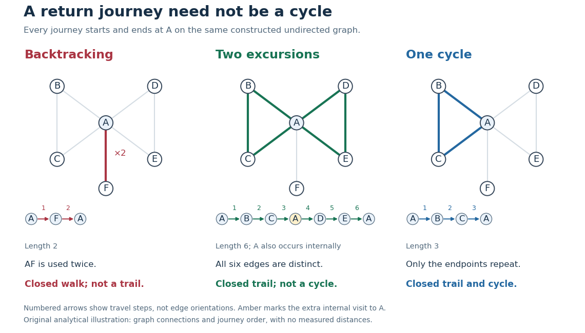

# Closed walk

↑ **Parent:** [Walk in a graph](walk-in-a-graph.md)

A [closed walk](closed-walk.md) is a [walk](walk-in-a-graph.md) with equal endpoint [vertices](vertex-graph-theory.md), $v_m=v_0$. Under our convention this includes the zero-length [walk](walk-in-a-graph.md) $(v)$; returning after traversing at least one [edge](edge-of-a-graph.md) requires $m>0$. Closure imposes no other restriction on repeated [vertices](vertex-graph-theory.md) or [edges](edge-of-a-graph.md). In a [directed graph](directed-graph.md), a [closed directed walk](closed-directed-walk.md) must also follow every [directed edge](directed-edge.md) in its permitted direction.[Lehman, Leighton and Meyer, Mathematics for Computer Science, §§9.2 and 11.8.1: closed walks](mathematics-for-computer-science-by-eric-lehman-and-others.md)

**[Figure 10](#image-returning-to-a-backtracking-closed-walk-closed-trail-with-a-repeated-internal-vertex-and-graph-cycle). Returning to $A$: backtracking closed walk, closed trail with a repeated internal vertex, and graph cycle**.

In the shared [simple graph](simple-graph.md), $A,F,A$ is a length-two [closed walk](closed-walk.md) that immediately backtracks along $AF$. It is not a [trail](trail-in-a-graph.md), since $AF$ is used twice, and it is not a [graph cycle](cycle-in-a-graph.md). The length-six [closed walk](closed-walk.md) $A,B,C,A,D,E,A$ is a [trail](trail-in-a-graph.md), since its six [edges](edge-of-a-graph.md) are distinct, but is not a [graph cycle](cycle-in-a-graph.md): it returns to $A$ midway through the journey. The length-three [closed walk](closed-walk.md) $A,B,C,A$ is a [graph cycle](cycle-in-a-graph.md), with all [vertices](vertex-graph-theory.md) distinct apart from the required endpoint repetition. In a [simple graph](simple-graph.md) that is an [undirected graph](undirected-graph.md), a [graph cycle](cycle-in-a-graph.md) has length at least three; the two-step backtrack is excluded.[Lehman, Leighton and Meyer, Mathematics for Computer Science, §11.8.1: cycles and backtracking](mathematics-for-computer-science-by-eric-lehman-and-others.md)

A positive-length [closed walk](closed-walk.md) therefore need not reveal a [graph cycle](cycle-in-a-graph.md): even a [tree](tree-graph-theory-split.md) permits an out-and-back journey on an [edge](edge-of-a-graph.md). A positive-length closed [trail](trail-in-a-graph.md) in a [simple graph](simple-graph.md) does contain a [graph cycle](cycle-in-a-graph.md). For a proof outline, choose a shortest positive-length consecutive portion of the [trail](trail-in-a-graph.md) whose endpoint [vertices](vertex-graph-theory.md) coincide. It cannot repeat an internal [vertex](vertex-graph-theory.md), since that would give a shorter such portion; it cannot have length one or two because [self-loops](loop-graph-theory.md) and repeated [edges](edge-of-a-graph.md) are excluded. It is consequently a [graph cycle](cycle-in-a-graph.md). Cutting it out leaves another closed [trail](trail-in-a-graph.md), possibly of length zero, so repetition partitions the original [edges](edge-of-a-graph.md) into [graph cycles](cycle-in-a-graph.md). In our six-step example these are the two [triangles in a graph](triangle-in-a-graph.md). A closed [trail](trail-in-a-graph.md) using every [edge](edge-of-a-graph.md) would be an [Euler circuit](euler-circuit.md); here $AF$ is omitted.

Counting return journeys makes [closed walks](closed-walk.md) useful even when they repeat [edges](edge-of-a-graph.md). For a finite [simple graph](simple-graph.md) with [adjacency matrix](adjacency-matrix.md) $M$, the [walk count from powers of an adjacency matrix](walk-count-from-powers-of-an-adjacency-matrix.md) gives $(M^k)_{uv}$ length-$k$ [walks](walk-in-a-graph.md) from $u$ to $v$, for every [nonnegative integer](natural-number.md) $k$. A proof outline is that [matrix multiplication](matrix-multiplication.md) appends one allowed step, summing over the previous endpoint; $M^0$ is the [identity matrix](identity-matrix.md), recording the unique zero-length [walk](walk-in-a-graph.md) at each [vertex](vertex-graph-theory.md). Consequently

$$
(M^k)_{vv}=\#\{\text{length-}k\text{ closed walks starting at }v\},\qquad \operatorname{tr}(M^k)=\sum_{v\in V}(M^k)_{vv}.
$$

The [trace](matrix-trace.md) counts [closed walks](closed-walk.md) with a specified starting [vertex](vertex-graph-theory.md) and traversal order, not distinct [graph cycles](cycle-in-a-graph.md). These formulas use adjacency entries, not arbitrary travel costs in a [weighted graph](weighted-graph.md).[Alexander Wolitzky, Graph Theory and Social Networks, slides 9–10: powers of adjacency matrices](https://ocw.mit.edu/courses/14-15-networks-spring-2022/mit14_15s22_lec2.pdf)

In our example, $(M^2)_{AA}=5$: the five length-two [closed walks](closed-walk.md) are $A,B,A$, $A,C,A$, $A,D,A$, $A,E,A$, and $A,F,A$. Also $(M^3)_{AA}=4$, going round either [triangle in a graph](triangle-in-a-graph.md) in either direction, and $\operatorname{tr}(M^3)=12$: each of the two [triangles in a graph](triangle-in-a-graph.md) supplies three choices of starting [vertex](vertex-graph-theory.md) and two directions. These exact counts for the constructed [graph](graph-split.md) illustrate why return counts and [graph cycle](cycle-in-a-graph.md) counts differ.

A [closed walk](closed-walk.md) naturally models a delivery or inspection journey that returns to its depot. Repeated [vertices](vertex-graph-theory.md) let it combine several excursions; repeated [edges](edge-of-a-graph.md) let it serve a dead end and return. For an [Euclidean travelling salesman tour](euclidean-travelling-salesman-tour.md), one can first construct a [closed walk](closed-walk.md) visiting all locations and then use the [triangle inequality](triangle-inequality.md) to shortcut repeated visits without increasing total length. That argument assumes direct travel between the retained locations is permitted, as in a [complete graph](complete-graph.md) weighted by [Euclidean distance](euclidean-distance.md); an arbitrary road network need not contain those shortcut [edges](edge-of-a-graph.md).

## ↑ Ancestors (6)

1. [Walk in a graph](walk-in-a-graph.md)
2. [Graph theory](graph-theory-split.md)
3. [Foundations of mathematics](foundations-of-mathematics-split.md)
4. [Area of mathematics](area-of-mathematics.md)
5. [Mathematics](mathematics-split.md)
6. [Codex Wiki](split.md)

## ← Incoming links (7)

- [Bipartite graph](bipartite-graph-split.md)
- [Closed walk](closed-walk.md)
- [Eulerian cycle](eulerian-cycle.md)
- [Facial boundary walk](facial-boundary-walk.md)
- [Solution](past-exam-of-the-mathematics-course-of-the-university-of-cambridge/2016/iii/paper-112/3/iii/solution.md)
- [Trail in a graph](trail-in-a-graph.md)
- [Walk in a graph](walk-in-a-graph.md)
