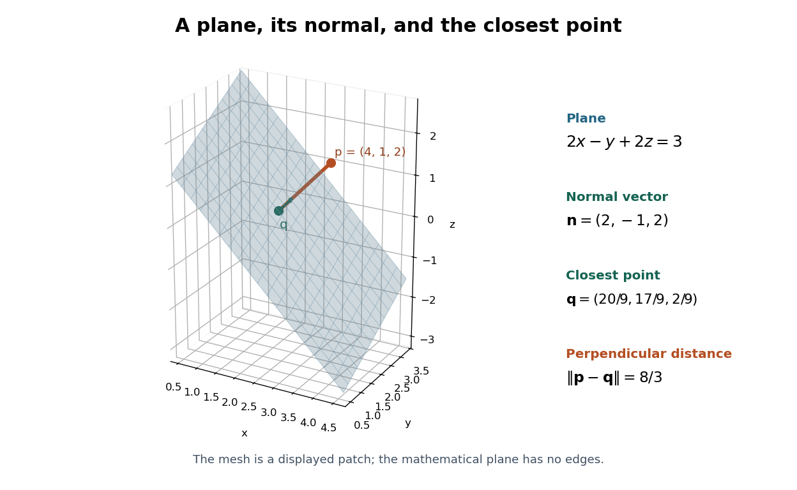

# Closest point on a plane

↑ **Parent:** [Distance from a point to a plane](distance-from-a-point-to-a-plane.md)

For a nonzero [normal vector](normal-vector.md) $\mathbf n$ and the [plane equation](cartesian-equation-of-a-plane.md) $\mathbf n\cdot\mathbf x=d$, the [closest point on a plane](closest-point-on-a-plane.md) to $\mathbf p$ is

$$
\boxed{\mathbf q=\mathbf p-\frac{\mathbf n\cdot\mathbf p-d}{\mathbf n\cdot\mathbf n}\mathbf n.}
$$

It subtracts only the normal displacement. Substituting gives $\mathbf n\cdot\mathbf q=d$, so $\mathbf q$ lies on the [plane](plane.md); the difference $\mathbf p-\mathbf q$ is a [scalar multiple](scalar-multiple.md) of its [normal vector](normal-vector.md). These two checks identify the [orthogonal projection onto a plane](closest-point-on-a-plane.md) without solving a three-variable minimization problem.

For $\mathbf n=(2,-1,2)$, $d=3$, and $\mathbf p=(4,1,2)$, the residual $8$ gives

$$
\boxed{\mathbf q=(4,1,2)-\frac89(2,-1,2)
=\left(\frac{20}9,\frac{17}9,\frac29\right).}
$$

Indeed, $(40-17+4)/9=3$, and $\|\mathbf p-\mathbf q\|=(8/9)\cdot3=8/3$. Choosing the [plane](plane.md) point $(1,1,1)$ instead gives distance $\sqrt{10}>8/3$: being on the [plane](plane.md) does not make a point the nearest one.

**[Figure 13](#image-the-closest-point-on-a-plane-is-reached-along-its-normal-vector). The closest point on a plane is reached along its normal vector**. Original three-dimensional example $2x-y+2z=3$, with $\mathbf p=(4,1,2)$ and $\mathbf q=(20/9,17/9,2/9)$. The finite mesh is only a displayed patch of the infinite [plane](plane.md); it is not a physical measurement.

As a [function](function-split.md) of $\mathbf p$, this projection is

$$
\mathbf p\longmapsto\left(I-\frac{\mathbf n\mathbf n^{\mathsf T}}{\mathbf n^{\mathsf T}\mathbf n}\right)\mathbf p
+\frac{d}{\mathbf n^{\mathsf T}\mathbf n}\mathbf n.
$$

It is an [affine map](affine-map.md), becoming a [linear map](linear-map.md) when $d=0$. Projecting a second time changes nothing. It preserves displacements along the [plane](plane.md) and removes the normal displacement, so it is a concrete example of an [idempotent map](idempotent-function.md).

**Table of contents**

- [Orthogonal projection onto an intercept plane](orthogonal-projection-onto-an-intercept-plane.md)

## ↑ Ancestors (5)

1. [Distance from a point to a plane](distance-from-a-point-to-a-plane.md)
2. [Geometry and topology](geometry-and-topology-split.md)
3. [Area of mathematics](area-of-mathematics.md)
4. [Mathematics](mathematics-split.md)
5. [Codex Wiki](split.md)

## ← Incoming links (6)

- [Closest point on a plane](closest-point-on-a-plane.md)
- [Distance from a point to a plane](distance-from-a-point-to-a-plane.md)
- [Orthogonal projection onto an intercept plane](orthogonal-projection-onto-an-intercept-plane.md)
- [Solution](past-exam-of-the-mathematics-course-of-the-year-1-of-the-natural-sciences-course-of-the-university-of-cambridge/2006/paper-1/5/c/solution.md)
- [Solution](past-exam-of-the-mathematics-course-of-the-year-1-of-the-natural-sciences-course-of-the-university-of-cambridge/2025/paper-1/11/b/iv/solution.md)
- [Signed distance from a point to a plane](signed-distance-from-a-point-to-a-plane.md)
