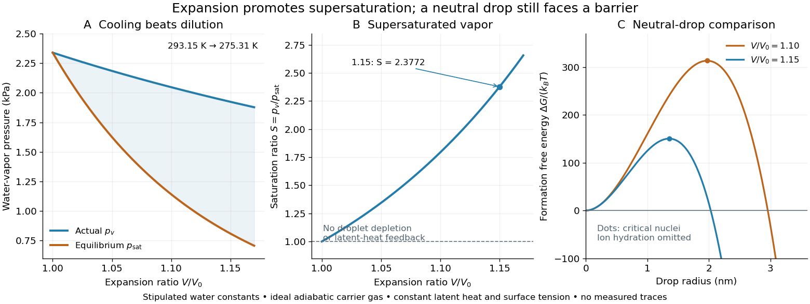

# Cloud-chamber expansion model

↑ **Parent:** [Expansion cloud chamber](expansion-cloud-chamber.md)

Consider an illustrative [water](water.md)–air [mixture](mixture-split.md), initially saturated at $T_0=293.15\,\mathrm K$. Let $\lambda=V/V_0$ be the expansion ratio and approximate the carrier [gas](gas.md) by a uniform [ideal gas](ideal-gas-split.md) with constant [heat capacity ratio](heat-capacity-ratio.md) $\gamma=1.40$. Before significant [condensation](condensation.md), assume fixed numbers of carrier and [vapor](vapor.md) [molecules](molecule-split.md), negligible incoming [heat](heat-split.md), and the reversible [adiabatic expansion](adiabatic-expansion.md) relation. The [first law of thermodynamics](first-law-of-thermodynamics-split.md), $nC_V\,dT=-p\,dV$, with the [ideal gas law](ideal-gas-law.md), gives

$$
T(\lambda)=T_0\lambda^{1-\gamma},\qquad p_v(\lambda)=p_0\lambda^{-\gamma}.
$$

The [vapor](vapor.md) follows the same [temperature](temperature-split.md), so its [partial pressure](partial-pressure.md) scales as $T/V$. A rapid real [piston](piston.md) motion need not be reversible; the formula is an idealized bulk estimate after neglecting flow and losses.

Use a physically motivated [Integrated Clausius-Clapeyron relation](integrated-clausius-clapeyron-relation.md) for the equilibrium [water](water.md) [vapor pressure](vapor-pressure.md), with stipulated rounded constants $p_0=2339\,\mathrm{Pa}$ at $T_0$, molar [latent heat](latent-heat.md) $L_m=45000\,\mathrm{J\,mol^{-1}}$ and [molar gas constant](molar-gas-constant.md) $R=8.314\,\mathrm{J\,mol^{-1}\,K^{-1}}$:

$$
p_{\rm sat}(T)=p_0\exp\left[\frac{L_m}{R}\left(\frac1{T_0}-\frac1T\right)\right],\qquad
\ln S=-\gamma\ln\lambda+\frac{L_m}{RT_0}\left(\lambda^{\gamma-1}-1\right).
$$

These constants define the example, without fitting any historical measurements. Throughout the plotted interval $1\leq\lambda\leq1.17$, the [temperature](temperature-split.md) stays above the freezing point of [water](water.md). Initially

$$
\left.\frac{d\ln S}{d\ln\lambda}\right|_{\lambda=1}
=-\gamma+(\gamma-1)\frac{L_m}{RT_0}\simeq5.99>0.
$$

Thus the decrease in [vapor pressure](vapor-pressure.md) initially beats dilution. At $\lambda=1.15$, the model gives $T=277.21\,\mathrm K$, $p_v=1923.33\,\mathrm{Pa}$, $p_{\rm sat}=809.07\,\mathrm{Pa}$ and $S=2.3772$.

**[Figure 12](#image-cooling-by-adiabatic-expansion-vapor-pressure-and-the-neutral-droplet-nucleation-barrier-in-a-stipulated-cloud-chamber-model). Cooling by adiabatic expansion, vapor pressure and the neutral-droplet nucleation barrier in a stipulated cloud chamber model**. Original calculations, not measured traces. The neutral-droplet model illustrates a barrier; it omits the charged clusters responsible for the detector's ion-assisted response.

Why does $S>1$ not instantly make every [molecule](molecule-split.md) a visible drop? In the capillarity approximation of [classical nucleation theory](classical-nucleation-theory.md), a neutral spherical drop of radius $r$ has a positive [surface energy](surface-energy.md) cost and a negative bulk [Gibbs free energy](gibbs-free-energy.md) contribution. For molecular [liquid](liquid.md) volume $v_l$, [surface tension](surface-tension-split.md) $\sigma$ and [Boltzmann constant](boltzmann-constant.md) $k_B$,

$$
\Delta G(r)=4\pi\sigma r^2-\frac{4\pi r^3}{3v_l}k_BT\ln S,\qquad
r_* =\frac{2\sigma v_l}{k_BT\ln S},\qquad
\Delta G_* =\frac{16\pi\sigma^3v_l^2}{3(k_BT\ln S)^2}.
$$

Differentiating $\Delta G$ shows that the [critical nucleus](critical-nucleus.md) at $r_*$ is a maximum: smaller neutral drops tend to shrink, whereas larger ones can grow. With stipulated $\sigma=0.075\,\mathrm{J\,m^{-2}}$, $v_l=2.99\times10^{-29}\,\mathrm{m^3}$ and $k_B=1.380649\times10^{-23}\,\mathrm{J\,K^{-1}}$, the $\lambda=1.15$ example gives $r_*=1.353\,\mathrm{nm}$ and $\Delta G_*/(k_BT)=150.3$. A substantial neutral-drop barrier can coexist with [supersaturated vapor](supersaturated-vapor.md).

This is deliberately a neutral-drop comparison. An [ion](ion.md) changes the cluster [free energy](thermodynamic-free-energy.md) through electrical interactions and molecular hydration; the formula does not calculate the ion-assisted [nucleation](nucleation.md) threshold. At nanometre radii, using bulk [surface tension](surface-tension-split.md) is itself approximate. There is no predicted droplet count, growth time or detection efficiency here. Once many drops grow, [latent heat](latent-heat.md) release, [vapor](vapor.md) depletion and [heat transfer](heat-transfer.md) from the chamber walls invalidate the dry [adiabatic expansion](adiabatic-expansion.md) trajectory. The example therefore explains the direction of the effect and the need for [nucleation](nucleation.md), without extrapolating its curves to Wilson's cloud limits.

## ↑ Ancestors (6)

1. [Expansion cloud chamber](expansion-cloud-chamber.md)
2. [Cloud chamber](cloud-chamber.md)
3. [Particle detector](particle-detector.md)
4. [Particle detection](particle-detection-split.md)
5. [Physics](physics-split.md)
6. [Codex Wiki](split.md)

## ← Incoming links (2)

- [Bubble-chamber nucleation model](bubble-chamber-nucleation-model.md)
- [Expansion cloud chamber](expansion-cloud-chamber.md)
