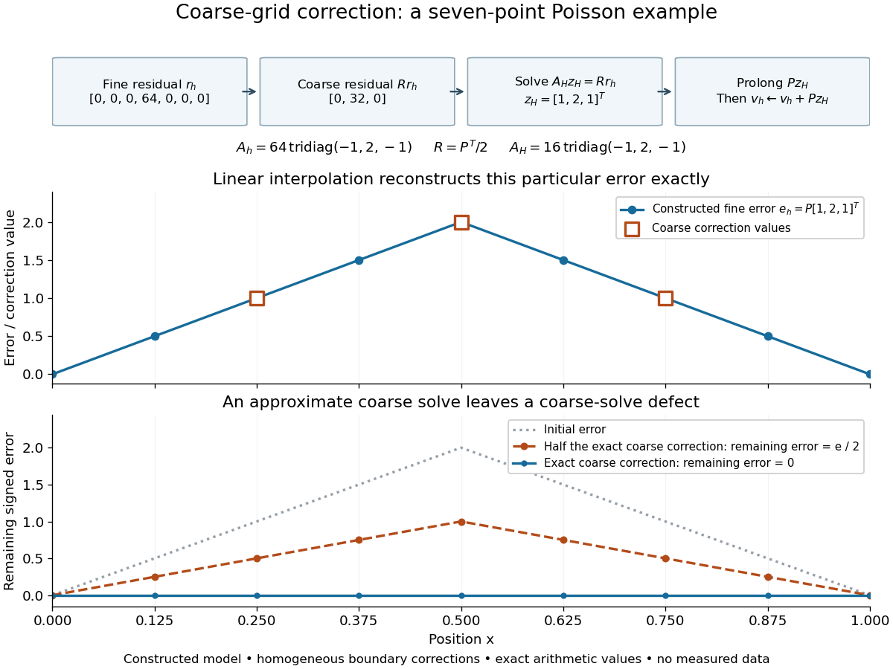

# Coarse-grid correction

↑ **Parent:** [Multigrid method](multigrid-method-split.md)

A [coarse-grid correction](coarse-grid-correction.md) improves a fine-grid approximation by solving a smaller equation for the part of its [approximation error](approximation-error.md) representable on a coarse [mesh](finite-element-mesh.md). Use the signed convention $e_h=u_h^*-v_h$ and the [linear-system residual](linear-system-residual.md) $r_h=b_h-A_hv_h=A_he_h$. A prolongation [linear map](linear-map.md) $P:\mathbb{R}^m\to\mathbb{R}^n$ interpolates coarse corrections into fine-grid corrections, and a restriction [linear map](linear-map.md) $R:\mathbb{R}^n\to\mathbb{R}^m$ transfers the [linear-system residual](linear-system-residual.md). Solve $A_Hz_H=Rr_h$ exactly or approximately and update $v_h\leftarrow v_h+Pz_H$. The plus sign follows from defining the [approximation error](approximation-error.md) as exact minus approximate. It is the correction equation's right-hand side $Rr_h$, rather than merely restricted solution values, that determines the update.

For the [multigrid method](multigrid-method-split.md) model $A_h=h^{-2}\operatorname{tridiag}(-1,2,-1)$, take $n=2m+1$, so $H=2h$ and the coarse nodes coincide with every second fine node. Use [linear interpolation](linear-interpolation.md) with zero boundary corrections $z_0=z_{m+1}=0$:

$$
(Pz)_{2i}=z_i\quad(1\leq i\leq m),\qquad (Pz)_{2i+1}=\frac{z_i+z_{i+1}}{2}\quad(0\leq i\leq m).
$$

Use [full-weighting restriction](full-weighting-restriction.md) for the interior [linear-system residual](linear-system-residual.md):

$$
(Rr)_i=\frac{r_{2i-1}+2r_{2i}+r_{2i+1}}4\quad(1\leq i\leq m),\qquad R=\frac12P^T.
$$

Here $P^T$ is the [matrix transpose](transpose.md) in ordinary unweighted coordinates. With these specific transfers, the [Galerkin coarse-grid operator](galerkin-coarse-grid-operator.md) is

$$
A_H=RA_hP=H^{-2}\operatorname{tridiag}(-1,2,-1).
$$

Thus it equals the rediscretized [Poisson equation](poisson-s-equation.md) operator on this constant-coefficient one-dimensional [mesh](finite-element-mesh.md). The equality is special to the stated model and transfers. In particular, dropping $h^{-2}$ from the fine [matrix](matrix.md) while using $H^{-2}$ on the coarse [mesh](finite-element-mesh.md) changes the correction unless the right-hand sides and transfers are rescaled consistently.

Take seven interior points, $h=1/8$, three coarse unknowns, and the deliberately constructed [approximation error](approximation-error.md)

$$
z=(1,2,1)^T,\qquad e_h=Pz=(1/2,1,3/2,2,3/2,1,1/2)^T.
$$

For example, choose $b_h=0$, so $u_h^*=0$ and $v_h=-e_h$. Direct [matrix](matrix.md) multiplication gives

$$
r_h=A_he_h=(0,0,0,64,0,0,0)^T,\qquad Rr_h=(0,32,0)^T,\qquad A_H=16\begin{pmatrix}2&-1&0\\-1&2&-1\\0&-1&2\end{pmatrix}.
$$

The exact coarse solve returns $z_H=z$, so adding $Pz_H$ removes the entire chosen [approximation error](approximation-error.md). A broad triangular error can have a sharply localized [linear-system residual](linear-system-residual.md): the latter measures discrete curvature, not error height. This is why the two should not be confused. A smooth [sine](sine.md) mode instead has [linear-system residual](linear-system-residual.md) $\lambda_k(A_h)e_h$, so interpreting its magnitude also requires the [eigenvalue](eigenvalue.md) and the equation's scaling.

**[Figure 2](#image-constructed-seven-point-poisson-example-residual-restriction-coarse-solve-interpolation-and-the-error-remaining-after-exact-or-partial-correction). Constructed seven-point Poisson example: residual restriction, coarse solve, interpolation, and the error remaining after exact or partial correction**.

The algebra explains the exact cancellation beyond this example. Assume $P$ has linearly independent columns and choose an invertible [Galerkin coarse-grid operator](galerkin-coarse-grid-operator.md) $A_H=RA_hP$. With an exact coarse solve, the [iteration matrix](iteration-matrix.md) for the remaining [approximation error](approximation-error.md) is

$$
e_h^{\mathrm{new}}=Ce_h,\qquad C=I-PA_H^{-1}RA_h,\qquad CP=0,\qquad C^2=C,\qquad RA_hC=0.
$$

The short proof is to substitute $RA_hP=A_H$. Thus every vector in the [column space](column-space.md) of $P$ is eliminated, and the corrected [linear-system residual](linear-system-residual.md) restricts to zero. These are exact [projection](projection-linear-algebra.md) identities, not a statement that every visually smooth vector belongs to that [column space](column-space.md). If $A_h$ is a [symmetric matrix](symmetric-matrix.md) and a [positive-definite matrix](positive-definite-matrix.md), and $R=cP^T$ with $c>0$, then $A_H$ is also a [positive-definite matrix](positive-definite-matrix.md). Moreover $P^TA_hCe_h=0$: $C$ is an [orthogonal projection](orthogonal-projection.md) onto the complement of the [column space](column-space.md) of $P$ in the [energy norm](energy-norm.md) $\|q\|_{A_h}=\sqrt{q^TA_hq}$. Equivalently, the added correction is the best approximation to $e_h$ from that [column space](column-space.md) in this [energy norm](energy-norm.md). Without these symmetry and transfer assumptions, the [projection](projection-linear-algebra.md) need not be orthogonal.[Introduction to Multigrid Methods by Long Chen](introduction-to-multigrid-methods-by-long-chen.md)

For an approximate coarse solve represented by a fixed [linear map](linear-map.md) $B_H$, replace $A_H^{-1}$ by $B_H$. Then

$$
C_B=I-PB_HRA_h,\qquad C_BP=P(I-B_HA_H).
$$

There is no exact cancellation of coarse-representable [approximation error](approximation-error.md) unless $B_HA_H=I$ on the relevant directions. For the triangular example, deliberately returning half the exact correction, $B_H=\tfrac12 A_H^{-1}$, leaves $e_h/2$, as the figure shows. This controlled mathematical comparison illustrates an incomplete coarse solve; it is not a measured performance result or a prescription for a [geometric multigrid V-cycle](geometric-multigrid-v-cycle.md). More generally, if $z_H^*=A_H^{-1}Rr_h$, then an approximate $z_H$ leaves $Ce_h+P(z_H^*-z_H)$, separating the nonrepresentable remainder from the coarse-solve defect.

With pre- and post-relaxation [iteration matrices](iteration-matrix.md) $S_{\mathrm{pre}}$ and $S_{\mathrm{post}}$, a two-grid error step has [iteration matrix](iteration-matrix.md) $E=S_{\mathrm{post}}C_BS_{\mathrm{pre}}$. A [geometric multigrid V-cycle](geometric-multigrid-v-cycle.md) supplies $B_H$ by one recursive coarse cycle from zero, with a direct solve only at the bottom. Effective smoothing, a coarse [column space](column-space.md) that approximates the surviving [approximation error](approximation-error.md), and a sufficiently accurate coarse correction must work together. Coarsening alone supplies no convergence guarantee, and correcting an arbitrary fine-grid vector exactly would require a coarse [column space](column-space.md) large enough to contain it.

**Table of contents**

- [Galerkin coarse-grid operator](galerkin-coarse-grid-operator.md)

## ↑ Ancestors (6)

1. [Multigrid method](multigrid-method-split.md)
2. [Numerical analysis](numerical-analysis-split.md)
3. [Analysis](analysis-split.md)
4. [Area of mathematics](area-of-mathematics.md)
5. [Mathematics](mathematics-split.md)
6. [Codex Wiki](split.md)

## ← Incoming links (5)

- [Coarse-grid correction](coarse-grid-correction.md)
- [Galerkin coarse-grid operator](galerkin-coarse-grid-operator.md)
- [Multigrid method](multigrid-method-split.md)
- [Solution](past-exam-of-the-mathematics-course-of-the-university-of-cambridge/2003/iii/paper-67/7/solution.md)
- [Solution](past-exam-of-the-mathematics-course-of-the-university-of-cambridge/2015/ii/paper-2/37e/b/solution.md)
