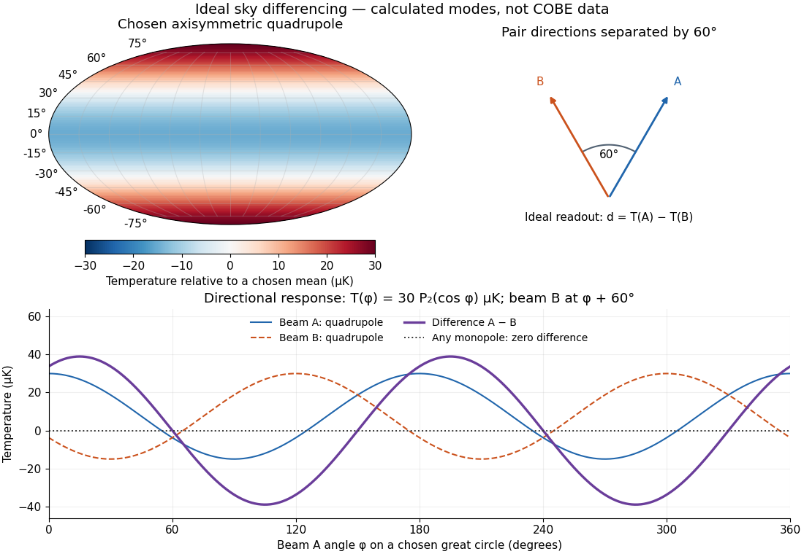

# COBE DMR sky anisotropy experiment

↑ **Parent:** [Differential Microwave Radiometer](differential-microwave-radiometer.md)

In 1992 the [COBE DMR](differential-microwave-radiometer.md) team, including [George F. Smoot](george-f-smoot.md) and [Charles L. Bennett](charles-l-bennett.md), used [radiometer](radiometer.md) [antennas](antenna-radio.md) to compare [antenna temperatures](antenna-temperature.md) between sky directions $60^\circ$ apart at $31.5$, $53$ and $90\,\mathrm{GHz}$, with two nearly independent channels per [frequency](frequency.md). Repeated sky coverage supported [least-squares solution](least-squares-solution-of-a-linear-inverse-problem.md) map reconstruction.[§§1–2, pp.L1–L2](structure-in-the-cobe-differential-microwave-radiometer-first-year-maps-by-george-f-smoot-and-others.md)

The analysis fitted magnetic response and removed the assumed kinematic [angular dipole](angular-dipole.md) and its second-order [Doppler effect](doppler-effect.md) contribution. Channel sums retained sky structure; channel differences estimated [noise](noise-signal-processing.md). Cross-channel correlations, different [frequency](frequency.md) maps and [Milky Way](milky-way.md) latitude cuts tested the interpretation. Residual large-angle structure supported [Cosmic microwave background anisotropy](cosmic-microwave-background-anisotropy-split.md); Galactic contamination particularly limited the [cosmic microwave background quadrupole](cosmic-microwave-background-quadrupole.md). Brightness fluctuations alone were not sufficient evidence of primordial structure.[§§2–3.1, p.L2: controls, motion subtraction, Table1](structure-in-the-cobe-differential-microwave-radiometer-first-year-maps-by-george-f-smoot-and-others.md)

**[Figure 1](#image-directional-differencing-rejects-a-monopole-and-responds-to-a-chosen-quadrupole). Directional differencing rejects a monopole and responds to a chosen quadrupole**. Ideal point beams and a stipulated low-order sky, not COBE observations. The ring scan deliberately has less coverage than a full sky survey.

The two differences serve different purposes. Comparing two sky directions measures angular variation. Comparing two independently calibrated receiver maps observing the same sky tests [noise](noise-signal-processing.md) and consistency. A common sky signal cancels in the latter comparison if their [antenna beam patterns](antenna-beam-pattern.md) and response scales match; a systematic error shared by both channels need not cancel. Separating observer motion, local emission and intrinsic [Cosmic microwave background anisotropy](cosmic-microwave-background-anisotropy-split.md) requires these additional tests.

**Table of contents**

- [Differential sky map monopole degeneracy](differential-sky-map-monopole-degeneracy.md)

## ↑ Ancestors (7)

1. [Differential Microwave Radiometer](differential-microwave-radiometer.md)
2. [Cosmic microwave background anisotropy](cosmic-microwave-background-anisotropy-split.md)
3. [Cosmic microwave background](cosmic-microwave-background-split.md)
4. [Cosmology](cosmology-split.md)
5. [Branches of physics](branches-of-physics.md)
6. [Physics](physics-split.md)
7. [Codex Wiki](split.md)
