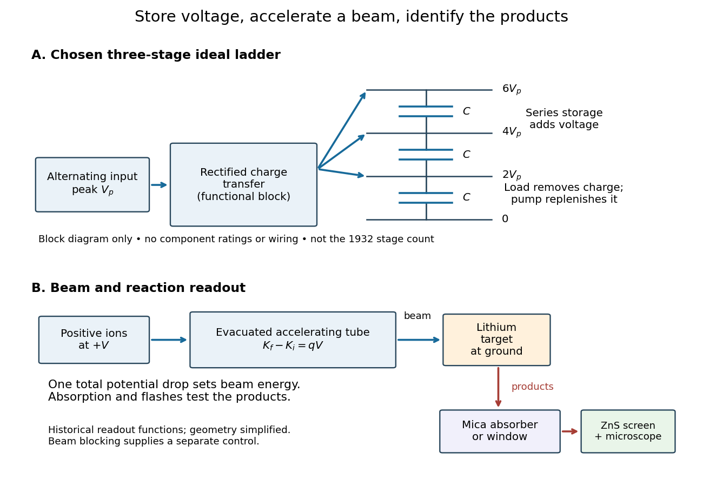

# Cockcroft-Walton generator

↑ **Parent:** [Electrostatic accelerator](electrostatic-accelerator.md)  
ⓦ [Wiki](https://en.wikipedia.org/wiki/Cockcroft–Walton_generator)

A [voltage multiplier](voltage-multiplier.md) made of [rectifiers](rectifier.md) and [capacitors](capacitor.md) that transfers [electric charge](electric-charge-split.md) from an alternating supply into a series stack of stored [electric potential differences](electric-potential-difference.md). The [rectifiers](rectifier.md) allow charge transfer during selected portions of the cycle; the [capacitors](capacitor.md) retain charge between transfers. The supply continually replaces charge removed by the load. Multiplication of voltage does not multiply [energy](energy-split.md): the input must supply the output [power](power.md) and losses.

In his 1951 lecture The Artificial Production of Fast Particles, [Ernest Thomas Sinton Walton](ernest-thomas-sinton-walton.md) describes the fourfold multiplier's series storage capacitors and alternating transfer capacitor in Fig. 2, p. 190. This is a mechanism for producing a nearly steady accelerating potential from an alternating input.[The Artificial Production of Fast Particles, lecture delivered 11 December 1951, p. 190, Fig. 2: storage and transfer capacitors; indexed primary text inspected](the-artificial-production-of-fast-particles-by-ernest-thomas-sinton-walton.md)

**[Figure 3](#image-voltage-accumulation-and-particle-acceleration-are-different-steps). Voltage accumulation and particle acceleration are different steps**. Original functional diagram. Three ideal storage stages illustrate a chosen multiplier model; charge transfer is shown as a functional block rather than a wiring diagram. The beam crosses one total potential drop. The lower chain summarizes the lithium experiment's target and scintillation readout, not the geometry or stage count of the 1932 apparatus.

**Table of contents**

- [Cockcroft-Walton multiplier model](cockcroft-walton-multiplier-model.md)

## ↑ Ancestors (5)

1. [Electrostatic accelerator](electrostatic-accelerator.md)
2. [Particle accelerator](particle-accelerator-split.md)
3. [Experimental apparatus](experimental-apparatus.md)
4. [Physics](physics-split.md)
5. [Codex Wiki](split.md)

## ← Incoming links (2)

- [Cockcroft-Walton multiplier model](cockcroft-walton-multiplier-model.md)
- [Electrostatic accelerator](electrostatic-accelerator.md)
