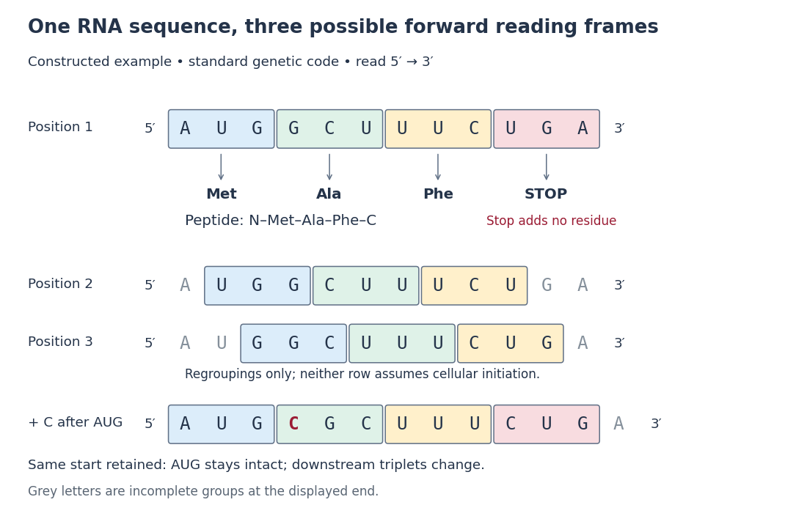

# Codon

↑ **Parent:** [Genetic code](genetic-code.md)

A [codon](codon.md) is a three-[nucleotide](nucleotide.md) unit read in a specified [reading frame](reading-frame.md) during [biological translation](translation-biology.md). For example, GCU specifies [alanine](alanine.md) in the standard [genetic code](genetic-code.md). Its letters are read $5'\to3'$.

For an original example, choose the [messenger RNA](messenger-rna.md) segment $5'\text{-}\mathrm{AUG\ GCU\ UUC\ UGA}\text{-}3'$ and stipulate initiation at the displayed AUG in a suitable [eukaryotic](eukaryote.md) context. Under the standard [genetic code](genetic-code.md), its first three [codons](codon.md) specify [methionine](methionine.md), [alanine](alanine.md) and [phenylalanine](phenylalanine.md); the fourth is a [stop codon](stop-codon.md). The resulting [peptide](peptide.md) before processing is N–[methionine](methionine.md)–[alanine](alanine.md)–[phenylalanine](phenylalanine.md)–C. Twelve [nucleotides](nucleotide.md) therefore specify three [amino acid residues](amino-acid-residue.md) and termination. The displayed segment omits the surrounding initiation signals; its [nucleotide sequence](nucleic-acid-sequence.md) alone is not a complete expression system.

A [codon](codon.md) belongs to an oriented [nucleotide sequence](nucleic-acid-sequence.md): GCU and UCG are different ordered triplets. Four possible [nucleobases](nucleotide-base.md), [adenine](adenine.md), [cytosine](cytosine.md), [guanine](guanine.md) and [uracil](uracil.md), allow $4\times4\times4=64$ triplets because each position can be chosen independently when enumerating possible sequences. This is a counting argument, not a claim that [nucleobases](nucleotide-base.md) occur independently in real [RNA](ribonucleic-acid.md). Sixty-one triplets are sense [codons](codon.md), meaning [amino acid](amino-acid.md) assignments, and UAA, UAG and UGA are [stop codons](stop-codon.md) in the standard [genetic code](genetic-code.md).[§15.1, The Genetic Code, Figure 15.4 and following paragraph: triplets and standard assignments](biology-2e-by-mary-ann-clark-and-others.md)

**[Figure 13](#image-codons-connect-an-oriented-rna-segment-to-an-amino-acid-order). Codons connect an oriented RNA segment to an amino acid order**. Original constructed [nucleotide sequence](nucleic-acid-sequence.md) under the standard [genetic code](genetic-code.md). Only the first row assumes initiation at AUG; the other two [reading frames](reading-frame.md) merely regroup the same letters. The bottom row inserts one C after AUG and retains that starting position. Grey trailing letters do not form complete [codons](codon.md) within the displayed segment.

The useful unit is the ordered triplet together with its [reading frame](reading-frame.md) and [genetic code](genetic-code.md), rather than three letters viewed in isolation. That combination lets [DNA sequencing](dna-sequencing.md) data support predictions about [protein](protein-split.md) sequences after identifying the relevant [messenger RNA](messenger-rna.md). The [Nirenberg and Matthaei experiment](nirenberg-and-matthaei-experiment.md) illustrates how the correspondence became experimentally accessible.

**Table of contents**

- [Start codon](start-codon.md)
- [Degenerate codon](degenerate-codon.md)
  - [NNS codon](nns-codon.md)
  - [NNK codon](nnk-codon.md)
- [Stop codon](stop-codon.md)
  - [Release factor](release-factor.md)

## ↑ Ancestors (7)

1. [Genetic code](genetic-code.md)
2. [Translation (biology)](translation-biology.md)
3. [Gene expression](gene-expression.md)
4. [Molecular genetics](molecular-genetics-split.md)
5. [Genetics](genetics-split.md)
6. [Biology](biology-split.md)
7. [Codex Wiki](split.md)

## ← Incoming links (28)

- [Alanine](alanine.md)
- [Aminoacyl-tRNA synthetase editing](aminoacyl-trna-synthetase-editing.md)
- [Anticodon](anticodon.md)
- [Codon](codon.md)
- [Degeneracy of the genetic code](degeneracy-of-the-genetic-code.md)
- [Degenerate codon](degenerate-codon.md)
- [Frameshift mutation](frameshift-mutation.md)
- [Gene expression](gene-expression.md)
- [Genetic code](genetic-code.md)
- [Glutamic acid residue](glutamic-acid-residue.md)
- [Mutation](mutation.md)
- [NNK codon](nnk-codon.md)
- [NNS codon](nns-codon.md)
- [Open reading frame](open-reading-frame.md)
- [Solution](past-exam-of-the-biochemistry-and-molecular-biology-course-of-the-university-of-cambridge/2024/paper-1/section-b/4/solution.md)
- [Solution](past-exam-of-the-biochemistry-course-of-the-university-of-cambridge/2024/paper-1/section-ii/7/solution.md)
- [Solution](past-exam-of-the-biochemistry-course-of-the-university-of-cambridge/2024/paper-2/section-i/1/solution.md)
- [Solution](past-exam-of-the-biochemistry-course-of-the-university-of-cambridge/2024/paper-2/section-ii/7/solution.md)
- [Solution](past-exam-of-the-biochemistry-course-of-the-university-of-cambridge/2025/paper-2/section-ii/5/solution.md)
- [Solution](past-exam-of-the-biochemistry-course-of-the-university-of-cambridge/2025/paper-2/section-ii/6/solution.md)
- [Protein](protein-split.md)
- [Reading frame](reading-frame.md)
- [Ribosome](ribosome.md)
- [Serine](serine.md)
- [Start codon](start-codon.md)
- [Translation (biology)](translation-biology.md)
- [Trinucleotide phosphoramidite](trinucleotide-phosphoramidite.md)
- [UPF protein](upf-protein.md)
