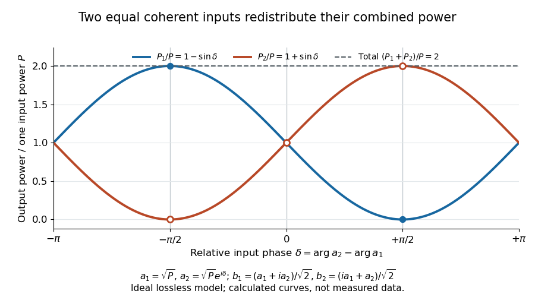

# Coherent beam splitter recombination

↑ **Parent:** [Beam splitter](beam-splitter.md)

Suppose the two input beams share [frequency](frequency.md), [electromagnetic polarization](polarization-of-an-electromagnetic-wave.md) and overlapping transverse profiles at each output, with stable relative [wave phase](phase-waves.md) during the [photodetector](photodetector.md)'s averaging interval. For the ideal [beam splitter scattering matrix](beam-splitter-scattering-matrix.md) above, expanding the squared [complex amplitudes](complex-amplitude.md) gives

$$
P_1=\frac{|a_1|^2+|a_2|^2}{2}-\operatorname{Im}(a_1^*a_2),
\qquad P_2=\frac{|a_1|^2+|a_2|^2}{2}+\operatorname{Im}(a_1^*a_2).
$$

The [imaginary part](imaginary-part.md) terms describe [wave interference](interference-wave-propagation.md). Applying the single-input power split to each input separately and adding the results would discard these terms. Their opposite signs ensure $P_1+P_2=|a_1|^2+|a_2|^2$: [conservation of energy](conservation-of-energy.md) survives even when one output is dark.

For an original example, let $a_1=\sqrt P$, $a_2=\sqrt P e^{i\delta}$ and $P=1\,\mathrm{mW}$. Then $P_1=P(1-\sin\delta)$ and $P_2=P(1+\sin\delta)$:

| Relative input [wave phase](phase-waves.md) $\delta$ | Output [power](power.md) $P_1$ | Output [power](power.md) $P_2$ |
| --- | --- | --- |
| $0$ | $1\,\mathrm{mW}$ | $1\,\mathrm{mW}$ |
| $+\pi/2$ | $0$ | $2\,\mathrm{mW}$ |
| $-\pi/2$ | $2\,\mathrm{mW}$ | $0$ |

At $+\pi/2$, $a_2=i\sqrt P$ makes $b_1=(\sqrt P-\sqrt P)/\sqrt2=0$ and $b_2=i\sqrt{2P}$; at $-\pi/2$ the dark output swaps. Thus the two inputs can feed all their combined [power](power.md) into one output without gain. At zero relative input [wave phase](phase-waves.md), the splitter's own relative [wave phase](phase-waves.md) leaves the contributions in quadrature, so neither output is dark.

**[Figure 5](#image-relative-input-wave-phase-redirects-the-combined-power-of-two-coherent-beams). Relative input wave phase redirects the combined power of two coherent beams**. Original ideal-model curves for $a_1=\sqrt P$, $a_2=\sqrt P e^{i\delta}$ and $S=2^{-1/2}\begin{pmatrix}1&i\\i&1\end{pmatrix}$. Output [powers](power.md) are normalized by one input's [power](power.md) $P$; their sum is always $2P$. Markers show the three worked cases. These are calculated curves, not measured data.

For fluctuating fields, average the cross term as $\operatorname{Im}\langle a_1^*a_2\rangle$. It vanishes for mutually uncorrelated inputs, making the independent power-splitting rule valid for the averaged output. Partial [first-order optical coherence](first-order-optical-coherence.md) reduces it. Orthogonal [linear polarizations](linear-polarization.md) eliminate the cross term in a polarization-insensitive power readout, and spatial mismatch reduces the overlap. Detector averaging can also erase rapid relative [wave phase](phase-waves.md) changes. A fixed relation between two inputs can be prepared by splitting one [laser](laser-split.md) beam and recombining the two arms.

An actual teaching protocol in Michelson Interferometer & Precision Wavelength Measurement — Week 1, University of Colorado Boulder, §§4–6, starts with an ideal-model prediction, then builds a [Michelson interferometer](michelson-interferometer.md) using a [helium-neon laser](helium-neon-laser.md), a [nonpolarizing beam splitter](nonpolarizing-beam-splitter.md), adjustable mirrors, a micrometer translation stage and a [photodetector](photodetector.md). Steering mirrors align beam overlap at near and far planes; far-plane [interference fringes](interference-fringe.md) refine alignment. Moving the arm mirror changes the returning relative [wave phase](phase-waves.md); detector voltage is watched with a live acquisition display or [oscilloscope](oscilloscope.md). The guide compares measured arm [powers](power.md) with 50:50 splitting and asks for a revised field model. It tests [electromagnetic polarization](polarization-of-an-electromagnetic-wave.md) dependence, optionally changing one arm with a [quarter-wave plate](quarter-wave-plate.md), and estimates noise from repeated readings at fixed mirror position. These controls test whether fringe changes reflect coherent recombination rather than splitter imbalance or misalignment. The guide supplies a protocol, not a numerical dataset. Its detector noise, imperfect overlap and [electromagnetic polarization](polarization-of-an-electromagnetic-wave.md) mismatch limit displacement inference.[Michelson Interferometer & Precision Wavelength Measurement — Week 1, §§4.1, 5.1–5.3, 6.1–6.4; figure 1 and live voltage monitor](michelson-interferometer-and-precision-wavelength-measurement-week-1-university-of-colorado-boulder-laboratory-guide.md)

Additional [background subtraction](background-subtraction.md) controls follow from the field model: block both arms to record the detector offset and ambient [light](light.md), then unblock each arm separately to establish its detected [power](power.md) at fixed gain. With both open, scan the mirror and compare extrema after subtracting that background. Keep the detector below saturation and repeat the scan to check drift. A changing signal alone cannot distinguish source [optical coherence](optical-coherence.md) from motion or changing overlap. For a [vacuum](vacuum.md) round trip, a mirror displacement $x$ changes relative [wave phase](phase-waves.md) by $4\pi x/\lambda$; the useful signal is its modulation after detection, not an optical-frequency oscillation that the detector must resolve.

## ↑ Ancestors (6)

1. [Beam splitter](beam-splitter.md)
2. [Optical instrument](optical-instrument-split.md)
3. [Optics](optics-split.md)
4. [Branches of physics](branches-of-physics.md)
5. [Physics](physics-split.md)
6. [Codex Wiki](split.md)
