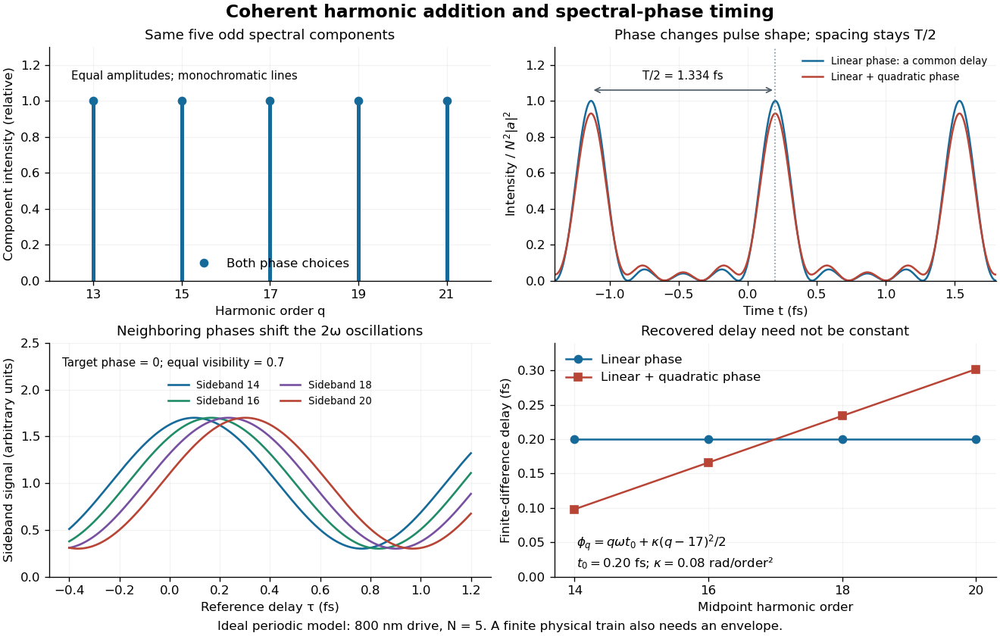

# Coherent harmonic pulse-train model

↑ **Parent:** [Attosecond pulse train](attosecond-pulse-train.md)

Choose $N$ equal-amplitude, monochromatic odd components with orders $q_j=q_0+2j$, $j=0,\ldots,N-1$, and odd $q_0$. Fix the complex-field convention

$$
\mathcal E(t)=a\sum_{j=0}^{N-1}e^{i\phi_j-iq_j\omega t},\qquad I(t)\propto|\mathcal E(t)|^2.
$$

Here $I$ is a normalized [light intensity](light-intensity.md) after averaging the fast carrier oscillations. Setting every $\phi_j=0$ and summing a [geometric series](geometric-series.md) gives

$$
\frac{I(t)}{N^2|a|^2}=\left[\frac{\sin(N\omega t)}{N\sin(\omega t)}\right]^2.
$$

At the removable singularities take the continuous limit. Maxima repeat every $T/2=\pi/\omega$; the first zeros on either side of a maximum lie at $t=\pm T/(2N)$. The zero-to-zero width is $T/N$, which is not the [full width at half maximum](full-width-at-half-maximum.md).

Choose orders $13,15,17,19,21$ and driving [wavelength](wavelength.md) $\lambda=800\,\mathrm{nm}$. Using $T=\lambda/c$ with the [speed of light](speed-of-light.md) $c$ gives $T=2.66851\,\mathrm{fs}$ and burst spacing $1.33426\,\mathrm{fs}$. Solving the exact half-maximum equation gives a [full width at half maximum](full-width-at-half-maximum.md) of approximately $240.6$ attoseconds. These are values of the specified five-component model, not measurements from the 2001 experiment.

A deliberately chosen [spectral phase](spectral-phase.md) $\phi_q=q\omega t_0$ translates the whole [attosecond pulse train](attosecond-pulse-train.md) by $t_0$ without changing its shape. Adding $\kappa(q-17)^2/2$ makes neighboring phase increments unequal: the same component intensities then produce a different temporal profile. For the choice $t_0=0.20\,\mathrm{fs}$ and $\kappa=0.08$ radians per squared harmonic order, the adjacent-component delay estimates are

$$
\frac{\phi_{q+2}-\phi_q}{2\omega}
=t_0+\frac{\kappa(q+1-17)}{\omega},
$$

namely $0.0981$, $0.1660$, $0.2340$ and $0.3019\,\mathrm{fs}$ for $q=13,15,17,19$. This [finite difference](finite-difference-split.md) estimates the [group delay](group-delay.md) at the pair's midpoint. It is not a single common arrival time.

**[Figure 10](#image-identical-harmonic-intensities-can-encode-different-pulse-shapes-and-delays). Identical harmonic intensities can encode different pulse shapes and delays**. Original idealized calculation for five monochromatic odd components. The top panels compare equal component intensities and the resulting normalized [light intensities](light-intensity.md). The lower panels compare a chosen delay-dependent two-path signal and the [group delays](group-delay.md) recovered from neighboring [spectral phases](spectral-phase.md). All values are stipulated model inputs or calculated outputs; none are experimental traces.

The infinite monochromatic sum is periodic forever and has infinite total [energy](energy-split.md). A real [attosecond pulse train](attosecond-pulse-train.md) has a finite envelope and finite component linewidths. This calculation isolates coherent addition; it cannot describe an isolated burst or establish its contrast against satellites. As a further check, averaging $I(t)$ over one half-period gives $N|a|^2$ for any constant component [spectral phases](spectral-phase.md), because the cross terms integrate to zero by [Fourier orthogonality](fourier-orthogonality.md). [Spectral phase](spectral-phase.md) redistributes the [light intensity](light-intensity.md) in time while leaving that average fixed.

## ↑ Ancestors (7)

1. [Attosecond pulse train](attosecond-pulse-train.md)
2. [Attosecond physics](attosecond-physics.md)
3. [Laser](laser-split.md)
4. [Optics](optics-split.md)
5. [Branches of physics](branches-of-physics.md)
6. [Physics](physics-split.md)
7. [Codex Wiki](split.md)

## ← Incoming links (1)

- [Two-path attosecond phase reconstruction](two-path-attosecond-phase-reconstruction.md)
