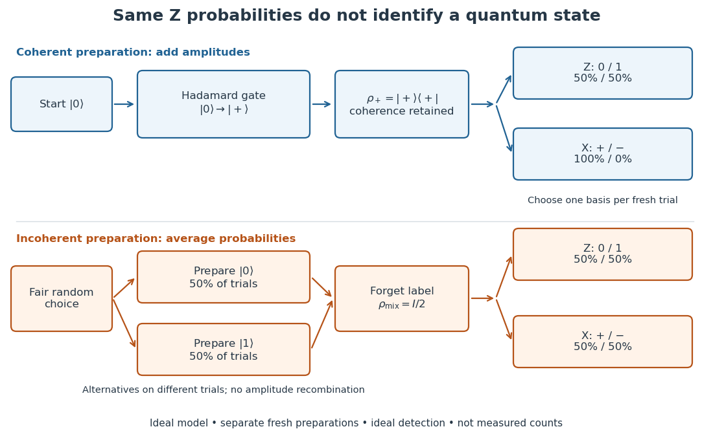
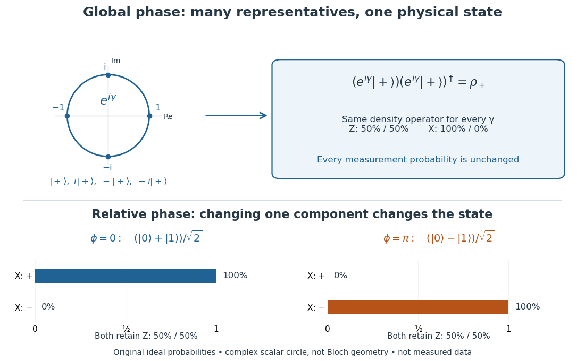

# Coherent preparation and incoherent mixing

↑ **Parent:** [Quantum state](quantum-state.md)

Choose the [qubit](qubit.md) [computational basis](computational-basis.md) $|0\rangle,|1\rangle$, also called the $Z$ basis, and the [Hadamard basis](hadamard-basis.md) $|\pm\rangle=(|0\rangle\pm|1\rangle)/\sqrt2$, also called the $X$ basis. Compare a coherent preparation of $|+\rangle$ with choosing $|0\rangle$ or $|1\rangle$ at random with equal [probabilities](probability.md) and discarding that label:

$$
\rho_+=\frac12\begin{pmatrix}1&1\\1&1\end{pmatrix},\qquad
\rho_{\mathrm{mix}}=\frac12|0\rangle\langle0|+\frac12|1\rangle\langle1|=\frac12\begin{pmatrix}1&0\\0&1\end{pmatrix}.
$$

These are original ideal preparation models. Their $Z$-basis [probabilities](probability.md) are both $(1/2,1/2)$, because their [quantum state populations](quantum-state-population.md) agree. Their $X$-basis [probabilities](probability.md) are respectively $(1,0)$ and $(1/2,1/2)$. Indeed $\langle+|\rho_+|+\rangle=1$, whereas $\langle+|I/2|+\rangle=1/2$. The missing off-diagonal [quantum coherence](quantum-coherence-in-a-specified-basis.md) therefore changes a prediction that the common populations cannot determine.

**[Figure 1](#image-coherent-preparation-and-random-mixing-agree-in-the-z-basis-but-differ-in-the-x-basis). Coherent preparation and random mixing agree in the Z basis but differ in the X basis**. Original ideal [qubit](qubit.md) preparation and detection branches. The random-choice branches are mutually exclusive trials; forgetting the label averages [probabilities](probability.md) without recombining [probability amplitudes](probability-amplitude.md). Each measurement branch uses a fresh preparation. The displayed [Born rule](born-rule.md) probabilities assume ideal detection and are not measured counts or the apparatus of the experiment below.

For a relative [quantum phase](quantum-phase.md) $\phi$, the coherent family instead has

$$
|\psi_\phi\rangle=\frac{|0\rangle+e^{i\phi}|1\rangle}{\sqrt2},\qquad
\rho_\phi=\frac12\begin{pmatrix}1&e^{-i\phi}\\e^{i\phi}&1\end{pmatrix},\qquad
P_X(\pm)=\frac{1\pm\cos\phi}{2}.
$$

The last formula follows by adding or subtracting the two [probability amplitudes](probability-amplitude.md) before taking the squared [modulus](modulus.md). At $\phi=\pi$, the state is $|-\rangle$ and the $X$ outcomes switch to $(0,1)$, while the $Z$ outcomes remain $(1/2,1/2)$. In contrast, $-|+\rangle$ changes both components by the same [global phase](global-phase.md) and retains the $X$ outcomes $(1,0)$. In [photon polarization](photon-polarization.md), the identification $|0\rangle=|H\rangle$, $|1\rangle=|V\rangle$ makes $|+\rangle$ and $|-\rangle$ the two orthogonal diagonal [linear polarizations](linear-polarization.md); these labels describe measurement bases, not spatial axes for photon [spin](spin.md).

**[Figure 2](#image-a-circle-of-global-phase-representatives-gives-one-state-while-a-relative-sign-changes-x-outcomes). A circle of global-phase representatives gives one state, while a relative sign changes X outcomes**. Original ideal model. The top circle is the [complex number](complex-number.md) $e^{i\gamma}$ multiplying the entire vector; it is not a [Bloch sphere](bloch-sphere.md) or a path through distinct physical states. All its representatives map to the same [density operator](density-matrix-split.md). Below, changing the relative [quantum phase](quantum-phase.md) from zero to $\pi$ gives different [density operators](density-matrix-split.md) and complementary $X$-basis [probabilities](probability.md). No experimental observations are plotted.

Even perfect statistics in one [basis](basis.md) cannot certify a preparation. The above $Z$ data fit both [density matrices](density-matrix-split.md). Conversely, distinct preparation histories can yield the same [quantum state](quantum-state.md):

$$
\frac12|0\rangle\langle0|+\frac12|1\rangle\langle1|
=\frac12|+\rangle\langle+|+\frac12|-\rangle\langle-|=\frac I2.
$$

The off-diagonal terms cancel in the right-hand ensemble. Every measurement on the [qubit](qubit.md) alone then has identical [probabilities](probability.md) for those two histories. A retained classical label would allow conditioning on different members of the [quantum state ensemble](quantum-state-ensemble.md); it is extra information beyond the unlabelled [density operator](density-matrix-split.md).

## ↑ Ancestors (6)

1. [Quantum state](quantum-state.md)
2. [Quantum system](quantum-system-split.md)
3. [Quantum mechanics](quantum-mechanics-split.md)
4. [Branches of physics](branches-of-physics.md)
5. [Physics](physics-split.md)
6. [Codex Wiki](split.md)
