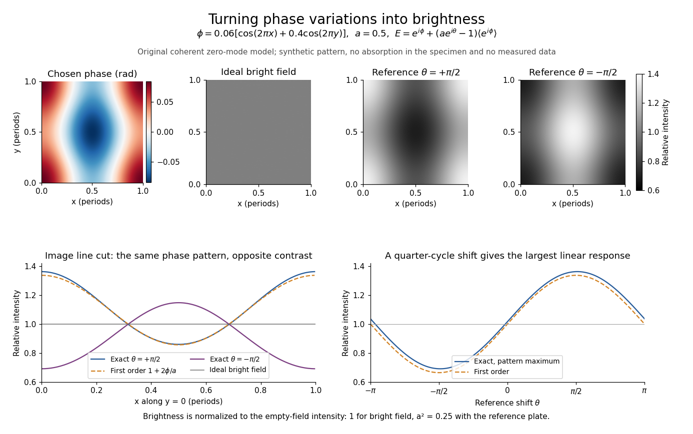

# Coherent zero-mode model of phase contrast

↑ **Parent:** [Phase-contrast microscopy](phase-contrast-microscopy.md)

The following original model isolates the conversion mechanism. Use a periodic image window, unit illumination, ideal unit [magnification](magnification.md), and a [phase plate](phase-plate.md) that changes only the zero [spatial frequency](spatial-frequency.md). Write $c_0=\langle e^{i\phi}\rangle$ for the spatial [mean](expected-value-split.md). Multiplying that single [Fourier coefficient](fourier-coefficient.md) by $a e^{i\theta}$, with $0<a\leq1$, gives the exact image field in this model:

$$
E_{\rm out}=e^{i\phi}+(a e^{i\theta}-1)c_0,
\qquad I_{\rm out}=|E_{\rm out}|^2.
$$

This formula follows by splitting $e^{i\phi}=c_0+(e^{i\phi}-c_0)$: the second term has zero [mean](expected-value-split.md) and is left unchanged. A real annular, partly coherent instrument alters a finite band of directions, so this calculation is a mechanism model rather than its full image-formation law.

For a [weak phase object](weak-phase-object.md) with $\langle\phi\rangle=0$, one has $c_0=1+O(\phi^2)$ and hence

$$
E_{\rm out}=a e^{i\theta}+i\phi+O(\phi^2),\qquad
\boxed{I_{\rm out}=a^2+2a\phi\sin\theta+O(\phi^2).}
$$

The cross term is $2\operatorname{Re}(a e^{-i\theta}i\phi)=2a\phi\sin\theta$. Thus $\theta=\pi/2$ makes positive $\phi$ brighter and $\theta=-\pi/2$ makes it darker under this stated [phase convention for complex amplitudes](phase-convention-for-complex-amplitudes.md). The sign comes from this convention and chosen plate; a manufacturer’s positive/negative contrast labels should not be inferred from the sign of $\theta$ alone.

For example, choose $a=0.5$ and a zero-mean periodic pattern whose peak [phase](phase-waves.md) is $0.084$. The first-order peak intensities are $0.25\pm0.084$, compared with the uniform ideal [bright-field microscopy](bright-field-microscopy.md) value $1$. The relative change about the reduced background is approximately $2\phi/a$ for a quarter-cycle shift. Attenuating the reference increases relative contrast while reducing the background photon count; it is not light amplification or a universal improvement of [signal-to-noise ratio](signal-to-noise-ratio.md).

**[Figure 10](#image-making-a-transparent-periodic-phase-pattern-visible). Making a transparent periodic phase pattern visible**. Original calculation for $\phi(x,y)=0.06[\cos(2\pi x)+0.4\cos(2\pi y)]$ on a unit periodic window and $a=0.5$. The specimen pattern is synthetic, not a cell photograph. The top row compares ideal [bright-field microscopy](bright-field-microscopy.md) and the exact [coherent zero-mode model of phase contrast](coherent-zero-mode-model-of-phase-contrast.md); brightness is shown relative to the empty-field value for each mode. Lower plots compare exact and first-order results along $y=0$ and as the reference [phase](phase-waves.md) changes at the pattern maximum. These are calculations, not historical observations.

Two checks expose what the model can and cannot measure. A spatially constant [phase](phase-waves.md) gives $E_{\rm out}=a e^{i\theta}e^{i\phi}$ and $I_{\rm out}=a^2$, so no absolute [phase](phase-waves.md) is recovered. Orthogonality of the constant and zero-mean parts also gives

$$
\langle I_{\rm out}\rangle=1-(1-a^2)|c_0|^2.
$$

For $a\leq1$ this cannot exceed the incident mean [light intensity](light-intensity.md). The image redistributes brightness and loses some reference light rather than creating energy.

## ↑ Ancestors (7)

1. [Phase-contrast microscopy](phase-contrast-microscopy.md)
2. [Optical microscope](optical-microscope.md)
3. [Optical instrument](optical-instrument-split.md)
4. [Optics](optics-split.md)
5. [Branches of physics](branches-of-physics.md)
6. [Physics](physics-split.md)
7. [Codex Wiki](split.md)

## ← Incoming links (3)

- [Bright-field microscopy](bright-field-microscopy.md)
- [Coherent zero-mode model of phase contrast](coherent-zero-mode-model-of-phase-contrast.md)
- [Phase-contrast image artifacts](phase-contrast-image-artifacts.md)
