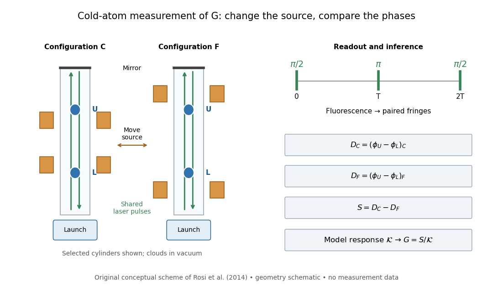

# Cold-atom measurement of the gravitational constant

↑ **Parent:** [Gravitational constant](gravitational-constant.md)

In 2014, [Gabriele Rosi](gabriele-rosi.md) and colleagues used [atom interferometry](atom-interferometry.md): two [rubidium](rubidium.md)-87 clouds prepared by [laser cooling](laser-cooling.md) in [vacuum](vacuum.md), $328\,\mathrm{mm}$ apart, received shared three-pulse [Raman transitions](raman-transition.md) spaced by $160\,\mathrm{ms}$. [Fluorescence](fluorescence-split.md) readout and paired-fringe [ellipse](ellipse.md) fitting yielded differential [wave phase](phase-waves.md). Twenty-four [tungsten](tungsten.md) alloy cylinders, about $516\,\mathrm{kg}$ total, moved between C and F. Cloud subtraction rejected shared vibration; configuration subtraction isolated the source change.[Main text pp. 3–5; Methods pp. 13–14; Fig. 1 caption p. 21](precision-measurement-of-the-newtonian-gravitational-constant-using-cold-atoms-by-gabriele-rosi-and-others.md)

**[Figure 6](#image-cold-atom-measurement-two-clouds-and-two-source-configurations). Cold-atom measurement: two clouds and two source configurations**. Original conceptual scheme; selected cylinders represent surrounding arrays. Geometry is schematic.[Main text pp. 3–5 and Fig. 1 caption p. 21](precision-measurement-of-the-newtonian-gravitational-constant-using-cold-atoms-by-gabriele-rosi-and-others.md)

Calibration used timed flight and light-sheet crossings; mirror tilt compensated [Earth](earth.md) rotation. [Wave vector](wavevector.md) reversal rejected unwanted shifts. Modeling included source [Newtonian gravitational potential](newtonian-gravitational-potential.md), atom [trajectories](trajectory.md), cloud distributions and moving supports. Source positioning, [mass density](density.md) variation and cloud geometry limited the reported combined relative [standard uncertainty](standard-uncertainty.md) to $150$ parts per million.[Main text pp. 5–6; Methods pp. 14–18; Table 1, p. 27](precision-measurement-of-the-newtonian-gravitational-constant-using-cold-atoms-by-gabriele-rosi-and-others.md)

To understand the subtraction without reproducing that full analysis, consider an ideal [atom interferometer](atom-interferometer.md) in uniform vertical [acceleration](acceleration.md) during each pulse sequence. Let $k_{\mathrm{eff}}$ be its signed effective vertical [wave vector](wavevector.md) component and $T$ the pulse spacing. Its acceleration-dependent [wave phase](phase-waves.md) is $\phi\simeq k_{\mathrm{eff}}gT^2$; labels U and L denote upper and lower clouds. The double difference is then

$$
S=(\phi_U-\phi_L)_C-(\phi_U-\phi_L)_F\simeq k_{\mathrm{eff}}T^2[(g_U-g_L)_C-(g_U-g_L)_F].
$$

A background field identical in C and F cancels even if it differs between the two clouds. In a fixed-geometry, linear-response model, write $S=G\mathcal K$, where $\mathcal K$ is calculated from the source [mass density](density.md), calibrated pulse sequence and atom [trajectories](trajectory.md). Thus $G_{\mathrm{inferred}}=S/\mathcal K$. Measuring [wave phase](phase-waves.md) accurately is one part of the task; calculating $\mathcal K$ accurately is another. The real nonuniform field and finite clouds require the trajectory-dependent analysis described above rather than this uniform-field approximation.

## ↑ Ancestors (7)

1. [Gravitational constant](gravitational-constant.md)
2. [Newtonian gravitational field](newtonian-gravitational-field.md)
3. [Newton's law of universal gravitation](newton-s-law-of-universal-gravitation-split.md)
4. [Classical mechanics](classical-mechanics-split.md)
5. [Branches of physics](branches-of-physics.md)
6. [Physics](physics-split.md)
7. [Codex Wiki](split.md)
