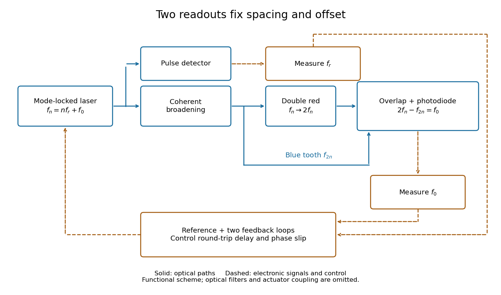

# Comb self-referencing

↑ **Parent:** [Optical frequency comb](optical-frequency-comb.md)

[Comb self-referencing](comb-self-referencing.md) compares two parts of one [optical frequency comb](optical-frequency-comb.md). Coherent broadening supplies an octave, a factor of two in [frequency](frequency.md). [Second-harmonic generation](second-harmonic-generation.md) doubles a red tooth; a [photodiode](photodiode.md) detects its [beat](beat.md) with an original blue tooth.[Introduction to Self-reference Comb Laser, Fig.1 explanation](introduction-to-self-reference-comb-laser-by-comblaser-laboratory-department-of-physics-national-central-university.md) Applying the tooth formula gives

$$
2f_n-f_{2n}=2(n f_r+f_0)-(2n f_r+f_0)=f_0.
$$

The doubled branch carries $2f_0$, while the original high-frequency branch carries $f_0$: their difference retains exactly one offset.

**[Figure 6](#image-read-the-tooth-spacing-and-offset-through-separate-electronic-signals). Read the tooth spacing and offset through separate electronic signals**. Original functional [comb self-referencing](comb-self-referencing.md) scheme. Solid optical paths bring doubled red light and original blue light to one detector. Dashed electronic paths connect both readouts to a common reference and feedback controls. Actuators can affect both parameters.

The displayed difference uses the order doubled tooth minus original tooth. An ordinary electronic [frequency counter](frequency-counter.md) returns a nonnegative [beat](beat.md) magnitude; spectral selection and known electronic shifts must identify whether it represents $f_0$, $f_r-f_0$, or a shifted version. Coherent broadening, overlapping [photon polarization](photon-polarization.md), spatial alignment and temporal overlap are required. Merely producing a broad patch of colored [light](light.md) does not establish a usable offset signal.

**Table of contents**

- [Octave-spanning comb phase-control experiment](octave-spanning-comb-phase-control-experiment.md)

## ↑ Ancestors (6)

1. [Optical frequency comb](optical-frequency-comb.md)
2. [Laser](laser-split.md)
3. [Optics](optics-split.md)
4. [Branches of physics](branches-of-physics.md)
5. [Physics](physics-split.md)
6. [Codex Wiki](split.md)

## ← Incoming links (1)

- [Comb self-referencing](comb-self-referencing.md)
