# Combinatorics

↑ **Parent:** [Area of mathematics](mathematics.md#area-of-mathematics)  
ⓦ [Wiki](https://en.wikipedia.org/wiki/Combinatorics)

[Combinatorics](combinatorics.md) studies discrete structures through counting, construction, and extremal questions. Its objects include [subsets](set.md#subset), [permutations](#permutation), [graphs](graph.md), and [set partitions](#set-partition). The question is often easy to ask: how many teams can we choose, how many arrangements avoid a collision, or how few connections are enough? The challenge is to organize the possibilities so that every permitted object is counted exactly as intended.

For example, choosing two people from five gives ten teams. Choosing a captain and deputy from those same five gives twenty assignments. The difference is whether order is part of the object: a team is a [subset](set.md#subset), while the two named roles distinguish an [ordered pair](set.md#ordered-pair). The [binomial coefficient](binomial-coefficient.md) and the [rule of product](#rule-of-product) encode these two counting problems. Choosing the right objects comes before manipulating a formula.

The beauty is that a change of viewpoint can turn enumeration into an explanation. [Double counting](#double-counting-proof-technique) connects two descriptions of one collection; [Pascal's identity](binomial-coefficient.md#pascal-s-rule) splits a selection into cases; the [inclusion-exclusion principle](#inclusion-exclusion-principle) repairs overlapping counts. These methods also supply exact finite models for [probability](probability-theory.md#probability) and help measure the possibilities an [algorithm](algorithm.md) must handle. Richard Stanley's textbook introduces the subject through counting questions and then develops these general tools. [Enumerative Combinatorics, Volume 1 (second-edition draft) by Richard Stanley](mathematics-bibliography.md#enumerative-combinatorics-volume-1-second-edition-draft-by-richard-stanley)

**Table of contents**

- [Chord diagram](#chord-diagram)
- [Combinatorics on words](#combinatorics-on-words)
  - [Inversion of a word](#inversion-of-a-word)
    - [Word inversion number](#word-inversion-number)
  - [Mechanical word](#mechanical-word)
    - [Lower mechanical word](#lower-mechanical-word)
  - [Lyndon word](#lyndon-word)
    - [Lyndon prefix](#lyndon-prefix)
- [Polycube](#polycube)
- [Unranking](#unranking)
- [Pólya enumeration](#polya-enumeration)
- [Subset zeta transform](#subset-zeta-transform)
- [Pólya enumeration theorem](#polya-enumeration-theorem)
- [Entringer number](#entringer-number)
  - [Entringer triangle](#entringer-triangle)
- [Lexicographic unranking](#lexicographic-unranking)
- [Transfer matrix](#transfer-matrix)
- [De Bruijn sequence](#de-bruijn-sequence)
  - [Binary De Bruijn sequence](#binary-de-bruijn-sequence)
- [Polyomino](#polyomino)
  - [Tromino](#tromino)
- [Combination (combinatorics)](#combination-combinatorics)
- [Allocation to labelled bins](#allocation-to-labelled-bins)
- [Pigeonhole principle](#pigeonhole-principle)
  - [Generalized pigeonhole principle](#generalized-pigeonhole-principle)
  - [Infinite pigeonhole principle](#infinite-pigeonhole-principle)
- [Enumerative combinatorics](#enumerative-combinatorics)
  - [q-analogue](#q-analogue)
  - [Board tiling](#board-tiling)
- [Combinatorial structure](#combinatorial-structure)
  - [Labelled combinatorial structure](#labelled-combinatorial-structure)
  - [Independence system](#independence-system)
    - [Ground set](#ground-set)
    - [Hereditary nonmatroid greedy obstruction](#hereditary-nonmatroid-greedy-obstruction)
- [Matroid](#matroid)
  - [Matroid independence axioms](#matroid-independence-axioms)
  - [Independent set of a matroid](#independent-set-of-a-matroid)
  - [Basis of a matroid](#basis-of-a-matroid)
  - [Rank of a matroid](#rank-of-a-matroid)
  - [Linear matroid](#linear-matroid)
    - [Weighted three-vector matroid](#weighted-three-vector-matroid)
  - [Graphic matroid](#graphic-matroid)
  - [Matroid greedy algorithm](#matroid-greedy-algorithm)
- [Rule of product](#rule-of-product)
- [Addition principle](#addition-principle)
- [Steiner system](#steiner-system)
  - [Block of a Steiner system](#block-of-a-steiner-system)
  - [Difference family for a Steiner 2-design](#difference-family-for-a-steiner-2-design)
    - [Cyclotomic construction of a Steiner 2-design](#cyclotomic-construction-of-a-steiner-2-design)
  - [Small Witt design](#small-witt-design)
    - [Synthematic construction of the small Witt design](#synthematic-construction-of-the-small-witt-design)
- [Six-point matching geometry](#six-point-matching-geometry)
  - [Pentad construction of the exceptional alternating-group automorphism](#pentad-construction-of-the-exceptional-alternating-group-automorphism)
  - [Duad-syntheme duality on six points](#duad-syntheme-duality-on-six-points)
  - [Duad](#duad)
    - [Syntheme](#syntheme)
      - [Total of synthemes](#total-of-synthemes)
        - [Counting synthematic totals](#counting-synthematic-totals)
- [Cycle lemma](#cycle-lemma)
  - [Cycle lemma with increments at most one](#cycle-lemma-with-increments-at-most-one)
- [Cyclic digit run](#cyclic-digit-run)
- [Finite geometry](#finite-geometry)
- [Increasing subsequence](#increasing-subsequence)
  - [Longest increasing subsequence](#longest-increasing-subsequence)
    - [Minimum-tail table for increasing subsequences](#minimum-tail-table-for-increasing-subsequences)
  - [Strictly increasing subsequence](#strictly-increasing-subsequence)
- [Additive combinatorics](additive-combinatorics.md)
  - [Furstenberg-Katznelson theorem](additive-combinatorics.md#furstenberg-katznelson-theorem)
  - [Bracket-linear frequency function](additive-combinatorics.md#bracket-linear-frequency-function)
  - [Four-term progression hypergraph encoding](additive-combinatorics.md#four-term-progression-hypergraph-encoding)
  - [Roth theorem on three-term arithmetic progressions](additive-combinatorics.md#roth-theorem-on-three-term-arithmetic-progressions)
    - [Roth density increment on an integer progression](additive-combinatorics.md#roth-density-increment-on-an-integer-progression)
    - [Triangle-removal proof of Roth theorem](additive-combinatorics.md#triangle-removal-proof-of-roth-theorem)
    - [Classical Roth bound for three-term progressions](additive-combinatorics.md#classical-roth-bound-for-three-term-progressions)
    - [High-energy Roth theorem](additive-combinatorics.md#high-energy-roth-theorem)
  - [Product set](additive-combinatorics.md#product-set)
    - [Multiplicative energy](additive-combinatorics.md#multiplicative-energy)
      - [Multiplicative energy sumset bound](additive-combinatorics.md#multiplicative-energy-sumset-bound)
  - [Corner in an integer grid](additive-combinatorics.md#corner-in-an-integer-grid)
    - [Corners theorem](additive-combinatorics.md#corners-theorem)
  - [Cut norm](additive-combinatorics.md#cut-norm)
  - [Non-abelian additive combinatorics](additive-combinatorics.md#non-abelian-additive-combinatorics)
    - [Matrix-valued Gowers U2 quantity](additive-combinatorics.md#matrix-valued-gowers-u2-quantity)
      - [Spectral inverse theorem for the matrix-valued U2 quantity](additive-combinatorics.md#spectral-inverse-theorem-for-the-matrix-valued-u2-quantity)
      - [Matrix Fourier block](additive-combinatorics.md#matrix-fourier-block)
    - [Quasirandom group](additive-combinatorics.md#quasirandom-group)
      - [Product mixing in a quasirandom group](additive-combinatorics.md#product-mixing-in-a-quasirandom-group)
    - [Fourier analysis on a finite group](additive-combinatorics.md#fourier-analysis-on-a-finite-group)
      - [Right translation of a group function](additive-combinatorics.md#right-translation-of-a-group-function)
      - [Left translation of a group function](additive-combinatorics.md#left-translation-of-a-group-function)
      - [Fourier transform on a finite group](additive-combinatorics.md#fourier-transform-on-a-finite-group)
        - [Parseval identity on a finite group](additive-combinatorics.md#parseval-identity-on-a-finite-group)
        - [Fourier inversion on a finite group](additive-combinatorics.md#fourier-inversion-on-a-finite-group)
      - [Normalized convolution on a finite group](additive-combinatorics.md#normalized-convolution-on-a-finite-group)
        - [Convolution theorem on a finite group](additive-combinatorics.md#convolution-theorem-on-a-finite-group)
  - [Box norm](additive-combinatorics.md#box-norm)
    - [Random sign rectangle fourth moment](additive-combinatorics.md#random-sign-rectangle-fourth-moment)
    - [Cut norm and rectangle fourth-moment equivalence](additive-combinatorics.md#cut-norm-and-rectangle-fourth-moment-equivalence)
    - [Three-dimensional box norm](additive-combinatorics.md#three-dimensional-box-norm)
      - [Pair-factor correlation bound for the three-dimensional box norm](additive-combinatorics.md#pair-factor-correlation-bound-for-the-three-dimensional-box-norm)
    - [Box norm singular-value identity](additive-combinatorics.md#box-norm-singular-value-identity)
    - [Bilinear correlation bound for the box norm](additive-combinatorics.md#bilinear-correlation-bound-for-the-box-norm)
      - [Triangle counting with one box-uniform pair and constant opposite degree](additive-combinatorics.md#triangle-counting-with-one-box-uniform-pair-and-constant-opposite-degree)
    - [Box Cauchy-Schwarz inequality](additive-combinatorics.md#box-cauchy-schwarz-inequality)
  - [Sum-product phenomenon](additive-combinatorics.md#sum-product-phenomenon)
    - [Closure bounds for small skew-sumset scalars](additive-combinatorics.md#closure-bounds-for-small-skew-sumset-scalars)
      - [Polynomial skew-sumset expansion over a prime field](additive-combinatorics.md#polynomial-skew-sumset-expansion-over-a-prime-field)
    - [Quadratic growth of a sixfold product difference set](additive-combinatorics.md#quadratic-growth-of-a-sixfold-product-difference-set)
    - [Solymosi sum-product theorem over the complex numbers](additive-combinatorics.md#solymosi-sum-product-theorem-over-the-complex-numbers)
  - [Density of a finite subset](additive-combinatorics.md#density-of-a-finite-subset)
    - [Balanced indicator function of a finite subset](additive-combinatorics.md#balanced-indicator-function-of-a-finite-subset)
  - [Sidon set](additive-combinatorics.md#sidon-set)
    - [Sliding-window upper bound for Sidon sets](additive-combinatorics.md#sliding-window-upper-bound-for-sidon-sets)
    - [Bose-Chowla Sidon construction](additive-combinatorics.md#bose-chowla-sidon-construction)
  - [Linear configuration count](additive-combinatorics.md#linear-configuration-count)
    - [Fourier stability of a linear configuration count](additive-combinatorics.md#fourier-stability-of-a-linear-configuration-count)
  - [Transference principle in additive combinatorics](additive-combinatorics.md#transference-principle-in-additive-combinatorics)
    - [Test-function seminorm](additive-combinatorics.md#test-function-seminorm)
      - [Dual test-function norm](additive-combinatorics.md#dual-test-function-norm)
    - [Dense model theorem for a multiplicative test family](additive-combinatorics.md#dense-model-theorem-for-a-multiplicative-test-family)
      - [Polynomial approximation of the positive part](additive-combinatorics.md#polynomial-approximation-of-the-positive-part)
  - [Sumset](additive-combinatorics.md#sumset)
    - [Sumset representation function](additive-combinatorics.md#sumset-representation-function)
    - [Translated Bohr neighborhood in a triple sumset](additive-combinatorics.md#translated-bohr-neighborhood-in-a-triple-sumset)
      - [Polynomial-length progression in a dense triple sumset](additive-combinatorics.md#polynomial-length-progression-in-a-dense-triple-sumset)
    - [Sum of a subset](additive-combinatorics.md#sum-of-a-subset)
    - [Distinct-positive-integer subset-sum lower bound](additive-combinatorics.md#distinct-positive-integer-subset-sum-lower-bound)
    - [Lexicographic embedding of a sumset](additive-combinatorics.md#lexicographic-embedding-of-a-sumset)
    - [Restricted sumset](additive-combinatorics.md#restricted-sumset)
    - [Plünnecke inequality](additive-combinatorics.md#plunnecke-inequality)
    - [Iterated sumset](additive-combinatorics.md#iterated-sumset)
  - [Difference set](additive-combinatorics.md#difference-set)
  - [Doubling constant](additive-combinatorics.md#doubling-constant)
    - [Polynomial growth of iterated sumsets](additive-combinatorics.md#polynomial-growth-of-iterated-sumsets)
    - [Plünnecke-Ruzsa inequality](additive-combinatorics.md#plunnecke-ruzsa-inequality)
      - [Petridis minimal-growth lemma](additive-combinatorics.md#petridis-minimal-growth-lemma)
      - [Ruzsa triangle inequality](additive-combinatorics.md#ruzsa-triangle-inequality)
        - [Noncommutative Ruzsa triangle inequality](additive-combinatorics.md#noncommutative-ruzsa-triangle-inequality)
          - [Fourfold product bound from small tripling](additive-combinatorics.md#fourfold-product-bound-from-small-tripling)
          - [Small doubling does not control tripling in a noncommutative group](additive-combinatorics.md#small-doubling-does-not-control-tripling-in-a-noncommutative-group)
    - [Freiman-Ruzsa theorem](additive-combinatorics.md#freiman-ruzsa-theorem)
      - [Freiman theorem for integer sets](additive-combinatorics.md#freiman-theorem-for-integer-sets)
      - [Freiman-Ruzsa theorem over a finite field](additive-combinatorics.md#freiman-ruzsa-theorem-over-a-finite-field)
        - [Freiman-Ruzsa bound from Bogolyubov and linear modelling](additive-combinatorics.md#freiman-ruzsa-bound-from-bogolyubov-and-linear-modelling)
        - [Injective linear modelling of a small sumset](additive-combinatorics.md#injective-linear-modelling-of-a-small-sumset)
          - [Lifting a subspace through a Freiman model](additive-combinatorics.md#lifting-a-subspace-through-a-freiman-model)
      - [Szemerédi theorem in a bounded-rank coset progression](additive-combinatorics.md#szemeredi-theorem-in-a-bounded-rank-coset-progression)
      - [Small difference set forces a three-term arithmetic progression](additive-combinatorics.md#small-difference-set-forces-a-three-term-arithmetic-progression)
  - [Approximate group](additive-combinatorics.md#approximate-group)
    - [Breuillard-Green-Tao structure theorem for approximate groups](additive-combinatorics.md#breuillard-green-tao-structure-theorem-for-approximate-groups)
    - [Higher product bound for an approximate group](additive-combinatorics.md#higher-product-bound-for-an-approximate-group)
    - [Intersection of an approximate group power with a subgroup](additive-combinatorics.md#intersection-of-an-approximate-group-power-with-a-subgroup)
    - [Large lower-step product in a torsion-free nilpotent approximate group](additive-combinatorics.md#large-lower-step-product-in-a-torsion-free-nilpotent-approximate-group)
      - [Large lifted product from a coset progression](additive-combinatorics.md#large-lifted-product-from-a-coset-progression)
        - [Fiber-counting lemma for a quotient map](additive-combinatorics.md#fiber-counting-lemma-for-a-quotient-map)
    - [Symmetric subset of a group](additive-combinatorics.md#symmetric-subset-of-a-group)
    - [Ruzsa covering lemma](additive-combinatorics.md#ruzsa-covering-lemma)
  - [Additive energy](additive-combinatorics.md#additive-energy)
    - [Additive energy controls three-term progression mixing](additive-combinatorics.md#additive-energy-controls-three-term-progression-mixing)
    - [Additive energy of a frequency graph](additive-combinatorics.md#additive-energy-of-a-frequency-graph)
      - [Derivative correlations force additive frequency energy](additive-combinatorics.md#derivative-correlations-force-additive-frequency-energy)
        - [Squared derivative correlations force frequency-graph energy](additive-combinatorics.md#squared-derivative-correlations-force-frequency-graph-energy)
    - [Polynomial progression in a high-energy fourfold difference set](additive-combinatorics.md#polynomial-progression-in-a-high-energy-fourfold-difference-set)
    - [Popular sum](additive-combinatorics.md#popular-sum)
    - [Additive quadruple](additive-combinatorics.md#additive-quadruple)
    - [Balog-Szemerédi-Gowers theorem](additive-combinatorics.md#balog-szemeredi-gowers-theorem)
      - [Graph form of the Balog-Szemerédi-Gowers theorem](additive-combinatorics.md#graph-form-of-the-balog-szemeredi-gowers-theorem)
        - [Four-step path lemma for a dense bipartite graph](additive-combinatorics.md#four-step-path-lemma-for-a-dense-bipartite-graph)
      - [Small-difference-set form of the Balog-Szemerédi-Gowers theorem](additive-combinatorics.md#small-difference-set-form-of-the-balog-szemeredi-gowers-theorem)
  - [Bogolyubov lemma](additive-combinatorics.md#bogolyubov-lemma)
    - [Cyclic Bogolyubov lemma with explicit phase radius](additive-combinatorics.md#cyclic-bogolyubov-lemma-with-explicit-phase-radius)
    - [Cyclic Bogolyubov lemma](additive-combinatorics.md#cyclic-bogolyubov-lemma)
    - [Finite-field Bogolyubov lemma](additive-combinatorics.md#finite-field-bogolyubov-lemma)
    - [Additive energy produces a large subspace in a fourfold difference set](additive-combinatorics.md#additive-energy-produces-a-large-subspace-in-a-fourfold-difference-set)
    - [Dense Bogolyubov-Ruzsa lemma](additive-combinatorics.md#dense-bogolyubov-ruzsa-lemma)
  - [Bohr set](additive-combinatorics.md#bohr-set)
    - [Progression in a Bohr set from successive minima](additive-combinatorics.md#progression-in-a-bohr-set-from-successive-minima)
    - [Bohr set in phase-distance convention](additive-combinatorics.md#bohr-set-in-phase-distance-convention)
    - [Dilate of a Bohr set](additive-combinatorics.md#dilate-of-a-bohr-set)
    - [Regular Bohr set](additive-combinatorics.md#regular-bohr-set)
    - [Lower bound for the size of a Bohr set](additive-combinatorics.md#lower-bound-for-the-size-of-a-bohr-set)
    - [Arithmetic progression in a cyclic Bohr set](additive-combinatorics.md#arithmetic-progression-in-a-cyclic-bohr-set)
      - [Nonwrapping progression in a cyclic Bohr set](additive-combinatorics.md#nonwrapping-progression-in-a-cyclic-bohr-set)
  - [Almost period of a function](additive-combinatorics.md#almost-period-of-a-function)
    - [Bohr-set almost periodicity of a convolution](additive-combinatorics.md#bohr-set-almost-periodicity-of-a-convolution)
    - [Lp almost period](additive-combinatorics.md#lp-almost-period)
      - [Finite-field convolution almost-periodicity theorem](additive-combinatorics.md#finite-field-convolution-almost-periodicity-theorem)
    - [Croot-Sisask almost-periodicity theorem](additive-combinatorics.md#croot-sisask-almost-periodicity-theorem)
    - [Finite-field character approximation](additive-combinatorics.md#finite-field-character-approximation)
  - [Normalized Fourier analysis on a finite abelian group](additive-combinatorics.md#normalized-fourier-analysis-on-a-finite-abelian-group)
    - [Large Fourier coefficient from a deficit of three-term progressions](additive-combinatorics.md#large-fourier-coefficient-from-a-deficit-of-three-term-progressions)
    - [Fourth Fourier moment bound for an indicator function](additive-combinatorics.md#fourth-fourier-moment-bound-for-an-indicator-function)
    - [Fourier coefficient on a finite abelian group](additive-combinatorics.md#fourier-coefficient-on-a-finite-abelian-group)
    - [Linear phase](additive-combinatorics.md#linear-phase)
      - [Progression partition with nearly constant linear phase](additive-combinatorics.md#progression-partition-with-nearly-constant-linear-phase)
    - [Sixth Fourier moment as a three-sum collision count](additive-combinatorics.md#sixth-fourier-moment-as-a-three-sum-collision-count)
    - [Large spectrum](additive-combinatorics.md#large-spectrum)
      - [Chang theorem](additive-combinatorics.md#chang-theorem)
      - [Dissociated set](additive-combinatorics.md#dissociated-set)
  - [Density increment](additive-combinatorics.md#density-increment)
    - [Hyperplane density increment for cap sets](additive-combinatorics.md#hyperplane-density-increment-for-cap-sets)
    - [Roth density-increment step](additive-combinatorics.md#roth-density-increment-step)
      - [One-frequency density increment on an integer interval](additive-combinatorics.md#one-frequency-density-increment-on-an-integer-interval)
      - [Fourier detection of a progression-free subset of an interval](additive-combinatorics.md#fourier-detection-of-a-progression-free-subset-of-an-interval)
    - [Bourgain bound for three-term-progression-free sets](additive-combinatorics.md#bourgain-bound-for-three-term-progression-free-sets)
      - [Bohr-set density increment lemma](additive-combinatorics.md#bohr-set-density-increment-lemma)
  - [Meshulam theorem](additive-combinatorics.md#meshulam-theorem)
  - [Finite-field Szemerédi theorem for four-term arithmetic progressions](additive-combinatorics.md#finite-field-szemeredi-theorem-for-four-term-arithmetic-progressions)
  - [Gowers uniformity norm](additive-combinatorics.md#gowers-uniformity-norm)
    - [Multiplicative derivative](additive-combinatorics.md#multiplicative-derivative)
    - [Gowers U2 norm](additive-combinatorics.md#gowers-u2-norm)
      - [Quadratic phase detection by the Gowers U2 norm](additive-combinatorics.md#quadratic-phase-detection-by-the-gowers-u2-norm)
    - [Gowers U3 norm](additive-combinatorics.md#gowers-u3-norm)
      - [Quadratic uniformity of a set](additive-combinatorics.md#quadratic-uniformity-of-a-set)
        - [Four-term progressions in a quadratically uniform interval set](additive-combinatorics.md#four-term-progressions-in-a-quadratically-uniform-interval-set)
        - [Triangular weights count genuine four-term progressions](additive-combinatorics.md#triangular-weights-count-genuine-four-term-progressions)
      - [Generalized von Neumann inequality for four-term progressions](additive-combinatorics.md#generalized-von-neumann-inequality-for-four-term-progressions)
        - [Four-term progression bound with torsion factors](additive-combinatorics.md#four-term-progression-bound-with-torsion-factors)
          - [Unbounded torsion obstructs uniform control of four-term progressions](additive-combinatorics.md#unbounded-torsion-obstructs-uniform-control-of-four-term-progressions)
      - [Gowers U3 norm on an interval](additive-combinatorics.md#gowers-u3-norm-on-an-interval)
      - [Derivative identity for the Gowers U3 norm](additive-combinatorics.md#derivative-identity-for-the-gowers-u3-norm)
    - [Gowers inner product](additive-combinatorics.md#gowers-inner-product)
      - [Gowers-Cauchy-Schwarz inequality](additive-combinatorics.md#gowers-cauchy-schwarz-inequality)
    - [Quadratic phase](additive-combinatorics.md#quadratic-phase)
    - [Inverse theorem for the Gowers U3 norm over a finite field](additive-combinatorics.md#inverse-theorem-for-the-gowers-u3-norm-over-a-finite-field)
      - [Frequency graph extracted from a large Gowers U3 norm](additive-combinatorics.md#frequency-graph-extracted-from-a-large-gowers-u3-norm)
      - [Density-increment proof of the finite-field four-term progression theorem](additive-combinatorics.md#density-increment-proof-of-the-finite-field-four-term-progression-theorem)
  - [Freiman homomorphism](additive-combinatorics.md#freiman-homomorphism)
    - [Freiman s-homomorphism](additive-combinatorics.md#freiman-s-homomorphism)
      - [Freiman s-isomorphism](additive-combinatorics.md#freiman-s-isomorphism)
        - [Freiman lifting of a progression](additive-combinatorics.md#freiman-lifting-of-a-progression)
        - [Freiman 2-isomorphism](additive-combinatorics.md#freiman-2-isomorphism)
          - [Minimal binary Freiman models have full fourfold sumset](additive-combinatorics.md#minimal-binary-freiman-models-have-full-fourfold-sumset)
      - [Ruzsa modelling lemma](additive-combinatorics.md#ruzsa-modelling-lemma)
        - [Cardinality-controlled cyclic Freiman model](additive-combinatorics.md#cardinality-controlled-cyclic-freiman-model)
        - [Cyclic Freiman model of a small-doubling integer set](additive-combinatorics.md#cyclic-freiman-model-of-a-small-doubling-integer-set)
        - [Half-size prime cyclic Freiman model](additive-combinatorics.md#half-size-prime-cyclic-freiman-model)
          - [Half-size cyclic Freiman model with a sharp difference-set bound](additive-combinatorics.md#half-size-cyclic-freiman-model-with-a-sharp-difference-set-bound)
    - [Second-difference obstruction to a Freiman homomorphism](additive-combinatorics.md#second-difference-obstruction-to-a-freiman-homomorphism)
    - [Large Freiman-homomorphic restriction from bounded derivative images](additive-combinatorics.md#large-freiman-homomorphic-restriction-from-bounded-derivative-images)
  - [Generalized arithmetic progression](additive-combinatorics.md#generalized-arithmetic-progression)
    - [Abelian progression](additive-combinatorics.md#abelian-progression)
    - [Coset progression](additive-combinatorics.md#coset-progression)
- [Indegree](#indegree)
- [Directed acyclic graph](#directed-acyclic-graph)
  - [Topological sorting](#topological-sorting)
    - [Topological order](#topological-order)
    - [Kahn's algorithm](#kahn-s-algorithm)
  - [Markov equivalence of directed acyclic graphs](#markov-equivalence-of-directed-acyclic-graphs)
    - [Completed partially directed acyclic graph](#completed-partially-directed-acyclic-graph)
    - [Skeleton and collider characterization of Markov equivalence](#skeleton-and-collider-characterization-of-markov-equivalence)
  - [Moral graph](#moral-graph)
    - [Hammersley-Clifford theorem](#hammersley-clifford-theorem)
  - [Topological ordering](#topological-ordering)
  - [D-separation](#d-separation)
    - [Collider](#collider)
      - [Unshielded collider](#unshielded-collider)
    - [D-separating set](#d-separating-set)
    - [Local Markov property of a directed acyclic graph](#local-markov-property-of-a-directed-acyclic-graph)
    - [Global Markov property of a directed acyclic graph](#global-markov-property-of-a-directed-acyclic-graph)
- [Incidence geometry](#incidence-geometry)
  - [Linear space (geometry)](#linear-space-geometry)
  - [Joint of a line collection](#joint-of-a-line-collection)
    - [Joints theorem](#joints-theorem)
      - [Pruning and minimal-degree polynomial argument](#pruning-and-minimal-degree-polynomial-argument)
  - [Kakeya set](#kakeya-set)
    - [Besicovitch set](#besicovitch-set)
      - [Compact Kakeya construction from small projections](#compact-kakeya-construction-from-small-projections)
      - [Perron tree](#perron-tree)
    - [Kakeya Minkowski dimension conjecture](#kakeya-minkowski-dimension-conjecture)
    - [Kakeya tube](#kakeya-tube)
  - [Ordinary line](#ordinary-line)
    - [Cubic covering from few ordinary lines](#cubic-covering-from-few-ordinary-lines)
  - [Distinct-distance set](#distinct-distance-set)
    - [Székely distinct-distance bound](#szekely-distinct-distance-bound)
      - [Circular-arc graph for distinct distances](#circular-arc-graph-for-distinct-distances)
        - [Rich-bisector deletion bound](#rich-bisector-deletion-bound)
    - [Unit-circle method for a distinct-distance lower bound](#unit-circle-method-for-a-distinct-distance-lower-bound)
  - [Incidences between points and curves](#incidences-between-points-and-curves)
    - [Incidence bound from two-point multiplicity](#incidence-bound-from-two-point-multiplicity)
  - [Szemerédi–Trotter theorem](#szemeredi-trotter-theorem)
    - [Rich line bound](#rich-line-bound)
    - [Szemerédi–Trotter theorem for unit circles](#szemeredi-trotter-theorem-for-unit-circles)
    - [Incidences between points and polynomial graphs](#incidences-between-points-and-polynomial-graphs)
- [Degree-sum formula](#degree-sum-formula)
- [Tree (graph theory)](tree-graph-theory.md)
  - [Plane tree](tree-graph-theory.md#plane-tree)
    - [Rooted plane tree](tree-graph-theory.md#rooted-plane-tree)
  - [Caterpillar tree](tree-graph-theory.md#caterpillar-tree)
  - [Lobster tree](tree-graph-theory.md#lobster-tree)
  - [Dissymmetry theorem for trees](tree-graph-theory.md#dissymmetry-theorem-for-trees)
  - [Leaf of a tree](tree-graph-theory.md#leaf-of-a-tree)
  - [Labelled tree](tree-graph-theory.md#labelled-tree)
  - [Unlabelled tree](tree-graph-theory.md#unlabelled-tree)
  - [Regular tree](tree-graph-theory.md#regular-tree)
    - [Edge boundary of a finite forest in a regular tree](tree-graph-theory.md#edge-boundary-of-a-finite-forest-in-a-regular-tree)
  - [Oriented tree](tree-graph-theory.md#oriented-tree)
    - [Three-times-order tournament bound for oriented trees](tree-graph-theory.md#three-times-order-tournament-bound-for-oriented-trees)
    - [Arborescence (graph theory)](tree-graph-theory.md#arborescence-graph-theory)
  - [Depth-first traversal of a tree](tree-graph-theory.md#depth-first-traversal-of-a-tree)
  - [Rooted tree](tree-graph-theory.md#rooted-tree)
    - [Fibonacci tree](tree-graph-theory.md#fibonacci-tree)
    - [Root of a tree](tree-graph-theory.md#root-of-a-tree)
    - [Parent in a rooted tree](tree-graph-theory.md#parent-in-a-rooted-tree)
    - [Child in a rooted tree](tree-graph-theory.md#child-in-a-rooted-tree)
    - [Rooted-tree generating function](tree-graph-theory.md#rooted-tree-generating-function)
    - [Homeomorphic embedding of a rooted tree](tree-graph-theory.md#homeomorphic-embedding-of-a-rooted-tree)
      - [Natural-sum ordinal rank of a finite rooted tree](tree-graph-theory.md#natural-sum-ordinal-rank-of-a-finite-rooted-tree)
      - [Adjacency-preserving rooted-tree embedding](tree-graph-theory.md#adjacency-preserving-rooted-tree-embedding)
        - [Branching-depth antichain of rooted trees](tree-graph-theory.md#branching-depth-antichain-of-rooted-trees)
      - [Label-monotone tree embedding](tree-graph-theory.md#label-monotone-tree-embedding)
    - [Lowest common ancestor](tree-graph-theory.md#lowest-common-ancestor)
    - [Recursively repetition-free labelled tree](tree-graph-theory.md#recursively-repetition-free-labelled-tree)
      - [Recursively repetition-free labelled trees preserve Dedekind-finiteness](tree-graph-theory.md#recursively-repetition-free-labelled-trees-preserve-dedekind-finiteness)
    - [Section of a rooted-tree automorphism](tree-graph-theory.md#section-of-a-rooted-tree-automorphism)
  - [Forest](tree-graph-theory.md#forest)
    - [Two-component spanning forest](tree-graph-theory.md#two-component-spanning-forest)
    - [Minimum spanning forest](tree-graph-theory.md#minimum-spanning-forest)
  - [Spanning tree](tree-graph-theory.md#spanning-tree)
    - [Fundamental cycle](tree-graph-theory.md#fundamental-cycle)
    - [Minimum spanning tree](tree-graph-theory.md#minimum-spanning-tree)
      - [Reverse-delete algorithm](tree-graph-theory.md#reverse-delete-algorithm)
      - [Kruskal's algorithm](tree-graph-theory.md#kruskal-s-algorithm)
        - [Kruskal's algorithm worked example](tree-graph-theory.md#kruskal-s-algorithm-worked-example)
        - [Kruskal safe edge](tree-graph-theory.md#kruskal-safe-edge)
        - [Kruskal component merging](tree-graph-theory.md#kruskal-component-merging)
      - [Prim's algorithm](tree-graph-theory.md#prim-s-algorithm)
      - [Minimum spanning tree cycle property](tree-graph-theory.md#minimum-spanning-tree-cycle-property)
      - [Minimum spanning tree cut property](tree-graph-theory.md#minimum-spanning-tree-cut-property)
    - [Uniform spanning tree](tree-graph-theory.md#uniform-spanning-tree)
      - [Uniform spanning tree of a recurrent infinite graph](tree-graph-theory.md#uniform-spanning-tree-of-a-recurrent-infinite-graph)
      - [Uniform spanning forest](tree-graph-theory.md#uniform-spanning-forest)
      - [Free uniform spanning forest](tree-graph-theory.md#free-uniform-spanning-forest)
        - [Negative association of uniform spanning-tree edges](tree-graph-theory.md#negative-association-of-uniform-spanning-tree-edges)
      - [Transfer-current theorem](tree-graph-theory.md#transfer-current-theorem)
        - [Mean spanning-tree path current](tree-graph-theory.md#mean-spanning-tree-path-current)
        - [Edge-inclusion formula for a uniform spanning tree](tree-graph-theory.md#edge-inclusion-formula-for-a-uniform-spanning-tree)
      - [Translation ergodicity of a uniform spanning forest](tree-graph-theory.md#translation-ergodicity-of-a-uniform-spanning-forest)
      - [Aldous-Broder algorithm](tree-graph-theory.md#aldous-broder-algorithm)
      - [Wilson's algorithm](tree-graph-theory.md#wilson-s-algorithm)
      - [Wired uniform spanning forest](tree-graph-theory.md#wired-uniform-spanning-forest)
        - [Wilson algorithm rooted at infinity](tree-graph-theory.md#wilson-algorithm-rooted-at-infinity)
        - [Component-number zero-one law for the wired uniform spanning forest](tree-graph-theory.md#component-number-zero-one-law-for-the-wired-uniform-spanning-forest)
    - [Directed spanning tree](tree-graph-theory.md#directed-spanning-tree)
    - [Kirchhoff's theorem](tree-graph-theory.md#kirchhoff-s-theorem)
  - [Cayley's formula](tree-graph-theory.md#cayley-s-formula)
    - [Labelled forest count with prescribed roots](tree-graph-theory.md#labelled-forest-count-with-prescribed-roots)
    - [Prüfer sequence](tree-graph-theory.md#prufer-sequence)
      - [Prüfer degree formula](tree-graph-theory.md#prufer-degree-formula)
        - [Labelled tree count with prescribed degrees](tree-graph-theory.md#labelled-tree-count-with-prescribed-degrees)
      - [Uniform labelled tree generation](tree-graph-theory.md#uniform-labelled-tree-generation)
  - [Kőnig's lemma](tree-graph-theory.md#konig-s-lemma)
  - [Breadth-first search](tree-graph-theory.md#breadth-first-search)
- [Double counting (proof technique)](#double-counting-proof-technique)
- [Set partition](#set-partition)
  - [Ordered set partition](#ordered-set-partition)
  - [Noncrossing partition](#noncrossing-partition)
  - [Exact cover](#exact-cover)
  - [Block of a set partition](#block-of-a-set-partition)
  - [Refinement of a set partition](#refinement-of-a-set-partition)
  - [Integer partition](#integer-partition)
    - [Binary partition](#binary-partition)
    - [Bulgarian solitaire](#bulgarian-solitaire)
    - [Partition in a rectangle](#partition-in-a-rectangle)
    - [Ferrers diagram](#ferrers-diagram)
  - [Stirling numbers of the second kind](#stirling-numbers-of-the-second-kind)
    - [Bell number](#bell-number)
    - [Graphical Stirling number](#graphical-stirling-number)
- [Lattice path](#lattice-path)
  - [Lindström-Gessel-Viennot lemma](#lindstrom-gessel-viennot-lemma)
  - [North-east lattice path](#north-east-lattice-path)
    - [North-east lattice path recurrence](#north-east-lattice-path-recurrence)
  - [Self-avoiding walk](#self-avoiding-walk)
    - [Partially directed self-avoiding walk](#partially-directed-self-avoiding-walk)
      - [North-east-west self-avoiding walk count](#north-east-west-self-avoiding-walk-count)
    - [Self-avoiding walk generating function](#self-avoiding-walk-generating-function)
      - [Even-length walk generating function on a bipartite graph](#even-length-walk-generating-function-on-a-bipartite-graph)
        - [Triangle replacement for self-avoiding walks](#triangle-replacement-for-self-avoiding-walks)
    - [Root-moment bound for open self-avoiding walks](#root-moment-bound-for-open-self-avoiding-walks)
    - [Directed ladder self-avoiding walk count](#directed-ladder-self-avoiding-walk-count)
    - [Connective constant](#connective-constant)
      - [Uniform connective constant of a bounded-degree graph](#uniform-connective-constant-of-a-bounded-degree-graph)
  - [Dyck path](#dyck-path)
    - [Semilength of a Dyck path](#semilength-of-a-dyck-path)
    - [Catalan number](#catalan-number)
      - [Ballot number](#ballot-number)
        - [Ballot theorem](#ballot-theorem)
      - [Narayana number](#narayana-number)
      - [Catalan recurrence](#catalan-recurrence)
        - [Generating function of the Catalan numbers](#generating-function-of-the-catalan-numbers)
      - [Binary parenthesization](#binary-parenthesization)
      - [History of Catalan enumeration](#history-of-catalan-enumeration)
    - [Balanced parentheses](#balanced-parentheses)
    - [First-return decomposition of a Dyck path](#first-return-decomposition-of-a-dyck-path)
    - [Reflection count for Dyck paths](#reflection-count-for-dyck-paths)
- [Extremal set theory](extremal-set-theory.md)
  - [Eventown theorem](extremal-set-theory.md#eventown-theorem)
  - [Oddtown theorem](extremal-set-theory.md#oddtown-theorem)
  - [Separating set system](extremal-set-theory.md#separating-set-system)
  - [Large family avoiding a high intersection](extremal-set-theory.md#large-family-avoiding-a-high-intersection)
  - [Forbidden-intersection density increment](extremal-set-theory.md#forbidden-intersection-density-increment)
    - [Quantitative forbidden-intersection bound by widening](extremal-set-theory.md#quantitative-forbidden-intersection-bound-by-widening)
  - [Effective ground-set parameter of a hereditary uniform layer](extremal-set-theory.md#effective-ground-set-parameter-of-a-hereditary-uniform-layer)
    - [Shadow ratio for a hereditary set family](extremal-set-theory.md#shadow-ratio-for-a-hereditary-set-family)
  - [Coordinate shifts of a set family](extremal-set-theory.md#coordinate-shifts-of-a-set-family)
    - [Downward coordinate compression](extremal-set-theory.md#downward-coordinate-compression)
      - [Two cube edges in every direction force many vertices](extremal-set-theory.md#two-cube-edges-in-every-direction-force-many-vertices)
    - [Coordinate-shift shadow containment](extremal-set-theory.md#coordinate-shift-shadow-containment)
  - [Constant-intersection family bound](extremal-set-theory.md#constant-intersection-family-bound)
    - [Constant t-wise intersection dichotomy](extremal-set-theory.md#constant-t-wise-intersection-dichotomy)
      - [Complement-of-singleton extremizers](extremal-set-theory.md#complement-of-singleton-extremizers)
  - [Elementary set shift](extremal-set-theory.md#elementary-set-shift)
    - [Shifted set family](extremal-set-theory.md#shifted-set-family)
      - [Ballot reflection injection](extremal-set-theory.md#ballot-reflection-injection)
  - [Odd cross-intersection bound](extremal-set-theory.md#odd-cross-intersection-bound)
  - [Even cross-intersection bound](extremal-set-theory.md#even-cross-intersection-bound)
  - [Weakly intersecting family in a product alphabet](extremal-set-theory.md#weakly-intersecting-family-in-a-product-alphabet)
  - [Bollobas set-pairs inequality](extremal-set-theory.md#bollobas-set-pairs-inequality)
  - [Separating family of disjoint set pairs](extremal-set-theory.md#separating-family-of-disjoint-set-pairs)
    - [Disjoint subcube packing inequality](extremal-set-theory.md#disjoint-subcube-packing-inequality)
  - [Symmetric chain decomposition of a Boolean lattice](extremal-set-theory.md#symmetric-chain-decomposition-of-a-boolean-lattice)
    - [Symmetric chain in a Boolean lattice](extremal-set-theory.md#symmetric-chain-in-a-boolean-lattice)
    - [Adjacent-level matching in a Boolean lattice](extremal-set-theory.md#adjacent-level-matching-in-a-boolean-lattice)
    - [Minimum chain partition of a Boolean lattice](extremal-set-theory.md#minimum-chain-partition-of-a-boolean-lattice)
  - [Lexicographic order](extremal-set-theory.md#lexicographic-order)
    - [Lexicographic rank](extremal-set-theory.md#lexicographic-rank)
  - [Colexicographic order](extremal-set-theory.md#colexicographic-order)
    - [Colexicographic initial segment](extremal-set-theory.md#colexicographic-initial-segment)
  - [Set family shadow](extremal-set-theory.md#set-family-shadow)
    - [Lower shadow](extremal-set-theory.md#lower-shadow)
      - [Iterated lower shadow](extremal-set-theory.md#iterated-lower-shadow)
        - [Clique counting from iterated shadows](extremal-set-theory.md#clique-counting-from-iterated-shadows)
      - [Kruskal-Katona theorem](extremal-set-theory.md#kruskal-katona-theorem)
        - [Nonisomorphic colex shadow minimizers](extremal-set-theory.md#nonisomorphic-colex-shadow-minimizers)
        - [Lovász shadow bound](extremal-set-theory.md#lovasz-shadow-bound)
        - [Colexicographic section compression](extremal-set-theory.md#colexicographic-section-compression)
        - [Binomial-shadow arithmetic lemma](extremal-set-theory.md#binomial-shadow-arithmetic-lemma)
        - [UV-compression](extremal-set-theory.md#uv-compression)
          - [Intersection-preserving lexicographic UV-compression](extremal-set-theory.md#intersection-preserving-lexicographic-uv-compression)
          - [Left-compressed set family](extremal-set-theory.md#left-compressed-set-family)
          - [Shadow lemma for UV-compressions](extremal-set-theory.md#shadow-lemma-for-uv-compressions)
        - [UV-compression proof of the Kruskal-Katona theorem](extremal-set-theory.md#uv-compression-proof-of-the-kruskal-katona-theorem)
    - [Upper shadow](extremal-set-theory.md#upper-shadow)
  - [Frankl-Wilson theorem](extremal-set-theory.md#frankl-wilson-theorem)
    - [Modular intersection graph](extremal-set-theory.md#modular-intersection-graph)
    - [Modular intersection polynomial](extremal-set-theory.md#modular-intersection-polynomial)
    - [Complement splitting for forbidden midpoint intersections](extremal-set-theory.md#complement-splitting-for-forbidden-midpoint-intersections)
      - [Fixed-core construction avoiding midpoint intersections](extremal-set-theory.md#fixed-core-construction-avoiding-midpoint-intersections)
    - [Prime-power modular intersection bound](extremal-set-theory.md#prime-power-modular-intersection-bound)
    - [Modular-size auxiliary polynomials](extremal-set-theory.md#modular-size-auxiliary-polynomials)
    - [Modular layer vanishing lemma](extremal-set-theory.md#modular-layer-vanishing-lemma)
    - [Nonuniform Frankl-Wilson theorem](extremal-set-theory.md#nonuniform-frankl-wilson-theorem)
    - [Ray-Chaudhuri–Wilson theorem](extremal-set-theory.md#ray-chaudhuri-wilson-theorem)
  - [Set family](extremal-set-theory.md#set-family)
    - [Helly family](extremal-set-theory.md#helly-family)
    - [Incidence matrix of a set system](extremal-set-theory.md#incidence-matrix-of-a-set-system)
    - [Diagonal-intersection set-pair bound](extremal-set-theory.md#diagonal-intersection-set-pair-bound)
    - [Union and intersection of set families](extremal-set-theory.md#union-and-intersection-of-set-families)
    - [Ahlswede–Daykin inequality](extremal-set-theory.md#ahlswede-daykin-inequality)
      - [Two-point four-functions inequality](extremal-set-theory.md#two-point-four-functions-inequality)
    - [Biased measure of a set family](extremal-set-theory.md#biased-measure-of-a-set-family)
    - [Self-dual set family](extremal-set-theory.md#self-dual-set-family)
      - [Complementary-layer bound for biased measure](extremal-set-theory.md#complementary-layer-bound-for-biased-measure)
        - [Weighted Bernoulli majority bound](extremal-set-theory.md#weighted-bernoulli-majority-bound)
    - [Laminar family of sets](extremal-set-theory.md#laminar-family-of-sets)
    - [Union-intersection compression](extremal-set-theory.md#union-intersection-compression)
    - [Cross-Sperner family](extremal-set-theory.md#cross-sperner-family)
    - [Hitting set](extremal-set-theory.md#hitting-set)
      - [Bounded-size transversal kernel](extremal-set-theory.md#bounded-size-transversal-kernel)
    - [Boolean lattice](extremal-set-theory.md#boolean-lattice)
      - [Kleitman diametric theorem](extremal-set-theory.md#kleitman-diametric-theorem)
      - [Injectivity of inclusion between adjacent set layers](extremal-set-theory.md#injectivity-of-inclusion-between-adjacent-set-layers)
      - [Up-set](extremal-set-theory.md#up-set)
      - [Down-set](extremal-set-theory.md#down-set)
        - [Edge boundary of a down-set in a cube](extremal-set-theory.md#edge-boundary-of-a-down-set-in-a-cube)
          - [Largest edge boundary of a down-set](extremal-set-theory.md#largest-edge-boundary-of-a-down-set)
        - [Downward closure of a set family](extremal-set-theory.md#downward-closure-of-a-set-family)
      - [Antichain](extremal-set-theory.md#antichain)
        - [Maximal chain in a Boolean lattice](extremal-set-theory.md#maximal-chain-in-a-boolean-lattice)
          - [Uniformly random maximal chain in a Boolean lattice](extremal-set-theory.md#uniformly-random-maximal-chain-in-a-boolean-lattice)
        - [Lubell-Yamamoto-Meshalkin inequality](extremal-set-theory.md#lubell-yamamoto-meshalkin-inequality)
          - [Equality in the LYM inequality](extremal-set-theory.md#equality-in-the-lym-inequality)
          - [Lubell mass](extremal-set-theory.md#lubell-mass)
          - [Local LYM inequality](extremal-set-theory.md#local-lym-inequality)
            - [Connectedness of adjacent-level incidence in a Boolean lattice](extremal-set-theory.md#connectedness-of-adjacent-level-incidence-in-a-boolean-lattice)
            - [Iterated local LYM inequality](extremal-set-theory.md#iterated-local-lym-inequality)
          - [Sperner's theorem](extremal-set-theory.md#sperner-s-theorem)
            - [Littlewood-Offord inequality](extremal-set-theory.md#littlewood-offord-inequality)
              - [Two-level Littlewood-Offord bound](extremal-set-theory.md#two-level-littlewood-offord-bound)
              - [Separated block decomposition for vector subset sums](extremal-set-theory.md#separated-block-decomposition-for-vector-subset-sums)
            - [Equality in Sperner theorem](extremal-set-theory.md#equality-in-sperner-theorem)
        - [k-Sperner family](extremal-set-theory.md#k-sperner-family)
          - [Weighted theorem for k-Sperner families](extremal-set-theory.md#weighted-theorem-for-k-sperner-families)
            - [Number of maximizing weighted k-Sperner families](extremal-set-theory.md#number-of-maximizing-weighted-k-sperner-families)
          - [Erdős theorem on k-Sperner families](extremal-set-theory.md#erdos-theorem-on-k-sperner-families)
        - [Cross-Sperner inequality](extremal-set-theory.md#cross-sperner-inequality)
          - [Two-block extremisers for the cross-Sperner inequality](extremal-set-theory.md#two-block-extremisers-for-the-cross-sperner-inequality)
    - [Characteristic vector of a set](extremal-set-theory.md#characteristic-vector-of-a-set)
      - [Modular intersection method for set families](extremal-set-theory.md#modular-intersection-method-for-set-families)
    - [Incidence graph](extremal-set-theory.md#incidence-graph)
    - [Trace of a set family](extremal-set-theory.md#trace-of-a-set-family)
      - [Set shattering](extremal-set-theory.md#set-shattering)
        - [Unbounded finite shattering without an infinite universal trace](extremal-set-theory.md#unbounded-finite-shattering-without-an-infinite-universal-trace)
      - [Shearer trace inequality](extremal-set-theory.md#shearer-trace-inequality)
    - [Union-closed family](extremal-set-theory.md#union-closed-family)
      - [Union-closed sets conjecture](extremal-set-theory.md#union-closed-sets-conjecture)
        - [Binary entropy product inequality](extremal-set-theory.md#binary-entropy-product-inequality)
        - [Entropy bound for a union-closed family](extremal-set-theory.md#entropy-bound-for-a-union-closed-family)
    - [Entropy bound for pairwise-union tuples](extremal-set-theory.md#entropy-bound-for-pairwise-union-tuples)
    - [Intersecting family](extremal-set-theory.md#intersecting-family)
      - [Union bound for intersecting families](extremal-set-theory.md#union-bound-for-intersecting-families)
      - [Colexicographic replacement can destroy intersection](extremal-set-theory.md#colexicographic-replacement-can-destroy-intersection)
      - [Lexicographic initial segments preserve ordinary intersection](extremal-set-theory.md#lexicographic-initial-segments-preserve-ordinary-intersection)
      - [Maximal intersecting families choose one member of every complementary pair](extremal-set-theory.md#maximal-intersecting-families-choose-one-member-of-every-complementary-pair)
      - [t-intersecting family](extremal-set-theory.md#t-intersecting-family)
        - [Lexicographic replacement can destroy two-intersection](extremal-set-theory.md#lexicographic-replacement-can-destroy-two-intersection)
        - [Maximal intersection does not imply maximum size](extremal-set-theory.md#maximal-intersection-does-not-imply-maximum-size)
        - [Nonuniform t-intersecting family bound](extremal-set-theory.md#nonuniform-t-intersecting-family-bound)
        - [Ahlswede-Khachatrian theorem](extremal-set-theory.md#ahlswede-khachatrian-theorem)
        - [Complementation of uniform intersecting families](extremal-set-theory.md#complementation-of-uniform-intersecting-families)
        - [Complete-intersection candidate family](extremal-set-theory.md#complete-intersection-candidate-family)
      - [Intersecting two-element set family](extremal-set-theory.md#intersecting-two-element-set-family)
      - [Witness-pair concentration for an intersecting uniform family](extremal-set-theory.md#witness-pair-concentration-for-an-intersecting-uniform-family)
      - [Two-intersecting family](extremal-set-theory.md#two-intersecting-family)
        - [Pair-cover bound for a two-intersecting uniform family](extremal-set-theory.md#pair-cover-bound-for-a-two-intersecting-uniform-family)
        - [Nonuniform two-intersecting family bound](extremal-set-theory.md#nonuniform-two-intersecting-family-bound)
      - [Intersecting shadow lemma](extremal-set-theory.md#intersecting-shadow-lemma)
      - [Weighted intersecting family bound on an odd Boolean lattice](extremal-set-theory.md#weighted-intersecting-family-bound-on-an-odd-boolean-lattice)
      - [Intersecting family in a product alphabet](extremal-set-theory.md#intersecting-family-in-a-product-alphabet)
      - [Exactly one-intersecting family](extremal-set-theory.md#exactly-one-intersecting-family)
        - [Finite linear space](extremal-set-theory.md#finite-linear-space)
          - [De Bruijn--Erdos pair-covering inequality](extremal-set-theory.md#de-bruijn-erdos-pair-covering-inequality)
          - [Near-pencil](extremal-set-theory.md#near-pencil)
          - [Finite projective plane](extremal-set-theory.md#finite-projective-plane)
      - [Cross-intersecting family](extremal-set-theory.md#cross-intersecting-family)
        - [Finite intersection witness for cross-intersecting families](extremal-set-theory.md#finite-intersection-witness-for-cross-intersecting-families)
      - [Upward closure of a set family](extremal-set-theory.md#upward-closure-of-a-set-family)
      - [Dinur-Friedgut junta theorem for intersecting families](extremal-set-theory.md#dinur-friedgut-junta-theorem-for-intersecting-families)
    - [Uniform set family](extremal-set-theory.md#uniform-set-family)
      - [Generating family for a uniform set family](extremal-set-theory.md#generating-family-for-a-uniform-set-family)
        - [Tight pairs of left-compressed generators](extremal-set-theory.md#tight-pairs-of-left-compressed-generators)
        - [Maximum-support generator fibre](extremal-set-theory.md#maximum-support-generator-fibre)
        - [Compatibility bound for complementary generating families](extremal-set-theory.md#compatibility-bound-for-complementary-generating-families)
        - [Small-support generating lemma for extremal intersecting families](extremal-set-theory.md#small-support-generating-lemma-for-extremal-intersecting-families)
          - [Generator replacement proof of the small-support intersection lemma](extremal-set-theory.md#generator-replacement-proof-of-the-small-support-intersection-lemma)
      - [Intersection-free uniform set family](extremal-set-theory.md#intersection-free-uniform-set-family)
        - [Antichain trace bound for intersection-free families](extremal-set-theory.md#antichain-trace-bound-for-intersection-free-families)
      - [Uniform layer of the Boolean cube](extremal-set-theory.md#uniform-layer-of-the-boolean-cube)
        - [Low-degree evaluation rank on a uniform layer](extremal-set-theory.md#low-degree-evaluation-rank-on-a-uniform-layer)
      - [Erdős-Ko-Rado theorem](extremal-set-theory.md#erdos-ko-rado-theorem)
        - [Erdős-Ko-Rado theorem from shadows](extremal-set-theory.md#erdos-ko-rado-theorem-from-shadows)
        - [Katona circle method](extremal-set-theory.md#katona-circle-method)
          - [Cyclic interval antichain bound](extremal-set-theory.md#cyclic-interval-antichain-bound)
          - [Cyclic interval intersection bound](extremal-set-theory.md#cyclic-interval-intersection-bound)
      - [Steiner triple system](extremal-set-theory.md#steiner-triple-system)
- [Polynomial method in combinatorics](#polynomial-method-in-combinatorics)
  - [Rich line covering bound over a finite field](#rich-line-covering-bound-over-a-finite-field)
  - [Schwartz-Zippel lemma](#schwartz-zippel-lemma)
  - [Polynomial vanishing on a finite set of spatial lines](#polynomial-vanishing-on-a-finite-set-of-spatial-lines)
  - [Intersection polynomial](#intersection-polynomial)
  - [Zero-sum sequences as differences of permutations of a prime field](#zero-sum-sequences-as-differences-of-permutations-of-a-prime-field)
  - [Polynomial nonvanishing below the field size](#polynomial-nonvanishing-below-the-field-size)
  - [Cap set](#cap-set)
    - [Meshulam bound for cap sets](#meshulam-bound-for-cap-sets)
    - [Cartesian powers of cap sets](#cartesian-powers-of-cap-sets)
      - [Removal of an exponential prefactor by Cartesian powers](#removal-of-an-exponential-prefactor-by-cartesian-powers)
    - [Ellenberg–Gijswijt cap-set bound](#ellenberg-gijswijt-cap-set-bound)
      - [Low-degree monomial count for the cap-set bound](#low-degree-monomial-count-for-the-cap-set-bound)
  - [Chevalley-Warning theorem](#chevalley-warning-theorem)
    - [Kemnitz theorem](#kemnitz-theorem)
  - [Dyson constant-term identity](#dyson-constant-term-identity)
    - [Good recurrence for the Dyson constant term](#good-recurrence-for-the-dyson-constant-term)
  - [Snevily matching theorem for an elementary abelian group](#snevily-matching-theorem-for-an-elementary-abelian-group)
  - [Alon-Tarsi lemma](#alon-tarsi-lemma)
    - [Combinatorial Nullstellensatz](#combinatorial-nullstellensatz)
      - [Restricted sumset bound for unequal subsets of a prime field](#restricted-sumset-bound-for-unequal-subsets-of-a-prime-field)
      - [Prime-regular subgraph from Boolean polynomial constraints](#prime-regular-subgraph-from-boolean-polynomial-constraints)
      - [Coordinate avoidance from a nonzero permanent](#coordinate-avoidance-from-a-nonzero-permanent)
  - [Modular intersection bound for a set family](#modular-intersection-bound-for-a-set-family)
- [Factorial](#factorial)
  - [Superfactorial](#superfactorial)
  - [Left factorial](#left-factorial)
  - [Double factorial](#double-factorial)
  - [Falling factorial](#falling-factorial)
  - [Rising factorial](#rising-factorial)
- [Binomial coefficient](binomial-coefficient.md)
  - [Franel sum](binomial-coefficient.md#franel-sum)
  - [Vandermonde's identity](binomial-coefficient.md#vandermonde-s-identity)
  - [Nested-subset binomial identity](binomial-coefficient.md#nested-subset-binomial-identity)
  - [Prime-row binomial coefficient divisibility](binomial-coefficient.md#prime-row-binomial-coefficient-divisibility)
    - [Binomial coefficient congruence across a prime row](binomial-coefficient.md#binomial-coefficient-congruence-across-a-prime-row)
  - [Gaussian binomial coefficient](binomial-coefficient.md#gaussian-binomial-coefficient)
    - [Gaussian multinomial coefficient](binomial-coefficient.md#gaussian-multinomial-coefficient)
    - [Gaussian binomial coefficient recurrence](binomial-coefficient.md#gaussian-binomial-coefficient-recurrence)
    - [Lattice-path interpretation of Gaussian binomial coefficients](binomial-coefficient.md#lattice-path-interpretation-of-gaussian-binomial-coefficients)
    - [Partition interpretation of Gaussian binomial coefficients](binomial-coefficient.md#partition-interpretation-of-gaussian-binomial-coefficients)
      - [Complement symmetry of Gaussian binomial coefficients](binomial-coefficient.md#complement-symmetry-of-gaussian-binomial-coefficients)
    - [Gaussian binomial coefficient counts finite-field subspaces](binomial-coefficient.md#gaussian-binomial-coefficient-counts-finite-field-subspaces)
    - [Unimodality of Gaussian binomial coefficients](binomial-coefficient.md#unimodality-of-gaussian-binomial-coefficients)
    - [Symmetric quantum binomial coefficient](binomial-coefficient.md#symmetric-quantum-binomial-coefficient)
  - [Pascal's triangle](binomial-coefficient.md#pascal-s-triangle)
  - [Hockey-stick identity](binomial-coefficient.md#hockey-stick-identity)
  - [Lucas's theorem](binomial-coefficient.md#lucas-s-theorem)
  - [Prime-power binomial divisibility](binomial-coefficient.md#prime-power-binomial-divisibility)
  - [Binomial coefficients with even interior terms](binomial-coefficient.md#binomial-coefficients-with-even-interior-terms)
  - [Combinatorial number system](binomial-coefficient.md#combinatorial-number-system)
  - [Pascal's rule](binomial-coefficient.md#pascal-s-rule)
  - [Central binomial coefficient](binomial-coefficient.md#central-binomial-coefficient)
    - [Normalized central binomial coefficients](binomial-coefficient.md#normalized-central-binomial-coefficients)
  - [Multinomial coefficient](binomial-coefficient.md#multinomial-coefficient)
    - [Multinomial theorem](binomial-coefficient.md#multinomial-theorem)
  - [Binomial theorem](binomial-coefficient.md#binomial-theorem)
    - [Binomial expansion](binomial-coefficient.md#binomial-expansion)
    - [Binomial inversion](binomial-coefficient.md#binomial-inversion)
    - [Alternating binomial moment](binomial-coefficient.md#alternating-binomial-moment)
    - [Freshman's dream](binomial-coefficient.md#freshman-s-dream)
    - [Binomial theorem for commuting matrices](binomial-coefficient.md#binomial-theorem-for-commuting-matrices)
    - [Alternating binomial-square sum](binomial-coefficient.md#alternating-binomial-square-sum)
- [Alternating-permutation convolution](#alternating-permutation-convolution)
- [Overlap structure of digit spalindromes](#overlap-structure-of-digit-spalindromes)
- [Stars and bars (combinatorics)](#stars-and-bars-combinatorics)
  - [Composition of an integer](#composition-of-an-integer)
    - [Weak composition of an integer](#weak-composition-of-an-integer)
  - [Bounded weak compositions](#bounded-weak-compositions)
- [Inclusion-exclusion principle](#inclusion-exclusion-principle)
  - [Inclusion-exclusion principle for probabilities](#inclusion-exclusion-principle-for-probabilities)
  - [Weighted inclusion-exclusion principle](#weighted-inclusion-exclusion-principle)
  - [Inclusion-exclusion for exact block occupancy](#inclusion-exclusion-for-exact-block-occupancy)
  - [Cyclic difference constraints](#cyclic-difference-constraints)
  - [Bonferroni inequalities](#bonferroni-inequalities)
    - [Jordan-Bonferroni exact-occurrence inequalities](#jordan-bonferroni-exact-occurrence-inequalities)
- [Geometric combinatorics](#geometric-combinatorics)
  - [Euclidean body](#euclidean-body)
    - [Axis-parallel box](#axis-parallel-box)
    - [Coordinate projection of a Euclidean body](#coordinate-projection-of-a-euclidean-body)
      - [Uniform cover](#uniform-cover)
        - [Fractional uniform cover](#fractional-uniform-cover)
        - [Uniform covers theorem](#uniform-covers-theorem)
          - [Box theorem](#box-theorem)
            - [Logarithmic linear program for the box theorem](#logarithmic-linear-program-for-the-box-theorem)
          - [Loomis--Whitney inequality](#loomis-whitney-inequality)
            - [Functional Loomis-Whitney inequality](#functional-loomis-whitney-inequality)
            - [Three projection areas of a volume-one body](#three-projection-areas-of-a-volume-one-body)
            - [Equality in the three-dimensional Loomis--Whitney inequality](#equality-in-the-three-dimensional-loomis-whitney-inequality)
        - [Irreducible uniform cover](#irreducible-uniform-cover)
          - [Dickson's lemma](#dickson-s-lemma)
- [Grid graph](#grid-graph)
  - [Toroidal grid](#toroidal-grid)
  - [Small-set edge isoperimetry in a square grid](#small-set-edge-isoperimetry-in-a-square-grid)
  - [Vertex-isoperimetric inequality in a grid](#vertex-isoperimetric-inequality-in-a-grid)
    - [Simplicial order on a grid](#simplicial-order-on-a-grid)
    - [Coordinate compression in a product of paths](#coordinate-compression-in-a-product-of-paths)
      - [Section formula for a grid neighbourhood](#section-formula-for-a-grid-neighbourhood)
    - [Local-to-global lemma for simplicial grid order](#local-to-global-lemma-for-simplicial-grid-order)
  - [Gray-code path embedding of a grid in a hypercube](#gray-code-path-embedding-of-a-grid-in-a-hypercube)
- [Necklace (combinatorics)](#necklace-combinatorics)
  - [Coloring bracelet](#coloring-bracelet)
- [Permutation](#permutation)
  - [Adjacent transposition](#adjacent-transposition)
  - [Steinhaus-Johnson-Trotter algorithm](#steinhaus-johnson-trotter-algorithm)
  - [Euler zigzag number](#euler-zigzag-number)
  - [Order of a permutation](#order-of-a-permutation)
  - [Digit permutation](#digit-permutation)
  - [Signed permutation](#signed-permutation)
  - [Eulerian number](#eulerian-number)
    - [Eulerian polynomial](#eulerian-polynomial)
  - [Stirling numbers of the first kind](#stirling-numbers-of-the-first-kind)
    - [Unsigned Stirling number of the first kind](#unsigned-stirling-number-of-the-first-kind)
  - [Lehmer code](#lehmer-code)
  - [Cyclic permutation](#cyclic-permutation)
  - [Finitely supported permutation](#finitely-supported-permutation)
  - [Uniform random permutation](#uniform-random-permutation)
    - [Independent relative ranks of a uniform random permutation](#independent-relative-ranks-of-a-uniform-random-permutation)
      - [Independent record indicators](#independent-record-indicators)
    - [Fixed point count of a uniform random permutation](#fixed-point-count-of-a-uniform-random-permutation)
  - [Cycle length of a tagged element in a uniform permutation](#cycle-length-of-a-tagged-element-in-a-uniform-permutation)
  - [Derangement of a permutation](#derangement-of-a-permutation)
  - [Cyclic ordering](#cyclic-ordering)
    - [Cyclic interval](#cyclic-interval)
  - [Generalised permutation](#generalised-permutation)
  - [Inversion of a permutation](#inversion-of-a-permutation)
    - [Inversion number](#inversion-number)
  - [Transposition (permutation)](#transposition-permutation)
  - [Product of two transpositions](#product-of-two-transpositions)
  - [Bounded-displacement permutation of the natural numbers](#bounded-displacement-permutation-of-the-natural-numbers)
- [Analysis of Boolean functions](analysis-of-boolean-functions.md)
  - [Friedgut-Kalai sharp threshold theorem](analysis-of-boolean-functions.md#friedgut-kalai-sharp-threshold-theorem)
  - [Kahn-Kalai-Linial theorem](analysis-of-boolean-functions.md#kahn-kalai-linial-theorem)
    - [Maximum-influence logarithmic lower bound](analysis-of-boolean-functions.md#maximum-influence-logarithmic-lower-bound)
    - [Squared-influence logarithmic lower bound](analysis-of-boolean-functions.md#squared-influence-logarithmic-lower-bound)
  - [Boolean hypercube](analysis-of-boolean-functions.md#boolean-hypercube)
    - [Face of the Boolean hypercube](analysis-of-boolean-functions.md#face-of-the-boolean-hypercube)
    - [Simplicial order on the discrete cube](analysis-of-boolean-functions.md#simplicial-order-on-the-discrete-cube)
      - [Complementary-size simplicial vertex boundaries can be asymmetric](analysis-of-boolean-functions.md#complementary-size-simplicial-vertex-boundaries-can-be-asymmetric)
      - [Simplicial vertex boundaries need not increase below half volume](analysis-of-boolean-functions.md#simplicial-vertex-boundaries-need-not-increase-below-half-volume)
    - [Vertex-isoperimetric inequality in the discrete cube](analysis-of-boolean-functions.md#vertex-isoperimetric-inequality-in-the-discrete-cube)
      - [Half-cube vertex-boundary extrema](analysis-of-boolean-functions.md#half-cube-vertex-boundary-extrema)
      - [Cross-intersection bound from cube separation](analysis-of-boolean-functions.md#cross-intersection-bound-from-cube-separation)
      - [Nonunique down-set extremizers for Harper theorem](analysis-of-boolean-functions.md#nonunique-down-set-extremizers-for-harper-theorem)
      - [Simplicial section compression](analysis-of-boolean-functions.md#simplicial-section-compression)
        - [Terminal families for simplicial section compression](analysis-of-boolean-functions.md#terminal-families-for-simplicial-section-compression)
      - [Harper theorem implies the Kruskal-Katona theorem](analysis-of-boolean-functions.md#harper-theorem-implies-the-kruskal-katona-theorem)
    - [Binary order on the discrete cube](analysis-of-boolean-functions.md#binary-order-on-the-discrete-cube)
      - [Section compression in binary order](analysis-of-boolean-functions.md#section-compression-in-binary-order)
        - [Families compressed in every binary section](analysis-of-boolean-functions.md#families-compressed-in-every-binary-section)
      - [Binary initial segment](analysis-of-boolean-functions.md#binary-initial-segment)
      - [Binary digit-sum inequality](analysis-of-boolean-functions.md#binary-digit-sum-inequality)
    - [Edge boundary in a graph](analysis-of-boolean-functions.md#edge-boundary-in-a-graph)
      - [Isoperimetric number of a graph](analysis-of-boolean-functions.md#isoperimetric-number-of-a-graph)
      - [Edge-isoperimetric inequality in the discrete cube](analysis-of-boolean-functions.md#edge-isoperimetric-inequality-in-the-discrete-cube)
        - [Entropy proof of cube edge-isoperimetry](analysis-of-boolean-functions.md#entropy-proof-of-cube-edge-isoperimetry)
          - [Equality cases of entropy cube edge-isoperimetry](analysis-of-boolean-functions.md#equality-cases-of-entropy-cube-edge-isoperimetry)
        - [Edge-isoperimetric theorem for binary initial segments](analysis-of-boolean-functions.md#edge-isoperimetric-theorem-for-binary-initial-segments)
          - [Binary initial segments maximize contained square faces](analysis-of-boolean-functions.md#binary-initial-segments-maximize-contained-square-faces)
        - [Binary entropy function](analysis-of-boolean-functions.md#binary-entropy-function)
    - [Boolean function](analysis-of-boolean-functions.md#boolean-function)
      - [Quite fair Boolean function](analysis-of-boolean-functions.md#quite-fair-boolean-function)
      - [Algebraic normal form](analysis-of-boolean-functions.md#algebraic-normal-form)
      - [Separated Boolean decomposition](analysis-of-boolean-functions.md#separated-boolean-decomposition)
      - [Random restriction of a Boolean function](analysis-of-boolean-functions.md#random-restriction-of-a-boolean-function)
      - [Tribes function](analysis-of-boolean-functions.md#tribes-function)
        - [Balanced tribes construction with unused coordinates](analysis-of-boolean-functions.md#balanced-tribes-construction-with-unused-coordinates)
        - [Tribes threshold window](analysis-of-boolean-functions.md#tribes-threshold-window)
      - [Block sensitivity](analysis-of-boolean-functions.md#block-sensitivity)
      - [Monotone Boolean function](analysis-of-boolean-functions.md#monotone-boolean-function)
      - [Fourier-Walsh transform](analysis-of-boolean-functions.md#fourier-walsh-transform)
        - [Fourier weight](analysis-of-boolean-functions.md#fourier-weight)
          - [Expected Fourier weight after a random restriction](analysis-of-boolean-functions.md#expected-fourier-weight-after-a-random-restriction)
        - [Coordinate-flip generator on a hypercube](analysis-of-boolean-functions.md#coordinate-flip-generator-on-a-hypercube)
          - [Even-function spectral gap on a hypercube](analysis-of-boolean-functions.md#even-function-spectral-gap-on-a-hypercube)
        - [Walsh character](analysis-of-boolean-functions.md#walsh-character)
        - [p-biased product measure](analysis-of-boolean-functions.md#p-biased-product-measure)
          - [p-biased Fourier coefficient](analysis-of-boolean-functions.md#p-biased-fourier-coefficient)
        - [Discrete derivative of a Boolean function](analysis-of-boolean-functions.md#discrete-derivative-of-a-boolean-function)
          - [Influence of a variable](analysis-of-boolean-functions.md#influence-of-a-variable)
            - [Hypercontractive weighted influence bound](analysis-of-boolean-functions.md#hypercontractive-weighted-influence-bound)
            - [Total influence](analysis-of-boolean-functions.md#total-influence)
              - [Margulis–Russo formula](analysis-of-boolean-functions.md#margulis-russo-formula)
                - [Pivotal for an increasing event](analysis-of-boolean-functions.md#pivotal-for-an-increasing-event)
        - [Noise operator on the Boolean hypercube](analysis-of-boolean-functions.md#noise-operator-on-the-boolean-hypercube)
          - [Beckner's inequality](analysis-of-boolean-functions.md#beckner-s-inequality)
            - [Low-degree Fourier mass of a sparse Boolean set](analysis-of-boolean-functions.md#low-degree-fourier-mass-of-a-sparse-boolean-set)
          - [Noise stability](analysis-of-boolean-functions.md#noise-stability)
        - [Linear Fourier weight](analysis-of-boolean-functions.md#linear-fourier-weight)
      - [Junta](analysis-of-boolean-functions.md#junta)
        - [Friedgut junta inequality](analysis-of-boolean-functions.md#friedgut-junta-inequality)
          - [Friedgut junta theorem](analysis-of-boolean-functions.md#friedgut-junta-theorem)
        - [Nisan-Szegedy junta theorem](analysis-of-boolean-functions.md#nisan-szegedy-junta-theorem)
      - [Quasirandom Boolean function](analysis-of-boolean-functions.md#quasirandom-boolean-function)
        - [Regularity lemma for Boolean functions](analysis-of-boolean-functions.md#regularity-lemma-for-boolean-functions)
  - [Bonami lemma](analysis-of-boolean-functions.md#bonami-lemma)
    - [Hypercontractive inequality on the Boolean hypercube](analysis-of-boolean-functions.md#hypercontractive-inequality-on-the-boolean-hypercube)
    - [Anticoncentration of a low-degree function](analysis-of-boolean-functions.md#anticoncentration-of-a-low-degree-function)
  - [Arrow's impossibility theorem](analysis-of-boolean-functions.md#arrow-s-impossibility-theorem)
    - [Condorcet paradox](analysis-of-boolean-functions.md#condorcet-paradox)
  - [Invariance principle for a low-degree multilinear polynomial](analysis-of-boolean-functions.md#invariance-principle-for-a-low-degree-multilinear-polynomial)
    - [Lindeberg replacement method](analysis-of-boolean-functions.md#lindeberg-replacement-method)
- [Ramsey theory](ramsey-theory.md)
  - [Square-difference recurrence for finite colourings](ramsey-theory.md#square-difference-recurrence-for-finite-colourings)
  - [Multicolour Ramsey bound](ramsey-theory.md#multicolour-ramsey-bound)
  - [Homogeneous set for a colouring](ramsey-theory.md#homogeneous-set-for-a-colouring)
    - [Computable colouring](ramsey-theory.md#computable-colouring)
      - [Finite-injury computable colouring of pairs](ramsey-theory.md#finite-injury-computable-colouring-of-pairs)
      - [Halting-stage colouring of triples](ramsey-theory.md#halting-stage-colouring-of-triples)
  - [Dyadic valuation and scale colouring](ramsey-theory.md#dyadic-valuation-and-scale-colouring)
  - [Space of infinite subsets of the natural numbers](ramsey-theory.md#space-of-infinite-subsets-of-the-natural-numbers)
    - [Finite stem of an infinite subset](ramsey-theory.md#finite-stem-of-an-infinite-subset)
    - [Ramsey family in the homogeneous-cone sense](ramsey-theory.md#ramsey-family-in-the-homogeneous-cone-sense)
    - [Ramsey cone topology](ramsey-theory.md#ramsey-cone-topology)
      - [Meagreness of the Ramsey cone topology](ramsey-theory.md#meagreness-of-the-ramsey-cone-topology)
    - [Ramsey set of infinite subsets](ramsey-theory.md#ramsey-set-of-infinite-subsets)
      - [Open Ramsey theorem](ramsey-theory.md#open-ramsey-theorem)
      - [Finite-symmetric-difference parity colouring](ramsey-theory.md#finite-symmetric-difference-parity-colouring)
      - [Non-Ramsey set from transfinite selection](ramsey-theory.md#non-ramsey-set-from-transfinite-selection)
      - [Completely Ramsey set](ramsey-theory.md#completely-ramsey-set)
        - [Stem-supported Ramsey family need not be completely Ramsey](ramsey-theory.md#stem-supported-ramsey-family-need-not-be-completely-ramsey)
        - [Completely Ramsey-null set](ramsey-theory.md#completely-ramsey-null-set)
          - [Ellentuck meagre-set fusion lemma](ramsey-theory.md#ellentuck-meagre-set-fusion-lemma)
        - [Fusion proof for open Ellentuck sets](ramsey-theory.md#fusion-proof-for-open-ellentuck-sets)
          - [Acceptance and rejection of finite stems](ramsey-theory.md#acceptance-and-rejection-of-finite-stems)
            - [Finitely many accepting extensions of a rejected stem](ramsey-theory.md#finitely-many-accepting-extensions-of-a-rejected-stem)
            - [Deciding all finite stems by fusion](ramsey-theory.md#deciding-all-finite-stems-by-fusion)
    - [Ellentuck topology](ramsey-theory.md#ellentuck-topology)
      - [Ellentuck Borel sets are completely Ramsey](ramsey-theory.md#ellentuck-borel-sets-are-completely-ramsey)
        - [Baire-property reduction for completely Ramsey families](ramsey-theory.md#baire-property-reduction-for-completely-ramsey-families)
      - [Cone on an infinite coinfinite ground set](ramsey-theory.md#cone-on-an-infinite-coinfinite-ground-set)
        - [Ordinarily nowhere-dense sets need not be completely Ramsey](ramsey-theory.md#ordinarily-nowhere-dense-sets-need-not-be-completely-ramsey)
      - [Countable unions of Ellentuck clopen sets need not be closed](ramsey-theory.md#countable-unions-of-ellentuck-clopen-sets-need-not-be-closed)
      - [Baire property in the Ellentuck topology](ramsey-theory.md#baire-property-in-the-ellentuck-topology)
    - [Ordinary topology on infinite subsets](ramsey-theory.md#ordinary-topology-on-infinite-subsets)
      - [Dense countable family of cofinite infinite subsets](ramsey-theory.md#dense-countable-family-of-cofinite-infinite-subsets)
      - [Gap-doubling closed family of infinite subsets](ramsey-theory.md#gap-doubling-closed-family-of-infinite-subsets)
        - [Meagre set meeting every Ramsey cone in both colours](ramsey-theory.md#meagre-set-meeting-every-ramsey-cone-in-both-colours)
      - [Baire property in the ordinary infinite-subset topology](ramsey-theory.md#baire-property-in-the-ordinary-infinite-subset-topology)
  - [Matching Ramsey number](ramsey-theory.md#matching-ramsey-number)
  - [Triangle-packing Ramsey number](ramsey-theory.md#triangle-packing-ramsey-number)
  - [Finite coloring](ramsey-theory.md#finite-coloring)
    - [Colour profile of a finite block](ramsey-theory.md#colour-profile-of-a-finite-block)
    - [Colour class](ramsey-theory.md#colour-class)
    - [Cyclic logarithmic coloring](ramsey-theory.md#cyclic-logarithmic-coloring)
    - [Refinement of a finite coloring](ramsey-theory.md#refinement-of-a-finite-coloring)
    - [Monochromatic set](ramsey-theory.md#monochromatic-set)
  - [Ramsey's theorem](ramsey-theory.md#ramsey-s-theorem)
    - [Simultaneous coefficient patterns from a homogeneous four-set colouring](ramsey-theory.md#simultaneous-coefficient-patterns-from-a-homogeneous-four-set-colouring)
    - [Successive thinning proof of the infinite Ramsey theorem](ramsey-theory.md#successive-thinning-proof-of-the-infinite-ramsey-theorem)
    - [Finite Ramsey theorem](ramsey-theory.md#finite-ramsey-theorem)
      - [Ramsey number](ramsey-theory.md#ramsey-number)
        - [Ramsey number for triangles](ramsey-theory.md#ramsey-number-for-triangles)
          - [Five-cycle Ramsey coloring](ramsey-theory.md#five-cycle-ramsey-coloring)
          - [Six-vertex monochromatic triangle argument](ramsey-theory.md#six-vertex-monochromatic-triangle-argument)
  - [Modular-intersection graph Ramsey lower bound](ramsey-theory.md#modular-intersection-graph-ramsey-lower-bound)
  - [Combinatorial line](ramsey-theory.md#combinatorial-line)
    - [Fixed-active-size obstruction for combinatorial lines](ramsey-theory.md#fixed-active-size-obstruction-for-combinatorial-lines)
    - [Run-count obstruction to interval-active lines](ramsey-theory.md#run-count-obstruction-to-interval-active-lines)
    - [Coordinate duplication for combinatorial lines](ramsey-theory.md#coordinate-duplication-for-combinatorial-lines)
    - [Adequate family of active coordinate sets](ramsey-theory.md#adequate-family-of-active-coordinate-sets)
    - [Hales-Jewett theorem](ramsey-theory.md#hales-jewett-theorem)
      - [Letter-merging proof of the Hales-Jewett theorem](ramsey-theory.md#letter-merging-proof-of-the-hales-jewett-theorem)
      - [Alphabet insensitivity lemma](ramsey-theory.md#alphabet-insensitivity-lemma)
        - [Explicit block bound for alphabet insensitivity](ramsey-theory.md#explicit-block-bound-for-alphabet-insensitivity)
    - [Combinatorial subspace](ramsey-theory.md#combinatorial-subspace)
      - [Extended Hales-Jewett theorem](ramsey-theory.md#extended-hales-jewett-theorem)
  - [Hilbert cube](ramsey-theory.md#hilbert-cube)
    - [Hilbert cube theorem](ramsey-theory.md#hilbert-cube-theorem)
  - [Van der Waerden theorem](ramsey-theory.md#van-der-waerden-theorem)
    - [Colour-focusing proof of Van der Waerden theorem](ramsey-theory.md#colour-focusing-proof-of-van-der-waerden-theorem)
    - [Brauer progression theorem](ramsey-theory.md#brauer-progression-theorem)
    - [Strengthened Van der Waerden theorem](ramsey-theory.md#strengthened-van-der-waerden-theorem)
    - [Color-focused arithmetic progression](ramsey-theory.md#color-focused-arithmetic-progression)
  - [Gallai theorem for an integer lattice](ramsey-theory.md#gallai-theorem-for-an-integer-lattice)
    - [Canonical arithmetic progression dichotomy](ramsey-theory.md#canonical-arithmetic-progression-dichotomy)
    - [Sum map from words to homothetic copies](ramsey-theory.md#sum-map-from-words-to-homothetic-copies)
    - [Arithmetic-progression bipartite Ramsey dichotomy](ramsey-theory.md#arithmetic-progression-bipartite-ramsey-dichotomy)
  - [Partition regular matrix](ramsey-theory.md#partition-regular-matrix)
    - [Scaling invariance of homogeneous partition regularity](ramsey-theory.md#scaling-invariance-of-homogeneous-partition-regularity)
    - [Reciprocal partition regularity](ramsey-theory.md#reciprocal-partition-regularity)
    - [Compactness bound for partition regularity](ramsey-theory.md#compactness-bound-for-partition-regularity)
    - [Partition regularity dichotomy under an extra constraint](ramsey-theory.md#partition-regularity-dichotomy-under-an-extra-constraint)
    - [Columns property](ramsey-theory.md#columns-property)
      - [Rado's theorem](ramsey-theory.md#rado-s-theorem)
        - [Partition-regular system forcing an ordered Schur relation](ramsey-theory.md#partition-regular-system-forcing-an-ordered-schur-relation)
        - [Rado theorem for one equation](ramsey-theory.md#rado-theorem-for-one-equation)
          - [Brauer configuration for a one-row zero-sum equation](ramsey-theory.md#brauer-configuration-for-a-one-row-zero-sum-equation)
          - [Leading-residue obstruction to partition regularity](ramsey-theory.md#leading-residue-obstruction-to-partition-regularity)
          - [One-equation partition regularity over odd integers](ramsey-theory.md#one-equation-partition-regularity-over-odd-integers)
      - [P-adic columns lemma](ramsey-theory.md#p-adic-columns-lemma)
        - [Finite separating-functional proof of the columns condition](ramsey-theory.md#finite-separating-functional-proof-of-the-columns-condition)
        - [Last nonzero digit coloring](ramsey-theory.md#last-nonzero-digit-coloring)
      - [M-p-c set](ramsey-theory.md#m-p-c-set)
        - [Rado solution inside an m-p-c set](ramsey-theory.md#rado-solution-inside-an-m-p-c-set)
        - [Monochromatic m-p-c set theorem](ramsey-theory.md#monochromatic-m-p-c-set-theorem)
          - [Finite sums theorem](ramsey-theory.md#finite-sums-theorem)
            - [Columns partition for finite-sums systems](ramsey-theory.md#columns-partition-for-finite-sums-systems)
  - [Hindman theorem](ramsey-theory.md#hindman-theorem)
    - [Dynamical proof of Hindman's theorem](ramsey-theory.md#dynamical-proof-of-hindman-s-theorem)
    - [Idempotent-ultrafilter proof of Hindman's theorem](ramsey-theory.md#idempotent-ultrafilter-proof-of-hindman-s-theorem)
    - [Finite-sums set](ramsey-theory.md#finite-sums-set)
      - [Divisibility chain inside a finite-sums set](ramsey-theory.md#divisibility-chain-inside-a-finite-sums-set)
      - [IP set](ramsey-theory.md#ip-set)
        - [Alternating dyadic intervals contain disjoint IP sets](ramsey-theory.md#alternating-dyadic-intervals-contain-disjoint-ip-sets)
        - [IP-star set](ramsey-theory.md#ip-star-set)
          - [IP-star filter](ramsey-theory.md#ip-star-filter)
        - [Partition regularity of IP sets](ramsey-theory.md#partition-regularity-of-ip-sets)
    - [Milliken–Taylor theorem](ramsey-theory.md#milliken-taylor-theorem)
  - [Monochromatic sums-and-products obstruction](ramsey-theory.md#monochromatic-sums-and-products-obstruction)
  - [Euclidean Ramsey set](ramsey-theory.md#euclidean-ramsey-set)
    - [Spherical point set](ramsey-theory.md#spherical-point-set)
    - [Product theorem for Euclidean Ramsey sets](ramsey-theory.md#product-theorem-for-euclidean-ramsey-sets)
    - [Three-term unit arithmetic progression is not Euclidean Ramsey](ramsey-theory.md#three-term-unit-arithmetic-progression-is-not-euclidean-ramsey)
    - [Triangle is a Euclidean Ramsey set](ramsey-theory.md#triangle-is-a-euclidean-ramsey-set)
    - [Line segment is a Euclidean Ramsey set](ramsey-theory.md#line-segment-is-a-euclidean-ramsey-set)
    - [Regular polygon is a Euclidean Ramsey set](ramsey-theory.md#regular-polygon-is-a-euclidean-ramsey-set)
    - [Approximately Euclidean Ramsey set](ramsey-theory.md#approximately-euclidean-ramsey-set)
    - [Edge Ramsey set](ramsey-theory.md#edge-ramsey-set)
    - [Cyclic transitive point set](ramsey-theory.md#cyclic-transitive-point-set)
      - [Kriz theorem for cyclic transitive point sets](ramsey-theory.md#kriz-theorem-for-cyclic-transitive-point-sets)
        - [A-invariant coloring of a Cartesian power](ramsey-theory.md#a-invariant-coloring-of-a-cartesian-power)
- [Symmetric function](#symmetric-function)
  - [Cauchy identity for symmetric functions](#cauchy-identity-for-symmetric-functions)
    - [Schur specialization by a generating function](#schur-specialization-by-a-generating-function)
    - [Dual Cauchy identity for symmetric functions](#dual-cauchy-identity-for-symmetric-functions)
  - [Symmetric-function involution](#symmetric-function-involution)
    - [Forgotten symmetric function](#forgotten-symmetric-function)
  - [Monomial symmetric function](#monomial-symmetric-function)
  - [Hall inner product of symmetric functions](#hall-inner-product-of-symmetric-functions)
  - [Complete homogeneous symmetric polynomial](#complete-homogeneous-symmetric-polynomial)
  - [Power-sum symmetric polynomial](#power-sum-symmetric-polynomial)
  - [Schur polynomial](#schur-polynomial)
    - [Hook-content formula](#hook-content-formula)
    - [Bialternant formula](#bialternant-formula)
      - [Schur evaluation at all ones](#schur-evaluation-at-all-ones)
    - [Skew Schur function](#skew-schur-function)
    - [Jacobi–Trudi identity](#jacobi-trudi-identity)
      - [Determinantal form of a symmetric-group character](#determinantal-form-of-a-symmetric-group-character)
  - [Frobenius characteristic map](#frobenius-characteristic-map)
    - [Frobenius alternant character formula](#frobenius-alternant-character-formula)

## Chord diagram

↑ **Parent:** [Combinatorics](combinatorics.md)

A cyclically ordered collection of endpoints paired into chords of a circle. The crossing relation defines a [circle graph](graph-theory.md#circle-graph); two chords with distinct endpoints cross exactly when their endpoints alternate.

## Combinatorics on words

↑ **Parent:** [Combinatorics](combinatorics.md)

### Inversion of a word

↑ **Parent:** [Combinatorics on words](#combinatorics-on-words)

#### Word inversion number

↑ **Parent:** [Inversion of a word](#inversion-of-a-word)

The number of [inversions of a word](#inversion-of-a-word): pairs of positions $i<j$ with $w_i>w_j$. Unlike an [inversion of a permutation](#inversion-of-a-permutation), this definition permits repeated letters in the word.

### Mechanical word

↑ **Parent:** [Combinatorics on words](#combinatorics-on-words)

For slope $0\le\alpha\le1$ and intercept $\rho$, the lower mechanical word has letters $w_n=\lfloor(n+1)\alpha+\rho\rfloor-\lfloor n\alpha+\rho\rfloor$. These letters are zero or one. Replacing floors by ceilings defines the upper mechanical word. An irrational slope gives a [Sturmian word](foundations-of-mathematics.md#sturmian-word).

#### Lower mechanical word

↑ **Parent:** [Mechanical word](#mechanical-word)

The floor-based [mechanical word](#mechanical-word) $w_n=\lfloor(n+1)\alpha+\rho\rfloor-\lfloor n\alpha+\rho\rfloor$.

### Lyndon word

↑ **Parent:** [Combinatorics on words](#combinatorics-on-words)

A nonempty finite [word](foundations-of-mathematics.md#string) that is strictly smaller in [lexicographic order](extremal-set-theory.md#lexicographic-order) than each of its nontrivial cyclic rotations. For example, $001$ is a Lyndon word, whereas $010$ is not because its rotation $001$ is smaller.

#### Lyndon prefix

↑ **Parent:** [Lyndon word](#lyndon-word)

A prefix of a word that is itself a [Lyndon word](#lyndon-word). The longest Lyndon prefix is useful when ranking necklaces and substrings of a [De Bruijn sequence](#de-bruijn-sequence).

## Polycube

↑ **Parent:** [Combinatorics](combinatorics.md)

A polycube is a face-connected union of finitely many unit [cubes](euclidean-geometry.md#cube) in the three-dimensional cubic grid. Its exposed square faces determine its surface area.

## Unranking

↑ **Parent:** [Combinatorics](combinatorics.md)

Unranking constructs the object at a specified rank in a chosen ordering of a finite class. [Lexicographic unranking](#lexicographic-unranking) uses [lexicographic order](extremal-set-theory.md#lexicographic-order).

<h2 id="polya-enumeration">Pólya enumeration</h2>

↑ **Parent:** [Combinatorics](combinatorics.md)

Pólya enumeration counts objects under a [group action](group-action.md), often by applying the [Pólya enumeration theorem](#polya-enumeration-theorem) to colourings.

## Subset zeta transform

↑ **Parent:** [Combinatorics](combinatorics.md)

The subset zeta transform sends a function $f$ on subsets to $F(S)=\sum_{T\subseteq S}f(T)$. For subsets of an $n$-element set, all values can be computed in $O(n2^n)$ additions by processing one element at a time. Reversing containment gives the superset transform.

<h2 id="polya-enumeration-theorem">Pólya enumeration theorem</h2>

↑ **Parent:** [Combinatorics](combinatorics.md)

The Pólya enumeration theorem counts colourings up to a finite [group action](group-action.md) using the action's [cycle index](representation-theory.md#cycle-index). Substituting colour weights into each cycle variable groups colourings by their colour inventories.

## Entringer number

↑ **Parent:** [Combinatorics](combinatorics.md)

Entringer numbers refine counts of alternating [permutations](#permutation). One standard convention uses $E(0,0)=1$, $E(n,0)=0$ for $n>0$, and $E(n,k)=E(n,k-1)+E(n-1,n-k)$ for $1\le k\le n$. Reversed-row [prefix sums](arithmetic.md#prefix-sum) generate the triangle.

### Entringer triangle

↑ **Parent:** [Entringer number](#entringer-number)

The Entringer triangle arranges [Entringer numbers](#entringer-number) into rows. Each row is obtained from reversed-row [prefix sums](arithmetic.md#prefix-sum), with the boundary convention specified by the recurrence.

## Lexicographic unranking

↑ **Parent:** [Combinatorics](combinatorics.md)

Lexicographic unranking constructs the object at a specified position in [lexicographic order](extremal-set-theory.md#lexicographic-order). At each step it counts valid completions for each possible next symbol, skips blocks preceding the desired rank, and continues within the selected block.

## Transfer matrix

↑ **Parent:** [Combinatorics](combinatorics.md)

A transfer matrix stores the weights of allowed transitions between finitely many boundary states. Its powers sum weights of compatible sequences of transitions. For a cyclic boundary condition, the [matrix trace](linear-algebra.md#matrix-trace) $\operatorname{tr}(T^n)$ counts weighted closed sequences of length $n$.

## De Bruijn sequence

↑ **Parent:** [Combinatorics](combinatorics.md)

A cyclic sequence over an alphabet of size $q$ in which every word of length $n$ appears exactly once as a cyclic window. Its length is $q^n$. The [De Bruijn graph](graph-theory.md#de-bruijn-graph) converts its construction into an [Eulerian cycle](graph-theory.md#eulerian-cycle) problem.

### Binary De Bruijn sequence

↑ **Parent:** [De Bruijn sequence](#de-bruijn-sequence)

## Polyomino

↑ **Parent:** [Combinatorics](combinatorics.md)

A finite connected union of unit squares on the square lattice, joined along whole sides. Counting conventions may identify shapes under [translation](geometry-and-topology.md#translation-geometry), [rotation](riemannian-geometry.md#rotation-mathematics), or [reflection](linear-algebra.md#reflection-mathematics), so those conventions must be specified.

### Tromino

↑ **Parent:** [Polyomino](#polyomino)

## Combination (combinatorics)

↑ **Parent:** [Combinatorics](combinatorics.md)

A choice of $k$ distinct elements from a [set](set.md) of $n$ elements, with order ignored. Equivalently it is a $k$-element [subset](set.md#subset). The [binomial coefficient](binomial-coefficient.md) $\binom nk$ counts such choices; choosing with repetition instead produces a [multiset](set.md#multiset).

## Allocation to labelled bins

↑ **Parent:** [Combinatorics](combinatorics.md)

Allocate $n$ distinct objects to $k$ labelled bins of specified nonnegative sizes $n_1,\ldots,n_k$, with $\sum_i n_i=n$. Order within a bin is ignored. The number of allocations is the [multinomial coefficient](binomial-coefficient.md#multinomial-coefficient)

$$
N(n_1,\ldots,n_k)=\frac{n!}{n_1!\cdots n_k!}.
$$

To prove this, order all the objects in a [permutation](#permutation) and assign the first $n_1$ to the first bin, the next $n_2$ to the second, and so on. Every allocation comes from exactly $n_1!\cdots n_k!$ internal orderings. These disjoint classes exhaust the $n!$ [permutations](#permutation), proving the formula by the [multiplication principle](#rule-of-product). Empty bins are allowed because $0!=1$.

For two bins of sizes $m$ and $n-m$, the count is $\binom nm$ and every allocation has multiplicity $m!(n-m)!$ in the [permutation](#permutation) sample space. Exchanging two equal-sized labelled bins generally gives a different allocation. In contrast, a [set partition](#set-partition) uses unlabelled nonempty blocks; forgetting bin labels changes the counting problem and must not be done silently.

## Pigeonhole principle

↑ **Parent:** [Combinatorics](combinatorics.md)  
ⓦ [Wiki](https://en.wikipedia.org/wiki/Pigeonhole_principle)

Place $N$ objects into $m\geq1$ boxes, assigning each object to exactly one box. Here $N$ is a nonnegative [integer](integer.md) and $m$ is a [positive integer](integer.md#positive-integer). The [pigeonhole principle](#pigeonhole-principle) says that if $N>m$, some box contains at least two objects. Equivalently, a [function](function.md) from an $N$-element [finite set](set.md#finite-set) to an $m$-element [finite set](set.md#finite-set) cannot be an [injective function](algebra.md#injective-function) when $N>m$. The boxes may stand for categories rather than physical containers. [Lehman, Leighton and Meyer, Mathematics for Computer Science, section 14.8, rule 14.8.1](https://ocw.mit.edu/courses/6-042j-mathematics-for-computer-science-spring-2015/mit6_042js15_textbook.pdf#page=581)

For thirteen objects and twelve boxes, a box containing at least two is unavoidable. Thinking of thirteen people and their birth months gives the same conclusion: at least two share a birth month. Twelve people could occupy the twelve months one apiece, so thirteen is the smallest number that forces a shared month. The [generalized pigeonhole principle](#generalized-pigeonhole-principle) quantifies how many objects must share a box when there are still more objects.

The useful surprise is that the [pigeonhole principle](#pigeonhole-principle) proves existence without needing to locate the objects involved. Choosing a good assignment rule is often the creative step: equal labels can mean equal remainders, nearby [points](geometry-and-topology.md#point-geometry), or repeated states of an [algorithm](algorithm.md). Once the rule is chosen, a short count can force a relationship among a much larger collection of objects. The [pigeonhole principle](#pigeonhole-principle) itself does not name the crowded box. When the objects and their assignments are explicitly available, a simple [algorithm](algorithm.md) finds one: scan the objects, keep the first object seen in each box, and stop when a later object enters an occupied box. At most $m+1$ scanned objects are needed when $N>m$.

**A geometric example.** Any five [points](geometry-and-topology.md#point-geometry) in a [square](euclidean-geometry.md#square) of side one contain two whose [Euclidean distance](topological-analysis.md#euclidean-distance) is at most $1/\sqrt2$. Give each [point](geometry-and-topology.md#point-geometry) [Cartesian coordinates](linear-algebra.md#cartesian-coordinate-system) $(x,y)\in[0,1]^2$. Divide both ranges into the [intervals](real-analysis.md#interval-mathematics) $[0,1/2)$ and $[1/2,1]$, making four cells. Thus $x<1/2$ belongs to the left half and $x\geq1/2$ to the right half; $y<1/2$ belongs to the lower half and $y\geq1/2$ to the upper half. This convention assigns every boundary [point](geometry-and-topology.md#point-geometry) to exactly one cell.

The [pigeonhole principle](#pigeonhole-principle) puts two of the five [points](geometry-and-topology.md#point-geometry) in the same cell. Their differences in [Cartesian coordinates](linear-algebra.md#cartesian-coordinate-system) have magnitude at most $1/2$, so the [Pythagorean theorem](euclidean-geometry.md#pythagorean-theorem) gives their [Euclidean distance](topological-analysis.md#euclidean-distance) $d$ the bound

$$
d^2\leq\left(\frac12\right)^2+\left(\frac12\right)^2=\frac12,
\qquad d\leq\frac1{\sqrt2}\approx0.707107.
$$

For the plotted [points](geometry-and-topology.md#point-geometry) $(0.1,0.1)$, $(0.4,0.4)$, $(0.8,0.2)$, $(0.2,0.8)$ and $(0.8,0.8)$, the first two occupy the lower-left cell and have [Euclidean distance](topological-analysis.md#euclidean-distance) $\sqrt{0.3^2+0.3^2}=\sqrt{0.18}\approx0.424264$. These [Cartesian coordinates](linear-algebra.md#cartesian-coordinate-system) exhibit the forced pair; the argument applies to every placement of five [points](geometry-and-topology.md#point-geometry).

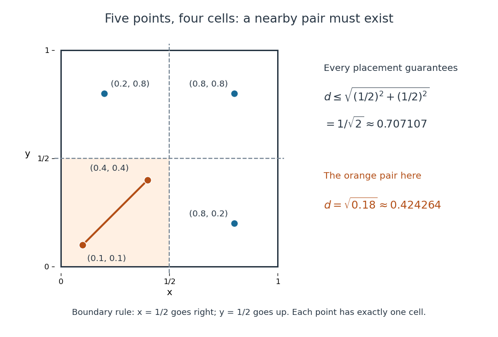

**[Figure 1](#image-the-pigeonhole-principle-places-two-of-five-points-in-one-of-four-cells-of-a-square-bounding-their-euclidean-distance-by-1-sqrt2). The pigeonhole principle places two of five points in one of four cells of a square, bounding their Euclidean distance by $1/\sqrt2$**.

**An arithmetic example.** Assign eight [integers](integer.md) to their seven [residue classes](modular-arithmetic.md#residue-class) modulo the [integer modulus](modular-arithmetic.md#modulus-in-modular-arithmetic) $7$. The [pigeonhole principle](#pigeonhole-principle) gives two with the same [residue class](modular-arithmetic.md#residue-class), so $7$ is an [integer divisor](divisibility.md#divisor) of their difference. In $\{2,5,9,12,16,20,24,27\}$, for example, $2$ and $9$ satisfy the [integer congruence](modular-arithmetic.md#integer-congruence) $9\equiv2\pmod7$, and $9-2=7$. Likewise, assigning [fractional parts](calculus.md#fractional-part) to short [intervals](real-analysis.md#interval-mathematics) gives the [Dirichlet approximation theorem](diophantine-approximation.md#dirichlet-s-approximation-theorem); its existing article explains the approximation bound.

### Generalized pigeonhole principle

↑ **Parent:** [Pigeonhole principle](#pigeonhole-principle)

For $N$ objects assigned to $m\geq1$ boxes, let $n_i$ be the number in box $i$. The [generalized pigeonhole principle](#generalized-pigeonhole-principle) states

$$
n_1+\cdots+n_m=N
\quad\Longrightarrow\quad
\max_{1\leq i\leq m}n_i\geq\left\lceil\frac Nm\right\rceil.
$$

The [ceiling function](calculus.md#ceiling-function) rounds up because box counts are [integers](integer.md). An equivalent threshold formulation says: for a [positive integer](integer.md#positive-integer) $k$, if $N>m(k-1)$, some box contains at least $k$ objects. For $N=m(k-1)$, putting $k-1$ objects in each box shows why the strict inequality matters. [Lehman, Leighton and Meyer, Mathematics for Computer Science, section 14.8.1, rule 14.8.2](https://ocw.mit.edu/courses/6-042j-mathematics-for-computer-science-spring-2015/mit6_042js15_textbook.pdf#page=583)

**Computed examples.** For $N=13$ and $m=12$, $\lceil13/12\rceil=2$. Counts $(2,1,1,1,1,1,1,1,1,1,1,1)$ attain this bound. For $N=23$ and $m=7$, $\lceil23/7\rceil=4$, and the balanced counts $(4,4,3,3,3,3,3)$ sum to $23$ and have largest count exactly $4$. The threshold version agrees: $23>7(4-1)=21$. In contrast, seven boxes each containing three hold only $21$ objects.

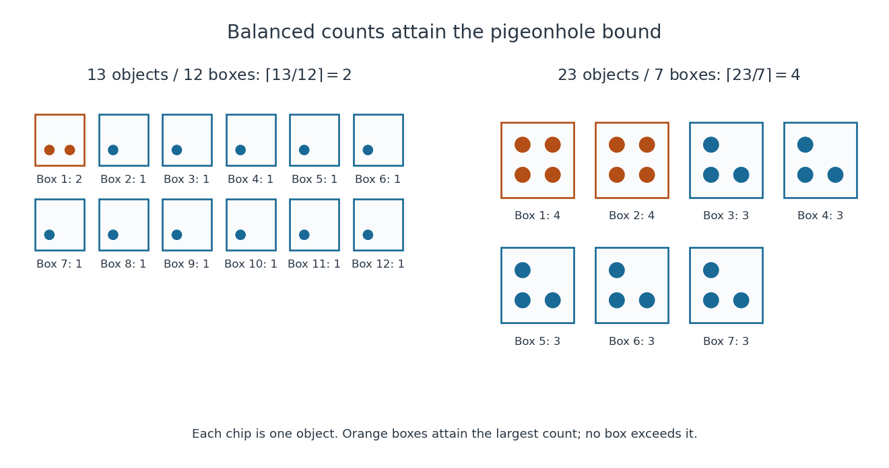

**[Figure 2](#image-two-balanced-arrangements-attain-the-generalized-pigeonhole-principle-bounds-thirteen-objects-in-twelve-boxes-force-two-and-twenty-three-in-seven-force-four). Two balanced arrangements attain the generalized pigeonhole principle bounds: thirteen objects in twelve boxes force two, and twenty-three in seven force four**.

The bound is sharp for every $N$ and $m$. Use [Euclidean division](integer.md#euclidean-division) to write $N=qm+r$ with [integers](integer.md) $q\geq0$ and $0\leq r<m$. Place $q+1$ objects in each of $r$ boxes and $q$ objects in each remaining box. The largest count is $q+1$ if $r>0$, and $q$ if $r=0$, exactly $\lceil N/m\rceil$. This balanced arrangement makes the guarantee best possible even though other arrangements can be much more crowded.

**Proof outline.** If every count were at most $k-1$, the total would be at most $m(k-1)$. This contradicts $N>m(k-1)$. Taking $k=\lceil N/m\rceil$ proves the displayed bound for $N>0$; for $N=0$ every count is zero.

### Infinite pigeonhole principle

↑ **Parent:** [Pigeonhole principle](#pigeonhole-principle)

The [infinite pigeonhole principle](#infinite-pigeonhole-principle) says that if an [infinite set](set.md#infinite-set) has a [partition of a set](set.md#partition-of-a-set) into finitely many parts, at least one part is an [infinite set](set.md#infinite-set). Equivalently, assigning infinitely many objects to a finite number of boxes forces some box to contain infinitely many objects. For example, separating the [natural numbers](arithmetic.md#natural-number) into their two [residue classes](modular-arithmetic.md#residue-class) modulo $2$ forces at least one class to be an [infinite set](set.md#infinite-set); here both are, as the lists $0,2,4,\ldots$ and $1,3,5,\ldots$ show.

**Proof outline.** A [union](set.md#set-union) of finitely many [finite sets](set.md#finite-set) is a [finite set](set.md#finite-set). If all the parts were [finite sets](set.md#finite-set), their [union](set.md#set-union) could not be the original [infinite set](set.md#infinite-set).

The assumption of finitely many parts is essential. With one box labelled by each [natural number](arithmetic.md#natural-number), assigning $n$ to box $n$ puts exactly one object in every box. Infinitely many objects and infinitely many boxes therefore need not produce even a shared box. The [infinite pigeonhole principle](#infinite-pigeonhole-principle) is useful whenever finitely many labels organize an endless collection: one label must keep occurring infinitely often, providing an [infinite set](set.md#infinite-set) on which that label is constant.

## Enumerative combinatorics

↑ **Parent:** [Combinatorics](combinatorics.md)  
ⓦ [Wiki](https://en.wikipedia.org/wiki/Enumerative_combinatorics)

### q-analogue

↑ **Parent:** [Enumerative combinatorics](#enumerative-combinatorics)

A parameter-dependent generalization which recovers a familiar object at a specified value or [limit](calculus.md#limit-of-a-function) of the parameter. In [enumerative combinatorics](#enumerative-combinatorics), a [generating function](sequence-and-series.md#generating-function) can refine an ordinary count by retaining a statistic; [Gaussian binomial coefficients](binomial-coefficient.md#gaussian-binomial-coefficient) are one example.

### Board tiling

↑ **Parent:** [Enumerative combinatorics](#enumerative-combinatorics)

Covering a finite board with specified tiles without gaps or overlaps. Counting [board tilings](#board-tiling) connects local placement rules to a [recurrence relation](sequence-and-series.md#recurrence-relation) and a [generating function](sequence-and-series.md#generating-function).

## Combinatorial structure

↑ **Parent:** [Combinatorics](combinatorics.md)

### Labelled combinatorial structure

↑ **Parent:** [Combinatorial structure](#combinatorial-structure)

A [combinatorial structure](#combinatorial-structure) whose elements carry distinct labels from a prescribed [finite set](set.md#finite-set). For example, a [rooted tree](tree-graph-theory.md#rooted-tree) can have labelled [vertices](graph.md#vertex-graph-theory); assigning labels is part of the structure counted by an [exponential generating function](sequence-and-series.md#exponential-generating-function).

### Independence system

↑ **Parent:** [Combinatorial structure](#combinatorial-structure)

An [independence system](#independence-system) consists of a [finite set](set.md#finite-set) $E$ and a nonempty family $\mathcal I$ of [subsets](set.md#subset) such that $I\in\mathcal I$ and $J\subseteq I$ imply $J\in\mathcal I$. This is the hereditary condition: deleting chosen elements keeps a selection admissible. In particular, the [empty set](set.md#empty-set) belongs to $\mathcal I$. An [independence system](#independence-system) becomes a [matroid](#matroid) when it also satisfies the [matroid independence axioms](#matroid-independence-axioms) for exchange. The [hereditary nonmatroid greedy obstruction](#hereditary-nonmatroid-greedy-obstruction) shows why deletion alone does not justify a [greedy algorithm](algorithm.md#greedy-algorithm).

#### Ground set

↑ **Parent:** [Independence system](#independence-system)

The [ground set](#ground-set) is the [set](set.md) of labelled elements available for selection. An [independence system](#independence-system) specifies which [subsets](set.md#subset) of this [ground set](#ground-set) are admissible; in a [linear matroid](#linear-matroid) the labels index [vectors](vector-space.md#vector), whereas in a [graphic matroid](#graphic-matroid) they index [edges](graph-theory.md#edge-of-a-graph).

#### Hereditary nonmatroid greedy obstruction

↑ **Parent:** [Independence system](#independence-system)

On the [ground set](#ground-set) $E=\{x,y,z\}$, permit exactly

$$
\mathcal F=\{\varnothing,\{x\},\{y\},\{z\},\{y,z\}\},
\qquad w(x)=10,\quad w(y)=w(z)=6.
$$

This lists every admissible [subset](set.md#subset); the excluded [subsets](set.md#subset) are $\{x,y\}$, $\{x,z\}$, and $\{x,y,z\}$. It is an [independence system](#independence-system): deleting elements from $\{y,z\}$ produces its listed singletons or the [empty set](set.md#empty-set), and deleting from a singleton produces the [empty set](set.md#empty-set). But $I=\{x\}$ and $J=\{y,z\}$ violate exchange: neither $y$ nor $z$ can be added to $I$. Thus it is not a [matroid](#matroid).

The descending-weight [greedy algorithm](algorithm.md#greedy-algorithm) admits $x$ first, then rejects both $y$ and $z$, returning $\{x\}$ with weight $10$. Exchanging the tied order of $y,z$ changes nothing. The admissible pair $\{y,z\}$ weighs $12$, exceeding every singleton and the [empty set](set.md#empty-set), so it is the true optimum. Both $\{x\}$ and $\{y,z\}$ are [maximal elements](set.md#maximal-element-of-a-partially-ordered-set) under inclusion of [subsets](set.md#subset), but only the pair has maximum [cardinality](cardinal-number.md#cardinality). This identifies exactly where the [matroid greedy algorithm](#matroid-greedy-algorithm) loses its guarantee: heredity preserves admissibility under deletions, while exchange prevents a locally maximal selection from being too small.

## Matroid

↑ **Parent:** [Combinatorics](combinatorics.md)  
ⓦ [Wiki](https://en.wikipedia.org/wiki/Matroid)

A [matroid](#matroid) is an [independence system](#independence-system) in which a smaller admissible selection can always grow using an element of a larger admissible selection. This exchange rule abstracts [linear independence](vector-space.md#linear-independence) of [vectors](vector-space.md#vector) and the selection of [edges](graph-theory.md#edge-of-a-graph) forming a [forest](tree-graph-theory.md#forest). It forces all [matroid bases](#basis-of-a-matroid) to have the same [cardinality](cardinal-number.md#cardinality) and makes the [matroid greedy algorithm](#matroid-greedy-algorithm) correct for maximizing their total weight. The useful surprise is that local choices become globally optimal because of a structural rule about admissible [subsets](set.md#subset), rather than a special numerical coincidence.

The [weighted three-vector matroid](#weighted-three-vector-matroid) below lets us inspect every [subset](set.md#subset) and every possible size comparison. Its three [vectors](vector-space.md#vector) give three two-element [matroid bases](#basis-of-a-matroid), yet their total weights differ. The [graphic matroid](#graphic-matroid) of a [graph triangle](graph.md#triangle-in-a-graph) has exactly the same admissible labels. A [pregeometry](model-theory.md#pregeometry) is a finitary closure-theoretic extension to possibly infinite [sets](set.md).

### Matroid independence axioms

↑ **Parent:** [Matroid](#matroid)

Let $E$ be a [finite set](set.md#finite-set) and $\mathcal I\subseteq\mathcal P(E)$ a family of [subsets](set.md#subset), where $\mathcal P(E)$ is the [power set](set.md#power-set). The [matroid independence axioms](#matroid-independence-axioms) are

$$
\begin{aligned}
&\varnothing\in\mathcal I,\\
&I\in\mathcal I,\ J\subseteq I\quad\Longrightarrow\quad J\in\mathcal I,\\
&I,J\in\mathcal I,\ |I|<|J|\quad\Longrightarrow\quad
\exists e\in J\setminus I:\ I\cup\{e\}\in\mathcal I.
\end{aligned}
$$

The second condition is heredity; the third is exchange, also called augmentation. The [set difference](set.md#set-difference) $J\setminus I$ matters: the new element must actually increase the [cardinality](cardinal-number.md#cardinality) of $I$. Exchange adds one element without requiring any deletion from $I$. Nonemptiness together with heredity is equivalent to the first condition. [Michel X. Goemans, Matroid optimization, section 5.1, p. 1, axioms (I1) and (I2)](mathematics-bibliography.md#matroid-optimization-by-michel-goemans)

### Independent set of a matroid

↑ **Parent:** [Matroid](#matroid)

A [matroid independent set](#independent-set-of-a-matroid) is a [subset](set.md#subset) belonging to the family $\mathcal I$. Independence refers to the chosen [matroid](#matroid): for a [linear matroid](#linear-matroid) it means [linear independence](vector-space.md#linear-independence), and for a [graphic matroid](#graphic-matroid) it means that the chosen [edges](graph-theory.md#edge-of-a-graph) contain no [graph cycle](graph-theory.md#cycle-in-a-graph). It is different from an [independent set](graph-theory.md#independent-set-graph-theory), which selects [vertices](graph.md#vertex-graph-theory) with no [edge](graph-theory.md#edge-of-a-graph) between them.

### Basis of a matroid

↑ **Parent:** [Matroid](#matroid)

A [matroid basis](#basis-of-a-matroid) is a [matroid independent set](#independent-set-of-a-matroid) that is a [maximal element](set.md#maximal-element-of-a-partially-ordered-set) under inclusion of [subsets](set.md#subset): no additional element of the [ground set](#ground-set) can be admitted. Maximum [cardinality](cardinal-number.md#cardinality) means having the largest size among all [matroid independent sets](#independent-set-of-a-matroid). Maximality tests whether this particular selection can grow; maximum size compares it with every selection. In a [matroid](#matroid) the two conditions coincide, so all [matroid bases](#basis-of-a-matroid) have a common size. They need not have equal weight. [Michel X. Goemans, Matroid optimization, section 5.1, p. 1, maximal independent sets and bases](mathematics-bibliography.md#matroid-optimization-by-michel-goemans)

**Proof outline.** If a maximal [matroid independent set](#independent-set-of-a-matroid) $B$ were smaller than another [matroid independent set](#independent-set-of-a-matroid) $J$, the [matroid independence axioms](#matroid-independence-axioms) would admit an element of $J\setminus B$, contradicting maximality. Finiteness allows every [matroid independent set](#independent-set-of-a-matroid) to grow to a [matroid basis](#basis-of-a-matroid) by successive admissible additions. In a general [independence system](#independence-system), maximal selections can have different sizes, as in the [hereditary nonmatroid greedy obstruction](#hereditary-nonmatroid-greedy-obstruction).

### Rank of a matroid

↑ **Parent:** [Matroid](#matroid)

For a [subset](set.md#subset) $A$ of the [ground set](#ground-set), the [rank of a matroid](#rank-of-a-matroid) on $A$ is the maximum [cardinality](cardinal-number.md#cardinality) of a [matroid independent set](#independent-set-of-a-matroid) contained in $A$:

$$
r_M(A)=\max\{\,|I|: I\subseteq A,\ I\in\mathcal I\,\}.
$$

Thus $r_M(E)$ is the common size of the [matroid bases](#basis-of-a-matroid), and $r_M(\varnothing)=0$. The [weighted three-vector matroid](#weighted-three-vector-matroid) has $r_M(E)=2$, even though its [ground set](#ground-set) has three labels.

### Linear matroid

↑ **Parent:** [Matroid](#matroid)

A [linear matroid](#linear-matroid) has a finite [ground set](#ground-set) indexing a family of [vectors](vector-space.md#vector) in a [vector space](vector-space.md) over a specified [field](algebra.md#field). A [subset](set.md#subset) of labels is a [matroid independent set](#independent-set-of-a-matroid) precisely when its [vectors](vector-space.md#vector) are [linearly independent](vector-space.md#linear-independence). Labels distinguish repeated [vectors](vector-space.md#vector); the [ground set](#ground-set) is not required to consist of distinct numerical [vectors](vector-space.md#vector). The [matroid bases](#basis-of-a-matroid) correspond to [bases](vector-space.md#basis) for the [linear span](vector-space.md#linear-span) of all the supplied [vectors](vector-space.md#vector).

**Exchange outline.** The [linear span](vector-space.md#linear-span) of $|I|$ [linearly independent](vector-space.md#linear-independence) [vectors](vector-space.md#vector) has [dimension](vector-space.md#dimension-vector-space) $|I|$. If $|J|>|I|$, not all the [linearly independent](vector-space.md#linear-independence) [vectors](vector-space.md#vector) indexed by $J$ can lie in that [linear span](vector-space.md#linear-span). A [vector](vector-space.md#vector) outside it can be added to $I$. Heredity follows because a [linear dependence](vector-space.md#linear-dependence) in a [subset](set.md#subset) would also be a [linear dependence](vector-space.md#linear-dependence) in the full selection.

#### Weighted three-vector matroid

↑ **Parent:** [Linear matroid](#linear-matroid)

Take labels $E=\{a,b,c\}$ and [vectors](vector-space.md#vector) in the [real vector space](vector-space.md#real-vector-space) $\mathbb R^2$:

$$
v_a=(1,0),\qquad v_b=(0,1),\qquad v_c=(1,1),
\qquad w(a)=8,\quad w(b)=5,\quad w(c)=6.
$$

Here is the complete independence check for all eight [subsets](set.md#subset). The [empty set](set.md#empty-set) is independent. Each of $\{a\},\{b\},\{c\}$ is independent because its [vector](vector-space.md#vector) is nonzero. Every pair is independent: the [determinants](multilinear-algebra.md#determinant) of the two-column [matrices](vector-space.md#matrix) $[v_a\ v_b]$, $[v_a\ v_c]$, and $[v_b\ v_c]$ are respectively $1$, $1$, and $-1$. The triple is dependent because $v_c-v_a-v_b=0$. Therefore

$$
\mathcal I=\{\varnothing,\{a\},\{b\},\{c\},
\{a,b\},\{a,c\},\{b,c\}\}.
$$

Deleting elements from any listed [subset](set.md#subset) stays in this list, verifying heredity. Every exchange comparison has sizes $(0,1)$, $(0,2)$, or $(1,2)$. From the [empty set](set.md#empty-set), any element of the larger [matroid independent set](#independent-set-of-a-matroid) works: this covers three singleton targets and three pair targets. From any singleton to any pair, every element of the pair outside the singleton works, since every resulting pair is independent. This covers all nine singleton-pair comparisons, including disjoint ones. There are no other comparisons: all fifteen ordered size-increasing pairs satisfy exchange.

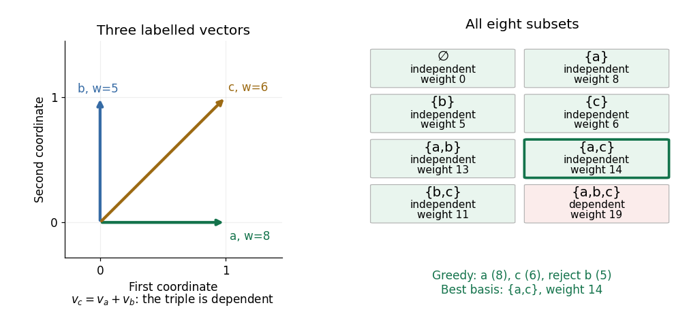

**[Figure 3](#image-three-vectors-have-three-independent-pairs-and-one-dependent-triple-the-heaviest-matroid-basis-is-a-c-with-weight-14). Three vectors have three independent pairs and one dependent triple; the heaviest matroid basis is $\{a,c\}$ with weight $14$**.

The three [matroid bases](#basis-of-a-matroid) are $\{a,b\}$, $\{a,c\}$, and $\{b,c\}$, all of [cardinality](cardinal-number.md#cardinality) two, with weights $13$, $14$, and $11$. The [matroid greedy algorithm](#matroid-greedy-algorithm) considers $a$, then $c$, then $b$: it admits $a$, admits $c$ because their [determinant](multilinear-algebra.md#determinant) is nonzero, and rejects $b$ because the triple is dependent. The resulting [matroid basis](#basis-of-a-matroid) $\{a,c\}$ has weight $8+6=14$, the largest of the three totals. Every singleton can grow, so none is maximal; the three pairs are both maximal and maximum in [cardinality](cardinal-number.md#cardinality).

### Graphic matroid

↑ **Parent:** [Matroid](#matroid)  
ⓦ [Wiki](https://en.wikipedia.org/wiki/Graphic_matroid)

For a finite [undirected graph](graph-theory.md#undirected-graph), the [graphic matroid](#graphic-matroid) has its [edges](graph-theory.md#edge-of-a-graph) as the [ground set](#ground-set). A [subset](set.md#subset) is a [matroid independent set](#independent-set-of-a-matroid) when its [edges](graph-theory.md#edge-of-a-graph) form a [forest](tree-graph-theory.md#forest) on the original [vertices](graph.md#vertex-graph-theory), including isolated [vertices](graph.md#vertex-graph-theory). Its [matroid bases](#basis-of-a-matroid) give a [spanning tree](tree-graph-theory.md#spanning-tree) in each [connected component of a graph](graph.md#component-graph-theory); for a [connected graph](graph.md#connected-graph), each [matroid basis](#basis-of-a-matroid) is a [spanning tree](tree-graph-theory.md#spanning-tree).

For a [graph triangle](graph.md#triangle-in-a-graph) on [vertices](graph.md#vertex-graph-theory) $P,Q,R$, label the [edges](graph-theory.md#edge-of-a-graph) $a=PQ$, $b=QR$, and $c=PR$, with weights $8,5,6$. The [empty set](set.md#empty-set), all singletons, and all pairs are [forests](tree-graph-theory.md#forest); the triple contains the [graph cycle](graph-theory.md#cycle-in-a-graph) $P,Q,R,P$. Thus its eight [subsets](set.md#subset) have exactly the independence pattern checked in the [weighted three-vector matroid](#weighted-three-vector-matroid), and the same fifteen exchange comparisons pass. The [matroid greedy algorithm](#matroid-greedy-algorithm) chooses $PQ$, chooses $PR$, and rejects $QR$, producing the heaviest [spanning tree](tree-graph-theory.md#spanning-tree), of weight $14$.

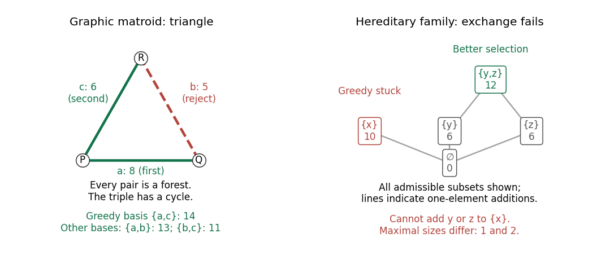

**[Figure 4](#image-a-weighted-graph-triangle-admits-greedy-selection-of-a-matroid-basis-a-hereditary-independence-system-without-exchange-traps-a-greedy-algorithm-at-weight-10-instead-of-12). A weighted graph triangle admits greedy selection of a matroid basis; a hereditary independence system without exchange traps a greedy algorithm at weight $10$ instead of $12$**.

**Exchange outline.** Deleting [edges](graph-theory.md#edge-of-a-graph) cannot create a [graph cycle](graph-theory.md#cycle-in-a-graph). If [forests](tree-graph-theory.md#forest) $I,J$ have $|I|<|J|$, some [edge](graph-theory.md#edge-of-a-graph) of $J$ joins different [connected components of a graph](graph.md#component-graph-theory) of $I$: otherwise, within each such component, $J$ would have at most its number of [vertices](graph.md#vertex-graph-theory) minus one [edges](graph-theory.md#edge-of-a-graph), giving $|J|\leq|I|$. Adding that [edge](graph-theory.md#edge-of-a-graph) keeps a [forest](tree-graph-theory.md#forest). This is the [matroid independence axioms](#matroid-independence-axioms) expressed through connectivity.

### Matroid greedy algorithm

↑ **Parent:** [Matroid](#matroid)

Assign each element of the finite [ground set](#ground-set) a [real number](arithmetic.md#real-number) $w(e)$. The [matroid greedy algorithm](#matroid-greedy-algorithm) sorts elements by nonincreasing weight, starts with the [empty set](set.md#empty-set), and admits an element exactly when the enlarged selection is a [matroid independent set](#independent-set-of-a-matroid). Ties can be resolved arbitrarily. After all elements have been considered, the result is a [matroid basis](#basis-of-a-matroid) of maximum total weight among all [matroid bases](#basis-of-a-matroid). This holds even with negative weights: the task is to produce a full [matroid basis](#basis-of-a-matroid). [Michel X. Goemans, Matroid optimization, section 5.2, pp. 5–6, greedy procedure and theorem 5.2](mathematics-bibliography.md#matroid-optimization-by-michel-goemans)

Maximizing weight over all [matroid independent sets](#independent-set-of-a-matroid) is a different task when weights can be negative. For that task, skip negative elements; zero-weight additions are optional. With weights $w(a)=8$, $w(c)=-1$, $w(b)=-2$ in the [weighted three-vector matroid](#weighted-three-vector-matroid), the heaviest [matroid basis](#basis-of-a-matroid) is $\{a,c\}$ with weight $7$, while the heaviest [matroid independent set](#independent-set-of-a-matroid) is $\{a\}$ with weight $8$. For nonnegative weights, every [matroid independent set](#independent-set-of-a-matroid) can be extended to a [matroid basis](#basis-of-a-matroid) without reducing weight, so the optimum values coincide.

**Proof outline.** Let $g_1,\ldots,g_r$ be the admitted elements in order, and order any competing [matroid basis](#basis-of-a-matroid) $b_1,\ldots,b_r$ by nonincreasing weight. If $w(b_k)>w(g_k)$, exchange would let one of $b_1,\ldots,b_k$ augment $\{g_1,\ldots,g_{k-1}\}$. That element was considered before $g_k$ and, by heredity, was admissible even at that earlier stage, a contradiction. Hence $w(g_k)\geq w(b_k)$ for every $k$, and summing proves optimality. Rejected elements remain inadmissible as the selection grows, by heredity, so the final selection is maximal. The guarantee depends on the [matroid independence axioms](#matroid-independence-axioms) and on weights adding independently across elements; interactions between chosen elements are a different objective.

## Rule of product

↑ **Parent:** [Combinatorics](combinatorics.md)  
ⓦ [Wiki](https://en.wikipedia.org/wiki/Rule_of_product)

For finite [sets](set.md), the number of ordered choices of one element from each is the product of the individual numbers of choices. More generally, if stage $j$ has exactly $n_j$ possible choices after every permitted history of earlier stages, the total number of full choice sequences is $\prod_j n_j$, by [mathematical induction](foundations-of-mathematics.md#mathematical-induction) on the stages. This counts $b^a$ [functions](function.md) between sets of sizes $a,b$, and counts the [injective functions](algebra.md#injective-function) by the [falling factorial](#falling-factorial) $b(b-1)\cdots(b-a+1)$ when $a\le b$.

With five people, choose a captain in five ways and a different deputy in four ways: **$5\cdot4=20$ ordered assignments**. The second choice depends on the first because the captain is excluded, but its number of permitted options is always four. The [rule of product](#rule-of-product) therefore applies without any assumption about [independent events](probability-theory.md#independent-events). To count two-person teams instead, each [subset](set.md#subset) has two possible role assignments, so division by $2!=2$ gives ten teams. This division works because every team was counted equally often.

## Addition principle

↑ **Parent:** [Combinatorics](combinatorics.md)  
ⓦ [Wiki](https://en.wikipedia.org/wiki/Addition_principle)

The [rule of sum](#addition-principle) counts alternatives in disjoint finite [sets](set.md) by adding their sizes. For a [disjoint union](set-theory.md#disjoint-union) $A\sqcup B$, each element belongs to exactly one alternative, so $|A\sqcup B|=|A|+|B|$. Overlapping alternatives require accounting for repeated elements, as in the [inclusion-exclusion principle](#inclusion-exclusion-principle). The groups indexed by first-return position in the [Catalan recurrence](#catalan-recurrence) are disjoint alternatives.

## Steiner system

↑ **Parent:** [Combinatorics](combinatorics.md)  
ⓦ [Wiki](https://en.wikipedia.org/wiki/Steiner_system)

A Steiner system $S(t,k,v)$ is a $v$-point set with $k$-point blocks such that every $t$-point subset is contained in exactly one block. Necessarily the number of blocks is $\binom vt/\binom kt$. This count is a necessary consistency check, not a substitute for proving exact containment. The [small Witt design](#small-witt-design) is $S(5,6,12)$.

### Block of a Steiner system

↑ **Parent:** [Steiner system](#steiner-system)

A designated [subset](set.md#subset) in a [Steiner system](#steiner-system) is a [Steiner block](#block-of-a-steiner-system). In a system $S(t,k,v)$, each [Steiner block](#block-of-a-steiner-system) contains $k$ points and each $t$-point [subset](set.md#subset) belongs to exactly one [Steiner block](#block-of-a-steiner-system). For $t=2$, this is the pair-coverage condition used in a [cyclotomic construction of a Steiner 2-design](#cyclotomic-construction-of-a-steiner-2-design).

### Difference family for a Steiner 2-design

↑ **Parent:** [Steiner system](#steiner-system)

In a finite additive [group](group.md), a family of $k$-subsets is a difference family of index one if each nonzero [group](group.md) element occurs exactly once among all their ordered within-block differences. Translating its [Steiner blocks](#block-of-a-steiner-system) by every [group](group.md) element gives a [Steiner system](#steiner-system) with parameters $2$-$(v,k,1)$: the unique representation of a difference determines the unique translated [Steiner block](#block-of-a-steiner-system) through two specified points.

#### Cyclotomic construction of a Steiner 2-design

↑ **Parent:** [Difference family for a Steiner 2-design](#difference-family-for-a-steiner-2-design)

Put $m=\binom{k}{2}$, take odd $q\equiv1\pmod{2m}$, and let $H$ be the index-$m$ multiplicative [subgroup](group.md#subgroup). If a $k$-set $A$ has its unordered pair differences in distinct $H$-cosets, choose $S\subset H$ containing exactly one element from each pair $\{h,-h\}$. Then $\{sA:s\in S\}$ is a [difference family for a Steiner 2-design](#difference-family-for-a-steiner-2-design). Indeed one unordered pair supplies each [coset](group-theory.md#coset), and its two difference orientations multiplied by $S$ cover that [coset](group-theory.md#coset) once. Translations yield a $2$-$(q,k,1)$ [Steiner system](#steiner-system). The [cyclotomic pattern extension by a second-moment bound](algebra.md#cyclotomic-pattern-extension-by-a-second-moment-bound) supplies suitable $A$ for all sufficiently large $q$ in this progression.

### Small Witt design

↑ **Parent:** [Steiner system](#steiner-system)

The small Witt design is a Steiner system $S(5,6,12)$ with 132 blocks. A six-set duad-syntheme duality constructs it on two disjoint six-sets: two whole-half blocks, forty-five blocks of each of the types $(2,4)$ and $(4,2)$, and forty corresponding-partition blocks of type $(3,3)$. The internal-duad/cross-syntheme incidence rule proves that each five-set lies in exactly one of these blocks.

#### Synthematic construction of the small Witt design

↑ **Parent:** [Small Witt design](#small-witt-design)

On a six-point set $X$ and its six [totals of synthemes](#total-of-synthemes) $Y$, each duad determines a partition of $Y$ into three pairs according to their shared synthemes. Include both whole halves, the 45 blocks $D\cup(Y\setminus P)$ for these duad-pair incidences, and their complements. For each partition $X=A\sqcup A^c$ into triples, cross synthemes give two triangular components on $Y$; include the four unions of a part of $X$ with a component. These 132 blocks form the [small Witt design](#small-witt-design).

## Six-point matching geometry

↑ **Parent:** [Combinatorics](combinatorics.md)

The complete graph on six points has fifteen edges and fifteen perfect matchings. Its six one-factorizations organize a dual incidence geometry exchanging points with factorizations and edges with matchings. The classical names are [duads](#duad), [synthemes](#syntheme) and [totals of synthemes](#total-of-synthemes). This geometry supports [duad-syntheme duality on six points](#duad-syntheme-duality-on-six-points) and a construction of the [small Witt design](#small-witt-design).

### Pentad construction of the exceptional alternating-group automorphism

↑ **Parent:** [Six-point matching geometry](#six-point-matching-geometry)

The six [pentads](#total-of-synthemes) are the six one-factorizations of the complete graph on six points. Permuting the ground-set points permutes these factorizations. The action sends a transposition to three disjoint transpositions and a $3$-cycle to two disjoint $3$-cycles. Its restriction to $A_6$ is faithful by simplicity, and the full action of $S_6$ is faithful because an order-two kernel would be central. It is consequently an automorphism of $S_6$. Its restriction preserves $A_6$ and changes $3$-cycle type, so it cannot be induced on $A_6$ by any conjugation from $S_6$.

### Duad-syntheme duality on six points

↑ **Parent:** [Six-point matching geometry](#six-point-matching-geometry)

A bijection from the points of one six-set to the totals of another extends by incidence to bijections from duads to synthemes, synthemes to duads, and totals to points. A duad maps to the intersection of its two point-totals. The same duality exchanges internal duads of a three-versus-three partition with cross synthemes of its corresponding partition. The latter rule follows by splitting the six cross perfect matchings into parity classes of three, yielding two triangles on the six totals.

### Duad

↑ **Parent:** [Six-point matching geometry](#six-point-matching-geometry)

A duad is an unordered pair of distinct points. On a six-point set there are $\binom62=15$ duads. They are the edges of the complete graph and are grouped into [synthemes](#syntheme).

#### Syntheme

↑ **Parent:** [Duad](#duad)

A syntheme partitions six points into three duads, equivalently a perfect matching of the complete graph. There are $6!/(2^3 3!)=15$ synthemes. Every duad belongs to three. Two edge-disjoint synthemes extend to a unique [total of synthemes](#total-of-synthemes): their union is a six-cycle, whose complement has a unique factorization into three matchings.

##### Total of synthemes

↑ **Parent:** [Syntheme](#syntheme)

A total is a set of five edge-disjoint synthemes covering all fifteen duads of a six-point set. There are six totals; each syntheme belongs to two and every two totals share exactly one syntheme. Each total contains exactly one syntheme containing any prescribed duad. Totals are one-factorizations of the complete graph.

###### Counting synthematic totals

↑ **Parent:** [Total of synthemes](#total-of-synthemes)

Two disjoint [synthemes](#syntheme) form a six-cycle, whose complement is a triangular prism. The prism has a unique partition into three perfect matchings, so the pair extends uniquely to a [total of synthemes](#total-of-synthemes). Eight synthemes are disjoint from a fixed syntheme; grouping them four per total yields two totals through it, and double counting gives six totals in all.

// Target: combinatorics.bigb

## Cycle lemma

↑ **Parent:** [Combinatorics](combinatorics.md)

The [cycle lemma](#cycle-lemma) turns a constraint at every prefix into a choice of where to start reading a circular [sequence](sequence-and-series.md#sequence). Think of a [lattice path](#lattice-path) whose vertical increments record votes for two candidates: $+1$ for one candidate and $-1$ for the other. Its [partial sums](sequence-and-series.md#partial-sum) are the running lead. Rotating the increments preserves the final lead, but changes whether that lead stays strictly positive throughout. This makes rotation useful for counting [lattice paths](#lattice-path) subject to prefix constraints; the sum-one [cycle lemma](#cycle-lemma) also supplies the cyclic prefix condition in the [cyclic Turán covering construction](hypergraph.md#cyclic-turan-covering-construction).

**The sum-one form.** Let $b=(b_1,\ldots,b_n)$ be any nonempty [sequence](sequence-and-series.md#sequence) of [integers](integer.md) with $\sum_{i=1}^n b_i=1$. A starting position $r\in\{0,\ldots,n-1\}$ means reading the rotated [sequence](sequence-and-series.md#sequence)

$$
b^{(r)}=(b_{r+1},\ldots,b_n,b_1,\ldots,b_r).
$$

Call $r$ good when every nonempty [partial sum](sequence-and-series.md#partial-sum) of $b^{(r)}$ is strictly positive, including the full [sum](arithmetic.md#sum):

$$
P_j^{(r)}=\sum_{i=1}^{j}b_i^{(r)}>0\qquad(1\leq j\leq n).
$$

The [cycle lemma](#cycle-lemma) says there is exactly one good starting position. Negative entries, zero entries and positive entries larger than one are all allowed in this sum-one form. The empty [partial sum](sequence-and-series.md#partial-sum) is zero and is excluded from the positivity requirement. Douglas West's exercise 1.3.46(a) states a stronger result for arbitrary [integer](integer.md) entries: take its case with all $n$ [partial sums](sequence-and-series.md#partial-sum) positive. [West, Combinatorial Mathematics, exercise 1.3.46(a), p. 50](https://api.pageplace.de/preview/DT0400.9781108889520_A49236431/preview-9781108889520_A49236431.pdf#page=72)

**A worked sum-one example.** For $b=(2,-2,0,1)$, the [partial sums](sequence-and-series.md#partial-sum) starting at zero are $S_0,S_1,S_2,S_3,S_4=0,2,0,0,1$. Starts $0,1,2$ fail: they have, respectively, a zero second [partial sum](sequence-and-series.md#partial-sum), a negative first [partial sum](sequence-and-series.md#partial-sum), and a zero first [partial sum](sequence-and-series.md#partial-sum). Start $3$ reads $(1,2,-2,0)$ and has nonempty [partial sums](sequence-and-series.md#partial-sum) $1,3,1,1$, all positive. This example both allows an increment larger than one and shows why touching zero fails.

**Why the last minimum works.** Put $S_0=0$ and $S_j=\sum_{i=1}^j b_i$. Choose the last index $r$ attaining the [minimum](set.md#minimum-of-a-subset-of-a-total-order) of the proper [partial sums](sequence-and-series.md#partial-sum) $S_0,\ldots,S_{n-1}$: include $S_0$ and exclude $S_n$. After that index, later proper [partial sums](sequence-and-series.md#partial-sum) are strictly larger than $S_r$; also $S_n=1>S_r$, since $S_r\leq0$. Before wrapping, the new [partial sums](sequence-and-series.md#partial-sum) are therefore positive differences $S_j-S_r$. After wrapping, they are $1+S_j-S_r\geq1$. In the worked example the last [minimum](set.md#minimum-of-a-subset-of-a-total-order) is at $r=3$; choosing the first [minimum](set.md#minimum-of-a-subset-of-a-total-order) at $r=0$ would fail. Uniqueness takes one further observation: two good starts would split the circle into two nonempty arcs, each having a positive [integer](integer.md) [sum](arithmetic.md#sum), yet their [sum](arithmetic.md#sum) would be one.

### Cycle lemma with increments at most one

↑ **Parent:** [Cycle lemma](#cycle-lemma)

A standard positive-total form of the [Dvoretzky-Motzkin cycle lemma](#cycle-lemma) uses a nonempty [sequence](sequence-and-series.md#sequence) $a=(a_1,\ldots,a_n)$ of [integers](integer.md) satisfying

$$
a_i\leq1\quad(1\leq i\leq n),\qquad \sum_{i=1}^{n}a_i=k>0.
$$

Exactly $k$ starting positions have every nonempty [partial sum](sequence-and-series.md#partial-sum) strictly positive, using the same rotation convention as the sum-one [cycle lemma](#cycle-lemma). Negative entries can be arbitrarily large in magnitude, and zero entries are allowed. Addario-Berry's proposition 2.2.1 gives an equivalent form with increments at least $-1$ and negative total; reversing the [sequence](sequence-and-series.md#sequence) and changing all signs gives the form here. [Addario-Berry, Lecture notes: 2021 CRM-PIMS Probability Summer School, proposition 2.2.1, p. 39](https://problab.ca/louigi/notes/ssprob2021.pdf#page=39)

**Four starts, two successes.** For $a=(1,1,1,-1)$, the [sum](arithmetic.md#sum) is $k=2$. Starts $0$ and $1$ give [partial sums](sequence-and-series.md#partial-sum) $(1,2,3,2)$ and $(1,2,1,2)$, respectively. Start $2$ gives $(1,0,1,2)$ and touches zero; start $3$ gives $(-1,0,1,2)$ and begins below zero. Thus exactly two starts are good. The rotated [sequence](sequence-and-series.md#sequence) $(-1,1,1,1)$ has the same positive total, but its first start is bad: a positive final lead alone does not control earlier [partial sums](sequence-and-series.md#partial-sum).

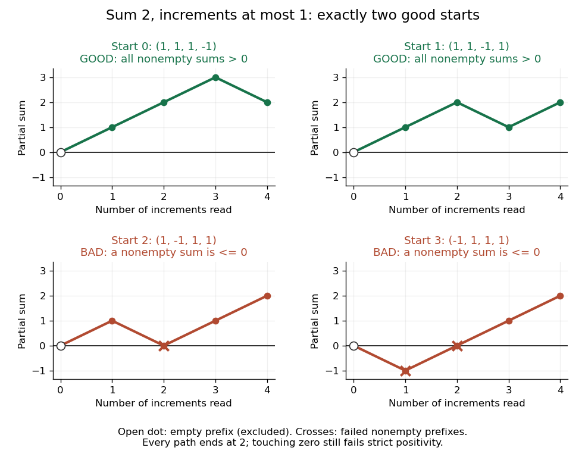

**[Figure 5](#image-all-four-starts-of-1-1-1-1-the-cycle-lemma-with-increments-at-most-one-counts-precisely-the-two-paths-whose-nonempty-partial-sums-stay-strictly-above-zero). All four starts of $(1,1,1,-1)$: the cycle lemma with increments at most one counts precisely the two paths whose nonempty partial sums stay strictly above zero**.

**Positions can give identical words.** The [sequence](sequence-and-series.md#sequence) $(1,1,-1,1,1,-1)$ repeats a block of length three and has [sum](arithmetic.md#sum) two. Its good starts are $0$ and $3$, both giving the same [word](foundations-of-mathematics.md#string) $(1,1,-1,1,1,-1)$ with [partial sums](sequence-and-series.md#partial-sum) $(1,2,1,2,3,2)$. Starts $1$ and $4$ touch zero; starts $2$ and $5$ begin negatively. The [cycle lemma with increments at most one](#cycle-lemma-with-increments-at-most-one) counts two starting positions even though there is only one distinct good rotated [word](foundations-of-mathematics.md#string). Counting distinct [words](foundations-of-mathematics.md#string) would lose the multiplicity that makes the statement true.

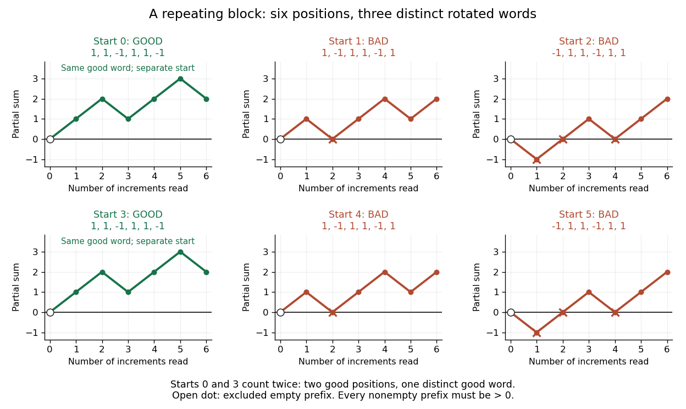

**[Figure 6](#image-six-starting-positions-of-the-repeating-sequence-1-1-1-1-1-1-starts-0-and-3-produce-identical-good-words-and-count-twice). Six starting positions of the repeating sequence $(1,1,-1,1,1,-1)$: starts $0$ and $3$ produce identical good words and count twice**.

**The upper bound matters.** The one-entry [sequence](sequence-and-series.md#sequence) $(2)$ has positive [integer](integer.md) [sum](arithmetic.md#sum) two, but only one starting position. Thus the sum-$k$ conclusion fails for arbitrary positive increments when $k>1$. The sum-one [cycle lemma](#cycle-lemma) above needs no such upper bound. Strict positivity also matters: counting paths that merely stay at or above zero would include additional starts in both diagrams.

**From rotation to enumeration.** For a fixed admissible [sequence](sequence-and-series.md#sequence), a start chosen from a [uniform distribution on a finite set](discrete-probability-distribution.md#discrete-uniform-distribution) of its $n$ positions is good with [probability](probability-theory.md#probability) $k/n$. More generally, let $\mathcal F$ be any [finite set](set.md#finite-set) of length-$n$ [sequences](sequence-and-series.md#sequence) satisfying the increment bound and total $k$, closed under rotation. [Double counting](#double-counting-proof-technique) pairs consisting of a [sequence](sequence-and-series.md#sequence) and a good starting position gives

$$
\#\{a\in\mathcal F:\text{all nonempty partial sums of }a\text{ are positive}\}
=\frac{k}{n}|\mathcal F|.
$$

For each good output [sequence](sequence-and-series.md#sequence) and each of the $n$ positions, inverse rotation gives one such pair, even when several rotated [words](foundations-of-mathematics.md#string) coincide. For example, the four [sequences](sequence-and-series.md#sequence) containing three $+1$ votes and one $-1$ vote have exactly $\frac24\binom43=2$ vote orders with a strictly positive running lead: $(1,1,1,-1)$ and $(1,1,-1,1)$. This is how the [cycle lemma with increments at most one](#cycle-lemma-with-increments-at-most-one) converts many prefix inequalities into a simple counting factor.

## Cyclic digit run

↑ **Parent:** [Combinatorics](combinatorics.md)

A cyclic digit run is a consecutive segment of a digit string whose successive digits all increase by one or all decrease by one modulo the base. For example, $8,9,0,1$ is an increasing decimal run. This refers to cyclic digit values, not to joining the final position of the string back to its first position. Overlapping run constraints can be counted with the [inclusion-exclusion principle](#inclusion-exclusion-principle).

## Finite geometry

↑ **Parent:** [Combinatorics](combinatorics.md)  
ⓦ [Wiki](https://en.wikipedia.org/wiki/Finite_geometry)

Finite geometry studies geometric incidence structures having finitely many points, such as finite projective and affine spaces.

## Increasing subsequence

↑ **Parent:** [Combinatorics](combinatorics.md)

An [increasing subsequence](#increasing-subsequence) of a finite [sequence](sequence-and-series.md#sequence) $x=(x_1,\ldots,x_n)$ in a [totally ordered set](set.md#totally-ordered-set) selects indices $1\leq i_1<\cdots<i_m\leq n$ such that

$$
x_{i_1}\leq x_{i_2}\leq\cdots\leq x_{i_m}.
$$

Here “increasing” means weakly increasing, also called nondecreasing: equal values are allowed, but indices must increase strictly. This is the convention of [Liben-Nowell, Vee and Zhu, Finding Longest Increasing and Common Subsequences in Streaming Data, section 1](https://cs.carleton.edu/faculty/dlibenno/papers/lis-lcs/lislcs.pdf). A [strictly increasing subsequence](#strictly-increasing-subsequence) instead requires $x_{i_1}<\cdots<x_{i_m}$. Always check which convention an [algorithm](algorithm.md) uses, especially when values repeat.

An [increasing subsequence](#increasing-subsequence) may skip positions; it neither rearranges values nor requires consecutive positions. Consider the deliberately constructed example

$$
x=(4,1,3,2,2,5,0).
$$

The indices $(2,4,5,6)$ select $(1,2,2,5)$, an [increasing subsequence](#increasing-subsequence) of length four. The indices $(2,3,6)$ select $(1,3,5)$, a [strictly increasing subsequence](#strictly-increasing-subsequence) of length three. In contrast, $(0,1,2,2,3,4,5)$ rearranges the input and is not a [subsequence](sequence-and-series.md#subsequence). The longest consecutive nondecreasing block is $(2,2,5)$, of length three; requiring consecutive positions would therefore solve a different problem.

Think of an [increasing subsequence](#increasing-subsequence) as preserving ordered observations while skipping interruptions. For the example, discarding $4,3,0$ leaves four observations with no downward step. The [longest increasing subsequence](#longest-increasing-subsequence) asks how much of the original order can be kept. This is an order comparison, rather than a claim about the size of upward or downward changes: replacing all values by their squares when the values are nonnegative leaves every allowed selection unchanged. More generally, any strictly order-preserving relabeling has this property.

### Longest increasing subsequence

↑ **Parent:** [Increasing subsequence](#increasing-subsequence)  
ⓦ [Wiki](https://en.wikipedia.org/wiki/Longest_increasing_subsequence)

A [longest increasing subsequence](#longest-increasing-subsequence) is an [increasing subsequence](#increasing-subsequence) of [maximum](set.md#maximum-of-a-subset-of-a-total-order) length. Write that length as $L(x)$, with $L(())=0$ for the empty [sequence](sequence-and-series.md#sequence); a nonempty input has $1\leq L(x)\leq n$. Several selections can attain the same [maximum](set.md#maximum-of-a-subset-of-a-total-order). Here $L$ uses the weak convention $\leq$; write $L_{<}(x)$ for the [maximum](set.md#maximum-of-a-subset-of-a-total-order) length of a [strictly increasing subsequence](#strictly-increasing-subsequence). For $(2,2,2)$, these lengths are three and one respectively; for an input with distinct values they agree.

For $x=(4,1,3,2,2,5,0)$, the answer is $L(x)=4$, attained at indices $(2,4,5,6)$, while $L_{<}(x)=3$. One useful interpretation is the smallest number of deletions needed to make the surviving [sequence](sequence-and-series.md#sequence) nondecreasing:

$$
\text{minimum deletions}=n-L(x).
$$

Indeed, keeping a [longest increasing subsequence](#longest-increasing-subsequence) attains this bound, and any valid remaining [sequence](sequence-and-series.md#sequence) is an [increasing subsequence](#increasing-subsequence), so cannot have more than $L(x)$ terms. In this example the answer is $7-4=3$. This makes $L(x)$ a measure of how much order can be recovered without moving any observation.

**A table that ends at each position.** Let $d_i$ be the [maximum](set.md#maximum-of-a-subset-of-a-total-order) length of an [increasing subsequence](#increasing-subsequence) ending specifically at position $i$. The [dynamic programming](mathematical-optimization.md#dynamic-programming) [recurrence relation](sequence-and-series.md#recurrence-relation) is

$$
d_i=1+\max\bigl(\{0\}\cup\{d_j:1\leq j<i,\ x_j\leq x_i\}\bigr),\qquad L(x)=\max_{1\leq i\leq n}d_i\quad(n>0).
$$

The zero covers a selection consisting only of $x_i$. Otherwise its penultimate index is an eligible $j$; append $x_i$ to an optimal selection ending there. Fill entries in increasing index order. For [strictly increasing subsequences](#strictly-increasing-subsequence), change the comparison to $x_j<x_i$. The strict version and reconstruction are developed in [University of Toronto, CSC373 tutorial 4 solutions (2018), exercise 2](https://www.cs.toronto.edu/~jepson/csc373/tutNotes/tutEx_DynProg_Soln.pdf); the weak version follows by allowing equality at the append step.

In the worked input, the weak table is $(1,1,2,2,3,4,1)$ and the strict table is $(1,1,2,2,2,3,1)$. At the second $2$, equality extends the first $2$ in the weak table. The final entry is only one, although the optimum is four: the best [increasing subsequence](#increasing-subsequence) need not finish at the last input position. Record a maximizing predecessor $p_i=j$ whenever $d_i>1$. Following these stored indices from any position maximizing $d_i$, then reversing them, gives an actual [longest increasing subsequence](#longest-increasing-subsequence). For the weak example the backward chain is $6,5,4,2$.

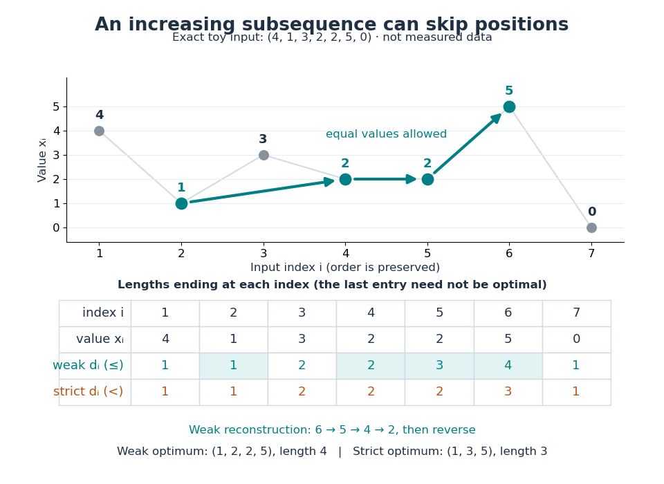

**[Figure 7](#image-skipping-positions-and-allowing-equal-values-changes-the-optimum). Skipping positions and allowing equal values changes the optimum**. An original toy input, not measured data. The colored selection keeps indices $2,4,5,6$ and values $1,2,2,5$. The two [dynamic programming](mathematical-optimization.md#dynamic-programming) rows give the best lengths ending at every position; the backward arrows reconstruct the weak [longest increasing subsequence](#longest-increasing-subsequence).

Scanning all earlier positions for each $i$ uses [time complexity](theoretical-computer-science.md#time-complexity) $O(n^2)$ and [space complexity](theoretical-computer-science.md#space-complexity) $O(n)$ for lengths and predecessors, using [Big O notation](real-analysis.md#big-o-notation) and assuming constant-time comparisons and operations on indices.

**Keep the easiest ending to extend.** The faster [algorithm](algorithm.md) maintains a [minimum-tail table for increasing subsequences](#minimum-tail-table-for-increasing-subsequences): $T_\ell$ is the smallest final value of any length-$\ell$ [increasing subsequence](#increasing-subsequence) in the processed prefix. For equal lengths, a smaller ending permits every future extension allowed by a larger ending. Thus only one best ending per length is needed. The table is nondecreasing, since removing the last term of a length-$(\ell+1)$ selection gives $T_\ell\leq T_{\ell+1}$. Start with an empty table. On reading $v=x_i$, use [binary search](algorithm.md#binary-search) to find the first entry strictly greater than $v$: replace it by $v$, or append $v$ if there is no such entry. Its position is one beyond the longest existing length whose ending is at most $v$. See [Liben-Nowell, Vee and Zhu, section 3.1 and Figure 1](https://cs.carleton.edu/faculty/dlibenno/papers/lis-lcs/lislcs.pdf).

Duplicates determine the [binary search](algorithm.md#binary-search) rule: weak increase replaces the first $T_\ell>v$, whereas strict increase replaces the first $T_\ell\geq v$. In Python these positions are returned by `bisect_right(T, v)` and `bisect_left(T, v)` respectively, counting positions from zero. Replace an entry or append; do not insert and shift the remaining entries. The documented equality rules are in [Python documentation, bisect\_left and bisect\_right](https://docs.python.org/3/library/bisect.html). Each search takes $O(\log(n+1))$ comparisons, giving [time complexity](theoretical-computer-science.md#time-complexity) $O(n\log(n+1))$, conventionally $O(n\log n)$ for $n\geq2$, and [space complexity](theoretical-computer-science.md#space-complexity) $O(L(x))$ for the weak length alone.

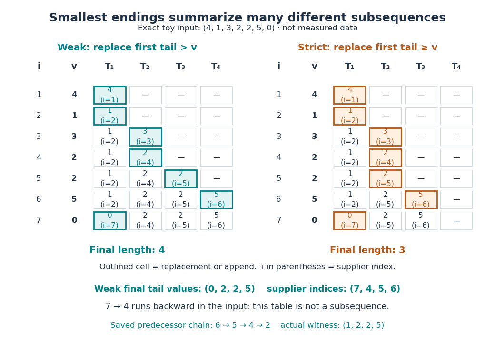

**[Figure 8](#image-two-binary-search-tie-rules-give-different-minimum-tail-tables). Two binary-search tie rules give different minimum-tail tables**. Original exact traces for the same toy input, not measured data. Each cell shows a tail value and the input index supplying it; the outlined cell was updated in that row. At the second $2$, the weak [algorithm](algorithm.md) appends and the strict [algorithm](algorithm.md) replaces. The final weak table has length four, but its supplier indices $7,4,5,6$ are not in increasing order.

**A length certificate needs separate reconstruction.** The final weak tail values are $(0,2,2,5)$, but they do not form an [increasing subsequence](#increasing-subsequence) of this input: the zero occurs last. Each table entry certifies a selection of its own length; the entries need not come from one compatible selection. To recover a [longest increasing subsequence](#longest-increasing-subsequence) during the fast [algorithm](algorithm.md), store a supplier index $q_\ell$ for each tail and a predecessor index for each input position. Before replacing slot $r$, save $p_i=q_{r-1}$, or no predecessor if $r=1$, then set $q_r=i$. Later replacements leave saved $p_i$ unchanged. Follow predecessors from the final $q_{L(x)}$ and reverse. This uses [space complexity](theoretical-computer-science.md#space-complexity) $O(n)$ and returns indices $(2,4,5,6)$ for the weak trace. The same construction works with the strict comparator; compare the two auxiliary arrays in [CP Algorithms contributors, restoring the subsequence after binary search](https://cp-algorithms.com/dynamic_programming/longest_increasing_subsequence.html#restoring-the-subsequence_1).

**Deleting or changing one term.** If $x^{\setminus k}$ deletes position $k$, then

$$
L(x)-1\leq L(x^{\setminus k})\leq L(x).
$$

Deleting cannot create a longer [increasing subsequence](#increasing-subsequence); removing position $k$ from a previously optimal selection loses at most one term. If $x'$ instead changes just the value at position $k$, both inputs have the same deleted [sequence](sequence-and-series.md#sequence), so their lengths each lie between its length and its length plus one. Consequently $|L(x')-L(x)|\leq1$. These bounds also hold for [strictly increasing subsequences](#strictly-increasing-subsequence). In the weak example, deleting either $2$ lowers the length to three, while deleting the final zero leaves it four. This is a [Lipschitz bound](real-analysis.md#lipschitz-bound) for single-term edits, regardless of the numerical size of a replacement. Insertion has the same bound by reversing deletion, so $m$ insertions, deletions or replacements can change $L$ by at most $m$.

For historical context, [Fredman, On computing the length of longest increasing subsequences (1975)](https://doi.org/10.1016/0012-365X(75)90103-X) studies the comparison count for distinct elements of a [totally ordered set](set.md#totally-ordered-set). Its distinctness assumption makes the weak and strict conventions coincide. No distinctness assumption is needed for the comparator-specific [algorithms](algorithm.md) above.

#### Minimum-tail table for increasing subsequences

↑ **Parent:** [Longest increasing subsequence](#longest-increasing-subsequence)

For a processed prefix $(x_1,\ldots,x_i)$, the [minimum-tail table for increasing subsequences](#minimum-tail-table-for-increasing-subsequences) stores

$$
T_\ell=\min\{x_{j_\ell}:1\leq j_1<\cdots<j_\ell\leq i,\ x_{j_1}\leq\cdots\leq x_{j_\ell}\},\qquad 1\leq\ell\leq L(x_1,\ldots,x_i).
$$

There is no slot for an unattainable length. The table records [minimum](set.md#minimum-of-a-subset-of-a-total-order) endings, rather than the terms of one [longest increasing subsequence](#longest-increasing-subsequence). Replacing the value comparisons by $<$ gives the corresponding table for [strictly increasing subsequences](#strictly-increasing-subsequence), whose entries are strictly increasing.

### Strictly increasing subsequence

↑ **Parent:** [Increasing subsequence](#increasing-subsequence)

A [strictly increasing subsequence](#strictly-increasing-subsequence) selects indices $i_1<\cdots<i_m$ of a [sequence](sequence-and-series.md#sequence) with $x_{i_1}<\cdots<x_{i_m}$. Equal values cannot both occur in it. Its [maximum](set.md#maximum-of-a-subset-of-a-total-order) possible length is $L_{<}(x)$, with $L_{<}(())=0$; in general $L_{<}(x)\leq L(x)$ for the weak [longest increasing subsequence](#longest-increasing-subsequence). Use strict comparisons in the [dynamic programming](mathematical-optimization.md#dynamic-programming) [recurrence relation](sequence-and-series.md#recurrence-relation) and replace the first tail at least as large as the next value in the [binary search](algorithm.md#binary-search) [algorithm](algorithm.md).

## Additive combinatorics

↑ **Parent:** [Combinatorics](combinatorics.md)

[This section is present in another page, follow this link to view it.](additive-combinatorics.md)

## Indegree

↑ **Parent:** [Combinatorics](combinatorics.md)

The [indegree](#indegree) $d^-(v)$ of a [vertex](graph.md#vertex-graph-theory) $v$ is the number of [directed edges](graph-theory.md#directed-edge) entering it, counting repeated [directed edges](graph-theory.md#directed-edge) separately if permitted. In the toy [Directed acyclic graph](#directed-acyclic-graph), the initial [indegrees](#indegree) of $A,B,C,D,E$ are $0,0,1,2,2$. In [Kahn's algorithm](#kahn-s-algorithm), these counts are updated to describe only the remaining [directed graph](graph-theory.md#directed-graph), so [indegree](#indegree) zero means that no unfinished predecessor remains. [Sedgewick and Wayne, Digraph: definition of indegree](https://raw.githubusercontent.com/kevin-wayne/algs4/master/src/main/java/edu/princeton/cs/algs4/Digraph.java)

## Directed acyclic graph

↑ **Parent:** [Combinatorics](combinatorics.md)  
ⓦ [Wiki](https://en.wikipedia.org/wiki/Directed_acyclic_graph)

A [Directed acyclic graph](#directed-acyclic-graph) is a [directed graph](graph-theory.md#directed-graph) with no [directed cycle](graph-theory.md#directed-cycle): following its [directed edges](graph-theory.md#directed-edge) can never return to the starting [vertex](graph.md#vertex-graph-theory). A [directed edge](graph-theory.md#directed-edge) $u\to v$ can represent the requirement that task $u$ finish before task $v$ starts. A [directed path](graph-theory.md#directed-path) then records a chain of prerequisites. The essential prerequisite for [topological sorting](#topological-sorting) is that these requirements contain no circular dependency. For finite [directed graphs](graph-theory.md#directed-graph), this is equivalent to the existence of a [topological order](#topological-order). [MIT, Introduction to Algorithms, Recitation 10, p. 3: directed acyclic graphs and topological sorts](https://live.ocw.mit.edu/courses/6-006-introduction-to-algorithms-spring-2020/d9265b3b33d238ff914b0223ac8e7628_MIT6_006S20_r10.pdf)

Consider an invented publishing workflow with five tasks: $A$ drafts the text, $B$ draws a figure, $C$ reviews the text, $D$ lays out the text and figure, and $E$ publishes the result. Its [directed edges](graph-theory.md#directed-edge) are $A\to C$, $A\to D$, $B\to D$, $C\to E$, and $D\to E$. Reviewing needs the draft; layout needs both the draft and figure; publication needs both review and layout. The drawing below encodes only these prerequisites, with no measured durations or resource constraints.

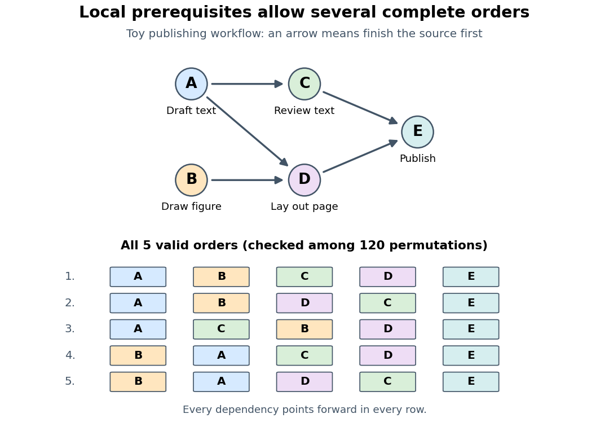

**[Figure 9](#image-five-toy-publishing-tasks-and-all-five-valid-topological-orders). Five toy publishing tasks and all five valid topological orders**.

The [Directed acyclic graph](#directed-acyclic-graph) leaves room for choice: $A$ and $B$ can occur in either order, and after both are complete, $C$ and $D$ can occur in either order. Task $C$ may even precede $B$, since the review does not need the figure. A [topological order](#topological-order) turns these local prerequisites into a complete executable list while retaining this freedom. It supplies a feasible sequential plan; task durations, available workers, and earliest finishing times require additional information.

### Topological sorting

↑ **Parent:** [Directed acyclic graph](#directed-acyclic-graph)  
ⓦ [Wiki](https://en.wikipedia.org/wiki/Topological_sorting)

A [topological sorting](#topological-sorting) is the task of constructing a [topological order](#topological-order) of a finite [directed graph](graph-theory.md#directed-graph), or reporting that a [directed cycle](graph-theory.md#directed-cycle) makes one impossible. [Kahn's algorithm](#kahn-s-algorithm) repeatedly takes a [vertex](graph.md#vertex-graph-theory) with no unfinished prerequisites. This is useful whenever an operation consumes results produced by earlier operations: once a [vertex](graph.md#vertex-graph-theory) is reached in a [topological order](#topological-order), every prerequisite along a [directed path](graph-theory.md#directed-path) has already been processed. [MIT, Lecture 14: job scheduling and topological sorting](https://ocw.mit.edu/courses/6-006-introduction-to-algorithms-spring-2008/resources/lec14/)

The reason a choice is always available in a nonempty finite [Directed acyclic graph](#directed-acyclic-graph) is simple. If every [vertex](graph.md#vertex-graph-theory) had an incoming [directed edge](graph-theory.md#directed-edge), repeatedly following predecessors would eventually revisit a [vertex](graph.md#vertex-graph-theory), giving a [directed cycle](graph-theory.md#directed-cycle). Removing a [vertex](graph.md#vertex-graph-theory) and its incident [directed edges](graph-theory.md#directed-edge) cannot create a [directed cycle](graph-theory.md#directed-cycle), so the argument repeats until every [vertex](graph.md#vertex-graph-theory) is listed. This proves existence of a [topological order](#topological-order) and explains why finiteness matters to this procedure.

// Target: combinatorics.bigb

#### Topological order

↑ **Parent:** [Topological sorting](#topological-sorting)

A [topological order](#topological-order) of a finite [directed graph](graph-theory.md#directed-graph) $G=(V,E)$ is a [sequence](sequence-and-series.md#sequence) $(v_1,\ldots,v_n)$ containing every [vertex](graph.md#vertex-graph-theory) exactly once, with

$$
(v_i,v_j)\in E\quad\Longrightarrow\quad i<j.
$$

Thus every [directed edge](graph-theory.md#directed-edge) points forward in the list. Equivalently, a [bijection](function.md#bijection) $p:V\to\{1,\ldots,n\}$ assigning positions satisfies $p(u)<p(v)$ for every [directed edge](graph-theory.md#directed-edge) $u\to v$. A [topological ordering](#topological-ordering) names the same kind of list. [MIT, Recitation 10, p. 3: the edge-by-edge definition](https://live.ocw.mit.edu/courses/6-006-introduction-to-algorithms-spring-2020/d9265b3b33d238ff914b0223ac8e7628_MIT6_006S20_r10.pdf)

The toy [Directed acyclic graph](#directed-acyclic-graph) has exactly five [topological orders](#topological-order): $ABCDE$, $ABDCE$, $ACBDE$, $BACDE$, and $BADCE$. These lists were checked by enumerating all $5!=120$ [permutations](#permutation) and retaining precisely those satisfying all five [directed edge](graph-theory.md#directed-edge) inequalities. Every list ends with $E$, since all other tasks have a [directed path](graph-theory.md#directed-path) to publication. A [topological order](#topological-order) need not put adjacent entries next to one another in the [directed graph](graph-theory.md#directed-graph): $A$ and $B$ are consecutive in $ABCDE$ without a [directed edge](graph-theory.md#directed-edge) between them.

A [directed cycle](graph-theory.md#directed-cycle) would force the impossible chain of position inequalities $p(u_1)<p(u_2)<\cdots<p(u_k)<p(u_1)$. In the toy example, adding $E\to C$ requires review before publication and publication before review, so there are no [topological orders](#topological-order). Together with the construction in [topological sorting](#topological-sorting), this proves that a finite [directed graph](graph-theory.md#directed-graph) admits a [topological order](#topological-order) if and only if it is a [Directed acyclic graph](#directed-acyclic-graph). The empty [directed graph](graph-theory.md#directed-graph) has the empty [sequence](sequence-and-series.md#sequence) as its [topological order](#topological-order).

There is also a useful connection to [partial orders](set.md#partially-ordered-set): define $u\preceq v$ when $u=v$ or there is a [directed path](graph-theory.md#directed-path) from $u$ to $v$. For a [Directed acyclic graph](#directed-acyclic-graph), this [reachability](graph.md#reachability-in-a-graph) relation is a [partial order](set.md#partially-ordered-set), and its [linear extensions](set.md#linear-extension) are exactly the [topological orders](#topological-order). The [Directed acyclic graph](#directed-acyclic-graph) specifies which pairs must be ordered; a [topological order](#topological-order) chooses positions for all the remaining pairs.

<h4 id="kahn-s-algorithm">Kahn's algorithm</h4>

↑ **Parent:** [Topological sorting](#topological-sorting)

[Kahn's algorithm](#kahn-s-algorithm) maintains each remaining [vertex](graph.md#vertex-graph-theory)'s [indegree](#indegree), the number of its unfinished incoming [directed edges](graph-theory.md#directed-edge), and a [FIFO queue](data-structure.md#fifo-queue) of ready [vertices](graph.md#vertex-graph-theory). Initialize the counts by scanning all [directed edges](graph-theory.md#directed-edge) and enqueue every [vertex](graph.md#vertex-graph-theory) of [indegree](#indegree) zero. Repeatedly dequeue a [vertex](graph.md#vertex-graph-theory) $u$, append it to the output, and decrement the count of each destination $v$ in $u$'s [adjacency list](data-structure.md#adjacency-list). Enqueue $v$ exactly when its count becomes zero. When the [FIFO queue](data-structure.md#fifo-queue) empties, accept the output if it contains all [vertices](graph.md#vertex-graph-theory); otherwise report a [directed cycle](graph-theory.md#directed-cycle). [Sedgewick and Wayne, TopologicalX: queue-based topological sorting](https://raw.githubusercontent.com/kevin-wayne/algs4/master/src/main/java/edu/princeton/cs/algs4/TopologicalX.java)

**[Figure 10](#image-computed-ready-queue-trace-and-the-obstruction-caused-by-a-reverse-dependency). Computed ready-queue trace and the obstruction caused by a reverse dependency**.

In the displayed run, initialize the [FIFO queue](data-structure.md#fifo-queue) as $A,B$ and visit $A$'s destinations in the order $C,D$. Removing $A$ makes $C$ ready but leaves $D$ waiting for $B$. Removing $B$ then makes $D$ ready. Publication becomes ready only after both $C$ and $D$ are removed. The output is $ABCDE$; choosing ready [vertices](graph.md#vertex-graph-theory) differently can produce the other [topological orders](#topological-order). For the modified [directed graph](graph-theory.md#directed-graph) with $E\to C$, the same procedure emits $A,B,D$ and then stops with $C,E$ still waiting on each other.

The invariant is that each stored [indegree](#indegree) counts incoming [directed edges](graph-theory.md#directed-edge) from unprocessed [vertices](graph.md#vertex-graph-theory). A ready [vertex](graph.md#vertex-graph-theory) therefore has every prerequisite already in the output. If the [FIFO queue](data-structure.md#fifo-queue) empties with [vertices](graph.md#vertex-graph-theory) left, every remaining [vertex](graph.md#vertex-graph-theory) has a predecessor in the remaining [directed graph](graph-theory.md#directed-graph); the predecessor argument gives a [directed cycle](graph-theory.md#directed-cycle). The unprocessed [vertices](graph.md#vertex-graph-theory) can also include tasks blocked downstream of a [directed cycle](graph-theory.md#directed-cycle), so the leftover list alone is not a list of exactly the cyclic [vertices](graph.md#vertex-graph-theory).

With [adjacency lists](data-structure.md#adjacency-list), constant-time [array](data-structure.md#array-data-structure) access and counter updates, and constant-time [FIFO queue](data-structure.md#fifo-queue) operations, the [time complexity](theoretical-computer-science.md#time-complexity) is $O(|V|+|E|)$ in [Big O notation](real-analysis.md#big-o-notation). Initialization scans all [vertices](graph.md#vertex-graph-theory) and [directed edges](graph-theory.md#directed-edge); each [vertex](graph.md#vertex-graph-theory) is then enqueued at most once and each outgoing [directed edge](graph-theory.md#directed-edge) processed at most once. Counts, ready [FIFO queue](data-structure.md#fifo-queue), and output need $O(|V|)$ storage beyond the [adjacency lists](data-structure.md#adjacency-list). Shifting an [array](data-structure.md#array-data-structure) on every dequeue invalidates this bound. [Sedgewick and Wayne, TopologicalX: time and extra-space bounds](https://raw.githubusercontent.com/kevin-wayne/algs4/master/src/main/java/edu/princeton/cs/algs4/TopologicalX.java) [Sedgewick and Wayne, Digraph: adjacency lists and outgoing-edge iteration](https://raw.githubusercontent.com/kevin-wayne/algs4/master/src/main/java/edu/princeton/cs/algs4/Digraph.java)

The name refers to A. B. Kahn's 1962 paper "Topological sorting of large networks", published in Communications of the ACM, volume 5, issue 11, pages 558–562. Its abstract motivates [topological sorting](#topological-sorting) through network analysis and project planning. [Kahn, Topological sorting of large networks (1962): publisher's record and abstract](https://doi.org/10.1145/368996.369025)

// Target: foundations-of-mathematics.bigb

### Markov equivalence of directed acyclic graphs

↑ **Parent:** [Directed acyclic graph](#directed-acyclic-graph)

Two [Directed acyclic graphs](#directed-acyclic-graph) are Markov equivalent when they encode the same [D-separations](#d-separation) for all disjoint sets of vertices. They consequently impose the same [global Markov property for a directed acyclic graph](causal-inference.md#global-markov-property-for-a-directed-acyclic-graph), although their causal interpretations can differ.

#### Completed partially directed acyclic graph

↑ **Parent:** [Markov equivalence of directed acyclic graphs](#markov-equivalence-of-directed-acyclic-graphs)

The completed partially directed acyclic graph of a [Markov equivalence of directed acyclic graphs](#markov-equivalence-of-directed-acyclic-graphs) class has their common [skeleton of a directed graph](graph-theory.md#skeleton-of-a-directed-graph). An edge is directed exactly when its orientation agrees in every member of the class, and is otherwise undirected. It can be constructed by enumerating all acyclic orientations with the prescribed [unshielded colliders](#unshielded-collider) and retaining only the common directions; practical [PC algorithms](causal-inference.md#pc-algorithm) use orientation propagation instead of enumeration.

#### Skeleton and collider characterization of Markov equivalence

↑ **Parent:** [Markov equivalence of directed acyclic graphs](#markov-equivalence-of-directed-acyclic-graphs)

Two [Directed acyclic graphs](#directed-acyclic-graph) are [Markov equivalent directed acyclic graphs](#markov-equivalence-of-directed-acyclic-graphs) if and only if they have the same [skeleton of a directed graph](graph-theory.md#skeleton-of-a-directed-graph) and the same [unshielded colliders](#unshielded-collider). Thus these two structures determine the observational equivalence class. This structural theorem is what converts the skeleton and collider phases of the [PC algorithm](causal-inference.md#pc-algorithm) into identification of an equivalence class.

### Moral graph

↑ **Parent:** [Directed acyclic graph](#directed-acyclic-graph)  
ⓦ [Wiki](https://en.wikipedia.org/wiki/Moral_graph)

The moral graph of a [Directed acyclic graph](#directed-acyclic-graph) joins every pair of vertices with a common child and then replaces every directed edge by an undirected edge.

#### Hammersley-Clifford theorem

↑ **Parent:** [Moral graph](#moral-graph)  
ⓦ [Wiki](https://en.wikipedia.org/wiki/Hammersley-Clifford_theorem)

For a strictly positive probability density, factorization into clique potentials of an undirected graph is equivalent to the global Markov conditional-independence property for that graph.

### Topological ordering

↑ **Parent:** [Directed acyclic graph](#directed-acyclic-graph)

A [topological ordering](#topological-ordering) is a [topological order](#topological-order): a list containing every [vertex](graph.md#vertex-graph-theory) once and placing the source of every [directed edge](graph-theory.md#directed-edge) before its destination. In the parent-and-child language of a [Directed acyclic graph](#directed-acyclic-graph), every parent precedes every child, and hence every ancestor precedes every descendant along a [directed path](graph-theory.md#directed-path). This is an ordering of the [vertices](graph.md#vertex-graph-theory), whereas [topological sorting](#topological-sorting) is the task of finding it. See [topological order](#topological-order) for the precise position condition and [Kahn's algorithm](#kahn-s-algorithm) for a construction.

### D-separation

↑ **Parent:** [Directed acyclic graph](#directed-acyclic-graph)  
ⓦ [Wiki](https://en.wikipedia.org/wiki/D-separation)

D-separation blocks paths through conditioned noncolliders and through unconditioned colliders without conditioned descendants.

#### Collider

↑ **Parent:** [D-separation](#d-separation)

On a path in a directed graph, an interior vertex is a collider when both adjacent path edges have arrowheads pointing into it. A path through a collider is blocked unless that collider or one of its descendants is conditioned upon.

##### Unshielded collider

↑ **Parent:** [Collider](#collider)

An unshielded [collider](#collider) in a [Directed acyclic graph](#directed-acyclic-graph) is a triple $a\to b\leftarrow c$ with $a$ and $c$ nonadjacent. The absence of an edge between its outer vertices makes this orientation detectable from [conditional independence](random-variable.md#conditional-independence) information under [faithfulness of a directed acyclic graph](causal-inference.md#faithfulness-of-a-directed-acyclic-graph).

#### D-separating set

↑ **Parent:** [D-separation](#d-separation)

A set d-separates two vertex sets when it blocks every path between them.

#### Local Markov property of a directed acyclic graph

↑ **Parent:** [D-separation](#d-separation)

Conditioned on its parents, a vertex is d-separated from all nondescendants other than those parents.

#### Global Markov property of a directed acyclic graph

↑ **Parent:** [D-separation](#d-separation)

The global Markov property of a [Directed acyclic graph](#directed-acyclic-graph) says that d-separation of vertex sets $A$ and $B$ by $S$ implies conditional independence of the corresponding random vectors given the variables at $S$.

## Incidence geometry

↑ **Parent:** [Combinatorics](combinatorics.md)  
ⓦ [Wiki](https://en.wikipedia.org/wiki/Incidence_geometry)

Incidence geometry studies which points lie on which curves, lines or higher-dimensional objects and how many such incidences a finite configuration can have.

### Linear space (geometry)

↑ **Parent:** [Incidence geometry](#incidence-geometry)  
ⓦ [Wiki](https://en.wikipedia.org/wiki/Linear_space_(geometry))

A linear space is a structure in [incidence geometry](#incidence-geometry) with a [set](set.md) of points and a collection of [subsets](set.md#subset) called lines: any two distinct points lie on exactly one line, and every line contains at least two points. The lines here are incidence-theoretic objects, without a required coordinate realization. A [finite linear space](extremal-set-theory.md#finite-linear-space) imposes finiteness; its nontrivial form excludes a line containing all points. This is distinct from a [vector space](vector-space.md), whose structure involves addition and scalar multiplication.

### Joint of a line collection

↑ **Parent:** [Incidence geometry](#incidence-geometry)

For distinct real affine lines in $\mathbb R^n$, $n\ge2$, a [joint of a line collection](#joint-of-a-line-collection) is a point lying on $n$ lines with [linearly independent](vector-space.md#linear-independence) direction vectors. In three dimensions the directions must not all lie in one plane. Extra incident lines are allowed; existence of one spanning choice is enough. This counts [joint of a line collection](#joint-of-a-line-collection) points, rather than tuples of lines or incidence multiplicities.

#### Joints theorem

↑ **Parent:** [Joint of a line collection](#joint-of-a-line-collection)

The number of [joints of a line collection](#joint-of-a-line-collection) formed by $L$ distinct real affine lines in $\mathbb R^n$ is at most $C_n L^{n/(n-1)}$. The [pruning and minimal-degree polynomial argument](#pruning-and-minimal-degree-polynomial-argument) proves this bound. The exponent is sharp: the coordinate-line grid has $m^n$ [joints of a line collection](#joint-of-a-line-collection) and $n m^{n-1}$ lines. In three dimensions the bound is $C L^{3/2}$.

##### Pruning and minimal-degree polynomial argument

↑ **Parent:** [Joints theorem](#joints-theorem)

Let a line collection have $M$ [joints of a line collection](#joint-of-a-line-collection) and put $D=\lceil nM^{1/n}\rceil$. If $M>LD$, deleting each line with at most $D$ current [joints of a line collection](#joint-of-a-line-collection), together with those [joints of a line collection](#joint-of-a-line-collection), leaves a nonempty configuration in which every line has more than $D$ [joints of a line collection](#joint-of-a-line-collection). A nonzero [polynomial](polynomial.md) of degree at most $D$ vanishes on the retained [joints of a line collection](#joint-of-a-line-collection) by [rank-nullity theorem](kernel-of-a-linear-map.md#rank-nullity-theorem). Choose one of minimum degree. Its restriction vanishes identically on every retained line, so its [gradient](multivariable-calculus.md#gradient) is orthogonal to a spanning set of directions at every [joint of a line collection](#joint-of-a-line-collection) and hence vanishes there. Each nonzero [partial derivative](multivariable-calculus.md#partial-derivative) would be a lower-degree [polynomial](polynomial.md) with the same zeros, contradicting minimality. In characteristic zero, all derivatives vanishing forces a constant [polynomial](polynomial.md), another contradiction. Therefore $M\le LD$, giving the [joints theorem](#joints-theorem). The argument's characteristic-zero assumption is essential to its derivative step.

### Kakeya set

↑ **Parent:** [Incidence geometry](#incidence-geometry)  
ⓦ [Wiki](https://en.wikipedia.org/wiki/Kakeya_set)

A bounded subset of $\mathbb R^n$ is a [Kakeya set](#kakeya-set) if it contains a unit line segment in every direction. Segment positions may vary with direction. Such a set need not have positive [Lebesgue measure](measure-theory.md#lebesgue-measure); the dimension problem concerns its [Minkowski dimension](geometry-and-topology.md#box-counting-dimension) or other notions of dimension.

#### Besicovitch set

↑ **Parent:** [Kakeya set](#kakeya-set)

A Besicovitch set is a planar Kakeya set of Lebesgue measure zero containing a unit line segment in every direction.

##### Compact Kakeya construction from small projections

↑ **Parent:** [Besicovitch set](#besicovitch-set)

Choose a compact $K\subset[0,1]\times\mathbb R$ with full horizontal projection and zero-length projections $y+tx$ for $t\in[0,1]$. Then the displayed set is compact, has zero area by the [Fubini theorem](measure-theory.md#fubini-s-theorem), and contains a segment of every slope in $[0,1]$. Such parameter sets exist by the [Baire category theorem](topological-analysis.md#baire-category-theorem) in the [Hausdorff metric](topological-analysis.md#hausdorff-distance): fine parallel segments approximate any parameter set while making a fixed band of projections uniformly small. Finite grids and a countable intersection make every required projection null. Four rotated copies supply every planar direction.

##### Perron tree

↑ **Parent:** [Besicovitch set](#besicovitch-set)

A Perron tree is a finite triangular splitting-and-sliding arrangement retaining a prescribed angular range while overlapping its pieces strongly. The compression parameter and the number of generations can make union area an arbitrarily small fraction of total piece area. Suitable longitudinal extensions separate the pieces into disjoint rectangles. This stronger finite geometry is used by the ball-multiplier counterexample; a compact measure-zero [Besicovitch set](#besicovitch-set) alone does not assert that arbitrary segment translates are disjoint.

#### Kakeya Minkowski dimension conjecture

↑ **Parent:** [Kakeya set](#kakeya-set)

The dimension assertion asks that every bounded [Kakeya set](#kakeya-set) in $\mathbb R^n$ have full [Minkowski dimension](geometry-and-topology.md#box-counting-dimension). The [Kakeya maximal conjecture](fourier-analysis.md#kakeya-maximal-conjecture) implies the stronger lower-dimension conclusion: its application to $E_\delta$ gives $|E_\delta|\gtrsim_{n,\varepsilon}\delta^{n\varepsilon}$, hence $N_\delta(E)\gtrsim_{n,\varepsilon}\delta^{-n+n\varepsilon}$ for every $\varepsilon>0$.

#### Kakeya tube

↑ **Parent:** [Kakeya set](#kakeya-set)

A Kakeya tube is a neighborhood of transverse radius $\delta$ of a line segment of fixed unit length. Round cross-sections and comparable rectangular cross-sections are interchangeable up to fixed constants. The tube has [Lebesgue measure](measure-theory.md#lebesgue-measure) comparable to $\delta^{n-1}$ in $\mathbb R^n$.

### Ordinary line

↑ **Parent:** [Incidence geometry](#incidence-geometry)

Relative to a finite point set, an [ordinary line](#ordinary-line) is a line containing exactly two points of that set. It is an exact-richness condition, not a count of unordered pairs alone: a line with three points contains three point pairs but is not ordinary. [Point-line duality](projective-space.md#point-line-duality) turns ordinary lines into intersections incident to exactly two dual lines.

#### Cubic covering from few ordinary lines

↑ **Parent:** [Ordinary line](#ordinary-line)

If a finite planar point set has at most $Kn$ [ordinary lines](#ordinary-line), its points can be covered by $O(K+1)$ possibly reducible cubics. The [Euler defect identity for a projective line arrangement](projective-space.md#euler-defect-identity-for-a-projective-line-arrangement) gives $O(Kn)$ bad edges in the dual. [Bounded-radius propagation of edge defects](projective-space.md#bounded-radius-propagation-of-edge-defects) and averaging select one dual line with $O(K+1)$ unsafe edges. [Cubic propagation along a triangular strip](algebraic-geometry.md#cubic-propagation-along-a-triangular-strip) covers each safe run; each exceptional intersection vertex represents a primal line, covered by a [degenerate cubic containing a line](algebraic-geometry.md#degenerate-cubic-containing-a-line). A dual line with very few intersection vertices instead yields a direct covering by few primal lines.

### Distinct-distance set

↑ **Parent:** [Incidence geometry](#incidence-geometry)

For a finite planar point set $P$, its [distinct-distance set](#distinct-distance-set) is $\Delta(P)=\{|p-q|:p,q\in P\}$. It includes zero for nonempty $P$. Its cardinality measures how many different distances the configuration determines. Ordered point pairs can be grouped according to their distance, which relates the problem to [incidences between points and curves](#incidences-between-points-and-curves).

<h4 id="szekely-distinct-distance-bound">Székely distinct-distance bound</h4>

↑ **Parent:** [Distinct-distance set](#distinct-distance-set)

For a finite set of at least two points in the plane, some point determines the displayed number of different positive [Euclidean distances](topological-analysis.md#euclidean-distance). The [circular-arc graph for distinct distances](#circular-arc-graph-for-distinct-distances) has quadratically many [edges](graph-theory.md#edge-of-a-graph). The [rich-bisector deletion bound](#rich-bisector-deletion-bound) removes high-multiplicity [edges](graph-theory.md#edge-of-a-graph) while retaining that order of growth. The [crossing lemma for multigraphs](graph-theory.md#crossing-lemma-for-multigraphs) then compares its lower crossing bound with the quadratic count of pairs of [circles](topology.md#circle). This strengthens the corresponding bound for the whole [distinct-distance set](#distinct-distance-set). The original result is Theorem11 of [Székely's 1997 paper](https://www.cs.tau.ac.il/~michas/szekely.pdf).

##### Circular-arc graph for distinct distances

↑ **Parent:** [Székely distinct-distance bound](#szekely-distinct-distance-bound)

Around each of $n$ points draw its at most $t$ distinct-distance [circles](topology.md#circle). On every [circle](topology.md#circle) containing at least three points, join cyclically consecutive points by arcs. The resulting loopless [multigraph](graph.md#multigraph) has at least $n(n-1)-2nt$ [edges](graph-theory.md#edge-of-a-graph) and a drawing with $O(n^2t^2)$ crossings. A pair joined by several arcs has every corresponding centre on its [perpendicular bisector](euclidean-geometry.md#perpendicular-bisector), which is the key to bounding multiplicity.

###### Rich-bisector deletion bound

↑ **Parent:** [Circular-arc graph for distinct distances](#circular-arc-graph-for-distinct-distances)

Every supporting centre of an arc between fixed endpoints lies on their [perpendicular bisector](euclidean-geometry.md#perpendicular-bisector). Multiplicity at least $k$ therefore makes that [line](euclidean-geometry.md#straight-line) contain at least $k$ of the original points. For each such [line](euclidean-geometry.md#straight-line) containing $s$ points, its $s$ centres each support at most $t$ [circles](topology.md#circle); on one [circle](topology.md#circle) at most two consecutive-point arcs have that symmetry axis. The [rich line bound](#rich-line-bound) summed over dyadic occupancies gives the displayed bound.

#### Unit-circle method for a distinct-distance lower bound

↑ **Parent:** [Distinct-distance set](#distinct-distance-set)

For every positive distance, draw equal-radius circles centred at the points of $P$. Their [incidences between points and curves](#incidences-between-points-and-curves) count the ordered pairs at that distance. The [Szemerédi–Trotter theorem for unit circles](#szemeredi-trotter-theorem-for-unit-circles) bounds each distance class by $O(|P|^{4/3})$. Summing over all classes accounts for $|P|(|P|-1)$ pairs, proving $|\Delta(P)|\gtrsim |P|^{2/3}$.

### Incidences between points and curves

↑ **Parent:** [Incidence geometry](#incidence-geometry)

For finite sets of points $P$ and geometric curves $\mathcal C$, a point-curve incidence is a pair $(p,\gamma)$ with $p\in\gamma$. The incidence count is $I(P,\mathcal C)=\sum_{\gamma\in\mathcal C}|P\cap\gamma|$. Bounds in [incidence geometry](#incidence-geometry) exploit restrictions on how curves can meet points, rather than treating the incidence relation as an arbitrary bipartite graph.

#### Incidence bound from two-point multiplicity

↑ **Parent:** [Incidences between points and curves](#incidences-between-points-and-curves)

If $n$ points and $m$ curves have the property that each pair of distinct points lies on at most $\lambda$ curves, then [double counting](#double-counting-proof-technique) gives $\sum_\gamma k_\gamma(k_\gamma-1)\le\lambda n(n-1)$, where $k_\gamma=|P\cap\gamma|$. The [Cauchy-Schwarz inequality](probability-and-statistics.md#cauchy-schwarz-inequality) implies $I^2\le mI+\lambda mn(n-1)$ and hence $I\le m+\sqrt{\lambda mn(n-1)}$. The statement needs only this combinatorial multiplicity condition, not algebraicity.

<h3 id="szemeredi-trotter-theorem">Szemerédi–Trotter theorem</h3>

↑ **Parent:** [Incidence geometry](#incidence-geometry)  
ⓦ [Wiki](https://en.wikipedia.org/wiki/Szemerédi–Trotter_theorem)

For $m$ lines and $n$ points in the real plane, the number of point-line incidences is

$$
O(m+n+m^{2/3}n^{2/3}).
$$

Connecting consecutive incidence points on each line and applying the [Crossing lemma](graph-theory.md#crossing-lemma) proves the bound.

#### Rich line bound

↑ **Parent:** [Szemerédi–Trotter theorem](#szemeredi-trotter-theorem)

For $n$ distinct points in the real plane, $L_{\geq k}$ counts [lines](euclidean-geometry.md#straight-line) containing at least $k\geq2$ points. The [Szemerédi–Trotter theorem](#szemeredi-trotter-theorem) applied to these [lines](euclidean-geometry.md#straight-line) gives the bound by absorbing its additive line-count term; bounded $k$ follows by counting point pairs. Consequently, summing occupancies of [lines](euclidean-geometry.md#straight-line) with at least $k$ points by dyadic ranges gives $O(n^2/k^2+n\log n)$.

<h4 id="szemeredi-trotter-theorem-for-unit-circles">Szemerédi–Trotter theorem for unit circles</h4>

↑ **Parent:** [Szemerédi–Trotter theorem](#szemeredi-trotter-theorem)

For distinct equal-radius circles and a finite point set in the real plane, [incidences between points and curves](#incidences-between-points-and-curves) satisfy $I(P,\mathcal C)=O(|P|^{2/3}|\mathcal C|^{2/3}+|P|+|\mathcal C|)$. Scaling the plane reduces any common positive radius to one. The constant is universal. The fixed-radius condition bounds the number of circles through two prescribed distinct points by two.

#### Incidences between points and polynomial graphs

↑ **Parent:** [Szemerédi–Trotter theorem](#szemeredi-trotter-theorem)

For $m$ distinct real univariate polynomials of degree at most $d$ and $n$ points with distinct first coordinates, the number of incidences between the points and the polynomial graphs is

$$
O\left(m+n+d^{1/3}m^{2/3}n^{2/3}\right).
$$

Two polynomial graphs meet at most $d$ times, so the graph formed from consecutive incidences has $O(dm^2)$ crossings; the [Crossing lemma](graph-theory.md#crossing-lemma) supplies the lower bound.

## Degree-sum formula

↑ **Parent:** [Combinatorics](combinatorics.md)

In every finite undirected graph, the sum of the vertex degrees is twice the number of edges, because each edge contributes one to the degree of each endpoint.

## Tree (graph theory)

↑ **Parent:** [Combinatorics](combinatorics.md)

[This section is present in another page, follow this link to view it.](tree-graph-theory.md)

## Double counting (proof technique)

↑ **Parent:** [Combinatorics](combinatorics.md)  
ⓦ [Wiki](https://en.wikipedia.org/wiki/Double_counting_(proof_technique))

Double counting establishes an identity by computing the [cardinality](cardinal-number.md#cardinality) of the same [finite set](set.md#finite-set) in two ways. The useful step is to identify exactly what the members of that collection are; an algebraic equality then records two legitimate ways to organize them.

Take the [ordered pairs](set.md#ordered-pair) $(S,x)$ where $S$ is a $k$-element [subset](set.md#subset) of an $n$-element [set](set.md) and $x\in S$ is marked. Choosing $S$ first gives $k\binom nk$ pairs. Choosing $x$ first leaves $k-1$ members to choose from the other $n-1$, giving $n\binom{n-1}{k-1}$. Hence

$$
k\binom nk=n\binom{n-1}{k-1}\qquad(1\leq k\leq n).
$$

For five people and two-person teams, both counts give $20$: ten teams with two choices of a marked member, or five choices of that member with four choices of a teammate. The identity is explained by the [bijection](function.md#bijection) between these descriptions, rather than merely verified through [factorials](#factorial).

## Set partition

↑ **Parent:** [Combinatorics](combinatorics.md)

A [set partition](#set-partition) of a [finite set](set.md#finite-set) $X$ is a [set](set.md) $\pi=\{B_1,\ldots,B_k\}$ of nonempty [subsets](set.md#subset), called [blocks of a set partition](#block-of-a-set-partition), with

$$
B_i\ne\varnothing,\qquad B_i\cap B_j=\varnothing\quad(i\ne j),\qquad \bigcup_{i=1}^k B_i=X.
$$

Thus every [set element](set.md#element-of-a-set) of $X$ belongs to exactly one [block of a set partition](#block-of-a-set-partition). This is the finite counting version of a [partition of a set](set.md#partition-of-a-set). The [blocks of a set partition](#block-of-a-set-partition) are **unlabelled**: their subscripts help describe them, but give them no roles or order. Stanley uses this definition in his classification of counting problems.[section 1.9: set partitions and their blocks](mathematics-bibliography.md#enumerative-combinatorics-volume-1-second-edition-draft-by-richard-stanley)

**All possibilities for three elements.** The [set](set.md) $\{1,2,3\}$ has exactly five [set partitions](#set-partition):

$$
\begin{gathered}
\{\{1,2,3\}\},\\
\{\{1,2\},\{3\}\},\quad \{\{1,3\},\{2\}\},\quad \{\{1\},\{2,3\}\},\\
\{\{1\},\{2\},\{3\}\}.
\end{gathered}
$$

For two [blocks of a set partition](#block-of-a-set-partition), one must have size two and the other size one; the three choices of the lone element give the middle row. One [block of a set partition](#block-of-a-set-partition) forces the whole [set](set.md), and three [blocks of a set partition](#block-of-a-set-partition) force three [singleton sets](set.md#singleton-mathematics). This proves the enumeration complete, with counts $1,3,1$ by number of [blocks of a set partition](#block-of-a-set-partition). Their [sum](arithmetic.md#sum) is the [Bell number](#bell-number) $B_3=5$.

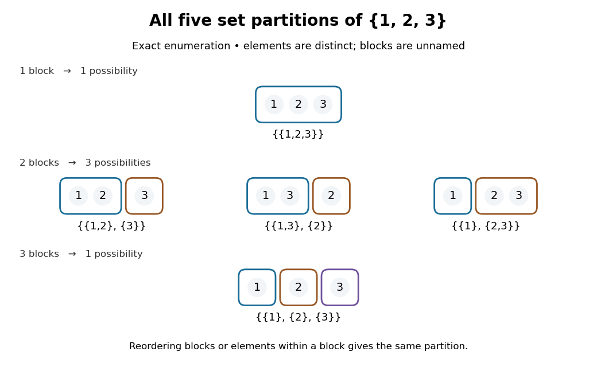

**[Figure 11](#image-exact-enumeration-of-the-five-set-partitions-of-1-2-3-outlines-show-blocks-of-a-set-partition-whose-positions-and-colours-carry-no-labels). Exact enumeration of the five set partitions of $\{1,2,3\}$: outlines show blocks of a set partition, whose positions and colours carry no labels**.

**What information is kept?** Exchanging the two [blocks of a set partition](#block-of-a-set-partition) in $\{\{1,2\},\{3\}\}$ leaves the same [set partition](#set-partition); writing the [tuple](set-theory.md#finite-tuple) $(\{1,2\},\{3\})$ instead makes an ordered list, different from $(\{3\},\{1,2\})$. Exchanging elements within a [block of a set partition](#block-of-a-set-partition) also changes nothing. In contrast, $\{\{1,3\},\{2\}\}$ is a different [set partition](#set-partition), because the actual memberships differ. Both have the same [integer partition](#integer-partition) $2+1$ of sizes. An [integer partition](#integer-partition), or its [Ferrers diagram](#ferrers-diagram), forgets which distinct objects were grouped together.

For four named people, $\{\{1,2\},\{3,4\}\}$ and $\{\{1,3\},\{2,4\}\}$ therefore describe different ways of making two unnamed teams, although both have sizes $2+2$. If every team must have exactly two people, only three [set partitions](#set-partition) qualify; if any nonempty team sizes are permitted, the [Stirling number of the second kind](#stirling-numbers-of-the-second-kind) $S(4,2)=7$ counts them. Naming the teams changes the counting problem again.

A [set partition](#set-partition) is useful whenever membership matters but category names do not. Define $x\sim y$ when $x$ and $y$ belong to the same [block of a set partition](#block-of-a-set-partition). This is an [equivalence relation](set-theory.md#equivalence-relation), and its [equivalence classes](set-theory.md#equivalence-class) recover the [set partition](#set-partition). Conversely, an [equivalence relation](set-theory.md#equivalence-relation) supplies its [set partition](#set-partition) of [equivalence classes](set-theory.md#equivalence-class). The beautiful simplification is that one grouping can be described by whole [subsets](set.md#subset) or by a rule comparing two elements. Additional distinctions are organized by [refinement of a set partition](#refinement-of-a-set-partition).

The [empty set](set.md#empty-set) has one [set partition](#set-partition), the empty collection $\pi=\varnothing$, with zero [blocks of a set partition](#block-of-a-set-partition). This differs from $\{\varnothing\}$, which is forbidden because its proposed [block of a set partition](#block-of-a-set-partition) is empty.

### Ordered set partition

↑ **Parent:** [Set partition](#set-partition)

### Noncrossing partition

↑ **Parent:** [Set partition](#set-partition)

A partition of cyclically ordered points into blocks whose connections can be drawn inside the circle without crossings between blocks. Equivalently, no two distinct blocks contain alternating points $a,b,c,d$ with $a,c$ in one block and $b,d$ in the other. The number on $n$ points is the $n$th [Catalan number](#catalan-number).

### Exact cover

↑ **Parent:** [Set partition](#set-partition)

Given a [set](set.md) $U$ and a family of its [subsets](set.md#subset), an [exact cover](#exact-cover) selects members of that family so that each element of $U$ belongs to exactly one selected member. Thus the selected members are [disjoint sets](set.md#disjoint-sets) whose [set union](set.md#set-union) is $U$. Anchoring a recursive choice at the smallest uncovered element avoids counting a cover in different orders.

### Block of a set partition

↑ **Parent:** [Set partition](#set-partition)

A [block of a set partition](#block-of-a-set-partition) is one of its nonempty [subsets](set.md#subset). Distinct [blocks of a set partition](#block-of-a-set-partition) have empty [intersection](set.md#set-intersection), and their [union](set.md#set-union) is the original [set](set.md). For $\pi=\{\{1,3\},\{2\}\}$, the [blocks of a set partition](#block-of-a-set-partition) are $\{1,3\}$ and the [singleton set](set.md#singleton-mathematics) $\{2\}$. The indices in a written list of [blocks of a set partition](#block-of-a-set-partition) do not label or order the [set partition](#set-partition).

### Refinement of a set partition

↑ **Parent:** [Set partition](#set-partition)

A [set partition](#set-partition) $\mathcal Q$ refines $\mathcal P$ if every cell of $\mathcal Q$ is contained in a cell of $\mathcal P$. Thus $\mathcal Q$ retains every separation made by $\mathcal P$ and may make additional separations. [Refinement of a set partition](#refinement-of-a-set-partition) is reflexive and transitive. If each partition refines the other, their cells coincide, so [refinement of a set partition](#refinement-of-a-set-partition) is a partial order on partitions. For finite partitions the nonempty intersections of cells form their common [refinement of a set partition](#refinement-of-a-set-partition). In [graph](graph.md) regularity arguments, subdividing cells and treating discarded [vertices](graph.md#vertex-graph-theory) as singletons preserves [refinement of a set partition](#refinement-of-a-set-partition); merging discarded [vertices](graph.md#vertex-graph-theory) into one cell need not. The [refinement variance identity for regularity energy](probabilistic-combinatorics.md#refinement-variance-identity-for-regularity-energy) consequently proves that this singleton treatment cannot decrease the [equitable regularity energy](probabilistic-combinatorics.md#equitable-regularity-energy).

### Integer partition

↑ **Parent:** [Set partition](#set-partition)  
ⓦ [Wiki](https://en.wikipedia.org/wiki/Integer_partition)

An [integer partition](#integer-partition) of a [nonnegative integer](arithmetic.md#natural-number) $n$ is a [multiset](set.md#multiset) of [positive integers](integer.md#positive-integer) whose [sum](arithmetic.md#sum) is $n$: repetitions matter, but the order of the summands does not. Equivalently, write its parts in decreasing order, allowing equality:

$$
\lambda=(\lambda_1,\ldots,\lambda_\ell),\qquad
\lambda_1\geq\cdots\geq\lambda_\ell>0,\qquad
\sum_{i=1}^{\ell}\lambda_i=n.
$$

The notation $\lambda\vdash n$ says that $\lambda$ is an [integer partition](#integer-partition) of $n$. The partition count $p(n)$ counts all [integer partitions](#integer-partition) of $n$, with any number of parts. Zero has one empty [integer partition](#integer-partition), so $p(0)=1$. The [partition of an integer](representation-theory-of-the-symmetric-group.md#partition-of-an-integer) article develops the same objects in [representation theory of the symmetric group](representation-theory-of-the-symmetric-group.md).[section 1.7, definitions of partitions and diagrams](mathematics-bibliography.md#enumerative-combinatorics-volume-1-second-edition-draft-by-richard-stanley)

**Computed example.** The seven [integer partitions](#integer-partition) of five are exactly

$$
5;\quad 4+1;\quad 3+2;\quad 3+1+1;\quad
2+2+1;\quad 2+1+1+1;\quad 1+1+1+1+1.
$$

Thus $p(5)=7$. Sorting each list of positive summands into decreasing order prevents repetitions in this enumeration. Grouping by largest part verifies completeness: largest parts $5,4,3,2,1$ contribute respectively $1,1,2,2,1$ possibilities. For largest part $3$, the remaining $2$ is either $2$ or $1+1$; for largest part $2$, the remaining $3$ uses only $2$ and $1$, giving $2+1$ or $1+1+1$.

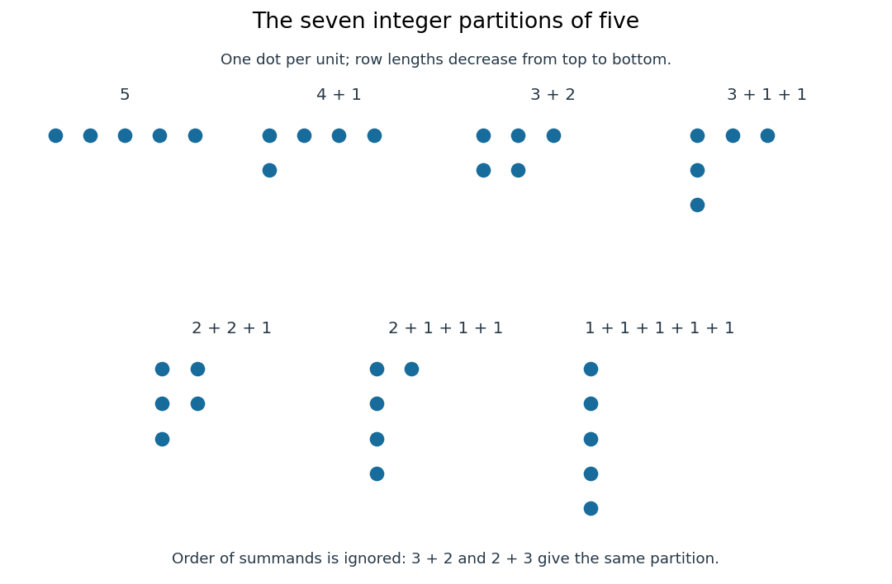

**[Figure 12](#image-all-seven-integer-partitions-of-five-drawn-as-ferrers-diagrams-each-row-has-as-many-dots-as-its-part). All seven integer partitions of five, drawn as Ferrers diagrams: each row has as many dots as its part**.

An [integer partition](#integer-partition) keeps sizes without named positions. The [compositions of an integer](#composition-of-an-integer) $(3,2)$ and $(2,3)$ are different [tuples](set-theory.md#finite-tuple), but sorting either gives the same [integer partition](#integer-partition) $3+2$. A [weak composition of an integer](#weak-composition-of-an-integer) $(0,3,2)$ also retains its empty first position; dropping its zero and sorting gives that same [integer partition](#integer-partition). Conversely, a [set partition](#set-partition) records which distinct elements belong to each block. For example, the [set partitions](#set-partition) $\{\{1,2,3\},\{4,5\}\}$ and $\{\{1,2,4\},\{3,5\}\}$ differ even though both have the same [integer partition](#integer-partition) $3+2$ of block sizes.

The [Ferrers diagram](#ferrers-diagram) makes an [integer partition](#integer-partition) into a shape. For $3+2$, the column lengths are $2,2,1$: exchanging rows and columns gives its [conjugate partition](representation-theory-of-the-symmetric-group.md#conjugate-partition) $2+2+1$. Exchanging again recovers $3+2$, so this operation is a [bijection](function.md#bijection). In particular, the three [integer partitions](#integer-partition) of five with at most two parts are $5$, $4+1$, and $3+2$; their [conjugate partitions](representation-theory-of-the-symmetric-group.md#conjugate-partition) $1+1+1+1+1$, $2+1+1+1$, and $2+2+1$ are precisely the three with largest part at most two. This visible symmetry explains the equal counts for these two restrictions. The square-cell version is the existing [Young diagram](representation-theory-of-the-symmetric-group.md#young-diagram).

**Counting by a generating function.** An [integer partition](#integer-partition) is determined by its multiplicities $m_j$, the number of parts equal to $j$. Its size condition is $\sum_{j\geq1}j m_j=n$. Consequently its [ordinary generating function](commutative-algebra.md#ordinary-generating-function) is

$$
\sum_{n\geq0}p(n)q^n
=\prod_{j\geq1}\left(1+q^j+q^{2j}+\cdots\right)
=\prod_{j\geq1}\frac{1}{1-q^j}.
$$

**Proof outline.** Choose the term $q^{jm_j}$ from the $j$th [geometric series](sequence-and-series.md#geometric-series). The product contributes $q^n$ exactly when those multiplicities describe an [integer partition](#integer-partition) of $n$, once for each such [integer partition](#integer-partition). As a [formal power series](commutative-algebra.md#formal-power-series), each [coefficient](vector-space.md#coefficient) is determined by finitely many factors: factors with $j>n$ contribute only their constant term to the [coefficient](vector-space.md#coefficient) of $q^n$. For $n=5$, multiplication through $j=5$ gives $1+q+2q^2+3q^3+5q^4+7q^5$ up to degree five, independently recovering $p(5)=7$. Restricting the factors gives the [generating function for partitions with bounded parts](representation-theory-of-the-symmetric-group.md#generating-function-for-partitions-with-bounded-parts). This is useful because restrictions on summands become choices of factors, while [conjugate partitions](representation-theory-of-the-symmetric-group.md#conjugate-partition) turn restrictions on numbers of rows into restrictions on row lengths.[section 1.8, conjugation and partition generating functions](mathematics-bibliography.md#enumerative-combinatorics-volume-1-second-edition-draft-by-richard-stanley)

#### Binary partition

↑ **Parent:** [Integer partition](#integer-partition)

An [integer partition](#integer-partition) in which every part is a [power of two](integer.md#power-of-two). Its [generating function](sequence-and-series.md#generating-function) is $\prod_{j\ge0}(1-x^{2^j})^{-1}$, because the factor indexed by $j$ chooses the multiplicity of the part $2^j$.

#### Bulgarian solitaire

↑ **Parent:** [Integer partition](#integer-partition)

A move removes one counter from each nonempty pile and forms a new pile from the removed counters. Thus the move acts on an [integer partition](#integer-partition) of a fixed total.

#### Partition in a rectangle

↑ **Parent:** [Integer partition](#integer-partition)

An [integer partition](#integer-partition) whose [Young diagram](representation-theory-of-the-symmetric-group.md#young-diagram) has at most $h$ rows and at most $w$ cells per row. Zeros may pad the list of row lengths. The [partition interpretation of Gaussian binomial coefficients](binomial-coefficient.md#partition-interpretation-of-gaussian-binomial-coefficients) counts these diagrams by their number of cells.

#### Ferrers diagram

↑ **Parent:** [Integer partition](#integer-partition)

A [Ferrers diagram](#ferrers-diagram) of an [integer partition](#integer-partition) $\lambda$ is a left-aligned array of dots with $\lambda_i$ dots in row $i$, using the longest row at the top here. Replacing each dot by a square cell gives a [Young diagram](representation-theory-of-the-symmetric-group.md#young-diagram). Reading the column lengths gives the [conjugate partition](representation-theory-of-the-symmetric-group.md#conjugate-partition).[section 1.7, Ferrers and Young diagrams](mathematics-bibliography.md#enumerative-combinatorics-volume-1-second-edition-draft-by-richard-stanley)

### Stirling numbers of the second kind

↑ **Parent:** [Set partition](#set-partition)  
ⓦ [Wiki](https://en.wikipedia.org/wiki/Stirling_numbers_of_the_second_kind)

For [nonnegative integers](arithmetic.md#natural-number) $n,k$, the [Stirling number of the second kind](#stirling-numbers-of-the-second-kind)

$$
S(n,k)=\left\{\begin{matrix}n\\k\end{matrix}\right\}
$$

counts the [set partitions](#set-partition) of an $n$-element [finite set](set.md#finite-set) into exactly $k$ unlabelled [blocks of a set partition](#block-of-a-set-partition). Set $S(0,0)=1$, $S(n,0)=0$ for $n>0$, and $S(n,k)=0$ for $k>n$. Also $S(n,1)=S(n,n)=1$ for $n\geq1$. Grassl and Levin develop these counts through explicit [set partitions](#set-partition) and a [recurrence relation](sequence-and-series.md#recurrence-relation). [Grassl and Levin, More Discrete Mathematics via Graph Theory, section 3.1: counting partitions](https://discrete.openmathbooks.org/more/mdm/sec_adv-partitions.html)

**Insert one distinguished element.** For $n\geq1$ and $1\leq k\leq n$, the [Stirling numbers of the second kind](#stirling-numbers-of-the-second-kind) obey

$$
S(n,k)=kS(n-1,k)+S(n-1,k-1).
$$

**Proof outline.** Inspect the [block of a set partition](#block-of-a-set-partition) containing $n$. If it contains another element, removing $n$ leaves a [set partition](#set-partition) into $k$ [blocks of a set partition](#block-of-a-set-partition); conversely, insert $n$ into any of those $k$ [blocks of a set partition](#block-of-a-set-partition). If $n$ is alone, remove its [singleton set](set.md#singleton-mathematics) and obtain a [set partition](#set-partition) into $k-1$ [blocks of a set partition](#block-of-a-set-partition). The cases cannot overlap, and deletion reverses each construction. This explains the factor $k$ even though the [blocks of a set partition](#block-of-a-set-partition) have no names. [Grassl and Levin, More Discrete Mathematics via Graph Theory, section 3.4: Stirling recurrence](https://discrete.openmathbooks.org/more/mdm/sec_adv-stirling.html)

For $n=4,k=2$, start with the three two-block [set partitions](#set-partition) of $\{1,2,3\}$. Inserting $4$ into either [block of a set partition](#block-of-a-set-partition) gives six possibilities. The remaining possibility is $\{\{1,2,3\},\{4\}\}$, obtained by making $4$ a [singleton set](set.md#singleton-mathematics). Hence $S(4,2)=2\cdot3+1=7$. The seven [set partitions](#set-partition) in the diagram comprise four with sizes $3+1$ and three with sizes $2+2$; this grouping by sizes independently gives $4+3=7$.

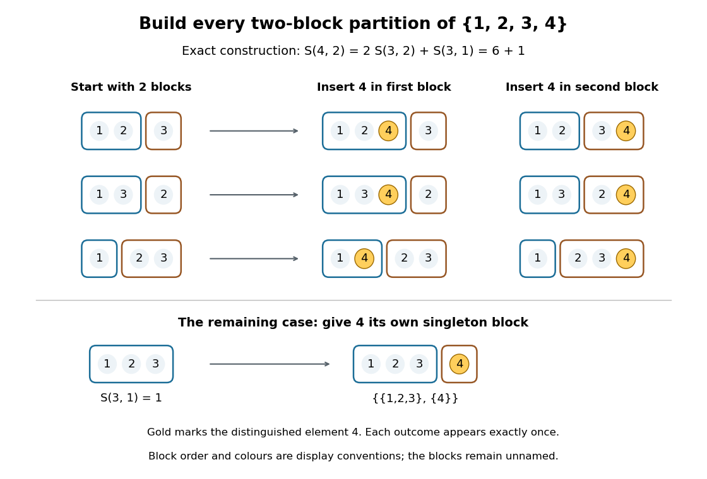

**[Figure 13](#image-exact-construction-of-all-seven-two-block-set-partitions-of-1-2-3-4-six-insert-4-into-an-existing-block-of-a-set-partition-and-one-creates-a-singleton-set). Exact construction of all seven two-block set partitions of $\{1,2,3,4\}$: six insert $4$ into an existing block of a set partition, and one creates a singleton set**.

**Three different counting questions.** The [binomial coefficient](binomial-coefficient.md) $\binom nk$ selects one $k$-element [subset](set.md#subset). The [Stirling number of the second kind](#stirling-numbers-of-the-second-kind) $S(n,k)$ groups all $n$ distinct elements into $k$ nonempty unnamed [blocks of a set partition](#block-of-a-set-partition). The power $k^n$ counts all [functions](function.md) to a specified $k$-element [finite set](set.md#finite-set), allowing some destination labels to go unused. At $n=4,k=2$, these counts are respectively $6$, $7$, and $16$. Choosing two people, making two unnamed nonempty teams, and assigning each person a red or blue label are different tasks.

**When the destinations have labels.** For fixed [finite sets](set.md#finite-set) $X,Y$ of sizes $n,k$, respectively, the number of [surjective functions](algebra.md#surjective-function) $X\to Y$ is

$$
\#\{f:X\to Y\mid f\text{ is surjective}\}=k!S(n,k).
$$

Here every element of $Y$ must be used. Each [surjective function](algebra.md#surjective-function) gives a [set partition](#set-partition) of $X$ into its nonempty [preimages](set-theory.md#preimage) $f^{-1}(\{y\})$. Conversely, assign the $k$ distinct destination labels to the $k$ [blocks of a set partition](#block-of-a-set-partition) in $k!$ ways, where $k!$ is a [factorial](#factorial). For two labelled teams of four people this gives $2!\cdot7=14$: of the $2^4=16$ assignments, exactly two use only one label. Dividing arbitrary [function](function.md) counts by $k!$ fails in general because unused labels can be permuted without changing a [function](function.md). For example, $3^4/3!=13.5$ cannot count [set partitions](#set-partition). The empty-to-empty [function](function.md) is a [surjection](algebra.md#surjective-function), consistent with $0!S(0,0)=1$. Stanley gives the [bijection](function.md#bijection) underlying this qualification.[section 1.9: Twelvefold Way entry 3](mathematics-bibliography.md#enumerative-combinatorics-volume-1-second-edition-draft-by-richard-stanley)

For example, the [inclusion-exclusion principle](#inclusion-exclusion-principle) counts the [surjections](algebra.md#surjective-function) from four elements to three labelled destinations as $3^4-3\cdot2^4+3\cdot1^4=36$. Thus $S(4,3)=36/3!=6$. An independent check chooses the only two-element [block of a set partition](#block-of-a-set-partition) in $\binom42=6$ ways; the other two elements form [singleton sets](set.md#singleton-mathematics).

**Why these numbers also occur in algebra.** Classifying all [functions](function.md) to an $m$-element [finite set](set.md#finite-set) by the size $k$ of their [image](set-theory.md#image-of-a-function) gives

$$
m^n=\sum_{k=0}^n S(n,k)(m)_k,\qquad (m)_k=m(m-1)\cdots(m-k+1),\quad (m)_0=1.
$$

For a fixed [set partition](#set-partition), the [falling factorial](#falling-factorial) $(m)_k$ counts assignments of distinct labels to its $k$ [blocks of a set partition](#block-of-a-set-partition), and is zero when $k>m$. At $n=3,m=4$, this reads $64=1\cdot4+3\cdot12+1\cdot24$. Replacing $m$ by $x$ yields a [polynomial](polynomial.md) identity: both sides agree at every [nonnegative integer](arithmetic.md#natural-number). Thus the [Stirling numbers of the second kind](#stirling-numbers-of-the-second-kind) translate powers into [falling factorials](#falling-factorial). Grouping by equal values turns a counting rule into an algebraic change of coordinates. Summing $S(n,k)$ without destination labels instead gives the [Bell number](#bell-number).

#### Bell number

↑ **Parent:** [Stirling numbers of the second kind](#stirling-numbers-of-the-second-kind)  
ⓦ [Wiki](https://en.wikipedia.org/wiki/Bell_number)

The [Bell number](#bell-number) $B_n$ counts all [set partitions](#set-partition) of an $n$-element [finite set](set.md#finite-set), with no restriction on the number of [blocks of a set partition](#block-of-a-set-partition). Summing the [Stirling numbers of the second kind](#stirling-numbers-of-the-second-kind) gives $B_n=\sum_{k=0}^n S(n,k)$. The first five values, for $n=0,1,2,3,4$, are $1,1,2,5,15$. In particular, $B_4=1+7+6+1=15$. [Grassl and Levin, More Discrete Mathematics via Graph Theory, definition 3.1.2: Bell numbers](https://discrete.openmathbooks.org/more/mdm/sec_adv-partitions.html)

#### Graphical Stirling number

↑ **Parent:** [Stirling numbers of the second kind](#stirling-numbers-of-the-second-kind)

The graphical Stirling number $\left\{\begin{smallmatrix}n\\k\end{smallmatrix}\right\}_G$ counts partitions of the vertices of a graph $G$ into $k$ nonempty [independent sets](graph-theory.md#independent-set-graph-theory). Equivalently, it counts proper colourings with $k$ unlabeled nonempty colour classes.

## Lattice path

↑ **Parent:** [Combinatorics](combinatorics.md)  
ⓦ [Wiki](https://en.wikipedia.org/wiki/Lattice_path)

A lattice path is a sequence of points in an integer lattice whose consecutive differences belong to a prescribed finite set of steps.

For instance, a [north-east lattice path](#north-east-lattice-path) uses only unit steps east or north in the [integer lattice](geometry-and-topology.md#integer-lattice) $\mathbb Z^2$. Restricting the allowed steps makes the counting question precise: the endpoint fixes how many of each step must occur, but their order remains free. [Pascal's rule](binomial-coefficient.md#pascal-s-rule) counts these [lattice paths](#lattice-path) by their last step; the same [binomial coefficient](binomial-coefficient.md) counts selections of step positions.

<h3 id="lindstrom-gessel-viennot-lemma">Lindström-Gessel-Viennot lemma</h3>

↑ **Parent:** [Lattice path](#lattice-path)

### North-east lattice path

↑ **Parent:** [Lattice path](#lattice-path)

A [north-east lattice path](#north-east-lattice-path) is a [lattice path](#lattice-path) whose allowed steps are $E=(1,0)$ and $N=(0,1)$. From $(0,0)$ to $(a,b)$, with [nonnegative integers](arithmetic.md#natural-number) $a,b$, it has $a$ east steps and $b$ north steps. The number is

$$
\boxed{P(a,b)=\binom{a+b}{b}=\binom{a+b}{a}.}
$$

There is one zero-step [north-east lattice path](#north-east-lattice-path) when $a=b=0$.[§1.2, Lattice Paths and Binomial Coefficients: encoding paths by step positions](mathematics-bibliography.md#discrete-mathematics-an-open-introduction-3rd-edition-by-oscar-levin)

**Seven positions, thirty-five paths.** To reach $(4,3)$, choose the three positions occupied by north steps in a seven-symbol word. For example, the [subset](set.md#subset) $\{2,4,7\}$ of $\{1,2,3,4,5,6,7\}$ gives `ENENEEN`: putting $N$ exactly in those positions and $E$ elsewhere reconstructs the [north-east lattice path](#north-east-lattice-path). Reading the north-step positions recovers the [subset](set.md#subset), so these two operations give a [bijection](function.md#bijection). Hence

$$
P(4,3)=\binom73=\frac{7\cdot6\cdot5}{3\cdot2\cdot1}=35.
$$

The numerator counts ordered choices of three different positions; each [subset](set.md#subset) occurs in $3!=6$ orders. Dividing by this [factorial](#factorial) counts each [north-east lattice path](#north-east-lattice-path) once. A [binary string](theoretical-computer-science.md#binary-string) recording $N$ as $1$ and $E$ as $0$ gives the same example as `0101001`.

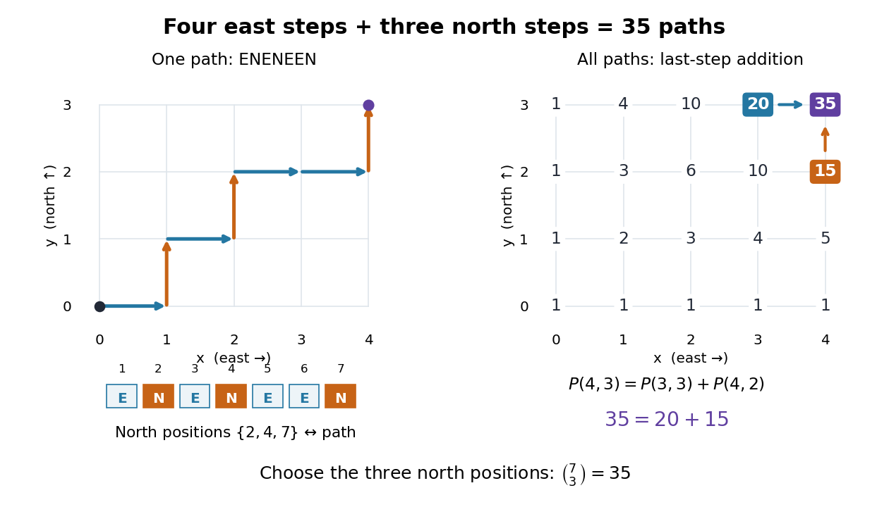

**[Figure 14](#image-a-bijection-from-three-chosen-positions-to-a-north-east-lattice-path-and-the-recursive-grid-giving-p-4-3-35). A bijection from three chosen positions to a north-east lattice path, and the recursive grid giving $P(4,3)=35$**. The original example `ENENEEN` reaches $(4,3)$. Both panels use east to the right and north upwards. The right panel counts all such [north-east lattice paths](#north-east-lattice-path), rather than just the displayed one: twenty arrive with a final east step and fifteen with a final north step.

This interpretation is useful when arrangements have fixed totals but flexible order: a [subset](set.md#subset), a [binary string](theoretical-computer-science.md#binary-string), and a [north-east lattice path](#north-east-lattice-path) become different views of one selection. It also separates endpoint restrictions from restrictions along the journey. Requiring the [lattice path](#lattice-path) to avoid specified [points](geometry-and-topology.md#point-geometry) changes the count; the unrestricted [binomial coefficient](binomial-coefficient.md) no longer suffices, but the local [north-east lattice path recurrence](#north-east-lattice-path-recurrence) still suggests how to count allowed arrivals.

#### North-east lattice path recurrence

↑ **Parent:** [North-east lattice path](#north-east-lattice-path)

For [positive integers](integer.md#positive-integer) $a,b$, the [north-east lattice path recurrence](#north-east-lattice-path-recurrence) is

$$
P(a,b)=P(a-1,b)+P(a,b-1),\qquad P(a,0)=P(0,b)=1.
$$

The boundaries have only straight [north-east lattice paths](#north-east-lattice-path). The origin counts the zero-step [north-east lattice path](#north-east-lattice-path) once.[§1.2, Lattice Paths: split by the final horizontal or vertical step](mathematics-bibliography.md#discrete-mathematics-an-open-introduction-3rd-edition-by-oscar-levin)

**Proof outline.** A [north-east lattice path](#north-east-lattice-path) ending at $(a,b)$ has a final step either from $(a-1,b)$ or from $(a,b-1)$. Deleting that step gives a shorter [north-east lattice path](#north-east-lattice-path); appending it reverses the operation. The two classes are disjoint and exhaust all possibilities, so the [rule of sum](#addition-principle) adds their counts. At $(4,3)$, the arrivals from $(3,3)$ contribute $\binom63=20$, while those from $(4,2)$ contribute $\binom62=15$: altogether $20+15=35$.

Set $P(a,b)=0$ if either [integer](integer.md) coordinate is negative. Then the same [recurrence relation](sequence-and-series.md#recurrence-relation) applies on the nonnegative axes away from $(0,0)$: one predecessor contributes one, and the other contributes zero. Initialize $P(0,0)=1$ separately; applying the [recurrence relation](sequence-and-series.md#recurrence-relation) there would incorrectly give zero.

Computing the grid once in increasing order of $a+b$ is [dynamic programming](mathematical-optimization.md#dynamic-programming): every entry uses two earlier entries. If a specified [point](geometry-and-topology.md#point-geometry) is forbidden, set its count to zero, then continue the same [recurrence relation](sequence-and-series.md#recurrence-relation) at allowed [points](geometry-and-topology.md#point-geometry). This counts [north-east lattice paths](#north-east-lattice-path) avoiding the forbidden [points](geometry-and-topology.md#point-geometry), provided the origin and endpoint are allowed. The last-step argument remains valid because appending a step to an allowed endpoint cannot visit any new intermediate [integer lattice](geometry-and-topology.md#integer-lattice) [point](geometry-and-topology.md#point-geometry).

### Self-avoiding walk

↑ **Parent:** [Lattice path](#lattice-path)  
ⓦ [Wiki](https://en.wikipedia.org/wiki/Self-avoiding_walk)

An $n$-step [self-avoiding walk](#self-avoiding-walk) on a [graph](graph.md) is a sequence $v_0,\ldots,v_n$ of distinct [graph vertices](graph.md#vertex-graph-theory) with an [edge](graph-theory.md#edge-of-a-graph) between successive [graph vertices](graph.md#vertex-graph-theory). It is a [graph path](graph-theory.md#path-in-a-graph) with $n$ [edges](graph-theory.md#edge-of-a-graph) and $n+1$ [graph vertices](graph.md#vertex-graph-theory). On a transitive [graph](graph.md), the exponential growth rate of rooted [self-avoiding walk](#self-avoiding-walk) counts is the [connective constant](#connective-constant).

#### Partially directed self-avoiding walk

↑ **Parent:** [Self-avoiding walk](#self-avoiding-walk)

On the [square lattice](graph.md#square-lattice), a [self-avoiding walk](#self-avoiding-walk) using north, east and west steps but no south steps. At each horizontal height, self-avoidance forces one monotone horizontal run. Conversely, such runs separated by north steps always give [self-avoiding walks](#self-avoiding-walk), because every new run is at a previously unvisited height.

##### North-east-west self-avoiding walk count

↑ **Parent:** [Partially directed self-avoiding walk](#partially-directed-self-avoiding-walk)

A horizontal run has [generating function](sequence-and-series.md#generating-function) $R(z)=(1+z)/(1-z)$. Decomposing each walk into $H(NH)^k$ gives $A(z)=R(z)/(1-zR(z))=(1+z)/(1-2z-z^2)$. Thus $a_0=1,a_1=3$ and $a_n=2a_{n-1}+a_{n-2}$. The exponential growth rate is $1+\sqrt2$, furnishing a strict lower bound greater than two for the [connective constant](#connective-constant) of all square-lattice [self-avoiding walks](#self-avoiding-walk).

#### Self-avoiding walk generating function

↑ **Parent:** [Self-avoiding walk](#self-avoiding-walk)

The [generating function](sequence-and-series.md#generating-function) weights each [self-avoiding walk](#self-avoiding-walk) by $x$ to the power of its length, including the zero-length walk. Its [radius of convergence](sequence-and-series.md#radius-of-convergence) is the reciprocal of the upper exponential growth rate of the rooted counts, by the [Cauchy-Hadamard theorem](sequence-and-series.md#cauchy-hadamard-theorem).

##### Even-length walk generating function on a bipartite graph

↑ **Parent:** [Self-avoiding walk generating function](#self-avoiding-walk-generating-function)

In a [bipartite graph](bipartite-graph.md), a [self-avoiding walk](#self-avoiding-walk) ends in its starting class exactly when it has even length. If degrees are bounded by $\Delta$, deleting the last [edge](graph-theory.md#edge-of-a-graph) gives $\sigma_{2k+1}\leq\Delta\sigma_{2k}$ and hence $Z_G^0(x)\leq Z_G(x)\leq(1+\Delta x)Z_G^0(x)$ for $x\geq0$. Thus these [generating functions](sequence-and-series.md#generating-function) have the same [radius of convergence](sequence-and-series.md#radius-of-convergence).

###### Triangle replacement for self-avoiding walks

↑ **Parent:** [Even-length walk generating function on a bipartite graph](#even-length-walk-generating-function-on-a-bipartite-graph)

Replace every degree-three [vertex of a graph](graph.md#vertex-graph-theory) in one class of a [bipartite graph](bipartite-graph.md) by a triangle with one port for each incident [edge](graph-theory.md#edge-of-a-graph). A [self-avoiding walk](#self-avoiding-walk) whose endpoints remain in the other class cannot make two completed passages through the same triangle: each passage needs two unused ports and only three exist. Each old two-edge passage has exactly two replacements, of lengths three and four. Therefore the restricted [generating functions](sequence-and-series.md#generating-function) satisfy $Z_H^0(x)=Z_G^0(\sqrt{x^3+x^4})$. If the old radius is $1/\mu$, the new radius obeys $\rho^3+\rho^4=\mu^{-2}$.

#### Root-moment bound for open self-avoiding walks

↑ **Parent:** [Self-avoiding walk](#self-avoiding-walk)

In independent [bond percolation](bond-percolation.md) on a [graph](graph.md), let $c_n$ be the number of $n$-step [self-avoiding walks](#self-avoiding-walk) from a fixed [graph vertex](graph.md#vertex-graph-theory) and $\kappa_n$ the number that are open. Then $\mathbb E\kappa_n=c_np^n$. The [Jensen inequality](real-analysis.md#jensen-s-inequality) for the [concave function](real-analysis.md#concave-function) $t^{1/n}$ gives $\mathbb E(\kappa_n^{1/n})\leq p c_n^{1/n}$. No [independence](random-variable.md#independent-random-variables) between different [self-avoiding walk](#self-avoiding-walk) indicators is needed. When $c_n^{1/n}\to\mu$, the [limit superior](sequence-and-series.md#limit-superior) is at most $p\mu$.

#### Directed ladder self-avoiding walk count

↑ **Parent:** [Self-avoiding walk](#self-avoiding-walk)

On the [doubly infinite ladder graph](graph.md#doubly-infinite-ladder-graph), [self-avoiding walks](#self-avoiding-walk) from a fixed [graph vertex](graph.md#vertex-graph-theory) using only rightward or vertical steps are in [bijection](function.md#bijection) with words in $R,V$ containing no consecutive $V$ symbols. Their count is $\sigma_n=F_{n+2}$, since $\sigma_0=1$, $\sigma_1=2$, and $\sigma_n=\sigma_{n-1}+\sigma_{n-2}$. Its exponential growth rate is the [golden ratio](algebra.md#golden-ratio).

#### Connective constant

↑ **Parent:** [Self-avoiding walk](#self-avoiding-walk)  
ⓦ [Wiki](https://en.wikipedia.org/wiki/Connective_constant)

If $b_n$ counts the $n$-step [self-avoiding walks](#self-avoiding-walk) from a fixed vertex of a transitive lattice, the connective constant is the exponential growth rate

$$
\kappa=\lim_{n\to\infty}b_n^{1/n}.
$$

Submultiplicativity of $b_n$ and the [Fekete lemma](sequence-and-series.md#fekete-s-lemma) applied to $\log b_n$ prove existence of this limit.

##### Uniform connective constant of a bounded-degree graph

↑ **Parent:** [Connective constant](#connective-constant)

For an infinite connected [locally finite graph](graph-theory.md#locally-finite-graph) with a uniform degree bound, let $\sigma_n(v)$ count its length-$n$ [self-avoiding walks](#self-avoiding-walk) from $v$. The suprema satisfy $\sigma_{m+n}\leq\sigma_m\sigma_n$, so the [Fekete lemma](sequence-and-series.md#fekete-s-lemma) applied to their logarithms gives a finite [connective constant](#connective-constant). Unlike the usual rooted definition on a [vertex-transitive graph](graph.md#vertex-transitive-graph), this definition explicitly takes the supremum over roots.

### Dyck path

↑ **Parent:** [Lattice path](#lattice-path)  
ⓦ [Wiki](https://en.wikipedia.org/wiki/Dyck_path)

A [Dyck path](#dyck-path) starts at $(0,0)$, ends at $(2n,0)$, uses steps $U=(1,1)$ and $D=(1,-1)$, and never passes below the horizontal axis. Its [semilength of a Dyck path](#semilength-of-a-dyck-path) is $n$: there are $n$ up steps and $n$ down steps. The nonnegative height records a constraint throughout the journey, not just the endpoint. The [Catalan number](#catalan-number) $C_n$ counts the [Dyck paths](#dyck-path) of this size.

#### Semilength of a Dyck path

↑ **Parent:** [Dyck path](#dyck-path)

Half the number of steps in a [Dyck path](#dyck-path). A [Dyck path](#dyck-path) with [semilength of a Dyck path](#semilength-of-a-dyck-path) $n$ has $2n$ steps and $n$ up/down pairs; the empty [Dyck path](#dyck-path) has $n=0$.

#### Catalan number

↑ **Parent:** [Dyck path](#dyck-path)  
ⓦ [Wiki](https://en.wikipedia.org/wiki/Catalan_number)

The [Catalan number](#catalan-number) $C_n$ counts [Dyck paths](#dyck-path) with [semilength of a Dyck path](#semilength-of-a-dyck-path) $n$. For a [nonnegative integer](arithmetic.md#natural-number) $n$,

$$
\boxed{C_n=\frac1{n+1}\binom{2n}{n},\qquad (C_0,C_1,C_2,C_3,C_4,C_5)=(1,1,2,5,14,42).}
$$

The count $C_0=1$ includes the empty path. Of the $\binom63=20$ paths with three up steps and three down steps, **exactly five stay at nonnegative height**. Their shapes and [balanced parentheses](#balanced-parentheses) encodings appear below.[§5, printed pp. 38–39, formula (7) and Problems 154–159: Catalan counts, binary parenthesizations, binary trees and Dyck paths](mathematics-bibliography.md#bijective-proof-problems-by-richard-p-stanley)

**[Figure 15](#image-all-five-dyck-paths-of-semilength-three-and-their-balanced-parentheses-encodings). All five Dyck paths of semilength three and their balanced parentheses encodings**. Original enumeration of six-step up/down paths with nonnegative prefix heights. An up step encodes an opening parenthesis and a down step a closing one. Each panel shows one distinct string; no path shape or illustration is copied from a source.

The useful connection is a shared decomposition. A [Dyck path](#dyck-path) splits uniquely at its [first-return decomposition of a Dyck path](#first-return-decomposition-of-a-dyck-path); a [binary tree](data-structure.md#binary-tree) splits at its root into left and right subtrees; a [binary parenthesization](#binary-parenthesization) splits at its last operation. Each removes one outer unit and leaves an [ordered pair](set.md#ordered-pair) of smaller objects. The resulting [Catalan recurrence](#catalan-recurrence) lets one count several different structures with the same calculation. A count of five does not mean the structures are physically identical: a [bijection](function.md#bijection) supplies the precise translation between them.

##### Ballot number

↑ **Parent:** [Catalan number](#catalan-number)

The number of walks with $a$ up-steps and $b$ down-steps, $a\ge b$, that never go below zero is $\binom{a+b}{b}-\binom{a+b}{b-1}$. Reflecting the initial segment through the first step below zero pairs forbidden walks with walks having $b-1$ down-steps. Setting $a=b=n$ gives the [Catalan number](#catalan-number) $C_n$.

###### Ballot theorem

↑ **Parent:** [Ballot number](#ballot-number)

Among words with $a$ up-steps and $b$ down-steps, $a>b$, the number whose running balance is strictly positive after every step is $\frac{a-b}{a+b}\binom{a+b}{b}$. For nonnegative running balance with $a\ge b$, the count is the [ballot number](#ballot-number) $\binom{a+b}{b}-\binom{a+b}{b-1}$. These are different boundary conventions; the nonnegative formula follows by reflecting the prefix through the first step below zero.

##### Narayana number

↑ **Parent:** [Catalan number](#catalan-number)

The number $N(n,k)=\frac1n\binom nk\binom n{k-1}$ counts [Dyck paths](#dyck-path) of semilength $n$ with exactly $k$ peaks, for $1\le k\le n$. Summing over $k$ gives the $n$th [Catalan number](#catalan-number).

##### Catalan recurrence

↑ **Parent:** [Catalan number](#catalan-number)

The [first-return decomposition of a Dyck path](#first-return-decomposition-of-a-dyck-path) and the [rule of product](#rule-of-product) give

$$
\boxed{C_0=1,\qquad C_n=\sum_{k=0}^{n-1}C_kC_{n-1-k}\quad(n\geq1).}
$$

For a given $k$, choose the inside path in $C_k$ ways and its suffix in $C_{n-1-k}$ ways. Different first-return locations give disjoint groups, so the [rule of sum](#addition-principle) adds their counts. For $n=4$, the terms are $1\cdot5+1\cdot2+2\cdot1+5\cdot1=14$. Iterating the [recurrence relation](sequence-and-series.md#recurrence-relation) computes the counts without enumerating every full path.

###### Generating function of the Catalan numbers

↑ **Parent:** [Catalan recurrence](#catalan-recurrence)

The [ordinary generating function](commutative-algebra.md#ordinary-generating-function) $C(x)=\sum_{n\geq0}C_nx^n$ packages the [Catalan recurrence](#catalan-recurrence). Its [Cauchy product](sequence-and-series.md#cauchy-product) gives the [formal power series](commutative-algebra.md#formal-power-series) identity

$$
C(x)=1+xC(x)^2.
$$

The constant term is $C_0=1$. Solving the [quadratic equation](polynomial.md#quadratic-equation) chooses

$$
C(x)=\frac{1-\sqrt{1-4x}}{2x},
$$

with the [formal power series](commutative-algebra.md#formal-power-series) square root having constant term one. The apparent quotient at $x=0$ has constant term one after cancellation; the other quadratic solution has a pole and cannot be this [ordinary generating function](commutative-algebra.md#ordinary-generating-function). The equation records the empty object or an outer unit with two ordered smaller objects.

##### Binary parenthesization

↑ **Parent:** [Catalan number](#catalan-number)

A [binary parenthesization](#binary-parenthesization) specifies the order of [binary operations](algebraic-operation.md#binary-operation) on a fixed ordered list of operands, combining exactly two existing expressions at each step. It has a [full binary tree](data-structure.md#full-binary-tree) as its expression structure: operands are leaves and operations are internal [vertices](graph.md#vertex-graph-theory). For four operands $a,b,c,d$, the five possibilities are $((ab)c)d$, $(a(bc))d$, $(ab)(cd)$, $a((bc)d)$, and $a(b(cd))$.

A [binary parenthesization](#binary-parenthesization) of $n+1$ operands contains $n$ binary operations. At the last operation, its left expression can contain $k$ operations and its right expression $n-1-k$. The [Catalan recurrence](#catalan-recurrence) therefore gives **$C_n$ possible evaluation structures**. The order of operands stays fixed; this is not a count of their [permutations](#permutation). Even for an [associative](algebraic-operation.md#associative-property) operation whose result is unchanged, different structures can have different evaluation costs, as in the [matrix-chain multiplication](algorithm.md#matrix-chain-multiplication) problem.[§5, Problem 154, printed p. 38: binary parenthesizations of n+1 letters](mathematics-bibliography.md#bijective-proof-problems-by-richard-p-stanley)

##### History of Catalan enumeration

↑ **Parent:** [Catalan number](#catalan-number)

[Leonhard Euler](mathematics.md#leonhard-euler)'s 1751 correspondence already studied [triangulations of a convex polygon](convex-set.md#triangulation-of-a-convex-polygon) and gave a closed formula for their counts. [Johann Andreas von Segner](mathematics.md#johann-andreas-von-segner) supplied a combinatorial [recurrence relation](sequence-and-series.md#recurrence-relation) in a paper written in 1758. [Eugène Charles Catalan](mathematics.md#eugene-charles-catalan)'s nineteenth-century work connected the formula to bracketed products. This history, documented in [Igor Pak](mathematics.md#igor-pak)'s account, shows how the same counting structure reappeared through different objects; the modern name alone does not establish discovery priority.[§§2–3 and §5, printed pp. 2–4: Euler correspondence, Segner recurrence and Catalan's bracketed products](mathematics-bibliography.md#history-of-catalan-numbers-by-igor-pak)

#### Balanced parentheses

↑ **Parent:** [Dyck path](#dyck-path)

A string of opening and closing parentheses is balanced when its total numbers of openings and closings agree and every prefix has at least as many openings as closings. Thus `(()())` is balanced, while `())(()` has equal totals but an invalid prefix. Reading `(` as an up step and `)` as a down step gives a [bijection](function.md#bijection) with [Dyck paths](#dyck-path): height is the number of openings awaiting a closing parenthesis. **There are $C_n$ balanced strings with $n$ pairs**, including one empty string. This models nested syntax and the [stack](data-structure.md#stack-data-structure) discipline that remembers the most recently opened unfinished part.

#### First-return decomposition of a Dyck path

↑ **Parent:** [Dyck path](#dyck-path)

A nonempty [Dyck path](#dyck-path) starts with $U$. At its first later return to height zero, cut after the matching $D$. The segment between these two steps stays at height at least one; translating it down one level gives a [Dyck path](#dyck-path) $P$. The remaining suffix is another [Dyck path](#dyck-path) $Q$. This gives the unique form $UPDQ$.

If the original [semilength of a Dyck path](#semilength-of-a-dyck-path) is $n$ and that of $P$ is $k$, then $Q$ has [semilength of a Dyck path](#semilength-of-a-dyck-path) $n-1-k$. The first return occurs after $2(k+1)$ steps. For the illustrated path `UUUDDDUD`, $n=4$, $P$ is `UUDD`, $Q$ is `UD`, and the first return occurs after six steps.

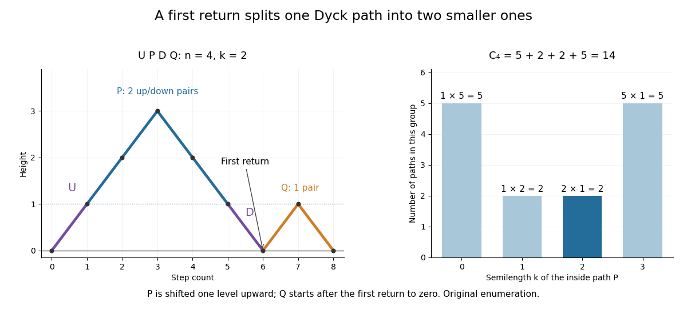

**[Figure 16](#image-first-return-decomposes-a-dyck-path-and-explains-the-catalan-recurrence). First return decomposes a Dyck path and explains the Catalan recurrence**. Original chosen path of semilength four. Purple steps enclose a blue two-pair path; the orange suffix has one pair. The bar chart independently counts all paths of semilength four by the inside semilength $k$: the four groups have sizes $5,2,2,5$, totaling $14$. The highlighted group contains the displayed path.

#### Reflection count for Dyck paths

↑ **Parent:** [Dyck path](#dyck-path)

There are $\binom{2n}{n}$ paths with $n$ up steps and $n$ down steps, ignoring the height constraint. For $n\geq1$, reflect the prefix of a bad path through its first visit to height $-1$, swapping its up and down steps. The resulting path has $n+1$ up steps and $n-1$ down steps, hence final height two. Its first visit to height one identifies the inverse reflection, so this is a [bijection](function.md#bijection). There are $\binom{2n}{n+1}$ bad paths. Subtracting gives

$$
C_n=\binom{2n}{n}-\binom{2n}{n+1}=\frac1{n+1}\binom{2n}{n}.
$$

This count connects a global nonnegative-height requirement to an unrestricted [binomial coefficient](binomial-coefficient.md). The case $n=0$ is separately the unique empty path.

## Extremal set theory

↑ **Parent:** [Combinatorics](combinatorics.md)

[This section is present in another page, follow this link to view it.](extremal-set-theory.md)

## Polynomial method in combinatorics

↑ **Parent:** [Combinatorics](combinatorics.md)  
ⓦ [Wiki](https://en.wikipedia.org/wiki/Polynomial_method_in_combinatorics)

The polynomial method in combinatorics encodes a discrete configuration by polynomials and obtains combinatorial bounds from their degree, zeros, coefficients, or linear independence.

### Rich line covering bound over a finite field

↑ **Parent:** [Polynomial method in combinatorics](#polynomial-method-in-combinatorics)

Suppose every point of $\mathbb F_q^n$ lies on an [affine line in a vector space](vector-space.md#affine-line-in-a-vector-space) meeting a subset $N$ in at least $m$ points, with $1\le m\le q$. A smaller $N$ would admit a nonzero [multivariate polynomial](polynomial.md#multivariate-polynomial) of [total degree](polynomial.md#total-degree-of-a-polynomial) at most $m-1$ vanishing on it, by the [dimension of a bounded-total-degree polynomial space](polynomial.md#dimension-of-a-bounded-total-degree-polynomial-space). Each selected line then has more [roots of a polynomial](polynomial.md#root-of-a-polynomial) than the degree of its restriction, so the [polynomial](polynomial.md) vanishes at every point. The [Schwartz-Zippel lemma](#schwartz-zippel-lemma) forbids this because $m-1<q$. Thus the displayed bound holds, and is at least $m^n/n!$. This is a point-covering condition; the [finite-field Kakeya set](vector-space.md#finite-field-kakeya-set) condition instead quantifies over directions.

### Schwartz-Zippel lemma

↑ **Parent:** [Polynomial method in combinatorics](#polynomial-method-in-combinatorics)

For a nonzero [multivariate polynomial](polynomial.md#multivariate-polynomial) of [total degree](polynomial.md#total-degree-of-a-polynomial) $d$ over a [field](algebra.md#field), and a finite subset $S$ of that field, at most $d|S|^{n-1}$ points of $S^n$ are zeros. For one variable this is the [root bound for a polynomial](polynomial.md#lagrange-root-bound-over-a-field). If $d\ge|S|$, the bound is already trivial. Otherwise, in the inductive proof write the [polynomial](polynomial.md) as degree $k$ in its last variable, with a nonzero leading coefficient of degree at most $d-k$ in the other variables. The leading coefficient vanishes on at most $(d-k)|S|^{n-2}$ fibers; outside those fibers there are at most $k$ [roots of a polynomial](polynomial.md#root-of-a-polynomial) per fiber. Counting the bad fibers with the trivial $|S|$ bound gives the asserted inequality.

### Polynomial vanishing on a finite set of spatial lines

↑ **Parent:** [Polynomial method in combinatorics](#polynomial-method-in-combinatorics)

A family of $L\ge1$ lines in $\mathbb R^3$ imposes at most $L(d+1)$ linear conditions on degree-at-most-$d$ polynomials, by [polynomial restriction to a line](polynomial.md#polynomial-restriction-to-a-line). The coefficient space has dimension $\binom{d+3}{3}$. Whenever $(d+2)(d+3)>6L$, a nonzero common vanishing polynomial exists. Taking $d=\lceil\sqrt{6L}\rceil$ gives degree less than $4\sqrt L$.

### Intersection polynomial

↑ **Parent:** [Polynomial method in combinatorics](#polynomial-method-in-combinatorics)

For a finite [set](set.md) $A\subseteq[n]$ and a finite list $L$ of allowed intersection sizes, the displayed [polynomial](polynomial.md) satisfies $p_A(\chi_B)=\prod_{\ell\in L}(|A\cap B|-\ell)$ at [characteristic vectors of sets](extremal-set-theory.md#characteristic-vector-of-a-set). For an $r$-[uniform set family](extremal-set-theory.md#uniform-set-family) whose pairwise intersection sizes lie in $L\subseteq\{0,\ldots,r-1\}$, these [polynomials](polynomial.md) vanish at all other family members and have nonzero values at their own members. Their restrictions are therefore [linearly independent](vector-space.md#linear-independence). [Multilinear reduction on the Boolean cube](polynomial.md#multilinear-reduction-on-the-boolean-cube) and [homogenisation on a uniform layer](polynomial.md#homogenisation-on-a-uniform-layer) then prove the [Ray-Chaudhuri–Wilson theorem](extremal-set-theory.md#ray-chaudhuri-wilson-theorem) bound.

### Zero-sum sequences as differences of permutations of a prime field

↑ **Parent:** [Polynomial method in combinatorics](#polynomial-method-in-combinatorics)

Every length-$p$ sequence in the [prime field](algebra.md#prime-field) $\mathbb F_p$ with sum zero, including sequences with repetitions, is the coordinatewise difference of two enumerations of that field. Apply the [Combinatorial Nullstellensatz](#combinatorial-nullstellensatz) on $(\mathbb F_p^*)^{p-1}$ to the product of the [Vandermonde determinant](galois-theory.md#vandermonde-determinant) in variables $x_i$ and its translate by the first $p-1$ sequence terms. The [Dyson constant-term identity](#dyson-constant-term-identity) gives a nonzero top coefficient, and the zero-sum condition supplies the final missing field element. The argument includes $p=2$.

### Polynomial nonvanishing below the field size

↑ **Parent:** [Polynomial method in combinatorics](#polynomial-method-in-combinatorics)

Let $P\in\mathbb F_p[x_1,\ldots,x_n]$ have [total degree of a polynomial](polynomial.md#total-degree-of-a-polynomial) less than $p$. If the associated [polynomial function](polynomial.md#polynomial-function) vanishes on all of $\mathbb F_p^n$, then $P$ is the zero polynomial. Induct on $n$: write

$$
P=\sum_{j=0}^{p-1}P_j(x_1,\ldots,x_{n-1})x_n^j.
$$

For each fixed $(x_1,\ldots,x_{n-1})$, the resulting univariate polynomial of degree less than $p$ has all $p$ field elements as [roots](polynomial.md#root-of-a-polynomial), so every coefficient $P_j$ vanishes everywhere. The induction hypothesis makes every $P_j$ the zero polynomial.

### Cap set

↑ **Parent:** [Polynomial method in combinatorics](#polynomial-method-in-combinatorics)  
ⓦ [Wiki](https://en.wikipedia.org/wiki/Cap_set)

A cap set is a subset $A\subseteq\mathbb F_3^n$ containing no three distinct points $x,y,z$ satisfying $x+y+z=0$. Equivalently, it contains no nonconstant three-term [arithmetic progression](arithmetic.md#arithmetic-progression).

#### Meshulam bound for cap sets

↑ **Parent:** [Cap set](#cap-set)

A [cap set](#cap-set) in $\mathbb F_3^n$ has [subset density](additive-combinatorics.md#density-of-a-finite-subset) $O(1/n)$. A [Fourier analysis on a finite abelian group](additive-combinatorics.md#normalized-fourier-analysis-on-a-finite-abelian-group) proof uses a [hyperplane density increment for cap sets](additive-combinatorics.md#hyperplane-density-increment-for-cap-sets) repeatedly: absence of nondiagonal zero-sum triples forces a large [finite abelian Fourier coefficient](additive-combinatorics.md#fourier-coefficient-on-a-finite-abelian-group), and hence a denser slice. This is a weaker bound than the [Ellenberg–Gijswijt cap-set bound](#ellenberg-gijswijt-cap-set-bound), but illustrates the [density increment](additive-combinatorics.md#density-increment) method.

#### Cartesian powers of cap sets

↑ **Parent:** [Cap set](#cap-set)

Every [Cartesian product](set-theory.md#cartesian-product) of [cap sets](#cap-set) is a [cap set](#cap-set). In [characteristic](algebra.md#characteristic-of-a-field) three, $x+y+z=0$ with any two equal forces all three equal. A zero-sum triple in a [Cartesian product](set-theory.md#cartesian-product) of [cap sets](#cap-set) is therefore diagonal in every coordinate block, hence diagonal overall.

##### Removal of an exponential prefactor by Cartesian powers

↑ **Parent:** [Cartesian powers of cap sets](#cartesian-powers-of-cap-sets)

Suppose every [cap set](#cap-set) in $\mathbb F_3^n$ has [cardinality](cardinal-number.md#cardinality) at most $K\theta^n$, with $K$ independent of $n$. Applying this to the $k$-fold [Cartesian product](set-theory.md#cartesian-product) of a fixed [cap set](#cap-set) $A$ gives $|A|^k\leq K\theta^{nk}$. Taking $k$th roots and letting $k$ tend to infinity proves $|A|\leq\theta^n$. More generally this argument applies to any class of finite objects closed under products with multiplicative size and additive dimension.

<h4 id="ellenberg-gijswijt-cap-set-bound">Ellenberg–Gijswijt cap-set bound</h4>

↑ **Parent:** [Cap set](#cap-set)

There is a constant $C<3$ such that every [cap set](#cap-set) in $\mathbb F_3^n$ has cardinality less than $C^n$.

For the [polynomial method in combinatorics](#polynomial-method-in-combinatorics), use

$$
T(x,y,z)=\prod_{i=1}^n\bigl(1-(x_i+y_i+z_i)^2\bigr).
$$

Over $\mathbb F_3$, this is the [indicator function](measure-theory.md#indicator-function) of $x+y+z=0$. On $A^3$ it is therefore a diagonal tensor with $|A|$ nonzero diagonal entries. Every [monomial](polynomial.md#monomial) in its expansion has individual exponents at most two and total degree at most $2n$, so one of its three variable blocks has degree at most $2n/3$. Grouping terms according to such a block and using the [slice rank of a diagonal tensor](multilinear-algebra.md#slice-rank-of-a-diagonal-tensor) gives

$$
|A|=\operatorname{slice\ rank}(T|_{A^3})\leq3m_n,
$$

where $m_n$ is the number of $\alpha\in\{0,1,2\}^n$ with $\sum_i\alpha_i\leq2n/3$. If $X_i=1-\alpha_i$ are [independent random variables](random-variable.md#independent-random-variables) uniform on $\{-1,0,1\}$, then

$$
\frac{m_n}{3^n}=\mathbb P\left(\sum_iX_i\geq\frac n3\right).
$$

Any exponential upper bound for this [tail probability](probability-theory.md#tail-probability) gives $m_n\leq(3-\epsilon)^n$ and hence the result after absorbing the factor three and finitely many small dimensions into $C<3$.

##### Low-degree monomial count for the cap-set bound

↑ **Parent:** [Ellenberg–Gijswijt cap-set bound](#ellenberg-gijswijt-cap-set-bound)

The number $m_n$ of [monomials](polynomial.md#monomial) in $n$ variables with each exponent at most two and total [polynomial degree](polynomial.md#degree-of-a-polynomial) at most $\lfloor2n/3\rfloor$ satisfies

$$
m_n\leq\left(\frac74\,2^{2/3}\right)^n.
$$

For each exponent vector $a$ counted on the left, $1\leq2^{2n/3-\sum_i a_i}$. Summing and then allowing all $a\in\{0,1,2\}^n$ gives $m_n\leq2^{2n/3}(1+1/2+1/4)^n$. The base has cube $343/16<27$, so it is strictly less than three. This elementary weighted count gives the exponential saving in the [polynomial method in combinatorics](#polynomial-method-in-combinatorics) without an unstated [probability](probability-theory.md#probability) estimate.

### Chevalley-Warning theorem

↑ **Parent:** [Polynomial method in combinatorics](#polynomial-method-in-combinatorics)  
ⓦ [Wiki](https://en.wikipedia.org/wiki/Chevalley-Warning_theorem)

If polynomials $f_1,\ldots,f_r$ over a finite field have total degree sum strictly smaller than their number of variables, then the number of their common zeros is divisible by the field characteristic.

#### Kemnitz theorem

↑ **Parent:** [Chevalley-Warning theorem](#chevalley-warning-theorem)

Every sequence of $4p-3$ elements of $\mathbb F_p^2$, where $p$ is prime, contains $p$ terms whose sum is zero. A proof applies the [Chevalley-Warning theorem](#chevalley-warning-theorem) to the cardinality and two coordinate sums and then double-counts zero-sum subsequences.

### Dyson constant-term identity

↑ **Parent:** [Polynomial method in combinatorics](#polynomial-method-in-combinatorics)  
ⓦ [Wiki](https://en.wikipedia.org/wiki/Dyson_constant-term_identity)

For nonnegative integers $a_1,\ldots,a_n$,

$$
\operatorname{CT}\prod_{i=1}^n\prod_{j\ne i}
\left(1-\frac{X_i}{X_j}\right)^{a_i}
=\frac{(a_1+\cdots+a_n)!}{a_1!\cdots a_n!}.
$$

#### Good recurrence for the Dyson constant term

↑ **Parent:** [Dyson constant-term identity](#dyson-constant-term-identity)

When all exponents are positive, the [Dyson constant-term identity](#dyson-constant-term-identity) satisfies $D(a)=\sum_i D(a-e_i)$. This follows from the rational identity $\sum_i\prod_{j\ne i}(1-X_i/X_j)^{-1}=1$, obtained from [Lagrange interpolation polynomial](interpolation.md#lagrange-polynomial) at zero. When $a_i=0$, taking the constant term in $X_i$ deletes that coordinate, giving the boundary recurrence.

### Snevily matching theorem for an elementary abelian group

↑ **Parent:** [Polynomial method in combinatorics](#polynomial-method-in-combinatorics)

Let $A$ and $B$ be $k$-element subsets of the additive group of a field of odd characteristic $p$, with $k<p$. There is a bijection $\pi:A\to B$ for which the sums $a+\pi(a)$ are pairwise distinct. The exterior-algebra proof works because $k!\ne0$ in the field.

### Alon-Tarsi lemma

↑ **Parent:** [Polynomial method in combinatorics](#polynomial-method-in-combinatorics)

Let $f\in F[x_1,\ldots,x_n]$ have degree at most $d_1+\cdots+d_n$, and let each $A_i\subset F$ contain $d_i+1$ distinct elements. The Alon-Tarsi coefficient formula is

$$
[x_1^{d_1}\cdots x_n^{d_n}]f
=\sum_{a_i\in A_i}
\frac{f(a_1,\ldots,a_n)}
{\prod_i\prod_{b\in A_i\setminus\{a_i\}}(a_i-b)}.
$$

It follows by applying [Lagrange interpolation](interpolation.md#lagrange-polynomial) successively in each variable.

#### Combinatorial Nullstellensatz

↑ **Parent:** [Alon-Tarsi lemma](#alon-tarsi-lemma)  
ⓦ [Wiki](https://en.wikipedia.org/wiki/Combinatorial_Nullstellensatz)

One coefficient form of the Combinatorial Nullstellensatz says that if $\deg f\leq d_1+\cdots+d_n$ and $[x_1^{d_1}\cdots x_n^{d_n}]f\ne0$, then for every choice of sets $A_i$ with $|A_i|=d_i+1$ there is a point $(a_1,\ldots,a_n)\in A_1\times\cdots\times A_n$ at which $f$ does not vanish.

##### Restricted sumset bound for unequal subsets of a prime field

↑ **Parent:** [Combinatorial Nullstellensatz](#combinatorial-nullstellensatz)

Suppose $|A|>|B|>0$ in $\mathbb F_p$. Put $a=|A|$ and $b'=\min(|B|,p+2-a)$, and choose $B'\subseteq B$ of size $b'$. Let $r=a+b'-2$. If the restricted sumset fits in a set $D$ of size $r-1$, then $(x-y)\prod_{d\in D}(x+y-d)$ vanishes on $A\times B'$. Its [coefficient](vector-space.md#coefficient) of $x^{a-1}y^{b'-1}$ is

$$
(a-b')\frac{(r-1)!}{(a-1)!(b'-1)!}\ne0\quad\text{in }\mathbb F_p.
$$

All factorial arguments are below $p$ and $0<a-b'<p$. The [Combinatorial Nullstellensatz](#combinatorial-nullstellensatz) gives a contradiction. Since $r=\min(p,|A|+|B|-2)$, this includes the saturated case as well as the small-set case.

##### Prime-regular subgraph from Boolean polynomial constraints

↑ **Parent:** [Combinatorial Nullstellensatz](#combinatorial-nullstellensatz)

For [prime](prime-number.md) $p$, a [graph](graph.md) with $m>(p-1)n$ [edges](graph-theory.md#edge-of-a-graph) and maximum degree at most $2p-1$ contains a nonempty $p$-regular subgraph. Over $\mathbb F_p$, apply the [Combinatorial Nullstellensatz](#combinatorial-nullstellensatz) on the Boolean edge-variable cube to

$$
\prod_v\left(1-\left(\sum_{e\ni v}x_e\right)^{p-1}\right)-\prod_e(1-x_e).
$$

Its full squarefree [coefficient](vector-space.md#coefficient) is nonzero because the first product has degree below $m$. A nonzero value cannot occur at the zero vector; at any other Boolean vector the second product vanishes, and the first forces all selected degrees to be multiples of $p$. The maximum-degree condition makes every positive selected degree exactly $p$.

##### Coordinate avoidance from a nonzero permanent

↑ **Parent:** [Combinatorial Nullstellensatz](#combinatorial-nullstellensatz)

If an $n$ by $n$ matrix $A$ over a field has nonzero [permanent](linear-algebra.md#permanent-mathematics), $b\in F^n$, and every $S_i\subseteq F$ has two elements, then some $x\in\prod_iS_i$ makes every coordinate of $Ax-b$ nonzero. Apply the [Combinatorial Nullstellensatz](#combinatorial-nullstellensatz) to

$$
\prod_{i=1}^n((Ax)_i-b_i),
$$

whose coefficient of $x_1\cdots x_n$ is $\operatorname{perm}A$.

### Modular intersection bound for a set family

↑ **Parent:** [Polynomial method in combinatorics](#polynomial-method-in-combinatorics)

Let $E\subseteq\mathbb F_p$ have size $m$, and let $\mathcal A\subseteq\mathcal P([n])$ satisfy $|A|\notin E$ and $|A\cap B|\in E$ for distinct $A,B\in\mathcal A$. Then

$$
|\mathcal A|\leq\sum_{i=0}^m\binom ni.
$$

The multilinearizations of

$$
P_A(x)=\prod_{e\in E}\left(\sum_{i\in A}x_i-e\right)
$$

are linearly independent functions on the characteristic vectors of the family and lie in the multilinear polynomial space of degree at most $m$.

## Factorial

↑ **Parent:** [Combinatorics](combinatorics.md)  
ⓦ [Wiki](https://en.wikipedia.org/wiki/Factorial)

For a [nonnegative integer](arithmetic.md#natural-number) $n$, the [factorial](#factorial) $n!$ is the [product](arithmetic.md#product-of-numbers) of the [positive integers](integer.md#positive-integer) from $1$ to $n$, with the [empty product](arithmetic.md#empty-product) equal to $1$:

$$
n!=\prod_{j=1}^{n}j,\qquad 0!=1.
$$

Thus $1!=1$, $2!=2$, $3!=6$, $4!=24$ and $5!=120$. The [factorial](#factorial) counts the [permutations](#permutation) of $n$ distinct objects: arranging $A,B,C$ gives exactly $ABC,ACB,BAC,BCA,CAB,CBA$. The choice tree in [permutation](#permutation) shows the three choices for the first position, two for the second, and one for the last.

The value $0!=1$ has a counting explanation: the [empty set](set.md#empty-set) has exactly one ordering, the empty list. Equivalently, it has exactly one [bijection](function.md#bijection) to itself, the empty [function](function.md). There are no choices to make, and one completed outcome. The [factorial](#factorial) therefore obeys the [recurrence relation](sequence-and-series.md#recurrence-relation)

$$
0!=1,\qquad n!=n(n-1)!\quad(n\geq1).
$$

The useful distinction is how many positions are filled. For [integers](integer.md) $0\leq k\leq n$, choosing and ordering $k$ distinct objects by [sampling without replacement](statistical-inference.md#sampling-without-replacement) gives the [falling factorial](#falling-factorial), while choosing an unordered $k$-element [subset](set.md#subset) gives the [binomial coefficient](binomial-coefficient.md):

$$
\underbrace{n(n-1)\cdots(n-k+1)}_{k\text{ factors}}=\frac{n!}{(n-k)!},\qquad
\binom nk=\frac{n!}{k!(n-k)!}.
$$

For five people, assigning captain and deputy gives $5!/3!=20$ outcomes; choosing a two-person team gives $\binom52=10$. Every team has exactly $2!$ assignments of the two roles, explaining the division. When $k=0$, both counts are one. The [factorial](#factorial) is useful here because one count of full orderings yields both formulas by cancellation and by forgetting order. [OpenStax, College Algebra 2e, section 9.5: counting ordered selections and combinations](https://openstax.org/books/college-algebra-2e/pages/9-5-counting-principles)

Distinctness matters. If the two copies of $A$ in $AAB$ are indistinguishable, the visible arrangements are just $AAB,ABA,BAA$, numbering $3!/2!=3$. Temporarily labelling them $A_1,A_2$ gives six [permutations](#permutation), but exchanging the two labels leaves each visible word unchanged, so every word was counted $2!$ times.

**Proof outline.** For $n\geq1$, choose the first object in $n$ ways, then order the remaining $n-1$ objects in $(n-1)!$ ways. The [rule of product](#rule-of-product) gives the [recurrence relation](sequence-and-series.md#recurrence-relation); repeated application gives the displayed [product](arithmetic.md#product-of-numbers), starting from the one empty ordering. This explains why the [factorial](#factorial) grows quickly: every additional distinct object introduces another multiplicative factor.

### Superfactorial

↑ **Parent:** [Factorial](#factorial)

The superfactorial of a [nonnegative integer](arithmetic.md#natural-number) $n$ is the product $\prod_{k=1}^n k!$. This convention differs from other similarly named iterated factorial operations, so the product definition should be stated.

### Left factorial

↑ **Parent:** [Factorial](#factorial)

### Double factorial

↑ **Parent:** [Factorial](#factorial)  
ⓦ [Wiki](https://en.wikipedia.org/wiki/Double_factorial)

The double factorial multiplies the positive integers of the same parity as $n$ up to $n$: $(2m-1)!!=1\cdot3\cdots(2m-1)$ and $(2m)!!=2\cdot4\cdots2m$. Set $(-1)!!=0!!=1$. In particular, $(2m-1)!!=(2m)!/(2^m m!)$, the number of pairings of $2m$ labelled objects.

### Falling factorial

↑ **Parent:** [Factorial](#factorial)

The falling factorial is the product of $j$ successive descending factors, with $(t)_0=1$. Another notation is $t^{\underline j}$; this article uses $(t)_j$ for descending factors, whereas the [rising factorial](#rising-factorial) uses the same notation for ascending factors. For a nonnegative integer $t$, it counts ordered selections of $j$ distinct objects and vanishes when $j>t$. Powers expand as $t^j=\sum_{\ell=0}^j S(j,\ell)(t)_\ell$, where $S(j,\ell)$ is a [Stirling number of the second kind](#stirling-numbers-of-the-second-kind).

### Rising factorial

↑ **Parent:** [Factorial](#factorial)

For a nonnegative integer $n$, the rising factorial is the product of $n$ consecutive increments starting at $a$, with $(a)_0=1$. Another notation is $a^{\overline n}$; the [falling factorial](#falling-factorial) uses descending factors. It compactly expresses the coefficient recurrence of a [confluent hypergeometric function of the first kind](linear-ordinary-differential-equation.md#confluent-hypergeometric-function-of-the-first-kind).

## Binomial coefficient

↑ **Parent:** [Combinatorics](combinatorics.md)

[This section is present in another page, follow this link to view it.](binomial-coefficient.md)

## Alternating-permutation convolution

↑ **Parent:** [Combinatorics](combinatorics.md)

Splitting an alternating permutation at its maximum gives

$$
2A_{n+1}=\sum_{k=0}^n\binom nkA_kA_{n-k},
$$

where $A_n$ counts up-down permutations and complementation identifies up-down with down-up permutations.

## Overlap structure of digit spalindromes

↑ **Parent:** [Combinatorics](combinatorics.md)

Two length-$2k$ palindromes with distinct first-half digits cannot begin fewer than $k$ positions apart: the later first half would include the repeated middle pair of the earlier palindrome. At separation $k$, their union has form $A A^{\rm rev}A$.

## Stars and bars (combinatorics)

↑ **Parent:** [Combinatorics](combinatorics.md)  
ⓦ [Wiki](https://en.wikipedia.org/wiki/Stars_and_bars_(combinatorics))

[Stars and bars](#stars-and-bars-combinatorics) counts [tuples](set-theory.md#finite-tuple) of [nonnegative integers](arithmetic.md#natural-number) with a prescribed [sum](arithmetic.md#sum). For [integers](integer.md) $N\geq0$ and $k\geq1$, its statement is

$$
\#\{(x_1,\ldots,x_k):x_i\geq0,\ x_1+\cdots+x_k=N\}
=\binom{N+k-1}{k-1}.
$$

Such a [tuple](set-theory.md#finite-tuple) is a [weak composition of an integer](#weak-composition-of-an-integer). Think of $k$ labelled bins: $x_1$ counts identical objects in the first bin, $x_2$ in the second, and so on. Bin names distinguish positions even when counts agree. [Stars and bars](#stars-and-bars-combinatorics) counts these count [tuples](set-theory.md#finite-tuple); assigning individually distinct objects requires additional information. [Felix Gotti, MIT 18.211, Lecture 6: Compositions, Proposition 1 and Example 3](https://math.mit.edu/~fgotti/docs/Courses/C.%20Combinatorial%20Analysis/6.%20Compositions/Compositions.pdf)

**Computed example.** With $N=5$ and $k=3$, the number of [weak compositions of an integer](#weak-composition-of-an-integer) is $\binom72=21$. The string `••|•|••` encodes $(2,1,2)$: two dots before the first bar, one between the bars, and two after the second. For a fixed first-bin count $x_1=a$, the second-bin count can be any [integer](integer.md) from $0$ to $5-a$ and the third is forced. Thus the direct count is $6+5+4+3+2+1=21$.

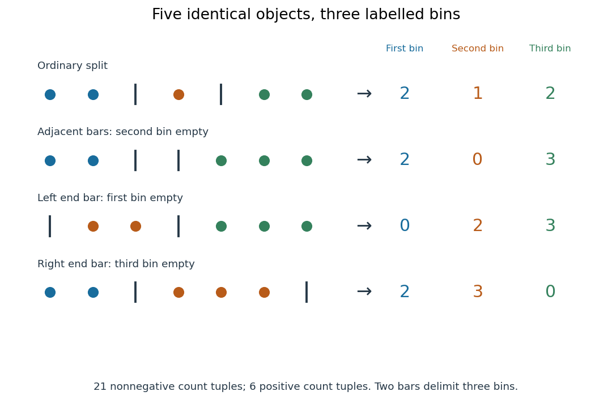

**[Figure 17](#image-stars-and-bars-for-five-identical-objects-and-three-labelled-bins-ordinary-splits-adjacent-bars-and-bars-at-either-end). Stars and bars for five identical objects and three labelled bins: ordinary splits, adjacent bars, and bars at either end**.

Adjacent bars encode an empty middle bin: `••||•••` gives $(2,0,3)$. A bar at the left end encodes an empty first bin, as in `|••|•••` for $(0,2,3)$; a bar at the right end encodes an empty third bin, as in `••|•••|` for $(2,3,0)$. These are valid [weak compositions of an integer](#weak-composition-of-an-integer). For $N=0$ every count is zero, and for $k=1$ the unique [tuple](set-theory.md#finite-tuple) is $(N)$, consistent with $\binom{N}{0}=1$.

**Proof outline.** Replace each count $x_i$ by that many dots and separate successive groups with $k-1$ bars. Reading the group sizes reverses this construction, so it is a [bijection](function.md#bijection) between [weak compositions of an integer](#weak-composition-of-an-integer) and strings of $N$ dots and $k-1$ bars. Choose the bar positions among $N+k-1$ positions; the [binomial coefficient](binomial-coefficient.md) counts the choices. The beauty is that empty bins need no separate cases: end bars and adjacent bars encode them automatically.

If every bin must be nonempty, the [tuples](set-theory.md#finite-tuple) are [compositions of an integer](#composition-of-an-integer), and their count is $\binom{N-1}{k-1}$ for $N\geq k\geq1$; for $N<k$ there are none. Subtract one from every count, setting $y_i=x_i-1$. This is a [bijection](function.md#bijection) to [weak compositions of an integer](#weak-composition-of-an-integer) of $N-k$, so [stars and bars](#stars-and-bars-combinatorics) gives $\binom{(N-k)+k-1}{k-1}=\binom{N-1}{k-1}$. For five objects and three bins, this is $\binom42=6$, with the six positive [tuples](set-theory.md#finite-tuple)

$$
(3,1,1),\ (1,3,1),\ (1,1,3),\ (2,2,1),\ (2,1,2),\ (1,2,2).
$$

For instance, $(2,1,2)$ shifts to $(1,0,1)$, whose [sum](arithmetic.md#sum) is $2=5-3$. Sorting the six positive [tuples](set-theory.md#finite-tuple) collapses them to just two [integer partitions](#integer-partition), $3+1+1$ and $2+2+1$. Thus named bins and unordered summands answer different questions.

[Stars and bars](#stars-and-bars-combinatorics) is useful for allocating identical resources or enumerating [integer](integer.md) solutions without listing them individually. Prescribed lower bounds can be subtracted just like the nonempty-bin requirement. Upper bounds require removing forbidden [tuples](set-theory.md#finite-tuple); the existing [bounded weak compositions](#bounded-weak-compositions) article applies the [inclusion-exclusion principle](#inclusion-exclusion-principle) to those violations.

### Composition of an integer

↑ **Parent:** [Stars and bars (combinatorics)](#stars-and-bars-combinatorics)

A [composition of an integer](#composition-of-an-integer) $N>0$ is an ordered [tuple](set-theory.md#finite-tuple) of [positive integers](integer.md#positive-integer) with [sum](arithmetic.md#sum) $N$. Its length $k$ counts the parts. For example, $(3,2)$ and $(2,3)$ are different [compositions of an integer](#composition-of-an-integer), though they give the same [integer partition](#integer-partition). [Stars and bars](#stars-and-bars-combinatorics) counts [compositions of an integer](#composition-of-an-integer) with fixed length. [Gotti, Lecture 6, definition of a composition](https://math.mit.edu/~fgotti/docs/Courses/C.%20Combinatorial%20Analysis/6.%20Compositions/Compositions.pdf)

#### Weak composition of an integer

↑ **Parent:** [Composition of an integer](#composition-of-an-integer)

A [weak composition of an integer](#weak-composition-of-an-integer) $N\geq0$ into $k\geq1$ parts is an ordered [tuple](set-theory.md#finite-tuple) of [nonnegative integers](arithmetic.md#natural-number) with [sum](arithmetic.md#sum) $N$. Zero parts retain their positions: $(0,2,3)$ and $(2,0,3)$ differ. Fixing the length $k$ is essential when applying [stars and bars](#stars-and-bars-combinatorics), since inserting extra zero parts creates further [tuples](set-theory.md#finite-tuple). [Gotti, Lecture 6, definition and discussion of weak compositions](https://math.mit.edu/~fgotti/docs/Courses/C.%20Combinatorial%20Analysis/6.%20Compositions/Compositions.pdf)

### Bounded weak compositions

↑ **Parent:** [Stars and bars (combinatorics)](#stars-and-bars-combinatorics)

To count nonnegative tuples with $\sum_{i=0}^r n_i=N$ and $n_i<a_i$, mark violations $n_i\geq a_i$. An intersection of violations indexed by $J$ is in [bijection](function.md#bijection) with unrestricted tuples of sum $N-\sum_{i\in J}a_i$, by subtracting the bounds from those coordinates. [Stars and bars](#stars-and-bars-combinatorics) counts this intersection; the [inclusion-exclusion principle](#inclusion-exclusion-principle) then gives the displayed formula. A negative remaining sum contributes zero.

## Inclusion-exclusion principle

↑ **Parent:** [Combinatorics](combinatorics.md)  
ⓦ [Wiki](https://en.wikipedia.org/wiki/Inclusion-exclusion_principle)

For [finite sets](set.md#finite-set) $A_1,\ldots,A_n$, the cardinality of their [union](set.md#set-union) is

$$
\left|\bigcup_{i=1}^n A_i\right|=\sum_{\varnothing\neq J\subseteq\{1,\ldots,n\}}(-1)^{|J|+1}\left|\bigcap_{j\in J}A_j\right|.
$$

Add the individual [cardinalities](cardinal-number.md#cardinality), subtract pairwise [intersection](set.md#set-intersection) counts, add triple [intersection](set.md#set-intersection) counts, and continue alternating. This is useful whenever one object can satisfy several conditions: a search result can match several filters, or a [permutation](#permutation) can have several forbidden [fixed points](function.md#fixed-point).

Among the [integers](integer.md) from 1 to 30, let $A$ contain the multiples of 2 and $B$ the multiples of 3. Then $|A|=15$, $|B|=10$, and $|A\cap B|=5$, because their common multiples are the multiples of 6. The naive sum $25$ counts those five twice; the correct [union](set.md#set-union) size is **$15+10-5=20$**. The regions contain ten in $A$ alone, five in both, five in $B$ alone, and ten in neither.

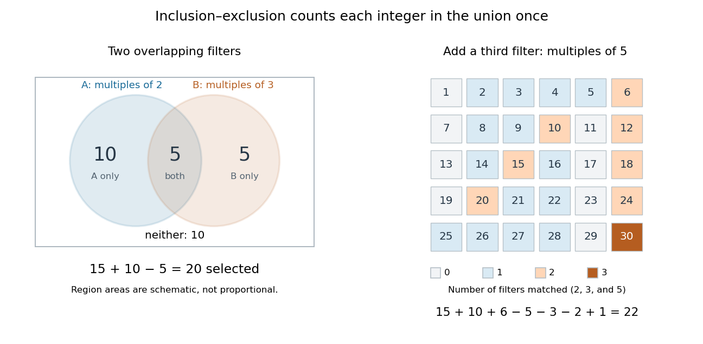

**[Figure 18](#image-subtracting-overlap-counts-each-selected-integer-once-a-third-divisibility-condition-requires-adding-the-triple-overlap-back). Subtracting overlap counts each selected integer once; a third divisibility condition requires adding the triple overlap back**.

Add a third [set](set.md) $C$ containing the multiples of 5. Its size is 6; the three pairwise [intersections](set.md#set-intersection) have sizes $5,3,2$; and the triple [intersection](set.md#set-intersection) contains only 30. The [inclusion-exclusion principle](#inclusion-exclusion-principle) gives **$15+10+6-5-3-2+1=22$** integers divisible by at least one of 2, 3, and 5.

The alternating corrections have a local explanation. An object belonging to exactly $r\geq1$ of the [sets](set.md) is counted $\binom r1-\binom r2+\cdots+(-1)^{r+1}\binom rr=1$ times, by the [binomial theorem](binomial-coefficient.md#binomial-theorem) applied to $(1-1)^r$. An object in none contributes zero. Thus overlapping descriptions are repaired without requiring the [sets](set.md) themselves to be disjoint. For [probability](probability-theory.md#probability), the same calculation applies to event probabilities in place of [cardinalities](cardinal-number.md#cardinality), giving the [inclusion-exclusion principle for probabilities](#inclusion-exclusion-principle-for-probabilities).

### Inclusion-exclusion principle for probabilities

↑ **Parent:** [Inclusion-exclusion principle](#inclusion-exclusion-principle)

For a finite family of [events](probability-space.md#event), the [probability](probability-theory.md#probability) of their [union](set.md#set-union) is the alternating sum of their [intersection](set.md#set-intersection) [probabilities](probability-theory.md#probability), with the same pattern as the [inclusion-exclusion principle](#inclusion-exclusion-principle). Expand the [indicator function](measure-theory.md#indicator-function) of the [union](set.md#set-union) and apply [linearity of expectation](expected-value.md#linearity-of-expectation); this does not require [independent events](probability-theory.md#independent-events).

### Weighted inclusion-exclusion principle

↑ **Parent:** [Inclusion-exclusion principle](#inclusion-exclusion-principle)

For finite [subsets](set.md#subset) $A_i$ of a finite ambient [set](set.md) $X$, the [indicator function](measure-theory.md#indicator-function) of their complement is $\prod_i(1-\mathbf1_{A_i})$. Expanding this finite product and summing it against any weight $f:X\to\mathbb R$ proves the weighted formula. The empty intersection is $X$. Negative weights are allowed; finiteness removes every convergence issue.

### Inclusion-exclusion for exact block occupancy

↑ **Parent:** [Inclusion-exclusion principle](#inclusion-exclusion-principle)

Suppose $N$ disjoint blocks each have $m$ elements. The number of $K$-element subsets having exactly $q>0$ elements in at least one block is the displayed sum, with $1\leq r\leq\min(N,\lfloor K/q\rfloor)$ and invalid [binomial coefficients](binomial-coefficient.md) interpreted as zero. For a specified set of $r$ blocks, choose $q$ elements in each and all remaining elements outside those blocks; [inclusion-exclusion](#inclusion-exclusion-principle) then counts the union of the exact-occupancy events. Excluding the rest of each specified block is essential.

// Target: algebra.bigb

### Cyclic difference constraints

↑ **Parent:** [Inclusion-exclusion principle](#inclusion-exclusion-principle)

Let $f$ take values in the additive [cyclic group](group.md#cyclic-group) $\mathbb Z/n\mathbb Z$ on a cycle with $n$ vertices. A constraint on edge $j$ prescribes $f(j)-f(j-1)=c_j$. Any proper selection of $k<n$ edges leaves disjoint paths, hence $n-k$ free initial values and $n^{n-k}$ solutions. The full cycle has $n$ solutions if $\sum_jc_j=0$ and none otherwise. Combining these intersection counts with the [inclusion-exclusion principle](#inclusion-exclusion-principle) gives

$$
\#\{f:\ f(j)-f(j-1)\ne c_j\text{ for every }j\}=(n-1)^n+(-1)^n(F-1),
$$

where $F$ is $n$ or zero according to the full-cycle consistency condition. This is a useful example in which every proper collection of local constraints is independent, but the full collection has one global obstruction.

### Bonferroni inequalities

↑ **Parent:** [Inclusion-exclusion principle](#inclusion-exclusion-principle)  
ⓦ [Wiki](https://en.wikipedia.org/wiki/Bonferroni_inequalities)

Truncating the [inclusion-exclusion principle](#inclusion-exclusion-principle) after an odd number of terms gives an upper bound, and truncating after an even number gives a lower bound. In particular,

$$
\mathbb P\left(\bigcup_iA_i\right)
\geq\sum_i\mathbb P(A_i)-\sum_{i<j}\mathbb P(A_i\cap A_j).
$$

#### Jordan-Bonferroni exact-occurrence inequalities

↑ **Parent:** [Bonferroni inequalities](#bonferroni-inequalities)

For the number $N$ of occurring events, write $S_j=\mathbb E\binom Nj$ and $T_m=\sum_{r=0}^m(-1)^r\binom{k+r}kS_{k+r}$. Then odd truncations bound $\Pr(N=k)$ below and even truncations above. For each integer $N>k$, the truncated binomial sum equals $(-1)^m\binom Nk\binom{N-k-1}m$ when $m<N-k$, and is zero otherwise. Its sign proves the bounds on taking [expectations](expected-value.md). This is the exact-count version of the [Bonferroni inequalities](#bonferroni-inequalities).

## Geometric combinatorics

↑ **Parent:** [Combinatorics](combinatorics.md)  
ⓦ [Wiki](https://en.wikipedia.org/wiki/Geometric_combinatorics)

Geometric combinatorics studies discrete aspects of geometric objects and uses combinatorial methods to prove geometric inequalities.

### Euclidean body

↑ **Parent:** [Geometric combinatorics](#geometric-combinatorics)

A Euclidean body is a nonempty bounded [Lebesgue measurable set](measure-theory.md#lebesgue-measurable-set) in $\mathbb R^n$ of positive [Lebesgue measure](measure-theory.md#lebesgue-measure). Projection inequalities require measurable coordinate projections, as for a [compact set](topology.md#compact-space) or a bounded [Borel set](measure-theory.md#borel-set). Modifying a body on a set of volume zero can change its coordinate-projection measures, so the actual projection sets matter. Geometric equality statements commonly impose additional regularity.

#### Axis-parallel box

↑ **Parent:** [Euclidean body](#euclidean-body)

An axis-parallel box in $\mathbb R^n$ is a [Cartesian product](set-theory.md#cartesian-product) $I_1\times\cdots\times I_n$ of bounded intervals. Its volume is the product of its side lengths, and each coordinate projection is the product of the corresponding intervals.

#### Coordinate projection of a Euclidean body

↑ **Parent:** [Euclidean body](#euclidean-body)

For $A\subseteq[n]$, the coordinate projection $S_A$ of $S\subseteq\mathbb R^n$ consists of the coordinate tuples $(x_i)_{i\in A}$ obtained from points $x\in S$. Its measure is denoted $|S_A|$.

##### Uniform cover

↑ **Parent:** [Coordinate projection of a Euclidean body](#coordinate-projection-of-a-euclidean-body)

A multiset $\mathcal C$ of subsets of $[n]$ is a $k$-uniform cover when every index belongs to exactly $k$ members of $\mathcal C$, counted with multiplicity.

###### Fractional uniform cover

↑ **Parent:** [Uniform cover](#uniform-cover)

Nonnegative weights $\lambda_A$ on coordinate subsets form a fractional uniform cover when the displayed equality holds for each coordinate. Rational weights can be multiplied by a common denominator to become an integer [uniform cover](#uniform-cover). The [uniform covers theorem](#uniform-covers-theorem) then gives $\log|S|\leq\sum_A\lambda_A\log|S_A|$. Exact equality of coordinate coverage matters when projection measures may be less than one.

###### Uniform covers theorem

↑ **Parent:** [Uniform cover](#uniform-cover)

If $\mathcal C$ is a $k$-uniform cover of $[n]$ and $S\subseteq\mathbb R^n$ is a [Euclidean body](#euclidean-body), then

$$
|S|^k\leq\prod_{A\in\mathcal C}|S_A|.
$$

Slicing in one coordinate, applying the theorem inductively to each slice, and then applying [Hölder's inequality](real-analysis.md#holder-s-inequality) to the $k$ projected slice functions proves the inequality.

Exact covering is essential for unrestricted real volumes. Finite subsets of a Cartesian product satisfy the analogous cardinality inequality, and in that discrete version covering at least $k$ times suffices.

###### Box theorem

↑ **Parent:** [Uniform covers theorem](#uniform-covers-theorem)

A [Euclidean body](#euclidean-body) has an [axis-parallel box](#axis-parallel-box) of the same volume with every coordinate-projection volume no larger than its own. In logarithmic coordinates the box side lengths solve a [linear program](linear-programming.md) with constraints $\sum_{i\in A}x_i\leq\log|K_A|$. Its dual uses nonnegative exact fractional covers; the [uniform cover inequality](#uniform-covers-theorem) bounds every dual objective below by $\log|K|$, proving existence by [strong duality](linear-programming.md#strong-duality).

An alternative proof minimizes an array of candidate projection volumes subject to the finitely many inequalities from [irreducible uniform covers](#irreducible-uniform-cover). Tight constraints force the array to factor into its singleton coordinates, which become the side lengths of the box.

###### Logarithmic linear program for the box theorem

↑ **Parent:** [Box theorem](#box-theorem)

Set $x_i=\log b_i$ for candidate [axis-parallel box](#axis-parallel-box) side lengths. Its coordinate-projection constraints are the displayed [linear program](linear-programming.md). The dual feasible weights are [fractional uniform covers](#fractional-uniform-cover). Its optimal extreme point is rational, so the [uniform covers theorem](#uniform-covers-theorem) forces its objective to be at least $\log|S|$. Weight one on the full coordinate set attains that value. [Strong duality](linear-programming.md#strong-duality) therefore supplies box side lengths with volume $|S|$ and no larger coordinate projections.

<h6 id="loomis-whitney-inequality">Loomis--Whitney inequality</h6>

↑ **Parent:** [Uniform covers theorem](#uniform-covers-theorem)  
ⓦ [Wiki](https://en.wikipedia.org/wiki/Loomis–Whitney_inequality)

The sets $[n]\setminus\{i\}$ form an $(n-1)$-uniform cover, so the [uniform covers theorem](#uniform-covers-theorem) gives

$$
|S|^{n-1}\leq\prod_{i=1}^n|S_{[n]\setminus\{i\}}|.
$$

###### Functional Loomis-Whitney inequality

↑ **Parent:** [Loomis--Whitney inequality](#loomis-whitney-inequality)

Each nonnegative integrable $f_j$ depends on all coordinates except the $j$th. In dimension three, [Cauchy-Schwarz inequality](probability-and-statistics.md#cauchy-schwarz-inequality) first in the third coordinate and then in the remaining pair proves the displayed estimate. Induction integrates the last coordinate by [Hölder's inequality](real-analysis.md#holder-s-inequality) on the first $d-1$ factors, then applies [Hölder's inequality](real-analysis.md#holder-s-inequality) to the remaining factor and the dimension-$(d-1)$ product. Taking indicators of [coordinate projections of a Euclidean body](#coordinate-projection-of-a-euclidean-body) gives the volume version of the [Loomis--Whitney inequality](#loomis-whitney-inequality).

###### Three projection areas of a volume-one body

↑ **Parent:** [Loomis--Whitney inequality](#loomis-whitney-inequality)

Positive numbers $a,b,c$ are the areas of the three coordinate projections of a volume-one [Euclidean body](#euclidean-body) exactly when $abc\geq1$. Necessity is the three-dimensional [Loomis--Whitney inequality](#loomis-whitney-inequality). For sufficiency take box lengths $x=\sqrt{ac/b}$, $y=\sqrt{ab/c}$ and $z=\sqrt{bc/a}$, and retain the union of the three slabs with first, second or third normalized coordinate at most $t$. All three projections are full rectangles, while volume is $\sqrt{abc}[1-(1-t)^3]$. Choosing $t=1-(1-1/\sqrt{abc})^{1/3}$ gives volume one. The slabs have positive thickness, so the construction uses a body with interior rather than zero-volume additions.

<h6 id="equality-in-the-three-dimensional-loomis-whitney-inequality">Equality in the three-dimensional Loomis--Whitney inequality</h6>

↑ **Parent:** [Loomis--Whitney inequality](#loomis-whitney-inequality)

Equality in the three-dimensional [Loomis--Whitney inequality](#loomis-whitney-inequality) forces a measurable body to agree up to a null set with a Cartesian product $E_1\times E_2\times E_3$. This follows from the equality conditions in the two [Cauchy-Schwarz inequalities](probability-and-statistics.md#cauchy-schwarz-inequality) used in its proof. If the body is connected and is a finite union of positive-volume [axis-parallel boxes](#axis-parallel-box), each $E_i$ is an interval and equality up to a null set upgrades to exact equality with one box.

###### Irreducible uniform cover

↑ **Parent:** [Uniform cover](#uniform-cover)

A uniform cover is irreducible when it is not the disjoint union, as a multiset, of two nonempty uniform covers. There are only finitely many irreducible uniform covers of a fixed finite set: their multiplicity vectors form an [antichain](extremal-set-theory.md#antichain) in $\mathbb N^{2^n}$, and [Dickson lemma](#dickson-s-lemma) forbids an infinite antichain there.

<h6 id="dickson-s-lemma">Dickson's lemma</h6>

↑ **Parent:** [Irreducible uniform cover](#irreducible-uniform-cover)  
ⓦ [Wiki](https://en.wikipedia.org/wiki/Dickson's_lemma)

Every subset of $\mathbb N^d$ has finitely many coordinatewise minimal elements. Equivalently, $\mathbb N^d$ has no infinite antichain in its coordinatewise partial order.

## Grid graph

↑ **Parent:** [Combinatorics](combinatorics.md)  
ⓦ [Wiki](https://en.wikipedia.org/wiki/Grid_graph)

The grid graph $[k]^d$ has vertices in the Cartesian power $\{1,\ldots,k\}^d$ and joins two vertices when they differ by one in exactly one coordinate.

### Toroidal grid

↑ **Parent:** [Grid graph](#grid-graph)

A periodic rectangular grid whose opposite boundaries are identified. On an $m$ by $n$ grid, coordinates are taken [modulo](modular-arithmetic.md#modulo-operation) $m$ and $n$, so each horizontal or vertical step wraps around at a boundary.

### Small-set edge isoperimetry in a square grid

↑ **Parent:** [Grid graph](#grid-graph)

For the $n\times n$ [grid graph](#grid-graph), if $b$ is an integer, $b<n/2$, and $(b-1)^2<a\leq b(b-1)$, the minimum [edge boundary](analysis-of-boolean-functions.md#edge-boundary-in-a-graph) of an $a$-vertex set is $2b-1$. A corner $(b-1)\times(b-1)$ square with a nonempty partial adjacent column attains it. The lower bound counts occupied rows and columns; full rows or columns are treated separately because they contribute no boundary in their own direction.

### Vertex-isoperimetric inequality in a grid

↑ **Parent:** [Grid graph](#grid-graph)

Among vertex subsets of $[k]^d$ with a fixed cardinality, initial segments of the [simplicial order on a grid](#simplicial-order-on-a-grid) minimize the external vertex boundary.

#### Simplicial order on a grid

↑ **Parent:** [Vertex-isoperimetric inequality in a grid](#vertex-isoperimetric-inequality-in-a-grid)

The simplicial order on $[k]^d$ orders points first by increasing coordinate sum and breaks ties by reverse lexicographic order.

#### Coordinate compression in a product of paths

↑ **Parent:** [Vertex-isoperimetric inequality in a grid](#vertex-isoperimetric-inequality-in-a-grid)

Coordinate compression in direction $i$ replaces every $i$-section of a subset of $[k]^d$ by the initial segment of the [simplicial order on a grid](#simplicial-order-on-a-grid) having the same size. Assuming the vertex-isoperimetric theorem one dimension lower, this operation preserves cardinality and does not increase the [external vertex boundary](graph-theory.md#external-vertex-boundary).

##### Section formula for a grid neighbourhood

↑ **Parent:** [Coordinate compression in a product of paths](#coordinate-compression-in-a-product-of-paths)

Let $A_j\subseteq[k]^{d-1}$ be the section of $A\subseteq[k]^d$ with one coordinate fixed at $j$, and put $A_0=A_{k+1}=\varnothing$. The corresponding section of its [closed graph neighbourhood](graph-theory.md#closed-graph-neighbourhood) is

$$
N[A]_j=N[A_j]\cup A_{j-1}\cup A_{j+1}.
$$

After coordinate compression, the three sets on the right are nested initial simplicial segments. Their union therefore has the largest of their three cardinalities, which is no larger than the original union.

#### Local-to-global lemma for simplicial grid order

↑ **Parent:** [Vertex-isoperimetric inequality in a grid](#vertex-isoperimetric-inequality-in-a-grid)

If initial segments of the simplicial order minimize vertex boundary in $[k]^2$, then they do so in every $[k]^d$. Inductively compress all coordinate sections. The [section formula for a grid neighbourhood](#section-formula-for-a-grid-neighbourhood) shows that no compression enlarges the boundary. Among boundary-minimizing compressed sets choose one with minimum coordinate-sum weight. Any departure from an initial simplicial segment produces an inversion in a two-coordinate face; the two-dimensional theorem replaces that face by its initial segment without enlarging the boundary and strictly lowers the weight. Hence no inversion remains and the set is an initial simplicial segment.

### Gray-code path embedding of a grid in a hypercube

↑ **Parent:** [Grid graph](#grid-graph)

The order $00,01,11,10$ is a [Gray code](graph.md#gray-code) through the four vertices of $Q_2$. Applying this identification independently in $n$ coordinate pairs makes $[4]^n=P_4^n$ a [spanning subgraph](graph-theory.md#spanning-subgraph) of the [hypercube graph](graph.md#hypercube-graph) $Q_{2n}$. Therefore every vertex boundary in $Q_{2n}$ contains the corresponding boundary in $[4]^n$.

## Necklace (combinatorics)

↑ **Parent:** [Combinatorics](combinatorics.md)  
ⓦ [Wiki](https://en.wikipedia.org/wiki/Necklace_(combinatorics))

A coloring necklace is an equivalence class of colorings of cyclically arranged positions under rotation. [Burnside lemma](representation-theory.md#burnside-s-lemma) counts necklaces by averaging the numbers of colorings fixed by each rotation.

### Coloring bracelet

↑ **Parent:** [Necklace (combinatorics)](#necklace-combinatorics)

A coloring bracelet also identifies colorings related by reflection, so it is an orbit under a [dihedral group](finite-group-theory.md#dihedral-group) rather than only a [cyclic group](group.md#cyclic-group).

## Permutation

↑ **Parent:** [Combinatorics](combinatorics.md)  
ⓦ [Wiki](https://en.wikipedia.org/wiki/Permutation)

A [permutation](#permutation) of a [set](set.md) $S$ is a [bijection](function.md#bijection) $\sigma:S\to S$: every element has exactly one [image](set-theory.md#image-of-a-function) and every element appears exactly once as an [image](set-theory.md#image-of-a-function). For a [finite set](set.md#finite-set), a [permutation](#permutation) can also be recorded as an ordering of all its elements, once a reference order has been chosen. For three distinct letters $A,B,C$, the six orderings are

$$
ABC,\quad ACB,\quad BAC,\quad BCA,\quad CAB,\quad CBA.
$$

There are three choices for the first letter, two unused letters for the second, and one for the third. Every path in the tree gives one complete ordering, and every ordering has one such path, so the [rule of product](#rule-of-product) gives $3\cdot2\cdot1=3!=6$, a [factorial](#factorial).

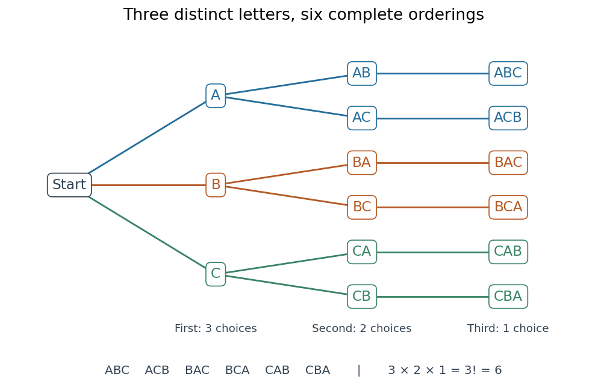

**[Figure 19](#image-the-full-choice-tree-for-the-six-permutations-of-three-distinct-letters-three-first-choices-two-second-choices-and-one-third-choice). The full choice tree for the six permutations of three distinct letters: three first choices, two second choices, and one third choice**.

**Ordering versus mapping.** Label the reference positions $1,\ldots,n$. An ordering [tuple](set-theory.md#finite-tuple) $(a_1,\ldots,a_n)$ of these labels describes the [function](function.md) $\sigma(i)=a_i$; conversely, reading the [images](set-theory.md#image-of-a-function) $\sigma(1),\ldots,\sigma(n)$ recovers the ordering. For example,

$$
\sigma=\begin{pmatrix}1&2&3&4\\3&1&4&2\end{pmatrix}
$$

means $1\mapsto3$, $2\mapsto1$, $3\mapsto4$, $4\mapsto2$. Its ordered image list is $(3,1,4,2)$, whereas its [cycle decomposition of a permutation](mathematics.md#cycle-decomposition-of-a-permutation) is $(1\,3\,4\,2)$: starting at $1$, follow its successive images back to $1$. Parentheses in the latter expression encode arrows around a [permutation cycle](finite-group-theory.md#permutation-cycle), rather than an image list in reference order. [Felix Gotti, MIT 18.211, lecture 11, pages 1–2: arrangements, bijections and cycles](https://math.mit.edu/~fgotti/docs/Courses/C.%20Combinatorial%20Analysis/11.%20Permutations%20I/Permutations%20I.pdf)

The two viewpoints answer different useful questions about the same object. An ordering tells us which object occupies each position; a [bijection](function.md#bijection) tells us where each label is sent and allows successive rearrangements through [function composition](function.md#function-composition). All [permutations](#permutation) of $n$ labels form the [symmetric group](finite-group-theory.md#symmetric-group), whose [subgroups](group.md#subgroup) are [permutation groups](finite-group-theory.md#permutation-group). The counting viewpoint supplies $n!$ possibilities, a [factorial](#factorial); the mapping viewpoint reveals how rearrangements combine.

**Composition convention.** Apply the rightmost [permutation](#permutation) first:

$$
(\sigma\tau)(i)=\sigma(\tau(i)).
$$

For the displayed $\sigma=(1\,3\,4\,2)$ and the [transposition](#transposition-permutation) $\tau=(1\,2)$, direct evaluation gives

$$
\sigma\tau=\begin{pmatrix}1&2&3&4\\1&3&4&2\end{pmatrix}=(2\,3\,4),\qquad
\tau\sigma=\begin{pmatrix}1&2&3&4\\3&2&4&1\end{pmatrix}=(1\,3\,4).
$$

For instance, $(\sigma\tau)(1)=\sigma(2)=1$, but $(\tau\sigma)(1)=\tau(3)=3$. Thus [function composition](function.md#function-composition) of [permutations](#permutation) need not be [commutative](algebraic-operation.md#commutativity); the omitted labels in these [permutation cycles](finite-group-theory.md#permutation-cycle) are [fixed points](function.md#fixed-point).

### Adjacent transposition

↑ **Parent:** [Permutation](#permutation)

### Steinhaus-Johnson-Trotter algorithm

↑ **Parent:** [Permutation](#permutation)

### Euler zigzag number

↑ **Parent:** [Permutation](#permutation)

### Order of a permutation

↑ **Parent:** [Permutation](#permutation)

### Digit permutation

↑ **Parent:** [Permutation](#permutation)

A rearrangement of the [numerical digits](integer.md#numerical-digit) of a numeral. Two numerals have the same [digit permutation](#digit-permutation) class exactly when their digit [multisets](set.md#multiset) agree. If they represent numbers of the same length, a leading zero must be disallowed.

### Signed permutation

↑ **Parent:** [Permutation](#permutation)

### Eulerian number

↑ **Parent:** [Permutation](#permutation)

#### Eulerian polynomial

↑ **Parent:** [Eulerian number](#eulerian-number)

### Stirling numbers of the first kind

↑ **Parent:** [Permutation](#permutation)

#### Unsigned Stirling number of the first kind

↑ **Parent:** [Stirling numbers of the first kind](#stirling-numbers-of-the-first-kind)

### Lehmer code

↑ **Parent:** [Permutation](#permutation)

For a [permutation](#permutation) $p_0,\ldots,p_{n-1}$ of $n$ ordered distinct values, its Lehmer code has entries $c_i=\#\{j>i:p_j<p_i\}$. Its zero-based [lexicographic order](extremal-set-theory.md#lexicographic-order) rank is $\sum_{i=0}^{n-1}c_i(n-1-i)!$. Each entry chooses among the still unused values; the [factorial](#factorial) weights count all completions with a smaller choice at the first differing position.

### Cyclic permutation

↑ **Parent:** [Permutation](#permutation)  
ⓦ [Wiki](https://en.wikipedia.org/wiki/Cyclic_permutation)

A [cyclic permutation](#cyclic-permutation), also called a [permutation cycle](finite-group-theory.md#permutation-cycle), sends $k\geq1$ distinct elements $a_1\mapsto a_2\mapsto\cdots\mapsto a_k\mapsto a_1$ and fixes every element outside this list. Its notation is $(a_1\,a_2\,\ldots\,a_k)$. For example, $(1\,3\,4\,2)$ is the [permutation](#permutation) with image list $(3,1,4,2)$: all four labels lie on one directed loop. In contrast,

$$
\rho=\begin{pmatrix}1&2&3&4\\3&4&1&2\end{pmatrix}=(1\,3)(2\,4)
$$

has two separate loops, exchanging $1$ with $3$ and $2$ with $4$. It is a [permutation](#permutation) composed of two [transpositions](#transposition-permutation), rather than a single [cyclic permutation](#cyclic-permutation).

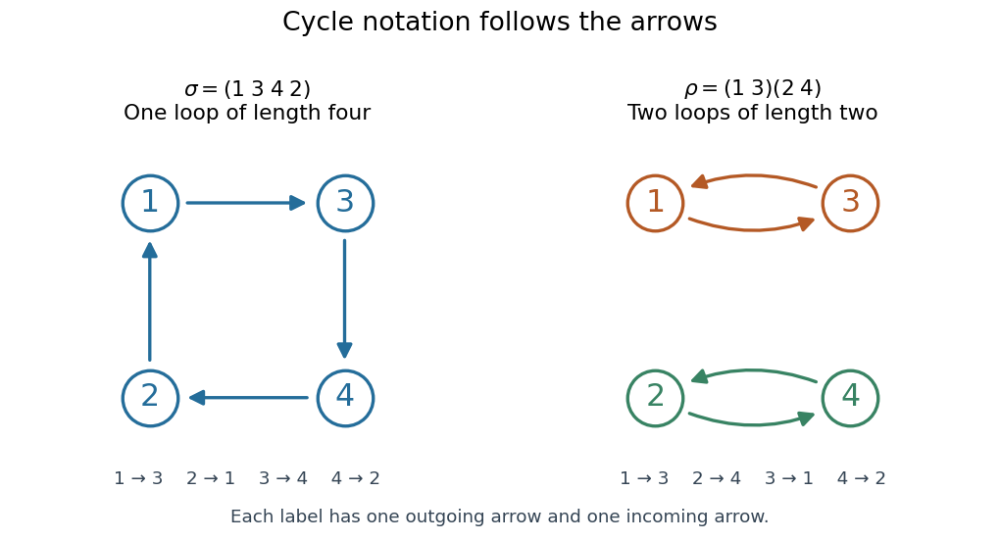

**[Figure 20](#image-two-permutations-on-four-labels-one-cyclic-permutation-1-3-4-2-and-two-disjoint-permutation-cycles-1-3-2-4-with-arrows-showing-every-image). Two permutations on four labels: one cyclic permutation $(1\,3\,4\,2)$ and two disjoint permutation cycles $(1\,3)(2\,4)$, with arrows showing every image**.

Starting at a different point of the same loop changes the written list but preserves the [cyclic permutation](#cyclic-permutation): $(1\,3\,4\,2)=(3\,4\,2\,1)$. Reversing the direction generally changes the [permutation](#permutation); it gives the [inverse function](function.md#inverse-function), here $(1\,2\,4\,3)$. A [transposition](#transposition-permutation) is a [cyclic permutation](#cyclic-permutation) of length two; a one-element [permutation cycle](finite-group-theory.md#permutation-cycle) records a [fixed point](function.md#fixed-point). In a [cycle decomposition of a permutation](mathematics.md#cycle-decomposition-of-a-permutation), one-element [permutation cycles](finite-group-theory.md#permutation-cycle) are usually omitted, with the underlying [set](set.md) understood.

The beauty of this representation is that repeated rearrangements become motion around independent loops. Applying $(1\,3\,4\,2)$ four times returns every label to its start, while applying $(1\,3)(2\,4)$ twice already does so. [Disjoint permutation cycles](finite-group-theory.md#disjoint-permutation-cycles) commute under [function composition](function.md#function-composition), since each moves only labels the others fix. On $n\geq1$ labels, there are $(n-1)!$ [cyclic permutations](#cyclic-permutation) whose single loop contains every label: fix $1$ as the first written entry and order the other $n-1$ labels freely, giving a [factorial](#factorial). This is also the count of [cyclic orderings](#cyclic-ordering); choosing a starting position would otherwise count each loop $n$ times. Rotations are identified here, while reversing direction is allowed to give a different [cyclic ordering](#cyclic-ordering).

**Proof outline for decomposition.** Starting at any label in a [finite set](set.md#finite-set), repeatedly apply the [permutation](#permutation). The [pigeonhole principle](#pigeonhole-principle) forces a repeated label. If the first repetition were at a label other than the starting one, its two predecessors would be different labels with the same [image](set-theory.md#image-of-a-function), contradicting the [injective function](algebra.md#injective-function) property. This produces a [permutation cycle](finite-group-theory.md#permutation-cycle) returning to the start. Start again at a label not yet visited; the new [permutation cycle](finite-group-theory.md#permutation-cycle) cannot meet an earlier one, since the [bijection](function.md#bijection) gives every label a unique predecessor. Continue until every label belongs to a loop. The resulting [cycle decomposition of a permutation](mathematics.md#cycle-decomposition-of-a-permutation) is unique up to the order of the [disjoint permutation cycles](finite-group-theory.md#disjoint-permutation-cycles) and the starting point written in each one. [Felix Gotti, MIT 18.211, lecture 11, definitions 1–2 and the preceding argument](https://math.mit.edu/~fgotti/docs/Courses/C.%20Combinatorial%20Analysis/11.%20Permutations%20I/Permutations%20I.pdf)

### Finitely supported permutation

↑ **Parent:** [Permutation](#permutation)

A finitely supported [permutation](#permutation) fixes every element outside some finite [subset](set.md#subset). The finitely supported [permutations](#permutation) of $\mathbb N$ are the union of the finite [symmetric groups](finite-group-theory.md#symmetric-group) acting on $\{1,\ldots,k\}$, and hence form a [countable set](cardinal-number.md#countable-set). All [permutations](#permutation) of $\mathbb N$ form an [uncountable set](cardinal-number.md#uncountable-set): independently swapping or fixing each pair $(2j-1,2j)$ injects the [power set](set.md#power-set) of $\mathbb N$ into this larger [set](set.md).

### Uniform random permutation

↑ **Parent:** [Permutation](#permutation)

A uniform random permutation of $n$ distinct objects gives each of the $n!$ [permutations](#permutation) the same [probability](probability-theory.md#probability). Restricting the order to any fixed subset gives a uniform ordering on that subset. Relative ranks encode such a permutation bijectively by independent choices of an insertion position.

#### Independent relative ranks of a uniform random permutation

↑ **Parent:** [Uniform random permutation](#uniform-random-permutation)

For a [uniform random permutation](#uniform-random-permutation) $a_1,\ldots,a_n$, define $R_i$ as the rank of $a_i$ among $a_1,\ldots,a_i$, with rank one assigned to the smallest value. Each sequence $r_i\in\{1,\ldots,i\}$ corresponds to exactly one [permutation](#permutation): insert index $i$ in position $r_i$ of the current increasing-value list, then assign the final list the values $1,\ldots,n$. The $n!$ equally likely permutations therefore correspond to the $\prod_{i=1}^n i=n!$ equally likely rank sequences. Consequently the $R_i$ are [independent random variables](random-variable.md#independent-random-variables), each with the displayed [uniform distribution](continuous-probability-distribution.md#continuous-uniform-distribution).

##### Independent record indicators

↑ **Parent:** [Independent relative ranks of a uniform random permutation](#independent-relative-ranks-of-a-uniform-random-permutation)

The indicators $Y_i=\mathbf1_{\{R_i=1\}}$ of successively smaller records are [independent](random-variable.md#independent-random-variables) and have [Bernoulli distributions](discrete-probability-distribution.md#bernoulli-distribution) of parameters $1/i$. Successively larger records use $R_i=i$ and have the same laws. For $K_n=\sum_{i=1}^nY_i$, [expectation](expected-value.md) and [variance additivity for independent random variables](variance.md#variance-additivity-for-independent-random-variables) give $E K_n=\sum_{i=1}^n1/i$ and $\operatorname{Var}K_n=\sum_{i=1}^n(1/i-1/i^2)$.

#### Fixed point count of a uniform random permutation

↑ **Parent:** [Uniform random permutation](#uniform-random-permutation)

For a [uniform random permutation](#uniform-random-permutation) $\pi$ of $n\geq1$ objects, let $M_n$ count its [fixed points](function.md#fixed-point). Write $M_n=\sum_{i=1}^n\mathbf1_{\{\pi(i)=i\}}$. Each [indicator random variable](expected-value.md#indicator-random-variable) has [expected value](expected-value.md) $1/n$, so [linearity of expectation](expected-value.md#linearity-of-expectation) gives **$\mathbb E[M_n]=1$ for every $n\geq1$**. This average does not require [independence](random-variable.md#independent-random-variables): for $n\geq2$, fixing two specified objects has [probability](probability-theory.md#probability) $1/[n(n-1)]$, greater than the product $1/n^2$ of their individual [probabilities](probability-theory.md#probability).

For four objects, exact enumeration gives counts $9,8,6,0,1$ for $0,1,2,3,4$ [fixed points](function.md#fixed-point) among the $24$ equally likely [permutations](#permutation). Their weighted [arithmetic mean](arithmetic.md#arithmetic-mean) is $(0\cdot9+1\cdot8+2\cdot6+4\cdot1)/24=1$. Exactly three [fixed points](function.md#fixed-point) are impossible: the last object must then also be fixed.

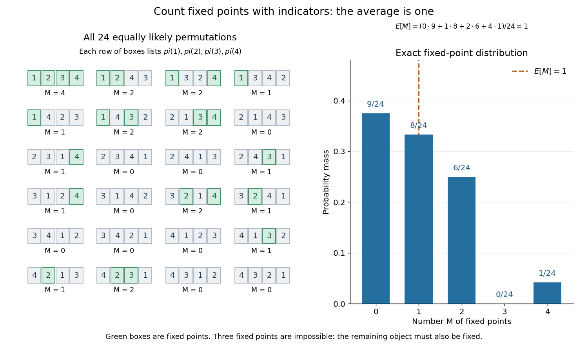

**[Figure 21](#image-the-fixed-point-count-of-a-uniform-random-permutation-averaged-over-all-24-permutations-of-four-objects). The fixed point count of a uniform random permutation averaged over all $24$ permutations of four objects**. Each card lists $\pi(1),\pi(2),\pi(3),\pi(4)$. Green entries equal their positions and therefore mark [fixed points](function.md#fixed-point). The [probability mass function](probability-distribution.md#probability-mass-function) on the right counts those cards; its [expected value](expected-value.md) is one.

Choose the $m$ fixed objects and derange the remaining $n-m$. Their count is $\binom nmD_{n-m}$ among $n!$ equally likely [permutations](#permutation). The [inclusion-exclusion principle](#inclusion-exclusion-principle) for $D_{n-m}$ proves the displayed law, valid for $0\le m\le n$ and zero otherwise. With $D_0=1$, it includes the all-fixed case and the impossibility of exactly $n-1$ fixed objects. For fixed $m$, the law tends to $e^{-1}/m!$, the [Poisson distribution](discrete-probability-distribution.md#poisson-distribution) of mean one.

### Cycle length of a tagged element in a uniform permutation

↑ **Parent:** [Permutation](#permutation)

In a uniformly random [permutation](#permutation) of $N$ objects, the cycle containing one specified object has a uniform length on $\{1,\ldots,N\}$. For length $\ell$, choose the other $\ell-1$ objects, arrange their order around the tagged object, and permute all remaining objects. The count is $\binom{N-1}{\ell-1}(\ell-1)!(N-\ell)!=(N-1)!$, independent of $\ell$. Its mean is $(N+1)/2$, while the mean number of other elements in that cycle is $(N-1)/2$.

### Derangement of a permutation

↑ **Parent:** [Permutation](#permutation)

A [permutation](#permutation) with no fixed points. Applying the [inclusion-exclusion principle](#inclusion-exclusion-principle) to the events that each element is fixed gives $D_n=n!\sum_{k=0}^n(-1)^k/k!$. Therefore $D_n/n!\to e^{-1}$, and the alternating-series remainder is at most $1/(n+1)!$.

// Destination: foundations-of-mathematics.bigb

### Cyclic ordering

↑ **Parent:** [Permutation](#permutation)

A [cyclic ordering](#cyclic-ordering) of a finite ground set records its elements around an oriented circle, identifying [permutations](#permutation) that differ by rotation. There are $(n-1)!$ such orderings for $n\geq1$. A uniformly random [permutation](#permutation) induces a uniformly random [cyclic ordering](#cyclic-ordering).

#### Cyclic interval

↑ **Parent:** [Cyclic ordering](#cyclic-ordering)

A [cyclic interval](#cyclic-interval) of length $r$ is the set of $r$ consecutive positions in a [cyclic ordering](#cyclic-ordering). For $1\leq r<n$, there are $n$ distinct intervals, one ending at each position. Under a uniformly random [permutation](#permutation), a fixed $r$-set appears as an interval with probability $n/\binom nr$. This is the counting mechanism of the [Katona circle method](extremal-set-theory.md#katona-circle-method).

### Generalised permutation

↑ **Parent:** [Permutation](#permutation)

A generalised permutation is a finite multiset of ordered pairs, displayed as a two-row array or encoded by a finite-support matrix of nonnegative integer multiplicities $m_{a,b}$. The no-repeated-column condition means every multiplicity is zero or one; entries within either individual row may still repeat.

### Inversion of a permutation

↑ **Parent:** [Permutation](#permutation)

For a [permutation](#permutation) $\pi$ of $\{1,\ldots,n\}$, an inversion is a pair $i<j$ with $\pi(i)>\pi(j)$. Its number equals the [Coxeter length](semisimple-lie-algebra.md#coxeter-length) for adjacent [transpositions](#transposition-permutation): each adjacent swap changes the count by one, and swapping adjacent descents sorts the permutation in exactly that many steps.

#### Inversion number

↑ **Parent:** [Inversion of a permutation](#inversion-of-a-permutation)

### Transposition (permutation)

↑ **Parent:** [Permutation](#permutation)

A transposition is a [permutation](#permutation) that exchanges two elements and fixes every other element. Every transposition has order two.

A transposition is a [cyclic permutation](#cyclic-permutation) of length two.

### Product of two transpositions

↑ **Parent:** [Permutation](#permutation)

A product of two transpositions is the identity when they coincide, a [three-cycle](finite-group-theory.md#three-cycle) when their supports meet in one letter, and a product of two [disjoint permutation cycles](finite-group-theory.md#disjoint-permutation-cycles) when their supports are disjoint.

### Bounded-displacement permutation of the natural numbers

↑ **Parent:** [Permutation](#permutation)

A permutation $\sigma$ of $\mathbb N$ has displacement at most one when $|\sigma(j)-j|\leq1$. Such a permutation is a disjoint collection of fixed points and adjacent transpositions, so independently swapping the pairs $(2n-1,2n)$ already gives uncountably many examples.

## Analysis of Boolean functions

↑ **Parent:** [Combinatorics](combinatorics.md)

[This section is present in another page, follow this link to view it.](analysis-of-boolean-functions.md)

## Ramsey theory

↑ **Parent:** [Combinatorics](combinatorics.md)

[This section is present in another page, follow this link to view it.](ramsey-theory.md)

## Symmetric function

↑ **Parent:** [Combinatorics](combinatorics.md)  
ⓦ [Wiki](https://en.wikipedia.org/wiki/Symmetric_function)

A symmetric function is a formal power series of bounded total degree that is invariant under every finite permutation of its variables. Symmetric functions form a graded ring with several useful bases.

### Cauchy identity for symmetric functions

↑ **Parent:** [Symmetric function](#symmetric-function)

Expand each factor as a [geometric series](sequence-and-series.md#geometric-series) indexed by a nonnegative [matrix](vector-space.md#matrix). The [RSK correspondence](representation-theory-of-the-symmetric-group.md#robinson-schensted-knuth-correspondence) preserves its row and column contents, changing the sum to pairs of [Semistandard Young tableaux](representation-theory-of-the-symmetric-group.md#semistandard-young-tableau) of the same shape and proving the displayed formal identity. Its kernel is also $\sum_\lambda h_\lambda(x)m_\lambda(y)=\sum_\lambda p_\lambda(x)p_\lambda(y)/z_\lambda$. These are dual-basis kernels for the [Hall inner product of symmetric functions](#hall-inner-product-of-symmetric-functions), so the Schur expansion proves orthonormality. Applying the [symmetric-function involution](#symmetric-function-involution) in one alphabet gives the dual identity $\prod_{i,j}(1+x_iy_j)=\sum_\lambda s_\lambda(x)s_{\lambda'}(y)$.

#### Schur specialization by a generating function

↑ **Parent:** [Cauchy identity for symmetric functions](#cauchy-identity-for-symmetric-functions)

Given $F(t)=\sum_{r\ge0}f_rt^r$ with $f_0=1$, put $f_r=0$ for $r<0$. The [Cauchy identity for symmetric functions](#cauchy-identity-for-symmetric-functions) and [Jacobi–Trudi identity](#jacobi-trudi-identity) give $\prod_iF(t_i)=\sum_\lambda s_\lambda^Fs_\lambda(t)$, degree by degree in the completion. For $F(t)=\prod_j(1-x_jt)^{-1}$ the coefficients are $s_\lambda(x)$; for $F(t)=\prod_j(1+x_jt)$ they are $s_{\lambda'}(x)$.

#### Dual Cauchy identity for symmetric functions

↑ **Parent:** [Cauchy identity for symmetric functions](#cauchy-identity-for-symmetric-functions)

Apply the [symmetric-function involution](#symmetric-function-involution) in one alphabet to the ordinary [Cauchy identity](#cauchy-identity-for-symmetric-functions). It changes complete generators to elementary ones and, by the dual [Jacobi–Trudi identity](#jacobi-trudi-identity), sends $s_\lambda$ to $s_{\lambda'}$. This proves the identity as a formal series and relates pairings with transposed Young shapes to squarefree [matrix](vector-space.md#matrix) weights.

### Symmetric-function involution

↑ **Parent:** [Symmetric function](#symmetric-function)

The [Fundamental theorem of symmetric polynomials](polynomial.md#fundamental-theorem-of-symmetric-polynomials) gives freely generated elementary functions, so sending each $e_r$ to $h_r$ defines an [algebra homomorphism](algebra-over-a-field.md#algebra-homomorphism-over-a-field). For $E(t)=\sum e_rt^r$ and $H(t)=\sum h_rt^r$, $E(-t)H(t)=1$. Applying the homomorphism shows $\omega(H(t))=E(t)$, hence $\omega^2=1$. Taking logarithms of $H$ gives the displayed action on power sums. It preserves the [Hall inner product of symmetric functions](#hall-inner-product-of-symmetric-functions) because each power-sum [basis](vector-space.md#basis) vector acquires only a sign.

#### Forgotten symmetric function

↑ **Parent:** [Symmetric-function involution](#symmetric-function-involution)

The coefficient of $m_\mu$ in $f_\lambda$ counts distinct rearrangements of the parts of $\lambda$ whose prefix-sum set contains the prefix sums of $\mu$. Indeed, [Hall inner product of symmetric functions](#hall-inner-product-of-symmetric-functions) duality between $m_\lambda,h_\lambda$ turns this coefficient into $(-1)^{|\lambda|-\ell(\lambda)}$ times the coefficient of $h_\lambda$ in $e_\mu$. Expanding $E(t)=H(-t)^{-1}$ expresses each $e_{\mu_j}$ as a signed sum of compositions of $\mu_j$. Concatenating these compositions gives precisely the counted rearrangements, and every sign is $(-1)^{|\lambda|-\ell(\lambda)}$.

### Monomial symmetric function

↑ **Parent:** [Symmetric function](#symmetric-function)

For an [integer partition](#integer-partition) $\lambda$, $m_\lambda$ sums the distinct [monomials](polynomial.md#monomial) whose positive exponent multiset is $\lambda$. No multiplicity is attached to repeated parts. The functions of fixed total degree form a [basis](vector-space.md#basis) of the [symmetric functions](#symmetric-function) of that degree, since finite variable [permutations](#permutation) identify precisely these [monomial](polynomial.md#monomial) orbits.

### Hall inner product of symmetric functions

↑ **Parent:** [Symmetric function](#symmetric-function)

Here $p_\alpha$ is a product of power-sum [symmetric functions](#symmetric-function) and $z_\alpha=\prod_r r^{m_r}m_r!$ for part multiplicities $m_r$. The [Frobenius characteristic map](#frobenius-characteristic-map) identifies this product with the [ordinary character](representation-theory.md#ordinary-character) [inner product](inner-product.md). [Schur functions](#schur-polynomial) are orthonormal, and the adjoint of multiplication by $p_k$ is $k\partial/\partial p_k$. These properties turn a power-sum multiplication formula into the [Murnaghan–Nakayama rule](representation-theory-of-the-symmetric-group.md#murnaghan-nakayama-rule).

### Complete homogeneous symmetric polynomial

↑ **Parent:** [Symmetric function](#symmetric-function)  
ⓦ [Wiki](https://en.wikipedia.org/wiki/Complete_homogeneous_symmetric_polynomial)

The complete homogeneous symmetric polynomial $h_n$ is the sum of all monomials of total degree $n$. Its generating function is

$$
H(t)=\sum_{n\geq0}h_nt^n
=\exp\left(\sum_{k\geq1}\frac{p_kt^k}{k}\right).
$$

### Power-sum symmetric polynomial

↑ **Parent:** [Symmetric function](#symmetric-function)  
ⓦ [Wiki](https://en.wikipedia.org/wiki/Power-sum_symmetric_polynomial)

The power-sum symmetric polynomial is $p_n=\sum_i x_i^n$. For an [integer partition](#integer-partition) $\mu$, write $p_\mu=\prod_i p_{\mu_i}$.

### Schur polynomial

↑ **Parent:** [Symmetric function](#symmetric-function)  
ⓦ [Wiki](https://en.wikipedia.org/wiki/Schur_polynomial)

The Schur polynomials form a basis of the ring of symmetric functions indexed by [integer partitions](#integer-partition).

#### Hook-content formula

↑ **Parent:** [Schur polynomial](#schur-polynomial)

For an [integer partition](#integer-partition) $\lambda$, $s_\lambda(1^m)=\prod_{(i,j)\in\lambda}(m+j-i)/h_{ij}$, where $h_{ij}$ is the cell's [hook length](representation-theory-of-the-symmetric-group.md#hook-length). It counts [Semistandard Young tableaux](representation-theory-of-the-symmetric-group.md#semistandard-young-tableau) of shape $\lambda$ whose entries belong to $\{1,\ldots,m\}$.

#### Bialternant formula

↑ **Parent:** [Schur polynomial](#schur-polynomial)

Let $a_\gamma=\det[x_j^{\gamma_i}]$ and $\delta=(N-1,\ldots,0)$. Multiply the [Jacobi–Trudi identity](#jacobi-trudi-identity) [matrix](vector-space.md#matrix) by $B_{jk}=(-1)^{N-j}e_{N-j}(X\setminus x_k)$. The generating-function identity $H(t)\prod_{i\ne k}(1-x_it)=(1-x_kt)^{-1}$ makes the product [matrix](vector-space.md#matrix) $[x_k^{\lambda_i+N-i}]$. Setting $\lambda=0$ shows $\det B=a_\delta$, proving the formula as a [polynomial](polynomial.md) identity.

##### Schur evaluation at all ones

↑ **Parent:** [Bialternant formula](#bialternant-formula)

Put $b_i=\lambda_i+N-i$. In the [bialternant formula](#bialternant-formula), substitute $x_j=e^{ty_j}$ with distinct $y_j$ and compare the first nonzero [determinant](multilinear-algebra.md#determinant) coefficients as $t\to0$. They arise from the distinct degrees $0,\ldots,N-1$ in the exponential expansions. The common factor in the $y_j$ and the factorials cancel, leaving the product of differences of the $b_i$ divided by the differences of $N-i$. This proves the displayed integral specialization without dividing by a vanishing Vandermonde value.

#### Skew Schur function

↑ **Parent:** [Schur polynomial](#schur-polynomial)

Sum the weight [monomials](polynomial.md#monomial) of all [Semistandard Young tableaux](representation-theory-of-the-symmetric-group.md#semistandard-young-tableau) on the [skew Young diagram](representation-theory-of-the-symmetric-group.md#skew-young-diagram) $\lambda/\mu$, with weak rows and strict columns. A [Bender-Knuth involution](representation-theory-of-the-symmetric-group.md#bender-knuth-involution) interchanges the counts of adjacent letters without changing the shape, so the sum is a [symmetric function](#symmetric-function). Taking $\mu$ empty gives the [Schur function](#schur-polynomial).

<h4 id="jacobi-trudi-identity">Jacobi–Trudi identity</h4>

↑ **Parent:** [Schur polynomial](#schur-polynomial)  
ⓦ [Wiki](https://en.wikipedia.org/wiki/Jacobi–Trudi_identity)

The Jacobi–Trudi identity expresses a Schur polynomial as

$$
s_\lambda=\det(h_{\lambda_i-i+j}).
$$

In particular, $s_{(a,b)}=h_ah_b-h_{a+1}h_{b-1}$.

##### Determinantal form of a symmetric-group character

↑ **Parent:** [Jacobi–Trudi identity](#jacobi-trudi-identity)

Here $[a]$ is the trivial [character](representation-theory.md#character-of-a-representation) of $S_a$, $[0]$ is the induction-product unit, $[a]=0$ for $a<0$, and multiplication is induction of external [tensor products](multilinear-algebra.md#tensor-product). The [Frobenius characteristic map](#frobenius-characteristic-map) turns the expression into the [Jacobi–Trudi identity](#jacobi-trudi-identity). A sign-reversing involution on intersecting lattice-path systems leaves precisely the nonintersecting systems corresponding to [Semistandard Young tableaux](representation-theory-of-the-symmetric-group.md#semistandard-young-tableau), proving the [determinant](multilinear-algebra.md#determinant) identity.

### Frobenius characteristic map

↑ **Parent:** [Symmetric function](#symmetric-function)  
ⓦ [Wiki](https://en.wikipedia.org/wiki/Frobenius_characteristic_map)

The Frobenius characteristic map sends class functions on $S_n$ to homogeneous symmetric functions of degree $n$. It satisfies

$$
\operatorname{ch}(\chi^\lambda)=s_\lambda,
\qquad
\operatorname{ch}(\chi)=\sum_{\mu\vdash n}\frac{\chi(\mu)}{z_\mu}p_\mu.
$$

#### Frobenius alternant character formula

↑ **Parent:** [Frobenius characteristic map](#frobenius-characteristic-map)

For a [partition of an integer](representation-theory-of-the-symmetric-group.md#partition-of-an-integer) $\lambda\vdash n$, padded to $m$ rows, let $\delta=(m-1,\ldots,0)$. If a permutation has $\alpha_q$ cycles of length $q$, put $p_\alpha=\prod_q(\sum_i x_i^q)^{\alpha_q}$. The [character](representation-theory.md#character-of-a-representation) of the [Specht module](representation-theory-of-the-symmetric-group.md#specht-module) $S^\lambda$ is the displayed coefficient. Equivalently $p_\alpha A_\delta=\sum_\lambda\chi^\lambda(\alpha)A_{\lambda+\delta}$, the alternant form of the [Frobenius characteristic map](#frobenius-characteristic-map). It gives finite coefficient computations without constructing representation matrices.

## ↑ Ancestors (3)

1. [Area of mathematics](mathematics.md#area-of-mathematics)
2. [Mathematics](mathematics.md)
3. [Codex Wiki](README.md)

## ← Incoming links (8)

- [Analysis of Boolean functions](analysis-of-boolean-functions.md)
- [Borsuk-Ulam theorem](algebraic-topology.md#borsuk-ulam-theorem)
- [Coding theory](coding-theory.md)
- [Combinatorics](combinatorics.md)
- [Discrete uniform distribution](discrete-probability-distribution.md#discrete-uniform-distribution)
- [Joseph Bernard Kruskal](mathematics.md#joseph-bernard-kruskal)
- [Solution](past-exam-of-the-mathematics-course-of-the-year-1-of-the-natural-sciences-course-of-the-university-of-cambridge/2017/paper-1.md#16/a/solution)
- [Ramsey theory](ramsey-theory.md)
