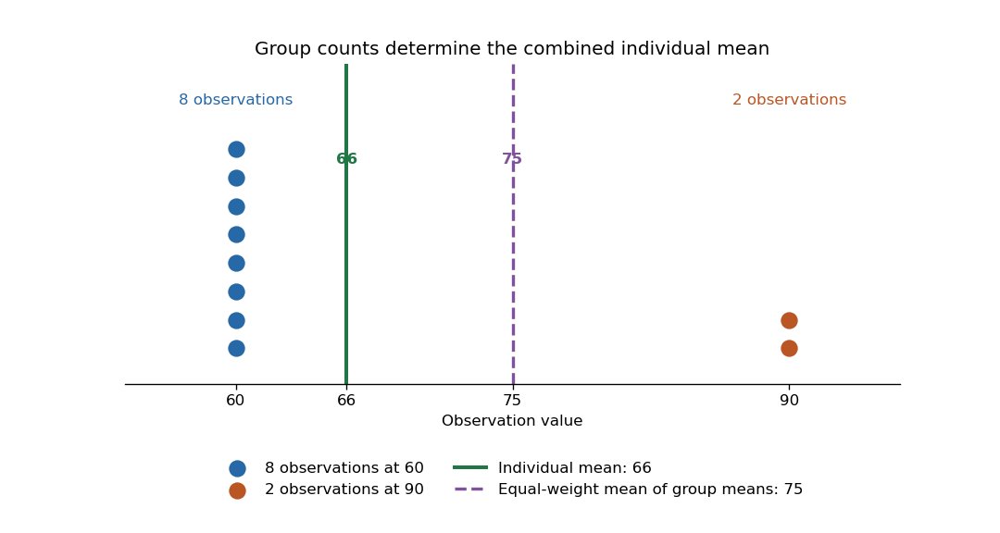

# Combining means of groups

↑ **Parent:** [Weighted arithmetic mean](weighted-arithmetic-mean.md)

Suppose disjoint nonempty groups have sizes $n_j$ and [arithmetic means](arithmetic-mean.md) $\bar x_j$. The [arithmetic mean](arithmetic-mean.md) of all observations is

$$
\boxed{\bar x=\frac{\sum_j n_j\bar x_j}{\sum_j n_j}.}
$$

Each group contributes the [sum](sum.md) $n_j\bar x_j$; add those totals before dividing by the overall count. This is exactly a [weighted mean](weighted-arithmetic-mean.md) of group means with weights equal to group sizes. [OpenStax Introductory Statistics 2e, §2.5: means from frequencies](https://openstax.org/books/introductory-statistics-2e/pages/2-5-measures-of-the-center-of-the-data)

Take a synthetic example with two observations equal to $90$ and eight equal to $60$. The two group means are $90$ and $60$, and the combined mean is $66$. Giving the two groups equal weights instead produces $(90+60)/2=75$, which summarizes the two group means with equal influence. To summarize all ten individuals with equal influence, use their group counts.

**[Figure 5](#image-group-size-determines-each-group-mean-s-influence-on-the-combined-individual-mean). Group size determines each group mean's influence on the combined individual mean**. Two synthetic observations are $90$ and eight are $60$. Their combined [arithmetic mean](arithmetic-mean.md) is $66$; the equal-weight average of the two group means is $75$.

The group means and counts determine the combined [arithmetic mean](arithmetic-mean.md), but do not generally determine the combined [variance](variance-split.md). Variation within the groups is additional information.

## ↑ Ancestors (8)

1. [Weighted arithmetic mean](weighted-arithmetic-mean.md)
2. [Sum](sum.md)
3. [Summation](summation.md)
4. [Addition](addition.md)
5. [Arithmetic](arithmetic-split.md)
6. [Area of mathematics](area-of-mathematics.md)
7. [Mathematics](mathematics-split.md)
8. [Codex Wiki](split.md)

## ← Incoming links (1)

- [Weighted arithmetic mean](weighted-arithmetic-mean.md)
