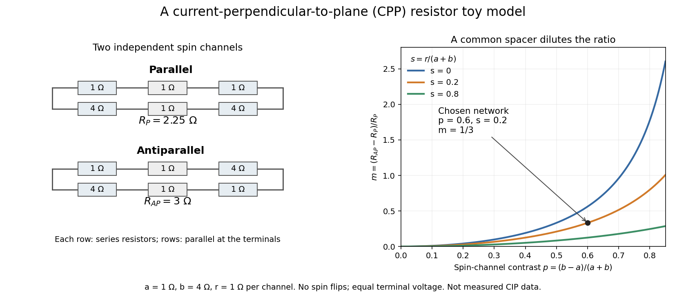

# Common-spacer dilution in the two-current model

↑ **Parent:** [Two-current resistor model](two-current-resistor-model.md)

Define a dimensionless channel contrast $p=(b-a)/(a+b)$ and spacer ratio $s=r/(a+b)$. Positive $a,b$ give $|p|<1$, and substitution gives the displayed expression. Equal channel responses, $p=0$, eliminate the model's magnetic-configuration signal. Increasing the common spacer resistance at fixed $a,b$ increases the denominator and decreases $m$.

**[Figure 12](#image-two-spin-channels-turn-magnetic-alignment-into-a-different-terminal-resistance). Two spin channels turn magnetic alignment into a different terminal resistance**. [Source](spin-channel-resistor-model-and-spacer-dilution.py). Original CPP circuit and chosen parameter curves, not fits to the historical CIP measurements. The example uses $a=1\,\Omega$, $b=4\,\Omega$, $r=1\,\Omega$. Curves vary the defined contrast $p$ at fixed spacer ratio $s$; this does not assert that changing a real chromium thickness leaves every other material and magnetic property fixed.

This is a controlled comparison within the model. In an actual multilayer, changing a spacer thickness can change the magnetic coupling and the interfaces as well as electrical transport. [Spin-flip scattering](spin-flip-scattering.md) also mixes the channels that the calculation kept independent.

## ↑ Ancestors (12)

1. [Two-current resistor model](two-current-resistor-model.md)
2. [Current-perpendicular-to-plane magnetoresistance](current-perpendicular-to-plane-magnetoresistance.md)
3. [Giant magnetoresistance](giant-magnetoresistance.md)
4. [Magnetoresistance](magnetoresistance.md)
5. [Electrical resistance](electrical-resistance.md)
6. [Electrical resistance and conductance](electrical-resistance-and-conductance.md)
7. [Electric current](electric-current.md)
8. [Electric charge](electric-charge-split.md)
9. [Electromagnetism](electromagnetism-split.md)
10. [Branches of physics](branches-of-physics.md)
11. [Physics](physics-split.md)
12. [Codex Wiki](split.md)
