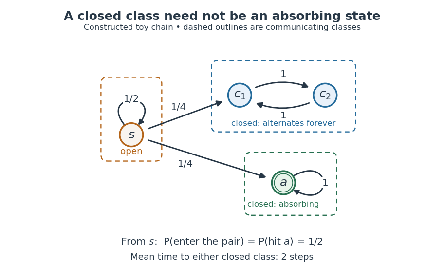

# Communicating class

↑ **Parent:** [Markov chain](markov-chain.md)  
ⓦ [Wiki](https://en.wikipedia.org/wiki/Communicating_class)

In a finite, time-homogeneous [Discrete-time Markov chain](discrete-time-markov-chain.md) with row-stochastic [transition matrix](stochastic-matrix.md) $P$, write $i\to j$ when $j$ is accessible from $i$, meaning $(P^n)_{ij}>0$ for some $n\geq0$. States communicate, written $i\leftrightarrow j$, when both $i\to j$ and $j\to i$. Communication is an [equivalence relation](equivalence-relation.md), and a communicating class is an entire [equivalence class](equivalence-class.md)

$$
C(i)=\{j\in S:i\leftrightarrow j\}.
$$

Thus [communicating classes](communicating-class.md) form a [partition](partition-of-a-set.md) of the [state space](state-space.md); a smaller mutually communicating subset is not itself a class. See [Maria Cameron's Markov Chains notes, section 1.2](https://math.umd.edu/~mariakc/REU2023/Tutorials/MarkovChains.pdf).

The allowance of zero steps matters: $P^0=I$, the [identity matrix](identity-matrix.md), makes $i\to i$ true even for a state with no possible positive-time return. Symmetry is built into communication. For transitivity, concatenate a positive-[probability](probability.md) path from $i$ to $j$ with one from $j$ to $k$, and do the same in reverse. These observations prove the [equivalence relation](equivalence-relation.md) directly. One-way accessibility alone is not symmetric and does not define the classes; see [Accessible state of a Markov chain](accessible-state-of-a-markov-chain.md).

A [closed communicating class](closed-communicating-class.md) satisfies $P_{ij}=0$ for every $i\in C$ and $j\notin C$. Once entered, it cannot be left. A singleton class is an [absorbing state](absorbing-state.md) exactly when it is closed. An [open communicating class](open-communicating-class.md) has an outgoing transition; after a path leaves it, it cannot return, since that would make the visited outside states communicate with it. The internal motion of a closed class can nevertheless continue forever.

**[Figure 7](#image-a-constructed-chain-has-three-communicating-classes-an-open-singleton-a-closed-alternating-pair-and-a-closed-absorbing-singleton-dashed-outlines-group-states-into-classes). A constructed chain has three communicating classes: an open singleton, a closed alternating pair, and a closed absorbing singleton; dashed outlines group states into classes.**

For this constructed example, in state order $(s,c_1,c_2,a)$, the [transition matrix](stochastic-matrix.md) is

$$
P=\begin{pmatrix}
1/2&1/4&0&1/4\\
0&0&1&0\\
0&1&0&0\\
0&0&0&1
\end{pmatrix}.
$$

There are exactly three [communicating classes](communicating-class.md): $\{s\}$, $\{c_1,c_2\}$, and $\{a\}$. Only the first is open. The second is closed but neither of its states is an [absorbing state](absorbing-state.md); they alternate deterministically. Although $s\to c_2$ via $c_1$, the reverse accessibility fails. A direct [matrix power](matrix-power.md) check gives $(P^2)_{s,c_2}=1/4$ and $(P^2)_{c_2,s}=0$.

Starting at $s$, let $\tau$ be the first [hitting time](first-passage-time.md) of either closed class. Staying at $s$ for $n$ steps has [probability](probability.md) $2^{-n}$, so $\mathbb P_s(\tau>n)=2^{-n}$ and $\mathbb E_s\tau=\sum_{n\geq0}2^{-n}=2$. The two eventual destination classes each have [probability](probability.md) $\sum_{k\geq0}(1/2)^k(1/4)=1/2$. Hence the [hitting probability](hitting-probability.md) of the [absorbing state](absorbing-state.md) $a$ is only $1/2$, and its unconditional [expected hitting time](expected-hitting-time.md) from $s$ is infinite: on half the paths it is never hit. In particular, entering a closed class with certainty does not imply entering an [absorbing state](absorbing-state.md) with certainty.

Classifying the [state space](state-space.md) separates two questions: which closed region will eventually be entered, and how does the [Markov chain](markov-chain.md) move inside that region? In this example the restriction to $\{c_1,c_2\}$ is an [irreducible Markov chain](irreducible-markov-chain.md) with period two; the restriction to $\{a\}$ is a one-state [irreducible Markov chain](irreducible-markov-chain.md) with period one. The whole [Markov chain](markov-chain.md) is reducible. The [absorbing state](absorbing-state.md) example illustrates a different possibility: every closed class is a singleton, so eventual class selection is also terminal outcome selection.

**Table of contents**

- [Accessible state of a Markov chain](accessible-state-of-a-markov-chain.md)
- [Open communicating class](open-communicating-class.md)
- [Communicating states](communicating-states.md)
- [Closed communicating class](closed-communicating-class.md)
- [Transient communicating class](transient-communicating-class.md)
- [Period of a state in a Markov chain](period-of-a-state-in-a-markov-chain.md)
  - [Return-free state in a Markov chain](return-free-state-in-a-markov-chain.md)
  - [Period is constant on a communicating class](period-is-constant-on-a-communicating-class.md)

## ↑ Ancestors (7)

1. [Markov chain](markov-chain.md)
2. [Markov process](markov-process-split.md)
3. [Probability theory](probability-theory-split.md)
4. [Probability and statistics](probability-and-statistics-split.md)
5. [Area of mathematics](area-of-mathematics.md)
6. [Mathematics](mathematics-split.md)
7. [Codex Wiki](split.md)

## ← Incoming links (15)

- [Absorbing state](absorbing-state.md)
- [Accessible state of a Markov chain](accessible-state-of-a-markov-chain.md)
- [Communicating class](communicating-class.md)
- [Irreducible Markov chain](irreducible-markov-chain.md)
- [Open communicating class](open-communicating-class.md)
- [Solution](past-exam-of-the-mathematics-course-of-the-university-of-cambridge/2004/ib/paper-1/22h/solution.md)
- [Solution](past-exam-of-the-mathematics-course-of-the-university-of-cambridge/2005/ib/paper-3/9d/solution.md)
- [Solution](past-exam-of-the-mathematics-course-of-the-university-of-cambridge/2006/ii/paper-1/26j/b/solution.md)
- [Solution](past-exam-of-the-mathematics-course-of-the-university-of-cambridge/2007/ib/paper-4/9c/solution.md)
- [Solution](past-exam-of-the-mathematics-course-of-the-university-of-cambridge/2007/ii/paper-2/26j/c/solution.md)
- [Solution](past-exam-of-the-mathematics-course-of-the-university-of-cambridge/2008/ib/paper-4/9h/solution.md)
- [Solution](past-exam-of-the-mathematics-course-of-the-university-of-cambridge/2016/ib/paper-2/20h/a/solution.md)
- [Solution](past-exam-of-the-mathematics-course-of-the-university-of-cambridge/2019/ib/paper-3/9h/a/solution.md)
- [Solution](past-exam-of-the-mathematics-course-of-the-university-of-cambridge/2021/ib/paper-3/8h/a/solution.md)
- [Solution](past-exam-of-the-mathematics-course-of-the-university-of-cambridge/2023/ib/paper-2/18h/c/solution.md)
