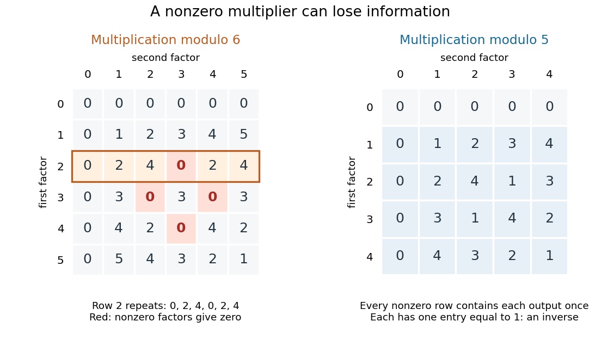

# Commutative ring

↑ **Parent:** [Ring](ring.md)  
ⓦ [Wiki](https://en.wikipedia.org/wiki/Commutative_ring)

A [commutative ring](commutative-ring.md) is a [ring](ring.md) in which [multiplication](multiplication.md) satisfies $ab=ba$ for every pair. The [integers](integer-split.md) and the [polynomial ring](polynomial-ring.md) $\mathbb Z[X]$ are examples. So is $\mathbb Z/n\mathbb Z$, the [quotient ring](quotient-ring.md) whose elements are [residue classes](residue-class.md) in [modular arithmetic](modular-arithmetic-split.md). We represent these by $0,1,\ldots,n-1$ and reduce each sum or product to its remainder. All following calculations modulo $6$ use this convention.

In $\mathbb Z/6\mathbb Z$, $2\cdot3=0$, although neither factor is zero. Thus $2$ and $3$ are [zero divisors](zero-divisor.md): nonzero elements whose product with another nonzero element can vanish. Also $2\cdot1=2\cdot4=2$. Removing the common factor $2$ would falsely assert $1=4$. The entire row for [multiplication](multiplication.md) by $2$ is

$$
2\cdot(0,1,2,3,4,5)=(0,2,4,0,2,4).
$$

The repetitions explain the [linear congruences](linear-congruence.md) directly. The [equation](equation.md) $2x=2$ has exactly the two solutions $x=1,4$, whereas $2x=1$ has none. A common factor can erase information, and a nonzero coefficient does not guarantee that an [equation](equation.md) has a solution.

**[Figure 2](#image-multiplication-modulo-6-repeats-outputs-while-every-nonzero-row-modulo-5-is-a-permutation). Multiplication modulo 6 repeats outputs, while every nonzero row modulo 5 is a permutation**.

A [unit in a ring](unit-in-a-ring.md) is an element $u$ with a [multiplicative inverse](multiplicative-inverse.md), meaning $uv=vu=1$ for some $v$. In $\mathbb Z/6\mathbb Z$, the [units](unit-in-a-ring.md) are exactly $1$ and $5$, since $5^2=1$. The other nonzero elements, $2,3,4$, are [zero divisors](zero-divisor.md); for $4$, use $4\cdot3=0$. In a nonzero [commutative ring](commutative-ring.md), a [unit](unit-in-a-ring.md) cannot be a [zero divisor](zero-divisor.md): multiplying $ub=0$ by its [multiplicative inverse](multiplicative-inverse.md) forces $b=0$. But a nonzero element need not be a [unit](unit-in-a-ring.md) or a [zero divisor](zero-divisor.md): the [integer](integer-split.md) $2$ is neither in $\mathbb Z$.

By contrast, in $\mathbb Z/5\mathbb Z$, every row for a nonzero multiplier is a [permutation](permutation.md) of $0,1,2,3,4$. Each such row contains $1$ exactly once, giving a [multiplicative inverse](multiplicative-inverse.md): $1^{-1}=1$, $2^{-1}=3$, $3^{-1}=2$, and $4^{-1}=4$. Hence this [commutative ring](commutative-ring.md) is a [field](field.md). For example, $2x=1$ now has the unique solution $x=3$. Reading the tables reveals which algebraic steps the arithmetic permits.

**Table of contents**

- [Associate element](associate-element.md)
- [Regular sequence](regular-sequence.md)
  - [Depth of a Noetherian local ring](depth-of-a-noetherian-local-ring.md)
- [Dual number](dual-number.md)
  - [Periodic resolution over dual numbers](periodic-resolution-over-dual-numbers.md)
- [Formal power series](formal-power-series.md)
  - [Formal power series reciprocal](formal-power-series-reciprocal.md)
  - [Lagrange inversion theorem](lagrange-inversion-theorem.md)
  - [Formal power series division](formal-power-series-division.md)
  - [Formal power series exponential](formal-power-series-exponential.md)
    - [Newton iteration for formal power series exponential](newton-iteration-for-formal-power-series-exponential.md)
  - [D-finite power series](d-finite-power-series.md)
  - [q-series](q-series.md)
  - [Inverse of a formal power series](inverse-of-a-formal-power-series.md)
    - [Newton inversion of a formal power series](newton-inversion-of-a-formal-power-series.md)
  - [Logarithm of a formal power series](logarithm-of-a-formal-power-series.md)
  - [Noetherianity of formal power series rings](noetherianity-of-formal-power-series-rings.md)
  - [Topologies on integral formal power series](topologies-on-integral-formal-power-series.md)
  - [Compositional inverse of a formal power series](compositional-inverse-of-a-formal-power-series.md)
    - [Recursive construction of a compositional inverse](recursive-construction-of-a-compositional-inverse.md)
  - [Formal power series over a local ring](formal-power-series-over-a-local-ring.md)
    - [Cotangent space of a formal power series ring](cotangent-space-of-a-formal-power-series-ring.md)
  - [Reducedness of a formal power series ring](reducedness-of-a-formal-power-series-ring.md)
  - [Formal power series module](formal-power-series-module.md)
  - [Noetherianity of a formal power series ring](noetherianity-of-a-formal-power-series-ring.md)
    - [Coefficient ideals of a formal power series ideal](coefficient-ideals-of-a-formal-power-series-ideal.md)
  - [Ordinary generating function](ordinary-generating-function.md)
- [Reduced ring](reduced-ring.md)
  - [Reducedness is detected by prime localizations](reducedness-is-detected-by-prime-localizations.md)

## ↑ Ancestors (6)

1. [Ring](ring.md)
2. [Commutative algebra](commutative-algebra-split.md)
3. [Algebra](algebra-split.md)
4. [Area of mathematics](area-of-mathematics.md)
5. [Mathematics](mathematics-split.md)
6. [Codex Wiki](split.md)

## ← Incoming links (81)

- [Affine scheme](affine-scheme.md)
- [Algebra over a commutative ring](algebra-over-a-commutative-ring.md)
- [Algebraic structure](algebraic-structure.md)
- [Binomial inversion](binomial-inversion.md)
- [Cayley-Hamilton theorem](cayley-hamilton-theorem-split.md)
- [Change-of-rings tensor quotient](change-of-rings-tensor-quotient.md)
- [Chinese remainder theorem for ideals](chinese-remainder-theorem-for-ideals.md)
- [Coalgebra](coalgebra.md)
- [Coefficient pairing for a monogenic algebra](coefficient-pairing-for-a-monogenic-algebra.md)
- [Coherent theory of local rings](coherent-theory-of-local-rings.md)
- [Commutative algebra](commutative-algebra-split.md)
- [Commutative ring](commutative-ring.md)
- [Congruence modulo an ideal](congruence-modulo-an-ideal.md)
- [Cyclic module](cyclic-module.md)
- [Derivation of an algebra](derivation-of-an-algebra.md)
- [Division ring](division-ring.md)
- [Equational criterion for flatness](equational-criterion-for-flatness.md)
- [Exactness of localization](exactness-of-localization.md)
- [Exactness of the unit-ideal localization Čech complex](exactness-of-the-unit-ideal-localization-cech-complex.md)
- [Factorization of polynomials](factorization-of-polynomials.md)
- [Field](field.md)
- [Free commutative monoid](free-commutative-monoid.md)
- [Functor represented by a scheme](functor-represented-by-a-scheme.md)
- [Heisenberg group over a commutative ring](heisenberg-group-over-a-commutative-ring.md)
- [Injectivity of a module map is detected at maximal localizations](injectivity-of-a-module-map-is-detected-at-maximal-localizations.md)
- [Integral domain](integral-domain.md)
- [Invertible module](invertible-module.md)
- [Local ring](local-ring.md)
- [Localization away from one plus an ideal lies in the Jacobson radical](localization-away-from-one-plus-an-ideal-lies-in-the-jacobson-radical.md)
- [Localization detects zero elements](localization-detects-zero-elements.md)
- [Matrix ring](matrix-ring.md)
- [Module (mathematics)](module-mathematics.md)
- [Module of smooth sections](module-of-smooth-sections.md)
- [Multiplicative cancellation in an integral domain](multiplicative-cancellation-in-an-integral-domain.md)
- [Newton's identities](newton-s-identities.md)
- [Nilradical](nilradical.md)
- [Nilradical as the intersection of prime ideals](nilradical-as-the-intersection-of-prime-ideals.md)
- [Solution](past-exam-of-the-mathematics-course-of-the-university-of-cambridge/2003/iii/paper-20/5/solution.md)
- [Solution](past-exam-of-the-mathematics-course-of-the-university-of-cambridge/2005/iii/paper-17/4/solution.md)
- [Solution](past-exam-of-the-mathematics-course-of-the-university-of-cambridge/2007/iii/paper-6/2/solution.md)
- [Solution](past-exam-of-the-mathematics-course-of-the-university-of-cambridge/2007/iii/paper-6/3/solution.md)
- [Solution](past-exam-of-the-mathematics-course-of-the-university-of-cambridge/2009/iii/paper-24/7/solution.md)
- [Solution](past-exam-of-the-mathematics-course-of-the-university-of-cambridge/2010/ii/paper-1/1g/i/solution.md)
- [Paper 3](past-exam-of-the-mathematics-course-of-the-university-of-cambridge/2010/iii/paper-3-split.md)
- [Solution](past-exam-of-the-mathematics-course-of-the-university-of-cambridge/2013/iii/paper-13/2/solution.md)
- [Solution](past-exam-of-the-mathematics-course-of-the-university-of-cambridge/2013/iii/paper-2/4/solution.md)
- [Solution](past-exam-of-the-mathematics-course-of-the-university-of-cambridge/2013/iii/paper-2/5/solution.md)
- [Solution](past-exam-of-the-mathematics-course-of-the-university-of-cambridge/2014/iii/paper-20/6/ii/solution.md)
- [Solution](past-exam-of-the-mathematics-course-of-the-university-of-cambridge/2015/iii/paper-20/2/c/solution.md)
- [Solution](past-exam-of-the-mathematics-course-of-the-university-of-cambridge/2016/iii/paper-122/2/c/solution.md)
- [Solution](past-exam-of-the-mathematics-course-of-the-university-of-cambridge/2016/iii/paper-122/2/d/solution.md)
- [Solution](past-exam-of-the-mathematics-course-of-the-university-of-cambridge/2017/ib/paper-2/11e/a/solution.md)
- [Solution](past-exam-of-the-mathematics-course-of-the-university-of-cambridge/2017/iii/paper-114/3/solution.md)
- [Solution](past-exam-of-the-mathematics-course-of-the-university-of-cambridge/2018/iii/paper-101/2/a/solution.md)
- [Solution](past-exam-of-the-mathematics-course-of-the-university-of-cambridge/2018/iii/paper-101/6/a/solution.md)
- [Solution](past-exam-of-the-mathematics-course-of-the-university-of-cambridge/2018/iii/paper-138/3/a/solution.md)
- [Solution](past-exam-of-the-mathematics-course-of-the-university-of-cambridge/2024/iii/paper-119/2/b/solution.md)
- [Solution](past-exam-of-the-mathematics-course-of-the-year-2-of-the-natural-sciences-course-of-the-university-of-cambridge/2001/paper-2/8/solution.md)
- [Perfect ring of characteristic p](perfect-ring-of-characteristic-p.md)
- [Polynomial](polynomial-split.md)
- [Polynomial composition](polynomial-composition.md)
- [Polynomial division](polynomial-division.md)
- [Polynomial reduction of matrix powers](polynomial-reduction-of-matrix-powers.md)
- [Polynomial remainder theorem](polynomial-remainder-theorem.md)
- [Prime-filter locale of a commutative ring](prime-filter-locale-of-a-commutative-ring.md)
- [Prime ideal avoiding a multiplicative subset](prime-ideal-avoiding-a-multiplicative-subset.md)
- [Reduced ring](reduced-ring.md)
- [Reflexive module](reflexive-module.md)
- [Regular sequence](regular-sequence.md)
- [Residue class](residue-class.md)
- [Ring](ring.md)
- [Saturated multiplicative subset](saturated-multiplicative-subset.md)
- [Scheme](scheme.md)
- [Spectrum of a commutative ring](spectrum-of-a-commutative-ring.md)
- [Tor functor](tor-functor.md)
- [Toric scheme over a base ring](toric-scheme-over-a-base-ring.md)
- [Total ring of fractions](total-ring-of-fractions.md)
- [Two-coefficient reduction of matrix powers](two-coefficient-reduction-of-matrix-powers.md)
- [Unit modulo n](unit-modulo-n.md)
- [Von Neumann regular ring](von-neumann-regular-ring.md)
- [Zariski coverage on finitely presented rings](zariski-coverage-on-finitely-presented-rings.md)
