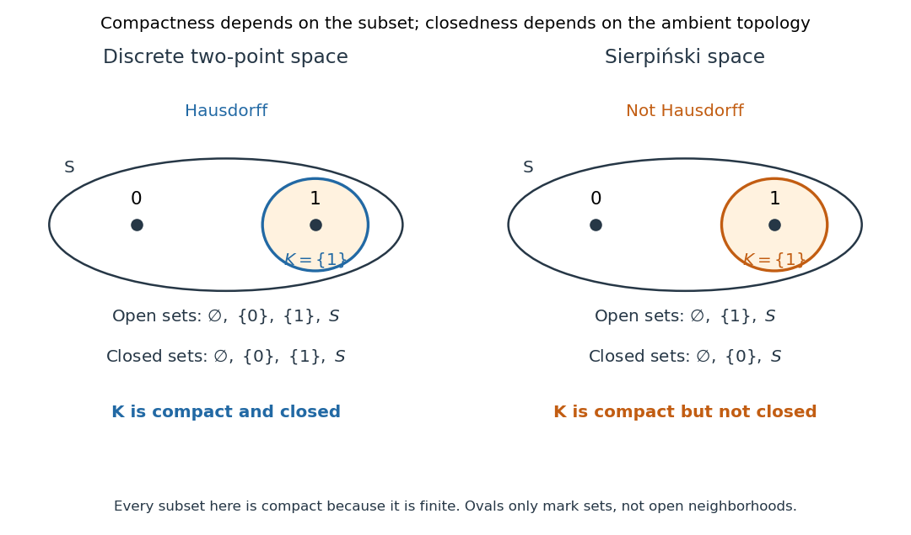

# Compact subset of a Hausdorff space

↑ **Parent:** [Hausdorff space](hausdorff-space.md)

Let $K\subseteq X$, where the ambient [topological space](topological-space.md) $X$ is [Hausdorff](hausdorff-space.md) and $K$ is [compact](compact-space.md) in its [subspace topology](subspace-topology.md). Then $K$ is a [closed set](closed-set.md) in $X$: the [complement](complement-of-a-set.md) $X\setminus K$ is an [open set](open-set.md) in $X$. The ambient space need not be [compact](compact-space.md). For example, $[0,1]$ is a [compact](compact-space.md) [closed interval](closed-real-interval.md) in the non-[compact](compact-space.md) [Hausdorff](hausdorff-space.md) [real line](real-line.md).[Lemma 3.2.7 and Proposition 3.2.8](point-set-topology-by-romyar-sharifi/chapter-3-connected-and-compact-spaces.md)

The ambient [Hausdorff](hausdorff-space.md) hypothesis matters even when $K$ itself is [Hausdorff](hausdorff-space.md). In the [Sierpiński space](sierpinski-space.md) $S=\{0,1\}$, the [open sets](open-set.md) are $\varnothing,\{1\},S$, so the [closed sets](closed-set.md) are $\varnothing,\{0\},S$. Thus $K=\{1\}$ is [compact](compact-space.md) and [Hausdorff](hausdorff-space.md) in its one-point [subspace topology](subspace-topology.md), but is not [closed](closed-set.md) in $S$: its [complement](complement-of-a-set.md) $\{0\}$ is not an [open set](open-set.md). Every [open](open-set.md) [neighborhood](neighbourhood-mathematics.md) of $0$ contains $1$, so separation from $K$ fails. In contrast, the [discrete topology](discrete-space.md) on the same underlying [set](set-split.md) is [Hausdorff](hausdorff-space.md) and makes both [singletons](singleton-mathematics.md) [closed](closed-set.md).

**[Figure 11](#image-a-compact-subset-is-closed-in-the-two-point-discrete-space-but-need-not-be-closed-in-the-sierpinski-space). A compact subset is closed in the two-point discrete space but need not be closed in the Sierpiński space**.

The diagram lists every [open set](open-set.md) and [closed set](closed-set.md), so the distinction can be checked directly. All [subsets](subset.md) in both panels are [compact](compact-space.md): for any [open cover](open-cover.md) of a [finite set](finite-set.md), choose one covering [open set](open-set.md) per point, obtaining a [finite subcover](finite-subcover.md). [Compactness](compact-space.md) alone therefore cannot distinguish the two panels.

Here is the finite-selection mechanism in the general proof. For $x\in X\setminus K$ and each $k\in K$, the [Hausdorff](hausdorff-space.md) property gives disjoint [open](open-set.md) [neighborhoods](neighbourhood-mathematics.md) $U_k$ of $k$ and $V_k$ of $x$. The $U_k$ give an ambient [open cover](open-cover.md) of $K$. Select a [finite subcover](finite-subcover.md) $U_{k_1},\ldots,U_{k_m}$ and set

$$
U=\bigcup_{j=1}^{m}U_{k_j},\qquad V=\bigcap_{j=1}^{m}V_{k_j}.
$$

Then $K\subseteq U$, $x\in V$, and $U\cap V=\varnothing$. The finite [intersection](set-intersection.md) makes $V$ an [open set](open-set.md); an infinite [intersection](set-intersection.md) would not guarantee this. Thus every point of $X\setminus K$ has an [open](open-set.md) [neighborhood](neighbourhood-mathematics.md) contained in that [complement](complement-of-a-set.md), proving that $K$ is [closed](closed-set.md). The [empty set](empty-set.md) is already [closed](closed-set.md).

This theorem combines with the [continuous image of a compact space](continuous-image-of-a-compact-space.md) theorem to make every [continuous map](continuous-map.md) from a [compact space](compact-space.md) to a [Hausdorff space](hausdorff-space.md) a [closed map](closed-map.md): a [closed subset](closed-set.md) of its domain is [compact](compact-space.md), and its [image](image-of-a-function.md) is [compact](compact-space.md) and hence [closed](closed-set.md) in the target. This is the reason the inverse in the [compact-to-Hausdorff continuous bijection theorem](compact-to-hausdorff-continuous-bijection-theorem.md) is [continuous](continuous-function.md). The converse implication, from [closed](closed-set.md) to [compact](compact-space.md), needs additional hypotheses: the [real line](real-line.md) is [closed](closed-set.md) in itself but not [compact](compact-space.md); in a [compact space](compact-space.md), every [closed subset](closed-set.md) is [compact](compact-space.md).

## ↑ Ancestors (6)

1. [Hausdorff space](hausdorff-space.md)
2. [Topology](topology-split.md)
3. [Geometry and topology](geometry-and-topology-split.md)
4. [Area of mathematics](area-of-mathematics.md)
5. [Mathematics](mathematics-split.md)
6. [Codex Wiki](split.md)

## ← Incoming links (2)

- [Continuous image of a compact space](continuous-image-of-a-compact-space.md)
- [Solution](past-exam-of-the-mathematics-course-of-the-university-of-cambridge/2009/ib/paper-2/4f/solution.md)
