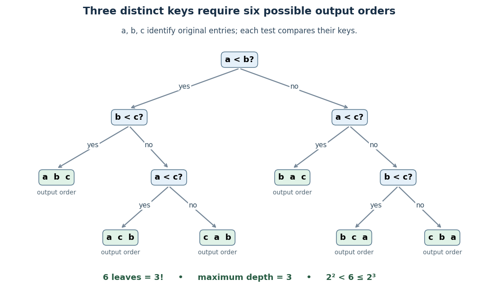

# Comparison sorting lower bound

↑ **Parent:** [Comparison sort](comparison-sort.md)

Any deterministic [comparison sort](comparison-sort.md) correct for all orders of $n$ distinct [sort keys](sort-key.md) needs at least $\lceil\log_2(n!)\rceil$ comparisons on some [input](input-computer-science.md). Here $n!$ is a [factorial](factorial.md), $\log_2$ a [logarithm](logarithm.md), and the brackets denote the [ceiling function](ceiling-function.md). This is a worst-case requirement, not a requirement on every [input](input-computer-science.md).[Theorem 11.5: deterministic comparison-tree lower bound](open-data-structures-an-introduction-by-pat-morin/11-1-comparison-based-sorting.md)

For three distinct [sort keys](sort-key.md), the diagram has one leaf for each possible ordering of the original entries $a,b,c$. Some paths need two comparisons, others three; two comparisons cannot distinguish all six orders.

**[Figure 19](#sorting-three-distinct-keys-comparison-decision-tree). A comparison decision tree distinguishes the six orders of three distinct sort keys**. Each internal node tests the [sort keys](sort-key.md) of two fixed original entries. A leaf gives the order in which their complete [sorting records](sorting-record.md) must be emitted. There are $3!=6$ leaves and maximum depth three. The diagram assumes distinct [sort keys](sort-key.md), so no equality branch is needed.

For the proof outline, represent adaptive comparisons by a [binary tree](binary-tree.md): distinct [sort keys](sort-key.md) give only two outcomes per comparison. A leaf fixes an [output](output-computing.md) [permutation](permutation.md); one leaf cannot correctly handle two different strict orders. Hence there must be at least $n!$ leaves. Maximum depth $h$ permits at most $2^h$ leaves, so $2^h\geq n!$ gives the bound. Even a three-way comparator has only two reachable outcomes on this distinct-key family.

The growth follows without a precise approximation to the [factorial](factorial.md). At least $\lfloor n/2\rfloor$ of its factors are at least $n/2$, so for $n\geq2$,

$$
\log_2(n!)\geq\lfloor n/2\rfloor\log_2(n/2).
$$

The brackets denote the [floor function](floor-function.md). This gives a constant times $n\log n$ lower bound for large $n$, matching the worst-case comparison growth of [merge sort](merge-sort.md).

Distinct [sort keys](sort-key.md) are essential to the $n!$ counting argument. Identical [sort keys](sort-key.md) do not create $n!$ different strict orders. If all [sort keys](sort-key.md) coincide, [stable sorting](stable-sorting.md) returns the arrival order. This does not remove the worst-case bound for a [comparison sort](comparison-sort.md) required to handle arbitrary distinct-key [inputs](input-computer-science.md).

## ↑ Ancestors (5)

1. [Comparison sort](comparison-sort.md)
2. [Sorting algorithm](sorting-algorithm.md)
3. [Algorithm](algorithm-split.md)
4. [Computer science](computer-science-split.md)
5. [Codex Wiki](split.md)

## ← Incoming links (3)

- [Radix sort](radix-sort.md)
- [Stable digit sort](stable-digit-sort.md)
- [Stable record placement in counting sort](stable-record-placement-in-counting-sort.md)
