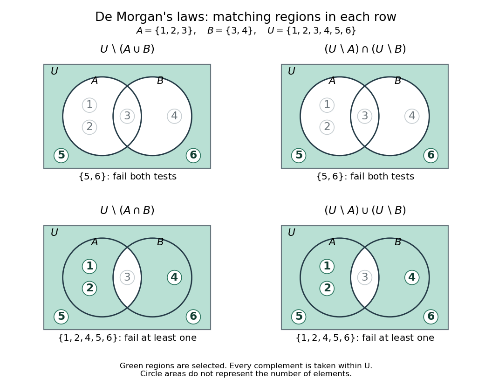

# Complement of a set

↑ **Parent:** [Set](set-split.md)  
ⓦ [Wiki](https://en.wikipedia.org/wiki/Complement_(set_theory))

The complement of a [subset](subset.md) $A$ within a specified [universal set](universal-set.md) $U$ contains exactly the [set elements](element-of-a-set.md) of $U$ excluded from $A$:

$$
A^c=U\setminus A=\{x\in U:x\notin A\},\qquad x\in U\Longrightarrow\bigl(x\in A^c\iff\neg(x\in A)\bigr).
$$

Here $A^c$ depends on the chosen [universal set](universal-set.md). Within $U$, taking a [complement](complement-of-a-set.md) performs [logical negation](negation.md) (NOT) on membership. Writing $U\setminus A$ keeps the ambient [set](set-split.md) visible when there could be ambiguity.

For $A=\{1,2,3\}$, $B=\{3,4\}$, and $U=\{1,2,3,4,5,6\}$:

$$
U\setminus A=\{4,5,6\},\qquad U\setminus B=\{1,2,5,6\}.
$$

If the [universal set](universal-set.md) grows to $U'=\{1,2,3,4,5,6,7\}$, the same [sets](set-split.md) have different [complements](complement-of-a-set.md): $U'\setminus A=\{4,5,6,7\}$ and $U'\setminus B=\{1,2,5,6,7\}$. In a database illustration, “records that fail this condition” therefore requires deciding which records are eligible to begin with; those eligible records form $U$.

For [subsets](subset.md) $A,B\subseteq U$, [De Morgan's laws](de-morgan-s-laws.md) exchange [union](set-union.md) and [intersection](set-intersection.md) when taking [complements](complement-of-a-set.md):

$$
U\setminus(A\cup B)=(U\setminus A)\cap(U\setminus B),\qquad U\setminus(A\cap B)=(U\setminus A)\cup(U\setminus B).
$$

For the same example, failing both conditions leaves $U\setminus(A\cup B)=\{5,6\}=(U\setminus A)\cap(U\setminus B)$. Failing at least one condition leaves $U\setminus(A\cap B)=\{1,2,4,5,6\}=(U\setminus A)\cup(U\setminus B)$. This is useful for rewriting exclusion rules into separate membership tests. The symmetry is also pleasing: exchanging [union](set-union.md) with [intersection](set-intersection.md) turns one rule into its partner.

**[Figure 2](#image-de-morgan-s-laws-excluding-a-union-means-failing-both-tests-while-excluding-an-intersection-means-failing-at-least-one). De Morgan's laws: excluding a union means failing both tests, while excluding an intersection means failing at least one**.

A brief membership proof works in [classical propositional logic](classical-propositional-logic.md). For any $x\in U$, let $P$ mean $x\in A$ and $Q$ mean $x\in B$. The [truth table](truth-table.md) below checks all four possibilities, with $1$ meaning true and $0$ false:

$$
\begin{array}{cc|cc|cc}
P&Q&\neg(P\vee Q)&\neg P\wedge\neg Q&\neg(P\wedge Q)&\neg P\vee\neg Q\\\hline
0&0&1&1&1&1\\
0&1&0&0&1&1\\
1&0&0&0&1&1\\
1&1&0&0&0&0
\end{array}
$$

Each paired column agrees. Translating [logical disjunction](logical-disjunction.md) (OR), [logical conjunction](logical-conjunction.md) (AND), and [logical negation](negation.md) (NOT) back into membership proves the two [set](set-split.md) equalities. For the general method of reducing [set](set-split.md) equalities to equivalences in [propositional logic](propositional-logic.md), see [Lehman, Leighton and Meyer, Mathematics for Computer Science (2015), §4.1.5 and Problem 4.5](https://ocw.mit.edu/courses/6-042j-mathematics-for-computer-science-spring-2015/mit6_042js15_textbook.pdf#page=93).

A historical perspective appears in Augustus De Morgan's [Formal Logic (1847), preface](https://en.wikisource.org/wiki/Page:Formal_Logic_(1847,_De_Morgan).djvu/8): he describes treating each name together with its contradictory name. In the membership viewpoint here, a [set](set-split.md) and its [complement](complement-of-a-set.md) likewise pair a condition with its [logical negation](negation.md).

**Table of contents**

- [Universal set](universal-set.md)

## ↑ Ancestors (6)

1. [Set](set-split.md)
2. [Set theory](set-theory-split.md)
3. [Foundations of mathematics](foundations-of-mathematics-split.md)
4. [Area of mathematics](area-of-mathematics.md)
5. [Mathematics](mathematics-split.md)
6. [Codex Wiki](split.md)

## ← Incoming links (10)

- [Boolean operations on events](boolean-operations-on-events.md)
- [Coinfinite set](coinfinite-set.md)
- [Cut capacity](cut-capacity.md)
- [Independent set (graph theory)](independent-set-graph-theory.md)
- [Minimum vertex cover](minimum-vertex-cover.md)
- [Solution](past-exam-of-the-mathematics-course-of-the-university-of-cambridge/2012/iii/paper-24/3/solution.md)
- [Solution](past-exam-of-the-mathematics-course-of-the-year-1-of-the-natural-sciences-course-of-the-university-of-cambridge/2023/paper-2/1/b/solution.md)
- [Simple set](simple-set.md)
- [Upper and lower sets](upper-and-lower-sets.md)
- [Vertex cover](vertex-cover.md)
