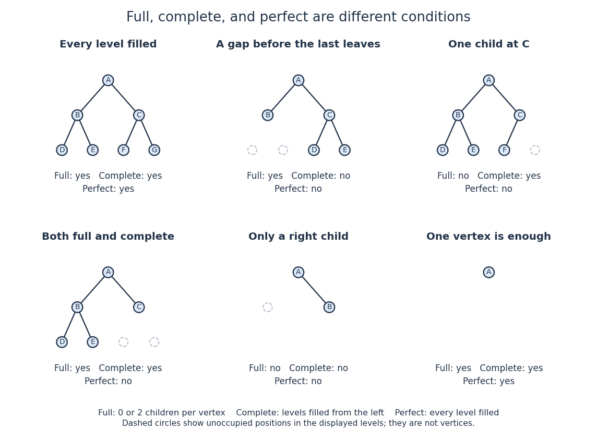

# Complete binary tree

↑ **Parent:** [Binary tree](binary-tree.md)

A [complete binary tree](complete-binary-tree.md) is a [binary tree](binary-tree.md) whose levels are full except possibly the deepest, which is filled from left to right with no gaps.[Data Structures and Algorithms, section 9.1.1: complete shape and binary heap example](data-structures-and-algorithms-edited-by-peter-ljunglof-and-others/9-1-binary-trees.md)

Here a level groups [vertices](vertex-graph-theory.md) by their [graph distance](distance-graph-theory.md) from the [root of a tree](root-of-a-tree.md). A [binary heap](binary-heap.md) uses this shape to maintain logarithmic [height of a binary tree](height-of-a-binary-tree.md). Completeness differs from the two-children condition of a [full binary tree](full-binary-tree.md).

**[Figure 17](#image-full-binary-trees-complete-binary-trees-and-perfect-binary-trees-impose-different-shape-conditions). Full binary trees, complete binary trees, and perfect binary trees impose different shape conditions**. Each panel states all three properties. Outlined positions expose gaps in the last level. In particular, the five-[vertex](vertex-graph-theory.md) example in the lower left is both full and complete but is not perfect.

For a six-[vertex](vertex-graph-theory.md) example, give $A$ two [children in a rooted tree](child-in-a-rooted-tree.md) $B,C$, give $B$ two [children in a rooted tree](child-in-a-rooted-tree.md) $D,E$, and give $C$ only a left child $F$. The levels have $1,2,3$ [vertices](vertex-graph-theory.md), and the last occupies its first three positions, so this is a [complete binary tree](complete-binary-tree.md). It is not a [full binary tree](full-binary-tree.md), since $C$ has exactly one child. Moving $F$ to the right slot of $C$ preserves $n=6$ and [height of a binary tree](height-of-a-binary-tree.md) $2$, but leaves a gap before $F$ and destroys completeness. Merely keeping the deepest [vertices](vertex-graph-theory.md) near the left side is insufficient; every earlier position must be occupied.

Number positions by the left-to-right level order of [breadth-first search](breadth-first-search.md), beginning with root position $1$. The children of position $i$ have positions $2i$ and $2i+1$. A nonempty [complete binary tree](complete-binary-tree.md) occupies exactly positions $1,\ldots,n$, so its [height of a binary tree](height-of-a-binary-tree.md) is $\lfloor\log_2 n\rfloor$: positions $2^h,\ldots,2^{h+1}-1$ form level $h$. This consecutive occupancy explains the compact [array](array-data-structure.md) representation of a [binary heap](binary-heap.md), while [heap order](heap-order.md) is a separate condition on values. Neither completeness nor the [binary tree](binary-tree.md) definition supplies the [binary search tree](binary-search-tree.md) ordering rule.

## ↑ Ancestors (4)

1. [Binary tree](binary-tree.md)
2. [Data structure](data-structure-split.md)
3. [Computer science](computer-science-split.md)
4. [Codex Wiki](split.md)

## ← Incoming links (4)

- [Binary heap](binary-heap.md)
- [Complete binary tree](complete-binary-tree.md)
- [Full binary tree](full-binary-tree.md)
- [Perfect binary tree](perfect-binary-tree.md)
