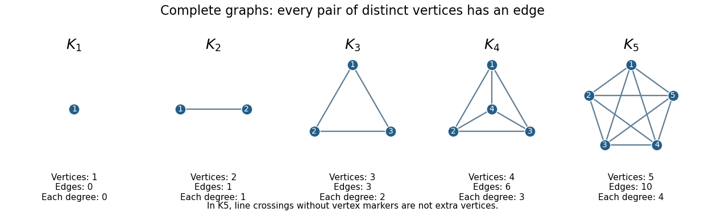

# Complete graph

↑ **Parent:** [Graph theory](graph-theory-split.md)  
ⓦ [Wiki](https://en.wikipedia.org/wiki/Complete_graph)

A [complete graph](complete-graph.md) is a [simple graph](simple-graph.md) in which every two distinct [vertices](vertex-graph-theory.md) are joined by an [edge](edge-of-a-graph.md). The finite [complete graph](complete-graph.md) on $n$ [vertices](vertex-graph-theory.md) is denoted $K_n$. Here the [edges](edge-of-a-graph.md) are undirected, and [self-loops](loop-graph-theory.md) are excluded. The usual pictures below use $n\geq1$: $K_1$ is a single [vertex](vertex-graph-theory.md), $K_2$ a single [edge](edge-of-a-graph.md), and $K_3$ a [triangle in a graph](triangle-in-a-graph.md).[§1.1, printed p. 3 of the third electronic edition (2005): pairwise adjacency, complete graphs and triangle notation](graph-theory-by-reinhard-diestel.md)

Completeness describes all the possible pairs, rather than a drawing style. Different layouts can represent the same [graph](graph-split.md) through a [graph isomorphism](graph-isomorphism.md). Crossing lines away from the drawn [vertices](vertex-graph-theory.md) do not add new [vertices](vertex-graph-theory.md) or [edges](edge-of-a-graph.md).

**[Figure 15](#image-complete-graphs-with-one-through-five-vertices). Complete graphs with one through five vertices**. Each original drawing joins every pair of distinct [vertices](vertex-graph-theory.md) exactly once. The [complete graphs](complete-graph.md) $K_1,K_2,K_3,K_4,K_5$ have respectively $0,1,3,6,10$ [edges](edge-of-a-graph.md). Intersections of drawn lines in the $K_5$ panel are not additional [vertices](vertex-graph-theory.md).

There are $\binom n2=n(n-1)/2$ unordered pairs of distinct [vertices](vertex-graph-theory.md), so this is the [edge count of a complete graph](edge-count-of-a-complete-graph.md). Each [vertex](vertex-graph-theory.md) has [vertex degree](degree-graph-theory.md) $n-1$. The [degree-sum formula](degree-sum-formula.md) gives the same count: $2|E|=n(n-1)$. These formulas make a [complete graph](complete-graph.md) the upper extreme for [edge](edge-of-a-graph.md) counts among [simple graphs](simple-graph.md) of a fixed size.

This is useful when modelling pairwise relationships. If every pair of objects needs its own direct connection, ten [vertices](vertex-graph-theory.md) require $45$ [edges](edge-of-a-graph.md), while twenty require $190$. Adding one more [vertex](vertex-graph-theory.md) to $K_n$ introduces $n$ further [edges](edge-of-a-graph.md). This counts a specified direct-link model; it does not require every communication system to implement every relationship with a separate physical connection.

A [proper vertex coloring](proper-vertex-coloring.md) of $K_n$ must give every [vertex](vertex-graph-theory.md) a different color, so its [chromatic number](chromatic-number.md) is $n$. For $n\geq1$, its [independence number](independence-number.md) is $1$: two distinct [vertices](vertex-graph-theory.md) already have an [edge](edge-of-a-graph.md) between them. Thus [complete graphs](complete-graph.md) provide immediate test cases for [graph coloring](graph-coloring-split.md) and [independent sets](independent-set-graph-theory.md).

**Table of contents**

- [Edge count of a complete graph](edge-count-of-a-complete-graph.md)
- [Clique (graph theory)](clique-graph-theory.md)
  - [Maximum clique](maximum-clique.md)
  - [Maximal clique](maximal-clique.md)
  - [Edge-disjoint clique packing](edge-disjoint-clique-packing.md)
    - [Clique-packing amplification of moment bounds](clique-packing-amplification-of-moment-bounds.md)
    - [Clique conflict graph](clique-conflict-graph.md)
  - [Clique number](clique-number.md)
  - [Pairwise intersections need not give a common intersection](pairwise-intersections-need-not-give-a-common-intersection.md)
- [Adjacency-matrix quadratic relation for a complete graph](adjacency-matrix-quadratic-relation-for-a-complete-graph.md)

## ↑ Ancestors (5)

1. [Graph theory](graph-theory-split.md)
2. [Foundations of mathematics](foundations-of-mathematics-split.md)
3. [Area of mathematics](area-of-mathematics.md)
4. [Mathematics](mathematics-split.md)
5. [Codex Wiki](split.md)

## ← Incoming links (95)

- [Adjacency list storage and query costs](adjacency-list-storage-and-query-costs.md)
- [Balanced complete multipartite blow-up](balanced-complete-multipartite-blow-up.md)
- [Branch set of a graph minor](branch-set-of-a-graph-minor.md)
- [Cayley's formula](cayley-s-formula.md)
- [Chordal graph](chordal-graph.md)
- [Chromatic number](chromatic-number.md)
- [Chromatic polynomial](chromatic-polynomial.md)
- [Chromatic polynomial after attaching a leaf](chromatic-polynomial-after-attaching-a-leaf.md)
- [Clique count in a binomial random graph](clique-count-in-a-binomial-random-graph.md)
- [Clique counting from iterated shadows](clique-counting-from-iterated-shadows.md)
- [Clique (graph theory)](clique-graph-theory.md)
- [Clique number](clique-number.md)
- [Closed walk](closed-walk.md)
- [Complete graph](complete-graph.md)
- [Complete graph subdivision](complete-graph-subdivision.md)
- [Complete uniform hypergraph](complete-uniform-hypergraph.md)
- [Connected regular graph with two adjacency eigenvalues](connected-regular-graph-with-two-adjacency-eigenvalues.md)
- [Edge coloring](edge-coloring.md)
- [Edge count of a complete graph](edge-count-of-a-complete-graph.md)
- [Extremal graph for disjoint cliques](extremal-graph-for-disjoint-cliques.md)
- [Finite Ramsey theorem](finite-ramsey-theorem.md)
- [Five-cycle Ramsey coloring](five-cycle-ramsey-coloring.md)
- [Full semantics for second-order logic](full-semantics-for-second-order-logic.md)
- [Geometric spanner](geometric-spanner.md)
- [Graph minor](graph-minor-split.md)
- [Hamilton cycle](hamilton-cycle.md)
- [Heawood torus map](heawood-torus-map.md)
- [Henkin semantics](henkin-semantics.md)
- [Hitting time of the bridge vertex between two cliques](hitting-time-of-the-bridge-vertex-between-two-cliques.md)
- [Kuratowski's theorem](kuratowski-s-theorem.md)
- [Ladder graph](ladder-graph.md)
- [Laplacian spectrum of a complete graph](laplacian-spectrum-of-a-complete-graph.md)
- [Matching one specified birthday](matching-one-specified-birthday.md)
- [Monochromatic line-graph percolation counterexample](monochromatic-line-graph-percolation-counterexample.md)
- [Monochromatic set](monochromatic-set.md)
- [Multicolour Ramsey bound](multicolour-ramsey-bound.md)
- [Mycielskian](mycielskian.md)
- [Nonplanarity by edge counts](nonplanarity-by-edge-counts.md)
- [Normal modes of an anchored complete spring graph](normal-modes-of-an-anchored-complete-spring-graph.md)
- [Solution](past-exam-of-the-mathematical-and-computational-biology-course-of-the-university-of-cambridge/2024/paper-1/d6/d/solution.md)
- [Solution](past-exam-of-the-mathematics-course-of-the-university-of-cambridge/2001/iii/paper-3/3/a/solution.md)
- [Solution](past-exam-of-the-mathematics-course-of-the-university-of-cambridge/2001/iii/paper-3/3/b/solution.md)
- [Solution](past-exam-of-the-mathematics-course-of-the-university-of-cambridge/2002/iii/paper-11/1/ii/solution.md)
- [Solution](past-exam-of-the-mathematics-course-of-the-university-of-cambridge/2002/iii/paper-11/2/solution.md)
- [Solution](past-exam-of-the-mathematics-course-of-the-university-of-cambridge/2002/iii/paper-9/1/solution.md)
- [Solution](past-exam-of-the-mathematics-course-of-the-university-of-cambridge/2005/ii/paper-2/17f/solution.md)
- [Solution](past-exam-of-the-mathematics-course-of-the-university-of-cambridge/2005/iii/paper-12/2/solution.md)
- [Solution](past-exam-of-the-mathematics-course-of-the-university-of-cambridge/2006/iii/paper-14/6/solution.md)
- [Solution](past-exam-of-the-mathematics-course-of-the-university-of-cambridge/2007/iii/paper-7/4/i/solution.md)
- [Solution](past-exam-of-the-mathematics-course-of-the-university-of-cambridge/2009/ii/paper-3/17f/a/solution.md)
- [Solution](past-exam-of-the-mathematics-course-of-the-university-of-cambridge/2009/ii/paper-3/17f/c/solution.md)
- [Solution](past-exam-of-the-mathematics-course-of-the-university-of-cambridge/2009/iii/paper-15/3/ii/solution.md)
- [Solution](past-exam-of-the-mathematics-course-of-the-university-of-cambridge/2010/ii/paper-3/17f/ii/solution.md)
- [Solution](past-exam-of-the-mathematics-course-of-the-university-of-cambridge/2010/ii/paper-4/17f/solution.md)
- [Solution](past-exam-of-the-mathematics-course-of-the-university-of-cambridge/2010/iii/paper-10/1/solution.md)
- [Solution](past-exam-of-the-mathematics-course-of-the-university-of-cambridge/2010/iii/paper-12/1/ii/solution.md)
- [Solution](past-exam-of-the-mathematics-course-of-the-university-of-cambridge/2012/iii/paper-9/1/ii/solution.md)
- [Solution](past-exam-of-the-mathematics-course-of-the-university-of-cambridge/2012/iii/paper-9/2/ii/solution.md)
- [Solution](past-exam-of-the-mathematics-course-of-the-university-of-cambridge/2013/iii/paper-12/1/solution.md)
- [Solution](past-exam-of-the-mathematics-course-of-the-university-of-cambridge/2015/iii/paper-13/1/iii/solution.md)
- [Solution](past-exam-of-the-mathematics-course-of-the-university-of-cambridge/2016/ia/paper-2/12f/a/solution.md)
- [Solution](past-exam-of-the-mathematics-course-of-the-university-of-cambridge/2016/iii/paper-112/4/solution.md)
- [Solution](past-exam-of-the-mathematics-course-of-the-university-of-cambridge/2017/ii/paper-3/15h/solution.md)
- [Solution](past-exam-of-the-mathematics-course-of-the-university-of-cambridge/2017/iii/paper-130/1/i/solution.md)
- [Solution](past-exam-of-the-mathematics-course-of-the-university-of-cambridge/2017/iii/paper-130/1/ii/solution.md)
- [Solution](past-exam-of-the-mathematics-course-of-the-university-of-cambridge/2017/iii/paper-215/1/c/solution.md)
- [Solution](past-exam-of-the-mathematics-course-of-the-university-of-cambridge/2017/iii/paper-215/2/d/solution.md)
- [Solution](past-exam-of-the-mathematics-course-of-the-university-of-cambridge/2018/ii/paper-3/17i/solution.md)
- [Solution](past-exam-of-the-mathematics-course-of-the-university-of-cambridge/2018/ii/paper-4/17i/solution.md)
- [Solution](past-exam-of-the-mathematics-course-of-the-university-of-cambridge/2019/ii/paper-1/17g/d/solution.md)
- [Solution](past-exam-of-the-mathematics-course-of-the-university-of-cambridge/2020/ii/paper-2/17g/ii/solution.md)
- [Solution](past-exam-of-the-mathematics-course-of-the-university-of-cambridge/2021/ii/paper-1/17g/a/solution.md)
- [Solution](past-exam-of-the-mathematics-course-of-the-university-of-cambridge/2023/ii/paper-1/17h/b/i/solution.md)
- [Solution](past-exam-of-the-mathematics-course-of-the-university-of-cambridge/2023/ii/paper-2/17h/b/solution.md)
- [Solution](past-exam-of-the-mathematics-course-of-the-university-of-cambridge/2023/ii/paper-2/17h/d/solution.md)
- [Solution](past-exam-of-the-mathematics-course-of-the-university-of-cambridge/2023/ii/paper-4/17h/d/solution.md)
- [Planar graph](planar-graph-split.md)
- [Planar graph edge bound](planar-graph-edge-bound.md)
- [Rado graph](rado-graph.md)
- [Ramsey number](ramsey-number.md)
- [Ramsey number for triangles](ramsey-number-for-triangles.md)
- [Ramsey theory](ramsey-theory-split.md)
- [Random branch-set construction of a complete graph minor](random-branch-set-construction-of-a-complete-graph-minor.md)
- [Ratio definition of cutoff](ratio-definition-of-cutoff.md)
- [Second-order encoding of three-colorability](second-order-encoding-of-three-colorability.md)
- [Simultaneous giant for fixed random-edge choice](simultaneous-giant-for-fixed-random-edge-choice.md)
- [Six-vertex monochromatic triangle argument](six-vertex-monochromatic-triangle-argument.md)
- [Squaring and zig-zag iteration yields bounded-degree expanders](squaring-and-zig-zag-iteration-yields-bounded-degree-expanders.md)
- [Topological minor](topological-minor.md)
- [Tournament (graph theory)](tournament-graph-theory.md)
- [Triangular number](triangular-number.md)
- [Triangular number pair-counting identity](triangular-number-pair-counting-identity.md)
- [Uniform labelled tree generation](uniform-labelled-tree-generation.md)
- [Uniform random graph process](uniform-random-graph-process.md)
- [Weighted Hamilton cycle](weighted-hamilton-cycle.md)
