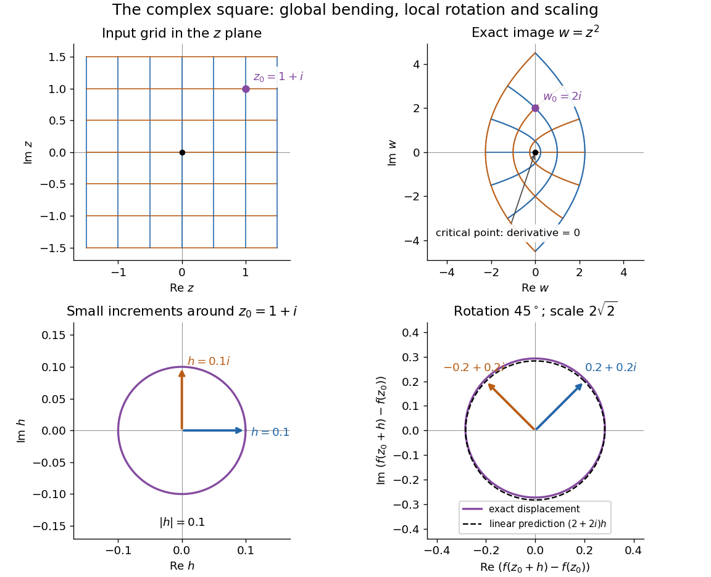

# Complex analysis

↑ **Parent:** [Analysis](analysis-split.md)  
ⓦ [Wiki](https://en.wikipedia.org/wiki/Complex_analysis)

Complex analysis studies [functions](function-split.md) of a [complex number](complex-number.md), especially [holomorphic functions](holomorphic-function.md). Its distinctive feature is that a single complex [derivative](derivative.md) controls variation in every direction of the [complex plane](complex-plane.md). The map $f(z)=z^2$ gives a first picture: straight coordinate lines become curved, yet small perpendicular arrows remain perpendicular wherever $f'(z)\ne0$.

**[Figure 1](#image-the-complex-square-bends-a-grid-globally-and-acts-near-1-plus-i-as-a-rotation-through-45-degrees-and-a-scaling-by-twice-the-square-root-of-two). The complex square bends a grid globally and acts near 1 + i as a rotation through 45 degrees and a scaling by twice the square root of two**.

The bottom panels show displacements rather than absolute positions. Multiplication by $f'(1+i)=2+2i$ predicts the image of each small arrow; the exact image differs by $h^2$. The origin is exceptional because $f'(0)=0$. This distinction between local [conformal maps](conformal-map.md) and a [critical point](critical-point.md) is central: [complex differentiability](complex-differentiability.md) imposes strong geometric structure, without making every [holomorphic function](holomorphic-function.md) globally one-to-one.

The remarkable next step is that [holomorphic functions](holomorphic-function.md) are determined inside a circle by their values on its boundary. Precisely, let $R>0$, let $D=\{z:|z-a|<R\}$, and suppose $f$ is a [holomorphic function](holomorphic-function.md) on an [open set](open-set.md) containing the closed disc $\overline D$. Orient its boundary counterclockwise. The [Cauchy integral formula](cauchy-integral-formula.md) states that, for every $w\in D$,

$$
f(w)=\frac{1}{2\pi i}\oint_{|z-a|=R}\frac{f(z)}{z-w}\,dz.
$$

The [contour integral](contour-integral.md) combines boundary values with a kernel depending on the requested interior point. It is a reconstruction formula, not merely a trick for evaluating an [integral](integral.md). The hypothesis about the closed disc ensures that all boundary values and the [contour integral](contour-integral.md) are well defined. [Orloff, MIT Topic 4, Theorem 4.1](https://ocw.mit.edu/courses/18-04-complex-variables-with-applications-spring-2018/b1a90df19f643b974555bbbb93138a48_MIT18_04S18_topic4.pdf)

At the centre, substituting $z=a+Re^{i\theta}$ cancels the denominator against $dz=iRe^{i\theta}d\theta$:

$$
f(a)=\frac{1}{2\pi}\int_0^{2\pi}f(a+Re^{i\theta})\,d\theta.
$$

Thus the centre value is the angular average of the boundary values. For the [polynomial](polynomial-split.md) $f(z)=z^2$, $a=1+i$ and $R=1/2$, expand the boundary data as

$$
f(a+Re^{i\theta})=2i+(1+i)e^{i\theta}+\tfrac14e^{2i\theta}.
$$

Both oscillating terms have zero average, leaving $f(a)=2i$. Away from the centre the weights change: on the [unit circle](complex-unit-circle.md),

$$
f(w)=\frac{1}{2\pi}\int_0^{2\pi}\frac{f(e^{i\theta})}{1-we^{-i\theta}}\,d\theta,\qquad |w|<1.
$$

With $f(z)=z^2$ and $w=1/2$, expanding the denominator as a [geometric series](geometric-series.md) leaves only its second-power term after integration, giving $f(1/2)=1/4$. This also explains how the [Cauchy integral formula](cauchy-integral-formula.md) recovers an entire [Taylor series](taylor-series.md) from boundary data.

When a [holomorphic function](holomorphic-function.md) has [isolated singularities](isolated-singularity-split.md), a different boundary calculation detects their [residues](residue.md). Suppose $\Gamma$ is a counterclockwise simple closed [contour](complex-integration-contour.md) and $f$ is [holomorphic](holomorphic-function.md) on a neighbourhood of it and its interior except at finitely many interior [isolated singularities](isolated-singularity-split.md) $a_j$. The [residue theorem](residue-theorem.md) gives

$$
\oint_\Gamma f(z)\,dz=2\pi i\sum_j\operatorname{Res}(f,a_j).
$$

A [residue](residue.md) is the coefficient of $(z-a_j)^{-1}$ in the [Laurent series](laurent-series.md). A short proof idea is to deform the [contour](complex-integration-contour.md) to small circles around the [isolated singularities](isolated-singularity-split.md) using the [Cauchy integral theorem](cauchy-s-integral-theorem.md). Integrating the [Laurent series](laurent-series.md) on each circle kills every power except $-1$. [Orloff, MIT Topic 8, residue theorem](https://ocw.mit.edu/courses/18-04-complex-variables-with-applications-spring-2018/3c58ce71ec6f7573804221d76158a0bd_MIT18_04S18_topic8.pdf)

Here is how a complex [pole](pole.md) determines a real [improper integral](improper-integral.md). Set $g(z)=1/(1+z^2)$ and use the [contour](complex-integration-contour.md) consisting of the segment from $-R$ to $R$, followed by the upper semicircle $A_R$, with $R>1$. Only the [simple pole](simple-pole.md) $i$ lies inside, and

$$
\operatorname{Res}(g,i)=\lim_{z\to i}\frac{z-i}{(z-i)(z+i)}=\frac{1}{2i},\qquad \int_{-R}^R\frac{dx}{1+x^2}+\int_{A_R}g(z)\,dz=\pi.
$$

The arc must actually disappear. On $A_R$, the [reverse triangle inequality](reverse-triangle-inequality.md) gives $|1+z^2|\ge R^2-1$, and its length is $\pi R$, so

$$
\left|\int_{A_R}g(z)\,dz\right|\le\frac{\pi R}{R^2-1}\longrightarrow0.
$$

The real integrand is bounded by $x^{-2}$ for $|x|\ge1$, so both tails converge separately. Taking the limit therefore proves the ordinary [improper integral](improper-integral.md)

$$
\int_{-\infty}^{\infty}\frac{dx}{1+x^2}=\pi.
$$

For example, at $R=10$ the real segment contributes $2\arctan(10)\approx2.942255$, and the arc contributes $0.199337$, below the bound $10\pi/99\approx0.317333$. The usefulness of the [residue theorem](residue-theorem.md) is that the same strategy works for many [rational functions](rational-function.md) whose real [antiderivatives](antiderivative.md) are cumbersome: find the enclosed [poles](pole.md), compute their [residues](residue.md), and control the connecting arc. [Orloff, MIT Topic 9, contour decay estimates](https://ocw.mit.edu/courses/18-04-complex-variables-with-applications-spring-2018/f69bc227ae476839819fb18e5b283072_MIT18_04S18_topic9.pdf)

Historically, Cauchy's 1825 memoir on [integrals](integral.md) with imaginary limits develops complex [contour integration](contour-integration.md) and its use in transforming and evaluating definite [integrals](integral.md). The opening sections define complex path [integrals](integral.md), discuss changing the path, and examine what happens near singular points. These are recognizable ancestors of the modern link between [holomorphic functions](holomorphic-function.md), [contours](complex-integration-contour.md) and [residues](residue.md). [Cauchy, Mémoire sur les intégrales définies, prises entre des limites imaginaires, 1825; reprinted 1874, sections 1–6](https://www.numdam.org/item/BSMA_1874__7__265_0.pdf)

**Table of contents**

- [Nontangential limit](nontangential-limit.md)
  - [Stolz region](stolz-region.md)
- [Polynomial hull](polynomial-hull.md)
  - [Polynomial hull in one complex variable](polynomial-hull-in-one-complex-variable.md)
- [Lower half-plane](lower-half-plane.md)
- [Holomorphic square root](holomorphic-square-root.md)
  - [Holomorphic square root outside all polynomial roots](holomorphic-square-root-outside-all-polynomial-roots.md)
- [Monodromy](monodromy.md)
  - [Isomonodromic deformation](isomonodromic-deformation.md)
  - [Formal monodromy](formal-monodromy.md)
    - [Formal monodromy correction to an entire-system Stokes product](formal-monodromy-correction-to-an-entire-system-stokes-product.md)
  - [Monodromy eigenfunction Laurent representation](monodromy-eigenfunction-laurent-representation.md)
- [Cayley transform between the half-plane and disk](cayley-transform-between-the-half-plane-and-disk.md)
- [Right half-plane](right-half-plane.md)
- [Holomorphic logarithm](holomorphic-logarithm.md)
- [Upper half-plane (complex analysis)](upper-half-plane-complex-analysis.md)
  - [Conformal automorphism of the upper half-plane](conformal-automorphism-of-the-upper-half-plane.md)
- [Polylogarithm](polylogarithm.md)
  - [Dilogarithm](dilogarithm.md)
- [Holomorphic function](holomorphic-function.md)
  - [Complex differentiability](complex-differentiability.md)
  - [Nevanlinna class](nevanlinna-class.md)
    - [Bounded characteristic](bounded-characteristic.md)
      - [Quotient characterization of bounded characteristic](quotient-characterization-of-bounded-characteristic.md)
  - [Multiplicity of a zero](multiplicity-of-a-zero.md)
  - [Periodic holomorphic descent through the exponential map](periodic-holomorphic-descent-through-the-exponential-map.md)
  - [Constant-modulus holomorphic function](constant-modulus-holomorphic-function.md)
  - [Banach-space-valued holomorphic function](banach-space-valued-holomorphic-function.md)
    - [Spectral-radius maximum principle](spectral-radius-maximum-principle.md)
    - [Norm maximum principle for a Banach-space-valued holomorphic function](norm-maximum-principle-for-a-banach-space-valued-holomorphic-function.md)
  - [Prescribed zeros in a plane domain via Runge approximation](prescribed-zeros-in-a-plane-domain-via-runge-approximation.md)
  - [Antiholomorphic function](antiholomorphic-function.md)
  - [Holomorphic convex hull](holomorphic-convex-hull.md)
  - [Blaschke product](blaschke-product.md)
    - [Interior zero count for a finite Blaschke product minus a constant](interior-zero-count-for-a-finite-blaschke-product-minus-a-constant.md)
    - [Hyperbolic zero estimate for a Blaschke product](hyperbolic-zero-estimate-for-a-blaschke-product.md)
    - [Vanishing absolute logarithmic mean characterization of Blaschke products](vanishing-absolute-logarithmic-mean-characterization-of-blaschke-products.md)
    - [Blaschke factorization of a bounded holomorphic function](blaschke-factorization-of-a-bounded-holomorphic-function.md)
    - [Radial logarithmic mean of a Blaschke product](radial-logarithmic-mean-of-a-blaschke-product.md)
    - [Automorphy character of an orbit Blaschke product](automorphy-character-of-an-orbit-blaschke-product.md)
    - [Blaschke condition](blaschke-condition.md)
      - [Blaschke sequence](blaschke-sequence.md)
  - [Jensen's formula](jensen-s-formula.md)
    - [Poisson-Jensen formula](poisson-jensen-formula.md)
      - [Annular spherical Jensen formula](annular-spherical-jensen-formula.md)
    - [Jensen zero-count bound](jensen-zero-count-bound.md)
      - [Lattice zeros force quadratic exponential growth](lattice-zeros-force-quadratic-exponential-growth.md)
  - [Holomorphic primitive](holomorphic-primitive.md)
  - [Complex differentiability at a point](complex-differentiability-at-a-point.md)
  - [Space of holomorphic functions](space-of-holomorphic-functions.md)
    - [Weighted holomorphic norm on a shrinking time domain](weighted-holomorphic-norm-on-a-shrinking-time-domain.md)
      - [Contraction estimate on a shrinking holomorphic domain](contraction-estimate-on-a-shrinking-holomorphic-domain.md)
  - [Order of a zero of a holomorphic function](order-of-a-zero-of-a-holomorphic-function.md)
    - [Zero sets in the unit disc](zero-sets-in-the-unit-disc.md)
    - [Simple zero](simple-zero.md)
  - [Analytic continuation](analytic-continuation.md)
    - [Natural boundary of a holomorphic function](natural-boundary-of-a-holomorphic-function.md)
    - [Zeta function regularization](zeta-function-regularization.md)
      - [Half-integer zeta-regularized mode sum](half-integer-zeta-regularized-mode-sum.md)
    - [Meromorphic continuation](meromorphic-continuation.md)
    - [Sokhotski–Plemelj theorem](sokhotski-plemelj-theorem.md)
      - [Signed Cauchy boundary operators](signed-cauchy-boundary-operators.md)
    - [Monodromy theorem](monodromy-theorem.md)
      - [Monodromy group of a covering](monodromy-group-of-a-covering.md)
        - [Monodromy transposition in a three-sheeted cover](monodromy-transposition-in-a-three-sheeted-cover.md)
        - [Monodromy group of z squared plus z to the minus two](monodromy-group-of-z-squared-plus-z-to-the-minus-two.md)
    - [Analytic continuation by contour deformation](analytic-continuation-by-contour-deformation.md)
      - [Branch phase in a figure-eight analytic continuation integral](branch-phase-in-a-figure-eight-analytic-continuation-integral.md)
    - [Multivalued inverse hyperbolic sine](multivalued-inverse-hyperbolic-sine.md)
  - [Entire function](entire-function.md)
    - [Injective entire functions are affine](injective-entire-functions-are-affine.md)
    - [Exponential polynomial](exponential-polynomial.md)
    - [Order of an entire function](order-of-an-entire-function.md)
    - [Entire function of exponential type](entire-function-of-exponential-type.md)
    - [Weierstrass factorization theorem](weierstrass-factorization-theorem.md)
      - [Canonical product](canonical-product.md)
        - [Canonical product construction for zeros escaping to the disk boundary](canonical-product-construction-for-zeros-escaping-to-the-disk-boundary.md)
        - [Boundary-adapted holomorphic zero factor](boundary-adapted-holomorphic-zero-factor.md)
      - [Hadamard factorization theorem](hadamard-factorization-theorem.md)
      - [Entire functions with the same zero divisor](entire-functions-with-the-same-zero-divisor.md)
    - [Pointwise vanishing derivative criterion for a polynomial](pointwise-vanishing-derivative-criterion-for-a-polynomial.md)
    - [Picard theorem](picard-theorem.md)
      - [Omitted value](omitted-value.md)
      - [Little Picard theorem](little-picard-theorem.md)
        - [Great Picard theorem](great-picard-theorem.md)
  - [Analytic function with image in an affine real line](analytic-function-with-image-in-an-affine-real-line.md)
- [Simply connected domain](simply-connected-domain.md)
  - [Crosscut](crosscut.md)
  - [Primitive of a holomorphic function on a simply connected domain](primitive-of-a-holomorphic-function-on-a-simply-connected-domain.md)
- [Complex inverse sine](complex-inverse-sine.md)
  - [Branches of the complex inverse sine](branches-of-the-complex-inverse-sine.md)
    - [Monodromy of the complex inverse sine](monodromy-of-the-complex-inverse-sine.md)
- [Morera's theorem](morera-s-theorem.md)
- [Cauchy's integral theorem](cauchy-s-integral-theorem.md)
  - [Cauchy theorem for a triangle](cauchy-theorem-for-a-triangle.md)
  - [Contour deformation](contour-deformation.md)
  - [Gaussian contour translation](gaussian-contour-translation.md)
- [Cauchy principal value](cauchy-principal-value.md)
  - [Principal-value beta integral](principal-value-beta-integral.md)
- [Principal-value residue rule](principal-value-residue-rule.md)
- [Exponential integral](exponential-integral.md)
  - [Logarithmic expansion of a symmetric exponential integral](logarithmic-expansion-of-a-symmetric-exponential-integral.md)
    - [Moving-cutoff correction to a symmetric exponential integral](moving-cutoff-correction-to-a-symmetric-exponential-integral.md)
  - [Small-argument expansion of the exponential integral](small-argument-expansion-of-the-exponential-integral.md)
- [Gamma function](gamma-function.md)
  - [Derivative of the gamma function](derivative-of-the-gamma-function.md)
  - [Gamma function has no zeros](gamma-function-has-no-zeros.md)
  - [Imaginary-argument gamma asymptotic](imaginary-argument-gamma-asymptotic.md)
  - [Gamma function residue at a nonpositive integer](gamma-function-residue-at-a-nonpositive-integer.md)
  - [Euler product for the gamma function](euler-product-for-the-gamma-function.md)
  - [Residues of the Gamma function](residues-of-the-gamma-function.md)
  - [Gamma integral](gamma-integral.md)
    - [Cubic oscillatory Gamma integral](cubic-oscillatory-gamma-integral.md)
  - [Gamma function recurrence](gamma-function-recurrence.md)
  - [Bohr-Mollerup theorem](bohr-mollerup-theorem.md)
  - [Bose integral](bose-integral.md)
  - [Euler's constant](euler-s-constant.md)
  - [Weierstrass product for the reciprocal gamma function](weierstrass-product-for-the-reciprocal-gamma-function.md)
  - [Digamma function](digamma-function.md)
    - [Trigamma function](trigamma-function.md)
    - [Positive zero of the digamma function](positive-zero-of-the-digamma-function.md)
  - [Gamma reflection formula](gamma-reflection-formula.md)
  - [Gamma duplication formula](gamma-duplication-formula.md)
  - [Beta function](beta-function.md)
    - [Incomplete beta function](incomplete-beta-function.md)
    - [Complex beta integral](complex-beta-integral.md)
    - [Beta--gamma identity](beta-gamma-identity.md)
      - [Sum-and-ratio substitution for gamma integrals](sum-and-ratio-substitution-for-gamma-integrals.md)
    - [Beta-function recurrence](beta-function-recurrence.md)
    - [Logarithmic moments of the Cauchy kernel](logarithmic-moments-of-the-cauchy-kernel.md)
  - [Gamma function asymptotic at zero](gamma-function-asymptotic-at-zero.md)
    - [Diagonal beta-function asymptotic at zero](diagonal-beta-function-asymptotic-at-zero.md)
- [Riemann surfaces](riemann-surfaces.md)
  - [Meromorphic differential on a Riemann surface](meromorphic-differential-on-a-riemann-surface.md)
  - [Hyperbolic Riemann surface in potential theory](hyperbolic-riemann-surface-in-potential-theory.md)
  - [Compact Riemann surface](compact-riemann-surface.md)
  - [Abel-Jacobi map of a compact Riemann surface](abel-jacobi-map-of-a-compact-riemann-surface.md)
    - [Abel theorem for divisors](abel-theorem-for-divisors.md)
  - [Differential of the third kind](differential-of-the-third-kind.md)
  - [Riemann bilinear relations for a compact surface](riemann-bilinear-relations-for-a-compact-surface.md)
  - [Three-branch-point regular surface cover](three-branch-point-regular-surface-cover.md)
    - [Orientation-reversing equivalence of branched-cover monodromy](orientation-reversing-equivalence-of-branched-cover-monodromy.md)
  - [Quasiconformal mapping](quasiconformal-mapping.md)
    - [Maximal dilatation](maximal-dilatation.md)
    - [Beltrami coefficient](beltrami-coefficient.md)
      - [Beltrami equation](beltrami-equation.md)
  - [Conformal metric](conformal-metric.md)
  - [Translation surface](translation-surface.md)
    - [Slit connected sum of translation tori](slit-connected-sum-of-translation-tori.md)
  - [Teichmüller theory](teichmuller-theory.md)
    - [Teichmüller map](teichmuller-map.md)
      - [Teichmüller's uniqueness theorem](teichmuller-s-uniqueness-theorem.md)
      - [Reich–Strebel inequality](reich-strebel-inequality.md)
    - [Extremal length](extremal-length.md)
      - [Extremal length lower bound from a closed one-form](extremal-length-lower-bound-from-a-closed-one-form.md)
      - [Conformal modulus of an annulus](conformal-modulus-of-an-annulus.md)
        - [Conformal cylinder](conformal-cylinder.md)
    - [SL2R action on differentials](sl2r-action-on-differentials.md)
    - [Teichmüller space](teichmuller-space.md)
  - [Local coordinate](local-coordinate.md)
  - [Holomorphic map](holomorphic-map.md)
    - [Biholomorphism](biholomorphism.md)
  - [Germ of a holomorphic function](germ-of-a-holomorphic-function.md)
    - [Function element](function-element.md)
    - [Space of germs of holomorphic functions](space-of-germs-of-holomorphic-functions.md)
      - [Analytic germ projection](analytic-germ-projection.md)
        - [Surjective inverse-polynomial germ projection without even covering](surjective-inverse-polynomial-germ-projection-without-even-covering.md)
      - [Evaluation map on a space of germs](evaluation-map-on-a-space-of-germs.md)
      - [Germ surface of the square root of z to the eighth minus one](germ-surface-of-the-square-root-of-z-to-the-eighth-minus-one.md)
  - [Complex structure lifted through a covering map](complex-structure-lifted-through-a-covering-map.md)
  - [Uniformization theorem](uniformization-theorem.md)
    - [Thrice-punctured sphere as a modular quotient](thrice-punctured-sphere-as-a-modular-quotient.md)
    - [Green-function exhaustion proof of disk uniformization](green-function-exhaustion-proof-of-disk-uniformization.md)
    - [Riemann mapping theorem](riemann-mapping-theorem.md)
      - [Square-root improvement of a normalized conformal map](square-root-improvement-of-a-normalized-conformal-map.md)
      - [Caratheodory boundary extension theorem](caratheodory-boundary-extension-theorem.md)
      - [Koebe distortion theorem](koebe-distortion-theorem.md)
        - [Koebe quarter theorem](koebe-quarter-theorem.md)
          - [Boundary-distance derivative bound for a conformal bijection](boundary-distance-derivative-bound-for-a-conformal-bijection.md)
    - [Automorphisms of simply connected Riemann surfaces](automorphisms-of-simply-connected-riemann-surfaces.md)
    - [Riemann surfaces uniformized by the complex plane](riemann-surfaces-uniformized-by-the-complex-plane.md)
    - [Plane domain with two omitted points is hyperbolic](plane-domain-with-two-omitted-points-is-hyperbolic.md)
    - [Uniformization of a punctured compact Riemann surface](uniformization-of-a-punctured-compact-riemann-surface.md)
    - [Compact Riemann surface containing an embedded punctured plane](compact-riemann-surface-containing-an-embedded-punctured-plane.md)
  - [Identity theorem on a Riemann surface](identity-theorem-on-a-riemann-surface.md)
  - [Harmonic function on a Riemann surface](harmonic-function-on-a-riemann-surface.md)
    - [Conformal invariance of harmonicity](conformal-invariance-of-harmonicity.md)
  - [Regular covering map](regular-covering-map.md)
  - [Complete analytic function](complete-analytic-function.md)
  - [Valency theorem](valency-theorem.md)
    - [Local degree of a holomorphic map](local-degree-of-a-holomorphic-map.md)
    - [Degree of a holomorphic map](degree-of-a-holomorphic-map.md)
      - [Degree of a power map of the Riemann sphere](degree-of-a-power-map-of-the-riemann-sphere.md)
    - [Degree of a rational map of the Riemann sphere](degree-of-a-rational-map-of-the-riemann-sphere.md)
      - [Degree bounds for the derivative of a rational function](degree-bounds-for-the-derivative-of-a-rational-function.md)
      - [Degree of the derivative of a rational function](degree-of-the-derivative-of-a-rational-function.md)
    - [Degree of an elliptic function](degree-of-an-elliptic-function.md)
      - [Degree of the derivative of an elliptic function](degree-of-the-derivative-of-an-elliptic-function.md)
    - [Octahedral rotation orbits on the Riemann sphere](octahedral-rotation-orbits-on-the-riemann-sphere.md)
    - [Degree-sized invariant separates finite-group orbits](degree-sized-invariant-separates-finite-group-orbits.md)
  - [Riemann-Hurwitz formula](riemann-hurwitz-formula.md)
    - [Total ramification of a holomorphic map](total-ramification-of-a-holomorphic-map.md)
    - [Ramification of a power map of the Riemann sphere](ramification-of-a-power-map-of-the-riemann-sphere.md)
    - [Double cover of the sphere with four branch values](double-cover-of-the-sphere-with-four-branch-values.md)
    - [Ramification index of a holomorphic map](ramification-index-of-a-holomorphic-map.md)
      - [Ramification point of a holomorphic map](ramification-point-of-a-holomorphic-map.md)
        - [Simple ramification point of a holomorphic map](simple-ramification-point-of-a-holomorphic-map.md)
        - [Critical point of a rational map](critical-point-of-a-rational-map.md)
          - [Critical orbit of a rational map](critical-orbit-of-a-rational-map.md)
          - [Critical points of iterates of a rational map](critical-points-of-iterates-of-a-rational-map.md)
          - [Critical multiplicity of a rational map](critical-multiplicity-of-a-rational-map.md)
            - [Total critical multiplicity of a rational map](total-critical-multiplicity-of-a-rational-map.md)
        - [Branch value of a holomorphic map](branch-value-of-a-holomorphic-map.md)
          - [Ramification at infinity of a superelliptic covering](ramification-at-infinity-of-a-superelliptic-covering.md)
    - [Triangulation proof of the Riemann-Hurwitz formula](triangulation-proof-of-the-riemann-hurwitz-formula.md)
    - [Affine normal forms of a complex cubic polynomial](affine-normal-forms-of-a-complex-cubic-polynomial.md)
  - [Riemann sphere](riemann-sphere.md)
    - [Chordal metric](chordal-metric.md)
      - [Rational map is Lipschitz in the chordal metric](rational-map-is-lipschitz-in-the-chordal-metric.md)
    - [Stereographic projection](stereographic-projection.md)
      - [Circle-plane relation under stereographic projection](circle-plane-relation-under-stereographic-projection.md)
        - [Antipodal equatorial intersection criterion for a great circle](antipodal-equatorial-intersection-criterion-for-a-great-circle.md)
      - [Antipodal stereographic coordinate relation](antipodal-stereographic-coordinate-relation.md)
        - [Antipodal cross-ratio and spherical distance](antipodal-cross-ratio-and-spherical-distance.md)
      - [Holomorphic stereographic atlas of the sphere](holomorphic-stereographic-atlas-of-the-sphere.md)
      - [Sphere rotations as special-unitary Möbius transformations](sphere-rotations-as-special-unitary-mobius-transformations.md)
    - [Local cyclic quotient of a Riemann surface](local-cyclic-quotient-of-a-riemann-surface.md)
      - [Finite conformal quotient of a Riemann surface](finite-conformal-quotient-of-a-riemann-surface.md)
    - [Orbit-separating invariant for the standard dihedral action on the Riemann sphere](orbit-separating-invariant-for-the-standard-dihedral-action-on-the-riemann-sphere.md)
  - [Punctured Riemann surface](punctured-riemann-surface.md)
    - [Path avoidance in a surface](path-avoidance-in-a-surface.md)
    - [Punctured complex plane](punctured-complex-plane.md)
      - [Cylinder as a punctured plane](cylinder-as-a-punctured-plane.md)
  - [Transport of a complex structure](transport-of-a-complex-structure.md)
  - [Nodal crossing](nodal-crossing.md)
    - [Topological manifold local obstruction](topological-manifold-local-obstruction.md)
    - [Reducible complex curve](reducible-complex-curve.md)
- [Elliptic integral](elliptic-integral.md)
  - [Elliptic integral of the first kind](elliptic-integral-of-the-first-kind.md)
    - [Lemniscatic integral](lemniscatic-integral.md)
    - [Complete elliptic integral of the first kind](complete-elliptic-integral-of-the-first-kind.md)
      - [Logarithmic endpoint asymptotic of the complete elliptic integral](logarithmic-endpoint-asymptotic-of-the-complete-elliptic-integral.md)
      - [Complementary complete elliptic integral of the first kind](complementary-complete-elliptic-integral-of-the-first-kind.md)
- [Elliptic function](elliptic-function.md)
  - [Zero-pole sum of an elliptic function](zero-pole-sum-of-an-elliptic-function.md)
  - [Elliptic divisor-sum identity](elliptic-divisor-sum-identity.md)
  - [Period lattice](period-lattice.md)
    - [Fundamental parallelogram of a period lattice](fundamental-parallelogram-of-a-period-lattice.md)
  - [Nonconstant elliptic function has a pole](nonconstant-elliptic-function-has-a-pole.md)
  - [Jacobi elliptic functions](jacobi-elliptic-functions.md)
    - [Jacobi elliptic sine](jacobi-elliptic-sine.md)
      - [Period lattice of the Jacobi elliptic sine](period-lattice-of-the-jacobi-elliptic-sine.md)
  - [Value multiplicity of an elliptic function](value-multiplicity-of-an-elliptic-function.md)
  - [Weierstrass functions](weierstrass-functions.md)
    - [Weierstrass elliptic function](weierstrass-elliptic-function.md)
      - [Weierstrass addition formula](weierstrass-addition-formula.md)
      - [Weierstrass sigma function](weierstrass-sigma-function.md)
        - [Legendre relation for Weierstrass quasi-periods](legendre-relation-for-weierstrass-quasi-periods.md)
      - [Four totally ramified Weierstrass values](four-totally-ramified-weierstrass-values.md)
      - [Termwise derivative proof of Weierstrass periodicity](termwise-derivative-proof-of-weierstrass-periodicity.md)
      - [Weierstrass shift-difference identity by pole cancellation](weierstrass-shift-difference-identity-by-pole-cancellation.md)
      - [Elliptic collinearity determinant](elliptic-collinearity-determinant.md)
        - [Confluent elliptic collinearity determinant](confluent-elliptic-collinearity-determinant.md)
      - [Elliptic function-field decomposition](elliptic-function-field-decomposition.md)
      - [Even elliptic functions are rational in the Weierstrass function](even-elliptic-functions-are-rational-in-the-weierstrass-function.md)
        - [Degree-two even elliptic function](degree-two-even-elliptic-function.md)
      - [Normal convergence of the Weierstrass elliptic-function series](normal-convergence-of-the-weierstrass-elliptic-function-series.md)
      - [Half-period values of the Weierstrass elliptic function](half-period-values-of-the-weierstrass-elliptic-function.md)
        - [Weierstrass half-period translation formula](weierstrass-half-period-translation-formula.md)
          - [Weierstrass quarter-period derivative identity](weierstrass-quarter-period-derivative-identity.md)
        - [Two-torsion point of a complex torus](two-torsion-point-of-a-complex-torus.md)
      - [Equianharmonic lattice](equianharmonic-lattice.md)
      - [Weierstrass zeta function](weierstrass-zeta-function.md)
      - [Laurent coefficients of the Weierstrass elliptic function](laurent-coefficients-of-the-weierstrass-elliptic-function.md)
        - [Positive polynomial recurrence for lattice Eisenstein sums](positive-polynomial-recurrence-for-lattice-eisenstein-sums.md)
      - [Weierstrass elliptic differential equation](weierstrass-elliptic-differential-equation.md)
        - [Nonvanishing discriminant of a complex lattice](nonvanishing-discriminant-of-a-complex-lattice.md)
- [Runge's theorem](runge-s-theorem.md)
  - [Uniform rational approximation algebra with prescribed poles](uniform-rational-approximation-algebra-with-prescribed-poles.md)
  - [Polynomial Runge theorem](polynomial-runge-theorem.md)
    - [Runge exhaustion of a slit disk](runge-exhaustion-of-a-slit-disk.md)
    - [Pointwise polynomial approximation of a half-plane sign](pointwise-polynomial-approximation-of-a-half-plane-sign.md)
    - [Pole-moving polynomial approximation](pole-moving-polynomial-approximation.md)
    - [Polynomially approximable resolvent point](polynomially-approximable-resolvent-point.md)
      - [Resolvent propagation across a complementary component](resolvent-propagation-across-a-complementary-component.md)
    - [Elementary polynomial approximation on a square](elementary-polynomial-approximation-on-a-square.md)
    - [Polynomial approximation of the reciprocal on a proper circular arc](polynomial-approximation-of-the-reciprocal-on-a-proper-circular-arc.md)
      - [Explicit polynomial approximation of the reciprocal on the left semicircle](explicit-polynomial-approximation-of-the-reciprocal-on-the-left-semicircle.md)
    - [Polynomial approximation obstruction on a punctured circle](polynomial-approximation-obstruction-on-a-punctured-circle.md)
    - [Pointwise approximation by a Runge exhaustion](pointwise-approximation-by-a-runge-exhaustion.md)
- [Winding number](winding-number.md)
  - [Winding number of a continuous closed path](winding-number-of-a-continuous-closed-path.md)
    - [Continuous logarithm lifting criterion](continuous-logarithm-lifting-criterion.md)
- [Homotopy invariance of winding number](homotopy-invariance-of-winding-number.md)
  - [Dominated perturbation preserves winding number](dominated-perturbation-preserves-winding-number.md)
  - [Winding-number proof of the fundamental theorem of algebra](winding-number-proof-of-the-fundamental-theorem-of-algebra.md)
  - [Winding-number proof of the no-retraction theorem](winding-number-proof-of-the-no-retraction-theorem.md)
- [Bromwich contour](bromwich-contour.md)
  - [Bromwich inversion with a square-root branch cut](bromwich-inversion-with-a-square-root-branch-cut.md)
- [Branch point](branch-point.md)
  - [Algebraic branch point](algebraic-branch-point.md)
  - [Branch of a multivalued function](branch-of-a-multivalued-function.md)
  - [Monodromy reflection at a square-root branch point](monodromy-reflection-at-a-square-root-branch-point.md)
    - [Translation generated by two square-root monodromy reflections](translation-generated-by-two-square-root-monodromy-reflections.md)
- [Complex number](complex-number.md)
  - [Polar form of a complex number](polar-form-of-a-complex-number.md)
    - [Root of a complex number](root-of-a-complex-number.md)
  - [Complex modulus](complex-modulus.md)
  - [Imaginary unit](imaginary-unit.md)
  - [Real part](real-part.md)
  - [Imaginary part](imaginary-part.md)
  - [Euler's formula](euler-s-formula.md)
  - [Modulus](modulus.md)
  - [Complex conjugate](complex-conjugate.md)
    - [Complex conjugation](complex-conjugation.md)
      - [Schwarz conjugation of a spectral function](schwarz-conjugation-of-a-spectral-function.md)
  - [Argument (complex analysis)](argument-complex-analysis.md)
  - [Complex plane](complex-plane.md)
    - [Finite-hole neighborhoods of a planar compact set](finite-hole-neighborhoods-of-a-planar-compact-set.md)
    - [Complex coordinate](complex-coordinate.md)
    - [Real linear equation of a line in the complex plane](real-linear-equation-of-a-line-in-the-complex-plane.md)
    - [Imaginary axis](imaginary-axis.md)
    - [Complex unit circle](complex-unit-circle.md)
- [Isolated singularity](isolated-singularity.md)
  - [Classification of isolated singularities](isolated-singularity.md#classification-of-isolated-singularities)
    - [Removable singularity](isolated-singularity.md#removable-singularity)
      - [Riemann removable singularity theorem](isolated-singularity.md#riemann-removable-singularity-theorem)
      - [Removable singularity at infinity](isolated-singularity.md#removable-singularity-at-infinity)
      - [Uniform L2 circle bound for a removable singularity](isolated-singularity.md#uniform-l2-circle-bound-for-a-removable-singularity)
    - [Pole](isolated-singularity.md#pole)
      - [Simple pole](isolated-singularity.md#simple-pole)
      - [Double pole](isolated-singularity.md#double-pole)
      - [Meromorphic function](isolated-singularity.md#meromorphic-function)
        - [Spherical derivative of a meromorphic function](isolated-singularity.md#spherical-derivative-of-a-meromorphic-function)
          - [Finite spherical area criterion for an isolated singularity](isolated-singularity.md#finite-spherical-area-criterion-for-an-isolated-singularity)
        - [Algebraic addition theorem](isolated-singularity.md#algebraic-addition-theorem)
          - [Simply periodic entire function without an algebraic addition theorem](isolated-singularity.md#simply-periodic-entire-function-without-an-algebraic-addition-theorem)
        - [Meromorphic functions on the sphere are rational](isolated-singularity.md#meromorphic-functions-on-the-sphere-are-rational)
        - [Mittag-Leffler's theorem](isolated-singularity.md#mittag-leffler-s-theorem)
        - [Polynomial growth forces a meromorphic function to be rational](isolated-singularity.md#polynomial-growth-forces-a-meromorphic-function-to-be-rational)
        - [Nevanlinna theory](isolated-singularity.md#nevanlinna-theory)
          - [Ahlfors covering surface theory](isolated-singularity.md#ahlfors-covering-surface-theory)
            - [Length-area exhaustion of the complex plane](isolated-singularity.md#length-area-exhaustion-of-the-complex-plane)
            - [Ahlfors second fundamental theorem](isolated-singularity.md#ahlfors-second-fundamental-theorem)
              - [Ahlfors five islands theorem](isolated-singularity.md#ahlfors-five-islands-theorem)
            - [Island of a meromorphic function](isolated-singularity.md#island-of-a-meromorphic-function)
              - [Simple island](isolated-singularity.md#simple-island)
            - [Average sheet number](isolated-singularity.md#average-sheet-number)
          - [Nevanlinna second main theorem](isolated-singularity.md#nevanlinna-second-main-theorem)
            - [Nevanlinna second main theorem in the unit disc](isolated-singularity.md#nevanlinna-second-main-theorem-in-the-unit-disc)
            - [Five values force infinitely many simple preimages](isolated-singularity.md#five-values-force-infinitely-many-simple-preimages)
          - [Nevanlinna logarithmic derivative lemma](isolated-singularity.md#nevanlinna-logarithmic-derivative-lemma)
            - [Derivative growth outside a finite-measure set](isolated-singularity.md#derivative-growth-outside-a-finite-measure-set)
          - [Nevanlinna ramification index](isolated-singularity.md#nevanlinna-ramification-index)
          - [Nevanlinna deficiency](isolated-singularity.md#nevanlinna-deficiency)
            - [Simultaneous deficiency and ramification for an exponential polynomial](isolated-singularity.md#simultaneous-deficiency-and-ramification-for-an-exponential-polynomial)
          - [Nevanlinna first main theorem](isolated-singularity.md#nevanlinna-first-main-theorem)
          - [Nevanlinna characteristic](isolated-singularity.md#nevanlinna-characteristic)
            - [Growth order of a meromorphic function](isolated-singularity.md#growth-order-of-a-meromorphic-function)
              - [Counting-order exceptions for a finite-order meromorphic function](isolated-singularity.md#counting-order-exceptions-for-a-finite-order-meromorphic-function)
            - [Rational composition law for the Nevanlinna characteristic](isolated-singularity.md#rational-composition-law-for-the-nevanlinna-characteristic)
          - [Nevanlinna integrated counting function](isolated-singularity.md#nevanlinna-integrated-counting-function)
            - [Truncated Nevanlinna counting function](isolated-singularity.md#truncated-nevanlinna-counting-function)
          - [Nevanlinna proximity function](isolated-singularity.md#nevanlinna-proximity-function)
        - [Meromorphic function as a holomorphic map to the Riemann sphere](isolated-singularity.md#meromorphic-function-as-a-holomorphic-map-to-the-riemann-sphere)
          - [Single-pole criterion for a spherical coordinate](isolated-singularity.md#single-pole-criterion-for-a-spherical-coordinate)
        - [Rational map (complex analysis)](isolated-singularity.md#rational-map-complex-analysis)
          - [Rational covering maps of the projective line](isolated-singularity.md#rational-covering-maps-of-the-projective-line)
          - [Common-factor reduction of a rational map](isolated-singularity.md#common-factor-reduction-of-a-rational-map)
          - [Rotational symmetry of a rational map](isolated-singularity.md#rotational-symmetry-of-a-rational-map)
            - [Axially equivariant monomial rational map](isolated-singularity.md#axially-equivariant-monomial-rational-map)
          - [Wronskian of a rational map](isolated-singularity.md#wronskian-of-a-rational-map)
          - [Angular Jacobian of a rational map](isolated-singularity.md#angular-jacobian-of-a-rational-map)
        - [Rational function](isolated-singularity.md#rational-function)
          - [Padé approximant](isolated-singularity.md#pade-approximant)
          - [Partial fraction decomposition](isolated-singularity.md#partial-fraction-decomposition)
            - [Reciprocal-polynomial root identities](isolated-singularity.md#reciprocal-polynomial-root-identities)
          - [Order of vanishing](isolated-singularity.md#order-of-vanishing)
      - [Exponential of a pole is an essential singularity](isolated-singularity.md#exponential-of-a-pole-is-an-essential-singularity)
    - [Essential singularity](isolated-singularity.md#essential-singularity)
      - [Casorati-Weierstrass theorem](isolated-singularity.md#casorati-weierstrass-theorem)
  - [Non-isolated singularity](isolated-singularity.md#non-isolated-singularity)
    - [Reciprocal cosine with accumulating poles](isolated-singularity.md#reciprocal-cosine-with-accumulating-poles)
  - [Zeros and poles](isolated-singularity.md#zeros-and-poles)
- [Contour integration](contour-integration.md)
  - [Cauchy transform](cauchy-transform.md)
    - [Paired radial jump of a continuous Cauchy transform](paired-radial-jump-of-a-continuous-cauchy-transform.md)
  - [Pochhammer contour](pochhammer-contour.md)
  - [Complex integration contour](complex-integration-contour.md)
  - [Complex contour](complex-contour.md)
    - [Piecewise smooth curve](piecewise-smooth-curve.md)
    - [Orientation of a contour](orientation-of-a-contour.md)
  - [Contour rotation](contour-rotation.md)
  - [Keyhole contour](keyhole-contour.md)
  - [Contour integral](contour-integral.md)
  - [Positive orientation of a contour](positive-orientation-of-a-contour.md)
  - [Estimation lemma](estimation-lemma.md)
  - [Uniform convergence and contour integration](uniform-convergence-and-contour-integration.md)
  - [Contour shifting](contour-shifting.md)
  - [Period obstruction to a holomorphic antiderivative](period-obstruction-to-a-holomorphic-antiderivative.md)
  - [Jordan's lemma](jordan-s-lemma.md)
    - [Alternating sine series with a quadratic denominator](alternating-sine-series-with-a-quadratic-denominator.md)
  - [Complex line integral estimate](complex-line-integral-estimate.md)
  - [Hankel contour](hankel-contour.md)
    - [Hankel analytic continuation](hankel-analytic-continuation.md)
    - [Residue extraction by a Hankel contour](residue-extraction-by-a-hankel-contour.md)
      - [Cancellation of positive-integer gamma singularities on a Hankel contour](cancellation-of-positive-integer-gamma-singularities-on-a-hankel-contour.md)
- [Univalent function](univalent-function.md)
  - [Area theorem (conformal mapping)](area-theorem-conformal-mapping.md)
  - [Normalized univalent function](normalized-univalent-function.md)
    - [Second coefficient bound for normalized univalent functions](second-coefficient-bound-for-normalized-univalent-functions.md)
    - [Odd square-root transform of a normalized univalent function](odd-square-root-transform-of-a-normalized-univalent-function.md)
  - [A univalent function has nonzero derivative](a-univalent-function-has-nonzero-derivative.md)
  - [Locally uniform limit of univalent functions](locally-uniform-limit-of-univalent-functions.md)
  - [Koebe function](koebe-function.md)
  - [Boundary logarithmic mean of a univalent function](boundary-logarithmic-mean-of-a-univalent-function.md)
- [Liouville theorem](liouville-theorem.md)
  - [Entire function confined to a half-plane is constant](entire-function-confined-to-a-half-plane-is-constant.md)
  - [One-sided product bound for an entire function](one-sided-product-bound-for-an-entire-function.md)
  - [Dense image of a nonconstant entire function](dense-image-of-a-nonconstant-entire-function.md)
  - [Entire function under a horizontal inverse-square-root bound](entire-function-under-a-horizontal-inverse-square-root-bound.md)
  - [Polynomial growth theorem for entire functions](polynomial-growth-theorem-for-entire-functions.md)
- [Cauchy derivative formula](cauchy-derivative-formula.md)
  - [Recovering an analytic derivative from the boundary real part](recovering-an-analytic-derivative-from-the-boundary-real-part.md)
  - [Lipschitz bound inside a bounded analytic half-plane](lipschitz-bound-inside-a-bounded-analytic-half-plane.md)
- [Locally uniform convergence of holomorphic functions](locally-uniform-convergence-of-holomorphic-functions.md)
- [Schwarz reflection principle](schwarz-reflection-principle.md)
- [Upper half-plane self-map](upper-half-plane-self-map.md)
- [Argument principle](argument-principle.md)
  - [Argument principle for a rational function](argument-principle-for-a-rational-function.md)
  - [Weighted argument principle](weighted-argument-principle.md)
  - [Boundary sampling can miss winding](boundary-sampling-can-miss-winding.md)
  - [Radial crossing test for polynomial root counts](radial-crossing-test-for-polynomial-root-counts.md)
  - [Quarter-sector winding test for a real quartic](quarter-sector-winding-test-for-a-real-quartic.md)
  - [Rouché's theorem](rouche-s-theorem.md)
    - [Rouché localization of polynomial roots](rouche-localization-of-polynomial-roots.md)
    - [Hurwitz's theorem](hurwitz-s-theorem.md)
    - [Open mapping theorem (complex analysis)](open-mapping-theorem-complex-analysis.md)
      - [Maximum modulus principle from the complex open mapping theorem](maximum-modulus-principle-from-the-complex-open-mapping-theorem.md)
    - [Unit-disc image from a boundary modulus lower bound](unit-disc-image-from-a-boundary-modulus-lower-bound.md)
  - [Integer residue of a logarithmic derivative](integer-residue-of-a-logarithmic-derivative.md)
- [Meromorphic function with prescribed zeros and poles](meromorphic-function-with-prescribed-zeros-and-poles.md)
- [Maximum modulus principle](maximum-modulus-principle.md)
  - [Hadamard three-circle theorem](hadamard-three-circle-theorem.md)
  - [Phragmén–Lindelöf principle](phragmen-lindelof-principle.md)
  - [Maximum modulus principle on a bounded domain](maximum-modulus-principle-on-a-bounded-domain.md)
    - [Bounded half-plane maximum principle](bounded-half-plane-maximum-principle.md)
- [Mean value property for holomorphic functions](mean-value-property-for-holomorphic-functions.md)
- [Dirichlet beta function](dirichlet-beta-function.md)
  - [Special values of the Dirichlet beta function](special-values-of-the-dirichlet-beta-function.md)
  - [Dirichlet beta reflection formula](dirichlet-beta-reflection-formula.md)
- [Identity theorem](identity-theorem.md)
- [Residue at infinity from an asymptotic constant](residue-at-infinity-from-an-asymptotic-constant.md)
- [Large-circle contour estimate](large-circle-contour-estimate.md)
- [Fuchsian differential equation](fuchsian-differential-equation.md)
  - [Accessory parameter](accessory-parameter.md)
  - [Regular singular point](regular-singular-point.md)
    - [Logarithmically divergent derivative at a regular singular endpoint](logarithmically-divergent-derivative-at-a-regular-singular-endpoint.md)
    - [Frobenius method](frobenius-method.md)
      - [Undetermined coefficient at Frobenius resonance](undetermined-coefficient-at-frobenius-resonance.md)
      - [Square-root reduction of a regular-singular differential equation](square-root-reduction-of-a-regular-singular-differential-equation.md)
      - [Frobenius solution](frobenius-solution.md)
      - [Hyperbolic reduction of a regular-singular differential equation](hyperbolic-reduction-of-a-regular-singular-differential-equation.md)
      - [Terminating Frobenius series](terminating-frobenius-series.md)
  - [Ordinary point criterion for a second-order equation](ordinary-point-criterion-for-a-second-order-equation.md)
  - [Characteristic exponent at a regular singular point](characteristic-exponent-at-a-regular-singular-point.md)
  - [Regular singular point criterion for a second-order equation](regular-singular-point-criterion-for-a-second-order-equation.md)
    - [Regular singular point at infinity](regular-singular-point-at-infinity.md)
    - [Logarithmic solution from a repeated Frobenius exponent](logarithmic-solution-from-a-repeated-frobenius-exponent.md)
  - [Irregular singular point](irregular-singular-point.md)
    - [Poincaré rank](poincare-rank.md)
  - [Riemann's differential equation](riemann-s-differential-equation.md)
    - [Papperitz symbol](papperitz-symbol.md)
      - [Fuchs relation](fuchs-relation.md)
      - [Möbius transformation of a Papperitz symbol](mobius-transformation-of-a-papperitz-symbol.md)
      - [Dependent-variable rescaling of a Papperitz symbol](dependent-variable-rescaling-of-a-papperitz-symbol.md)
  - [Gauss hypergeometric equation](gauss-hypergeometric-equation.md)
    - [Euler's hypergeometric transformation](euler-s-hypergeometric-transformation.md)
    - [Hypergeometric connection formula at one](hypergeometric-connection-formula-at-one.md)
    - [Hypergeometric function](hypergeometric-function.md)
      - [Euler integral for the hypergeometric function](euler-integral-for-the-hypergeometric-function.md)
    - [Pfaff transformation](pfaff-transformation.md)
    - [Second local hypergeometric solution](second-local-hypergeometric-solution.md)
    - [Hypergeometric connection formula at infinity](hypergeometric-connection-formula-at-infinity.md)
    - [Hypergeometric cancellation identity](hypergeometric-cancellation-identity.md)
      - [Elementary specialization of a hypergeometric solution](elementary-specialization-of-a-hypergeometric-solution.md)
        - [Hypergeometric cosine identity](hypergeometric-cosine-identity.md)
        - [Hypergeometric sine identity](hypergeometric-sine-identity.md)

## ↑ Ancestors (4)

1. [Analysis](analysis-split.md)
2. [Area of mathematics](area-of-mathematics.md)
3. [Mathematics](mathematics-split.md)
4. [Codex Wiki](split.md)

## ← Incoming links (4)

- [Analytic number theory](analytic-number-theory-split.md)
- [Domain (mathematical analysis)](domain-mathematical-analysis.md)
- [Modulus](modulus.md)
- [Resolvent formalism](resolvent-formalism.md)
