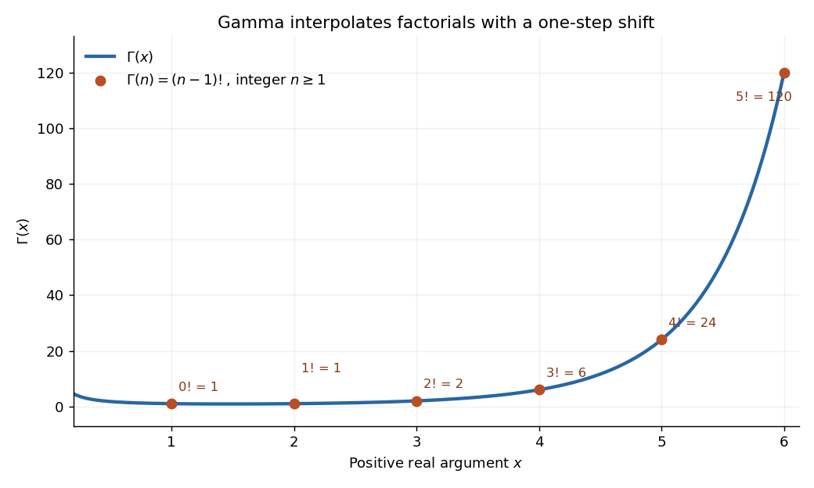

# Complex analysis

↑ **Parent:** [Analysis](analysis.md)  
ⓦ [Wiki](https://en.wikipedia.org/wiki/Complex_analysis)

Complex analysis studies [functions](function.md) of a [complex number](#complex-number), especially [holomorphic functions](holomorphic-function.md). Its distinctive feature is that a single complex [derivative](calculus.md#derivative) controls variation in every direction of the [complex plane](#complex-plane). The map $f(z)=z^2$ gives a first picture: straight coordinate lines become curved, yet small perpendicular arrows remain perpendicular wherever $f'(z)\ne0$.

**[Figure 1](#image-the-complex-square-bends-a-grid-globally-and-acts-near-1-plus-i-as-a-rotation-through-45-degrees-and-a-scaling-by-twice-the-square-root-of-two). The complex square bends a grid globally and acts near 1 + i as a rotation through 45 degrees and a scaling by twice the square root of two**.

The bottom panels show displacements rather than absolute positions. Multiplication by $f'(1+i)=2+2i$ predicts the image of each small arrow; the exact image differs by $h^2$. The origin is exceptional because $f'(0)=0$. This distinction between local [conformal maps](geometry-and-topology.md#conformal-map) and a [critical point](analysis.md#critical-point) is central: [complex differentiability](holomorphic-function.md#complex-differentiability) imposes strong geometric structure, without making every [holomorphic function](holomorphic-function.md) globally one-to-one.

The remarkable next step is that [holomorphic functions](holomorphic-function.md) are determined inside a circle by their values on its boundary. Precisely, let $R>0$, let $D=\{z:|z-a|<R\}$, and suppose $f$ is a [holomorphic function](holomorphic-function.md) on an [open set](topology.md#open-set) containing the closed disc $\overline D$. Orient its boundary counterclockwise. The [Cauchy integral formula](analysis.md#cauchy-integral-formula) states that, for every $w\in D$,

$$
f(w)=\frac{1}{2\pi i}\oint_{|z-a|=R}\frac{f(z)}{z-w}\,dz.
$$

The [contour integral](#contour-integral) combines boundary values with a kernel depending on the requested interior point. It is a reconstruction formula, not merely a trick for evaluating an [integral](integral.md). The hypothesis about the closed disc ensures that all boundary values and the [contour integral](#contour-integral) are well defined. [Orloff, MIT Topic 4, Theorem 4.1](https://ocw.mit.edu/courses/18-04-complex-variables-with-applications-spring-2018/b1a90df19f643b974555bbbb93138a48_MIT18_04S18_topic4.pdf)

At the centre, substituting $z=a+Re^{i\theta}$ cancels the denominator against $dz=iRe^{i\theta}d\theta$:

$$
f(a)=\frac{1}{2\pi}\int_0^{2\pi}f(a+Re^{i\theta})\,d\theta.
$$

Thus the centre value is the angular average of the boundary values. For the [polynomial](polynomial.md) $f(z)=z^2$, $a=1+i$ and $R=1/2$, expand the boundary data as

$$
f(a+Re^{i\theta})=2i+(1+i)e^{i\theta}+\tfrac14e^{2i\theta}.
$$

Both oscillating terms have zero average, leaving $f(a)=2i$. Away from the centre the weights change: on the [unit circle](#complex-unit-circle),

$$
f(w)=\frac{1}{2\pi}\int_0^{2\pi}\frac{f(e^{i\theta})}{1-we^{-i\theta}}\,d\theta,\qquad |w|<1.
$$

With $f(z)=z^2$ and $w=1/2$, expanding the denominator as a [geometric series](sequence-and-series.md#geometric-series) leaves only its second-power term after integration, giving $f(1/2)=1/4$. This also explains how the [Cauchy integral formula](analysis.md#cauchy-integral-formula) recovers an entire [Taylor series](calculus.md#taylor-series) from boundary data.

When a [holomorphic function](holomorphic-function.md) has [isolated singularities](isolated-singularity.md), a different boundary calculation detects their [residues](analysis.md#residue). Suppose $\Gamma$ is a counterclockwise simple closed [contour](#complex-integration-contour) and $f$ is [holomorphic](holomorphic-function.md) on a neighbourhood of it and its interior except at finitely many interior [isolated singularities](isolated-singularity.md) $a_j$. The [residue theorem](analysis.md#residue-theorem) gives

$$
\oint_\Gamma f(z)\,dz=2\pi i\sum_j\operatorname{Res}(f,a_j).
$$

A [residue](analysis.md#residue) is the coefficient of $(z-a_j)^{-1}$ in the [Laurent series](analysis.md#laurent-series). A short proof idea is to deform the [contour](#complex-integration-contour) to small circles around the [isolated singularities](isolated-singularity.md) using the [Cauchy integral theorem](#cauchy-s-integral-theorem). Integrating the [Laurent series](analysis.md#laurent-series) on each circle kills every power except $-1$. [Orloff, MIT Topic 8, residue theorem](https://ocw.mit.edu/courses/18-04-complex-variables-with-applications-spring-2018/3c58ce71ec6f7573804221d76158a0bd_MIT18_04S18_topic8.pdf)

Here is how a complex [pole](isolated-singularity.md#pole) determines a real [improper integral](real-analysis.md#improper-integral). Set $g(z)=1/(1+z^2)$ and use the [contour](#complex-integration-contour) consisting of the segment from $-R$ to $R$, followed by the upper semicircle $A_R$, with $R>1$. Only the [simple pole](isolated-singularity.md#simple-pole) $i$ lies inside, and

$$
\operatorname{Res}(g,i)=\lim_{z\to i}\frac{z-i}{(z-i)(z+i)}=\frac{1}{2i},\qquad \int_{-R}^R\frac{dx}{1+x^2}+\int_{A_R}g(z)\,dz=\pi.
$$

The arc must actually disappear. On $A_R$, the [reverse triangle inequality](topological-analysis.md#reverse-triangle-inequality) gives $|1+z^2|\ge R^2-1$, and its length is $\pi R$, so

$$
\left|\int_{A_R}g(z)\,dz\right|\le\frac{\pi R}{R^2-1}\longrightarrow0.
$$

The real integrand is bounded by $x^{-2}$ for $|x|\ge1$, so both tails converge separately. Taking the limit therefore proves the ordinary [improper integral](real-analysis.md#improper-integral)

$$
\int_{-\infty}^{\infty}\frac{dx}{1+x^2}=\pi.
$$

For example, at $R=10$ the real segment contributes $2\arctan(10)\approx2.942255$, and the arc contributes $0.199337$, below the bound $10\pi/99\approx0.317333$. The usefulness of the [residue theorem](analysis.md#residue-theorem) is that the same strategy works for many [rational functions](isolated-singularity.md#rational-function) whose real [antiderivatives](integral.md#antiderivative) are cumbersome: find the enclosed [poles](isolated-singularity.md#pole), compute their [residues](analysis.md#residue), and control the connecting arc. [Orloff, MIT Topic 9, contour decay estimates](https://ocw.mit.edu/courses/18-04-complex-variables-with-applications-spring-2018/f69bc227ae476839819fb18e5b283072_MIT18_04S18_topic9.pdf)

Historically, Cauchy's 1825 memoir on [integrals](integral.md) with imaginary limits develops complex [contour integration](#contour-integration) and its use in transforming and evaluating definite [integrals](integral.md). The opening sections define complex path [integrals](integral.md), discuss changing the path, and examine what happens near singular points. These are recognizable ancestors of the modern link between [holomorphic functions](holomorphic-function.md), [contours](#complex-integration-contour) and [residues](analysis.md#residue). [Cauchy, Mémoire sur les intégrales définies, prises entre des limites imaginaires, 1825; reprinted 1874, sections 1–6](https://www.numdam.org/item/BSMA_1874__7__265_0.pdf)

**Table of contents**

- [Power maps of a reciprocal-coordinate hyperbola](#power-maps-of-a-reciprocal-coordinate-hyperbola)
- [Nontangential limit](#nontangential-limit)
  - [Stolz region](#stolz-region)
- [Polynomial hull](#polynomial-hull)
  - [Polynomial hull in one complex variable](#polynomial-hull-in-one-complex-variable)
- [Lower half-plane](#lower-half-plane)
- [Holomorphic square root](#holomorphic-square-root)
  - [Square root of z squared minus one](#square-root-of-z-squared-minus-one)
  - [Holomorphic square root outside all polynomial roots](#holomorphic-square-root-outside-all-polynomial-roots)
- [Monodromy](#monodromy)
  - [Isomonodromic deformation](#isomonodromic-deformation)
  - [Formal monodromy](#formal-monodromy)
    - [Formal monodromy correction to an entire-system Stokes product](#formal-monodromy-correction-to-an-entire-system-stokes-product)
  - [Monodromy eigenfunction Laurent representation](#monodromy-eigenfunction-laurent-representation)
- [Cayley transform between the half-plane and disk](#cayley-transform-between-the-half-plane-and-disk)
- [Right half-plane](#right-half-plane)
- [Holomorphic logarithm](#holomorphic-logarithm)
- [Upper half-plane (complex analysis)](#upper-half-plane-complex-analysis)
  - [Conformal automorphism of the upper half-plane](#conformal-automorphism-of-the-upper-half-plane)
- [Polylogarithm](#polylogarithm)
  - [Dilogarithm](#dilogarithm)
- [Holomorphic function](holomorphic-function.md)
  - [Complex differentiability](holomorphic-function.md#complex-differentiability)
  - [Nevanlinna class](holomorphic-function.md#nevanlinna-class)
    - [Bounded characteristic](holomorphic-function.md#bounded-characteristic)
      - [Quotient characterization of bounded characteristic](holomorphic-function.md#quotient-characterization-of-bounded-characteristic)
  - [Multiplicity of a zero](holomorphic-function.md#multiplicity-of-a-zero)
  - [Periodic holomorphic descent through the exponential map](holomorphic-function.md#periodic-holomorphic-descent-through-the-exponential-map)
  - [Constant-modulus holomorphic function](holomorphic-function.md#constant-modulus-holomorphic-function)
  - [Banach-space-valued holomorphic function](holomorphic-function.md#banach-space-valued-holomorphic-function)
    - [Spectral-radius maximum principle](holomorphic-function.md#spectral-radius-maximum-principle)
    - [Norm maximum principle for a Banach-space-valued holomorphic function](holomorphic-function.md#norm-maximum-principle-for-a-banach-space-valued-holomorphic-function)
  - [Prescribed zeros in a plane domain via Runge approximation](holomorphic-function.md#prescribed-zeros-in-a-plane-domain-via-runge-approximation)
  - [Antiholomorphic function](holomorphic-function.md#antiholomorphic-function)
  - [Holomorphic convex hull](holomorphic-function.md#holomorphic-convex-hull)
  - [Blaschke product](holomorphic-function.md#blaschke-product)
    - [Interior zero count for a finite Blaschke product minus a constant](holomorphic-function.md#interior-zero-count-for-a-finite-blaschke-product-minus-a-constant)
    - [Hyperbolic zero estimate for a Blaschke product](holomorphic-function.md#hyperbolic-zero-estimate-for-a-blaschke-product)
    - [Vanishing absolute logarithmic mean characterization of Blaschke products](holomorphic-function.md#vanishing-absolute-logarithmic-mean-characterization-of-blaschke-products)
    - [Blaschke factorization of a bounded holomorphic function](holomorphic-function.md#blaschke-factorization-of-a-bounded-holomorphic-function)
    - [Radial logarithmic mean of a Blaschke product](holomorphic-function.md#radial-logarithmic-mean-of-a-blaschke-product)
    - [Automorphy character of an orbit Blaschke product](holomorphic-function.md#automorphy-character-of-an-orbit-blaschke-product)
    - [Blaschke condition](holomorphic-function.md#blaschke-condition)
      - [Blaschke sequence](holomorphic-function.md#blaschke-sequence)
  - [Jensen's formula](holomorphic-function.md#jensen-s-formula)
    - [Circle log-mean of a holomorphic function](holomorphic-function.md#circle-log-mean-of-a-holomorphic-function)
      - [Circle geometric mean of a holomorphic function](holomorphic-function.md#circle-geometric-mean-of-a-holomorphic-function)
      - [Polynomial circle log-mean](holomorphic-function.md#polynomial-circle-log-mean)
      - [Log-radius slope of the circle log-mean](holomorphic-function.md#log-radius-slope-of-the-circle-log-mean)
    - [Radial zero-counting function](holomorphic-function.md#radial-zero-counting-function)
      - [Integrated zero count](holomorphic-function.md#integrated-zero-count)
    - [Jensen formula proof outline](holomorphic-function.md#jensen-formula-proof-outline)
    - [Poisson-Jensen formula](holomorphic-function.md#poisson-jensen-formula)
      - [Annular spherical Jensen formula](holomorphic-function.md#annular-spherical-jensen-formula)
    - [Jensen zero-count bound](holomorphic-function.md#jensen-zero-count-bound)
      - [Lattice zeros force quadratic exponential growth](holomorphic-function.md#lattice-zeros-force-quadratic-exponential-growth)
  - [Holomorphic primitive](holomorphic-function.md#holomorphic-primitive)
  - [Complex differentiability at a point](holomorphic-function.md#complex-differentiability-at-a-point)
    - [Complex derivative](holomorphic-function.md#complex-derivative)
  - [Space of holomorphic functions](holomorphic-function.md#space-of-holomorphic-functions)
    - [Weighted holomorphic norm on a shrinking time domain](holomorphic-function.md#weighted-holomorphic-norm-on-a-shrinking-time-domain)
      - [Contraction estimate on a shrinking holomorphic domain](holomorphic-function.md#contraction-estimate-on-a-shrinking-holomorphic-domain)
  - [Order of a zero of a holomorphic function](holomorphic-function.md#order-of-a-zero-of-a-holomorphic-function)
    - [Zero sets in the unit disc](holomorphic-function.md#zero-sets-in-the-unit-disc)
    - [Simple zero](holomorphic-function.md#simple-zero)
  - [Analytic continuation](holomorphic-function.md#analytic-continuation)
    - [Natural boundary of a holomorphic function](holomorphic-function.md#natural-boundary-of-a-holomorphic-function)
    - [Zeta function regularization](holomorphic-function.md#zeta-function-regularization)
      - [Half-integer zeta-regularized mode sum](holomorphic-function.md#half-integer-zeta-regularized-mode-sum)
    - [Meromorphic continuation](holomorphic-function.md#meromorphic-continuation)
    - [Sokhotski–Plemelj theorem](holomorphic-function.md#sokhotski-plemelj-theorem)
      - [Signed Cauchy boundary operators](holomorphic-function.md#signed-cauchy-boundary-operators)
    - [Monodromy theorem](holomorphic-function.md#monodromy-theorem)
      - [Simply connected corollary of the monodromy theorem](holomorphic-function.md#simply-connected-corollary-of-the-monodromy-theorem)
      - [Logarithm and square-root continuation along different paths](holomorphic-function.md#logarithm-and-square-root-continuation-along-different-paths)
      - [Existence hypothesis of the monodromy theorem](holomorphic-function.md#existence-hypothesis-of-the-monodromy-theorem)
      - [Local continuation proof of the monodromy theorem](holomorphic-function.md#local-continuation-proof-of-the-monodromy-theorem)
      - [Monodromy group of a covering](holomorphic-function.md#monodromy-group-of-a-covering)
        - [Monodromy transposition in a three-sheeted cover](holomorphic-function.md#monodromy-transposition-in-a-three-sheeted-cover)
        - [Monodromy group of z squared plus z to the minus two](holomorphic-function.md#monodromy-group-of-z-squared-plus-z-to-the-minus-two)
    - [Analytic continuation by contour deformation](holomorphic-function.md#analytic-continuation-by-contour-deformation)
      - [Branch phase in a figure-eight analytic continuation integral](holomorphic-function.md#branch-phase-in-a-figure-eight-analytic-continuation-integral)
    - [Multivalued inverse hyperbolic sine](holomorphic-function.md#multivalued-inverse-hyperbolic-sine)
  - [Entire function](holomorphic-function.md#entire-function)
    - [Injective entire functions are affine](holomorphic-function.md#injective-entire-functions-are-affine)
    - [Exponential polynomial](holomorphic-function.md#exponential-polynomial)
    - [Order of an entire function](holomorphic-function.md#order-of-an-entire-function)
    - [Entire function of exponential type](holomorphic-function.md#entire-function-of-exponential-type)
    - [Weierstrass factorization theorem](holomorphic-function.md#weierstrass-factorization-theorem)
      - [Canonical product](holomorphic-function.md#canonical-product)
        - [Canonical product construction for zeros escaping to the disk boundary](holomorphic-function.md#canonical-product-construction-for-zeros-escaping-to-the-disk-boundary)
        - [Boundary-adapted holomorphic zero factor](holomorphic-function.md#boundary-adapted-holomorphic-zero-factor)
      - [Hadamard factorization theorem](holomorphic-function.md#hadamard-factorization-theorem)
      - [Entire functions with the same zero divisor](holomorphic-function.md#entire-functions-with-the-same-zero-divisor)
    - [Pointwise vanishing derivative criterion for a polynomial](holomorphic-function.md#pointwise-vanishing-derivative-criterion-for-a-polynomial)
    - [Picard theorem](holomorphic-function.md#picard-theorem)
      - [Omitted value](holomorphic-function.md#omitted-value)
      - [Little Picard theorem](holomorphic-function.md#little-picard-theorem)
        - [Great Picard theorem](holomorphic-function.md#great-picard-theorem)
  - [Analytic function with image in an affine real line](holomorphic-function.md#analytic-function-with-image-in-an-affine-real-line)
- [Simply connected domain](#simply-connected-domain)
  - [Crosscut](#crosscut)
  - [Primitive of a holomorphic function on a simply connected domain](#primitive-of-a-holomorphic-function-on-a-simply-connected-domain)
- [Complex inverse sine](#complex-inverse-sine)
  - [Branches of the complex inverse sine](#branches-of-the-complex-inverse-sine)
    - [Monodromy of the complex inverse sine](#monodromy-of-the-complex-inverse-sine)
- [Morera's theorem](#morera-s-theorem)
- [Cauchy's integral theorem](#cauchy-s-integral-theorem)
  - [Cauchy theorem for a triangle](#cauchy-theorem-for-a-triangle)
  - [Contour deformation](#contour-deformation)
  - [Gaussian contour translation](#gaussian-contour-translation)
- [Cauchy principal value](#cauchy-principal-value)
  - [Differentiating a principal-value integral across a fixed simple pole](#differentiating-a-principal-value-integral-across-a-fixed-simple-pole)
  - [Principal-value beta integral](#principal-value-beta-integral)
- [Principal-value residue rule](#principal-value-residue-rule)
- [Exponential integral](#exponential-integral)
  - [Logarithmic expansion of a symmetric exponential integral](#logarithmic-expansion-of-a-symmetric-exponential-integral)
    - [Moving-cutoff correction to a symmetric exponential integral](#moving-cutoff-correction-to-a-symmetric-exponential-integral)
  - [Small-argument expansion of the exponential integral](#small-argument-expansion-of-the-exponential-integral)
- [Gamma function](#gamma-function)
  - [Derivative of the gamma function](#derivative-of-the-gamma-function)
  - [Gamma function has no zeros](#gamma-function-has-no-zeros)
  - [Imaginary-argument gamma asymptotic](#imaginary-argument-gamma-asymptotic)
  - [Gamma function residue at a nonpositive integer](#gamma-function-residue-at-a-nonpositive-integer)
  - [Euler product for the gamma function](#euler-product-for-the-gamma-function)
  - [Residues of the Gamma function](#residues-of-the-gamma-function)
  - [Gamma integral](#gamma-integral)
    - [Cubic oscillatory Gamma integral](#cubic-oscillatory-gamma-integral)
  - [Gamma function recurrence](#gamma-function-recurrence)
  - [Bohr-Mollerup theorem](#bohr-mollerup-theorem)
  - [Bose integral](#bose-integral)
  - [Euler's constant](#euler-s-constant)
    - [Integral bounds for Euler's constant](#integral-bounds-for-euler-s-constant)
  - [Weierstrass product for the reciprocal gamma function](#weierstrass-product-for-the-reciprocal-gamma-function)
  - [Digamma function](#digamma-function)
    - [Trigamma function](#trigamma-function)
    - [Positive zero of the digamma function](#positive-zero-of-the-digamma-function)
  - [Gamma reflection formula](#gamma-reflection-formula)
  - [Gamma duplication formula](#gamma-duplication-formula)
  - [Beta function](#beta-function)
    - [Beta integral](#beta-integral)
    - [Beta-gamma identity](#beta-gamma-identity)
      - [Sum-and-ratio substitution for gamma integrals](#sum-and-ratio-substitution-for-gamma-integrals)
    - [Equal-argument beta integral](#equal-argument-beta-integral)
    - [Trigonometric form of the beta function](#trigonometric-form-of-the-beta-function)
    - [Power-complement integral recurrence](#power-complement-integral-recurrence)
    - [Incomplete beta function](#incomplete-beta-function)
    - [Complex beta integral](#complex-beta-integral)
    - [Beta-function recurrence](#beta-function-recurrence)
    - [Logarithmic moments of the Cauchy kernel](#logarithmic-moments-of-the-cauchy-kernel)
  - [Gamma function asymptotic at zero](#gamma-function-asymptotic-at-zero)
    - [Diagonal beta-function asymptotic at zero](#diagonal-beta-function-asymptotic-at-zero)
- [Riemann surfaces](riemann-surfaces.md)
  - [Meromorphic differential on a Riemann surface](riemann-surfaces.md#meromorphic-differential-on-a-riemann-surface)
  - [Hyperbolic Riemann surface in potential theory](riemann-surfaces.md#hyperbolic-riemann-surface-in-potential-theory)
  - [Compact Riemann surface](riemann-surfaces.md#compact-riemann-surface)
  - [Abel-Jacobi map of a compact Riemann surface](riemann-surfaces.md#abel-jacobi-map-of-a-compact-riemann-surface)
    - [Abel theorem for divisors](riemann-surfaces.md#abel-theorem-for-divisors)
  - [Differential of the third kind](riemann-surfaces.md#differential-of-the-third-kind)
  - [Riemann bilinear relations for a compact surface](riemann-surfaces.md#riemann-bilinear-relations-for-a-compact-surface)
  - [Three-branch-point regular surface cover](riemann-surfaces.md#three-branch-point-regular-surface-cover)
    - [Orientation-reversing equivalence of branched-cover monodromy](riemann-surfaces.md#orientation-reversing-equivalence-of-branched-cover-monodromy)
  - [Quasiconformal mapping](riemann-surfaces.md#quasiconformal-mapping)
    - [Maximal dilatation](riemann-surfaces.md#maximal-dilatation)
    - [Beltrami coefficient](riemann-surfaces.md#beltrami-coefficient)
      - [Beltrami equation](riemann-surfaces.md#beltrami-equation)
  - [Conformal metric](riemann-surfaces.md#conformal-metric)
  - [Translation surface](riemann-surfaces.md#translation-surface)
    - [Slit connected sum of translation tori](riemann-surfaces.md#slit-connected-sum-of-translation-tori)
  - [Teichmüller theory](riemann-surfaces.md#teichmuller-theory)
    - [Teichmüller map](riemann-surfaces.md#teichmuller-map)
      - [Teichmüller's uniqueness theorem](riemann-surfaces.md#teichmuller-s-uniqueness-theorem)
      - [Reich–Strebel inequality](riemann-surfaces.md#reich-strebel-inequality)
    - [Extremal length](riemann-surfaces.md#extremal-length)
      - [Extremal length lower bound from a closed one-form](riemann-surfaces.md#extremal-length-lower-bound-from-a-closed-one-form)
      - [Conformal modulus of an annulus](riemann-surfaces.md#conformal-modulus-of-an-annulus)
        - [Conformal cylinder](riemann-surfaces.md#conformal-cylinder)
    - [SL2R action on differentials](riemann-surfaces.md#sl2r-action-on-differentials)
    - [Teichmüller space](riemann-surfaces.md#teichmuller-space)
  - [Local coordinate](riemann-surfaces.md#local-coordinate)
  - [Holomorphic map](riemann-surfaces.md#holomorphic-map)
    - [Biholomorphism](riemann-surfaces.md#biholomorphism)
  - [Germ of a holomorphic function](riemann-surfaces.md#germ-of-a-holomorphic-function)
    - [Function element](riemann-surfaces.md#function-element)
    - [Space of germs of holomorphic functions](riemann-surfaces.md#space-of-germs-of-holomorphic-functions)
      - [Analytic germ projection](riemann-surfaces.md#analytic-germ-projection)
        - [Surjective inverse-polynomial germ projection without even covering](riemann-surfaces.md#surjective-inverse-polynomial-germ-projection-without-even-covering)
      - [Evaluation map on a space of germs](riemann-surfaces.md#evaluation-map-on-a-space-of-germs)
      - [Germ surface of the square root of z to the eighth minus one](riemann-surfaces.md#germ-surface-of-the-square-root-of-z-to-the-eighth-minus-one)
  - [Complex structure lifted through a covering map](riemann-surfaces.md#complex-structure-lifted-through-a-covering-map)
  - [Uniformization theorem](riemann-surfaces.md#uniformization-theorem)
    - [Thrice-punctured sphere as a modular quotient](riemann-surfaces.md#thrice-punctured-sphere-as-a-modular-quotient)
    - [Green-function exhaustion proof of disk uniformization](riemann-surfaces.md#green-function-exhaustion-proof-of-disk-uniformization)
    - [Riemann mapping theorem](riemann-surfaces.md#riemann-mapping-theorem)
      - [Square-root improvement of a normalized conformal map](riemann-surfaces.md#square-root-improvement-of-a-normalized-conformal-map)
      - [Caratheodory boundary extension theorem](riemann-surfaces.md#caratheodory-boundary-extension-theorem)
      - [Koebe distortion theorem](riemann-surfaces.md#koebe-distortion-theorem)
        - [Koebe quarter theorem](riemann-surfaces.md#koebe-quarter-theorem)
          - [Boundary-distance derivative bound for a conformal bijection](riemann-surfaces.md#boundary-distance-derivative-bound-for-a-conformal-bijection)
    - [Automorphisms of simply connected Riemann surfaces](riemann-surfaces.md#automorphisms-of-simply-connected-riemann-surfaces)
    - [Riemann surfaces uniformized by the complex plane](riemann-surfaces.md#riemann-surfaces-uniformized-by-the-complex-plane)
    - [Plane domain with two omitted points is hyperbolic](riemann-surfaces.md#plane-domain-with-two-omitted-points-is-hyperbolic)
    - [Uniformization of a punctured compact Riemann surface](riemann-surfaces.md#uniformization-of-a-punctured-compact-riemann-surface)
    - [Compact Riemann surface containing an embedded punctured plane](riemann-surfaces.md#compact-riemann-surface-containing-an-embedded-punctured-plane)
  - [Identity theorem on a Riemann surface](riemann-surfaces.md#identity-theorem-on-a-riemann-surface)
  - [Harmonic function on a Riemann surface](riemann-surfaces.md#harmonic-function-on-a-riemann-surface)
    - [Conformal invariance of harmonicity](riemann-surfaces.md#conformal-invariance-of-harmonicity)
  - [Regular covering map](riemann-surfaces.md#regular-covering-map)
  - [Complete analytic function](riemann-surfaces.md#complete-analytic-function)
  - [Valency theorem](riemann-surfaces.md#valency-theorem)
    - [Local degree of a holomorphic map](riemann-surfaces.md#local-degree-of-a-holomorphic-map)
    - [Degree of a holomorphic map](riemann-surfaces.md#degree-of-a-holomorphic-map)
      - [Degree of a power map of the Riemann sphere](riemann-surfaces.md#degree-of-a-power-map-of-the-riemann-sphere)
    - [Degree of a rational map of the Riemann sphere](riemann-surfaces.md#degree-of-a-rational-map-of-the-riemann-sphere)
      - [Degree bounds for the derivative of a rational function](riemann-surfaces.md#degree-bounds-for-the-derivative-of-a-rational-function)
      - [Degree of the derivative of a rational function](riemann-surfaces.md#degree-of-the-derivative-of-a-rational-function)
    - [Degree of an elliptic function](riemann-surfaces.md#degree-of-an-elliptic-function)
      - [Degree of the derivative of an elliptic function](riemann-surfaces.md#degree-of-the-derivative-of-an-elliptic-function)
    - [Octahedral rotation orbits on the Riemann sphere](riemann-surfaces.md#octahedral-rotation-orbits-on-the-riemann-sphere)
    - [Degree-sized invariant separates finite-group orbits](riemann-surfaces.md#degree-sized-invariant-separates-finite-group-orbits)
  - [Riemann-Hurwitz formula](riemann-surfaces.md#riemann-hurwitz-formula)
    - [Total ramification of a holomorphic map](riemann-surfaces.md#total-ramification-of-a-holomorphic-map)
    - [Ramification of a power map of the Riemann sphere](riemann-surfaces.md#ramification-of-a-power-map-of-the-riemann-sphere)
    - [Double cover of the sphere with four branch values](riemann-surfaces.md#double-cover-of-the-sphere-with-four-branch-values)
    - [Ramification index of a holomorphic map](riemann-surfaces.md#ramification-index-of-a-holomorphic-map)
      - [Ramification point of a holomorphic map](riemann-surfaces.md#ramification-point-of-a-holomorphic-map)
        - [Simple ramification point of a holomorphic map](riemann-surfaces.md#simple-ramification-point-of-a-holomorphic-map)
        - [Critical point of a rational map](riemann-surfaces.md#critical-point-of-a-rational-map)
          - [Critical orbit of a rational map](riemann-surfaces.md#critical-orbit-of-a-rational-map)
          - [Critical points of iterates of a rational map](riemann-surfaces.md#critical-points-of-iterates-of-a-rational-map)
          - [Critical multiplicity of a rational map](riemann-surfaces.md#critical-multiplicity-of-a-rational-map)
            - [Total critical multiplicity of a rational map](riemann-surfaces.md#total-critical-multiplicity-of-a-rational-map)
        - [Branch value of a holomorphic map](riemann-surfaces.md#branch-value-of-a-holomorphic-map)
          - [Ramification at infinity of a superelliptic covering](riemann-surfaces.md#ramification-at-infinity-of-a-superelliptic-covering)
    - [Triangulation proof of the Riemann-Hurwitz formula](riemann-surfaces.md#triangulation-proof-of-the-riemann-hurwitz-formula)
    - [Affine normal forms of a complex cubic polynomial](riemann-surfaces.md#affine-normal-forms-of-a-complex-cubic-polynomial)
  - [Riemann sphere](riemann-surfaces.md#riemann-sphere)
    - [Chordal metric](riemann-surfaces.md#chordal-metric)
      - [Rational map is Lipschitz in the chordal metric](riemann-surfaces.md#rational-map-is-lipschitz-in-the-chordal-metric)
    - [Stereographic projection](riemann-surfaces.md#stereographic-projection)
      - [Circle-plane relation under stereographic projection](riemann-surfaces.md#circle-plane-relation-under-stereographic-projection)
        - [Antipodal equatorial intersection criterion for a great circle](riemann-surfaces.md#antipodal-equatorial-intersection-criterion-for-a-great-circle)
      - [Antipodal stereographic coordinate relation](riemann-surfaces.md#antipodal-stereographic-coordinate-relation)
        - [Antipodal cross-ratio and spherical distance](riemann-surfaces.md#antipodal-cross-ratio-and-spherical-distance)
      - [Holomorphic stereographic atlas of the sphere](riemann-surfaces.md#holomorphic-stereographic-atlas-of-the-sphere)
        - [Reciprocal chart at infinity](riemann-surfaces.md#reciprocal-chart-at-infinity)
      - [Sphere rotations as special-unitary Möbius transformations](riemann-surfaces.md#sphere-rotations-as-special-unitary-mobius-transformations)
    - [Local cyclic quotient of a Riemann surface](riemann-surfaces.md#local-cyclic-quotient-of-a-riemann-surface)
      - [Finite conformal quotient of a Riemann surface](riemann-surfaces.md#finite-conformal-quotient-of-a-riemann-surface)
    - [Orbit-separating invariant for the standard dihedral action on the Riemann sphere](riemann-surfaces.md#orbit-separating-invariant-for-the-standard-dihedral-action-on-the-riemann-sphere)
  - [Punctured Riemann surface](riemann-surfaces.md#punctured-riemann-surface)
    - [Path avoidance in a surface](riemann-surfaces.md#path-avoidance-in-a-surface)
    - [Punctured complex plane](riemann-surfaces.md#punctured-complex-plane)
      - [Cylinder as a punctured plane](riemann-surfaces.md#cylinder-as-a-punctured-plane)
  - [Transport of a complex structure](riemann-surfaces.md#transport-of-a-complex-structure)
  - [Nodal crossing](riemann-surfaces.md#nodal-crossing)
    - [Topological manifold local obstruction](riemann-surfaces.md#topological-manifold-local-obstruction)
    - [Reducible complex curve](riemann-surfaces.md#reducible-complex-curve)
- [Elliptic integral](#elliptic-integral)
  - [Elliptic integral of the second kind](#elliptic-integral-of-the-second-kind)
    - [Modulus derivative of the incomplete elliptic integral of the second kind](#modulus-derivative-of-the-incomplete-elliptic-integral-of-the-second-kind)
    - [Complete elliptic integral of the second kind](#complete-elliptic-integral-of-the-second-kind)
  - [Elliptic integral of the first kind](#elliptic-integral-of-the-first-kind)
    - [Lemniscatic integral](#lemniscatic-integral)
    - [Complete elliptic integral of the first kind](#complete-elliptic-integral-of-the-first-kind)
      - [Logarithmic endpoint asymptotic of the complete elliptic integral](#logarithmic-endpoint-asymptotic-of-the-complete-elliptic-integral)
      - [Complementary complete elliptic integral of the first kind](#complementary-complete-elliptic-integral-of-the-first-kind)
- [Elliptic function](#elliptic-function)
  - [Zero-pole sum of an elliptic function](#zero-pole-sum-of-an-elliptic-function)
  - [Elliptic divisor-sum identity](#elliptic-divisor-sum-identity)
  - [Period lattice](#period-lattice)
    - [Fundamental parallelogram of a period lattice](#fundamental-parallelogram-of-a-period-lattice)
  - [Nonconstant elliptic function has a pole](#nonconstant-elliptic-function-has-a-pole)
  - [Jacobi elliptic functions](#jacobi-elliptic-functions)
    - [Jacobi elliptic sine](#jacobi-elliptic-sine)
      - [Period lattice of the Jacobi elliptic sine](#period-lattice-of-the-jacobi-elliptic-sine)
  - [Value multiplicity of an elliptic function](#value-multiplicity-of-an-elliptic-function)
  - [Weierstrass functions](#weierstrass-functions)
    - [Weierstrass elliptic function](#weierstrass-elliptic-function)
      - [Weierstrass addition formula](#weierstrass-addition-formula)
      - [Weierstrass sigma function](#weierstrass-sigma-function)
        - [Legendre relation for Weierstrass quasi-periods](#legendre-relation-for-weierstrass-quasi-periods)
      - [Four totally ramified Weierstrass values](#four-totally-ramified-weierstrass-values)
      - [Termwise derivative proof of Weierstrass periodicity](#termwise-derivative-proof-of-weierstrass-periodicity)
      - [Weierstrass shift-difference identity by pole cancellation](#weierstrass-shift-difference-identity-by-pole-cancellation)
      - [Elliptic collinearity determinant](#elliptic-collinearity-determinant)
        - [Confluent elliptic collinearity determinant](#confluent-elliptic-collinearity-determinant)
      - [Elliptic function-field decomposition](#elliptic-function-field-decomposition)
      - [Even elliptic functions are rational in the Weierstrass function](#even-elliptic-functions-are-rational-in-the-weierstrass-function)
        - [Degree-two even elliptic function](#degree-two-even-elliptic-function)
      - [Normal convergence of the Weierstrass elliptic-function series](#normal-convergence-of-the-weierstrass-elliptic-function-series)
      - [Half-period values of the Weierstrass elliptic function](#half-period-values-of-the-weierstrass-elliptic-function)
        - [Weierstrass half-period translation formula](#weierstrass-half-period-translation-formula)
          - [Weierstrass quarter-period derivative identity](#weierstrass-quarter-period-derivative-identity)
        - [Two-torsion point of a complex torus](#two-torsion-point-of-a-complex-torus)
      - [Equianharmonic lattice](#equianharmonic-lattice)
      - [Weierstrass zeta function](#weierstrass-zeta-function)
      - [Laurent coefficients of the Weierstrass elliptic function](#laurent-coefficients-of-the-weierstrass-elliptic-function)
        - [Positive polynomial recurrence for lattice Eisenstein sums](#positive-polynomial-recurrence-for-lattice-eisenstein-sums)
      - [Weierstrass elliptic differential equation](#weierstrass-elliptic-differential-equation)
        - [Nonvanishing discriminant of a complex lattice](#nonvanishing-discriminant-of-a-complex-lattice)
- [Runge's theorem](#runge-s-theorem)
  - [Uniform rational approximation algebra with prescribed poles](#uniform-rational-approximation-algebra-with-prescribed-poles)
  - [Polynomial Runge theorem](#polynomial-runge-theorem)
    - [Runge exhaustion of a slit disk](#runge-exhaustion-of-a-slit-disk)
    - [Pointwise polynomial approximation of a half-plane sign](#pointwise-polynomial-approximation-of-a-half-plane-sign)
    - [Pole-moving polynomial approximation](#pole-moving-polynomial-approximation)
    - [Polynomially approximable resolvent point](#polynomially-approximable-resolvent-point)
      - [Resolvent propagation across a complementary component](#resolvent-propagation-across-a-complementary-component)
    - [Elementary polynomial approximation on a square](#elementary-polynomial-approximation-on-a-square)
    - [Polynomial approximation of the reciprocal on a proper circular arc](#polynomial-approximation-of-the-reciprocal-on-a-proper-circular-arc)
      - [Explicit polynomial approximation of the reciprocal on the left semicircle](#explicit-polynomial-approximation-of-the-reciprocal-on-the-left-semicircle)
    - [Polynomial approximation obstruction on a punctured circle](#polynomial-approximation-obstruction-on-a-punctured-circle)
    - [Pointwise approximation by a Runge exhaustion](#pointwise-approximation-by-a-runge-exhaustion)
- [Winding number](#winding-number)
  - [Winding number of a continuous closed path](#winding-number-of-a-continuous-closed-path)
    - [Continuous logarithm lifting criterion](#continuous-logarithm-lifting-criterion)
- [Homotopy invariance of winding number](#homotopy-invariance-of-winding-number)
  - [Dominated perturbation preserves winding number](#dominated-perturbation-preserves-winding-number)
  - [Winding-number proof of the fundamental theorem of algebra](#winding-number-proof-of-the-fundamental-theorem-of-algebra)
  - [Winding-number proof of the no-retraction theorem](#winding-number-proof-of-the-no-retraction-theorem)
- [Bromwich contour](#bromwich-contour)
  - [Bromwich inversion with a square-root branch cut](#bromwich-inversion-with-a-square-root-branch-cut)
- [Branch point](#branch-point)
  - [Logarithmic branch point](#logarithmic-branch-point)
  - [Algebraic branch point](#algebraic-branch-point)
  - [Branch of a multivalued function](#branch-of-a-multivalued-function)
  - [Monodromy reflection at a square-root branch point](#monodromy-reflection-at-a-square-root-branch-point)
    - [Translation generated by two square-root monodromy reflections](#translation-generated-by-two-square-root-monodromy-reflections)
- [Complex number](#complex-number)
  - [Multiplication of complex numbers](#multiplication-of-complex-numbers)
  - [Complex arithmetic](#complex-arithmetic)
  - [Polar form of a complex number](#polar-form-of-a-complex-number)
    - [Root of a complex number](#root-of-a-complex-number)
      - [Complex square root](#complex-square-root)
  - [Complex modulus](#complex-modulus)
  - [Imaginary unit](#imaginary-unit)
  - [Real part](#real-part)
  - [Imaginary part](#imaginary-part)
  - [Euler's formula](#euler-s-formula)
  - [Modulus](#modulus)
  - [Complex conjugate](#complex-conjugate)
    - [Complex conjugation](#complex-conjugation)
      - [Schwarz conjugation of a spectral function](#schwarz-conjugation-of-a-spectral-function)
  - [Argument (complex analysis)](#argument-complex-analysis)
    - [Principal argument](#principal-argument)
  - [Complex plane](#complex-plane)
    - [Finite-hole neighborhoods of a planar compact set](#finite-hole-neighborhoods-of-a-planar-compact-set)
    - [Complex coordinate](#complex-coordinate)
    - [Real linear equation of a line in the complex plane](#real-linear-equation-of-a-line-in-the-complex-plane)
    - [Imaginary axis](#imaginary-axis)
    - [Complex unit circle](#complex-unit-circle)
    - [Real axis](#real-axis)
- [Isolated singularity](isolated-singularity.md)
  - [Classification of isolated singularities](isolated-singularity.md#classification-of-isolated-singularities)
    - [Removable singularity](isolated-singularity.md#removable-singularity)
      - [Riemann removable singularity theorem](isolated-singularity.md#riemann-removable-singularity-theorem)
      - [Removable singularity at infinity](isolated-singularity.md#removable-singularity-at-infinity)
      - [Uniform L2 circle bound for a removable singularity](isolated-singularity.md#uniform-l2-circle-bound-for-a-removable-singularity)
    - [Pole](isolated-singularity.md#pole)
      - [Pole at infinity](isolated-singularity.md#pole-at-infinity)
      - [Simple pole](isolated-singularity.md#simple-pole)
        - [Regular part at a simple pole](isolated-singularity.md#regular-part-at-a-simple-pole)
      - [Double pole](isolated-singularity.md#double-pole)
      - [Meromorphic function](isolated-singularity.md#meromorphic-function)
        - [Spherical derivative of a meromorphic function](isolated-singularity.md#spherical-derivative-of-a-meromorphic-function)
          - [Finite spherical area criterion for an isolated singularity](isolated-singularity.md#finite-spherical-area-criterion-for-an-isolated-singularity)
        - [Algebraic addition theorem](isolated-singularity.md#algebraic-addition-theorem)
          - [Simply periodic entire function without an algebraic addition theorem](isolated-singularity.md#simply-periodic-entire-function-without-an-algebraic-addition-theorem)
        - [Meromorphic functions on the sphere are rational](isolated-singularity.md#meromorphic-functions-on-the-sphere-are-rational)
        - [Mittag-Leffler's theorem](isolated-singularity.md#mittag-leffler-s-theorem)
        - [Polynomial growth forces a meromorphic function to be rational](isolated-singularity.md#polynomial-growth-forces-a-meromorphic-function-to-be-rational)
        - [Nevanlinna theory](isolated-singularity.md#nevanlinna-theory)
          - [Ahlfors covering surface theory](isolated-singularity.md#ahlfors-covering-surface-theory)
            - [Length-area exhaustion of the complex plane](isolated-singularity.md#length-area-exhaustion-of-the-complex-plane)
            - [Ahlfors second fundamental theorem](isolated-singularity.md#ahlfors-second-fundamental-theorem)
              - [Ahlfors five islands theorem](isolated-singularity.md#ahlfors-five-islands-theorem)
            - [Island of a meromorphic function](isolated-singularity.md#island-of-a-meromorphic-function)
              - [Simple island](isolated-singularity.md#simple-island)
            - [Average sheet number](isolated-singularity.md#average-sheet-number)
          - [Nevanlinna second main theorem](isolated-singularity.md#nevanlinna-second-main-theorem)
            - [Nevanlinna second main theorem in the unit disc](isolated-singularity.md#nevanlinna-second-main-theorem-in-the-unit-disc)
            - [Five values force infinitely many simple preimages](isolated-singularity.md#five-values-force-infinitely-many-simple-preimages)
          - [Nevanlinna logarithmic derivative lemma](isolated-singularity.md#nevanlinna-logarithmic-derivative-lemma)
            - [Derivative growth outside a finite-measure set](isolated-singularity.md#derivative-growth-outside-a-finite-measure-set)
          - [Nevanlinna ramification index](isolated-singularity.md#nevanlinna-ramification-index)
          - [Nevanlinna deficiency](isolated-singularity.md#nevanlinna-deficiency)
            - [Simultaneous deficiency and ramification for an exponential polynomial](isolated-singularity.md#simultaneous-deficiency-and-ramification-for-an-exponential-polynomial)
          - [Nevanlinna first main theorem](isolated-singularity.md#nevanlinna-first-main-theorem)
          - [Nevanlinna characteristic](isolated-singularity.md#nevanlinna-characteristic)
            - [Growth order of a meromorphic function](isolated-singularity.md#growth-order-of-a-meromorphic-function)
              - [Counting-order exceptions for a finite-order meromorphic function](isolated-singularity.md#counting-order-exceptions-for-a-finite-order-meromorphic-function)
            - [Rational composition law for the Nevanlinna characteristic](isolated-singularity.md#rational-composition-law-for-the-nevanlinna-characteristic)
          - [Nevanlinna integrated counting function](isolated-singularity.md#nevanlinna-integrated-counting-function)
            - [Truncated Nevanlinna counting function](isolated-singularity.md#truncated-nevanlinna-counting-function)
          - [Nevanlinna proximity function](isolated-singularity.md#nevanlinna-proximity-function)
        - [Meromorphic function as a holomorphic map to the Riemann sphere](isolated-singularity.md#meromorphic-function-as-a-holomorphic-map-to-the-riemann-sphere)
          - [Single-pole criterion for a spherical coordinate](isolated-singularity.md#single-pole-criterion-for-a-spherical-coordinate)
        - [Rational map (complex analysis)](isolated-singularity.md#rational-map-complex-analysis)
          - [Rational covering maps of the projective line](isolated-singularity.md#rational-covering-maps-of-the-projective-line)
          - [Common-factor reduction of a rational map](isolated-singularity.md#common-factor-reduction-of-a-rational-map)
          - [Rotational symmetry of a rational map](isolated-singularity.md#rotational-symmetry-of-a-rational-map)
            - [Axially equivariant monomial rational map](isolated-singularity.md#axially-equivariant-monomial-rational-map)
          - [Wronskian of a rational map](isolated-singularity.md#wronskian-of-a-rational-map)
          - [Angular Jacobian of a rational map](isolated-singularity.md#angular-jacobian-of-a-rational-map)
        - [Rational function](isolated-singularity.md#rational-function)
          - [Padé approximant](isolated-singularity.md#pade-approximant)
          - [Partial fraction decomposition](isolated-singularity.md#partial-fraction-decomposition)
            - [Reciprocal-polynomial root identities](isolated-singularity.md#reciprocal-polynomial-root-identities)
          - [Order of vanishing](isolated-singularity.md#order-of-vanishing)
      - [Exponential of a pole is an essential singularity](isolated-singularity.md#exponential-of-a-pole-is-an-essential-singularity)
    - [Essential singularity](isolated-singularity.md#essential-singularity)
      - [Casorati-Weierstrass theorem](isolated-singularity.md#casorati-weierstrass-theorem)
  - [Non-isolated singularity](isolated-singularity.md#non-isolated-singularity)
    - [Reciprocal cosine with accumulating poles](isolated-singularity.md#reciprocal-cosine-with-accumulating-poles)
  - [Zeros and poles](isolated-singularity.md#zeros-and-poles)
- [Contour integration](#contour-integration)
  - [Reciprocal affine sine integral](#reciprocal-affine-sine-integral)
  - [Square-root endpoint integrals by an upper-half-plane contour](#square-root-endpoint-integrals-by-an-upper-half-plane-contour)
  - [Fractional-power integral from an upper-half-plane contour](#fractional-power-integral-from-an-upper-half-plane-contour)
  - [Cauchy transform](#cauchy-transform)
    - [Paired radial jump of a continuous Cauchy transform](#paired-radial-jump-of-a-continuous-cauchy-transform)
  - [Pochhammer contour](#pochhammer-contour)
  - [Complex integration contour](#complex-integration-contour)
  - [Complex contour](#complex-contour)
    - [Piecewise smooth curve](#piecewise-smooth-curve)
    - [Orientation of a contour](#orientation-of-a-contour)
  - [Contour rotation](#contour-rotation)
  - [Keyhole contour](#keyhole-contour)
  - [Contour integral](#contour-integral)
  - [Positive orientation of a contour](#positive-orientation-of-a-contour)
  - [Estimation lemma](#estimation-lemma)
  - [Uniform convergence and contour integration](#uniform-convergence-and-contour-integration)
  - [Contour shifting](#contour-shifting)
  - [Period obstruction to a holomorphic antiderivative](#period-obstruction-to-a-holomorphic-antiderivative)
  - [Jordan's lemma](#jordan-s-lemma)
    - [Alternating sine series with a quadratic denominator](#alternating-sine-series-with-a-quadratic-denominator)
  - [Complex line integral estimate](#complex-line-integral-estimate)
  - [Hankel contour](#hankel-contour)
    - [Hankel analytic continuation](#hankel-analytic-continuation)
    - [Residue extraction by a Hankel contour](#residue-extraction-by-a-hankel-contour)
      - [Cancellation of positive-integer gamma singularities on a Hankel contour](#cancellation-of-positive-integer-gamma-singularities-on-a-hankel-contour)
- [Univalent function](#univalent-function)
  - [Area theorem (conformal mapping)](#area-theorem-conformal-mapping)
  - [Normalized univalent function](#normalized-univalent-function)
    - [Second coefficient bound for normalized univalent functions](#second-coefficient-bound-for-normalized-univalent-functions)
    - [Odd square-root transform of a normalized univalent function](#odd-square-root-transform-of-a-normalized-univalent-function)
  - [A univalent function has nonzero derivative](#a-univalent-function-has-nonzero-derivative)
  - [Locally uniform limit of univalent functions](#locally-uniform-limit-of-univalent-functions)
  - [Koebe function](#koebe-function)
  - [Boundary logarithmic mean of a univalent function](#boundary-logarithmic-mean-of-a-univalent-function)
- [Liouville theorem](#liouville-theorem)
  - [Entire function confined to a half-plane is constant](#entire-function-confined-to-a-half-plane-is-constant)
  - [One-sided product bound for an entire function](#one-sided-product-bound-for-an-entire-function)
  - [Dense image of a nonconstant entire function](#dense-image-of-a-nonconstant-entire-function)
  - [Entire function under a horizontal inverse-square-root bound](#entire-function-under-a-horizontal-inverse-square-root-bound)
  - [Polynomial growth theorem for entire functions](#polynomial-growth-theorem-for-entire-functions)
- [Cauchy derivative formula](#cauchy-derivative-formula)
  - [Recovering an analytic derivative from the boundary real part](#recovering-an-analytic-derivative-from-the-boundary-real-part)
  - [Lipschitz bound inside a bounded analytic half-plane](#lipschitz-bound-inside-a-bounded-analytic-half-plane)
- [Locally uniform convergence of holomorphic functions](#locally-uniform-convergence-of-holomorphic-functions)
- [Schwarz reflection principle](#schwarz-reflection-principle)
- [Upper half-plane self-map](#upper-half-plane-self-map)
- [Argument principle](#argument-principle)
  - [Argument principle for a rational function](#argument-principle-for-a-rational-function)
  - [Weighted argument principle](#weighted-argument-principle)
  - [Boundary sampling can miss winding](#boundary-sampling-can-miss-winding)
  - [Radial crossing test for polynomial root counts](#radial-crossing-test-for-polynomial-root-counts)
  - [Quarter-sector winding test for a real quartic](#quarter-sector-winding-test-for-a-real-quartic)
  - [Rouché's theorem](#rouche-s-theorem)
    - [Rouché localization of polynomial roots](#rouche-localization-of-polynomial-roots)
    - [Hurwitz's theorem](#hurwitz-s-theorem)
    - [Open mapping theorem (complex analysis)](#open-mapping-theorem-complex-analysis)
      - [Maximum modulus principle from the complex open mapping theorem](#maximum-modulus-principle-from-the-complex-open-mapping-theorem)
    - [Unit-disc image from a boundary modulus lower bound](#unit-disc-image-from-a-boundary-modulus-lower-bound)
  - [Integer residue of a logarithmic derivative](#integer-residue-of-a-logarithmic-derivative)
- [Meromorphic function with prescribed zeros and poles](#meromorphic-function-with-prescribed-zeros-and-poles)
- [Maximum modulus principle](#maximum-modulus-principle)
  - [Hadamard three-circle theorem](#hadamard-three-circle-theorem)
  - [Phragmén–Lindelöf principle](#phragmen-lindelof-principle)
  - [Maximum modulus principle on a bounded domain](#maximum-modulus-principle-on-a-bounded-domain)
    - [Bounded half-plane maximum principle](#bounded-half-plane-maximum-principle)
- [Mean value property for holomorphic functions](#mean-value-property-for-holomorphic-functions)
- [Dirichlet beta function](#dirichlet-beta-function)
  - [Special values of the Dirichlet beta function](#special-values-of-the-dirichlet-beta-function)
  - [Dirichlet beta reflection formula](#dirichlet-beta-reflection-formula)
- [Identity theorem](#identity-theorem)
- [Residue at infinity from an asymptotic constant](#residue-at-infinity-from-an-asymptotic-constant)
- [Large-circle contour estimate](#large-circle-contour-estimate)
- [Fuchsian differential equation](#fuchsian-differential-equation)
  - [Accessory parameter](#accessory-parameter)
  - [Regular singular point](#regular-singular-point)
    - [Apparent regular singular point](#apparent-regular-singular-point)
    - [Logarithmically divergent derivative at a regular singular endpoint](#logarithmically-divergent-derivative-at-a-regular-singular-endpoint)
    - [Frobenius method](#frobenius-method)
      - [Undetermined coefficient at Frobenius resonance](#undetermined-coefficient-at-frobenius-resonance)
      - [Square-root reduction of a regular-singular differential equation](#square-root-reduction-of-a-regular-singular-differential-equation)
      - [Frobenius solution](#frobenius-solution)
      - [Hyperbolic reduction of a regular-singular differential equation](#hyperbolic-reduction-of-a-regular-singular-differential-equation)
      - [Terminating Frobenius series](#terminating-frobenius-series)
  - [Ordinary point criterion for a second-order equation](#ordinary-point-criterion-for-a-second-order-equation)
  - [Characteristic exponent at a regular singular point](#characteristic-exponent-at-a-regular-singular-point)
  - [Regular singular point criterion for a second-order equation](#regular-singular-point-criterion-for-a-second-order-equation)
    - [Regular singular point at infinity](#regular-singular-point-at-infinity)
    - [Logarithmic solution from a repeated Frobenius exponent](#logarithmic-solution-from-a-repeated-frobenius-exponent)
  - [Irregular singular point](#irregular-singular-point)
    - [Poincaré rank](#poincare-rank)
  - [Riemann's differential equation](#riemann-s-differential-equation)
    - [Papperitz symbol](#papperitz-symbol)
      - [Fuchs relation](#fuchs-relation)
      - [Möbius transformation of a Papperitz symbol](#mobius-transformation-of-a-papperitz-symbol)
      - [Dependent-variable rescaling of a Papperitz symbol](#dependent-variable-rescaling-of-a-papperitz-symbol)
  - [Gauss hypergeometric equation](#gauss-hypergeometric-equation)
    - [Hypergeometric Frobenius recurrence](#hypergeometric-frobenius-recurrence)
    - [Euler's hypergeometric transformation](#euler-s-hypergeometric-transformation)
    - [Hypergeometric connection formula at one](#hypergeometric-connection-formula-at-one)
    - [Hypergeometric function](#hypergeometric-function)
      - [Euler integral for the hypergeometric function](#euler-integral-for-the-hypergeometric-function)
    - [Pfaff transformation](#pfaff-transformation)
    - [Second local hypergeometric solution](#second-local-hypergeometric-solution)
    - [Hypergeometric connection formula at infinity](#hypergeometric-connection-formula-at-infinity)
    - [Hypergeometric cancellation identity](#hypergeometric-cancellation-identity)
      - [Elementary specialization of a hypergeometric solution](#elementary-specialization-of-a-hypergeometric-solution)
        - [Hypergeometric cosine identity](#hypergeometric-cosine-identity)
        - [Hypergeometric sine identity](#hypergeometric-sine-identity)

## Power maps of a reciprocal-coordinate hyperbola

↑ **Parent:** [Complex analysis](complex-analysis.md)

Let $a>0$, $t>0$ and $z=t+ia/t$. The real and imaginary coordinates obey $XY=a$, a [hyperbola](euclidean-geometry.md#hyperbola). Put $s=t^2-a^2/t^2$, which is strictly increasing. Then $z^2=s+2ia$ traces a horizontal line, and $z^4=s^2-4a^2+4ias$ traces a [parabola](euclidean-geometry.md#parabola). Eliminating $s$ gives the displayed quadratic relation between [real part](#real-part) and [imaginary part](#imaginary-part). The value of $t$ fixes an orientation and determines which segment is traversed; the full real parabola is obtained as $t$ ranges over $(0,\infty)$.

## Nontangential limit

↑ **Parent:** [Complex analysis](complex-analysis.md)

A boundary limit taken while approaching within a cone that stays away from tangency. At zero in the [complex upper half-plane](#upper-half-plane-complex-analysis), every fixed cone $|\operatorname{Re}z|\leq A\operatorname{Im}z$ is allowed. A [nontangential limit](#nontangential-limit) need not be a limit along all paths approaching the boundary.

// Destination: analysis.bigb

### Stolz region

↑ **Parent:** [Nontangential limit](#nontangential-limit)

A fixed-aperture approach region at a boundary point of the [unit disc](topology.md#unit-disc). Its points approach the boundary point without becoming tangent to the circle. Convergence inside every such fixed region is a [nontangential limit](#nontangential-limit); the corresponding supremum defines a [non-tangential maximal function](harmonic-analysis.md#non-tangential-maximal-function).

## Polynomial hull

↑ **Parent:** [Complex analysis](complex-analysis.md)

For a compact set $K\subset\mathbb C^n$, its polynomial hull is the set displayed, where $p$ ranges over all complex [multivariate polynomials](polynomial.md#multivariate-polynomial). It contains $K$. In one complex dimension, bounded complementary components are filled in: the [maximum modulus principle](#maximum-modulus-principle) bounds every [polynomial](polynomial.md) inside those components by its boundary values. Polynomial approximation and separation distinguish points outside the hull.

### Polynomial hull in one complex variable

↑ **Parent:** [Polynomial hull](#polynomial-hull)

For a [compact set](topology.md#compact-space) $K\subset\mathbb C$, its polynomial hull is $\widehat K=\{z:|P(z)|\le\sup_K|P|\text{ for every polynomial }P\}$. In one complex variable this is $K$ together with all bounded components of its complement. The [maximum modulus principle](#maximum-modulus-principle) proves inclusion of each filled hole. Conversely, polynomial approximation of an exterior pole by the [Runge approximation theorem](#runge-s-theorem) separates an exterior point from the filled compact set. The filled set has connected complement, which makes it the natural set for polynomial approximation of functions whose poles lie in the unbounded complementary component.

## Lower half-plane

↑ **Parent:** [Complex analysis](complex-analysis.md)

The [lower half-plane](#lower-half-plane) is the set of complex numbers with negative imaginary part. It is the reflection of the [complex upper half-plane](#upper-half-plane-complex-analysis) across the real axis.

## Holomorphic square root

↑ **Parent:** [Complex analysis](complex-analysis.md)

A [holomorphic square root](#holomorphic-square-root) of a nonvanishing [holomorphic function](holomorphic-function.md) $f$ is a [holomorphic function](holomorphic-function.md) $g$ satisfying $g^2=f$. It exists locally. On a connected open domain it exists globally exactly when the [winding number](#winding-number) of $f\circ\gamma$ around zero is even for every closed path $\gamma$ in the domain. Continuing a local square root once along such a path multiplies it by $(-1)^m$, where $m$ is that [winding number](#winding-number). Thus the obstruction concerns parity, whereas a [holomorphic logarithm](#holomorphic-logarithm) needs every such winding number to be zero.

On $\mathbb C\setminus\{0\}$, the function $f(z)=z$ has no global [holomorphic square root](#holomorphic-square-root): its value winds once on the [unit circle](#complex-unit-circle), and the lift shown under [monodromy](#monodromy) changes sign. In contrast, $f(z)=z^2$ winds twice there and has global square roots $g(z)=z$ and $g(z)=-z$. It still has no [holomorphic logarithm](#holomorphic-logarithm) on that domain. This distinguishes the two global continuation conditions.

### Square root of z squared minus one

↑ **Parent:** [Holomorphic square root](#holomorphic-square-root)

The [branch points](#branch-point) are $\pm1$; infinity has two unbranched meromorphic choices. On the [complex plane](#complex-plane) slit along $[-1,1]$, normalization $f(z)\sim z$ at infinity selects a [holomorphic square root](#holomorphic-square-root) with boundary values $f(x+i0)=i\sqrt{1-x^2}$ and $f(x-i0)=-i\sqrt{1-x^2}$ for $-1<x<1$. On the exterior real intervals, $f(x)=\operatorname{sgn}(x)\sqrt{x^2-1}$. A counterclockwise [contour integral](#contour-integral) around the finite [branch cut](analysis.md#branch-cut) satisfies $\oint d\zeta/f(\zeta)=2\pi i$: the upper lip runs right to left, the lower lip left to right, and the endpoint arcs contribute $O(\sqrt\varepsilon)$. The opposite global branch reverses these signs.

### Holomorphic square root outside all polynomial roots

↑ **Parent:** [Holomorphic square root](#holomorphic-square-root)

An even-degree [polynomial](polynomial.md) with all roots in $|z|<R$ admits a [holomorphic square root](#holomorphic-square-root) throughout $|z|>R$. Factor out its even power of $z$ and use the convergent logarithm of each $1-a_j/z$ to construct it. Even degree removes the annular winding obstruction. The two choices differ by a global sign.

## Monodromy

↑ **Parent:** [Complex analysis](complex-analysis.md)  
ⓦ [Wiki](https://en.wikipedia.org/wiki/Monodromy)

Monodromy records how a [germ of a holomorphic function](riemann-surfaces.md#germ-of-a-holomorphic-function) changes after [analytic continuation](holomorphic-function.md#analytic-continuation) around a closed path. The source point returns to itself, but the continued [germ of a holomorphic function](riemann-surfaces.md#germ-of-a-holomorphic-function) need not. For $z(t)=e^{it}$, $0\le t\le2\pi$, starting with [holomorphic square root](#holomorphic-square-root) value $1$ gives $w(t)=e^{it/2}$ and hence $w(2\pi)=-1$; starting with [complex logarithm](analysis.md#complex-logarithm) value $0$ gives $L(t)=it$ and hence $L(2\pi)=2\pi i$. After $m$ counterclockwise turns the values are $(-1)^m$ and $2\pi im$. Thus [monodromy](#monodromy) exchanges the two square-root [branches of a multivalued function](#branch-of-a-multivalued-function), whereas it shifts through infinitely many logarithm [branches of a multivalued function](#branch-of-a-multivalued-function). [Rosales, Branch Points and Branch Cuts, section 1 and Example 2.4](mathematics-bibliography.md#branch-points-and-branch-cuts-by-rodolfo-r-rosales)

**[Figure 2](#image-one-closed-loop-in-the-source-plane-lifts-to-an-open-semicircle-for-the-square-root-and-an-open-vertical-segment-for-the-logarithm). One closed loop in the source plane lifts to an open semicircle for the square root and an open vertical segment for the logarithm**.

The three panels use the same parameter $t$. They show [analytic continuation](holomorphic-function.md#analytic-continuation) through local [holomorphic](holomorphic-function.md) patches, including across a chosen [branch cut](analysis.md#branch-cut); repeatedly evaluating the [principal logarithm](analysis.md#principal-complex-logarithm) would instead reset its [imaginary part](#imaginary-part) at the cut. [Monodromy](#monodromy) makes the obstruction to a global [branch of a multivalued function](#branch-of-a-multivalued-function) visible and motivates the use of [Riemann surfaces](riemann-surfaces.md) as domains on which continued values stay distinct.

### Isomonodromic deformation

↑ **Parent:** [Monodromy](#monodromy)

A parameter deformation preserves generalized [monodromy](#monodromy) data, including [Stokes matrices](asymptotic-expansion.md#stokes-matrix) and [formal monodromy](#formal-monodromy) at irregular points. If normalized sectorial [matrices](vector-space.md#matrix) have parameter-independent jumps, $B=Y_zY^{-1}$ agrees across overlaps. Its finite singularities and growth at infinity determine it by complex analytic arguments. Compatibility of $Y_\lambda=AY$ and $Y_z=BY$ is precisely the displayed zero-curvature identity, obtained by differentiating both equations and subtracting.

### Formal monodromy

↑ **Parent:** [Monodromy](#monodromy)

An unramified formal [fundamental matrix](differential-equation.md#fundamental-matrix-of-a-linear-differential-equation) $\widehat Y=\widehat G(\lambda)\lambda^\Theta e^{Q(\lambda)}$ acquires the right factor $e^{2\pi i\Theta}$ on a positive turn of the [logarithm](calculus.md#logarithm) branch. This is [formal monodromy](#formal-monodromy). It can be nontrivial even when the true equation has an entire [fundamental matrix](differential-equation.md#fundamental-matrix-of-a-linear-differential-equation) and trivial actual [monodromy](#monodromy), because [Stokes matrices](asymptotic-expansion.md#stokes-matrix) compensate for it.

#### Formal monodromy correction to an entire-system Stokes product

↑ **Parent:** [Formal monodromy](#formal-monodromy)

When Stokes factors act on solution coefficient vectors, a full positive turn gives their ordered product equal to the inverse of [formal monodromy](#formal-monodromy) for a [polynomial](polynomial.md) system with no finite singularities. The true [fundamental matrix](differential-equation.md#fundamental-matrix-of-a-linear-differential-equation) is entire, so its actual [monodromy](#monodromy) is trivial, but its normalized formal branch changes by $M_f$. Indeed, write $Y_{j+1}=Y_jS_j^{-1}$; then $Y_{N+1}=Y_1(S_N\cdots S_1)^{-1}$, whereas normalized continuation after the positive turn gives $Y_{N+1}=Y_1M_f$. Cancelling the invertible [fundamental matrix](differential-equation.md#fundamental-matrix-of-a-linear-differential-equation) proves the identity. The uncorrected product is identity only when $M_f=I$. For a cubic-exponential two-by-two system with $U=1,V=-1,P=1,R=2,d=3/2$, the formal exponent is $\theta=1/2$, so $M_f=-I$ and the Stokes product is $-I$.

### Monodromy eigenfunction Laurent representation

↑ **Parent:** [Monodromy](#monodromy)

For a linear [ordinary differential equation](differential-equation.md#ordinary-differential-equation) with [holomorphic](holomorphic-function.md) coefficients on a punctured disc, analytic continuation of a basis gives an invertible [monodromy](#monodromy) matrix. A nonzero [eigenvector](linear-operator-theory.md#eigenvector) with [eigenvalue](linear-operator-theory.md#eigenvalue) $\lambda=e^{2\pi i\sigma}$ selects a solution $w$ for which $z^{-\sigma}w$ is single-valued and [holomorphic](holomorphic-function.md). Its [Laurent series](analysis.md#laurent-series) gives $w=z^\sigma\sum_{n\in\mathbb Z}c_nz^n$. No regular-singular hypothesis is needed; infinitely many negative powers may occur.

## Cayley transform between the half-plane and disk

↑ **Parent:** [Complex analysis](complex-analysis.md)

The [Cayley transform](group-theory.md#cayley-transform-complex-analysis) gives a [conformal bijection](riemann-surfaces.md#biholomorphism) between an unbounded half-plane and the [unit disc](topology.md#unit-disc). Two conventions are useful. For the [right half-plane](#right-half-plane), use

$$
R(z)=\frac{z-1}{z+1},\qquad R^{-1}(w)=\frac{1+w}{1-w},\qquad 1-|R(z)|^2=\frac{4\operatorname{Re}z}{|z+1|^2}.
$$

For the [upper half-plane](#upper-half-plane-complex-analysis), use

$$
C(z)=\frac{z-i}{z+i},\qquad C^{-1}(w)=i\frac{1+w}{1-w},\qquad 1-|C(z)|^2=\frac{4\operatorname{Im}z}{|z+i|^2}.
$$

Rotating the [upper half-plane](#upper-half-plane-complex-analysis) onto the [right half-plane](#right-half-plane) by $z\mapsto-iz$ explains the relationship $C(z)=R(-iz)$. The factors of $i$ distinguish which half-plane is mapped onto the [unit disc](topology.md#unit-disc). [Orloff, MIT Topic 10, Example 10.14 and section 10.11](https://ocw.mit.edu/courses/18-04-complex-variables-with-applications-spring-2018/ef46ddd9941227b8700c945bb7475ae9_MIT18_04S18_topic10.pdf)

**[Figure 3](#image-the-upper-half-plane-cayley-transform-bends-a-rectangular-grid-into-the-unit-disc-while-preserving-angles-at-intersections). The upper half-plane Cayley transform bends a rectangular grid into the unit disc while preserving angles at intersections**.

In particular, $C(i)=0$, $C(2i)=1/3$ and $C(1+i)=(1-2i)/5$. The whole positive imaginary axis becomes the real diameter: $C(iy)=(y-1)/(y+1)$ for $y>0$. Horizontal grid lines become [circles](topology.md#circle) tangent to the [unit circle](#complex-unit-circle) at $1$ when completed by their endpoint at infinity; they are not [hyperbolic geodesics](hyperbolic-geometry.md#geodesic-in-the-poincare-half-plane-model).

On the [Riemann sphere](riemann-surfaces.md#riemann-sphere), $C$ maps the extended [real line](real-analysis.md#real-line) onto the [unit circle](#complex-unit-circle):

$$
C(-1)=i,\qquad C(0)=-1,\qquad C(1)=-i,\qquad C(\infty)=1.
$$

Every finite real $x$ has $|C(x)|=1$; the remaining point $w=1$ corresponds to infinity. The [pole](isolated-singularity.md#pole) $z=-i$ is outside the [upper half-plane](#upper-half-plane-complex-analysis), and the [pole](isolated-singularity.md#pole) of $C^{-1}$ at $w=1$ is on the [boundary](topology.md#boundary-of-a-set) of the [unit disc](topology.md#unit-disc). Neither [pole](isolated-singularity.md#pole) obstructs the interior [conformal bijection](riemann-surfaces.md#biholomorphism).

For a short verification, subtract the squared [moduli](#modulus):

$$
|z+i|^2-|z-i|^2=4\operatorname{Im}z,\qquad \operatorname{Im}C^{-1}(w)=\frac{1-|w|^2}{|1-w|^2}.
$$

These identities put each interior image in the required domain; solving $w(z+i)=z-i$ gives the stated [inverse function](function.md#inverse-function). Both maps are [holomorphic](holomorphic-function.md), with $C'(z)=2i/(z+i)^2\ne0$, so the [conformal bijection](riemann-surfaces.md#biholomorphism) preserves Euclidean [angles](geometry-and-topology.md#angle) between tangent directions.

[Euclidean distance](topological-analysis.md#euclidean-distance) is not preserved: $i$ and $2i$ are one unit apart, whereas $0$ and $1/3$ are only one third of a unit apart. The striking feature is that $C$ does preserve length for the [hyperbolic metrics](hyperbolic-geometry.md#hyperbolic-metric) of the [Poincaré half-plane model](hyperbolic-geometry.md#poincare-half-plane-model) and [Poincaré disk model](hyperbolic-geometry.md#poincare-disk-model):

$$
ds_{\mathbb H}=\frac{|dz|}{\operatorname{Im}z},\qquad ds_{\mathbb D}=\frac{2|dw|}{1-|w|^2},\qquad \frac{2|C'(z)|\,|dz|}{1-|C(z)|^2}=\frac{|dz|}{\operatorname{Im}z}.
$$

Consequently it is an [isometry](riemannian-geometry.md#isometry) for these [hyperbolic metrics](hyperbolic-geometry.md#hyperbolic-metric), including their induced [hyperbolic distances](hyperbolic-geometry.md#hyperbolic-distance). For the same example, the corresponding [hyperbolic geodesic](hyperbolic-geometry.md#geodesic-in-the-poincare-half-plane-model) segments have equal length:

$$
\int_1^2\frac{dy}{y}=\log2=\int_0^{1/3}\frac{2\,dr}{1-r^2}.
$$

Thus the [Cayley transform](group-theory.md#cayley-transform-complex-analysis) lets us choose the most convenient picture: a straight [boundary](topology.md#boundary-of-a-set) for calculations, or a bounded [unit disc](topology.md#unit-disc) for visualization. It also transports [automorphisms of the unit disk](topology.md#automorphism-of-the-unit-disk) into [upper half-plane automorphisms](#conformal-automorphism-of-the-upper-half-plane) by [function composition](function.md#function-composition) $C^{-1}\circ g\circ C$.

## Right half-plane

↑ **Parent:** [Complex analysis](complex-analysis.md)

The [right half-plane](#right-half-plane) consists of [complex numbers](#complex-number) with positive [real part](#real-part). Its [boundary](topology.md#boundary-of-a-set) is the imaginary axis. For example, $1+i$ is inside, $i$ is on the [boundary](topology.md#boundary-of-a-set), and $-1+i$ is outside. Rotation $z\mapsto iz$ takes the [right half-plane](#right-half-plane) onto the [upper half-plane](#upper-half-plane-complex-analysis); the [Cayley transform between the half-plane and disk](#cayley-transform-between-the-half-plane-and-disk) uses $R(z)=(z-1)/(z+1)$ for this convention.

## Holomorphic logarithm

↑ **Parent:** [Complex analysis](complex-analysis.md)

A holomorphic logarithm of a nowhere-zero [holomorphic function](holomorphic-function.md) $f$ on a domain $U$ is a [holomorphic function](holomorphic-function.md) $g$ such that $e^{g(z)}=f(z)$ throughout $U$. Differentiating with the [chain rule](calculus.md#chain-rule) gives $g'=f'/f$. For $f(z)=z$, a [holomorphic logarithm](#holomorphic-logarithm) is a [branch of the complex logarithm](analysis.md#branch-of-the-complex-logarithm), and its [derivative](calculus.md#derivative) is $1/z$.

The [principal logarithm](analysis.md#principal-complex-logarithm) is [holomorphic](holomorphic-function.md) on the slit [complex plane](#complex-plane) $D=\mathbb C\setminus(-\infty,0]$, with

$$
\operatorname{Log}z=\log|z|+i\operatorname{Arg}z,\qquad -\pi<\operatorname{Arg}z<\pi,\qquad (\operatorname{Log}z)'=\frac1z.
$$

Here $\operatorname{Arg}$ is the chosen [complex argument](#argument-complex-analysis), and $\operatorname{Im}\operatorname{Log}z\in(-\pi,\pi)$. One may conventionally assign a principal value on the negative real axis, but that axis is excluded from this [holomorphic](holomorphic-function.md) domain. [Romik, Complex Analysis Lecture Notes, section 13, items 109–110](mathematics-bibliography.md#complex-analysis-lecture-notes-by-dan-romik) For example, $1+i=\sqrt2e^{i\pi/4}$ gives $\operatorname{Log}(1+i)=\tfrac12\log2+i\pi/4$ and $(\operatorname{Log})'(1+i)=(1-i)/2$; all its other [complex logarithms](analysis.md#complex-logarithm) differ by $2\pi ik$, $k\in\mathbb Z$.

There is no [holomorphic logarithm](#holomorphic-logarithm) of $z$ on the punctured [complex plane](#complex-plane) $\mathbb C\setminus\{0\}$. Such a function would be a [holomorphic primitive](holomorphic-function.md#holomorphic-primitive) of $1/z$, so its [contour integral](#contour-integral) around every closed path would vanish. On the counterclockwise [unit circle](#complex-unit-circle), however,

$$
\oint_{|z|=1}\frac{dz}{z}=\int_0^{2\pi}\frac{ie^{it}}{e^{it}}\,dt=2\pi i\ne0.
$$

This is the [period obstruction to a holomorphic antiderivative](#period-obstruction-to-a-holomorphic-antiderivative), and also exactly the logarithm change in the [monodromy](#monodromy) diagram.

Every nowhere-zero [holomorphic function](holomorphic-function.md) $f$ on a [simply connected domain](#simply-connected-domain) $U$ does admit a [holomorphic logarithm](#holomorphic-logarithm). Choose $a\in U$ and $b\in\mathbb C$ with $e^b=f(a)$, and define

$$
g(z)=b+\int_a^z\frac{f'(\zeta)}{f(\zeta)}\,d\zeta.
$$

The [Cauchy integral theorem](#cauchy-s-integral-theorem) makes this [contour integral](#contour-integral) independent of the path in $U$. Then $g'=f'/f$ and $(fe^{-g})'=e^{-g}(f'-fg')=0$; its value at $a$ is $1$, proving $e^g=f$. Any two choices on a [connected](geometry-and-topology.md#connected-space) domain differ by a constant $2\pi ik$, since their difference is [continuous](calculus.md#continuous-function) and takes values in the discrete set $2\pi i\mathbb Z$. [Romik, section 12, Corollary 108, and section 13, Exercise 114](mathematics-bibliography.md#complex-analysis-lecture-notes-by-dan-romik)

For a computed example, take $f(z)=1+z$ on the [unit disc](topology.md#unit-disc), with $a=b=0$. Expanding $f'/f=1/(1+z)$ as a [geometric series](sequence-and-series.md#geometric-series) and integrating gives

$$
g(z)=\sum_{n=1}^{\infty}\frac{(-1)^{n-1}z^n}{n},\qquad g(1/2)=\log(3/2),\qquad e^{g(1/2)}=3/2.
$$

The construction also produces [holomorphic square roots](#holomorphic-square-root): $h=e^{g/2}$ satisfies $h^2=f$, so here $h(1/2)=\sqrt{3/2}$. More generally, $e^{\alpha g}$ gives a consistent [branch of a multivalued function](#branch-of-a-multivalued-function) for [complex exponentiation](analysis.md#complex-exponentiation) by $\alpha$. A [holomorphic logarithm](#holomorphic-logarithm) converts multiplicative expressions into additive ones while making the domain restrictions explicit.

## Upper half-plane (complex analysis)

↑ **Parent:** [Complex analysis](complex-analysis.md)  
ⓦ [Wiki](https://en.wikipedia.org/wiki/Upper_half-plane)

The [upper half-plane](#upper-half-plane-complex-analysis) is the [open set](topology.md#open-set)

$$
\mathbb H=\{z=x+iy\in\mathbb C:y>0\}.
$$

It contains precisely the [complex numbers](#complex-number) with positive [imaginary part](#imaginary-part): $1+i$ is inside, $1$ lies on its [boundary](topology.md#boundary-of-a-set), and $1-i$ belongs to the [lower half-plane](#lower-half-plane). In the [complex plane](#complex-plane) its [boundary](topology.md#boundary-of-a-set) is the [real line](real-analysis.md#real-line); in the [Riemann sphere](riemann-surfaces.md#riemann-sphere) the [boundary](topology.md#boundary-of-a-set) also includes infinity. It is a [convex set](convex-set.md), hence a [simply connected domain](#simply-connected-domain), and the [Cayley transform between the half-plane and disk](#cayley-transform-between-the-half-plane-and-disk) makes it [biholomorphic](riemann-surfaces.md#biholomorphism) to the [unit disc](topology.md#unit-disc).

With the [hyperbolic metric](hyperbolic-geometry.md#hyperbolic-metric) $ds=|dz|/\operatorname{Im}z$, the same domain becomes the [Poincaré half-plane model](hyperbolic-geometry.md#poincare-half-plane-model). Its [hyperbolic geodesics](hyperbolic-geometry.md#geodesic-in-the-poincare-half-plane-model) are vertical lines and upper semicircles whose centres lie on the [real line](real-analysis.md#real-line). Under the [Cayley transform](group-theory.md#cayley-transform-complex-analysis), these become arcs of [circles](topology.md#circle) orthogonal to the [unit circle](#complex-unit-circle), with diameters as the straight-line cases. [Series, Hyperbolic Geometry, sections 2.1 and 2.1.1](https://warwick.ac.uk/fac/sci/maths/people/staff/caroline_series/hyperbolic_geometry_ma448_lecture_notes.pdf)

**[Figure 4](#image-boundary-points-and-hyperbolic-geodesics-correspond-under-the-cayley-transform-from-the-upper-half-plane-to-the-unit-disc). Boundary points and hyperbolic geodesics correspond under the Cayley transform from the upper half-plane to the unit disc**.

Matching colours identify each [hyperbolic geodesic](hyperbolic-geometry.md#geodesic-in-the-poincare-half-plane-model) and its image. The vertical line through zero maps to a diameter; the vertical line through one maps to an arc ending at $-i$ and $1$. A semicircle from $-1$ to $1$ also maps to a diameter, whereas the semicircle from $0$ to $2$ maps to a curved arc. Their endpoints lie on the [boundary](topology.md#boundary-of-a-set), outside the domains: the endpoints are infinitely far from interior points in [hyperbolic distance](hyperbolic-geometry.md#hyperbolic-distance).

The [upper half-plane](#upper-half-plane-complex-analysis) is useful because its straight [boundary](topology.md#boundary-of-a-set) and explicit [upper half-plane automorphisms](#conformal-automorphism-of-the-upper-half-plane) make [conformal maps](geometry-and-topology.md#conformal-map) and [hyperbolic geometry](hyperbolic-geometry.md) calculable. The picture explains why shortest [hyperbolic geodesic](hyperbolic-geometry.md#geodesic-in-the-poincare-half-plane-model) routes can look curved in Euclidean coordinates; their lengths are measured with the position-dependent [hyperbolic metric](hyperbolic-geometry.md#hyperbolic-metric).

For historical context, in his letter to Klein of 22 September 1882, Poincaré constructs a [quadrilateral](euclidean-geometry.md#quadrilateral) bounded by four [circles](topology.md#circle) orthogonal to a fundamental [circle](topology.md#circle), and studies transformations generating repeated copies. In modern language, the sides inside that [circle](topology.md#circle) are [hyperbolic geodesics](hyperbolic-geometry.md#geodesic-in-the-poincare-half-plane-model) in a disk model. The letter directly exhibits the connection between transformation [groups](group.md), geometry and complex [functions](function.md). [Poincaré to Klein, 22 September 1882, English translation, opening construction](https://henripoincarepapers.univ-nantes.fr/chp/text/klein-en-1882-09-22.html)

### Conformal automorphism of the upper half-plane

↑ **Parent:** [Upper half-plane (complex analysis)](#upper-half-plane-complex-analysis)

Every [conformal automorphism of the upper half-plane](#conformal-automorphism-of-the-upper-half-plane) is a [Möbius transformation](group-theory.md#mobius-transformation) with real coefficients and positive [determinant](multilinear-algebra.md#determinant), and conversely every such map is a [conformal bijection](riemann-surfaces.md#biholomorphism) of the [upper half-plane](#upper-half-plane-complex-analysis) to itself:

$$
f(z)=\frac{az+b}{cz+d},\qquad a,b,c,d\in\mathbb R,\qquad \Delta=ad-bc>0.
$$

The real-coefficient and sign conditions matter. The complex [Möbius transformation](group-theory.md#mobius-transformation) $z\mapsto iz$ sends $i$ to $-1$ on the [boundary](topology.md#boundary-of-a-set), while the real [Möbius transformation](group-theory.md#mobius-transformation) $z\mapsto1/z$ has negative [determinant](multilinear-algebra.md#determinant) and sends $i$ to $-i$ in the [lower half-plane](#lower-half-plane). [Romik, Complex Analysis, Homework 4, page 3, automorphism statement 5](https://math.ucdavis.edu/~romik/data/uploads/teaching/math205a-2018/mat205a-2018-hw4.pdf)

For two concrete [upper half-plane automorphisms](#conformal-automorphism-of-the-upper-half-plane), take

$$
T(z)=z+1,\quad A_T=\begin{pmatrix}1&1\\0&1\end{pmatrix},\qquad S(z)=-\frac1z,\quad A_S=\begin{pmatrix}0&-1\\1&0\end{pmatrix}.
$$

Both [matrices](vector-space.md#matrix) have [determinant](multilinear-algebra.md#determinant) one. Here $T(i)=1+i$, $S(i)=i$, and $S(1+i)=(-1+i)/2$. On the extended [real line](real-analysis.md#real-line), $T$ fixes infinity and $S$ exchanges zero and infinity. On the [unit disc](topology.md#unit-disc), the same maps become $C\circ T\circ C^{-1}$ and $C\circ S\circ C^{-1}$; the second is simply $w\mapsto-w$.

Multiplying all four coefficients by a nonzero real scalar leaves $f$ unchanged. Dividing them by $\sqrt\Delta$ normalizes the [determinant](multilinear-algebra.md#determinant) to one; the two remaining representatives $A$ and $-A$ give the same map. Thus the [group](group.md) under [function composition](function.md#function-composition) is the [projective special linear group](group-theory.md#projective-special-linear-group)

$$
\operatorname{Aut}(\mathbb H)\cong PSL_2(\mathbb R)=SL_2(\mathbb R)/\{I,-I\},
$$

where $SL_2(\mathbb R)$ is the [real special linear group of degree two](group-theory.md#real-special-linear-group-of-degree-two). Composition of the [Möbius transformations](group-theory.md#mobius-transformation) corresponds to multiplication of their [matrices](vector-space.md#matrix). [Series, section 1.3, Theorem 1.27](https://warwick.ac.uk/fac/sci/maths/people/staff/caroline_series/hyperbolic_geometry_ma448_lecture_notes.pdf)

On the [boundary](topology.md#boundary-of-a-set),

$$
f'(x)=\frac{\Delta}{(cx+d)^2}>0\qquad(cx+d\ne0).
$$

So $f$ preserves the cyclic [boundary orientation](differential-geometry.md#boundary-orientation) of the extended [real line](real-analysis.md#real-line); when $c\ne0$, its [pole](isolated-singularity.md#pole) at $-d/c$ prevents treating it as a single increasing [function](function.md) across that point on the ordinary [real line](real-analysis.md#real-line). Three distinct [boundary](topology.md#boundary-of-a-set) images determine a [Möbius transformation](group-theory.md#mobius-transformation) uniquely, but an [upper half-plane automorphism](#conformal-automorphism-of-the-upper-half-plane) can realize only triples with matching cyclic [boundary orientation](differential-geometry.md#boundary-orientation).

A brief proof outline starts with the identities

$$
\operatorname{Im}f(z)=\frac{\Delta\operatorname{Im}z}{|cz+d|^2},\qquad f^{-1}(w)=\frac{dw-b}{-cw+a}.
$$

They show that $f$ and its [inverse function](function.md#inverse-function) preserve the [upper half-plane](#upper-half-plane-complex-analysis). For completeness of the classification, conjugate an arbitrary [conformal bijection](riemann-surfaces.md#biholomorphism) by the [Cayley transform](group-theory.md#cayley-transform-complex-analysis). Normalize its image of zero with an [automorphism of the unit disk](topology.md#automorphism-of-the-unit-disk), then apply the [Schwarz lemma](analysis.md#schwarz-lemma) to the resulting map and its [inverse function](function.md#inverse-function); both inequalities force a rotation. Conjugating back gives the real [Möbius transformation](group-theory.md#mobius-transformation) above.

Finally, $|f'(z)|=\Delta/|cz+d|^2$ and the displayed [imaginary part](#imaginary-part) identity show that $|df(z)|/\operatorname{Im}f(z)=|dz|/\operatorname{Im}z$. Every [upper half-plane automorphism](#conformal-automorphism-of-the-upper-half-plane) is therefore also an [isometry](riemannian-geometry.md#isometry) of the [Poincaré half-plane model](hyperbolic-geometry.md#poincare-half-plane-model). The same formulas describe both [holomorphic](holomorphic-function.md) coordinate symmetries and motions of the [hyperbolic plane](hyperbolic-geometry.md#hyperbolic-plane).

## Polylogarithm

↑ **Parent:** [Complex analysis](complex-analysis.md)  
ⓦ [Wiki](https://en.wikipedia.org/wiki/Polylogarithm)

For $|z|<1$, the polylogarithm is $\operatorname{Li}_s(z)=\sum_{n\geq1}z^n/n^s$; contour formulas analytically continue it to a slit plane.

### Dilogarithm

↑ **Parent:** [Polylogarithm](#polylogarithm)  
ⓦ [Wiki](https://en.wikipedia.org/wiki/Dilogarithm)

The dilogarithm is the order-two [polylogarithm](#polylogarithm), defined for $|z|<1$ by $\operatorname{Li}_2(z)=\sum_{n\geq1}z^n/n^2$. Its derivative is $-\operatorname{Log}(1-z)/z$, with a removable value at zero; a chosen [complex logarithm](analysis.md#complex-logarithm) branch gives its [analytic continuation](holomorphic-function.md#analytic-continuation).

## Holomorphic function

↑ **Parent:** [Complex analysis](complex-analysis.md)

[This section is present in another page, follow this link to view it.](holomorphic-function.md)

## Simply connected domain

↑ **Parent:** [Complex analysis](complex-analysis.md)

A domain is simply connected when every closed path in it can be continuously contracted to a point while remaining in the domain.

Such a domain is a [simply connected space](algebraic-topology.md#simply-connected-space).

### Crosscut

↑ **Parent:** [Simply connected domain](#simply-connected-domain)

A crosscut of a planar domain is a simple open arc inside the domain whose two endpoints are distinct boundary points, interpreted as [prime ends](geometry-and-topology.md#prime-end) when necessary. In a [simply connected domain](#simply-connected-domain) it divides the domain into two components. In the half-plane, a bounded crosscut joining two real points separates the intervening real interval from infinity; a [Loewner chain](schramm-loewner-evolution.md#loewner-chain) completing that crosscut swallows this interval.

### Primitive of a holomorphic function on a simply connected domain

↑ **Parent:** [Simply connected domain](#simply-connected-domain)

Every [holomorphic function](holomorphic-function.md) $f$ on a [simply connected domain](#simply-connected-domain) has a single-valued [antiderivative](integral.md#antiderivative). Fixing $z_0$ and setting

$$
F(z)=\int_{z_0}^z f(t)\,dt
$$

gives a path-independent function with $F'=f$, because the [Cauchy integral theorem](#cauchy-s-integral-theorem) makes the integral around every closed path zero.

## Complex inverse sine

↑ **Parent:** [Complex analysis](complex-analysis.md)

The principal complex inverse sine on

$$
\mathbb C\setminus\bigl((-\infty,-1]\cup[1,\infty)\bigr)
$$

is the branch

$$
\arcsin z=\int_0^z\frac{dt}{\sqrt{1-t^2}}
$$

whose derivative equals one at zero.

It is the complex sine member of the [inverse trigonometric functions](geometry-and-topology.md#inverse-trigonometric-functions).

### Branches of the complex inverse sine

↑ **Parent:** [Complex inverse sine](#complex-inverse-sine)

If $G$ is the principal [complex inverse sine](#complex-inverse-sine), all values reached by [analytic continuation](holomorphic-function.md#analytic-continuation) are

$$
2n\pi+G(z)
\quad\hbox{or}\quad
(2n+1)\pi-G(z),
\qquad n\in\mathbb Z.
$$

This follows from the [monodromy reflections](#monodromy-reflection-at-a-square-root-branch-point) about the branch values $-\pi/2$ and $\pi/2$.

#### Monodromy of the complex inverse sine

↑ **Parent:** [Branches of the complex inverse sine](#branches-of-the-complex-inverse-sine)

Let $w$ be a local value of the [complex inverse sine](#complex-inverse-sine). Since the limiting values at the two [branch points](#branch-point) are $\pi/2$ at $z=1$ and $-\pi/2$ at $z=-1$, [monodromy reflection at a square-root branch point](#monodromy-reflection-at-a-square-root-branch-point) gives

$$
R_+(w)=\pi-w,
\qquad
R_-(w)=-\pi-w.
$$

Following a counterclockwise loop that encloses both branch points in the convention where $\sqrt{1-z^2}$ is positive just above $(-1,1)$ applies the two reflections in the order that gives

$$
R_-\circ R_+(w)=w-2\pi.
$$

The reverse orientation gives $w+2\pi$. Thus the translational part of the monodromy is generated by $2\pi$.

<h2 id="morera-s-theorem">Morera's theorem</h2>

↑ **Parent:** [Complex analysis](complex-analysis.md)  
ⓦ [Wiki](https://en.wikipedia.org/wiki/Morera's_theorem)

If a continuous complex-valued function on a domain has zero integral around the boundary of every triangle contained in that domain, then it is holomorphic.

<h2 id="cauchy-s-integral-theorem">Cauchy's integral theorem</h2>

↑ **Parent:** [Complex analysis](complex-analysis.md)  
ⓦ [Wiki](https://en.wikipedia.org/wiki/Cauchy's_integral_theorem)

If a function is holomorphic on a simply connected domain, its integral around every closed piecewise smooth contour in that domain vanishes. In particular, contours with common endpoints may be deformed through the domain without changing the integral.

### Cauchy theorem for a triangle

↑ **Parent:** [Cauchy's integral theorem](#cauchy-s-integral-theorem)

A [holomorphic function](holomorphic-function.md) on an open neighbourhood of a closed triangle has zero [contour integral](#contour-integral) around its boundary. Goursat's subdivision proof uses complex differentiability alone: repeatedly choose a quarter-size triangle carrying at least one quarter of the integral, and subtract the affine expansion at the limiting point. No continuity of the derivative is assumed.

### Contour deformation

↑ **Parent:** [Cauchy's integral theorem](#cauchy-s-integral-theorem)

A contour deformation changes the path of a [contour integral](#contour-integral) through a region where its integrand is a [holomorphic function](holomorphic-function.md). The [Cauchy integral theorem](#cauchy-s-integral-theorem) preserves the integral when the endpoints are fixed and the connecting boundary terms vanish. Crossing a [pole](isolated-singularity.md#pole) instead contributes the appropriately oriented [residue](analysis.md#residue); a [branch cut](analysis.md#branch-cut) limits which deformations are permitted on one analytic sheet.

### Gaussian contour translation

↑ **Parent:** [Cauchy's integral theorem](#cauchy-s-integral-theorem)

For $a>0$ and real $c$, integrate $e^{-az^2}$ around a wide rectangle between the real axis and $\operatorname{Im}z=c$. The vertical contributions vanish as the width tends to infinity, so

$$
\int_{\mathbb R+ic}e^{-az^2}\,dz
=\int_{\mathbb R}e^{-ax^2}\,dx.
$$

## Cauchy principal value

↑ **Parent:** [Complex analysis](complex-analysis.md)  
ⓦ [Wiki](https://en.wikipedia.org/wiki/Cauchy_principal_value)

The [Cauchy principal value](#cauchy-principal-value) assigns an [integral](integral.md) a value by a specified symmetric [limit](calculus.md#limit-of-a-function). Its simplest example is $1/x$ on $[-1,1]$: delete $(-\varepsilon,\varepsilon)$, integrate what remains, and obtain zero for every $\varepsilon>0$. The positive [signed area under a graph](integral.md#signed-area-under-a-graph) cancels the negative one, although each grows without bound as the gap closes. This is a useful cancellation rule, but it does not make the ordinary [improper integral](real-analysis.md#improper-integral) exist.

**[Figure 5](#image-equal-local-cutoffs-cancel-the-signed-areas-of-1-x-unequal-cutoffs-leave-a-logarithmic-remainder-even-when-both-shrink-to-zero). Equal local cutoffs cancel the signed areas of 1/x; unequal cutoffs leave a logarithmic remainder, even when both shrink to zero**.

Precisely, let $a<c<b$ be finite and suppose that the two truncated [integrals](integral.md) below exist for every sufficiently small $\varepsilon>0$. The local [Cauchy principal value](#cauchy-principal-value) at $c$ is

$$
\operatorname{PV}\int_a^b f(x)\,dx
=\lim_{\varepsilon\downarrow0}\left(\int_a^{c-\varepsilon}f(x)\,dx+\int_{c+\varepsilon}^b f(x)\,dx\right),
$$

provided the combined [limit](calculus.md#limit-of-a-function) is finite. The same $\varepsilon$ removes equal distances on the two sides of $c$; the outer endpoints $a,b$ need not be equally distant from $c$. By contrast, the ordinary [improper integral](real-analysis.md#improper-integral) requires both one-sided [limits](calculus.md#limit-of-a-function) to be finite separately before adding them. Whenever those separate [limits](calculus.md#limit-of-a-function) exist, the [Cauchy principal value](#cauchy-principal-value) agrees with their sum.[NIST DLMF, equation 1.4.24: local principal value](https://dlmf.nist.gov/1.4#E24)

For $1/x$, the [natural logarithm](calculus.md#natural-logarithm) gives

$$
\int_{-1}^{-\varepsilon}\frac{dx}{x}=\log\varepsilon\longrightarrow-\infty,
\qquad
\int_{\varepsilon}^{1}\frac{dx}{x}=-\log\varepsilon\longrightarrow+\infty.
$$

Their sum is zero at every positive cutoff, so $\operatorname{PV}\int_{-1}^1dx/x=0$. This calculation adds two finite truncated [integrals](integral.md) and then takes a [limit](calculus.md#limit-of-a-function); it never assigns a meaning to $-\infty+\infty$. If the left and right deletion widths are instead $\varepsilon_-$ and $\varepsilon_+$, then

$$
\int_{-1}^{-\varepsilon_-}\frac{dx}{x}+\int_{\varepsilon_+}^{1}\frac{dx}{x}
=\log\frac{\varepsilon_-}{\varepsilon_+}.
$$

Thus a ratio tending to $r>0$ produces $\log r$: choosing $\varepsilon_-=2\varepsilon_+$ gives $\log2$, and choosing $\varepsilon_-=\varepsilon_+^2$ makes the sum tend to $-\infty$. Both widths can tend to zero without selecting a unique answer. The local [Cauchy principal value](#cauchy-principal-value) selects the ratio $1$.

Unequal outer endpoints leave a finite contribution even with symmetric local deletion. For $A,B>0$,

$$
\operatorname{PV}\int_{-A}^{B}\frac{dx}{x}=\log\frac BA;
\qquad
\operatorname{PV}\int_{-1}^{2}\frac{dx}{x}=\log2.
$$

More generally, for a function $h$ with continuous [derivative](calculus.md#derivative) on $[a,b]$, subtract its value at the possible [simple pole](isolated-singularity.md#simple-pole):

$$
\operatorname{PV}\int_a^b\frac{h(x)}{x-c}\,dx
=h(c)\log\frac{b-c}{c-a}
+\int_a^b\frac{h(x)-h(c)}{x-c}\,dx.
$$

The quotient in the last [integral](integral.md) extends continuously to $h'(c)$ at $c$. This formula explains both the cancellation and a practical way to compute it: integrate a continuous remainder instead of subtracting two large, nearly equal divergent contributions.

A finite [Cauchy principal value](#cauchy-principal-value) is weaker than [absolute convergence](sequence-and-series.md#absolute-convergence). Indeed,

$$
\int_{-1}^{-\varepsilon}\frac{dx}{|x|}+\int_{\varepsilon}^{1}\frac{dx}{|x|}
=2\log(1/\varepsilon)\longrightarrow+\infty.
$$

Taking the [absolute value](real-analysis.md#absolute-value) destroys the cancellation. Even the [Cauchy principal value](#cauchy-principal-value) need not exist: $1/x^2$ gives $2(1/\varepsilon-1)\to+\infty$ on the same truncated interval. Absolute integrability makes the cutoff prescription unnecessary; an ordinary [improper integral](real-analysis.md#improper-integral) can also converge without [absolute convergence](sequence-and-series.md#absolute-convergence), as the [Dirichlet integral](fourier-analysis.md#dirichlet-integral) illustrates. The three notions should therefore be checked separately.

There is an independent [Cauchy principal value](#cauchy-principal-value) at infinity. For a [function](function.md) integrable on every finite interval, define

$$
\operatorname{PV}\int_{-\infty}^{\infty}f(x)\,dx
=\lim_{R\to\infty}\int_{-R}^R f(x)\,dx,
$$

when the [limit](calculus.md#limit-of-a-function) is finite. The ordinary [improper integral](real-analysis.md#improper-integral) instead requires convergence of the two tails separately.[NIST DLMF, equation 1.4.25: principal value at infinity](https://dlmf.nist.gov/1.4#E25) For example, the [odd function](calculus.md#odd-function) $f(x)=x/(1+x^2)$ has no finite singularity and its symmetric [integral](integral.md) is always zero, whereas its two tails diverge. Unequal truncations give

$$
\int_{-A}^B\frac{x}{1+x^2}\,dx
=\frac12\log\frac{1+B^2}{1+A^2}.
$$

Letting $B/A\to r>0$ as $A,B\to\infty$ yields $\log r$. Symmetry at infinity is therefore a separate choice from symmetry near a finite [pole](isolated-singularity.md#pole). When both are needed, state both prescriptions, for example first take the local [Cauchy principal value](#cauchy-principal-value) at fixed $R$ and then let $R\to\infty$; coupling the two cutoffs requires its own justification.

The local cancellation also defines the [principal-value reciprocal distribution](distribution-theory.md#principal-value-reciprocal-distribution). Since $1/x$ is not a [locally integrable function](distribution-theory.md#locally-integrable-function) across zero, its action on a [test function](distribution-theory.md#test-function) $\varphi$ is prescribed by

$$
\left\langle\operatorname{PV}\frac1x,\varphi\right\rangle
=\lim_{\varepsilon\downarrow0}\int_{|x|>\varepsilon}\frac{\varphi(x)}x\,dx
=\int_0^\infty\frac{\varphi(x)-\varphi(-x)}x\,dx.
$$

The [test function](distribution-theory.md#test-function) is smooth with [compact support](function.md#compact-support), so the last numerator removes the singular constant contribution: its quotient tends to $2\varphi'(0)$ at zero and vanishes sufficiently far away. This defines a [distribution](distribution-theory.md#distribution-mathematical-analysis), not a finite pointwise value of $1/x$ at zero. It extends to [Schwartz functions](fourier-analysis.md#schwartz-function) as a [tempered distribution](fourier-analysis.md#tempered-distribution), and is also the [distributional derivative of the logarithmic modulus](distribution-theory.md#distributional-derivative-of-the-logarithmic-modulus).[Hunter and Nachtergaele, Applied Analysis, Chapter 11, Example 11.7, p. 293: principal-value reciprocal distribution](https://www.math.ucdavis.edu/~hunter/book/ch11.pdf) Using an asymmetric local cutoff ratio $r>0$ would add $(\log r)\varphi(0)$ to this action, equivalently adding $(\log r)$ times the [Dirac delta function](distribution-theory.md#dirac-delta-function). Thus the cutoff choice matters even after passing to [distributions](distribution-theory.md#distribution-mathematical-analysis).

Why keep this prescription? A [Fourier transform](fourier-transform.md) naturally encounters such a kernel. With $\widehat f(k)=\int_{\mathbb R}f(x)e^{-ikx}\,dx$, pairing $x$ and $-x$ gives, for $k\ne0$ and $0<\varepsilon<R$,

$$
\int_{\varepsilon<|x|<R}\frac{e^{-ikx}}x\,dx
=-2i\int_{\varepsilon}^{R}\frac{\sin(kx)}x\,dx
\longrightarrow-i\pi\operatorname{sgn}(k).
$$

The [cosine](geometry-and-topology.md#cosine) contribution is an [odd function](calculus.md#odd-function) and cancels locally; the [sine](geometry-and-topology.md#sine) contribution has a removable singularity and its tail converges by the [Dirichlet integral](fourier-analysis.md#dirichlet-integral). This is the [Fourier transform of a principal-value reciprocal](fourier-analysis.md#principal-value-fourier-transform-of-a-real-pole), with $\operatorname{sgn}$ the [sign function](foundations-of-mathematics.md#sign-function). The displayed computation is a prescribed [limit](calculus.md#limit-of-a-function) for each nonzero $k$; the corresponding [Fourier transform](fourier-transform.md) identity is understood as an identity of [tempered distributions](fourier-analysis.md#tempered-distribution), rather than the transform of an absolutely integrable reciprocal function.

**[Figure 6](#image-fourier-cancellation-for-1-x-the-odd-cosine-contribution-disappears-the-sine-contribution-approaches-minus-i-times-pi-and-the-hilbert-transform-turns-a-cosine-into-a-sine). Fourier cancellation for 1/x: the odd cosine contribution disappears, the sine contribution approaches minus i times pi, and the Hilbert transform turns a cosine into a sine**.

The [Hilbert transform](fourier-transform.md#hilbert-transform) uses exactly this [principal-value reciprocal distribution](distribution-theory.md#principal-value-reciprocal-distribution) as a [convolution kernel](fourier-analysis.md#convolution-kernel). In the convention already used here,

$$
Hf(y)=\frac1\pi\operatorname{PV}\int_{\mathbb R}\frac{f(x)}{y-x}\,dx,
\qquad
\widehat{Hf}(k)=-i\operatorname{sgn}(k)\widehat f(k)
$$

for [Schwartz functions](fourier-analysis.md#schwartz-function) $f$, with the second identity interpreted through [tempered distributions](fourier-analysis.md#tempered-distribution). Hence the singular [integral](integral.md) has a simple description as a [Fourier multiplier](fourier-transform.md#fourier-multiplier).[Stroock, MIT Topics in Fourier Analysis, Lecture 21, p. 1: principal-value convolution kernel and its Fourier multiplier; signs adapted to the displayed convention](https://ocw.mit.edu/courses/res-18-015-topics-in-fourier-analysis-spring-2024/mitres_18_015_s24_lec21.pdf) For the bounded pure tone $\cos(\omega x)$ with $\omega>0$, the same calculation with symmetric deletion about $x=y$ and symmetric truncation of $x-y$ at infinity gives $H\cos(\omega y)=\sin(\omega y)$ and $H\sin(\omega y)=-\cos(\omega y)$. These tones lie outside the [Schwartz space](fourier-analysis.md#schwartz-space); their prescribed [Cauchy principal values](#cauchy-principal-value) explain the quarter-cycle shift in the figure. Both figures are calculated mathematical illustrations. Reversing the Hilbert denominator reverses these signs; NIST uses that opposite convention.[NIST DLMF, equations 1.14.41 and 1.14.46: Hilbert transform and Fourier sign conventions](https://dlmf.nist.gov/1.14#v)

### Differentiating a principal-value integral across a fixed simple pole

↑ **Parent:** [Cauchy principal value](#cauchy-principal-value)

Suppose $q(t)=A/(t-c)+r(t)$, where $r$ is continuous, the pole $c$ is fixed, and differentiable endpoints obey $a(x)<c<b(x)$ locally. Then

$$
\operatorname{PV}\int_{a(x)}^{b(x)}q(t)dt=A\ln\frac{|b(x)-c|}{|a(x)-c|}+\int_{a(x)}^{b(x)}r(t)dt.
$$

Apply the [chain rule](calculus.md#chain-rule) and the [fundamental theorem of calculus](calculus.md#fundamental-theorem-of-calculus) to get

$$
\boxed{\frac d{dx}\operatorname{PV}\int_{a(x)}^{b(x)}q(t)dt=q(b(x))b'(x)-q(a(x))a'(x).}
$$

The same boundary expression as in the [Leibniz integral rule](analysis.md#leibniz-integral-rule) thus applies to this explicitly specified [Cauchy principal value](#cauchy-principal-value). If $A\ne0$, the two ordinary one-sided [improper integrals](real-analysis.md#improper-integral) diverge, so their sum is not an ordinary [integral](integral.md). A finite boundary derivative alone does not make that divergent integral meaningful.

### Principal-value beta integral

↑ **Parent:** [Cauchy principal value](#cauchy-principal-value)

For $0<s<a$,

$$
\operatorname{PV}\int_0^\infty\frac{x^{s-1}}{1-x^a}dx=\frac\pi a\cot\frac{\pi s}{a}.
$$

## Principal-value residue rule

↑ **Parent:** [Complex analysis](complex-analysis.md)

For real $a$ and nonzero real $\omega$,

$$
\operatorname{PV}\int_{-\infty}^{\infty}\frac{e^{i\omega x}}{x-a}\,dx
=i\pi\operatorname{sgn}(\omega)e^{i\omega a}.
$$

## Exponential integral

↑ **Parent:** [Complex analysis](complex-analysis.md)  
ⓦ [Wiki](https://en.wikipedia.org/wiki/Exponential_integral)

For real $x>0$, the decaying exponential integral is

$$
E_1(x)=\int_x^\infty\frac{e^{-t}}t\,dt,\qquad E_1'(x)=-\frac{e^{-x}}x.
$$

The other standard real convention satisfies $\operatorname{Ei}(-x)=-E_1(x)$. The [NIST definitions](https://dlmf.nist.gov/6.2) specify the analytic continuation and branch conventions.

### Logarithmic expansion of a symmetric exponential integral

↑ **Parent:** [Exponential integral](#exponential-integral)

For $J(\varepsilon)=\int_0^\infty e^{-x-\varepsilon/x}dx/x$, reciprocity $x\mapsto\varepsilon/x$ and the [small-argument expansion of the exponential integral](#small-argument-expansion-of-the-exponential-integral) give $J=-\log\varepsilon-2\gamma+o(1)$. Differentiation and [integration by parts](calculus.md#integration-by-parts) give $\varepsilon J''+J'=J$. Its [Frobenius method](#frobenius-method) yields

$$
J=-\log\varepsilon-2\gamma+\varepsilon[-\log\varepsilon+2-2\gamma]+O(\varepsilon^2|\log\varepsilon|).
$$

The logarithm is a singular contribution that a naive termwise expansion at $x=0$ misses.

#### Moving-cutoff correction to a symmetric exponential integral

↑ **Parent:** [Logarithmic expansion of a symmetric exponential integral](#logarithmic-expansion-of-a-symmetric-exponential-integral)

For $I=\int_\varepsilon^\infty e^{-x-\varepsilon/x}dx/x$, the omitted interval becomes $J-I=\int_1^\infty e^{-t-\varepsilon/t}dt/t$. A uniform [Taylor expansion](calculus.md#taylor-expansion) gives $J-I=E_1(1)-\varepsilon[e^{-1}-E_1(1)]+O(\varepsilon^2)$. Subtracting this correction from the [logarithmic expansion of a symmetric exponential integral](#logarithmic-expansion-of-a-symmetric-exponential-integral) preserves both the constant and first-order coefficient.

### Small-argument expansion of the exponential integral

↑ **Parent:** [Exponential integral](#exponential-integral)

As $x\downarrow0$, the [exponential integral](#exponential-integral) has

$$
E_1(x)=-\gamma-\log x+x-\frac{x^2}4+O(x^3),
$$

where $\gamma$ is the [Euler--Mascheroni constant](#euler-s-constant). Integrating the [Taylor series](calculus.md#taylor-series) of $E_1'(x)=-e^{-x}/x$ gives every nonconstant coefficient; the constant follows from the limiting definition of $\gamma$. A logarithm of a stretched variable can create a [switchback term](singular-perturbation.md#switchback-term) in a [matched asymptotic expansion](singular-perturbation.md#matched-asymptotic-expansion).

## Gamma function

↑ **Parent:** [Complex analysis](complex-analysis.md)  
ⓦ [Wiki](https://en.wikipedia.org/wiki/Gamma_function)

The Gamma function extends [factorials](combinatorics.md#factorial) to a continuous argument. Its defining [Gamma integral](#gamma-integral) is

$$
\Gamma(z)=\int_0^\infty t^{z-1}e^{-t}\,dt,\qquad \operatorname{Re}z>0,
$$

where $t^{z-1}=\exp((z-1)\log t)$ uses the real [natural logarithm](calculus.md#natural-logarithm) for $t>0$. The [Gamma function recurrence](#gamma-function-recurrence) gives its [meromorphic continuation](holomorphic-function.md#meromorphic-continuation) to the [complex plane](#complex-plane), with [simple poles](isolated-singularity.md#simple-pole) at $0,-1,-2,\ldots$ and no zeros. See [Gamma function residue at a nonpositive integer](#gamma-function-residue-at-a-nonpositive-integer) and [Gamma function has no zeros](#gamma-function-has-no-zeros) for proof outlines.[NIST DLMF, Section 5.2(i): definition and analytic properties](https://dlmf.nist.gov/5.2)

For nonnegative [integers](integer.md) $n$, the [factorial](combinatorics.md#factorial) identity has a shift of one:

$$
\Gamma(n+1)=n!,\qquad \Gamma(1)=1,\quad \Gamma(2)=1,\quad \Gamma(3)=2,\quad \Gamma(4)=6.
$$

Thus $\Gamma(n)=(n-1)!$ for positive [integers](integer.md) $n$. Half-integer arguments supply a different familiar constant:

$$
\Gamma\left(\frac12\right)=\sqrt\pi,\qquad \Gamma\left(\frac32\right)=\frac{\sqrt\pi}{2}.
$$

The first value follows from the [Gaussian integral](integral.md#gaussian-integral); the second follows from the [Gamma function recurrence](#gamma-function-recurrence).[NIST DLMF, equations 5.4.1 and 5.4.6: integer and half-integer values](https://dlmf.nist.gov/5.4)

**[Figure 7](#image-the-gamma-function-on-the-positive-real-axis-passes-through-the-factorial-values-0-through-5-at-arguments-1-through-6). The Gamma function on the positive real axis passes through the factorial values 0! through 5! at arguments 1 through 6**.

The plot shows only positive real arguments; the [gamma function](#gamma-function) also accepts [complex numbers](#complex-number) away from its [poles](isolated-singularity.md#pole). Matching the [factorials](combinatorics.md#factorial) alone does not select a unique interpolation, even if the [Gamma function recurrence](#gamma-function-recurrence) is imposed: $f(x)=\Gamma(x)\exp(\sin(2\pi x))$ has the same positive-integer values and the same [recurrence relation](sequence-and-series.md#recurrence-relation). The [Bohr-Mollerup theorem](#bohr-mollerup-theorem) supplies the extra condition that selects the [gamma function](#gamma-function).

The useful idea is to replace a discrete [product of numbers](arithmetic.md#product-of-numbers) by an [integral](integral.md) whose exponent varies continuously. The [Gamma integral](#gamma-integral) then evaluates whole families of [integrals](integral.md) at once, provides the [normalizing constant](continuous-probability-distribution.md#normalizing-constant) for the [Gamma distribution](continuous-probability-distribution.md#gamma-distribution) in [probability theory](probability-theory.md), and appears in [physics](physics.md), for example in the [Bose integral](#bose-integral). Its large-positive-argument growth reconnects this continuous description to [factorials](combinatorics.md#factorial) through [Stirling's formula](real-analysis.md#stirling-formula).[NIST DLMF, equation 5.11.3: Gamma asymptotic expansion](https://dlmf.nist.gov/5.11)

Historically, [Leonhard Euler](mathematics.md#leonhard-euler) studied the interpolation of [factorials](combinatorics.md#factorial) in his paper E19, written in 1729 and published in 1738. His integral over $(0,1)$ becomes the [Gamma integral](#gamma-integral) after a [change of variables](multivariable-calculus.md#change-of-variables-formula), with the same one-step shift in the argument.[Euler Archive, E19: original-paper record, dates, and integral construction](https://scholarlycommons.pacific.edu/euler-works/19/)

### Derivative of the gamma function

↑ **Parent:** [Gamma function](#gamma-function)

For positive real $a$, differentiating the [gamma function](#gamma-function) integral under the integral sign gives the displayed formula; successive [derivatives](calculus.md#derivative) insert higher powers of $\log t$. Dominated differentiation on compact positive-$a$ intervals is justified by exponential decay at infinity and integrability of $t^{a-1}|\log t|^n$ at zero. At $a=1$, these derivatives give moments used in logarithmic endpoint [asymptotic expansions](asymptotic-expansion.md).

### Gamma function has no zeros

↑ **Parent:** [Gamma function](#gamma-function)

The [beta-gamma identity](#beta-gamma-identity) gives $\Gamma(z/2)^2=B(z/2,z/2)\Gamma(z)$ for $\operatorname{Re}z>0$. A zero of $\Gamma(z)$ would therefore force zeros at every $z/2^m$. But $w\Gamma(w)=\Gamma(1+w)\to1$ as $w\to0$ in the right half-plane, a contradiction. The [Gamma function recurrence](#gamma-function-recurrence) then extends nonvanishing to every point where the meromorphic gamma function is finite. Nonpositive integers are poles, not zeros.

### Imaginary-argument gamma asymptotic

↑ **Parent:** [Gamma function](#gamma-function)

Rotating the integral defining the [Gamma function](#gamma-function) toward the positive imaginary axis introduces the factor $ie^{-\pi n/2}$. After scaling by $n$, the remaining phase is $\log s-s$, whose unique stationary point is $s=1$ with second derivative $-1$. The [stationary phase method](analysis.md#stationary-phase-method) gives $e^{-in-i\pi/4}\sqrt{2\pi/n}$ for this scaled integral, producing the displayed asymptotic. The boundary contour integral must be Abel-regularized; its off-saddle tails are smaller by integration by parts.

### Gamma function residue at a nonpositive integer

↑ **Parent:** [Gamma function](#gamma-function)

The [Gamma function recurrence](#gamma-function-recurrence) and $\Gamma(z)\sim1/z$ at zero imply a [simple pole](isolated-singularity.md#simple-pole) at every $z=-n$, $n\geq0$, with [residue](analysis.md#residue) $(-1)^n/n!$.

### Euler product for the gamma function

↑ **Parent:** [Gamma function](#gamma-function)

For $z$ away from the poles, the [gamma function](#gamma-function) satisfies

$$
\Gamma(z)=\frac1z\prod_{n=1}^\infty(1+1/n)^z(1+z/n)^{-1}.
$$

Its finite product is $m!(m+1)^z/[z(z+1)\cdots(z+m)]$. Splitting even and odd factors gives the [gamma duplication formula](#gamma-duplication-formula).

### Residues of the Gamma function

↑ **Parent:** [Gamma function](#gamma-function)

The [Gamma function recurrence](#gamma-function-recurrence) gives $\Gamma(s)=\Gamma(s+j+1)/(s(s+1)\cdots(s+j))$. Its numerator equals one at $s=-j$, so the [residue](analysis.md#residue) there is $(-1)^j/j!$ for every nonnegative integer $j$.

### Gamma integral

↑ **Parent:** [Gamma function](#gamma-function)

For real $a>0$ and $\operatorname{Re}s>0$, the [change of variables](multivariable-calculus.md#change-of-variables-formula) $u=at$ in the defining [improper integral](real-analysis.md#improper-integral) for the [Gamma function](#gamma-function) gives

$$
\int_0^\infty t^{s-1}e^{-at}\,dt=a^{-s}\Gamma(s).
$$

The [improper integral](real-analysis.md#improper-integral) converges absolutely: near zero its absolute [integrand](integral.md#integrand) behaves like $t^{\operatorname{Re}s-1}$, and at infinity the [exponential function](calculus.md#exponential-function) overcomes every fixed power.[NIST DLMF, equation 5.2.1: Euler's integral and its domain](https://dlmf.nist.gov/5.2#E1)

For real $s=1,2,4$ and $a=1$, the [integrands](integral.md#integrand) are $e^{-t}$, $te^{-t}$, and $t^3e^{-t}$, with total areas $\Gamma(1)=1$, $\Gamma(2)=1$, and $\Gamma(4)=6$. The third [integrand](integral.md#integrand) is taller and has six times the area of the first, although the [exponential function](calculus.md#exponential-function) makes each tail decay.

**[Figure 8](#image-gamma-integral-kernels-for-shapes-1-2-and-4-have-total-areas-1-1-and-6-before-probability-normalization). Gamma integral kernels for shapes 1, 2, and 4 have total areas 1, 1, and 6 before probability normalization**.

For real $s>0$, the kernel $t^{s-1}e^{-t}$ becomes the [probability density function](continuous-probability-distribution.md#probability-density-function) of a [Gamma distribution](continuous-probability-distribution.md#gamma-distribution) with shape $s$ and unit rate only after division by its [normalizing constant](continuous-probability-distribution.md#normalizing-constant) $\Gamma(s)$. In particular, the shape-four [probability density function](continuous-probability-distribution.md#probability-density-function) is $t^3e^{-t}/6$. More generally, the [Gamma integral](#gamma-integral) verifies that $a^st^{s-1}e^{-at}/\Gamma(s)$ integrates to one for shape $s>0$ and rate $a>0$.

For the half-integer evaluation, the [change of variables](multivariable-calculus.md#change-of-variables-formula) $t=u^2$ reduces the [Gamma integral](#gamma-integral) to the [Gaussian integral](integral.md#gaussian-integral):

$$
\Gamma\left(\frac12\right)=2\int_0^\infty e^{-u^2}\,du=\sqrt\pi.
$$

Consequently, for real $u>0$,

$$
u^{-1/2}=\frac1{\sqrt\pi}\int_0^\infty t^{-1/2}e^{-ut}\,dt.
$$

#### Cubic oscillatory Gamma integral

↑ **Parent:** [Gamma integral](#gamma-integral)

For $t>0$, contour rotation through angle $-\pi/6$ gives

$$
\int_0^\infty e^{-itu^3}du
=e^{-i\pi/6}t^{-1/3}\Gamma\left(\frac43\right).
$$

Taking real parts yields

$$
\int_0^\infty\cos(u^3)du
=\Gamma\left(\frac43\right)\cos\frac\pi6.
$$

### Gamma function recurrence

↑ **Parent:** [Gamma function](#gamma-function)

The [Gamma function](#gamma-function) obeys the [recurrence relation](sequence-and-series.md#recurrence-relation)

$$
\Gamma(z+1)=z\Gamma(z).
$$

Initially, for $\operatorname{Re}z>0$, [integration by parts](calculus.md#integration-by-parts) in the [Gamma integral](#gamma-integral) gives the short proof

$$
\Gamma(z+1)=\int_0^\infty t^ze^{-t}\,dt=\left[-t^ze^{-t}\right]_0^\infty+z\int_0^\infty t^{z-1}e^{-t}\,dt=z\Gamma(z).
$$

The boundary term vanishes at zero because $|t^z|=t^{\operatorname{Re}z}\to0$, and at infinity because of exponential decay. Together with $\Gamma(1)=\int_0^\infty e^{-t}\,dt=1$, the [Gamma function recurrence](#gamma-function-recurrence) immediately gives $\Gamma(n+1)=n!$ for every nonnegative [integer](integer.md) $n$.[NIST DLMF, equation 5.5.1: Gamma recurrence](https://dlmf.nist.gov/5.5#E1)

Read backwards, the [Gamma function recurrence](#gamma-function-recurrence) defines

$$
\Gamma(z)=\frac{\Gamma(z+m)}{z(z+1)\cdots(z+m-1)},\qquad \operatorname{Re}(z+m)>0,
$$

where $m$ is a positive [integer](integer.md). These overlapping formulas agree by the [Gamma function recurrence](#gamma-function-recurrence), giving the [meromorphic continuation](holomorphic-function.md#meromorphic-continuation). Since $\Gamma(1)=1$, they give a [simple pole](isolated-singularity.md#simple-pole) at zero and then at every negative [integer](integer.md); [Gamma function residue at a nonpositive integer](#gamma-function-residue-at-a-nonpositive-integer) records the [residues](analysis.md#residue). The [recurrence relation](sequence-and-series.md#recurrence-relation) therefore holds throughout the continuation as an identity of [meromorphic functions](isolated-singularity.md#meromorphic-function).

### Bohr-Mollerup theorem

↑ **Parent:** [Gamma function](#gamma-function)

On $(0,\infty)$, the [Gamma function](#gamma-function) is the unique positive [function](function.md) $f$ satisfying $f(1)=1$, $f(x+1)=xf(x)$, and the condition that $\log f$ is a [convex function](real-analysis.md#convex-function). This last condition concerns the [natural logarithm](calculus.md#natural-logarithm) of $f$, rather than $f$ itself, and removes the interpolation freedom left by the [Gamma function recurrence](#gamma-function-recurrence).[NIST DLMF, Section 5.5(iv): Bohr-Mollerup theorem](https://dlmf.nist.gov/5.5#iv)

### Bose integral

↑ **Parent:** [Gamma function](#gamma-function)

For $\operatorname{Re}s>1$, expansion of $(e^x-1)^{-1}$ as a [geometric series](sequence-and-series.md#geometric-series) and termwise integration give

$$
\int_0^\infty\frac{x^{s-1}}{e^x-1}\,dx
=\Gamma(s)\zeta(s).
$$

<h3 id="euler-s-constant">Euler's constant</h3>

↑ **Parent:** [Gamma function](#gamma-function)  
ⓦ [Wiki](https://en.wikipedia.org/wiki/Euler's_constant)

The Euler--Mascheroni constant is

$$
\gamma=\lim_{n\to\infty}\left(\sum_{k=1}^n\frac1k-\log n\right).
$$

<h4 id="integral-bounds-for-euler-s-constant">Integral bounds for Euler's constant</h4>

↑ **Parent:** [Euler's constant](#euler-s-constant)

For the [harmonic number](analytic-number-theory.md#harmonic-number) $H_N$, the upper sequence $u_N=H_N-\ln N$ decreases and the lower sequence $v_N=H_N-\ln(N+1)$ increases. The inequalities $\ln(1+1/N)>1/(N+1)$ and $\ln(1+1/(N+1))<1/(N+1)$ follow by integrating the decreasing function $1/x$ over a unit interval. They give the two monotonicities, while $u_N-v_N=\ln(1+1/N)\to0$. The [monotone convergence theorem for sequences](sequence-and-series.md#bounded-monotone-sequence-theorem) therefore gives the common limit [Euler's constant](#euler-s-constant) $\gamma$. Strict monotonicity makes each finite-index bound strict. At $N=1$, this gives $0<1-\ln2<\gamma<1$, since $\ln2<1$.

### Weierstrass product for the reciprocal gamma function

↑ **Parent:** [Gamma function](#gamma-function)

The reciprocal gamma function has the entire-product representation

$$
\frac1{\Gamma(z)}
=ze^{\gamma z}\prod_{k=1}^{\infty}
\left(1+\frac zk\right)e^{-z/k}.
$$

This is a particular application of the [Weierstrass factorization theorem](holomorphic-function.md#weierstrass-factorization-theorem).

### Digamma function

↑ **Parent:** [Gamma function](#gamma-function)  
ⓦ [Wiki](https://en.wikipedia.org/wiki/Digamma_function)

The digamma function is the logarithmic derivative

$$
\psi(z)=\frac{\Gamma'(z)}{\Gamma(z)}.
$$

Logarithmically differentiating the Weierstrass product gives

$$
\psi(z)=-\gamma-\frac1z
+z\sum_{k=1}^{\infty}\frac1{k(z+k)}.
$$

#### Trigamma function

↑ **Parent:** [Digamma function](#digamma-function)  
ⓦ [Wiki](https://en.wikipedia.org/wiki/Trigamma_function)

The trigamma function is $\psi'(z)$. For real $z>0$,

$$
\psi'(z)=\frac1{z^2}+\sum_{k=1}^{\infty}\frac1{(z+k)^2}>0.
$$

#### Positive zero of the digamma function

↑ **Parent:** [Digamma function](#digamma-function)

The digamma function is strictly increasing on the positive real axis, while

$$
\psi(1)=-\gamma<0,
\qquad
\psi(2)=1-\gamma>0.
$$

It therefore has exactly one positive zero, and that zero lies in $(1,2)$.

### Gamma reflection formula

↑ **Parent:** [Gamma function](#gamma-function)

$$
\Gamma(z)\Gamma(1-z)=\frac{\pi}{\sin\pi z}.
$$

### Gamma duplication formula

↑ **Parent:** [Gamma function](#gamma-function)

$$
\Gamma(z)\Gamma(z+\tfrac12)=2^{1-2z}\sqrt\pi\,\Gamma(2z).
$$

It follows by making the logarithm of the quotient entire and periodic; growth forces its periodic remainder to be constant.

### Beta function

↑ **Parent:** [Gamma function](#gamma-function)  
ⓦ [Wiki](https://en.wikipedia.org/wiki/Beta_function)

For $\operatorname{Re}p,\operatorname{Re}q>0$, Euler's beta function is

$$
B(p,q)=\int_0^1t^{q-1}(1-t)^{p-1}\,dt.
$$

#### Beta integral

↑ **Parent:** [Beta function](#beta-function)

For positive [real numbers](arithmetic.md#real-number) $a,b$, the beta integral represents the [beta function](#beta-function) by $B(a,b)=\int_0^1x^{a-1}(1-x)^{b-1}\,dx$. In particular, for [nonnegative integers](arithmetic.md#natural-number) $m,n$, it gives $\int_0^1x^m(1-x)^n\,dx=m!n!/(m+n+1)!$, connecting [integration](integral.md) to [binomial coefficients](binomial-coefficient.md).

#### Beta-gamma identity

↑ **Parent:** [Beta function](#beta-function)

For $p,q>0$, express the product of the two [Gamma integrals](#gamma-integral) as the nonnegative [double integral](integral.md#double-integral)

$$
\Gamma(p)\Gamma(q)=\int_0^\infty\int_0^\infty x^{p-1}y^{q-1}e^{-(x+y)}dx\,dy.
$$

Use $r=x+y$ and $u=x/(x+y)$, with inverse $x=ru$, $y=r(1-u)$ and [Jacobian determinant](multivariable-calculus.md#jacobian-determinant) of absolute value $r$. The new [domain of integration](integral.md#domain-of-integration) is $r>0$, $0<u<1$, and the integrand with this factor becomes $r^{p+q-1}e^{-r}u^{p-1}(1-u)^{q-1}$. [Tonelli's theorem](measure-theory.md#tonelli-theorem) and separation of the two integrals therefore give $\Gamma(p+q)B(p,q)$. The positive real parameter hypothesis ensures that all the original integrals are finite.

For complex parameters with positive real parts, the same proof first gives the undivided identity $\Gamma(p+q)B(p,q)=\Gamma(p)\Gamma(q)$. Absolute integrability follows by taking real parts in the exponents, so [Fubini's theorem](measure-theory.md#fubini-s-theorem) applies. The [nonvanishing of the Gamma function](#gamma-function-has-no-zeros) then permits division by $\Gamma(p+q)$.

##### Sum-and-ratio substitution for gamma integrals

↑ **Parent:** [Beta-gamma identity](#beta-gamma-identity)

For $s,t>0$, put $r=s+t$ and $u=t/(s+t)$. Then $(s,t)=(r(1-u),ru)$ and $ds\,dt=r\,dr\,du$, separating radial gamma and ratio beta integrals.

#### Equal-argument beta integral

↑ **Parent:** [Beta function](#beta-function)

In $B(n,n)=\int_0^1[x(1-x)]^{n-1}dx$, put $v=2x-1$. Then $x(1-x)=(1-v^2)/4$, and [evenness](calculus.md#even-function) gives

$$
B(n,n)=2^{2-2n}\int_0^1(1-v^2)^{n-1}dv.
$$

The further substitution $u=v^2$ turns this into $2^{1-2n}B(1/2,n)$. The symmetry of the [Euler beta function](#beta-function) yields the title identity. This proof works for every positive real $n$, without requiring $n$ to be an integer or using the [Gamma function](#gamma-function).

#### Trigonometric form of the beta function

↑ **Parent:** [Beta function](#beta-function)

For positive real $p,q$, substitute $x=\sin^2\theta$ in the defining [Euler beta function](#beta-function) integral. The increasing substitution maps $[0,\pi/2]$ onto $[0,1]$ and has $dx=2\sin\theta\cos\theta\,d\theta$. Combining this factor with $x^{p-1}(1-x)^{q-1}$ gives the displayed identity. Positivity of both parameters ensures convergence at the two endpoints, even when the integrand is unbounded there.

#### Power-complement integral recurrence

↑ **Parent:** [Beta function](#beta-function)

For $p>0$ and a nonnegative integer $n$, [integration by parts](calculus.md#integration-by-parts) gives, when $n>0$,

$$
J_n(p)=pn\int_0^1s^p(1-s^p)^{n-1}\,ds
=pn\bigl(J_{n-1}(p)-J_n(p)\bigr).
$$

The endpoint term $[s(1-s^p)^n]_0^1$ vanishes. Therefore

$$
J_n(p)=\frac{pn}{pn+1}J_{n-1}(p),\qquad J_0(p)=1.
$$

Repeated application yields $J_n(p)=\prod_{j=1}^n pj/(pj+1)$. The [integration by substitution](integral.md#integration-by-substitution) $w=s^p$ also identifies $J_n(p)=B(1/p,n+1)/p$ with an [Euler beta function](#beta-function). A related weighted [integral](integral.md) follows immediately from the same substitution:

$$
\int_0^1s^{p-1}(1-s^p)^n\,ds=\frac1{p(n+1)}.
$$

#### Incomplete beta function

↑ **Parent:** [Beta function](#beta-function)

For real $p,q>0$ and $0\leq z\leq1$, the displayed integral is the incomplete [beta function](#beta-function). The regularized version is $I_z(p,q)=B_z(p,q)/B_1(p,q)$, the [cumulative distribution function](probability-distribution.md#cumulative-distribution-function) of the [beta distribution](probability-distribution.md#beta-distribution). It has endpoint values zero and one and derivative $z^{p-1}(1-z)^{q-1}/B_1(p,q)$. This is a useful explicit [scale function of a one-dimensional diffusion](stochastic-calculus.md#scale-function-stochastic-processes) when the scale density has two power-law endpoint singularities.

#### Complex beta integral

↑ **Parent:** [Beta function](#beta-function)

For $c=1-a-b$ with positive real parts $\operatorname{Re}a,\operatorname{Re}b,\operatorname{Re}c$, the integral converges at its two finite singularities and at infinity, and equals

$$
\pi\frac{\Gamma(a)\Gamma(b)\Gamma(c)}{\Gamma(1-a)\Gamma(1-b)\Gamma(1-c)}.
$$

To prove it, use [Schwinger parameterization](perturbative-quantum-field-theory.md#schwinger-parameterization) with exponents $1-a$ and $1-b$. Integrating the resulting planar [Gaussian integral](integral.md#gaussian-integral) gives $\pi/(\lambda+\rho)$ times $\exp[-\lambda\rho/(\lambda+\rho)]$. Set $q=\lambda+\rho$ and $x=\lambda/q$; the $q$ integral is a [gamma function](#gamma-function) and the $x$ integral is $B(a,b)$, giving the stated ratio. This domain justifies the interchanges; elsewhere the answer is interpreted by [analytic continuation](holomorphic-function.md#analytic-continuation). The string measure $d^2z=2dx\,dy$ multiplies the answer by two.

#### Beta-function recurrence

↑ **Parent:** [Beta function](#beta-function)

The [Beta function](#beta-function) obeys

$$
B(x+1,y)=\frac{x}{x+y}B(x,y),
\qquad
B(x,y+1)=\frac{y}{x+y}B(x,y).
$$

These identities follow immediately from the [beta-gamma identity](#beta-gamma-identity) and the [Gamma function recurrence](#gamma-function-recurrence).

#### Logarithmic moments of the Cauchy kernel

↑ **Parent:** [Beta function](#beta-function)

For $0<a<2$,

$$
I(a)=\int_0^\infty\frac{x^{a-1}}{1+x^2}\,dx
=\frac\pi2\csc\frac{\pi a}{2}.
$$

Differentiating at $a=1$ and expanding the secant gives

$$
\int_0^\infty\frac{(\log x)^2}{1+x^2}\,dx=\frac{\pi^3}{8},
\qquad
\int_0^\infty\frac{(\log x)^4}{1+x^2}\,dx=\frac{5\pi^5}{32}.
$$

### Gamma function asymptotic at zero

↑ **Parent:** [Gamma function](#gamma-function)

The functional equation and $\Gamma(1)=1$ give $\Gamma(z)\sim1/z$ as $z\to0$ away from the negative real axis.

#### Diagonal beta-function asymptotic at zero

↑ **Parent:** [Gamma function asymptotic at zero](#gamma-function-asymptotic-at-zero)

The beta--gamma identity gives $B(z,z)=\Gamma(z)^2/\Gamma(2z)\sim2/z$ as $z\to0$ through the right half-plane.

## Riemann surfaces

↑ **Parent:** [Complex analysis](complex-analysis.md)

[This section is present in another page, follow this link to view it.](riemann-surfaces.md)

## Elliptic integral

↑ **Parent:** [Complex analysis](complex-analysis.md)  
ⓦ [Wiki](https://en.wikipedia.org/wiki/Elliptic_integral)

An elliptic integral is an integral of a rational function of $x$ and $\sqrt{P(x)}$, where $P$ is a cubic or quartic [polynomial](polynomial.md) with distinct roots. The standard first, second and third kinds describe the essential normal forms. Choosing the full endpoint yields complete versions such as the [complete elliptic integral of the first kind](#complete-elliptic-integral-of-the-first-kind).

### Elliptic integral of the second kind

↑ **Parent:** [Elliptic integral](#elliptic-integral)

For real modulus $0\leq k\leq1$, the displayed [integral](integral.md) is the incomplete elliptic integral of the second kind, with amplitude $\phi$. The modulus convention matters: some sources instead use the parameter $m=k^2$. The [arc length](riemannian-geometry.md#arc-length) of an [ellipse](euclidean-geometry.md#ellipse) reduces to this [integral](integral.md), because a trigonometric parametrization gives a [square root](algebra.md#square-root) of $1-k^2\sin^2\theta$. At $k=0$ it reduces to $\phi$; at $k=1$ the real integrand is $|\cos\theta|$.

#### Modulus derivative of the incomplete elliptic integral of the second kind

↑ **Parent:** [Elliptic integral of the second kind](#elliptic-integral-of-the-second-kind)

For real $|k|<1$, define $E(\phi,k)=\int_0^\phi\sqrt{1-k^2\sin^2x}dx$ and $F(\phi,k)=\int_0^\phi(1-k^2\sin^2x)^{-1/2}dx$. Smoothness of the integrands permits [differentiation under the integral sign](analysis.md#differentiation-under-the-integral-sign). Subtracting the two integrands gives $E-F=-k^2\int_0^\phi\sin^2x/\sqrt{1-k^2\sin^2x}dx$, which is $k\partial_kE$. This proves the displayed identity for $k\ne0$. At $k=0$, both sides extend continuously with value zero. The variable $k$ is the modulus; derivatives with respect to the parameter $m=k^2$ instead obey $\partial_m E=(E-F)/(2m)$, with removable value $-\tfrac12\int_0^\phi\sin^2x\,dx$ at zero.

#### Complete elliptic integral of the second kind

↑ **Parent:** [Elliptic integral of the second kind](#elliptic-integral-of-the-second-kind)

For $0\leq k\leq1$, define $E(k)=\int_0^{\pi/2}\sqrt{1-k^2\sin^2\theta}\,d\theta$. An [ellipse](euclidean-geometry.md#ellipse) with [semi-major and semi-minor axes](euclidean-geometry.md#semi-major-and-semi-minor-axes) $a\geq b>0$ and [eccentricity of a conic](euclidean-geometry.md#eccentricity-of-a-conic) $e=\sqrt{1-b^2/a^2}$ has perimeter $4aE(e)$. Differentiating its parametrization gives the speed $a\sqrt{1-e^2\sin^2\theta}$, and fourfold symmetry reduces the full [arc length](riemannian-geometry.md#arc-length) to a quadrant. The [binomial series](sequence-and-series.md#binomial-series) gives $E(k)=(\pi/2)(1-k^2/4-3k^4/64+O(k^6))$ near zero.

### Elliptic integral of the first kind

↑ **Parent:** [Elliptic integral](#elliptic-integral)

For a parameter $k$, one form of the incomplete elliptic integral of the first kind is

$$
F(z,k)=\int_0^z\frac{dt}{\sqrt{(1-t^2)(1-k^2t^2)}}.
$$

Its value depends on the choices of square-root branches and, under [analytic continuation](holomorphic-function.md#analytic-continuation) around the [branch points](#branch-point), on the integration path.

#### Lemniscatic integral

↑ **Parent:** [Elliptic integral of the first kind](#elliptic-integral-of-the-first-kind)

Choose the [holomorphic square root](#holomorphic-square-root) equal to one at zero on the [unit disc](topology.md#unit-disc). The resulting [elliptic integral](#elliptic-integral) maps that disc conformally onto the [square](euclidean-geometry.md#square) with vertices $\pm B,\pm iB$, where $B=\int_0^1dt/\sqrt{1-t^4}$. For the inverse [Cayley transform between the half-plane and disk](#cayley-transform-between-the-half-plane-and-disk) $h(z)=i(1+z)/(1-z)$, the square of the [derivative](calculus.md#derivative) of $F_1\circ h$, with $F_1'(w)=1/\sqrt{w(1-w^2)}$, is $2i/(1-z^4)$. Thus the two [square](euclidean-geometry.md#square) maps differ by an affine change of coordinate.

#### Complete elliptic integral of the first kind

↑ **Parent:** [Elliptic integral of the first kind](#elliptic-integral-of-the-first-kind)

For $0<k<1$, the complete elliptic integral of the first kind is

$$
K(k)=\int_0^1\frac{dt}{\sqrt{(1-t^2)(1-k^2t^2)}}.
$$

It is the complete first-kind member of the [elliptic integral](#elliptic-integral) family.

##### Logarithmic endpoint asymptotic of the complete elliptic integral

↑ **Parent:** [Complete elliptic integral of the first kind](#complete-elliptic-integral-of-the-first-kind)

Here $m$ is the parameter, equal to the squared modulus. Near $m=1$ the endpoint integrand is locally $(1-m+s^2)^{-1/2}$. Matching its integral to the outer secant integral gives $L$. The next correction is of order $(1-m)\log(1/(1-m))$. Keeping the parameter/modulus convention explicit prevents a factor-of-two error in the complementary small quantity.

##### Complementary complete elliptic integral of the first kind

↑ **Parent:** [Complete elliptic integral of the first kind](#complete-elliptic-integral-of-the-first-kind)

For the complementary modulus $k'=\sqrt{1-k^2}$,

$$
K'(k)=K(k')
=\int_1^{1/k}\frac{dt}{\sqrt{(t^2-1)(1-k^2t^2)}}.
$$

## Elliptic function

↑ **Parent:** [Complex analysis](complex-analysis.md)  
ⓦ [Wiki](https://en.wikipedia.org/wiki/Elliptic_function)

An elliptic function is a [meromorphic function](isolated-singularity.md#meromorphic-function) with two real-linearly independent [periods](mathematics.md#period-of-a-function) $\omega_1,\omega_2$. A [fundamental cell](#fundamental-parallelogram-of-a-period-lattice) is a half-open parallelogram

$$
z_0+\{s\omega_1+t\omega_2:0\leq s,t<1\}.
$$

Opposite boundary integrals cancel. Consequently a nonconstant elliptic function has equally many zeros and poles in a cell, counted with multiplicity, and the sum of its pole residues in a cell is zero.

### Zero-pole sum of an elliptic function

↑ **Parent:** [Elliptic function](#elliptic-function)

For a nonzero [elliptic function](#elliptic-function) with [period lattice](#period-lattice) $\Lambda$, its [zeros of a function](polynomial.md#zero-of-a-function) $a_j$ and [poles](isolated-singularity.md#pole) $b_j$, repeated with their [multiplicities](polynomial.md#multiplicity-mathematics), have equal total number and satisfy $\sum_j a_j-\sum_j b_j\in\Lambda$. Choose a fundamental parallelogram avoiding all zeros and poles on its boundary. The [argument principle](#argument-principle) applied to $f'/f$ gives equality of the numbers. Applying the [residue theorem](analysis.md#residue-theorem) to $zf'/f$ gives their difference of sums. Pairing opposite edges, the extra factors are the two lattice generators multiplied by integrals of $f'/f$ along an edge. These integrals are integer multiples of $2\pi i$, because the endpoints have the same nonzero function value. Thus the difference of sums is a lattice element. This links zeros of a pulled-back line to the [chord-and-tangent group law](normalization-of-an-algebraic-curve.md#chord-and-tangent-group-law).

### Elliptic divisor-sum identity

↑ **Parent:** [Elliptic function](#elliptic-function)

For a nonzero [elliptic function](#elliptic-function), the weighted sum of its zero positions minus its pole positions belongs to the [period lattice](#period-lattice). Integrating $zf^{\prime}/f$ around a [fundamental parallelogram](#fundamental-parallelogram-of-a-period-lattice) proves this: translating opposite edges gives a lattice-linear combination of integrals of $f^{\prime}/f$, each an integer multiple of $2\pi i$. The unweighted integral proves that the zero and pole multiplicities have equal total.

### Period lattice

↑ **Parent:** [Elliptic function](#elliptic-function)

Two real-linearly independent [periods](mathematics.md#period-of-a-function) $\omega_1,\omega_2$ generate the period lattice

$$
\Lambda=\mathbb Z\omega_1+\mathbb Z\omega_2.
$$

#### Fundamental parallelogram of a period lattice

↑ **Parent:** [Period lattice](#period-lattice)

A fundamental parallelogram for $\Lambda=\mathbb Z\omega_1+\mathbb Z\omega_2$ is a translate of

$$
\{s\omega_1+t\omega_2:0\leq s,t<1\}.
$$

Its translates tile the [complex plane](#complex-plane).

### Nonconstant elliptic function has a pole

↑ **Parent:** [Elliptic function](#elliptic-function)

If an [elliptic function](#elliptic-function) had no [poles](isolated-singularity.md#pole), it would be [entire](holomorphic-function.md#entire-function). It is bounded on the closure of a [fundamental parallelogram](#fundamental-parallelogram-of-a-period-lattice), and periodicity then makes it bounded on the whole [complex plane](#complex-plane). The [Liouville theorem](#liouville-theorem) would make it constant. Thus every nonconstant elliptic function has a pole.

### Jacobi elliptic functions

↑ **Parent:** [Elliptic function](#elliptic-function)  
ⓦ [Wiki](https://en.wikipedia.org/wiki/Jacobi_elliptic_functions)

The Jacobi elliptic functions include $\operatorname{sn}(u,k)$, $\operatorname{cn}(u,k)$ and $\operatorname{dn}(u,k)$, with $\operatorname{sn}^2+\operatorname{cn}^2=1$ and $\operatorname{dn}^2+k^2\operatorname{sn}^2=1$. Their ratios give the other standard members. The [Jacobi elliptic sine](#jacobi-elliptic-sine) is the inverse of the [elliptic integral of the first kind](#elliptic-integral-of-the-first-kind).

#### Jacobi elliptic sine

↑ **Parent:** [Jacobi elliptic functions](#jacobi-elliptic-functions)

The Jacobi elliptic sine is the local inverse of the [elliptic integral of the first kind](#elliptic-integral-of-the-first-kind): if

$$
u=\int_0^z\frac{dt}{\sqrt{(1-t^2)(1-k^2t^2)}},
$$

then $z=\operatorname{sn}(u,k)$. Its analytic continuation is a meromorphic doubly periodic function.

It is the sn member of the [Jacobi elliptic functions](#jacobi-elliptic-functions).

##### Period lattice of the Jacobi elliptic sine

↑ **Parent:** [Jacobi elliptic sine](#jacobi-elliptic-sine)

For real $0<k<1$, the [period lattice](#period-lattice) of $\operatorname{sn}(u,k)$ is generated by

$$
4K(k)
\quad\hbox{and}\quad
2iK'(k).
$$

The periods arise by composing the [monodromy reflections](#monodromy-reflection-at-a-square-root-branch-point) of its inverse [elliptic integral of the first kind](#elliptic-integral-of-the-first-kind).

### Value multiplicity of an elliptic function

↑ **Parent:** [Elliptic function](#elliptic-function)

For any finite value $a$, apply the argument principle to $f-a$ around a fundamental parallelogram whose boundary avoids zeros and poles. Periodicity cancels the opposite-edge integrals, so the number of solutions of $f(z)=a$ equals the fixed number of poles of $f$, counting multiplicities.

### Weierstrass functions

↑ **Parent:** [Elliptic function](#elliptic-function)  
ⓦ [Wiki](https://en.wikipedia.org/wiki/Weierstrass_functions)

Associated with a [period lattice](#period-lattice) are the Weierstrass sigma, zeta, eta and elliptic functions. They satisfy $\zeta=\sigma'/\sigma$ and $\wp=-\zeta'$; the eta constants record quasi-period increments of the [Weierstrass zeta function](#weierstrass-zeta-function).

#### Weierstrass elliptic function

↑ **Parent:** [Weierstrass functions](#weierstrass-functions)  
ⓦ [Wiki](https://en.wikipedia.org/wiki/Weierstrass_elliptic_function)

For a [period lattice](#period-lattice) $\Lambda\subset\mathbb C$, the Weierstrass elliptic function is the normally convergent lattice sum

$$
\wp_\Lambda(z)=\frac1{z^2}+\sum_{\omega\in\Lambda\setminus\{0\}}\left(\frac1{(z-\omega)^2}-\frac1{\omega^2}\right).
$$

It is an even [elliptic function](#elliptic-function) with a double [pole](isolated-singularity.md#pole) of principal part $(z-\omega)^{-2}$ and zero [residue](analysis.md#residue) at every point $\omega$ of the [period lattice](#period-lattice).

##### Weierstrass addition formula

↑ **Parent:** [Weierstrass elliptic function](#weierstrass-elliptic-function)

For generic fixed $w$, regard the right side as an [elliptic function](#elliptic-function) of $z$. The apparent [pole](isolated-singularity.md#pole) at zero cancels, giving limiting value $\wp(w)$. At $z=w$ the slope ratio is finite. At $z=-w$, its squared slope has the same double principal part as $\wp(z+w)$ and no [simple pole](isolated-singularity.md#simple-pole) term. These exhaust the possible [poles](isolated-singularity.md#pole) because the [Weierstrass elliptic function](#weierstrass-elliptic-function) has degree two. The difference is therefore an entire [elliptic function](#elliptic-function), hence constant by [Liouville theorem](#liouville-theorem), and its value at zero is zero. [Meromorphic](isolated-singularity.md#meromorphic-function) continuation extends the identity to the exceptional parameters.

##### Weierstrass sigma function

↑ **Parent:** [Weierstrass elliptic function](#weierstrass-elliptic-function)

For a [period lattice](#period-lattice), the displayed canonical product converges normally because its logarithmic tails are bounded by a constant times $|\omega|^{-3}$. It defines an odd entire function with simple zeros exactly at the lattice and derivative one at zero. Its logarithmic derivative is the [Weierstrass zeta function](#weierstrass-zeta-function), and the derivative of that logarithmic derivative is minus the [Weierstrass elliptic function](#weierstrass-elliptic-function). Sigma is quasi-periodic rather than elliptic; balanced products of its translates construct meromorphic functions with prescribed [divisors](divisibility.md#divisor) on a complex torus.

###### Legendre relation for Weierstrass quasi-periods

↑ **Parent:** [Weierstrass sigma function](#weierstrass-sigma-function)

For an oriented lattice basis with $\operatorname{Im}(\omega_2/\omega_1)>0$, write $\eta_j=\zeta(z+\omega_j)-\zeta(z)$. These differences are constant because $\zeta'=-\wp$ is periodic. Integrating zeta around a fundamental cell gives the displayed relation by its one simple pole of residue one. Oddness and the logarithmic derivative then give $\sigma(z+\omega_j)=-e^{\eta_j(z+\omega_j/2)}\sigma(z)$. This fixes both the sign and the exponent convention in sigma-product constructions.

##### Four totally ramified Weierstrass values

↑ **Parent:** [Weierstrass elliptic function](#weierstrass-elliptic-function)

The [Weierstrass elliptic function](#weierstrass-elliptic-function) has degree two on its period torus. Its three distinct half-period values $e_j$ have double local preimages, and its [pole](isolated-singularity.md#pole) is double, so these four values are totally ramified. This also follows from $\wp'^2=4\prod_j(\wp-e_j)$ and the principal part at the [pole](isolated-singularity.md#pole). A [Möbius transformation](group-theory.md#mobius-transformation) with [pole](isolated-singularity.md#pole) away from these values moves all four to finite values without changing local degrees.

##### Termwise derivative proof of Weierstrass periodicity

↑ **Parent:** [Weierstrass elliptic function](#weierstrass-elliptic-function)

The [Normal convergence of the Weierstrass elliptic-function series](#normal-convergence-of-the-weierstrass-elliptic-function-series) allows its [derivative](calculus.md#derivative) to be written as an absolutely locally uniformly convergent sum of inverse cubes. For a [period lattice](#period-lattice) $\Lambda$, this derivative sum is invariant under translation by any lattice vector, by reindexing. Consequently $\wp(z+\omega)-\wp(z)$ is constant; its apparent [poles](isolated-singularity.md#pole) cancel. The [Weierstrass elliptic function](#weierstrass-elliptic-function) is even, so for a primitive lattice generator $\omega$, evaluation at $z=-\omega/2$ makes that constant zero. Applying this to two generators proves that this is a [periodic function](function.md#periodic-function), namely $\wp$. This argument avoids separating the original convergent series into two divergent inverse-square sums.

##### Weierstrass shift-difference identity by pole cancellation

↑ **Parent:** [Weierstrass elliptic function](#weierstrass-elliptic-function)

For $2a\notin\Lambda$, the apparent double poles at $z=\pm a$ on the left are canceled by its squared zero factor. Subtract the right side: the order-three principal parts at lattice points cancel by the even Laurent expansion of $\wp$, leaving at most a simple pole per period cell. An [elliptic function](#elliptic-function) has total residue zero in a period cell, so that possible pole is removable. The resulting entire periodic function is constant, and its oddness makes the constant zero. This proves the identity without presupposing the elliptic differential equation.

##### Elliptic collinearity determinant

↑ **Parent:** [Weierstrass elliptic function](#weierstrass-elliptic-function)

The determinant of the columns $(1,\wp(z),\wp'(z))$, $(1,\wp(w),\wp'(w))$ and $(1,\wp(-z-w),\wp'(-z-w))$ vanishes identically. Its apparent cubic poles at $z=0,-w$ have order at most two because the coefficient multiplying the cubic-pole entry vanishes linearly. Column coincidences give six zeros, unless $3w$ is a lattice point, when they give four zeros with one multiple zero. In the half-period case, the two apparent zero locations at poles are removable zeros: $\wp'(w)=0$ and the two $1/z$ terms cancel, leaving $O(z)$. Thus the zero count exceeds possible pole order in every case. The [argument principle](#argument-principle) proves the identity, which expresses collinearity of the three points on the [Weierstrass equation of an elliptic curve](normalization-of-an-algebraic-curve.md#weierstrass-equation-of-an-elliptic-curve).

###### Confluent elliptic collinearity determinant

↑ **Parent:** [Elliptic collinearity determinant](#elliptic-collinearity-determinant)

For distinct finite point classes on a complex [elliptic curve](normalization-of-an-algebraic-curve.md#elliptic-curve), ordinary column determinants test whether a line meets the curve at those three points. Repeated columns instead vanish for a purely linear-algebraic reason. To prescribe a tangent intersection at $u$, replace the second equal column by its derivative; to prescribe a triple intersection, use $c(u),c'(u),c''(u)$. These confluent determinants vanish exactly when the corresponding degree-three intersection divisor has point sum zero, away from the affine chart's pole. A local homogeneous lift supplies the version at the origin.

##### Elliptic function-field decomposition

↑ **Parent:** [Weierstrass elliptic function](#weierstrass-elliptic-function)

Every [elliptic function](#elliptic-function) has a unique expression $A(\wp)+B(\wp)\wp^{\prime}$ with [rational functions](isolated-singularity.md#rational-function) $A,B$. Its even part is rational in the [Weierstrass elliptic function](#weierstrass-elliptic-function); its odd part divided by $\wp^{\prime}$ is even and meromorphic, so is also rational in $\wp$. The local even Laurent series at a half-period and at the pole justify meromorphic descent through the double cover of the [Riemann sphere](riemann-surfaces.md#riemann-sphere).

##### Even elliptic functions are rational in the Weierstrass function

↑ **Parent:** [Weierstrass elliptic function](#weierstrass-elliptic-function)

The [Weierstrass elliptic function](#weierstrass-elliptic-function) is the quotient map from the complex torus by $z\mapsto-z$. An even [elliptic function](#elliptic-function) descends through this map; its even Laurent series at each branch point makes the descended function meromorphic there. A [meromorphic function](isolated-singularity.md#meromorphic-function) on the [Riemann sphere](riemann-surfaces.md#riemann-sphere) is rational, so $f=Q(\wp)$.

###### Degree-two even elliptic function

↑ **Parent:** [Even elliptic functions are rational in the Weierstrass function](#even-elliptic-functions-are-rational-in-the-weierstrass-function)

An even [elliptic function](#elliptic-function) descends through the degree-two quotient map $\wp$ to a [rational function](isolated-singularity.md#rational-function) $R$ on the [Riemann sphere](riemann-surfaces.md#riemann-sphere). If the original function also has degree two, composition of map degrees gives $2=2\deg R$, so $R$ has degree one. Consequently it is a [Möbius transformation](group-theory.md#mobius-transformation) with $ad-bc\ne0$. The shift $\operatorname{sn}(z+K,k)$ is even and has degree two, providing an example for the common [period lattice](#period-lattice) of the [Jacobi elliptic sine](#jacobi-elliptic-sine) and $\wp$.

##### Normal convergence of the Weierstrass elliptic-function series

↑ **Parent:** [Weierstrass elliptic function](#weierstrass-elliptic-function)

On every compact set disjoint from the lattice, the summand

$$
\frac1{(z-\omega)^2}-\frac1{\omega^2}
$$

is bounded by $C|\omega|^{-3}$ for all sufficiently large $|\omega|$. Since the lattice sum of $|\omega|^{-3}$ converges, the defining series for $\wp$ converges normally.

##### Half-period values of the Weierstrass elliptic function

↑ **Parent:** [Weierstrass elliptic function](#weierstrass-elliptic-function)

At the three nonzero two-torsion points $z_i$ of $\mathbb C/\Lambda$, put $e_i=\wp(z_i)$. The values are distinct because $\wp(z)=\wp(w)$ exactly when $z\equiv\pm w\pmod\Lambda$.

###### Weierstrass half-period translation formula

↑ **Parent:** [Half-period values of the Weierstrass elliptic function](#half-period-values-of-the-weierstrass-elliptic-function)

Let $h_i$ represent a nonzero [two-torsion point of a complex torus](#two-torsion-point-of-a-complex-torus), and write $e_i=\wp(h_i)$. The product $(\wp(z+h_i)-e_i)(\wp(z)-e_i)$ is an [elliptic function](#elliptic-function) whose apparent [poles](isolated-singularity.md#pole) cancel against double [zeros](polynomial.md#zero-of-a-function). It is therefore constant by [Liouville theorem](#liouville-theorem). Its value at $z=0$ is $\wp''(h_i)/2$. The [Weierstrass elliptic differential equation](#weierstrass-elliptic-differential-equation) gives $\wp''(h_i)/2=3e_i^2-g_2/4=(e_i-e_j)(e_i-e_l)$, proving the formula.

###### Weierstrass quarter-period derivative identity

↑ **Parent:** [Weierstrass half-period translation formula](#weierstrass-half-period-translation-formula)

At $z=h_i/2$, evenness and periodicity give $\wp(z+h_i)=\wp(z)$. The [Weierstrass half-period translation formula](#weierstrass-half-period-translation-formula) therefore identifies $(\wp(h_i/2)-e_i)^2$ with $(e_i-e_j)(e_i-e_l)$. Differentiating the [Weierstrass half-period translation formula](#weierstrass-half-period-translation-formula) proves the identity, interpreted as equality of [meromorphic functions](isolated-singularity.md#meromorphic-function), including the apparent singularities of its quotients.

###### Two-torsion point of a complex torus

↑ **Parent:** [Half-period values of the Weierstrass elliptic function](#half-period-values-of-the-weierstrass-elliptic-function)

A two-torsion point satisfies $2z\in\Lambda$. The three nonzero classes are represented by half-periods $\lambda/2$, $\mu/2$, and $(\lambda+\mu)/2$.

##### Equianharmonic lattice

↑ **Parent:** [Weierstrass elliptic function](#weierstrass-elliptic-function)  
ⓦ [Wiki](https://en.wikipedia.org/wiki/Equianharmonic_lattice)

The equianharmonic triangular lattice is preserved by multiplication by the cube root of unity $\omega=e^{2\pi i/3}$. On its three nonzero two-torsion classes, multiplication by $\omega$ acts as a three-cycle.

##### Weierstrass zeta function

↑ **Parent:** [Weierstrass elliptic function](#weierstrass-elliptic-function)

The Weierstrass zeta function satisfies $\zeta'=-\wp$ and is quasi-periodic: for every period $\omega$, the difference $\zeta(z+\omega)-\zeta(z)$ is constant. It has a simple pole of residue one at each lattice point. Consequently, if $\sum_jc_j=0$, then

$$
\sum_jc_j\zeta(z-a_j)
$$

is an elliptic function.

It is the quasi-periodic zeta member of the [Weierstrass functions](#weierstrass-functions).

##### Laurent coefficients of the Weierstrass elliptic function

↑ **Parent:** [Weierstrass elliptic function](#weierstrass-elliptic-function)

Writing $G_{2r}=\sum_{\omega\ne0}\omega^{-2r}$ for the lattice Eisenstein sums, expansion about zero gives

$$
\wp(z)=\frac1{z^2}
+\sum_{r=2}^{\infty}(2r-1)G_{2r}z^{2r-2}.
$$

Thus the constant coefficient vanishes and, for $k\geq1$, the coefficient of $z^{2k}$ is $(2k+1)G_{2k+2}$.

###### Positive polynomial recurrence for lattice Eisenstein sums

↑ **Parent:** [Laurent coefficients of the Weierstrass elliptic function](#laurent-coefficients-of-the-weierstrass-elliptic-function)

Write the [Weierstrass elliptic function](#weierstrass-elliptic-function) as $\wp(z)=z^{-2}+\sum_{n\geq1}c_nz^{2n}$, with $c_1=3G_4$, $c_2=5G_6$ and $c_n=(2n+1)G_{2n+2}$. Differentiate the [Weierstrass elliptic differential equation](#weierstrass-elliptic-differential-equation) to obtain $\wp''=6\wp^2-g_2/2$. Comparing coefficients of $z^{2n-2}$ gives the displayed recurrence for $n\geq3$. Every denominator is positive, so induction expresses every higher [lattice Eisenstein series](modular-function.md#lattice-eisenstein-sum) as a polynomial in $G_4,G_6$ with positive rational coefficients on its occurring monomials. In particular $G_8=3G_4^2/7$ and $G_{10}=5G_4G_6/11$.

##### Weierstrass elliptic differential equation

↑ **Parent:** [Weierstrass elliptic function](#weierstrass-elliptic-function)

The [Weierstrass elliptic function](#weierstrass-elliptic-function) satisfies

$$
\wp'(z)^2=4\wp(z)^3-g_2\wp(z)-g_3.
$$

Writing $G_{2r}=\sum_{\omega\in\Lambda\setminus\{0\}}\omega^{-2r}$, the [Laurent coefficients of the Weierstrass elliptic function](#laurent-coefficients-of-the-weierstrass-elliptic-function) give

$$
\wp(z)=z^{-2}+3G_4z^2+5G_6z^4+O(z^6),
\qquad
\wp'(z)=-2z^{-3}+6G_4z+20G_6z^3+O(z^5).
$$

Thus $g_2=60G_4$ and $g_3=140G_6$ cancel every nonremovable term in the [Laurent series](analysis.md#laurent-series) of $\wp'^2-4\wp^3+g_2\wp+g_3$ at each point of the [period lattice](#period-lattice). The resulting [elliptic function](#elliptic-function) is an [entire function](holomorphic-function.md#entire-function) and is bounded, hence is zero by [Liouville theorem](#liouville-theorem).

###### Nonvanishing discriminant of a complex lattice

↑ **Parent:** [Weierstrass elliptic differential equation](#weierstrass-elliptic-differential-equation)

The three nonzero half-period classes make the odd derivative of the [Weierstrass elliptic function](#weierstrass-elliptic-function) vanish. Their values are distinct: two equal values would force at least four zeros for a function with only one double pole. Thus they are three distinct roots of $4X^3-g_2X-g_3$, whose monic discriminant gives the displayed factor. This lattice discriminant differs by $(2\pi)^{12}$ from the normalized [modular discriminant](modular-function.md#modular-discriminant) for the lattice $\mathbb Z+\mathbb Z\tau$.

<h2 id="runge-s-theorem">Runge's theorem</h2>

↑ **Parent:** [Complex analysis](complex-analysis.md)  
ⓦ [Wiki](https://en.wikipedia.org/wiki/Runge's_theorem)

A holomorphic function near a compact set can be uniformly approximated by rational functions with poles in prescribed complementary components; connected complement permits polynomials.

### Uniform rational approximation algebra with prescribed poles

↑ **Parent:** [Runge's theorem](#runge-s-theorem)

Let $K\subset\mathbb C$ be compact and permit polynomial terms and finite poles in $S\subset\mathbb C\setminus K$, meeting every bounded complementary component. In the uniform closure $A$ of these rational functions, the coordinate $u(z)=z$ has spectrum exactly $K$. Indeed the set of $\lambda\notin K$ with $(u-\lambda)^{-1}\in A$ is relatively open by invertibility and relatively closed by uniform continuity of the scalar resolvent; it meets each component by a prescribed pole, or by a Neumann expansion at infinity. It is therefore all of $\mathbb C\setminus K$. [Holomorphic functional calculus](banach-algebra.md#holomorphic-functional-calculus) then places every function holomorphic near $K$ in $A$, proving prescribed-pole [Runge approximation theorem](#runge-s-theorem).

### Polynomial Runge theorem

↑ **Parent:** [Runge's theorem](#runge-s-theorem)

If $K\subset\mathbb C$ is compact with connected complement and $f$ is holomorphic near $K$, then for each $\varepsilon>0$ there is a polynomial $p$ such that $\sup_K|p-f|<\varepsilon$.

#### Runge exhaustion of a slit disk

↑ **Parent:** [Polynomial Runge theorem](#polynomial-runge-theorem)

For the unit disk with the nonpositive real radius removed, compact sets $K_m=\{re^{i\theta}:1/m\leq r\leq1-1/m,\ |\theta|\leq\pi-1/m\}$, $m\geq3$, exhaust the domain. Each has connected complement: its inner and outer complementary regions join through the missing angular sector. The [polynomial Runge theorem](#polynomial-runge-theorem) gives a [polynomial](polynomial.md) within $1/m$ of a given [holomorphic function](holomorphic-function.md) on $K_m$. Every compact subset lies in some $K_m$, so these polynomials converge uniformly on compact subsets.

#### Pointwise polynomial approximation of a half-plane sign

↑ **Parent:** [Polynomial Runge theorem](#polynomial-runge-theorem)

There is a sequence of complex [polynomials](polynomial.md) converging pointwise on the whole plane to the sign of the imaginary part, with value zero on the real axis. For each $n$, take the [compact](topology.md#compact-space) union of the upper rectangle $[-n,n]+i[1/n,n]$, its lower reflection and the real segment $[-n,n]$. Its complement is [connected](geometry-and-topology.md#connected-space). The function equal to one, minus one and zero on disjoint [neighborhoods](topology.md#neighbourhood-mathematics) of the three components is [holomorphic](holomorphic-function.md). The [polynomial Runge theorem](#polynomial-runge-theorem) provides a [polynomial](polynomial.md) within $1/n$ of it on the union. Every fixed point lies in its corresponding component for all large $n$, proving [pointwise convergence](sequence-and-series.md#pointwise-convergence). The limit is discontinuous, so the convergence cannot be locally uniform near the real axis. This illustrates how pointwise approximation by [holomorphic functions](holomorphic-function.md) differs from locally uniform approximation.

#### Pole-moving polynomial approximation

↑ **Parent:** [Polynomial Runge theorem](#polynomial-runge-theorem)

Let the uniform closure of polynomials on a compact set be an algebra. A reciprocal at a sufficiently distant pole belongs to it by a geometric series. A path of poles avoiding the compact set can be divided into short steps; expanding each reciprocal in powers of the previous one transfers polynomial approximability along the path.

#### Polynomially approximable resolvent point

↑ **Parent:** [Polynomial Runge theorem](#polynomial-runge-theorem)

For a closed set $K\subsetneq\mathbb C$, a point $\lambda\notin K$ is a polynomially approximable resolvent point when $z\mapsto(z-\lambda)^{-1}$ is a [uniform limit](sequence-and-series.md#uniform-limit) on $K$ of complex polynomials.

##### Resolvent propagation across a complementary component

↑ **Parent:** [Polynomially approximable resolvent point](#polynomially-approximable-resolvent-point)

The polynomially approximable resolvent points form a subset that is both open and closed relative to $\mathbb C\setminus K$. Openness follows from the uniformly convergent expansion

$$
\frac1{z-\mu}
=\sum_{n=0}^{\infty}\frac{(\mu-\lambda)^n}{(z-\lambda)^{n+1}}
$$

when $|\mu-\lambda|<\operatorname{dist}(\lambda,K)$; relative closedness follows from the uniform continuity of the resolvent as its pole varies away from $K$. Hence approximability at one point propagates throughout its connected component of $\mathbb C\setminus K$.

#### Elementary polynomial approximation on a square

↑ **Parent:** [Polynomial Runge theorem](#polynomial-runge-theorem)

Let $S$ be a closed square and let $f$ be holomorphic on a neighbourhood of a slightly larger square. The [Cauchy integral formula](analysis.md#cauchy-integral-formula) on the larger boundary is uniformly approximated on $S$ by Riemann sums of resolvents whose poles lie outside $S$. Far-away resolvents have convergent geometric-series expansions in $z$, and [resolvent propagation across a complementary component](#resolvent-propagation-across-a-complementary-component) moves this polynomial approximability to every pole outside the square. Approximating the finitely many resolvents in each Riemann sum by polynomials proves polynomial approximation on $S$ without invoking the general [Runge theorem](#runge-s-theorem).

#### Polynomial approximation of the reciprocal on a proper circular arc

↑ **Parent:** [Polynomial Runge theorem](#polynomial-runge-theorem)

A proper closed arc $S$ of a circle centered at zero has connected complement and stays away from zero. The polynomial Runge theorem therefore gives polynomials converging uniformly to $1/z$ on $S$.

##### Explicit polynomial approximation of the reciprocal on the left semicircle

↑ **Parent:** [Polynomial approximation of the reciprocal on a proper circular arc](#polynomial-approximation-of-the-reciprocal-on-a-proper-circular-arc)

On $K=\{z:|z|=1,\operatorname{Re}z\leq0\}$, the polynomials

$$
p_n(z)=-\frac14\sum_{j=0}^n\sum_{k=0}^{n^2}\binom{j+k}{k}\left(\frac z4\right)^k
$$

converge uniformly to $1/z$. Expand $1/z$ first in powers of $4/(z-4)$, whose modulus is at most $4/\sqrt{17}$ on $K$, and then expand each $(z-4)^{-j-1}$ in powers of $z/4$. The estimate $\binom{j+k}{k}\leq2^{j+k}$ controls the diagonal truncation.

#### Polynomial approximation obstruction on a punctured circle

↑ **Parent:** [Polynomial Runge theorem](#polynomial-runge-theorem)

Polynomials cannot converge uniformly to $1/z$ on $\{z:|z|=1,z\ne1\}$. Uniform convergence there makes the polynomials uniformly Cauchy on the full circle because deleting one point does not change the supremum of a continuous function. They would therefore converge uniformly to $1/z$ on the full circle, contradicting

$$
\oint p(z)\,dz=0,
\qquad
\oint\frac{dz}{z}=2\pi i.
$$

#### Pointwise approximation by a Runge exhaustion

↑ **Parent:** [Polynomial Runge theorem](#polynomial-runge-theorem)

To approximate a piecewise constant function pointwise, exhaust each of its separated regions by compact subsets whose finite union has connected complement. Apply polynomial Runge approximation to the locally constant holomorphic function on each stage, with errors tending to zero. Every fixed point eventually lies in all later stages, so the uniform stagewise estimates imply pointwise convergence.

## Winding number

↑ **Parent:** [Complex analysis](complex-analysis.md)  
ⓦ [Wiki](https://en.wikipedia.org/wiki/Winding_number)

The winding number records how many net turns a closed [piecewise smooth curve](#piecewise-smooth-curve) makes around a chosen point $w$. Counterclockwise turns contribute positively, clockwise turns negatively. It measures a traversal, including repeated visits; a drawing of the curve's outline alone can lose that information. For a [closed curve](topology.md#closed-curve) $\gamma$ avoiding $w$,

$$
\operatorname{wind}(\gamma,w)
=\frac1{2\pi i}\int_\gamma\frac{dz}{z-w}.
$$

Equivalently, continuously follow an [argument](#argument-complex-analysis) of $\gamma(t)-w$ along one journey and divide its total change by $2\pi$. The start and endpoint agree as [complex numbers](#complex-number), so the change is an [integer](integer.md) number of full turns. The principal [argument](#argument-complex-analysis) at the endpoints cannot retain those turns; a continuous choice along the parametrized path can.[§11.2, definition of winding number and §11.2.1](mathematics-bibliography.md#topic-11-argument-principle-by-jeremy-orloff)

For $\gamma(t)=e^{it}$, $0\leq t\leq2\pi$, the [winding number](#winding-number) about zero is one. Traversing the same [unit circle](#complex-unit-circle) twice makes it two; reversing its [orientation of a contour](#orientation-of-a-contour) makes it negative. The [winding number](#winding-number) about $w=2$ is zero: the same journey now stays to one side of the point being measured. Joining one counterclockwise loop and one clockwise loop around zero gives net [winding number](#winding-number) zero even though both loops encircle zero.

The [winding number](#winding-number) does not change during a [homotopy](homotopy.md) of [closed curves](topology.md#closed-curve) avoiding $w$. This is why it is useful: complicated curves can often be deformed to simple ones whose count is obvious. The [argument principle](#argument-principle) transfers that robust geometric [integer](integer.md) to a count of [zeros of a function](polynomial.md#zero-of-a-function) and [poles](isolated-singularity.md#pole). The example in [boundary sampling can miss winding](#boundary-sampling-can-miss-winding) shows why finite samples of a curve need control between samples before they can certify the same [winding number](#winding-number).

### Winding number of a continuous closed path

↑ **Parent:** [Winding number](#winding-number)

If $\gamma:[0,1]\to\mathbb C\setminus\{0\}$ is [continuous](calculus.md#continuous-function) and closed, choose a continuous lift $\theta$ such that

$$
\frac{\gamma(t)}{|\gamma(t)|}=e^{2\pi i\theta(t)}.
$$

Then $\operatorname{wind}(\gamma,0)=\theta(1)-\theta(0)\in\mathbb Z$. This agrees with the contour-integral definition when the path is piecewise smooth.

#### Continuous logarithm lifting criterion

↑ **Parent:** [Winding number of a continuous closed path](#winding-number-of-a-continuous-closed-path)

On a locally [path-connected](geometry-and-topology.md#path-connected-space) space, on each path component choose a value of a [complex logarithm](analysis.md#complex-logarithm) of $f$ at a base point. Continue it along paths using local logarithms. Independence of the path is exactly vanishing of the [winding number of a continuous closed path](#winding-number-of-a-continuous-closed-path) for all loops. This constructs a [continuous function](calculus.md#continuous-function) $g$ with $f=e^g$. The implication from a logarithm to zero winding requires no local connectivity. For applications to arbitrary planar [compact](topology.md#compact-space) sets, apply the criterion on polygonal neighborhoods rather than assuming the [compact](topology.md#compact-space) set is locally [path-connected](geometry-and-topology.md#path-connected-space).

## Homotopy invariance of winding number

↑ **Parent:** [Complex analysis](complex-analysis.md)

A homotopy through closed paths avoiding the base point cannot change the integer winding number.

### Dominated perturbation preserves winding number

↑ **Parent:** [Homotopy invariance of winding number](#homotopy-invariance-of-winding-number)

If closed continuous paths $\gamma,\phi$ satisfy $|\gamma(t)|>|\phi(t)|$ for every $t$, then $H(s,t)=\gamma(t)+s\phi(t)$ never vanishes. It is therefore a homotopy through closed paths in $\mathbb C\setminus\{0\}$, and

$$
\operatorname{wind}(\gamma+\phi,0)=\operatorname{wind}(\gamma,0).
$$

### Winding-number proof of the fundamental theorem of algebra

↑ **Parent:** [Homotopy invariance of winding number](#homotopy-invariance-of-winding-number)

For a polynomial $P(z)=a_nz^n+\cdots+a_0$ of positive degree, on a sufficiently large circle its leading term dominates the remaining terms. The [dominated-perturbation lemma](#dominated-perturbation-preserves-winding-number) therefore gives winding number $n$ to the loop $P(Re^{2\pi it})$. If $P$ had no zero, radial contraction of the input circle would map under $P$ to a homotopy with a constant loop in $\mathbb C\setminus\{0\}$, which has winding number zero. This contradiction proves the [Fundamental theorem of algebra](algebra.md#fundamental-theorem-of-algebra).

### Winding-number proof of the no-retraction theorem

↑ **Parent:** [Homotopy invariance of winding number](#homotopy-invariance-of-winding-number)

If a continuous retraction from a closed disc to its boundary existed, applying it to a contraction of the boundary circle inside the disc would give a homotopy in $\mathbb C\setminus\{0\}$ from a loop of winding number one to a constant loop of winding number zero. [Homotopy invariance of winding number](#homotopy-invariance-of-winding-number) rules this out.

## Bromwich contour

↑ **Parent:** [Complex analysis](complex-analysis.md)

A Bromwich contour is a vertical line in the complex frequency plane lying to the right of the singularities in the inverse Laplace integral.

### Bromwich inversion with a square-root branch cut

↑ **Parent:** [Bromwich contour](#bromwich-contour)

When an inverse Laplace integrand contains $p^{-1/2}$ on the principal branch, closing the Bromwich contour to the left encloses isolated poles and wraps a branch cut along the negative real axis. Pole residues give persistent oscillatory terms, while the jump across the two sides of the cut gives a real decaying integral.

## Branch point

↑ **Parent:** [Complex analysis](complex-analysis.md)  
ⓦ [Wiki](https://en.wikipedia.org/wiki/Branch_point)

A branch point is a point around which a sufficiently small loop can change a [germ of a holomorphic function](riemann-surfaces.md#germ-of-a-holomorphic-function) under [analytic continuation](holomorphic-function.md#analytic-continuation). This is a local condition: a large loop around a regular point might also enclose a distant [branch point](#branch-point), so that large loop alone cannot classify the regular point. For the [complex logarithm](analysis.md#complex-logarithm) and square root, every nonzero point has a local [holomorphic](holomorphic-function.md) branch, but a loop once around $0$ changes the chosen branch. [Rosales, section 1, Definition 1.1 and its clarifications](mathematics-bibliography.md#branch-points-and-branch-cuts-by-rodolfo-r-rosales)

For $z=re^{it}$ with fixed $r>0$, start at $t=0$ with values $\sqrt r$ and $\log r$. Their continuations are

$$
w(t)=\sqrt r\,e^{it/2},\qquad L(t)=\log r+it.
$$

One counterclockwise turn gives $w(2\pi)=-\sqrt r$ and $L(2\pi)=\log r+2\pi i$. At $r=4$, the square root therefore changes from $2$ to $-2$, while the logarithm changes from $\log4$ to $\log4+2\pi i$. Two turns restore the square root to $2$; no nonzero number of turns restores the logarithm. This distinguishes a two-sheeted [algebraic branch point](#algebraic-branch-point) from a [logarithmic singularity](analysis.md#logarithmic-singularity).

A [pole](isolated-singularity.md#pole) need not be a [branch point](#branch-point): $1/z$ is unbounded near $0$, yet $1/(re^{it})=r^{-1}e^{-it}$ returns to its starting value after one turn. Conversely, the square-root values tend to $0$ at their [branch point](#branch-point). The issue is whether a single [holomorphic](holomorphic-function.md) choice survives going around the point, rather than whether the values become large. On the [Riemann sphere](riemann-surfaces.md#riemann-sphere), infinity is also a [branch point](#branch-point) of both $\sqrt z$ and $\log z$: in the local coordinate $\zeta=1/z$, these are $\zeta^{-1/2}$ and $-\log\zeta$, whose continuations around $\zeta=0$ change sign and subtract $2\pi i$, respectively. [Rosales, section 1, equation 1.3, and Example 2.4](mathematics-bibliography.md#branch-points-and-branch-cuts-by-rodolfo-r-rosales)

### Logarithmic branch point

↑ **Parent:** [Branch point](#branch-point)

The [complex logarithm](analysis.md#complex-logarithm) has infinite-sheeted branching: continuing once around its zero changes its value by $2\pi i$. Multiplication by a function vanishing at that point need not remove the branching. For example $z^m\log z$ with positive integer $m$ tends to zero but changes by $2\pi iz^m$ after continuation around zero. This remains a [branch point](#branch-point), rather than a [removable singularity](isolated-singularity.md#removable-singularity), because no single-valued holomorphic function exists on a full punctured neighbourhood. The coordinate $w=1/z$ tests logarithmic branching at infinity in the same way.

### Algebraic branch point

↑ **Parent:** [Branch point](#branch-point)

At an algebraic [branch point](#branch-point), a local solution becomes [meromorphic](isolated-singularity.md#meromorphic-function) after the finite substitution $z-a=t^k$. The displayed convergent expansion has only finitely many negative terms. A square-root [branch point](#branch-point) corresponds to $k=2$; an [essential singularity](isolated-singularity.md#essential-singularity) or [logarithmic singularity](analysis.md#logarithmic-singularity) need not become meromorphic under any such finite substitution.

### Branch of a multivalued function

↑ **Parent:** [Branch point](#branch-point)

A branch of a multivalued analytic expression is a single-valued [holomorphic function](holomorphic-function.md) on a specified domain that consistently selects one of the expression's possible values. A [branch cut](analysis.md#branch-cut) is a convenient way to choose such a domain, rather than an intrinsic locus of singularities. On $D=\mathbb C\setminus(-\infty,0]$, the [principal logarithm](analysis.md#principal-complex-logarithm) supplies two square-root branches

$$
B_+(z)=\exp\left(\tfrac12\operatorname{Log}z\right),\qquad B_-(z)=-B_+(z),\qquad B_\pm(z)^2=z.
$$

For $z=i$, these give $B_+(i)=e^{i\pi/4}=(1+i)/\sqrt2$ and $B_-(i)=-(1+i)/\sqrt2$. Their [derivatives](calculus.md#derivative) follow by differentiating $B_\pm^2=z$: $B_\pm'=1/(2B_\pm)$, so $B_+'(i)=(1-i)/(2\sqrt2)$. There are exactly two branches on $D$: for any other [holomorphic square root](#holomorphic-square-root) $B$, the ratio $B/B_+$ is [continuous](calculus.md#continuous-function), takes values in $\{1,-1\}$, and hence is constant on the [connected](geometry-and-topology.md#connected-space) domain.

The cut can move. Choosing $0<\theta<2\pi$ defines a [holomorphic logarithm](#holomorphic-logarithm) $L_+(z)=\log|z|+i\theta$ on $D_+=\mathbb C\setminus[0,\infty)$. At $-1$ this gives $L_+(-1)=i\pi$ and $\exp(L_+(-1)/2)=i$, both regular values despite $-1$ lying on the previous cut. In the [complex upper half-plane](#upper-half-plane-complex-analysis), $L_+$ agrees with $\operatorname{Log}$; in the [lower half-plane](#lower-half-plane) it equals $\operatorname{Log}+2\pi i$, so the corresponding square roots have opposite signs there. The overlap $D\cap D_+$ has two components, exactly why the [identity theorem](#identity-theorem) cannot force agreement between them. [Orloff, section 13.2.1, Example 13.4](https://ocw.mit.edu/courses/18-04-complex-variables-with-applications-spring-2018/af8c9c78c3915aaf3fd1695f8d32a3b3_MIT18_04S18_topic13.pdf)

For example, the limits of $B_+$ at $-r$, $r>0$, are $i\sqrt r$ from above and $-i\sqrt r$ from below. This jump records the chosen [branch cut](analysis.md#branch-cut); each point $-r\ne0$ still has a neighbourhood supporting a [holomorphic square root](#holomorphic-square-root). Moving the cut changes the bookkeeping, while the [branch point](#branch-point) at $0$ and its [monodromy](#monodromy) persist. Specifying a [branch of a multivalued function](#branch-of-a-multivalued-function) is therefore essential before differentiating or performing [contour integration](#contour-integration) with [holomorphic square roots](#holomorphic-square-root), [complex logarithms](analysis.md#complex-logarithm) or [complex exponentiation](analysis.md#complex-exponentiation).

### Monodromy reflection at a square-root branch point

↑ **Parent:** [Branch point](#branch-point)

Let

$$
W(z)=\int_{z_0}^z\frac{q(t)}{\sqrt{P(t)}}\,dt,
$$

where $P$ has a simple zero at $a$, and let $A$ be the limiting value of $W$ at $a$ on one sheet. [Analytic continuation](holomorphic-function.md#analytic-continuation) once around $a$ changes the sign of the square root and hence of $W'$. The continued primitive agrees at $a$ with the original one, so it is

$$
W\longmapsto 2A-W.
$$

#### Translation generated by two square-root monodromy reflections

↑ **Parent:** [Monodromy reflection at a square-root branch point](#monodromy-reflection-at-a-square-root-branch-point)

If continuation around two square-root branch points acts on a primitive as $R_A(W)=2A-W$ and $R_B(W)=2B-W$, then

$$
R_B\circ R_A(W)=W+2(B-A).
$$

Thus pairs of branch-point loops generate additive periods of an inverse function.

## Complex number

↑ **Parent:** [Complex analysis](complex-analysis.md)  
ⓦ [Wiki](https://en.wikipedia.org/wiki/Complex_number)

A [complex number](#complex-number) is $z=x+iy$, where $x,y$ are [real numbers](arithmetic.md#real-number) and the [imaginary unit](#imaginary-unit) satisfies $i^2=-1$. The [real part](#real-part) is $x$ and the [imaginary part](#imaginary-part) is $y$: for $3+4i$ they are $3$ and $4$, respectively. Equality requires both coordinates to agree. Thus the [complex plane](#complex-plane) gives each [complex number](#complex-number) a concrete position, while ordinary [addition](arithmetic.md#addition) and [multiplication](arithmetic.md#multiplication) become geometric operations.

For $z=3+4i$ and $w=1+i$, [addition](arithmetic.md#addition) works coordinate by coordinate, whereas [multiplication](arithmetic.md#multiplication) uses $i^2=-1$:

$$
z+w=4+5i,\qquad zw=(3+4i)(1+i)=3+7i-4=-1+7i.
$$

These answers encode different motions: [addition](arithmetic.md#addition) by $w$ is a [translation](geometry-and-topology.md#translation-geometry), while [multiplication](arithmetic.md#multiplication) by $w$ is a [rotation](riemannian-geometry.md#rotation-mathematics) combined with a uniform change of size. Keeping these pictures distinct prevents a common beginner's confusion.

The [complex numbers](#complex-number) form a [field](algebra.md#field): every nonzero $z$ has a [multiplicative inverse](arithmetic.md#multiplicative-inverse), computable using its [complex conjugate](#complex-conjugate) and [modulus](#modulus). They also supply the missing solutions of a [quadratic equation](polynomial.md#quadratic-equation) such as $u^2+1=0$, namely $u=\pm i$. The surprising payoff is that extending arithmetic also makes [Euclidean geometry](euclidean-geometry.md) easier to calculate. For a systematic introduction to these definitions, see [Jeremy Orloff, MIT 18.04, topic 1, sections 1.3–1.5](https://ocw.mit.edu/courses/18-04-complex-variables-with-applications-spring-2018/6eae09885b0fab3f068e31752198abea_MIT18_04S18_topic1.pdf).

### Multiplication of complex numbers

↑ **Parent:** [Complex number](#complex-number)

Multiplication is defined by $(a+bi)(c+di)=(ac-bd)+(ad+bc)i$. In polar form, it multiplies magnitudes and adds arguments. This arithmetic operation is distinct from elliptic-curve [complex multiplication](algebraic-geometry.md#complex-multiplication).

### Complex arithmetic

↑ **Parent:** [Complex number](#complex-number)

Arithmetic operations on [complex numbers](#complex-number). Writing two inputs as $a+bi$ and $c+di$ turns multiplication into $(ac-bd)+(ad+bc)i$ and addition into $(a+c)+(b+d)i$. This is distinct from the specialized theory of [complex multiplication](algebraic-geometry.md#complex-multiplication) of [elliptic curves](normalization-of-an-algebraic-curve.md#elliptic-curve).

### Polar form of a complex number

↑ **Parent:** [Complex number](#complex-number)

A nonzero [complex number](#complex-number) has [polar form](#polar-form-of-a-complex-number)

$$
z=r(\cos\theta+i\sin\theta)=re^{i\theta},\qquad r=|z|>0,
$$

where $r$ is its [modulus](#modulus) and $\theta$ is an [argument](#argument-complex-analysis). The equality uses [Euler's formula](#euler-s-formula); [sine](geometry-and-topology.md#sine) and [cosine](geometry-and-topology.md#cosine) recover the [imaginary part](#imaginary-part) and [real part](#real-part) from [polar coordinates](multivariable-calculus.md#polar-coordinates). For $z=3+4i$, take $r=5$ and $\theta=\arctan(4/3)\approx0.927295$ [radians](geometry-and-topology.md#radian), so $\cos\theta=3/5$ and $\sin\theta=4/5$.

If $w=se^{i\phi}\ne0$, then

$$
zw=rs e^{i(\theta+\phi)},\qquad \frac zw=\frac rs e^{i(\theta-\phi)}.
$$

Thus [multiplication](arithmetic.md#multiplication) multiplies [moduli](#modulus) and adds [arguments](#argument-complex-analysis) modulo $2\pi$; [division](arithmetic.md#division-mathematics) divides [moduli](#modulus) and subtracts [arguments](#argument-complex-analysis) modulo $2\pi$. Since $1+i=\sqrt2 e^{i\pi/4}$, multiplying $3+4i$ by $1+i$ gives $-1+7i$, of [modulus](#modulus) $5\sqrt2$ and [argument](#argument-complex-analysis) $\theta+\pi/4\approx1.712693$ [radians](geometry-and-topology.md#radian). One formula simultaneously describes its new size and direction.

**[Figure 9](#image-complex-multiplication-rotates-every-direction-and-scales-every-length-equally). Complex multiplication rotates every direction and scales every length equally**.

Repeated [multiplication](arithmetic.md#multiplication) now becomes especially simple: $(re^{i\theta})^n=r^n e^{in\theta}$ for a positive [integer](integer.md) $n$. This explains the evenly spaced [arguments](#argument-complex-analysis) of the [roots of a complex number](#root-of-a-complex-number). For example, $(3+4i)^2=-7+24i$ has [modulus](#modulus) $25$ and principal [argument](#argument-complex-analysis) $2\theta\approx1.854590$ [radians](geometry-and-topology.md#radian). The Cartesian calculation and the [polar form](#polar-form-of-a-complex-number) provide independent checks on both its location and its size. Choose [polar form](#polar-form-of-a-complex-number) when the task concerns [multiplication](arithmetic.md#multiplication), [division](arithmetic.md#division-mathematics), or repeated turns; use [real parts](#real-part) and [imaginary parts](#imaginary-part) for [addition](arithmetic.md#addition).

#### Root of a complex number

↑ **Parent:** [Polar form of a complex number](#polar-form-of-a-complex-number)

For $z=re^{i\theta}\ne0$ and a positive integer $n$, all solutions of $w^n=z$ are $r^{1/n}e^{i(\theta+2\pi k)/n}$ for $k=0,\ldots,n-1$. They differ by multiplication by [roots of unity](algebra.md#root-of-unity) and are distinct. If $z=0$, the sole root is zero.

##### Complex square root

↑ **Parent:** [Root of a complex number](#root-of-a-complex-number)

For a nonzero [complex number](#complex-number) $z=re^{i\theta}$ with $r>0$, its two square roots are $\pm\sqrt r\,e^{i\theta/2}$. They are distinct and differ by a sign. At $z=0$ the only square root is zero. A principal value convention chooses $\theta=\operatorname{Arg}z\in(-\pi,\pi]$ and the plus sign; continuity across the negative real axis then fails. A [holomorphic square root](#holomorphic-square-root) is a different, domain-dependent notion: it requires a holomorphic function whose square is $z$ on the specified domain. It cannot exist on every punctured neighborhood surrounding zero.

### Complex modulus

↑ **Parent:** [Complex number](#complex-number)

The [complex modulus](#complex-modulus) of $z=x+iy$ is $|z|=\sqrt{x^2+y^2}=\sqrt{z\overline z}$. It is the [Euclidean norm](normed-vector-space.md#euclidean-norm) of $(x,y)$ in the [complex plane](#complex-plane), and satisfies $|zw|=|z||w|$ and the [triangle inequality](topological-analysis.md#triangle-inequality).

### Imaginary unit

↑ **Parent:** [Complex number](#complex-number)  
ⓦ [Wiki](https://en.wikipedia.org/wiki/Imaginary_unit)

The imaginary unit is the complex number $i$ satisfying $i^2=-1$. Its integer powers repeat with period four.

### Real part

↑ **Parent:** [Complex number](#complex-number)

For a [complex number](#complex-number) $z=x+iy$, its real part is $\operatorname{Re}z=x$.

### Imaginary part

↑ **Parent:** [Complex number](#complex-number)

For a [complex number](#complex-number) $z=x+iy$, its imaginary part is $\operatorname{Im}z=y$.

<h3 id="euler-s-formula">Euler's formula</h3>

↑ **Parent:** [Complex number](#complex-number)  
ⓦ [Wiki](https://en.wikipedia.org/wiki/Euler's_formula)

For a real [angle](geometry-and-topology.md#angle) $\theta$ in [radians](geometry-and-topology.md#radian), Euler's formula states

$$
e^{i\theta}=\cos\theta+i\sin\theta,
$$

where $i$ is the [imaginary unit](#imaginary-unit). It connects the [complex exponential](calculus.md#complex-exponential-function) to the [sine](geometry-and-topology.md#sine) and [cosine](geometry-and-topology.md#cosine) coordinates of the [unit circle](#complex-unit-circle). In particular, $|e^{i\theta}|=1$, and multiplying by $e^{i\theta}$ rotates a [complex number](#complex-number) through angle $\theta$ without changing its [modulus](#modulus). At $\theta=\pi/3$ it gives $e^{i\pi/3}=1/2+i\sqrt3/2$; at $\theta=\pi$, it gives $e^{i\pi}=-1$.

The identity makes [angle](geometry-and-topology.md#angle) addition algebraic: $e^{i\alpha}e^{i\beta}=e^{i(\alpha+\beta)}$. Expanding the product and comparing [real parts](#real-part) and [imaginary parts](#imaginary-part) recovers the [sine addition formula](geometry-and-topology.md#sine-addition-formula) and [cosine addition formula](geometry-and-topology.md#cosine-addition-formula). Differentiating $e^{i\omega t}$ gives $i\omega e^{i\omega t}$, and differentiating again gives $-\omega^2e^{i\omega t}$. Its real and imaginary coordinates therefore solve the [harmonic oscillator equation](classical-mechanics.md#simple-harmonic-motion). This is why [complex exponentials](calculus.md#complex-exponential-function) are useful building blocks in [Fourier analysis](fourier-analysis.md): differentiation acts on each frequency by simple multiplication.

**[Figure 10](#image-euler-s-formula-turns-circular-motion-into-sine-and-cosine-traces). Euler's formula turns circular motion into sine and cosine traces**.

A short justification separates the even and odd powers in the absolutely convergent [power series](sequence-and-series.md#power-series) for $e^{i\theta}$. The even powers give $\sum_{n\geq0}(-1)^n\theta^{2n}/(2n)!=\cos\theta$, and the odd powers give $i\sum_{n\geq0}(-1)^n\theta^{2n+1}/(2n+1)!=i\sin\theta$. The [absolute convergence](sequence-and-series.md#absolute-convergence) permits this regrouping. The formula thus links an analytic definition of the [complex exponential](calculus.md#complex-exponential-function) to a geometric motion rather than merely introducing a convenient notation.

[Leonhard Euler](mathematics.md#leonhard-euler) presents the relation between imaginary exponentials and [sines](geometry-and-topology.md#sine) and [cosines](geometry-and-topology.md#cosine) in his 1748 Introductio in analysin infinitorum, volume 1, chapter VIII, section 138. His derivation uses limiting powers after connecting trigonometric addition to algebra. The original Latin and Ian Bruce's English translation can be read together in [Euler, Introductio, chapter VIII, section 138](https://www.17centurymaths.com/contents/euler/introductiontoanalysisvolone/ch8vol1.pdf).

### Modulus

↑ **Parent:** [Complex number](#complex-number)

The [modulus](#modulus) of a [complex number](#complex-number) $z=x+iy$ is

$$
|z|=\sqrt{x^2+y^2}=\sqrt{z\overline z}.
$$

It extends [absolute value](real-analysis.md#absolute-value) to the [complex plane](#complex-plane): the [modulus](#modulus) is the [Euclidean distance](topological-analysis.md#euclidean-distance) from $z$ to zero, or the [Euclidean norm](normed-vector-space.md#euclidean-norm) of its coordinate [vector](vector-space.md#vector). The [Pythagorean theorem](euclidean-geometry.md#pythagorean-theorem) gives $|3+4i|=5$, even though its two coordinates have sizes $3$ and $4$. The [modulus](#modulus) is always nonnegative, and is zero exactly at zero.

Two essential rules are

$$
|zw|=|z||w|,\qquad |z+w|\leq |z|+|w|.
$$

The second is the [triangle inequality](topological-analysis.md#triangle-inequality). For $z=3+4i$ and $w=1+i$, the product has [modulus](#modulus) $\sqrt{50}=5\sqrt2\approx7.071068$, while the sum has [modulus](#modulus) $\sqrt{41}\approx6.403124<5+\sqrt2\approx6.414214$. The strict inequality records that the two displacement [vectors](vector-space.md#vector) point in different directions.

The [Euclidean distance](topological-analysis.md#euclidean-distance) between two [complex numbers](#complex-number) $z,w$ is $|z-w|$. Consequently $|z-w|<\varepsilon$ expresses geometric closeness without treating the two coordinates separately. This makes the [modulus](#modulus) a natural measure of error in [complex analysis](complex-analysis.md); the [triangle inequality](topological-analysis.md#triangle-inequality) bounds accumulated error, while the product rule tracks how [multiplication](arithmetic.md#multiplication) changes its size. Equal [moduli](#modulus) do not imply equal [complex numbers](#complex-number): $5$, $-5$, and $3+4i$ all lie on the same [circle](topology.md#circle) around zero. The [modulus](#modulus) records size and deliberately forgets direction; the [argument](#argument-complex-analysis) supplies the missing information.

### Complex conjugate

↑ **Parent:** [Complex number](#complex-number)  
ⓦ [Wiki](https://en.wikipedia.org/wiki/Complex_conjugate)

The [complex conjugate](#complex-conjugate) of $z=x+iy$ is $\overline z=x-iy$. It keeps the [real part](#real-part) and negates the [imaginary part](#imaginary-part). In the [complex plane](#complex-plane), this is a [reflection](linear-algebra.md#reflection-mathematics) across the horizontal axis. Thus $3+4i$ and its [complex conjugate](#complex-conjugate) $3-4i$ have the same [modulus](#modulus) $5$, with opposite [arguments](#argument-complex-analysis) modulo $2\pi$.

**[Figure 11](#image-addition-translates-a-complex-number-conjugation-reflects-it-and-preserves-its-modulus). Addition translates a complex number; conjugation reflects it and preserves its modulus**.

The product with the [complex conjugate](#complex-conjugate) is a nonnegative [real number](arithmetic.md#real-number):

$$
z\overline z=x^2+y^2=|z|^2,\qquad \frac1z=\frac{\overline z}{|z|^2}\quad(z\ne0).
$$

In our example, $(3+4i)(3-4i)=25$ and $1/(3+4i)=(3-4i)/25=0.12-0.16i$. Its [modulus](#modulus) is $1/5$. Geometrically, taking the [multiplicative inverse](arithmetic.md#multiplicative-inverse) reverses the [argument](#argument-complex-analysis) and reciprocates the [modulus](#modulus); the reflected direction alone is only part of the operation.

Applying the [complex conjugate](#complex-conjugate) twice returns the starting point. Moreover, a [complex number](#complex-number) equals its own [complex conjugate](#complex-conjugate) exactly when its [imaginary part](#imaginary-part) is zero. The horizontal axis is therefore characterized algebraically by $z=\overline z$.

The [complex conjugate](#complex-conjugate) also recovers the two coordinates without reading them off explicitly:

$$
\operatorname{Re}z=\frac{z+\overline z}{2},\qquad \operatorname{Im}z=\frac{z-\overline z}{2i}.
$$

For $3+4i$, the numerator of the second expression is $8i$, giving $4$. These identities let calculations move between [complex numbers](#complex-number) and their underlying [real parts](#real-part) and [imaginary parts](#imaginary-part).

#### Complex conjugation

↑ **Parent:** [Complex conjugate](#complex-conjugate)

Complex conjugation sends a [complex number](#complex-number) $z=a+ib$ to its [complex conjugate](#complex-conjugate) $\overline z=a-ib$. It is an involution and a [field automorphism](galois-theory.md#field-automorphism) of $\mathbb C$, with fixed field $\mathbb R$. Applied componentwise to a complex vector, it produces the conjugated vector appearing in a [Choi state](quantum-information-theory.md#choi-state) for a rank-one [Kraus operator](quantum-information-theory.md#kraus-operator).

##### Schwarz conjugation of a spectral function

↑ **Parent:** [Complex conjugation](#complex-conjugation)

This operation reflects a [holomorphic function](holomorphic-function.md) across the real axis while preserving holomorphic dependence on the new argument. A transform of real data with real kernel coefficients satisfies $F^\sharp=F$. In a polygonal [global relation](boundary-value-problem.md#global-relation-for-a-linear-boundary-value-problem), complex rotation factors are conjugated as well; an explicit prefactor $i$ changes sign.

### Argument (complex analysis)

↑ **Parent:** [Complex number](#complex-number)  
ⓦ [Wiki](https://en.wikipedia.org/wiki/Argument_(complex_analysis))

An [argument](#argument-complex-analysis) of a nonzero [complex number](#complex-number) $z$ is any [angle](geometry-and-topology.md#angle) $\theta$ for which $z=|z|e^{i\theta}$. All [arguments](#argument-complex-analysis) are $\theta+2\pi k$, with $k$ an [integer](integer.md). Zero has no [argument](#argument-complex-analysis): it has no distinguished direction. A commonly chosen representative, the principal [argument](#argument-complex-analysis) $\operatorname{Arg}z$, lies in $(-\pi,\pi]$. Choosing representatives is part of specifying a [branch of a multivalued function](#branch-of-a-multivalued-function). These conventions are described in [Jeremy Orloff, MIT 18.04, topic 1, sections 1.5 and 1.14](https://ocw.mit.edu/courses/18-04-complex-variables-with-applications-spring-2018/6eae09885b0fab3f068e31752198abea_MIT18_04S18_topic1.pdf).

For $3+4i$, the principal [argument](#argument-complex-analysis) is $\arctan(4/3)\approx0.927295$ [radians](geometry-and-topology.md#radian), computed with the [inverse tangent](geometry-and-topology.md#inverse-tangent). But the coordinate ratio alone loses the quadrant: $-3-4i$ has the same ratio $4/3$, yet its principal [argument](#argument-complex-analysis) is $\arctan(4/3)-\pi\approx-2.214297$ [radians](geometry-and-topology.md#radian).

For nonzero $z,w$, the correct rule is

$$
\operatorname{Arg}(zw)\equiv\operatorname{Arg}z+\operatorname{Arg}w\pmod{2\pi}.
$$

Ordinary equality can fail. With $z=w=e^{3\pi i/4}$, their principal [arguments](#argument-complex-analysis) sum to $3\pi/2$, but $zw=-i$ has principal [argument](#argument-complex-analysis) $-\pi/2$. They differ by one full turn. As a point crosses the negative horizontal axis, the principal [argument](#argument-complex-analysis) jumps by $2\pi$. A continuous choice on a suitable region therefore requires a [branch cut](analysis.md#branch-cut); the jump belongs to the choice of representative, although the point moves smoothly.

#### Principal argument

↑ **Parent:** [Argument (complex analysis)](#argument-complex-analysis)

The [principal argument](#principal-argument) selects a single [complex argument](#argument-complex-analysis) of a nonzero [complex number](#complex-number), conventionally in $(-\pi,\pi]$. It is the [imaginary part](#imaginary-part) of the [principal logarithm](analysis.md#principal-complex-logarithm). The alternative interval $[-\pi,\pi)$ changes the convention on the negative [real axis](#real-axis). Neither convention makes the selected [complex argument](#argument-complex-analysis) continuous across that axis.

### Complex plane

↑ **Parent:** [Complex number](#complex-number)  
ⓦ [Wiki](https://en.wikipedia.org/wiki/Complex_plane)

The [complex plane](#complex-plane) identifies the [complex number](#complex-number) $x+iy$ with the point $(x,y)$ in [Cartesian coordinates](linear-algebra.md#cartesian-coordinate-system). The horizontal coordinate is its [real part](#real-part), the vertical coordinate its [imaginary part](#imaginary-part). Arrows from zero identify the same points with [vectors](vector-space.md#vector). Adding $1+i$ moves $3+4i$ to $4+5i$: every point undergoes the same [translation](geometry-and-topology.md#translation-geometry).

[Multiplication](arithmetic.md#multiplication) has a richer geometry. Multiplying by the [imaginary unit](#imaginary-unit) sends $x+iy$ to $-y+ix$, a counterclockwise quarter-turn [rotation](riemannian-geometry.md#rotation-mathematics). In particular $i(3+4i)=-4+3i$. Multiplying by $1+i$ rotates through $\pi/4$ and scales every [Euclidean distance](topological-analysis.md#euclidean-distance) by $\sqrt2$. More generally, [multiplication](arithmetic.md#multiplication) by $a+ib$ acts through the real [matrix](vector-space.md#matrix)

$$
\begin{pmatrix}x\\y\end{pmatrix}\longmapsto
\begin{pmatrix}a&-b\\b&a\end{pmatrix}
\begin{pmatrix}x\\y\end{pmatrix}.
$$

For $a+ib\ne0$, this preserves oriented [angles](geometry-and-topology.md#angle) between nonzero displacement [vectors](vector-space.md#vector): every direction turns equally. Its [determinant](multilinear-algebra.md#determinant) is $a^2+b^2>0$, while its common scale is $\sqrt{a^2+b^2}$. This is the elementary geometric reason [complex numbers](#complex-number) are so useful for [conformal maps](geometry-and-topology.md#conformal-map).

The name Argand plane recalls Jean-Robert Argand's geometric interpretation. In his 1813 article he explicitly reports publishing his Essai in 1806; the original article is available in [Argand, Annales de mathématiques, volume 4, page 133](https://fr.wikisource.org/wiki/Page:Annales_de_math%C3%A9matiques_pures_et_appliqu%C3%A9es,_1813-1814,_Tome_4.djvu/141). A [BnF scan of the 1874 second edition](https://www.hist-math.fr/textes/Argand1874_QuantitesImaginaires.pdf) preserves the essay and its geometric drawings. Reading these alongside a modern [complex plane](#complex-plane) reveals how directions and lengths give arithmetic a visible meaning.

#### Finite-hole neighborhoods of a planar compact set

↑ **Parent:** [Complex plane](#complex-plane)

Given a [compact](topology.md#compact-space) planar set $K$ and an [open](topology.md#open-set) neighborhood $V$, a finite square-grid construction gives a [compact](topology.md#compact-space) polygonal neighborhood inside $V$ with finitely many complementary components. Remove thin polygonal corridors disjoint from $K$ joining holes that lie in the same component of $\mathbb C\setminus K$, and joining holes in its unbounded component to the exterior. Corridors can also include a prescribed point from each of finitely many specified bounded components. There remains a neighborhood whose bounded holes lie in distinct bounded components of $\mathbb C\setminus K$, each containing its chosen point. Standard small polygonal rounding gives a finite union of planar surfaces with [boundary](topology.md#boundary-of-a-set). The index map from its first integral [homology group](homology.md#homology-group) to one integer per bounded hole is an isomorphism. Triangulate a surrounding disc: a one-cycle bounds a two-chain whose coefficients are constant in each complementary component. Zero hole coefficients give a filling supported inside the neighborhood; the face chain of each hole supplies a dual cycle. The cycles can be sums of boundary curves in different components. This uses finite triangulation, not the general [Jordan curve theorem](topological-surface.md#jordan-curve-theorem).

#### Complex coordinate

↑ **Parent:** [Complex plane](#complex-plane)

Represent Cartesian coordinates $(x,y)$ in the plane by the [complex number](#complex-number) $z=x+iy$, whose [real part](#real-part) and [imaginary part](#imaginary-part) recover them. Multiplication by $e^{i\theta}$ rotates the coordinates through angle $\theta$, so a rotating-frame calculation becomes a complex exponential change of variable.

#### Real linear equation of a line in the complex plane

↑ **Parent:** [Complex plane](#complex-plane)

For $c\ne0$ and real $r$, this equation defines a [straight line](euclidean-geometry.md#straight-line). Writing $z=x+iy$ and $c=u+iv$ gives $2ux+2vy+r=0$, so $c$ supplies a normal direction. Conversely every real affine line $Ax+By+C=0$ has this representation with $c=(A+iB)/2$ and $r=C$. The condition $c\ne0$ excludes an empty set or the entire [complex plane](#complex-plane).

#### Imaginary axis

↑ **Parent:** [Complex plane](#complex-plane)

The imaginary axis is the set of [complex numbers](#complex-number) $iy$ with $y\in\mathbb R$. It is the vertical coordinate axis in the [complex plane](#complex-plane).

#### Complex unit circle

↑ **Parent:** [Complex plane](#complex-plane)

The complex unit circle is the subgroup $\{z\in\mathbb C:|z|=1\}$ under multiplication.

#### Real axis

↑ **Parent:** [Complex plane](#complex-plane)

The [real axis](#real-axis) consists of the points of the [complex plane](#complex-plane) whose [imaginary part](#imaginary-part) is zero. These points represent the [real numbers](arithmetic.md#real-number).

## Isolated singularity

↑ **Parent:** [Complex analysis](complex-analysis.md)

[This section is present in another page, follow this link to view it.](isolated-singularity.md)

## Contour integration

↑ **Parent:** [Complex analysis](complex-analysis.md)  
ⓦ [Wiki](https://en.wikipedia.org/wiki/Contour_integration)

Contour integration integrates complex functions along oriented curves and evaluates many real integrals through residues.

### Reciprocal affine sine integral

↑ **Parent:** [Contour integration](#contour-integration)

For real $a>b>0$, put $d=\sqrt{a^2-b^2}$. The [change of variables](multivariable-calculus.md#change-of-variables-formula) $z=e^{i\theta}$ changes the integral to $\oint_{|z|=1}(2/b)\,dz/[z^2+2i(a/b)z-1]$. The roots are $-i(a-d)/b$ and $-i(a+d)/b$, with only the first inside the circle because $a-d=b^2/(a+d)$. The [residue](analysis.md#residue) there is $1/(id)$, and the [residue theorem](analysis.md#residue-theorem) proves the displayed result. A shift of the angular variable replaces sine by cosine. More generally for real $a>|b|$, the same answer follows by shifting by $\pi$ when $b<0$, and the case $b=0$ follows directly.

### Square-root endpoint integrals by an upper-half-plane contour

↑ **Parent:** [Contour integration](#contour-integration)

Let $a>0$ and let $R$ be a [rational function](isolated-singularity.md#rational-function) with $R(z^2)$ finite for real $z$ and $R(u)=O(u^{-1})$ at infinity. Choose the branch $h(z)=\sqrt{z^2-a^2}$ analytic off $[-a,a]$, with $h(z)\sim z$ at infinity. Put $g(z)=zR(z^2)/h(z)$. On the real exterior, $g(-x)=g(x)$; on the upper bank of the cut, $h(x+i0)=i\sqrt{a^2-x^2}$, so $g(x+i0)$ is odd in $x$.

Close a real-axis [contour](#complex-integration-contour) with a large upper [semicircle](topology.md#semicircle), making clockwise upper indentations at the two [branch points](#branch-point). The large arc vanishes because $g=O(z^{-2})$. Each small indentation is $O(\sqrt\varepsilon)$ and vanishes. The integral along the upper bank of $[-a,a]$ is zero by oddness; the two exterior pieces sum to twice the required integral. The [residue theorem](analysis.md#residue-theorem) therefore gives

$$
\boxed{\int_a^\infty\frac{xR(x^2)}{\sqrt{x^2-a^2}}\,dx=\pi i\sum_{\operatorname{Im}z>0}\operatorname{Res}_z\frac{zR(z^2)}{\sqrt{z^2-a^2}}.}
$$

Residues must use the chosen branch, notably $h(iy)=i\sqrt{y^2+a^2}$ for $y>0$. The substitution $u=\sqrt{x^2-a^2}$ provides an independent real-variable check, converting the integral to $\int_0^\infty R(u^2+a^2)\,du$.

### Fractional-power integral from an upper-half-plane contour

↑ **Parent:** [Contour integration](#contour-integration)

Take $a>0$ and define $z^s$ using $-\pi/2<\arg z<3\pi/2$, so the [branch cut](analysis.md#branch-cut) lies on the negative imaginary axis. An indented upper semicircle encloses the simple pole $ia$. Its two straight segments contribute $(1+e^{i\pi s})$ times the desired real integral, while the [residue theorem](analysis.md#residue-theorem) gives $\pi a^{s-1}e^{i\pi s/2}$. The large arc vanishes as its radius to the power $s-1$, and the small arc as its radius to the power $s+1$, giving the stated convergence range and result. This contour avoids placing a branch cut on either straight integration segment.

### Cauchy transform

↑ **Parent:** [Contour integration](#contour-integration)

This [contour integral](#contour-integral) defines an analytic function away from the oriented integration curve, under the relevant integrability assumptions. Its limiting values across the curve are related by the [Sokhotski–Plemelj theorem](holomorphic-function.md#sokhotski-plemelj-theorem). On an oriented real axis, with $Hf(\rho)=\pi^{-1}\operatorname{PV}\int f(s)/(\rho-s)\,ds$, the [signed Cauchy boundary operators](holomorphic-function.md#signed-cauchy-boundary-operators) are $C^\pm f=\pm f/2+iHf/2$.

#### Paired radial jump of a continuous Cauchy transform

↑ **Parent:** [Cauchy transform](#cauchy-transform)

For continuous boundary data on the counterclockwise unit circle and its [Cauchy transform](#cauchy-transform) $\Phi$, $\Phi(r\omega)-\Phi(r^{-1}\omega)=P\phi(r\omega)$ for $0<r<1$. This follows by subtracting the two Cauchy kernels and obtaining the [Poisson kernel on the circle](partial-differential-equation.md#poisson-kernel-on-the-circle). Consequently the paired interior-minus-exterior difference tends to $\phi(\omega)$ as $r\uparrow1$. For $r\downarrow1$ from above, the same written difference has the opposite sign. This paired limit does not require each individual boundary value of the transform to exist.

// Destination: analysis.bigb

### Pochhammer contour

↑ **Parent:** [Contour integration](#contour-integration)  
ⓦ [Wiki](https://en.wikipedia.org/wiki/Pochhammer_contour)

A commutator contour around two branch points cancels the total [monodromy](#monodromy) of its integrand. For the contour circling $1,0$ clockwise and then $1,0$ anticlockwise, with initial positive-real branches, the [Beta function](#beta-function) obeys

$$
\int_Pt^{z-1}(1-t)^{b-1}\,dt=(1-e^{-2\pi iz})(1-e^{-2\pi ib})B(z,b).
$$

The contour integral is [entire](holomorphic-function.md#entire-function) in $z$, giving a [meromorphic continuation](holomorphic-function.md#meromorphic-continuation) of the [Beta function](#beta-function).

### Complex integration contour

↑ **Parent:** [Contour integration](#contour-integration)

A complex integration [contour](#complex-integration-contour) is an oriented piecewise continuously differentiable [curve](topology.md#curve) in the [complex plane](#complex-plane). For a parametrization $\gamma(s)$, its [contour integral](#contour-integral) is $\int_\Gamma f(z)\,dz=\int f(\gamma(s))\gamma'(s)\,ds$. Reversing orientation changes the sign. Unbounded [contours](#complex-integration-contour) require a convergent improper or explicitly regularized limit.

### Complex contour

↑ **Parent:** [Contour integration](#contour-integration)

An oriented piecewise differentiable path in the complex plane, used as the domain of a [contour integral](#contour-integral). Its orientation controls the signs of residues in the [residue theorem](analysis.md#residue-theorem).

#### Piecewise smooth curve

↑ **Parent:** [Complex contour](#complex-contour)

A piecewise smooth curve has a [continuous function](calculus.md#continuous-function) as a parametrization on a [compact](topology.md#compact-space) [interval](real-analysis.md#interval-mathematics), with a finite partition into subintervals on each of which the parametrization is [continuously differentiable](multivariable-calculus.md#continuously-differentiable-function). One-sided derivatives may differ at joining points, so polygonal [contours](#complex-integration-contour) are allowed. A [contour integral](#contour-integral) is the sum of the integrals over those smooth pieces.

#### Orientation of a contour

↑ **Parent:** [Complex contour](#complex-contour)

The orientation of a [contour](#complex-integration-contour) specifies the direction in which its parametrization is traversed. Reversing that direction negates its [contour integral](#contour-integral). For a [simple closed curve](geometry-and-topology.md#simple-closed-curve) in the [complex plane](#complex-plane), [positive orientation of a contour](#positive-orientation-of-a-contour) is the direction keeping its bounded interior on the left.

### Contour rotation

↑ **Parent:** [Contour integration](#contour-integration)

An integration ray can be rotated through an analytic sector when endpoint and connecting-arc contributions vanish. Complex powers gain a phase from the rotated differential and power. This relates conditionally convergent oscillatory gamma integrals to decaying Laplace integrals.

### Keyhole contour

↑ **Parent:** [Contour integration](#contour-integration)

A contour encircling a branch cut travels on its two sides and joins them by small and large circles. It converts the phase change of a complex power into a real integral through the [residue theorem](analysis.md#residue-theorem). The two circular contributions must be bounded before taking their limiting radii.

### Contour integral

↑ **Parent:** [Contour integration](#contour-integration)

For a piecewise [differentiable](analysis.md#differentiable-function) parametrized contour $z(t)$, the contour integral is $\int f(z(t))z'(t)\,dt$. It depends on the orientation of the contour. For a [holomorphic function](holomorphic-function.md), the [Cauchy integral theorem](#cauchy-s-integral-theorem) allows a [contour deformation](#contour-deformation) through regions without singularities.

### Positive orientation of a contour

↑ **Parent:** [Contour integration](#contour-integration)

For a simple [closed curve](topology.md#closed-curve) in the standard oriented [complex plane](#complex-plane), positive orientation keeps the bounded interior on the left while traversing the curve. A [circle](topology.md#circle) is therefore traversed counterclockwise; reversing direction changes the sign of its [contour integral](#contour-integral).

### Estimation lemma

↑ **Parent:** [Contour integration](#contour-integration)  
ⓦ [Wiki](https://en.wikipedia.org/wiki/Estimation_lemma)

If $|f(z)|\leq M$ along a contour of length $L$, then

$$
\left|\int_C f(z)\,dz\right|\leq ML.
$$

### Uniform convergence and contour integration

↑ **Parent:** [Contour integration](#contour-integration)

If continuous functions $f_n$ converge uniformly to $f$ on the image of a rectifiable curve $\gamma$, then

$$
\int_\gamma f_n(z)\,dz\longrightarrow\int_\gamma f(z)\,dz.
$$

Indeed, the absolute difference is at most the length of $\gamma$ times $\sup_\gamma|f_n-f|$.

### Contour shifting

↑ **Parent:** [Contour integration](#contour-integration)

Contour shifting deforms a complex integration path through a region where the integrand is [meromorphic](isolated-singularity.md#meromorphic-function). The [residue theorem](analysis.md#residue-theorem) says that the change equals $2\pi i$ times the sum of residues of the poles crossed.

### Period obstruction to a holomorphic antiderivative

↑ **Parent:** [Contour integration](#contour-integration)

A holomorphic function has an antiderivative on a domain only if its integral around every closed curve vanishes. Thus a single nonzero period, such as $\int_{|z|=1}dz/z=2\pi i$, prevents a global antiderivative.

<h3 id="jordan-s-lemma">Jordan's lemma</h3>

↑ **Parent:** [Contour integration](#contour-integration)  
ⓦ [Wiki](https://en.wikipedia.org/wiki/Jordan's_lemma)

Jordan's lemma controls exponential contour integrals on large semicircles and makes their arc contributions vanish.

#### Alternating sine series with a quadratic denominator

↑ **Parent:** [Jordan's lemma](#jordan-s-lemma)

For real $a\ne0$ and $|x|<\pi$, integrate $z\sin(xz)/((a^2+z^2)\sin\pi z)$ around a thin positively oriented strip containing the integers. Its integer [residues](analysis.md#residue) give the series. Closing the two strip sides outward instead gives minus the sum of the residues at $z=\pm ia$, each $\sinh(ax)/(2\sinh(a\pi))$. The factor $|x|<\pi$ ensures exponential decay on those closures. The bilateral series is interpreted by symmetric partial sums; at $a=0$ its continuous extension is $-x$ with the zero-index summand defined to be zero.

### Complex line integral estimate

↑ **Parent:** [Contour integration](#contour-integration)  
ⓦ [Wiki](https://en.wikipedia.org/wiki/Complex_line_integral_estimate)

Integrating along a straight segment bounds a complex integral by segment length times the supremum of the integrand.

### Hankel contour

↑ **Parent:** [Contour integration](#contour-integration)  
ⓦ [Wiki](https://en.wikipedia.org/wiki/Hankel_contour)

A Hankel contour runs along both banks of a branch cut and circles its branch point, converting the jump of a complex power into a sine factor.

#### Hankel analytic continuation

↑ **Parent:** [Hankel contour](#hankel-contour)

Subtracting the local Taylor expansion at the encircled branch point extends a Hankel integral successively across left half-planes; prefactors often remove the introduced poles.

#### Residue extraction by a Hankel contour

↑ **Parent:** [Hankel contour](#hankel-contour)

When the complex power becomes an integer power, a collapsed Hankel contour extracts the coefficient of $t^{-1}$ in the local Laurent series.

##### Cancellation of positive-integer gamma singularities on a Hankel contour

↑ **Parent:** [Residue extraction by a Hankel contour](#residue-extraction-by-a-hankel-contour)

Keep the circular portion of a [Hankel contour](#hankel-contour) at fixed nonzero radius. Its numerator $I(z)=\int_Ht^{z-1}e^t\,dt$ is an [entire function](holomorphic-function.md#entire-function) of $z$, because the contour avoids zero and its tails decay exponentially, uniformly on compact parameter sets. At a positive integer $n$, the integrand is single-valued and entire in $t$, so the bank integrals cancel and the circular integral is zero. Thus $I(n)=0$, canceling the simple zero of $2i\sin(\pi z)$ in the Hankel representation of the [gamma function](#gamma-function). At a nonpositive integer $-n$, the circular integral instead gives $2\pi i/n!$, yielding residue $(-1)^n/n!$.

## Univalent function

↑ **Parent:** [Complex analysis](complex-analysis.md)  
ⓦ [Wiki](https://en.wikipedia.org/wiki/Univalent_function)

A univalent function is a holomorphic injective function.

### Area theorem (conformal mapping)

↑ **Parent:** [Univalent function](#univalent-function)  
ⓦ [Wiki](https://en.wikipedia.org/wiki/Area_theorem_(conformal_mapping))

For a [univalent](#univalent-function) exterior map $G(\zeta)=\zeta+b_0+\sum_{n\ge1}b_n\zeta^{-n}$, the image of $|\zeta|=R>1$ is a positively oriented Jordan curve. [Green's theorem](multivariable-calculus.md#green-theorem) gives its enclosed area as $\pi(R^2-\sum_{n\ge1}n|b_n|^2R^{-2n})$. Nonnegativity and $R\downarrow1$ give the displayed bound. Laurent-series differentiation and integration on a [circle](topology.md#circle) of radius greater than one are justified by [uniform convergence](sequence-and-series.md#uniform-convergence) there.

### Normalized univalent function

↑ **Parent:** [Univalent function](#univalent-function)

A [normalized univalent function](#normalized-univalent-function) is a [holomorphic function](holomorphic-function.md) on the [unit disc](topology.md#unit-disc) which is [injective](algebra.md#injective-function) and has the displayed normalization. Its [Taylor series](calculus.md#taylor-series) begins $z+a_2z^2+\cdots$. Normalization makes coefficient bounds and image-size estimates independent of translation and dilation; the [Koebe quarter theorem](riemann-surfaces.md#koebe-quarter-theorem) is the sharp universal image bound.

#### Second coefficient bound for normalized univalent functions

↑ **Parent:** [Normalized univalent function](#normalized-univalent-function)

The [odd square-root transform of a normalized univalent function](#odd-square-root-transform-of-a-normalized-univalent-function) has reciprocal exterior expansion $1/h(1/\zeta)=\zeta-(a_2/2)\zeta^{-1}+\cdots$. Its first negative Laurent coefficient has modulus at most one by the [area theorem for univalent functions](#area-theorem-conformal-mapping), proving the bound. If $w$ is omitted by $f$, the normalized map $wf/(w-f)$ has second coefficient $a_2+1/w$. Applying the bound twice gives $|1/w|\le4$, the [Koebe quarter theorem](riemann-surfaces.md#koebe-quarter-theorem).

#### Odd square-root transform of a normalized univalent function

↑ **Parent:** [Normalized univalent function](#normalized-univalent-function)

Because $f(z)/z$ is holomorphic and nowhere zero on the [unit disc](topology.md#unit-disc), its [square root](algebra.md#square-root) with value one at zero exists. Defining $h(z)=z\sqrt{f(z^2)/z^2}$ gives an odd normalized [univalent function](#univalent-function). If $h(z)=h(w)$, squaring gives $z^2=w^2$; the possibility $z=-w$ and oddness force both to be zero. Applying the [area theorem for univalent functions](#area-theorem-conformal-mapping) to $1/h(1/\zeta)$ yields $|a_2|\le2$.

### A univalent function has nonzero derivative

↑ **Parent:** [Univalent function](#univalent-function)

For an [injective](algebra.md#injective-function) [holomorphic function](holomorphic-function.md) $f$ on an [open subset](topology.md#open-set) of $\mathbb C$, $f'(z)$ is nowhere zero. If $f(z)-f(z_0)=(z-z_0)^m h(z)$ with $h(z_0)\ne0$, choose a small [circle](topology.md#circle) where both $h$ and $mh+(z-z_0)h'$ have no zeros. The [argument principle](#argument-principle) counts $m$ zeros of $f(z)-f(z_0)-w$ inside that [circle](topology.md#circle) for sufficiently small $w\ne0$: deforming $w$ to zero cannot change the count. All these zeros are simple, since $f'$ only vanishes at $z_0$ inside the [circle](topology.md#circle) and $z_0$ is not a zero when $w\ne0$. Injectivity forces $m=1$, and hence $f'(z_0)\ne0$.

### Locally uniform limit of univalent functions

↑ **Parent:** [Univalent function](#univalent-function)

A [locally uniform convergence](sequence-and-series.md#locally-uniform-convergence) limit of [univalent functions](#univalent-function) on a domain is either constant or univalent. For a nonconstant limit $f$, suppose distinct $x,y$ satisfy $f(x)=f(y)$. Choose a small closed disk around $x$ excluding $y$ with $f-f(y)$ nonzero on its boundary. The [Rouche theorem](#rouche-s-theorem) then forces $f_j-f_j(y)$ to have a zero in that disk for large $j$, contradicting injectivity of $f_j$. This supplies the injectivity step in an extremal proof of the [Riemann mapping theorem](riemann-surfaces.md#riemann-mapping-theorem) without assuming it as a special lemma.

### Koebe function

↑ **Parent:** [Univalent function](#univalent-function)

The Koebe function $k(z)=z/(1-z)^2$ is a [univalent function](#univalent-function) from the [unit disc](topology.md#unit-disc) onto $\mathbb C\setminus(-\infty,-1/4]$. To see the image, $(1+z)/(1-z)$ maps the disc onto the right half-plane and $k(z)=(((1+z)/(1-z))^2-1)/4$. Its normalization $k(0)=0$, $k'(0)=1$ proves sharpness of the [Koebe quarter theorem](riemann-surfaces.md#koebe-quarter-theorem).

### Boundary logarithmic mean of a univalent function

↑ **Parent:** [Univalent function](#univalent-function)

If $\phi$ maps the unit disc conformally to a proper simply connected domain, the nonvanishing holomorphic quotient $F(w)=(\phi(w)-\phi(0))/w$ has harmonic log modulus. Its radial mean equals $\log|\phi'(0)|$. Boundary values are understood as radial limits: the standard integral-mean bound $\sup_{r<1}\int|\phi(re^{i\theta})|^p\,d\theta<\infty$ for $0<p<1/2$, together with the [Koebe distortion theorem](riemann-surfaces.md#koebe-distortion-theorem) lower bound $|F(w)|\geq|\phi'(0)|/4$, gives [uniform integrability](convergence-of-random-variables.md#uniform-integrability) of these logarithms. Hence

$$
\log|\phi'(0)|=\frac1{2\pi}\int_0^{2\pi}\log|\phi(e^{i\theta})-\phi(0)|\,d\theta.
$$

## Liouville theorem

↑ **Parent:** [Complex analysis](complex-analysis.md)  
ⓦ [Wiki](https://en.wikipedia.org/wiki/Liouville_theorem)

Every bounded entire function is constant.

### Entire function confined to a half-plane is constant

↑ **Parent:** [Liouville theorem](#liouville-theorem)

If an [entire function](holomorphic-function.md#entire-function) $g$ satisfies $\operatorname{Re}(cg)\ge b$ for constants $c\ne0$ and real $b$, then $e^{-cg}$ is entire and has modulus at most $e^{-b}$. The [Liouville theorem](#liouville-theorem) makes it constant, and differentiating gives $g'=0$ since the exponential never vanishes. The conclusion also applies after rotating and translating any containing half-plane; separate bounds on the real and imaginary parts are unnecessary.

### One-sided product bound for an entire function

↑ **Parent:** [Liouville theorem](#liouville-theorem)

If an [entire function](holomorphic-function.md#entire-function) $f=u+iv$ has $uv$ bounded above, then $f$ is constant. Indeed $F=\exp(-if^2)$ is entire and $|F|=\exp(2uv)$ is bounded, so the [Liouville theorem](#liouville-theorem) makes $F$ constant. Differentiating gives $ff'=0$. The derivative of $f^2$ is therefore zero, and continuity on the connected complex plane makes $f$ itself constant. No separate boundedness of $u$ or $v$ is required.

### Dense image of a nonconstant entire function

↑ **Parent:** [Liouville theorem](#liouville-theorem)

The image of every nonconstant entire function is dense in $\mathbb C$. If a disc about $w$ were omitted, then $1/(f-w)$ would be bounded and entire, so Liouville's theorem would make $f$ constant.

### Entire function under a horizontal inverse-square-root bound

↑ **Parent:** [Liouville theorem](#liouville-theorem)

If an entire function satisfies $|h(z)|\leq|\operatorname{Re}z|^{-1/2}$ away from the imaginary axis, then $h=0$. Cauchy's formula on $|z|=R$ bounds every Taylor coefficient by a constant times

$$
R^{-n-1/2}\int_0^{2\pi}|\cos\theta|^{-1/2}\,d\theta,
$$

which tends to zero as $R\to\infty$.

### Polynomial growth theorem for entire functions

↑ **Parent:** [Liouville theorem](#liouville-theorem)  
ⓦ [Wiki](https://en.wikipedia.org/wiki/Polynomial_growth_theorem_for_entire_functions)

An entire function bounded by a polynomial in the radius is itself a polynomial, by Cauchy estimates.

## Cauchy derivative formula

↑ **Parent:** [Complex analysis](complex-analysis.md)  
ⓦ [Wiki](https://en.wikipedia.org/wiki/Cauchy_derivative_formula)

Suppose $f$ is a [holomorphic function](holomorphic-function.md) on an [open set](topology.md#open-set) containing the closed disc $|z-a|\le R$, with $R>0$. For any nonnegative integer $n$ and $|w-a|<R$, the counterclockwise boundary [contour](#complex-integration-contour) satisfies

$$
f^{(n)}(w)=\frac{n!}{2\pi i}\oint_{|z-a|=R}\frac{f(z)}{(z-w)^{n+1}}\,dz.
$$

The case $n=0$ is the [Cauchy integral formula](analysis.md#cauchy-integral-formula). On a smaller closed disc, the denominator stays uniformly away from zero, allowing repeated differentiation under the [contour integral](#contour-integral). This proves that a [holomorphic function](holomorphic-function.md) has complex [derivatives](calculus.md#derivative) of every order. [Orloff, MIT Topic 4, derivative formula](https://ocw.mit.edu/courses/18-04-complex-variables-with-applications-spring-2018/b1a90df19f643b974555bbbb93138a48_MIT18_04S18_topic4.pdf)

At the centre, if $M=\max_{|z-a|=R}|f(z)|$, taking [absolute values](real-analysis.md#absolute-value) gives the [Cauchy estimate](analysis.md#cauchy-estimate) $|f^{(n)}(a)|\le n!M/R^n$. Boundary size therefore limits interior variation. For $f(z)=z^2$ on the [unit disc](topology.md#unit-disc), $M=1$, and the $n=2$ estimate is exact: $|f''(0)|=2$. This is one quantitative reason that [holomorphic functions](holomorphic-function.md) are so rigid.

### Recovering an analytic derivative from the boundary real part

↑ **Parent:** [Cauchy derivative formula](#cauchy-derivative-formula)

For a [holomorphic function](holomorphic-function.md) on a neighbourhood of a closed disc, parametrize the [Cauchy derivative formula](#cauchy-derivative-formula) on its boundary. The conjugate [Cauchy integral theorem](#cauchy-s-integral-theorem) gives $\int\overline{f(re^{i\theta})}e^{-i\theta}\,d\theta=0$. Replacing $f$ in the derivative integral by $f+\bar f=2\operatorname{Re}f$ therefore gives the displayed identity. The boundary real part determines every nonconstant analytic coefficient; only an imaginary additive constant is lost.

### Lipschitz bound inside a bounded analytic half-plane

↑ **Parent:** [Cauchy derivative formula](#cauchy-derivative-formula)

If $f$ is analytic and bounded by $K$ on $\operatorname{Re}z>0$, then Cauchy's derivative estimate gives

$$
|f'(z)|\leq K/c
$$

on $\operatorname{Re}z>c$. Integrating along line segments gives a Lipschitz bound with the same constant in that smaller half-plane.

## Locally uniform convergence of holomorphic functions

↑ **Parent:** [Complex analysis](complex-analysis.md)  
ⓦ [Wiki](https://en.wikipedia.org/wiki/Locally_uniform_convergence_of_holomorphic_functions)

Locally uniform limits of holomorphic functions are holomorphic and their derivatives converge locally uniformly.

## Schwarz reflection principle

↑ **Parent:** [Complex analysis](complex-analysis.md)  
ⓦ [Wiki](https://en.wikipedia.org/wiki/Schwarz_reflection_principle)

A holomorphic function real on a boundary interval extends across it by conjugate reflection.

## Upper half-plane self-map

↑ **Parent:** [Complex analysis](complex-analysis.md)  
ⓦ [Wiki](https://en.wikipedia.org/wiki/Upper_half-plane_self-map)

An upper-half-plane self-map is holomorphic and has positive imaginary part in the upper half-plane.

## Argument principle

↑ **Parent:** [Complex analysis](complex-analysis.md)  
ⓦ [Wiki](https://en.wikipedia.org/wiki/Argument_principle)

The argument principle turns a boundary journey into an interior count: follow the values of a [meromorphic function](isolated-singularity.md#meromorphic-function) around a [contour](#complex-integration-contour), and count their net turns around zero. Every enclosed [zero of a function](polynomial.md#zero-of-a-function) contributes its [multiplicity of a zero](holomorphic-function.md#multiplicity-of-a-zero); every enclosed [pole](isolated-singularity.md#pole) subtracts its order. There is no need to find each [zero of a function](polynomial.md#zero-of-a-function) separately.

Let $\gamma$ be a [piecewise smooth](#piecewise-smooth-curve) [simple closed curve](geometry-and-topology.md#simple-closed-curve) with [positive orientation of a contour](#positive-orientation-of-a-contour). Suppose $f$ is a [meromorphic function](isolated-singularity.md#meromorphic-function) on an open [neighborhood](topology.md#neighbourhood-mathematics) of the curve and its interior, with no [zeros of a function](polynomial.md#zero-of-a-function) or [poles](isolated-singularity.md#pole) on $\gamma$. Then

$$
\boxed{N-P=\frac1{2\pi i}\oint_\gamma\frac{f'(z)}{f(z)}\,dz=\operatorname{wind}(f\circ\gamma,0)}.
$$

Here $N$ is the sum of the [zero multiplicities](holomorphic-function.md#multiplicity-of-a-zero) inside $\gamma$, and $P$ is the sum of the orders of its enclosed [poles](isolated-singularity.md#pole). The [image](set-theory.md#image-of-a-function) [contour](#complex-integration-contour) $f\circ\gamma$ may cross itself or revisit a point. Its signed [winding number](#winding-number), rather than the number of visually bounded regions, is the quantity that counts.[§11.2, Theorems 11.1 and 11.4, pp. 1–3](mathematics-bibliography.md#topic-11-argument-principle-by-jeremy-orloff)

For the [polynomial](polynomial.md) $f(z)=z^3$ and the [unit circle](#complex-unit-circle) $\gamma(t)=e^{it}$, $0\leq t\leq2\pi$, the [image](set-theory.md#image-of-a-function) is $e^{3it}$. It goes around zero three times although its drawn outline is just one circle. The interior contains one distinct [zero of a function](polynomial.md#zero-of-a-function), at zero, with [multiplicity of a zero](holomorphic-function.md#multiplicity-of-a-zero) three: **the count is three**. Reversing the [orientation of a contour](#orientation-of-a-contour) reverses the [winding number](#winding-number) and the sign of the [contour integral](#contour-integral).

An [argument](#argument-complex-analysis) must be followed continuously along the journey. Subtracting the principal [arguments](#argument-complex-analysis) at the endpoints loses whole turns: a closed [image](set-theory.md#image-of-a-function) [contour](#complex-integration-contour) has the same endpoint value even when its [winding number](#winding-number) is nonzero. Nor does [winding number](#winding-number) zero prove that there are no [zeros of a function](polynomial.md#zero-of-a-function): one enclosed simple [zero of a function](polynomial.md#zero-of-a-function) and one enclosed simple [pole](isolated-singularity.md#pole) cancel in $N-P$. Known [poles](isolated-singularity.md#pole) must be added back to recover $N$.

The mechanism is short. Near a [zero of a function](polynomial.md#zero-of-a-function) of order $m$, factor $f(z)=(z-a)^m g(z)$ with $g$ a nonvanishing [holomorphic function](holomorphic-function.md). Its [logarithmic derivative](analytic-number-theory.md#logarithmic-derivative) is $f'/f=m/(z-a)+g'/g$, so its [residue](analysis.md#residue) is $m$. A [pole](isolated-singularity.md#pole) of order $m$ gives [residue](analysis.md#residue) $-m$. The [residue theorem](analysis.md#residue-theorem) adds those contributions. Changing variables to $w=f(z)$ identifies the resulting [contour integral](#contour-integral) with the [winding number](#winding-number). This is a local algebraic count joined to a global geometric count.[Topic 11: Argument Principle by Jeremy Orloff](mathematics-bibliography.md#topic-11-argument-principle-by-jeremy-orloff)

The usefulness goes beyond explicit [polynomials](polynomial.md). [Rouché's theorem](#rouche-s-theorem) keeps a count unchanged when a boundary [perturbation](asymptotic-expansion.md#perturbation) cannot push the [image](set-theory.md#image-of-a-function) [contour](#complex-integration-contour) through zero. The [Nyquist stability criterion](control-theory.md#nyquist-stability-criterion) applies the same counting idea to [poles](isolated-singularity.md#pole) governing a system under [feedback control](control-theory.md#closed-loop-control).[§11.2.3 and §11.3.6](mathematics-bibliography.md#topic-11-argument-principle-by-jeremy-orloff)

### Argument principle for a rational function

↑ **Parent:** [Argument principle](#argument-principle)

Consider the [rational function](isolated-singularity.md#rational-function)

$$
f(z)=\frac{(z-1/4)^2(z-2)}{z+1/2}.
$$

Inside the [unit circle](#complex-unit-circle) are a double [zero of a function](polynomial.md#zero-of-a-function) at $1/4$ and a simple [pole](isolated-singularity.md#pole) at $-1/2$. The simple [zero of a function](polynomial.md#zero-of-a-function) at $2$ is outside. Thus **$N=2$, $P=1$, and the [winding number](#winding-number) is one**. The factorization checks the count exactly; the plot illustrates how the boundary records it.

**[Figure 12](#image-a-double-zero-and-a-simple-pole-leave-one-net-turn-of-the-boundary-image). A double zero and a simple pole leave one net turn of the boundary image**. Left: the positively oriented [unit circle](#complex-unit-circle) surrounds the double [zero of a function](polynomial.md#zero-of-a-function) at $1/4$ and simple [pole](isolated-singularity.md#pole) at $-1/2$. Right: the [image](set-theory.md#image-of-a-function) [contour](#complex-integration-contour) under the stipulated [rational function](isolated-singularity.md#rational-function), with matching colored boundary points and arrows. Its net [winding number](#winding-number) about zero is one. The curve is computed from the formula, not copied from a source.

For the concentric [circle](topology.md#circle) $|z|=r$, the [winding number](#winding-number) is zero for $0<r<1/4$, two for $1/4<r<1/2$, one for $1/2<r<2$, and two for $r>2$. At $r=1/4$ or $r=2$, the boundary contains a [zero of a function](polynomial.md#zero-of-a-function); at $r=1/2$, it contains a [pole](isolated-singularity.md#pole). The theorem does not apply at those three radii. Moving a boundary changes the count only when it crosses an object being counted; [homotopy invariance of winding number](#homotopy-invariance-of-winding-number) describes the unchanged count between crossings.

### Weighted argument principle

↑ **Parent:** [Argument principle](#argument-principle)

The boundary can recover more than a count. Under the hypotheses of the [argument principle](#argument-principle), let $h$ be a [holomorphic function](holomorphic-function.md) on a [neighborhood](topology.md#neighbourhood-mathematics) of the contour and its interior. If the enclosed [zeros of a function](polynomial.md#zero-of-a-function) are $a_j$ with [zero multiplicities](holomorphic-function.md#multiplicity-of-a-zero) $m_j$ and the enclosed [poles](isolated-singularity.md#pole) are $b_k$ of orders $n_k$, then

$$
\frac1{2\pi i}\oint_\gamma h(z)\frac{f'(z)}{f(z)}\,dz=\sum_jm_jh(a_j)-\sum_kn_kh(b_k).
$$

Multiplying the local [logarithmic derivative](analytic-number-theory.md#logarithmic-derivative) by $h$ changes its [residue](analysis.md#residue) from $m_j$ to $m_jh(a_j)$, or from $-n_k$ to $-n_kh(b_k)$. The [residue theorem](analysis.md#residue-theorem) then gives the identity. Choosing $h=1$ recovers the [argument principle](#argument-principle); choosing $h(z)=z$ gives the sum of the enclosed zero locations minus the sum of the enclosed pole locations, both counted with [zero multiplicities](holomorphic-function.md#multiplicity-of-a-zero) or pole orders.[NIST Digital Library of Mathematical Functions; §1.10(iv), equation 1.10.10](mathematics-bibliography.md#nist-digital-library-of-mathematical-functions/1-algebraic-and-analytic-methods)

For the [rational function](isolated-singularity.md#rational-function) in [argument principle for a rational function](#argument-principle-for-a-rational-function), the $h(z)=z$ integral is $2(1/4)-(-1/2)=1$. Adding the known pole location $-1/2$ back gives a zero-location sum of $1/2$. Dividing by the zero count two gives **the arithmetic mean of the enclosed zeros, with multiplicity, as $1/4$**. Choosing $h(z)=z^k$ similarly gives the difference between the [power-sum symmetric polynomials](combinatorics.md#power-sum-symmetric-polynomial) evaluated on the enclosed zero and pole locations, repeating each location according to its multiplicity or order. These identities let boundary information constrain both the number and aggregate locations of enclosed [zeros of a function](polynomial.md#zero-of-a-function).

### Boundary sampling can miss winding

↑ **Parent:** [Argument principle](#argument-principle)

A finite list of function values does not determine the [winding number](#winding-number) of the intervening [image](set-theory.md#image-of-a-function) [contour](#complex-integration-contour). For example, sample $\gamma(t)=e^{it}$ only at $t_j=2\pi j/4$, $j=0,1,2,3$. The [polynomials](polynomial.md) $f(z)=z$ and $g(z)=z^5$ agree at all four sampled points, because $\gamma(t_j)^4=1$. Joining those values by straight segments draws the same square for both. Yet their true [winding numbers](#winding-number) are one and five, and their enclosed [zero multiplicities](holomorphic-function.md#multiplicity-of-a-zero) differ by four.

**[Figure 13](#image-four-identical-boundary-samples-can-hide-four-additional-turns). Four identical boundary samples can hide four additional turns**. Left: $z$ and $z^5$ on the [unit circle](#complex-unit-circle) give the same four samples and the same polygon if only those samples are joined. The full curves have the same circular outline but different traversal counts. Right: their continuous [arguments](#argument-complex-analysis), measured in turns, reveal one versus five revolutions. The dashed stairs show the false one-turn interpretation obtained by taking the shortest [argument](#argument-complex-analysis) increments between the four samples.

Refining samples can help resolve a given example, but an asserted root count needs a bound controlling what happens between them. One sufficient certificate is to enclose the [image](set-theory.md#image-of-a-function) of each boundary subarc and its interpolating segment in a [convex set](convex-set.md) that excludes zero. Straight interpolation then gives a [homotopy](homotopy.md) avoiding zero, so the polygon and true [image](set-theory.md#image-of-a-function) [contour](#complex-integration-contour) have the same [winding number](#winding-number). A plot that merely looks closed and avoids zero at its sampled points is not that certificate.

### Radial crossing test for polynomial root counts

↑ **Parent:** [Argument principle](#argument-principle)

If $p(z(t))=t$ and $p'(z)\ne0$, implicit differentiation gives $z'(t)=1/p'(z)$. At a crossing of the [unit circle](#complex-unit-circle), the displayed radial derivative determines whether the root enters or leaves the [disk](topology.md#disk-mathematics) as the real parameter increases. Root counts are constant between such boundary crossings, including multiplicities. At the crossing parameter itself, boundary roots are excluded from an open-disk count. This complements the [winding number](#winding-number) form of the [argument principle](#argument-principle) and handles a self-intersecting [image](set-theory.md#image-of-a-function) [contour](#complex-integration-contour) without guessing its enclosed regions.

### Quarter-sector winding test for a real quartic

↑ **Parent:** [Argument principle](#argument-principle)

Suppose a monic real [quartic polynomial](polynomial.md#quartic-polynomial) has no nonnegative real zero and its real part on the imaginary axis is everywhere positive. For sufficiently large $R$, its image of the quarter-circle arc from $R$ to $iR$, closed by the straight chord from $p(iR)$ to $p(R)$, has [winding number](#winding-number) one: compare with $z^4$ on the arc and its constant image on the chord. The rest of the actual sector boundary maps into the right half-plane, so its replacement by that chord preserves the winding number. The [argument principle](#argument-principle) then counts exactly one root in the open first quadrant, including multiplicity.

<h3 id="rouche-s-theorem">Rouché's theorem</h3>

↑ **Parent:** [Argument principle](#argument-principle)  
ⓦ [Wiki](https://en.wikipedia.org/wiki/Rouché's_theorem)

If $f,g$ are holomorphic near the closure of a bounded domain and $|g|<|f|$ on its boundary, then $f$ and $f+g$ have the same number of interior zeros, counted with multiplicity. Apply the argument principle to the zero-free boundary homotopy $f+tg$.

<h4 id="rouche-localization-of-polynomial-roots">Rouché localization of polynomial roots</h4>

↑ **Parent:** [Rouché's theorem](#rouche-s-theorem)

Let $P(z)=\prod_\ell(z-r_\ell)$ have distinct roots. Choose a disc around $r_j$ with radius $\delta$ smaller than every separation from $r_j$. On its boundary, $|P(z)|\geq\delta\prod_{\ell\ne j}(|r_j-r_\ell|-\delta)$. If a [holomorphic](holomorphic-function.md) perturbation $H$ satisfies the displayed inequality, [Rouché's theorem](#rouche-s-theorem) shows that $P+H$ has exactly one root in that disc, counted with multiplicity. Discs confined to specified half-planes or quadrants give direct geometric root-location proofs without needing a global root-continuation argument.

<h4 id="hurwitz-s-theorem">Hurwitz's theorem</h4>

↑ **Parent:** [Rouché's theorem](#rouche-s-theorem)  
ⓦ [Wiki](https://en.wikipedia.org/wiki/Hurwitz's_theorem_(complex_analysis))

A locally uniform limit of nonvanishing holomorphic functions on a connected open set is either nonvanishing or identically zero. More generally, isolated zeros persist nearby with their multiplicity.

#### Open mapping theorem (complex analysis)

↑ **Parent:** [Rouché's theorem](#rouche-s-theorem)  
ⓦ [Wiki](https://en.wikipedia.org/wiki/Open_mapping_theorem_(complex_analysis))

A nonconstant holomorphic function on a domain maps open sets to open sets. Around any point, isolate its zero relative to the value there and use [Rouché's theorem](#rouche-s-theorem) to show that every sufficiently nearby value has a preimage.

##### Maximum modulus principle from the complex open mapping theorem

↑ **Parent:** [Open mapping theorem (complex analysis)](#open-mapping-theorem-complex-analysis)

If a nonconstant holomorphic function had a local maximum of its modulus, its open image near that point would contain values of larger modulus. Hence no such local maximum exists.

#### Unit-disc image from a boundary modulus lower bound

↑ **Parent:** [Rouché's theorem](#rouche-s-theorem)

If $f$ is holomorphic near the closed unit disc, $|f|\geq1$ on its boundary, and $|f(z_0)|<1$ at one interior point, then $f$ maps the open unit disc onto a set containing the open unit disc. Rouché's theorem first shows that $f$ has a zero and then that every $f-w$ with $|w|<1$ has one.

### Integer residue of a logarithmic derivative

↑ **Parent:** [Argument principle](#argument-principle)

If $g$ is holomorphic and nonvanishing on a punctured disc, then

$$
\operatorname{res}_0\frac{g'}g
=\frac1{2\pi i}\int_C\frac{g'}g\,dz
$$

is the integer winding number of $g(C)$ about zero. If it equals $k$, the logarithmic derivative of $z^{-k}g(z)$ has a removable singularity at zero.

## Meromorphic function with prescribed zeros and poles

↑ **Parent:** [Complex analysis](complex-analysis.md)  
ⓦ [Wiki](https://en.wikipedia.org/wiki/Meromorphic_function_with_prescribed_zeros_and_poles)

A meromorphic function with finitely many specified simple zeros and poles is a rational product up to a nonzero holomorphic factor.

## Maximum modulus principle

↑ **Parent:** [Complex analysis](complex-analysis.md)  
ⓦ [Wiki](https://en.wikipedia.org/wiki/Maximum_modulus_principle)

A nonconstant holomorphic function on a connected domain cannot attain a local maximum of its modulus at an interior point.

### Hadamard three-circle theorem

↑ **Parent:** [Maximum modulus principle](#maximum-modulus-principle)

For a holomorphic scalar function on a neighborhood of a closed annulus, $M(r)$ is the maximum modulus on its radius-$r$ circle. The logarithm of its modulus is [subharmonic](partial-differential-equation.md#subharmonic-function); compare it with the harmonic function affine in $\log|z|$ which takes the logarithms of the two boundary maxima. The [maximum principle for subharmonic functions](partial-differential-equation.md#maximum-principle-for-subharmonic-functions) proves the displayed bound. Zero boundary maxima are handled by adding a positive bound and taking its limit. The same bound holds for the norm of a [Banach space](banach-space.md)-valued holomorphic function by applying scalar functionals and the [Hahn-Banach theorem](functional-analysis.md#hahn-banach-theorem).

<h3 id="phragmen-lindelof-principle">Phragmén–Lindelöf principle</h3>

↑ **Parent:** [Maximum modulus principle](#maximum-modulus-principle)  
ⓦ [Wiki](https://en.wikipedia.org/wiki/Phragmén–Lindelöf_principle)

A maximum-modulus extension for unbounded domains with suitable growth restrictions. In its polynomial-growth vertical-strip form, bounds $|F(a+it)|\ll(1+|t|)^u$ and $|F(b+it)|\ll(1+|t|)^v$ for a [holomorphic function](holomorphic-function.md) imply the interpolated exponent $((b-\sigma)u+(\sigma-a)v)/(b-a)$. It is the strip-convexity tool used to move [subpower zeta bounds to the right of the critical line](analytic-number-theory.md#subpower-zeta-bound-to-the-right-of-the-critical-line) back onto that line.

### Maximum modulus principle on a bounded domain

↑ **Parent:** [Maximum modulus principle](#maximum-modulus-principle)

If a function is continuous on the closure of a bounded plane domain and holomorphic inside, the compact closure supplies a point of maximum modulus. Unless the function is constant, the [maximum modulus principle](#maximum-modulus-principle) places every maximum on the boundary.

#### Bounded half-plane maximum principle

↑ **Parent:** [Maximum modulus principle on a bounded domain](#maximum-modulus-principle-on-a-bounded-domain)

Let $f$ be bounded and holomorphic on a half-plane and continuous on its closure. A bound $|f|\leq M$ on the boundary line propagates throughout the half-plane. Apply the bounded-domain principle to $f(z)z^{-1/n}$ on expanding truncated half-discs, then let $n\to\infty$.

## Mean value property for holomorphic functions

↑ **Parent:** [Complex analysis](complex-analysis.md)

The value of a holomorphic function at the center of a closed disc equals its average around every concentric circle lying in the domain.

The real and imaginary parts are [harmonic functions](partial-differential-equation.md#harmonic-function), whose mean-value property explains this average identity.

## Dirichlet beta function

↑ **Parent:** [Complex analysis](complex-analysis.md)  
ⓦ [Wiki](https://en.wikipedia.org/wiki/Dirichlet_beta_function)

The Dirichlet beta function is $\beta(s)=\sum_{n\geq0}(-1)^n(2n+1)^{-s}$ and is the Dirichlet L-function for the nontrivial character modulo four.

### Special values of the Dirichlet beta function

↑ **Parent:** [Dirichlet beta function](#dirichlet-beta-function)

Hankel residue extraction gives $\beta(0)=1/2$, $\beta(-2)=-1/2$, and values at other nonpositive integers from the Taylor coefficients of $1/(2\cosh t)$.

### Dirichlet beta reflection formula

↑ **Parent:** [Dirichlet beta function](#dirichlet-beta-function)

The functional equation may be written

$$
\beta(1-s)=\Gamma(s)(\pi/2)^{-s}\sin(\pi s/2)\beta(s).
$$

## Identity theorem

↑ **Parent:** [Complex analysis](complex-analysis.md)  
ⓦ [Wiki](https://en.wikipedia.org/wiki/Identity_theorem)

Two holomorphic functions on a connected domain that agree on a set with an interior accumulation point agree everywhere.

## Residue at infinity from an asymptotic constant

↑ **Parent:** [Complex analysis](complex-analysis.md)

If $F(z)=L+O(1/z)$ uniformly on large circles, then $F(z)/z$ has residue $L$ at infinity in the large-contour sense and its counterclockwise large-circle integral tends to $2\pi iL$.

## Large-circle contour estimate

↑ **Parent:** [Complex analysis](complex-analysis.md)

On a circle of radius $R$, an integrand uniformly of order $R^{-2}$ has contour integral of order $R^{-1}$ by the estimation lemma.

## Fuchsian differential equation

↑ **Parent:** [Complex analysis](complex-analysis.md)  
ⓦ [Wiki](https://en.wikipedia.org/wiki/Fuchsian_differential_equation)

A Fuchsian differential equation has only regular singular points, including possibly the point at infinity.

### Accessory parameter

↑ **Parent:** [Fuchsian differential equation](#fuchsian-differential-equation)

An accessory parameter is a coefficient not determined by the singular points and their [indicial exponents](linear-ordinary-differential-equation.md#indicial-exponent). A second-order [Fuchsian differential equation](#fuchsian-differential-equation) with exactly three regular singular points has no such independent parameter.

### Regular singular point

↑ **Parent:** [Fuchsian differential equation](#fuchsian-differential-equation)  
ⓦ [Wiki](https://en.wikipedia.org/wiki/Regular_singular_point)

A regular singular point is a singularity at which solutions of a linear differential equation have at worst controlled power and logarithmic behavior after a Frobenius reduction.

#### Apparent regular singular point

↑ **Parent:** [Regular singular point](#regular-singular-point)

A [regular singular point](#regular-singular-point) with a full set of analytic local solutions is an apparent singularity of the differential equation. Singular normalized coefficients do not by themselves force singular solutions. For example, $xy''-y'=0$ has normalized coefficient $-1/x$, but its fundamental solutions $1,x^2$ are both analytic through zero. Their [Wronskian](linear-ordinary-differential-equation.md#wronskian) is $2x$, which vanishes at the singular point while being nonzero on each adjacent ordinary interval. The nonvanishing-Wronskian criterion for a fundamental set applies on intervals where the normalized equation has regular coefficients.

#### Logarithmically divergent derivative at a regular singular endpoint

↑ **Parent:** [Regular singular point](#regular-singular-point)

For $xy''+a(x)y=0$ with analytic coefficient and a continuous solution having $a(0)y(0)\ne0$, the equation gives $y''\sim-a(0)y(0)/x$. Integrating towards the endpoint gives the displayed logarithmic divergence of the [derivative](calculus.md#derivative). A bounded solution value therefore does not imply a finite [derivative](calculus.md#derivative) at a [regular singular point](#regular-singular-point).

#### Frobenius method

↑ **Parent:** [Regular singular point](#regular-singular-point)  
ⓦ [Wiki](https://en.wikipedia.org/wiki/Frobenius_method)

Near a regular singular point $x_0$, the Frobenius method seeks

$$
y=(x-x_0)^r\sum_{n\geq0}a_n(x-x_0)^n.
$$

The lowest power gives the indicial equation for $r$, and the remaining powers give a coefficient recurrence.

##### Undetermined coefficient at Frobenius resonance

↑ **Parent:** [Frobenius method](#frobenius-method)

When two [indicial roots](linear-ordinary-differential-equation.md#indicial-root) differ by a positive integer, the recurrence for the smaller-root [Frobenius solution](#frobenius-solution) can have a zero coefficient at the index of the larger root. If the corresponding right-hand side also vanishes, that coefficient is free and adds the larger-root solution; if it does not vanish, a pure Frobenius series is obstructed and a logarithmic term may be required. For $x^2y''-2xy'-x^2y=0$, the recurrence $n(n-3)a_n=a_{n-2}$ has $a_1=0$ and leaves $a_3$ free. Choosing $a_3=0$ selects the even solution, not the only solution with exponent zero.

##### Square-root reduction of a regular-singular differential equation

↑ **Parent:** [Frobenius method](#frobenius-method)

With $s=\sqrt z$ and $Y(s)=y(s^2)$, the displayed [linear differential equation](differential-equation.md#linear-differential-equation) becomes $Y_{ss}+Y=0$ away from zero. Its [Frobenius solutions](#frobenius-solution) have exponents $0$ and $1/2$: $\cos\sqrt z=\sum_{n\geq0}(-1)^nz^n/(2n)!$ and $\sin\sqrt z=z^{1/2}\sum_{n\geq0}(-1)^nz^n/(2n+1)!$. The first is an entire function of $z$; the second needs a local square-root branch. This illustrates how a [regular singular point](#regular-singular-point) can arise from a degenerate change of independent variable.

##### Frobenius solution

↑ **Parent:** [Frobenius method](#frobenius-method)

A local series solution at a regular singular point, with exponent $r$ satisfying the indicial equation. Resonant exponents can require a logarithmic companion solution.

##### Hyperbolic reduction of a regular-singular differential equation

↑ **Parent:** [Frobenius method](#frobenius-method)

The equation $x^2y''-2xy'+(2-x^2)y=0$ has a [regular singular point](#regular-singular-point) at zero. Factoring $y=xu$ cancels the Euler derivative terms and leaves $u''-u=0$ away from zero. Its analytic solutions $x\cosh x$ and $x\sinh x$ extend across zero. Their coefficient recurrence $(n-1)(n-2)c_n=c_{n-2}$ has independent free coefficients $c_1,c_2$, giving two entire solutions without a logarithmic branch despite integer-separated indicial roots.

##### Terminating Frobenius series

↑ **Parent:** [Frobenius method](#frobenius-method)

A terminating Frobenius series is a [Frobenius method](#frobenius-method) solution whose analytic [power series](sequence-and-series.md#power-series) factor has only finitely many nonzero coefficients. Its coefficient [linear recurrence relation](algebra.md#linear-recurrence-relation) must allow the first omitted coefficient and all following coefficients to be zero. At an integer separation of [characteristic exponents at a regular singular point](#characteristic-exponent-at-a-regular-singular-point), a resonant coefficient equation can become $0=0$, permitting such a choice rather than forcing a logarithmic term. With exponent zero, termination produces a [polynomial](polynomial.md) solution.

### Ordinary point criterion for a second-order equation

↑ **Parent:** [Fuchsian differential equation](#fuchsian-differential-equation)

For $y''+P(z)y'+Q(z)y=0$, the finite point $z_0$ is ordinary when $P$ and $Q$ are [holomorphic](holomorphic-function.md) at $z_0$.

### Characteristic exponent at a regular singular point

↑ **Parent:** [Fuchsian differential equation](#fuchsian-differential-equation)

Substitution of a Frobenius behavior $(z-z_0)^\rho$ into the leading singular terms gives the indicial equation and its characteristic exponents.

### Regular singular point criterion for a second-order equation

↑ **Parent:** [Fuchsian differential equation](#fuchsian-differential-equation)

For

$$
y''+P(z)y'+Q(z)y=0,
$$

$z_0$ is a regular singular point when $(z-z_0)P(z)$ and $(z-z_0)^2Q(z)$ are analytic at $z_0$.

#### Regular singular point at infinity

↑ **Parent:** [Regular singular point criterion for a second-order equation](#regular-singular-point-criterion-for-a-second-order-equation)

Under $\zeta=1/z$, the point $z=\infty$ is regular singular for

$$
y''+P(z)y'+Q(z)y=0
$$

exactly when $zP(z)$ and $z^2Q(z)$ are [holomorphic](holomorphic-function.md) functions of $1/z$ near $1/z=0$.

#### Logarithmic solution from a repeated Frobenius exponent

↑ **Parent:** [Regular singular point criterion for a second-order equation](#regular-singular-point-criterion-for-a-second-order-equation)

When a second-order equation has a repeated indicial root and only one independent Frobenius series, a second solution has the local form

$$
y_2(z)=y_1(z)\log(z-z_0)+\text{a Frobenius series}.
$$

### Irregular singular point

↑ **Parent:** [Fuchsian differential equation](#fuchsian-differential-equation)

A singular point of a linear differential equation is irregular when it fails the regular-singular criterion. For $y''+P(x)y'+Q(x)y=0$, a pole of order greater than one in $P$ or greater than two in $Q$ makes the point irregular.

<h4 id="poincare-rank">Poincaré rank</h4>

↑ **Parent:** [Irregular singular point](#irregular-singular-point)

For a first-order meromorphic [linear ordinary differential equation](linear-ordinary-differential-equation.md) $Y_t=A(t)Y$, with a coefficient [pole](isolated-singularity.md#pole) of order $p>1$ in a fixed local coordinate and gauge, its Poincaré rank is $p-1$. At infinity one must transform the differential system, not just the [matrix](vector-space.md#matrix)-valued function: $Y_\lambda=A_0\lambda^mY+\cdots$ becomes $Y_t=-A_0t^{-m-2}Y+\cdots$ under $t=1/\lambda$, giving rank $m+1$. A singular gauge can lower an apparent rank; distinct leading [eigenvalues](linear-operator-theory.md#eigenvalue) prevent the elementary degeneracy in the unramified setting.

<h3 id="riemann-s-differential-equation">Riemann's differential equation</h3>

↑ **Parent:** [Fuchsian differential equation](#fuchsian-differential-equation)  
ⓦ [Wiki](https://en.wikipedia.org/wiki/Riemann's_differential_equation)

Riemann's differential equation is a second-order [ordinary differential equation](differential-equation.md#ordinary-differential-equation) with three [regular singular points](#regular-singular-point), normalized to zero, one and infinity by a [Möbius transformation](group-theory.md#mobius-transformation). Its local characteristic exponents are encoded by the [Papperitz symbol](#papperitz-symbol) and constrained by the [Fuchs relation](#fuchs-relation).

#### Papperitz symbol

↑ **Parent:** [Riemann's differential equation](#riemann-s-differential-equation)

A Papperitz or P-symbol lists the three regular singular points of a second-order equation and the two characteristic exponents at each.

This symbol records the local exponents of [Riemann's differential equation](#riemann-s-differential-equation).

##### Fuchs relation

↑ **Parent:** [Papperitz symbol](#papperitz-symbol)  
ⓦ [Wiki](https://en.wikipedia.org/wiki/Fuchs_relation)

For a second-order equation with three regular singular points, the sum of all six characteristic exponents is one.

For an order-$n$ [Fuchsian differential equation](#fuchsian-differential-equation) with $r$ finite singular points and infinity, the sum of all characteristic exponents is $n(n-1)(r-1)/2$. The three-singularity second-order case has $n=2$ and $r=2$.

<h5 id="mobius-transformation-of-a-papperitz-symbol">Möbius transformation of a Papperitz symbol</h5>

↑ **Parent:** [Papperitz symbol](#papperitz-symbol)

A Möbius change of independent variable permutes the singular points while carrying their characteristic exponent pairs with them.

##### Dependent-variable rescaling of a Papperitz symbol

↑ **Parent:** [Papperitz symbol](#papperitz-symbol)

Multiplying a solution by $(z-z_0)^\lambda$ adds $\lambda$ to both exponents at the finite point $z_0$ and subtracts $\lambda$ from both exponents at infinity, under the convention that an exponent $\rho$ at infinity corresponds to behavior $z^{-\rho}$.

### Gauss hypergeometric equation

↑ **Parent:** [Fuchsian differential equation](#fuchsian-differential-equation)

The Gauss equation has singularities at $0,1,\infty$ and normalized exponent-zero solution $F(A,B;C;u)$ at the origin.

#### Hypergeometric Frobenius recurrence

↑ **Parent:** [Gauss hypergeometric equation](#gauss-hypergeometric-equation)

For the [Gauss hypergeometric equation](#gauss-hypergeometric-equation) with parameters $\alpha,\beta,\gamma$, a [Frobenius solution](#frobenius-solution) $y=x^\sigma\sum_{n\geq0}a_nx^n$, $a_0\ne0$, has [indicial roots](linear-ordinary-differential-equation.md#indicial-root) $\sigma=0$ and $\sigma=1-\gamma$. Matching each successive power gives the displayed undivided recurrence. The usual ratio formula is valid only when its left coefficient is nonzero. At integer-separated roots, a zero coefficient requires a compatibility check as in an [undetermined coefficient at Frobenius resonance](#undetermined-coefficient-at-frobenius-resonance); otherwise a logarithmic companion may be necessary. For example, $\gamma=0,\sigma=0$ gives $0=\alpha\beta a_0$ at $n=1$, obstructing that exponent-zero series when $\alpha\beta\ne0$.

<h4 id="euler-s-hypergeometric-transformation">Euler's hypergeometric transformation</h4>

↑ **Parent:** [Gauss hypergeometric equation](#gauss-hypergeometric-equation)

Multiply a solution with parameters $(c-a,c-b;c)$ by $(1-z)^{c-a-b}$. Its local exponents become exactly those of the [Gauss hypergeometric equation](#gauss-hypergeometric-equation) with parameters $(a,b;c)$: those at one shift by $c-a-b$, and those at infinity shift by its negative. Direct differentiation gives the same [differential](smooth-manifold.md#differential-of-a-smooth-map) equation. Near zero, choose the factor with value one; uniqueness of the analytic normalized solution, for $c$ not a nonpositive integer, gives the identity. Compatible analytic continuation extends it to other domains and parameters where the normalized functions are defined.

#### Hypergeometric connection formula at one

↑ **Parent:** [Gauss hypergeometric equation](#gauss-hypergeometric-equation)

Put $d=c-a-b\notin\mathbb Z$ and choose a branch of $(1-z)^d$. The solution regular at zero is

$$
{}_2F_1(a,b;c;z)=\frac{\Gamma(c)\Gamma(d)}{\Gamma(c-a)\Gamma(c-b)}{}_2F_1(a,b;1-d;1-z)+\frac{\Gamma(c)\Gamma(-d)}{\Gamma(a)\Gamma(b)}(1-z)^d{}_2F_1(c-a,c-b;1+d;1-z).
$$

The two [characteristic exponents at a regular singular point](#characteristic-exponent-at-a-regular-singular-point) are $0,d$. The [Euler integral for the hypergeometric function](#euler-integral-for-the-hypergeometric-function) determines the first coefficient by a finite endpoint limit and the second by scaling the singular endpoint; [analytic continuation](holomorphic-function.md#analytic-continuation) extends the parameter ranges.

#### Hypergeometric function

↑ **Parent:** [Gauss hypergeometric equation](#gauss-hypergeometric-equation)  
ⓦ [Wiki](https://en.wikipedia.org/wiki/Hypergeometric_function)

The Gauss hypergeometric function is the normalized analytic solution at zero,

$$
{}_2F_1(a,b;c;z)
=\sum_{n=0}^{\infty}\frac{(a)_n(b)_n}{(c)_n}\frac{z^n}{n!},
$$

initially for $|z|<1$ and $c\notin\{0,-1,-2,\ldots\}$, followed by [analytic continuation](holomorphic-function.md#analytic-continuation) where possible.

The ordinary [hypergeometric function](#hypergeometric-function) is ${}_2F_1(a,b;c;z)=\sum_{n\geq0}(a)_n(b)_nz^n/((c)_n n!)$ near zero for admissible $c$. It solves the [Gauss hypergeometric equation](#gauss-hypergeometric-equation) and extends by [analytic continuation](holomorphic-function.md#analytic-continuation).

##### Euler integral for the hypergeometric function

↑ **Parent:** [Hypergeometric function](#hypergeometric-function)

For $\Re c>\Re b>0$ and a fixed branch away from the cut,

$$
{}_2F_1(a,b;c;z)=\frac{\Gamma(c)}{\Gamma(b)\Gamma(c-b)}\int_0^1s^{b-1}(1-s)^{c-b-1}(1-zs)^{-a}\,ds.
$$

Expand $(1-zs)^{-a}$ for $|z|<1$ and integrate termwise using the [beta function](#beta-function) to recover the [Gauss hypergeometric function](#hypergeometric-function) series. [Analytic continuation](holomorphic-function.md#analytic-continuation) extends the identity in $z$.

#### Pfaff transformation

↑ **Parent:** [Gauss hypergeometric equation](#gauss-hypergeometric-equation)

With compatible branches and initially near $z=0$,

$$
F\left(a,c-b;c;\frac{z}{z-1}\right)
=(1-z)^aF(a,b;c;z).
$$

It follows by applying a Möbius transformation and a dependent-variable rescaling to the same [Papperitz symbol](#papperitz-symbol), then matching the normalized analytic solution at zero.

#### Second local hypergeometric solution

↑ **Parent:** [Gauss hypergeometric equation](#gauss-hypergeometric-equation)

When $C$ is not an integer, a second local solution at zero is $u^{1-C}F(A-C+1,B-C+1;2-C;u)$.

#### Hypergeometric connection formula at infinity

↑ **Parent:** [Gauss hypergeometric equation](#gauss-hypergeometric-equation)

Away from resonant parameter cases, two independent local solutions at infinity are

$$
z^{-a}F(a,1+a-c;1+a-b;z^{-1})
$$

and the expression obtained by exchanging $a$ and $b$. Every analytic continuation of a hypergeometric solution into their common domain is a constant linear combination of this basis.

#### Hypergeometric cancellation identity

↑ **Parent:** [Gauss hypergeometric equation](#gauss-hypergeometric-equation)

The binomial series gives $F(A,C;C;u)=(1-u)^{-A}$ wherever the defining series converges, followed by analytic continuation.

##### Elementary specialization of a hypergeometric solution

↑ **Parent:** [Hypergeometric cancellation identity](#hypergeometric-cancellation-identity)

Special parameter choices can identify a hypergeometric solution with an elementary solution of the same second-order differential equation by matching its local normalization.

###### Hypergeometric cosine identity

↑ **Parent:** [Elementary specialization of a hypergeometric solution](#elementary-specialization-of-a-hypergeometric-solution)

For compatible local branches near $x=0$,

$$
F\left(\frac{k}{2},-\frac{k}{2};\frac12;\sin^2x\right)=\cos(kx).
$$

It follows by transforming the [harmonic oscillator equation](classical-mechanics.md#simple-harmonic-motion) $y''+k^2y=0$ into the [Gauss hypergeometric equation](#gauss-hypergeometric-equation) and selecting the solution with value one and derivative zero at the origin.

###### Hypergeometric sine identity

↑ **Parent:** [Elementary specialization of a hypergeometric solution](#elementary-specialization-of-a-hypergeometric-solution)

For $k\ne0$ and compatible local branches near $x=0$,

$$
F\left(\frac{1+k}{2},\frac{1-k}{2};\frac32;\sin^2x\right)
=\frac{\sin(kx)}{k\sin x}.
$$

This is obtained from the [second local hypergeometric solution](#second-local-hypergeometric-solution) at zero and its normalization.

## ↑ Ancestors (4)

1. [Analysis](analysis.md)
2. [Area of mathematics](mathematics.md#area-of-mathematics)
3. [Mathematics](mathematics.md)
4. [Codex Wiki](README.md)

## ← Incoming links (5)

- [Analytic number theory](analytic-number-theory.md)
- [Domain (mathematical analysis)](topology.md#domain-mathematical-analysis)
- [Modulus](#modulus)
- [Resolvent formalism](functional-analysis.md#resolvent-formalism)
- [Riemann sphere](riemann-surfaces.md#riemann-sphere)
