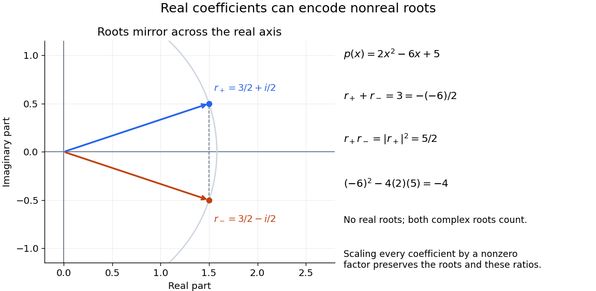

<h1 id="complex-conjugate-roots-in-vieta-s-formulas">Complex conjugate roots in Vieta's formulas</h1>

↑ **Parent:** [Vieta's formulas](vieta-s-formulas.md)

For the [quadratic polynomial](quadratic-polynomial.md) $p(x)=2x^2-6x+5$, the [discriminant](discriminant.md) is $(-6)^2-4(2)(5)=-4$, so its [roots of a polynomial](root-of-a-polynomial.md) are the [complex conjugates](complex-conjugate.md)

$$
r_+=\frac{3+i}{2},\qquad r_-=\frac{3-i}{2}.
$$

Their [sum](sum.md) is $3=-(-6)/2$, and their [product](product-of-numbers.md) is $(9+1)/4=5/2$, matching the constant [coefficient](coefficient.md) divided by the [leading coefficient](leading-coefficient-of-a-polynomial.md). More revealingly, $r_+r_-=r_+\overline{r_+}=|r_+|^2$: the [product](product-of-numbers.md) is the square of a [complex modulus](complex-modulus.md). [Coefficients](coefficient.md) in the [real numbers](real-number.md) therefore need not imply [polynomial roots](root-of-a-polynomial.md) in the [real numbers](real-number.md).

**[Figure 4](#image-complex-conjugate-roots-of-2x-2-6x-plus-5-satisfy-the-same-coefficient-identities). Complex conjugate roots of $2x^2-6x+5$ satisfy the same coefficient identities**. The two stipulated [roots of a polynomial](root-of-a-polynomial.md) are reflections across the [real axis](real-axis.md) of the [complex plane](complex-plane.md). Their [sum](sum.md) cancels the [imaginary parts](imaginary-part.md), and their [product](product-of-numbers.md) is the squared [complex modulus](complex-modulus.md) $5/2$. The pale arc marks that common [complex modulus](complex-modulus.md). Both positions belong in the root list even though there are no [roots of a polynomial](root-of-a-polynomial.md) in the [real numbers](real-number.md).

For any [polynomial](polynomial-split.md) with [coefficients](coefficient.md) in the [real numbers](real-number.md), $p(\overline z)=\overline{p(z)}$. Thus a nonreal [root of a polynomial](root-of-a-polynomial.md) brings its [complex conjugate](complex-conjugate.md) along with the same [multiplicity of a root](multiplicity-of-a-root.md). This follows by applying [complex conjugation](complex-conjugation.md) to the [polynomial](polynomial-split.md) expression and its factors. It explains why sums of [complex conjugate](complex-conjugate.md) terms can produce [coefficients](coefficient.md) in the [real numbers](real-number.md).

## ↑ Ancestors (6)

1. [Vieta's formulas](vieta-s-formulas.md)
2. [Polynomial](polynomial-split.md)
3. [Algebra](algebra-split.md)
4. [Area of mathematics](area-of-mathematics.md)
5. [Mathematics](mathematics-split.md)
6. [Codex Wiki](split.md)
