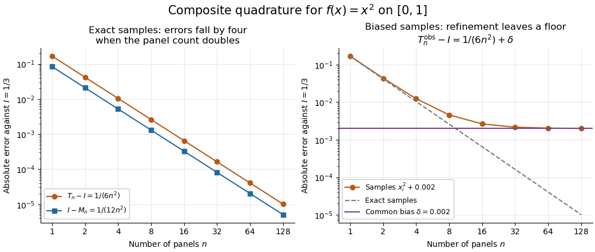

# Composite trapezoidal rule

↑ **Parent:** [Trapezoidal rule](trapezoidal-rule.md)

On an equal-panel [partition of an interval](partition-of-an-interval.md), with $h=(b-a)/n$, sum the [trapezoidal rule](trapezoidal-rule.md) over adjacent panels:

$$
T_n(f)=h\left[\frac{f(a)}2+\sum_{j=1}^{n-1}f(a+jh)+\frac{f(b)}2\right].
$$

There are $n+1$ distinct [quadrature nodes](quadrature-node.md). Each interior sample belongs to two panels and therefore has [quadrature weight](quadrature-weight.md) $h$, while each endpoint has [quadrature weight](quadrature-weight.md) $h/2$. Equivalently, the [composite trapezoidal rule](composite-trapezoidal-rule.md) integrates the [piecewise linear function](piecewise-linear-function.md) obtained by [linear interpolation](linear-interpolation.md) exactly.[§5.6.1, equations 5.6.3–5.6.5: integrating the piecewise linear interpolant](fundamentals-of-numerical-computation-by-tobin-a-driscoll-and-others/5-6-numerical-integration.md)

For $f\in C^2[a,b]$ and $K=\max_{x\in[a,b]}|f''(x)|$, summing panel [quadrature errors](quadrature-error.md) gives

$$
T_n(f)-I(f)=\frac{b-a}{12}h^2f''(\xi),\qquad |T_n(f)-I(f)|\leq\frac{b-a}{12}h^2K
$$

for some $\xi\in(a,b)$. Thus panel [quadrature errors](quadrature-error.md) of order $O(h^3)$ accumulate to order $O(h^2)$, using [big O notation](big-o-notation.md).[§3.5(i), equations 3.5.2–3.5.3: composite formula and signed error](nist-digital-library-of-mathematical-functions/3-5-quadrature-subsection-i-trapezoidal-rules.md) On a nonuniform [partition of an interval](partition-of-an-interval.md) with widths $h_j$ and largest width $H$, the bound is $K\sum_jh_j^3/12\leq K(b-a)H^2/12$.

For the [polynomial](polynomial-split.md) $f(x)=x^2$ on $[0,1]$, direct summation yields

$$
T_n(f)=\frac13+\frac{1}{6n^2},\qquad T_n(f)-I(f)=-2\bigl(M_n(f)-I(f)\bigr).
$$

Both [quadrature errors](quadrature-error.md) shrink by exactly four when $n$ doubles, with opposite signs. This exact relation belongs to this [polynomial](polynomial-split.md) example; the [trapezoidal rule](trapezoidal-rule.md) is not always twice as inaccurate as the [midpoint quadrature rule](midpoint-quadrature-rule.md).

**[Figure 2](#image-quadratic-quadrature-errors-fall-by-four-on-refinement-while-a-common-sample-bias-persists). Quadratic quadrature errors fall by four on refinement while a common sample bias persists**.

The left plot uses exact [polynomial](polynomial-split.md) sums; the right adds a common sample bias $\delta=0.002$ to the [composite trapezoidal rule](composite-trapezoidal-rule.md). That mathematical model converges to $1/3+\delta$, showing why smaller panels alone do not ensure accuracy for noisy samples. It illustrates [noise sensitivity of a quadrature rule](noise-sensitivity-of-a-quadrature-rule.md), rather than measured data.

## ↑ Ancestors (8)

1. [Trapezoidal rule](trapezoidal-rule.md)
2. [Implicit Runge-Kutta method](implicit-runge-kutta-method.md)
3. [Runge-Kutta method](runge-kutta-method-split.md)
4. [Numerical analysis](numerical-analysis-split.md)
5. [Analysis](analysis-split.md)
6. [Area of mathematics](area-of-mathematics.md)
7. [Mathematics](mathematics-split.md)
8. [Codex Wiki](split.md)

## ← Incoming links (7)

- [Composite Simpson's rule](composite-simpson-s-rule.md)
- [Composite trapezoidal rule](composite-trapezoidal-rule.md)
- [Fresnel slit propagation](fresnel-slit-propagation.md)
- [Midpoint quadrature rule](midpoint-quadrature-rule.md)
- [Noise sensitivity of a quadrature rule](noise-sensitivity-of-a-quadrature-rule.md)
- [Numerical integration](numerical-integration-split.md)
- [Quadrature rule](quadrature-rule.md)
