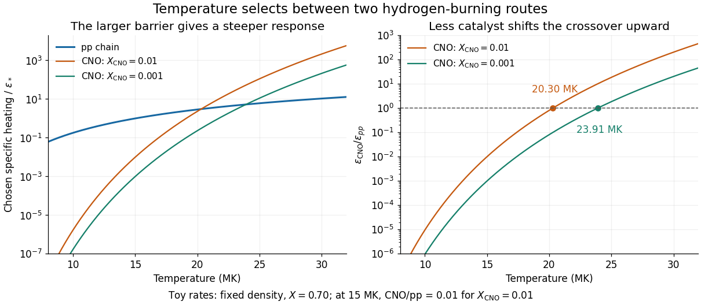

# Composition-dependent temperature selection of hydrogen burning

↑ **Parent:** [CNO crossover temperature](cno-crossover-temperature.md)

A hotter [stellar core](stellar-core.md) can favor a higher-barrier route despite fewer catalyst [nuclei](atomic-nucleus-split.md). To isolate this competition, prescribe a local [hydrogen burning](hydrogen-burning.md) toy model at fixed [mass density](density.md) $\rho$, with reference $T_0=15\,\mathrm{MK}$ and

$$
F_a(T)=\theta^{-2/3}\exp[-\tau_{a0}(\theta^{-1/3}-1)],\quad \theta=T/T_0,\quad \tau_{a0}=3\left(\frac{E_{G,a}}{4k_BT_0}\right)^{1/3}.
$$

Choose $E_{G,pp}=493\,\mathrm{keV}$ and $E_{G,\rm CNO}=45000\,\mathrm{keV}$, rounded barrier parameters for a [proton](proton.md) pair and [proton](proton.md) capture on [nitrogen-14](nitrogen-14.md). These prescribe the [temperature](temperature-split.md) dependence, while the following freely chosen heating normalization incorporates effective nuclear factors and deposited [energy](energy-split.md):

$$
\epsilon_{pp}=\epsilon_*\frac{\rho}{\rho_0}\left(\frac{X}{0.70}\right)^2F_{pp}(T),\qquad \epsilon_{\rm CNO}=0.01\epsilon_*\frac{\rho}{\rho_0}\frac{X}{0.70}\frac{X_{\rm CNO}}{0.01}F_{\rm CNO}(T).
$$

Here $X$ is [hydrogen mass fraction](hydrogen-mass-fraction.md), $X_{\rm CNO}$ is [CNO mass fraction](cno-mass-fraction.md), and $\epsilon_*$ is an arbitrary positive unit of [stellar energy-generation rate](stellar-energy-generation-rate.md). For $X=0.70$ and $X_{\rm CNO}=0.01$, the reference ratio is $0.01$ by construction. It is not a measured solar ratio. The [CNO cycle](cno-cycle.md) bottleneck is represented by one effective rate, without evolving the existing [proton-proton chain branches](proton-proton-chain-branches.md) or catalyst network.

At $T_0$, the logarithmic [temperature](temperature-split.md) slopes are $(\tau_{pp,0}-2)/3=3.90$ and $(\tau_{{\rm CNO},0}-2)/3=19.90$. The larger [Coulomb barrier](coulomb-barrier.md) gives a steeper fractional response. Because these slopes change with [temperature](temperature-split.md), this example retains the exponential rather than extending two fixed power laws. Writing $R_0=0.01(X_{\rm CNO}/0.01)(0.70/X)$ and $D=\tau_{{\rm CNO},0}-\tau_{pp,0}$ gives

$$
\frac{\epsilon_{\rm CNO}}{\epsilon_{pp}}=R_0\exp[-D(\theta^{-1/3}-1)],\qquad T_* =T_0\left(1+\frac{\log R_0}{D}\right)^{-3},
$$

provided the bracket is positive. With the chosen composition, $T_*=20.30\,\mathrm{MK}$. Reducing $X_{\rm CNO}$ to $0.001$ at unchanged $X$ shifts it to $23.91\,\mathrm{MK}$. For $X_{\rm CNO}=0$, this catalytic route supplies no heat in this model. These are local toy crossovers: a whole [star](star.md)'s [luminosity](luminosity.md) requires integrating its [stellar energy-generation rate](stellar-energy-generation-rate.md) through its [stellar composition profile](stellar-composition-profile.md) and [stellar structure](stellar-structure-split.md). Nuclear features, [plasma screening](plasma-screening.md) and changes of the dominant bottleneck limit the model's extrapolation.

**[Figure 5](#image-chosen-pp-and-cno-heating-rates-and-their-composition-dependent-crossover). Chosen pp and CNO heating rates and their composition-dependent crossover**. Original local toy rates at fixed density and hydrogen mass fraction 0.70. The CNO-to-pp ratio at 15 MK is chosen as 0.01 for CNO mass fraction 0.01. Exponential barrier responses give crossovers at 20.30 and 23.91 MK for the two catalyst abundances. These are model curves, not stellar measurements or a fitted solar model.

## ↑ Ancestors (8)

1. [CNO crossover temperature](cno-crossover-temperature.md)
2. [CNO cycle](cno-cycle.md)
3. [Stellar nuclear fusion](stellar-nuclear-fusion.md)
4. [Stellar astrophysics](stellar-astrophysics-split.md)
5. [Astrophysics](astrophysics-split.md)
6. [Branches of physics](branches-of-physics.md)
7. [Physics](physics-split.md)
8. [Codex Wiki](split.md)
