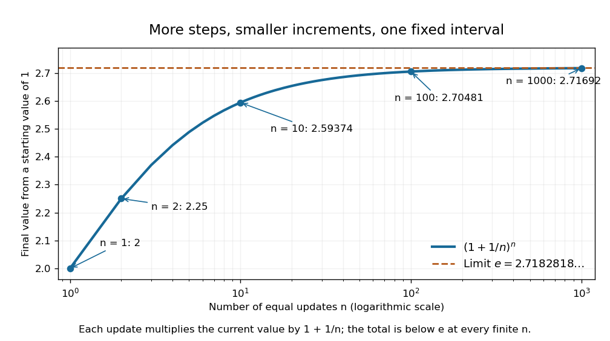

# Compounding limit for e

↑ **Parent:** [e (mathematical constant)](e-mathematical-constant.md)

Start at one and apply $n$ updates, each multiplying the current value by $1+1/n$. The final value is $(1+1/n)^n$: one update gives $2$, two give $2.25$, ten give approximately $2.59374$, and one hundred give approximately $2.70481$. Increasing the number of steps, while reducing each increment proportionally, approaches [Euler's number](e-mathematical-constant.md) rather than producing unbounded accumulation.

**[Figure 6](#image-repeated-smaller-proportional-updates-approach-euler-s-number-over-one-fixed-interval). Repeated smaller proportional updates approach Euler's number over one fixed interval**.

The [natural logarithm](natural-logarithm.md) makes the [limit](limit-of-a-function.md) transparent. For $u>0$, its [integral](integral-split.md) definition gives $u/(1+u)\leq\ln(1+u)\leq u$, by bounding $1/t$ on $[1,1+u]$. With $u=1/n$,

$$
\frac1{1+1/n}\leq n\ln(1+1/n)\leq1.
$$

The [squeeze theorem](squeeze-theorem.md) gives a logarithmic [limit](limit-of-a-function.md) of one; continuity of the [exponential function](exponential-function.md) gives $(1+1/n)^n\to e$. This links a discrete multiplicative rule with continuous [exponential growth](exponential-growth.md), without assuming that a finite number of steps equals the limiting value.

## ↑ Ancestors (8)

1. [e (mathematical constant)](e-mathematical-constant.md)
2. [Exponential function](exponential-function.md)
3. [Calculus](calculus-split.md)
4. [Real analysis](real-analysis-split.md)
5. [Analysis](analysis-split.md)
6. [Area of mathematics](area-of-mathematics.md)
7. [Mathematics](mathematics-split.md)
8. [Codex Wiki](split.md)

## ← Incoming links (1)

- [e (mathematical constant)](e-mathematical-constant.md)
