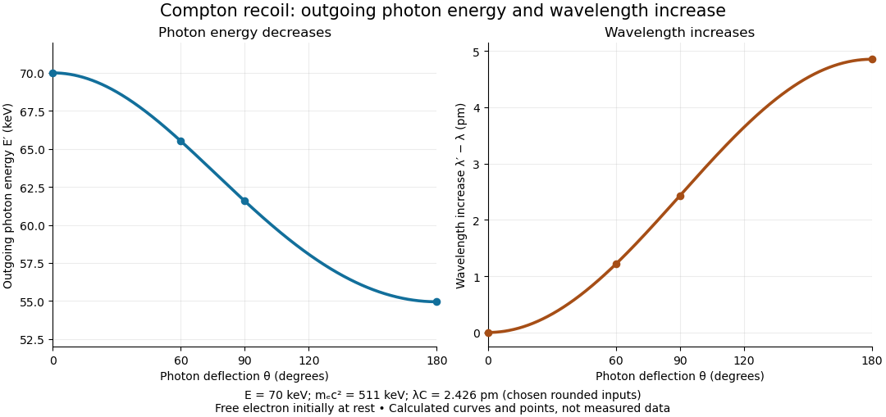

# Compton scattering

↑ **Parent:** [Compton wavelength](compton-wavelength.md)  
ⓦ [Wiki](https://en.wikipedia.org/wiki/Compton_scattering)

[Compton scattering](compton-scattering.md) redistributes [photon](photon.md) [energy](energy-split.md) and [momentum](momentum-split.md) in a [collision](collision.md) with a charged [subatomic particle](subatomic-particle.md), here an [electron](electron.md). For a free [electron](electron.md) initially at rest in the chosen [inertial frame](inertial-frame.md), an incident [photon](photon.md) of [energy](energy-split.md) $E=hc/\lambda$ leaves with [energy](energy-split.md) $E'=hc/\lambda'$ after deflection through $\theta$. The angle $\theta\in[0,\pi]$ is between the incident and outgoing [photon](photon.md) directions; it is not the [electron](electron.md) recoil angle. [Four-momentum conservation](four-momentum-conservation.md) gives

$$
E'=\frac{E}{1+\dfrac{E}{m_ec^2}(1-\cos\theta)},
\qquad
\lambda'-\lambda=\frac{h}{m_ec}(1-\cos\theta),
\qquad
T_e=E-E',
$$

where $m_e$ is the [electron](electron.md) [rest mass](invariant-mass.md) and $T_e$ its final [kinetic energy](kinetic-energy.md). The [photon](photon.md) [energy](energy-split.md) loss pays for the [electron](electron.md) recoil: neither [energy](energy-split.md) nor [momentum](momentum-split.md) disappears.

For an original worked example, stipulate $E=70\,\mathrm{keV}$, the rounded [electron](electron.md) [rest energy](rest-energy.md) $m_ec^2=511\,\mathrm{keV}$, and the rounded [Compton wavelength](compton-wavelength.md) $\lambda_C=2.426\,\mathrm{pm}$; $\mathrm{keV}$ means $10^3$ [electronvolts](electronvolt.md). Treat these rounded inputs as the example's constants. They give the following calculated values, with [energies](energy-split.md) rounded to three decimal places:

| [Photon](photon.md) deflection $\theta$ | Outgoing [photon](photon.md) [energy](energy-split.md) $E'$ in $\mathrm{keV}$ | [Electron](electron.md) [kinetic energy](kinetic-energy.md) $T_e$ in $\mathrm{keV}$ | [Wavelength](wavelength.md) increase in $\mathrm{pm}$ | $0^\circ$ | $70.000$ | $0.000$ | $0.000$ | $60^\circ$ | $65.513$ | $4.487$ | $1.213$ | $90^\circ$ | $61.566$ | $8.434$ | $2.426$ | $180^\circ$ | $54.946$ | $15.054$ | $4.852$ |
| --- | --- | --- | --- | --- | --- | --- | --- | --- | --- | --- | --- | --- | --- | --- | --- | --- | --- | --- | --- |

Since $0\leq1-\cos\theta\leq2$, every outgoing [photon](photon.md) has $0<E'\leq E$ and $T_e\geq0$. At zero deflection there is no recoil; backscattering transfers the most [energy](energy-split.md). At fixed $\theta$, the absolute [wavelength](wavelength.md) increase is independent of incident [energy](energy-split.md), while the fractional [energy](energy-split.md) loss grows with $E/(m_ec^2)$. This makes [Compton scattering](compton-scattering.md) useful for inferring [energy](energy-split.md) transfers from directions in [photon](photon.md) detectors.

**[Figure 1](#image-calculated-compton-scattering-energy-and-wavelength-shift-for-a-70-mathrm-kev-photon). Calculated Compton scattering energy and wavelength shift for a $70\,\mathrm{keV}$ photon**. Original ideal free-[electron](electron.md) curves with calculated points at four chosen deflections. Both horizontal axes show [photon](photon.md) deflection from the incident direction. These are model predictions, not historical measurements or an angular [wave intensity](intensity-physics.md) distribution.

The free-[electron](electron.md)-at-rest assumption matters. An [electron](electron.md) in a [bound state](bound-state.md) has [binding energy](binding-energy.md) and an initial [momentum](momentum-split.md) distribution. Neglecting these is useful when the transferred [energy](energy-split.md) is large compared with the relevant [binding energy](binding-energy.md) and the initial [momentum](momentum-split.md) is small compared with the resolved [momentum transfer](momentum-transfer.md). Otherwise the outgoing [photon](photon.md) [energies](energy-split.md) can broaden or depart from the stationary-target formula; an initially moving [electron](electron.md) can even give [energy](energy-split.md) to the [photon](photon.md).

A material may also scatter [X-rays](x-ray.md) through a [coherent elastic scattering](coherent-elastic-scattering.md) channel with an effectively unshifted component. When an intact [chemical atom](atom-physics.md) of [mass](mass.md) $M$ takes the recoil, the corresponding [Compton wavelength](compton-wavelength.md) $h/(Mc)$ is much smaller than the [electron](electron.md) value. The single free-[electron](electron.md) curve does not predict that component's weight. More generally, [energy](energy-split.md) versus angle is a kinematic constraint; angular [wave intensity](intensity-physics.md) requires a [differential scattering cross-section](differential-scattering-cross-section.md), together with target and detector information.

**Table of contents**

- [Bound-electron scattering without a Thomson frequency window](bound-electron-scattering-without-a-thomson-frequency-window.md)
- [Compton recoil kinematics](compton-recoil-kinematics.md)
- [Inverse Compton scattering](inverse-compton-scattering.md)
- [Compton scattering experiment of 1923](compton-scattering-experiment-of-1923.md)
- [Kompaneets equation](kompaneets-equation.md)
  - [Compton y parameter](compton-y-parameter.md)
    - [Integrated Compton parameter](integrated-compton-parameter.md)
- [One-loop diagram classes for Compton scattering](one-loop-diagram-classes-for-compton-scattering.md)
- [Tree-level Compton amplitude](tree-level-compton-amplitude.md)
- [Double Compton scattering](double-compton-scattering.md)

## ↑ Ancestors (4)

1. [Compton wavelength](compton-wavelength.md)
2. [Mathematical physics](mathematical-physics-split.md)
3. [Physics](physics-split.md)
4. [Codex Wiki](split.md)

## ← Incoming links (33)

- [Arthur Holly Compton](arthur-holly-compton.md)
- [Baryon Jeans length across recombination](baryon-jeans-length-across-recombination.md)
- [Binding energy](binding-energy.md)
- [Bothe-Geiger coincidence experiment](bothe-geiger-coincidence-experiment.md)
- [Bound-electron scattering without a Thomson frequency window](bound-electron-scattering-without-a-thomson-frequency-window.md)
- [Bremsstrahlung](bremsstrahlung.md)
- [Chadwick neutron discovery experiment](chadwick-neutron-discovery-experiment.md)
- [Cherenkov luminescence controls in irradiated liquids](cherenkov-luminescence-controls-in-irradiated-liquids.md)
- [Coherent elastic scattering](coherent-elastic-scattering.md)
- [Compton cooling by the cosmic microwave background](compton-cooling-by-the-cosmic-microwave-background.md)
- [Compton recoil kinematics](compton-recoil-kinematics.md)
- [Compton scattering](compton-scattering.md)
- [Compton wavelength](compton-wavelength.md)
- [Double Compton scattering](double-compton-scattering.md)
- [Electron-positron annihilation into two photons](electron-positron-annihilation-into-two-photons.md)
- [Heisenberg's microscope](heisenberg-s-microscope.md)
- [Inverse Compton cooling](inverse-compton-cooling.md)
- [Kompaneets equation](kompaneets-equation.md)
- [Solution](past-exam-of-the-mathematics-course-of-the-university-of-cambridge/2003/ib/paper-3/10a/solution.md)
- [Solution](past-exam-of-the-mathematics-course-of-the-university-of-cambridge/2009/iii/paper-44/4/solution.md)
- [Solution](past-exam-of-the-mathematics-course-of-the-university-of-cambridge/2012/iii/paper-46/4/solution.md)
- [Solution](past-exam-of-the-mathematics-course-of-the-university-of-cambridge/2015/ia/paper-4/4c/solution.md)
- [Solution](past-exam-of-the-mathematics-course-of-the-university-of-cambridge/2017/ia/paper-4/9a/a/solution.md)
- [Solution](past-exam-of-the-mathematics-course-of-the-university-of-cambridge/2017/iii/paper-312/2/iii/solution.md)
- [Solution](past-exam-of-the-mathematics-course-of-the-university-of-cambridge/2019/iii/paper-301/3/iv/b/solution.md)
- [Solution](past-exam-of-the-mathematics-course-of-the-university-of-cambridge/2019/iii/paper-346/1/a/solution.md)
- [Solution](past-exam-of-the-mathematics-course-of-the-university-of-cambridge/2022/ia/paper-4/12c/c/solution.md)
- [Solution](past-exam-of-the-mathematics-course-of-the-university-of-cambridge/2023/iii/paper-301/4/iii/solution.md)
- [Binding scale and recoil](past-exam-of-the-optics-and-electrodynamics-course-of-the-university-of-cambridge/2019/section-b/b5/binding-scale-and-recoil.md)
- [Solution](past-exam-of-the-physics-a-course-of-the-university-of-cambridge/2010/paper-2/section-c/c10/b/solution.md)
- [Photon absorption](photon-absorption.md)
- [Two-target recoil mass constraint](two-target-recoil-mass-constraint.md)
- [Vertex parity of a QED amplitude](vertex-parity-of-a-qed-amplitude.md)
