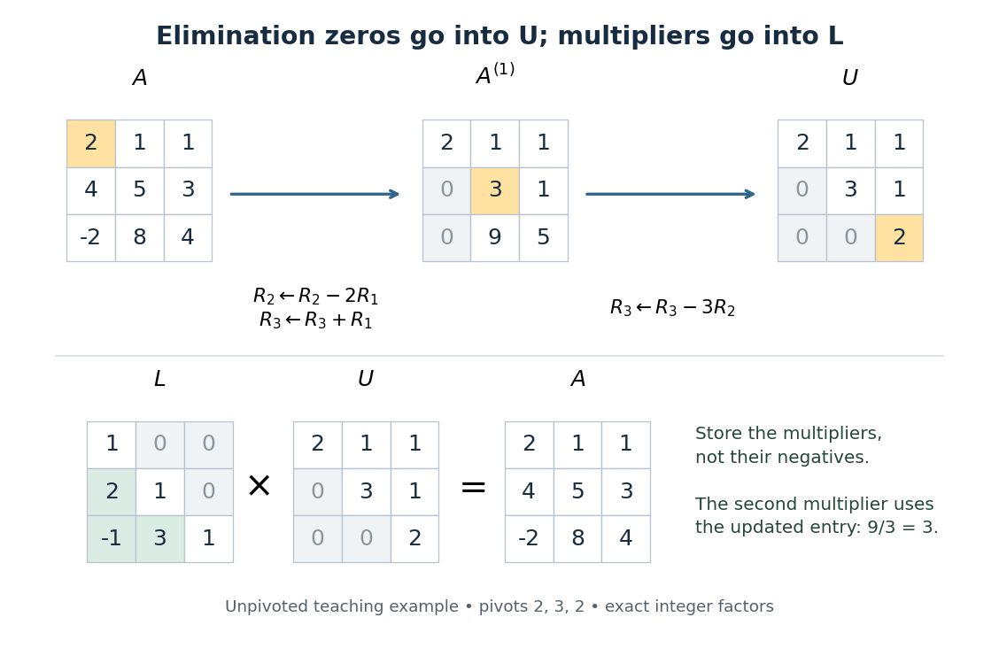

# Computed three-by-three LU decomposition

↑ **Parent:** [LU decomposition](lu-decomposition.md)

Here is an original example of [Gaussian elimination](gaussian-elimination.md) that can be checked entirely with [integers](integer-split.md). Start with

$$
A=\begin{pmatrix}2&1&1\\4&5&3\\-2&8&4\end{pmatrix}.
$$

The first [pivot element](pivot-element.md) is $2$. The [elimination multipliers](elimination-multiplier.md) are $l_{21}=4/2=2$ and $l_{31}=-2/2=-1$. Apply the [elementary row operations](elementary-row-operation.md) $R_2\leftarrow R_2-2R_1$ and $R_3\leftarrow R_3+R_1$ to obtain

$$
A^{(1)}=\begin{pmatrix}2&1&1\\0&3&1\\0&9&5\end{pmatrix}.
$$

Now the second [pivot element](pivot-element.md) is $3$, and $l_{32}=9/3=3$. The [elementary row operation](elementary-row-operation.md) $R_3\leftarrow R_3-3R_2$ gives

$$
U=\begin{pmatrix}2&1&1\\0&3&1\\0&0&2\end{pmatrix},\qquad L=\begin{pmatrix}1&0&0\\2&1&0\\-1&3&1\end{pmatrix},\qquad LU=A.
$$

Importantly, $l_{32}$ comes from the current reduced [matrix](matrix.md), not the original entry $a_{32}=8$. To reconstruct $A$ from $U$, its second row is twice the first row of $U$ plus the second; its third row is minus the first row of $U$ plus three times the second plus the third. These are exactly the coefficients in the [lower triangular matrix](lower-triangular-matrix.md) $L$.

**[Figure 11](#image-gaussian-elimination-turns-a-three-by-three-matrix-into-an-upper-triangular-matrix-while-elimination-multipliers-are-stored-in-a-lower-triangular-matrix). Gaussian elimination turns a three-by-three matrix into an upper triangular matrix, while elimination multipliers are stored in a lower triangular matrix**.

The unpivoted calculation here illustrates the structure of [LU decomposition](lu-decomposition.md); applying [partial pivoting](columnwise-partial-pivoting.md) to this particular $A$ would choose a different first row and different factors. Both procedures can represent the same [linear system](system-of-linear-equations.md) when their [permutation matrices](permutation-matrix.md) are handled consistently.

## ↑ Ancestors (7)

1. [LU decomposition](lu-decomposition.md)
2. [Numerical linear algebra](numerical-linear-algebra-split.md)
3. [Numerical analysis](numerical-analysis-split.md)
4. [Analysis](analysis-split.md)
5. [Area of mathematics](area-of-mathematics.md)
6. [Mathematics](mathematics-split.md)
7. [Codex Wiki](split.md)

## ← Incoming links (2)

- [Reusing LU factors for multiple right-hand sides](reusing-lu-factors-for-multiple-right-hand-sides.md)
- [Triangular solves for LU decomposition](triangular-solves-for-lu-decomposition.md)
