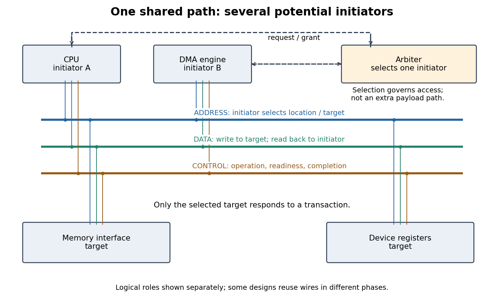

# Computer bus

↑ **Parent:** [Computer science](computer-science-split.md)

A [computer bus](computer-bus.md) connects components through agreed communication paths and transfer rules. On a [shared computer bus](shared-computer-bus.md), a [CPU](central-processing-unit.md) and a [DMA](direct-memory-access.md) engine can both want the same path to [computer memory](computer-memory.md): attaching another initiator does not create another independent path. [Bus arbitration](bus-arbitration.md) chooses who may start; [bus ownership](bus-ownership.md) states who may use each resource; [bus throughput](bus-throughput.md) measures the useful data delivered. This makes sharing a performance question as well as a correctness question.

**[Figure 23](#image-shared-computer-bus-paths-bus-arbitration-and-address-data-and-control-roles). Shared computer bus paths, bus arbitration, and address, data and control roles**.

**Table of contents**

- [Shared computer bus](shared-computer-bus.md)
  - [Address bus](address-bus.md)
  - [Data bus](data-bus.md)
  - [Control bus](control-bus.md)
- [Bus transaction](bus-transaction.md)
  - [Bus cycle](bus-cycle.md)
  - [Bus wait state](bus-wait-state.md)
  - [Bus burst](bus-burst.md)
- [Bus arbitration](bus-arbitration.md)
  - [Bus ownership](bus-ownership.md)
  - [Bus contention](bus-contention.md)
- [Bus throughput](bus-throughput.md)
  - [Shared-bus timing example](shared-bus-timing-example.md)
- [Shared buses and point-to-point links](shared-buses-and-point-to-point-links.md)
- [PCI Express](pci-express.md)
- [Intel QuickPath Interconnect](intel-quickpath-interconnect.md)
- [Direct memory access](direct-memory-access.md)
  - [DMA buffer](dma-buffer.md)
  - [DMA address](dma-address.md)
  - [DMA buffer synchronization](dma-buffer-synchronization.md)
- [Input-output memory management unit](input-output-memory-management-unit.md)

## ↑ Ancestors (2)

1. [Computer science](computer-science-split.md)
2. [Codex Wiki](split.md)

## ← Incoming links (12)

- [Address bus](address-bus.md)
- [Bus cycle](bus-cycle.md)
- [Bus ownership](bus-ownership.md)
- [Computer bus](computer-bus.md)
- [Control bus](control-bus.md)
- [Data bus](data-bus.md)
- [Direct memory access](direct-memory-access.md)
- [Solution](past-exam-of-the-mathematics-course-of-the-university-of-cambridge/2006/ia/paper-5/8/a/i/solution.md)
- [Solution](past-exam-of-the-mathematics-course-of-the-university-of-cambridge/2006/ia/paper-5/8/a/ii/solution.md)
- [Solution](past-exam-of-the-mathematics-course-of-the-university-of-cambridge/2006/ia/paper-5/8/a/iii/solution.md)
- [Solution](past-exam-of-the-mathematics-course-of-the-university-of-cambridge/2006/ia/paper-5/8/a/iv/solution.md)
- [Shared computer bus](shared-computer-bus.md)
