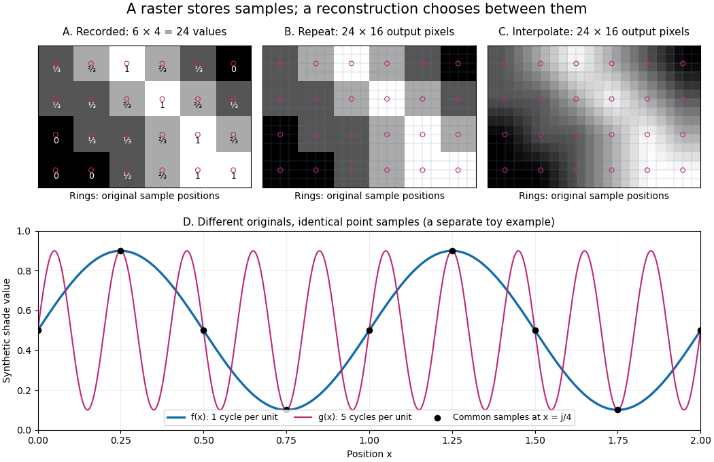

# Computer graphics

↑ **Parent:** [Computer science](computer-science.md)  
ⓦ [Wiki](https://en.wikipedia.org/wiki/Computer_graphics)

**Table of contents**

- [Color model](#color-model)
  - [RGB color model](#rgb-color-model)
- [Raster graphics](#raster-graphics)
  - [Pixel](#pixel)
    - [Sample depth](#sample-depth)
  - [Grayscale](#grayscale)
  - [Raster sampling and reconstruction](#raster-sampling-and-reconstruction)
- [sRGB](#srgb)
  - [Relative luminance](#relative-luminance)
- [Vector graphics](#vector-graphics)
  - [SVG](#svg)

## Color model

↑ **Parent:** [Computer graphics](computer-graphics.md)

### RGB color model

↑ **Parent:** [Color model](#color-model)

## Raster graphics

↑ **Parent:** [Computer graphics](computer-graphics.md)  
ⓦ [Wiki](https://en.wikipedia.org/wiki/Raster_graphics)

[Raster graphics](#raster-graphics) describe a picture by an [array](data-structure.md#array-data-structure) of [pixels](#pixel) on a grid. For a rectangular image of width $W$ and height $H$, write its stored values as $p_{rc}$, with $0\leq r<H$ and $0\leq c<W$. A [grayscale](#grayscale) [pixel](#pixel) can have one shade value; a colour [pixel](#pixel) can have several component values. The grid specifies where values belong, while the encoding specifies what those values mean. A [raster image](#raster-graphics) therefore needs dimensions and an interpretation of its samples, not just a string of numbers.

The appealing feature is that pictures become explicit data: selecting a rectangle selects entries of an [array](data-structure.md#array-data-structure); comparing two images compares their [pixel](#pixel) values; [image compression](data-compression.md#image-compression) can exploit repeated or related values. [Raster sampling and reconstruction](#raster-sampling-and-reconstruction) explains why the stored grid and the displayed picture are different objects. A square drawn around a sample is one display convention, not a claim that the original scene consisted of little squares.

For example, a $6\times4$ [grayscale](#grayscale) [raster image](#raster-graphics) stores 24 [pixel](#pixel) values, even when displayed across a much larger rectangle. With one unsigned eight-[bit](information-theory.md#bit) sample per [pixel](#pixel), its uncompressed sample payload is $24\cdot8=192$ [bits](information-theory.md#bit); a [file format](computer-science.md#file-format) can additionally require a [file header](computer-science.md#file-header), padding and other information, and [image compression](data-compression.md#image-compression) can change the stored size.

Enlarging that image can copy each [pixel](#pixel) into a block through [nearest-neighbor interpolation](computer-science.md#nearest-neighbor-interpolation), or infer intermediate values through [interpolation](interpolation.md). Either procedure supplies a reconstruction rule; neither determines which unrecorded detail was present in the original. [Vector graphics](#vector-graphics) use a different representation, specifying geometric objects to be rendered onto a chosen grid. Re-rendering such a description and enlarging an existing [raster image](#raster-graphics) are different operations.

### Pixel

↑ **Parent:** [Raster graphics](#raster-graphics)  
ⓦ [Wiki](https://en.wikipedia.org/wiki/Pixel)

A [pixel](#pixel) is one picture element at an indexed position in a [raster image](#raster-graphics). It can contain a single [grayscale](#grayscale) value or several colour components. The word can also refer to a physical display element; the indexed element of the stored image is the meaning used here. One stored [pixel](#pixel) need not occupy exactly one physical display element when the image is resized. Microsoft's bitmap documentation likewise distinguishes an image's grid and its numerical colour representation.[Microsoft Learn, About Bitmaps: pixel grids and bitmap representations](https://learn.microsoft.com/en-us/windows/win32/gdi/about-bitmaps)

Separate _position_ from _value_: [raster sampling and reconstruction](#raster-sampling-and-reconstruction) concerns the spatial grid, while [sample depth](#sample-depth) concerns how many [bits](information-theory.md#bit) encode each component. Four times as many [pixels](#pixel) can describe a finer grid without improving the [quantization](computer-science.md#quantization-signal-processing) of any value. Conversely, more [bits](information-theory.md#bit) per sample can distinguish more shades without locating an edge more precisely.

In the binary example under [run-length encoding](data-compression.md#run-length-encoding), one [bit](information-theory.md#bit) per [pixel](#pixel) selects black or white. In the [grayscale](#grayscale) example under [lossy block averaging](data-compression.md#lossy-block-averaging), eight [bits](information-theory.md#bit) per [pixel](#pixel) select one of 256 codes. Calling them codes keeps their numerical values distinct from the physical light that a display emits.

#### Sample depth

↑ **Parent:** [Pixel](#pixel)

The [sample depth](#sample-depth) $b$ is the number of [bits](information-theory.md#bit) allocated to one stored sample. An unsigned $b$-[bit](information-theory.md#bit) [integer](integer.md) has $2^b$ codes, $0,\ldots,2^b-1$. This is per component, not automatically per [pixel](#pixel): three eight-[bit](information-theory.md#bit) components require 24 payload [bits](information-theory.md#bit) per [pixel](#pixel). A [raster image](#raster-graphics) with $W H$ [pixels](#pixel) and $k$ such components requires $WHkb$ payload [bits](information-theory.md#bit) before [data compression](data-compression.md), padding or a [file header](computer-science.md#file-header).

For a toy normalized shade $x\in[0,1]$, define uniform [quantization](computer-science.md#quantization-signal-processing) with endpoints included by

$$
q_b(x)=\left\lfloor(2^b-1)x+\frac12\right\rfloor,\qquad \widehat x_b=\frac{q_b(x)}{2^b-1}.
$$

The [floor function](calculus.md#floor-function) implements rounding to the nearest code, with exact halves rounded upward. The reconstruction step is $\delta_b=1/(2^b-1)$, and $|\widehat x_b-x|\leq\delta_b/2$. For $b=2$, the levels are $0,1/3,2/3,1$; for $b=8$ they are $0,1/255,\ldots,1$. Increasing [sample depth](#sample-depth) refines this value grid without changing the spatial grid. These levels are uniform in $x$; if $x$ is encoded [sRGB](#srgb), they are not uniform in [relative luminance](#relative-luminance).

[PNG](data-compression.md#png) uses a bit-depth field per sample or palette index. Its [grayscale](#grayscale) type without alpha permits 1, 2, 4, 8 or 16 [bits](information-theory.md#bit) per sample; its truecolour type permits 8 or 16 [bits](information-theory.md#bit) per component. These are format-specific restrictions, not a rule for every [raster image](#raster-graphics).[W3C, PNG Specification, Third Edition, section 11.2.1, IHDR, Table 12](https://www.w3.org/TR/png-3/#11IHDR)

### Grayscale

↑ **Parent:** [Raster graphics](#raster-graphics)  
ⓦ [Wiki](https://en.wikipedia.org/wiki/Grayscale)

A [grayscale](#grayscale) image varies along shades from black to white rather than recording independent colour differences. A numerical [grayscale](#grayscale) image assigns one shade sample to each [pixel](#pixel); an encoding determines how that sample maps to a displayed shade. A colour [raster image](#raster-graphics) can also look [grayscale](#grayscale), for example when its three [sRGB](#srgb) components are equal.

**[Figure 1](#image-toy-quantization-and-srgb-encoding-more-codes-and-more-light-are-different-questions). Toy quantization and sRGB encoding: more codes and more light are different questions**.

The convention in our [lossy block averaging](data-compression.md#lossy-block-averaging) example is black at the [integer](integer.md) code 0 and white at 255. Its [arithmetic means](arithmetic.md#arithmetic-mean) act on those stored codes. This is a fully specified numerical experiment, but it does not claim that code 128 means half the physical light of code 255. [PNG](data-compression.md#png) explicitly allows samples that are not proportional to light: its [grayscale](#grayscale) interpretation depends on the indicated transfer curve, and can be device-dependent when that information is absent.[W3C, PNG Specification, Third Edition, section 6.1: colour types, grayscale interpretation and transfer curves](https://www.w3.org/TR/png-3/#6Colour-values)

Two different questions therefore need different operations. To average _stored codes_, average the [integers](integer.md). To average [relative luminance](#relative-luminance) for neutral [sRGB](#srgb) shades, decode the codes to linear light, average there, and encode the result again. Equal weights on black and white give encoded value $1/2$ by the first method, but approximately $0.73536$ by the second. Rounded to eight-[bit](information-theory.md#bit) codes these are 128 and 188. This example concerns ideal neutral shades and the specified [sRGB](#srgb) conversion; it does not assert a universal grayscale conversion for every colour encoding.

The upper panels hold the spatial grid fixed and change [sample depth](#sample-depth): four levels produce broad constant bands, while 256 levels make smaller numerical steps. The lower panels hold the colour interpretation fixed and compare encoded [sRGB](#srgb) values with [relative luminance](#relative-luminance). All panels are calculated synthetic examples, not measured display data. [Grayscale](#grayscale) is useful when shade structure is the quantity of interest: a synthetic scalar [image signal](computer-science.md#image-signal) can be inspected without introducing separate colour components.

### Raster sampling and reconstruction

↑ **Parent:** [Raster graphics](#raster-graphics)

A point-sampling model assigns $p_{rc}=f(x_c,y_r)$ to a [pixel](#pixel) on a grid, where $f$ is a [continuous function](calculus.md#continuous-function) representing an [image signal](computer-science.md#image-signal). An area-sampling model instead assigns the [average value of a function](integral.md#average-value-of-a-function) over a specified footprint. These are different models: a narrow feature between point samples can be missed, whereas its contribution to an area sample depends on its width and shade. Neither model says that the recorded value uniquely determines everything inside a grid cell.

**[Figure 2](#image-a-toy-raster-grid-two-reconstructions-and-distinct-signals-with-identical-samples). A toy raster grid, two reconstructions, and distinct signals with identical samples**.

The upper panels start with exactly the same $6\times4$ [array](data-structure.md#array-data-structure). [Nearest-neighbor interpolation](computer-science.md#nearest-neighbor-interpolation) repeats its values into a $24\times16$ display; successive [linear interpolations](function.md#linear-interpolation) in the two coordinate directions produce a smoother $24\times16$ display. Original sample positions are marked. Both displays use 384 output [pixels](#pixel), but only the same 24 recorded values. The extra values follow the chosen [interpolation](interpolation.md) rule. Between-grid appearance is inferred, not independently recorded.

Spatial resolution needs a stated meaning. A grid over a rectangle of width $L_x$ and height $L_y$ has nominal cell pitches $\Delta x=L_x/W$ and $\Delta y=L_y/H$. Over the same rectangle, doubling both dimensions halves these pitches and quadruples the [pixel](#pixel) count. That is a finer grid, not a guarantee of more recoverable detail. Blurring before sampling, [quantization](computer-science.md#quantization-signal-processing) and [aliasing](fourier-analysis.md#aliasing) can make different originals share the same recorded [array](data-structure.md#array-data-structure). Enlarging the rectangle without adding samples instead increases the displayed pitch.

A reproducible computational demonstration makes the ambiguity exact. Take the one-dimensional profiles $f(x)=0.5+0.4\sin(2\pi x)$ and $g(x)=0.5+0.4\sin(10\pi x)$, repeated identically along every row. Sample at $x_j=j/4$ for $j=0,\ldots,8$. Since $10\pi x_j=2\pi x_j+2\pi j$, the fact that the [sine](geometry-and-topology.md#sine) is a [periodic function](function.md#periodic-function) gives $f(x_j)=g(x_j)$. Both yield $0.5,0.9,0.5,0.1,0.5,0.9,0.5,0.1,0.5$, although at $x=1/8$ they give approximately $0.78284$ and $0.21716$. The lower panel draws both originals and their common samples: no operation on those samples alone can identify the original profile. This is [aliasing](fourier-analysis.md#aliasing) in an ideal point-sampling model, without [image noise](computer-science.md#image-noise) or rounding.

The [Nyquist–Shannon sampling theorem](fourier-analysis.md#nyquist-shannon-sampling-theorem) describes reconstruction under a bandwidth restriction and ideal sampling assumptions; it does not grant uniqueness for arbitrary [image signals](computer-science.md#image-signal) from a finite [raster image](#raster-graphics).[Shannon, Communication in the Presence of Noise (1949), section II, Theorem 1 and reconstruction from the infinite sample sequence](https://fab.cba.mit.edu/classes/S62.12/docs/Shannon_noise.pdf) The beautiful lesson is constructive: choose what detail the grid should preserve before sampling, and choose a reconstruction rule suited to the information actually retained.

## sRGB

↑ **Parent:** [Computer graphics](computer-graphics.md)  
ⓦ [Wiki](https://en.wikipedia.org/wiki/sRGB)

[sRGB](#srgb) specifies a red-green-blue colour encoding. Restricting attention to component values in $[0,1]$, its encoded component $s$ corresponds to the linear-light component

$$
D(s)=\begin{cases}s/12.92,&0\leq s\leq0.04045,\\((s+0.055)/1.055)^{2.4},&0.04045<s\leq1.\end{cases}
$$

Thus the conversion is piecewise, not a single power law. The reverse conversion used here is

$$
E(l)=\begin{cases}12.92l,&0\leq l\leq0.0031308,\\1.055l^{1/2.4}-0.055,&0.0031308<l\leq1.\end{cases}
$$

These conventional rounded thresholds are used by the W3C conversion routines; they give a tiny mismatch at the join rather than a mathematically exact pair of inverses everywhere.[W3C, CSS Color Module Level 4, section 10.2: encoded and linear-light sRGB](https://www.w3.org/TR/css-color-4/#predefined-sRGB)[W3C, CSS Color Module Level 4, sample colour-conversion code: lin\_sRGB and gam\_sRGB](https://www.w3.org/TR/css-color-4/#color-conversion-code)

For an eight-[bit](information-theory.md#bit) neutral [grayscale](#grayscale) code $q$, use $s=q/255$ in all three components. Its [relative luminance](#relative-luminance) is then $D(s)$. For example, $D(0.5)\approx0.21404$, whereas $E(0.5)\approx0.73536$. This is why averaging encoded values and averaging linear light give different answers. [sRGB](#srgb) is a specified interpretation; merely calling a [raster image](#raster-graphics) [grayscale](#grayscale) does not imply it uses [sRGB](#srgb).

### Relative luminance

↑ **Parent:** [sRGB](#srgb)

For the normalized [sRGB](#srgb) calculations here, [relative luminance](#relative-luminance) is the linear-light weighted sum

$$
Y=0.2126R+0.7152G+0.0722B,
$$

where $R,G,B$ are decoded linear-light components, not encoded code values. This is the [sRGB](#srgb) calculation specified in W3C's WCAG 2.2 definition of [relative luminance](#relative-luminance). It places reference black at 0 and reference white at 1; it does not by itself specify an absolute display light level.[W3C, WCAG 2.2, definition of relative luminance: sRGB decoding and weights](https://www.w3.org/TR/WCAG22/#dfn-relative-luminance)

For a neutral [sRGB](#srgb) shade, $R=G=B=l$, and the weights sum to 1, so $Y=l$. For a coloured [pixel](#pixel), [relative luminance](#relative-luminance) can be encoded as a neutral [sRGB](#srgb) shade with all three encoded components $E(Y)$. This preserves the specified $Y$ while discarding colour differences; it is one precisely defined [grayscale](#grayscale) conversion, not a unique way to turn all colour images into [grayscale](#grayscale).

## Vector graphics

↑ **Parent:** [Computer graphics](computer-graphics.md)  
ⓦ [Wiki](https://en.wikipedia.org/wiki/Vector_graphics)

[Vector graphics](#vector-graphics) represent a picture by geometric objects and instructions for drawing them: positions, shapes, fills, boundary strokes and transformations. A [circle](topology.md#circle) can be stored as a centre and radius; a [rectangle](euclidean-geometry.md#rectangle) as a corner, width and height; a [polygon](euclidean-geometry.md#polygon) as an ordered list of vertices. These geometric primitives describe whole objects rather than assigning a colour to every [pixel](#pixel). [SVG](#svg) provides elements for such basic shapes and for paths assembled from [line segments](convex-set.md#line-segment) and curves.[W3C SVG Working Group, SVG 2, section 10.1: basic shapes and their equivalent paths](https://www.w3.org/TR/SVG2/shapes.html#Introduction)

The useful separation is between the stored geometry and the finite output. A [circle](topology.md#circle) of radius 2 remains the same geometric description whether rendered across twenty or two thousand output [pixels](#pixel). This is the sense in which [vector graphics](#vector-graphics) are resolution independent: increasing the output grid can evaluate the original geometry again. The resulting [raster image](#raster-graphics) still has finite spatial resolution, and numerical coordinates have finite precision. Enlarging a previously rendered [raster image](#raster-graphics) through [interpolation](interpolation.md) instead works with its existing samples. Neither operation guarantees that arbitrarily thin details remain visible at every size.

An [SVG](#svg) path uses a current point and drawing commands. For example, `M 1 4 L 5 4 L 3 1 Z` moves to $(1,4)$, draws two [line segments](convex-set.md#line-segment), then closes back to the starting point, giving a [triangle](euclidean-geometry.md#triangle). Uppercase commands use absolute [coordinates](vector-space.md#coordinate-linear-algebra); the corresponding lowercase commands use offsets from the current point. Thus `M 1 4 l 4 0 l -2 -3 z` describes the same [triangle](euclidean-geometry.md#triangle). The coordinates belong to the current user [Cartesian coordinate system](linear-algebra.md#cartesian-coordinate-system), not necessarily to output [pixels](#pixel).[W3C SVG Working Group, SVG 2, section 9.3: path data, current points and absolute or relative commands](https://www.w3.org/TR/SVG2/paths.html#PathData)

For a curved example, the path `M 1 4 Q 3 0 5 4 Z` uses one quadratic [Bézier curve](computer-aided-geometric-design.md#bezier-curve) followed by a closing [line segment](convex-set.md#line-segment). With [control points](computer-aided-geometric-design.md#control-point) $P_0=(1,4)$, $P_1=(3,0)$ and $P_2=(5,4)$, its curved boundary is

$$
B(t)=(1-t)^2P_0+2t(1-t)P_1+t^2P_2=(1+4t,\;4-8t+8t^2),\qquad 0\leq t\leq1.
$$

The endpoints are $P_0,P_2$, and $B(1/2)=(3,2)$; the interior [control point](computer-aided-geometric-design.md#control-point) $P_1$ is not a point on the curve. A fill paints the enclosed region, while a stroke paints a band around its boundary with a chosen width. One can use either or both: geometry and paint instructions are distinct.[W3C SVG Working Group, SVG 2, section 9.3.7: quadratic Bézier path commands](https://www.w3.org/TR/SVG2/paths.html#PathDataQuadraticBezierCommands)[W3C SVG Working Group, SVG 2, section 13.1: filling interiors and stroking outlines](https://www.w3.org/TR/SVG2/painting.html#Introduction)

**[Figure 3](#image-analytical-path-illustration-a-quadratic-bezier-boundary-and-its-affine-image). Analytical path illustration: a quadratic Bézier boundary and its affine image**.

The first illustration uses increasing $y$ downward, following the initial [SVG](#svg) coordinate convention. Its dashed [control polygon](computer-aided-geometric-design.md#control-polygon) guides the eye; it is not part of the filled path. Apply the [affine map](geometry-and-topology.md#affine-map)

$$
T(x,y)=(1.5x+0.5y+1,\;y+1),\qquad A=\begin{pmatrix}1.5&0.5\\0&1\end{pmatrix}.
$$

This combines horizontal scaling, a [shear mapping](vector-space.md#shear-mapping) and a [translation](geometry-and-topology.md#translation-geometry). The transformed [control points](computer-aided-geometric-design.md#control-point) are $(4.5,5)$, $(5.5,1)$ and $(10.5,5)$, giving the path `M 4.5 5 Q 5.5 1 10.5 5 Z`. Its curved midpoint is $T(3,2)=(6.5,3)$. The [affine equivariance of a geometric basis](computer-aided-geometric-design.md#affine-equivariance-of-a-geometric-basis) explains why transforming only the [control points](computer-aided-geometric-design.md#control-point) transforms the entire [Bézier curve](computer-aided-geometric-design.md#bezier-curve): its weights sum to one, so the [translation](geometry-and-topology.md#translation-geometry) is added exactly once. The enclosed [area](differential-geometry.md#surface-area) is $\int_0^1 8t(1-t)\cdot4\,dt=16/3$ before transformation and $|\det A|\cdot16/3=8$ afterwards. These checks concern the filled region, excluding the width of any stroke.

An [SVG](#svg) `viewBox` specifies a [rectangle](euclidean-geometry.md#rectangle) in user [coordinates](vector-space.md#coordinate-linear-algebra) to map into a display region. For example, `viewBox="0 0 6 6"` in a square viewport of 120 by 120 display units gives a scale of 20 display units per user unit; in a square viewport of 600 by 600 it gives 100. The path's [control points](computer-aided-geometric-design.md#control-point) need not change. For unequal proportions, `preserveAspectRatio` controls whether the mapping preserves proportions or stretches the axes separately. These display units need not correspond one for one to physical display [pixels](#pixel).[W3C SVG Working Group, SVG 2, section 8.4: initial axes and user units](https://www.w3.org/TR/SVG2/coords.html#InitialCoordinateSystem)[W3C SVG Working Group, SVG 2, sections 8.6–8.7: viewBox mapping and preserveAspectRatio](https://www.w3.org/TR/SVG2/coords.html#ViewBoxAttribute)

_Rasterization_ converts the geometric drawing into a [raster image](#raster-graphics) on a chosen grid. Deciding whether each [pixel](#pixel) centre lies inside a filled region is a simple rule, but a moving diagonal boundary can make entire [pixels](#pixel) switch abruptly. _Antialiasing_ reduces these sampling artifacts by accounting for a footprint around each sample, rather than treating every [pixel](#pixel) as a single inside-or-outside decision. This connects [vector graphics](#vector-graphics) to [raster sampling and reconstruction](#raster-sampling-and-reconstruction) and [aliasing](fourier-analysis.md#aliasing); a finer grid and a better sampling rule solve different parts of the problem.

For an exact analytical model, fill the region $R=\{(x,y)\in[0,4]^2:y\leq x+1/4\}$. For a square [pixel](#pixel) footprint $S$, let

$$
\alpha_S=\frac{\operatorname{area}(R\cap S)}{\operatorname{area}(S)},\qquad L_S=\alpha_S L_{\rm fill}+(1-\alpha_S)L_{\rm background}.
$$

Here $\alpha_S$ is geometric coverage, and $L$ is [relative luminance](#relative-luminance) for ideal opaque neutral shades, with $L_{\rm fill}=0$ and $L_{\rm background}=1$. The [intersection](set.md#set-intersection) and [area](differential-geometry.md#surface-area) determine how much of the footprint is covered. This is a specified area-average model, not a claim that every [SVG](#svg) renderer uses exact coverage. The [SVG](#svg) `shape-rendering` property supplies rendering hints and permits implementation tradeoffs, including disabling antialiasing for some choices.[W3C SVG Working Group, SVG 2, section 13.10.1: shape-rendering hints and antialiasing tradeoffs](https://www.w3.org/TR/SVG2/painting.html#ShapeRenderingProperty)

**[Figure 4](#image-analytical-rasterization-model-pixel-centre-decisions-versus-exact-coverage-on-two-grids). Analytical rasterization model: pixel-centre decisions versus exact coverage on two grids**.

On the $4\times4$ grid of unit squares, $S=[0,1]\times[0,1]$ has coverage $\alpha_S=1-(3/4)^2/2=23/32$, whereas the [pixel](#pixel) centre $(1/2,1/2)$ lies inside $R$ and gives coverage 1 under the centre rule. The adjacent square $[0,1]\times[1,2]$ has coverage $1/32$ but its centre lies outside. The entire filled [area](differential-geometry.md#surface-area) is $16-(15/4)^2/2=287/32$. Summing exact coverage times cell [area](differential-geometry.md#surface-area) gives this value on both the $4\times4$ and $16\times16$ grids; the coarse centre rule instead gives 10. Coverage values are displayed after [sRGB](#srgb) encoding of the modeled [relative luminance](#relative-luminance). The thin coloured line is a geometry overlay, not an extra sampled stroke. Enlarging the middle panel by [nearest-neighbor interpolation](computer-science.md#nearest-neighbor-interpolation) would repeat its sixteen values; re-rendering the geometry produces the 256 independently evaluated footprints in the right panel. Antialiasing reduces abrupt edges but cannot make a finite grid preserve every geometric detail.

The attractive feature of [vector graphics](#vector-graphics) is editability at the level of intent: move one [control point](computer-aided-geometric-design.md#control-point) to bend a boundary, change a [circle](topology.md#circle)'s radius, or transform a whole diagram while keeping its parts aligned. Logos, technical diagrams and [outline fonts](typography.md#outline-font) benefit because their structure can be expressed with relatively few shapes and curves. A complicated photograph may require enormous geometric detail, so [vector graphics](#vector-graphics) do not imply a smaller file than [raster graphics](#raster-graphics). Nor does an [SVG](#svg) container guarantee that every object is vector geometry: its `image` element can embed or reference a [PNG](data-compression.md#png) [raster image](#raster-graphics). Transforming that embedded [raster image](#raster-graphics) changes its placement and reconstruction, but does not recover missing original detail.[W3C SVG Working Group, SVG 2, section 12.3: image elements and embedded raster content](https://www.w3.org/TR/SVG2/embedded.html#ImageElement)

### SVG

↑ **Parent:** [Vector graphics](#vector-graphics)  
ⓦ [Wiki](https://en.wikipedia.org/wiki/SVG)

[SVG](#svg), short for [Scalable Vector Graphics](#svg), is a markup [file format](computer-science.md#file-format) for two-dimensional graphics, specified by the W3C SVG Working Group. It describes [vector graphics](#vector-graphics) shapes, text and image objects, with grouping and transformations; it can therefore contain both geometric objects and [raster images](#raster-graphics). The small command strings in [vector graphics](#vector-graphics) are path data within this format, not complete standalone documents.[W3C SVG Working Group, SVG 2, section 1.1: scope, graphical objects and transformations](https://www.w3.org/TR/SVG2/intro.html#AboutSVG)

## ↑ Ancestors (2)

1. [Computer science](computer-science.md)
2. [Codex Wiki](README.md)
