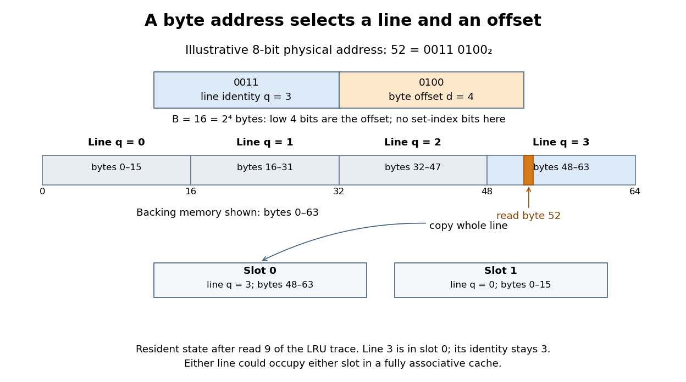
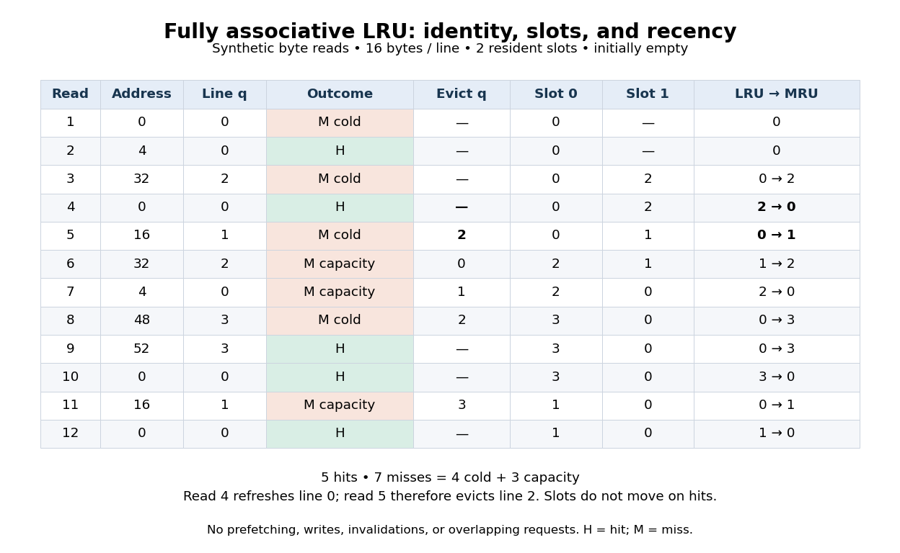

# Computer memory

↑ **Parent:** [Computer science](computer-science.md)  
ⓦ [Wiki](https://en.wikipedia.org/wiki/Computer_memory)

Storage holding information used by a computer. Here, resident [memory pages](virtual-memory.md#memory-page) occupy main [computer memory](computer-memory.md); a [physical address](#physical-address) identifies a location in the physical address system rather than an [operating-system process](operating-system.md#process-computing)'s private numbering.

**Table of contents**

- [Non-volatile memory](#non-volatile-memory)
  - [Flash memory](#flash-memory)
- [Memory location](#memory-location)
- [Store buffer](#store-buffer)
  - [Store queue](#store-queue)
  - [Store-to-load forwarding](#store-to-load-forwarding)
- [Volatile memory access](#volatile-memory-access)
- [Read-only memory](#read-only-memory)
- [Endianness](#endianness)
- [Pointer (computer programming)](#pointer-computer-programming)
  - [Pointer chasing](#pointer-chasing)
  - [Null pointer](#null-pointer)
- [Memory address](#memory-address)
  - [Register-offset addressing](#register-offset-addressing)
- [Heap memory](#heap-memory)
- [Heap allocation](#heap-allocation)
  - [Memory reclamation](#memory-reclamation)
    - [Hazard pointer](#hazard-pointer)
    - [Read-copy-update](#read-copy-update)
      - [Grace period](#grace-period)
    - [Use-after-free](#use-after-free)
- [Garbage collection](#garbage-collection)
  - [Tracing garbage collection](#tracing-garbage-collection)
  - [Garbage collection root](#garbage-collection-root)
- [Reference counting](#reference-counting)
- [Memory reference](#memory-reference)
  - [Null reference](#null-reference)
  - [Reference aliasing](#reference-aliasing)
  - [Deep copy](#deep-copy)
  - [Object identity](#object-identity)
  - [Memory access trace](#memory-access-trace)
- [Physical address](#physical-address)
- [Byte](#byte)
- [Cache (computing)](#cache-computing)
  - [Cache coherence](#cache-coherence)
    - [False sharing](#false-sharing)
  - [Cache pollution](#cache-pollution)
  - [No-write-allocate cache](#no-write-allocate-cache)
  - [Write-allocate cache](#write-allocate-cache)
  - [Cache hierarchy](#cache-hierarchy)
    - [Cache prefetching](#cache-prefetching)
      - [Software prefetch](#software-prefetch)
  - [Caching](#caching)
  - [Cache line](#cache-line)
    - [Cache slot](#cache-slot)
      - [Cache tag](#cache-tag)
  - [Cache hit](#cache-hit)
    - [Cache hit rate](#cache-hit-rate)
  - [Cache miss](#cache-miss)
    - [Cache miss rate](#cache-miss-rate)
    - [Capacity miss](#capacity-miss)
    - [Conflict miss](#conflict-miss)
    - [Cache miss penalty](#cache-miss-penalty)
    - [Compulsory miss](#compulsory-miss)
  - [Fully associative cache](#fully-associative-cache)
  - [Direct-mapped cache](#direct-mapped-cache)
  - [Memory access latency](#memory-access-latency)
    - [Average memory access time](#average-memory-access-time)

## Non-volatile memory

↑ **Parent:** [Computer memory](computer-memory.md)  
ⓦ [Wiki](https://en.wikipedia.org/wiki/Non-volatile_memory)

[Computer memory](computer-memory.md) that retains stored information without power.

### Flash memory

↑ **Parent:** [Non-volatile memory](#non-volatile-memory)  
ⓦ [Wiki](https://en.wikipedia.org/wiki/Flash_memory)

[Non-volatile memory](#non-volatile-memory) programmed and erased electrically. Its program and erase granularities need not match the block size exported to a [file system](file-system.md).

## Memory location

↑ **Parent:** [Computer memory](computer-memory.md)

An individually addressable place in [computer memory](computer-memory.md) holding a value. An abstract memory interface can separate reading and updating existing [memory locations](#memory-location) from allocating a fresh [memory location](#memory-location).

## Store buffer

↑ **Parent:** [Computer memory](computer-memory.md)

Storage for pending writes, usually with their [memory addresses](#memory-address), data and status. A younger [load instruction](computer-science.md#load-instruction) must account for older overlapping buffered [store instructions](computer-science.md#store-instruction), often by [store-to-load forwarding](#store-to-load-forwarding).

### Store queue

↑ **Parent:** [Store buffer](#store-buffer)

An age-ordered structure tracking [store instructions](computer-science.md#store-instruction), their [memory addresses](#memory-address) and data, and their eligibility to become visible. An implementation may distinguish a speculative [store queue](#store-queue) from the committed [store buffer](#store-buffer).

### Store-to-load forwarding

↑ **Parent:** [Store buffer](#store-buffer)

Satisfying a [load instruction](computer-science.md#load-instruction) from an older pending [store instruction](computer-science.md#store-instruction) rather than stale backing [computer memory](computer-memory.md). The youngest applicable older write supplies each requested [byte](#byte); unresolved or partial overlaps require additional handling.

## Volatile memory access

↑ **Parent:** [Computer memory](computer-memory.md)

A memory access whose execution is observable under the source language or machine rules, so that replacing repeated accesses by a saved value can change behavior. The precise guarantees depend on the [programming language](programming-language.md); volatile access alone does not provide thread synchronization.

## Read-only memory

↑ **Parent:** [Computer memory](computer-memory.md)  
ⓦ [Wiki](https://en.wikipedia.org/wiki/Read-only_memory)

A memory read through an address whose contents are fixed during ordinary operation. Used as a [Boolean function](analysis-of-boolean-functions.md#boolean-function) lookup table, $a$ address [bits](information-theory.md#bit) select one of $2^a$ words, each holding $b$ output bits, so the logical table capacity is $2^a b$ bits. A [finite-state machine](foundations-of-mathematics.md#finite-state-machine) can store its [next-state function](foundations-of-mathematics.md#next-state-function) in such a table while separate [flip-flops](electrical-engineering.md#flip-flop) store the current state.

## Endianness

↑ **Parent:** [Computer memory](computer-memory.md)  
ⓦ [Wiki](https://en.wikipedia.org/wiki/Endianness)

The ordering of the bytes of a multi-byte value in addressed memory. Little-endian storage puts the least significant byte at the lowest address; big-endian storage puts the most significant byte there. Logical shifts of a value already held in a [processor register](computer-science.md#processor-register) act on bit significance, independently of that storage convention.

## Pointer (computer programming)

↑ **Parent:** [Computer memory](computer-memory.md)

A [pointer](#pointer-computer-programming) is a value designating a location in a program's memory model, or a special value such as a [null pointer](#null-pointer) that designates no object. A node in a pointer-linked [binary tree](data-structure.md#binary-tree) stores [pointers](#pointer-computer-programming) to its two children. Representation, size, alignment and the validity of dereferencing depend on the [programming language](programming-language.md) and target; 32-bit [AAPCS32](programming-language.md#aapcs32) data [pointers](#pointer-computer-programming) occupy four bytes.

### Pointer chasing

↑ **Parent:** [Pointer (computer programming)](#pointer-computer-programming)

Following a chain of stored [pointers](#pointer-computer-programming), as in a [linked list](data-structure.md#linked-list). A later [memory address](#memory-address) may depend on the result of an earlier [load instruction](computer-science.md#load-instruction), limiting how far ahead [cache prefetching](#cache-prefetching) can run.

### Null pointer

↑ **Parent:** [Pointer (computer programming)](#pointer-computer-programming)

A [null pointer](#null-pointer) is a distinguished [pointer](#pointer-computer-programming) value that designates no object or function. Pointer-linked [binary trees](data-structure.md#binary-tree) commonly use it to represent an absent child. Dereferencing it is invalid; its representation is target dependent, although [AAPCS32](programming-language.md#aapcs32) specifies an all-zero null representation.

## Memory address

↑ **Parent:** [Computer memory](computer-memory.md)

A numerical identifier for a location in [computer memory](computer-memory.md). In a [byte](#byte)-addressed system, consecutive four-[byte](#byte) [array](data-structure.md#array-data-structure) elements have [memory addresses](#memory-address) differing by four.

### Register-offset addressing

↑ **Parent:** [Memory address](#memory-address)

An [assembly language](programming-language.md#assembly-language) memory operand whose effective address is the sum of a base [processor register](computer-science.md#processor-register) and an offset [processor register](computer-science.md#processor-register). A byte-load table lookup uses the index directly as a byte offset; wider entries require an appropriate scale. The effective address is formed from the old register values before the destination register is overwritten.

## Heap memory

↑ **Parent:** [Computer memory](computer-memory.md)

Storage used for [heap allocation](#heap-allocation), with [software object](programming-language.md#software-object) lifetimes not necessarily nested like procedure calls on a call [stack](data-structure.md#stack-data-structure). [Garbage collection](#garbage-collection) can reclaim unreachable [software objects](programming-language.md#software-object); keeping references to every allocated [software object](programming-language.md#software-object) prevents that reclamation regardless of how little of each [software object](programming-language.md#software-object)'s data a program still needs.

## Heap allocation

↑ **Parent:** [Computer memory](computer-memory.md)

Heap allocation creates an [software object](programming-language.md#software-object) whose lifetime need not match one lexical procedure call. Other [software objects](programming-language.md#software-object) can retain references to it after the constructing call returns. Automatic storage reclamation therefore follows reachability or another memory-management discipline, rather than simply returning from that call.

### Memory reclamation

↑ **Parent:** [Heap allocation](#heap-allocation)

Making storage available for reuse after its object is no longer accessible to any legitimate user. Concurrent readers retaining old [pointers](#pointer-computer-programming) make safe [memory reclamation](#memory-reclamation) a separate problem from atomic pointer publication.

#### Hazard pointer

↑ **Parent:** [Memory reclamation](#memory-reclamation)  
ⓦ [Wiki](https://en.wikipedia.org/wiki/Hazard_pointer)

A published reader protection record used by a protocol that validates the protected [pointer](#pointer-computer-programming) and delays [memory reclamation](#memory-reclamation) while relevant readers may access the object. Merely copying an unprotected pointer does not supply this lifetime guarantee.

#### Read-copy-update

↑ **Parent:** [Memory reclamation](#memory-reclamation)  
ⓦ [Wiki](https://en.wikipedia.org/wiki/Read-copy-update)

A family of concurrent access techniques that publishes replacement versions and postpones [memory reclamation](#memory-reclamation) until a suitable [grace period](#grace-period) has passed. Correct reader tracking, publication ordering and lifetime rules are essential.

##### Grace period

↑ **Parent:** [Read-copy-update](#read-copy-update)

An interval sufficient to establish that every reader that might retain a preexisting reference has left its protected read-side region. Completion permits the corresponding old object to undergo [memory reclamation](#memory-reclamation).

#### Use-after-free

↑ **Parent:** [Memory reclamation](#memory-reclamation)

An access through a [pointer](#pointer-computer-programming) after its storage has been released. Reusing the same [memory address](#memory-address) for a different object can make this failure silently return unrelated data instead of immediately crashing.

## Garbage collection

↑ **Parent:** [Computer memory](computer-memory.md)

Automatic reclamation of allocated storage no longer reachable by a program. Clearing a private linked structure can discard its root references in constant pointer work even though later reclamation may require additional collector work. Data-structure operation bounds should state whether they count deferred memory-management costs.

### Tracing garbage collection

↑ **Parent:** [Garbage collection](#garbage-collection)

A [tracing garbage collection](#tracing-garbage-collection) implementation starts from [garbage collection roots](#garbage-collection-root) and follows [software object](programming-language.md#software-object) references. [Software objects](programming-language.md#software-object) outside that reachable set can be reclaimed, including cycles that have no path from a root. A decorator or adapter holding a component reference keeps that component reachable while the wrapper remains reachable. The number of allocated [software objects](programming-language.md#software-object) alone does not establish how much storage can be reclaimed.

### Garbage collection root

↑ **Parent:** [Garbage collection](#garbage-collection)

A garbage collection root is an initially accessible reference from which the collector traces reachable [software objects](programming-language.md#software-object). Depending on the runtime, roots include active [stack](data-structure.md#stack-data-structure) or register references and static references. [Software objects](programming-language.md#software-object) reached transitively through reference fields must remain live. Exact root sets and collection timing are implementation details.

## Reference counting

↑ **Parent:** [Computer memory](computer-memory.md)  
ⓦ [Wiki](https://en.wikipedia.org/wiki/Reference_counting)

Tracking how many references retain an object. For the [copy-on-write](virtual-memory.md#copy-on-write) model, the object is a [page frame](virtual-memory.md#page-frame) and each mapping retains it; removing the last reference permits reclamation. Real [operating-system kernels](operating-system.md#kernel-operating-system) can track other kinds of ownership too. [Lab: Copy-on-Write Fork for xv6](computer-science-bibliography.md#6-1810-and-fall-2022/lab-copy-on-write-fork-for-xv6)

## Memory reference

↑ **Parent:** [Computer memory](computer-memory.md)

An access to a location in [computer memory](computer-memory.md), such as an instruction fetch, a read or a write. A page-level reference [sequence](sequence-and-series.md#sequence) records the corresponding [memory page](virtual-memory.md#memory-page) for each access, retaining repetitions and order.

### Null reference

↑ **Parent:** [Memory reference](#memory-reference)

A null reference denotes the absence of an ordinary referenced [software object](programming-language.md#software-object). In null-terminated [linked lists](data-structure.md#linked-list) it marks the end of a chain. A search can return it to signal absence, but the caller must check before selecting data members. [Short-circuit evaluation](programming-language.md#short-circuit-evaluation) can make a combined nonnull-and-property guard safe.

### Reference aliasing

↑ **Parent:** [Memory reference](#memory-reference)

Two program references designate the same mutable object or overlapping mutable state. Binary-update contracts must account for this possibility: an update intended to combine two old values should snapshot both operands before modifying the receiver. A frame condition preserving a distinct operand cannot literally preserve a second reference that aliases the modified receiver.

### Deep copy

↑ **Parent:** [Memory reference](#memory-reference)

A copy that duplicates the relevant reachable mutable structure instead of sharing all original references. A [Memento pattern](programming-language.md#memento-pattern) snapshot containing mutable arrays must preserve their saved contents against subsequent mutation, whether by a suitable [deep copy](#deep-copy) or by an immutable persistent representation. The intended ownership graph and any permitted sharing must be specified; blindly copying one outer object is only a shallow copy.

### Object identity

↑ **Parent:** [Memory reference](#memory-reference)

The identity of a particular allocated object, distinct from equality of its current fields. Two different [linked list nodes](data-structure.md#linked-list-node) can store identical payloads, while two references can designate the same node. Pointer algorithms must state whether they preserve identities, copy payloads or allocate replacements. Testing cycle completion by identity avoids confusing two equal-looking nodes.

### Memory access trace

↑ **Parent:** [Memory reference](#memory-reference)

An ordered [sequence](sequence-and-series.md#sequence) of [memory references](#memory-reference), recording repetitions as well as addresses. The example under [memory cache](#cache-computing) records twelve reads in decimal [physical addresses](#physical-address); the trace itself does not determine [cache hits](#cache-hit) until [cache line](#cache-line) size, capacity, initial contents, placement and replacement are specified.

## Physical address

↑ **Parent:** [Computer memory](computer-memory.md)  
ⓦ [Wiki](https://en.wikipedia.org/wiki/Physical_address)

An address in the physical address system, obtained from a [virtual address](virtual-memory.md#virtual-address) by [address translation](virtual-memory.md#address-translation) in the examples here. Physical address ranges can also identify devices, so not every [physical address](#physical-address) denotes ordinary [computer memory](computer-memory.md).

## Byte

↑ **Parent:** [Computer memory](computer-memory.md)  
ⓦ [Wiki](https://en.wikipedia.org/wiki/Byte)

A unit of information; throughout these examples, one [byte](#byte) contains eight [bits](information-theory.md#bit) and is the smallest independently addressed unit of [computer memory](computer-memory.md).

## Cache (computing)

↑ **Parent:** [Computer memory](computer-memory.md)  
ⓦ [Wiki](https://en.wikipedia.org/wiki/Cache_(computing))

A store of selected information kept for faster reuse. A [translation lookaside buffer](virtual-memory.md#translation-lookaside-buffer) is a [memory cache](#cache-computing) of [address translations](virtual-memory.md#address-translation); a [buffer cache](file-system.md#buffer-cache) instead holds device-block contents.

For a data [memory cache](#cache-computing), the useful bargain is to keep a small selection of [computer memory](computer-memory.md) close to the [CPU](computer-science.md#central-processing-unit). A [cache hit](#cache-hit) serves a read from that selection; a [cache miss](#cache-miss) requires obtaining the contents elsewhere. [Temporal locality](computer-science.md#temporal-locality) helps a retained [cache block](#cache-line) serve repeated reads, and [spatial locality](computer-science.md#spatial-locality) helps one transferred [cache line](#cache-line) serve neighbouring [bytes](#byte). Placement, capacity and [LRU replacement](virtual-memory.md#lru-replacement) determine whether that opportunity survives until the next read. [11.4. CPU Caches](computer-science-bibliography.md#dive-into-systems-by-suzanne-j-matthews-and-others/11-4-cpu-caches)

The worked [memory access trace](#memory-access-trace) below uses twelve single-[byte](#byte) reads at these decimal [physical addresses](#physical-address), in this fixed order:

$$
0,4,32,0,16,32,4,48,52,0,16,0.
$$

Assume an initially empty [fully associative cache](#fully-associative-cache), 16-[byte](#byte) aligned [cache blocks](#cache-line), and capacity two [cache slots](#cache-slot): 32 [bytes](#byte) of cached data, excluding metadata. Use exact [LRU replacement](virtual-memory.md#lru-replacement), refreshing recency on every read, including [cache hits](#cache-hit). Every [cache miss](#cache-miss) fetches its requested [cache line](#cache-line) completely before the next read; only a full [memory cache](#cache-computing) needs an eviction. There are no writes, fetching ahead of requests, external invalidations, or overlapping reads. All addresses denote ordinary cacheable [computer memory](computer-memory.md), and [address translation](virtual-memory.md#address-translation) is outside this model. These are deliberately synthetic assumptions, not specifications of a particular [CPU](computer-science.md#central-processing-unit).

This makes the outcome reproducible from the [memory access trace](#memory-access-trace), rather than from an informal impression that data are “nearby” or “recent”. The [cache line](#cache-line) geometry below identifies the requested unit; [fully associative cache](#fully-associative-cache) enumerates the resulting states; [average memory access time](#average-memory-access-time) translates the counts into a simple timing calculation.

### Cache coherence

↑ **Parent:** [Cache (computing)](#cache-computing)  
ⓦ [Wiki](https://en.wikipedia.org/wiki/Cache_coherence)

Consistency requirements for cached copies of the same memory location, including agreement on its writes. [Cache coherence](#cache-coherence) does not itself impose [sequential consistency](operating-system.md#sequential-consistency) across different locations.

#### False sharing

↑ **Parent:** [Cache coherence](#cache-coherence)  
ⓦ [Wiki](https://en.wikipedia.org/wiki/False_sharing)

Independent data in the same [cache line](#cache-line) cause unnecessary ownership transfers or invalidations when different [CPU cores](computer-science.md#cpu-core) access them. A frequently written lock beside stable reader data can invalidate those data despite no logical conflict.

### Cache pollution

↑ **Parent:** [Cache (computing)](#cache-computing)

Loss of useful cached data because less useful data occupy the limited [memory cache](#cache-computing). Excessive [cache prefetching](#cache-prefetching) can increase later demand [cache misses](#cache-miss) by evicting useful [cache lines](#cache-line).

### No-write-allocate cache

↑ **Parent:** [Cache (computing)](#cache-computing)

A [memory cache](#cache-computing) policy that sends a write miss onward without allocating the missed [cache line](#cache-line) in that level. Different levels of a [cache hierarchy](#cache-hierarchy) may use different write policies.

### Write-allocate cache

↑ **Parent:** [Cache (computing)](#cache-computing)

A [memory cache](#cache-computing) policy that allocates the relevant [cache line](#cache-line) on a write [cache miss](#cache-miss). Fetching that [cache line](#cache-line) can delay a [store instruction](computer-science.md#store-instruction) unless other mechanisms hide the delay.

### Cache hierarchy

↑ **Parent:** [Cache (computing)](#cache-computing)

Several levels of [memory cache](#cache-computing), typically combining a small low-[latency](computer-science.md#latency-engineering) first level with larger later levels. Each level reduces traffic reaching the next; local and global [cache miss rates](#cache-miss-rate) must be distinguished.

#### Cache prefetching

↑ **Parent:** [Cache hierarchy](#cache-hierarchy)

Fetching a [cache line](#cache-line) before a demand access requires it, to overlap transfer [latency](computer-science.md#latency-engineering) with useful work. A [software prefetch](#software-prefetch) is one way to request this; unnecessary requests can cause [cache pollution](#cache-pollution).

##### Software prefetch

↑ **Parent:** [Cache prefetching](#cache-prefetching)

A program-directed hint to fetch a [cache line](#cache-line) early. A useful nonblocking hint produces no destination [processor register](computer-science.md#processor-register) value and allows execution to continue before the transfer completes. Fault and dropping behavior depend on the specified instruction contract.

### Caching

↑ **Parent:** [Cache (computing)](#cache-computing)

Keeping reusable copies in a [cache](#cache-computing).

### Cache line

↑ **Parent:** [Cache (computing)](#cache-computing)

A fixed-sized, aligned block of consecutive [bytes](#byte) transferred and tracked as a unit by a data [memory cache](#cache-computing). Here [cache line](#cache-line) and [cache block](#cache-line) name that unit of data, including its identity in backing [computer memory](computer-memory.md); a resident slot holds a copy. Reading one element can bring neighbouring elements into the same [cache line](#cache-line), exploiting [spatial locality](computer-science.md#spatial-locality).

For a nonnegative [integer](integer.md) [physical address](#physical-address) $a$ and a [cache line](#cache-line) size $B$ [bytes](#byte), [Euclidean division](integer.md#euclidean-division) gives the backing [cache block](#cache-line) number $q$ and offset $d$:

$$
q=\left\lfloor\frac{a}{B}\right\rfloor,\qquad d=a\bmod B,\qquad a=Bq+d,\qquad 0\leq d<B.
$$

Here the brackets denote the [floor function](calculus.md#floor-function) and $\bmod$ gives the [remainder](integer.md#remainder). [Cache line](#cache-line) $q$ contains [bytes](#byte) at [physical addresses](#physical-address) $Bq$ through $Bq+B-1$. With $B=16$, read address 52 selects [cache block](#cache-line) 3, spanning addresses 48–63, and offset 4. Addresses 48 and 52 therefore request the same [cache line](#cache-line); addresses 15 and 16 request different [cache lines](#cache-line) despite being adjacent.

**[Figure 1](#image-physical-address-52-selects-cache-line-3-and-offset-4-the-resident-copy-occupies-cache-slot-0). Physical address 52 selects cache line 3 and offset 4; the resident copy occupies cache slot 0**.

For a [cache line](#cache-line) size $B=2^b$, the low $b$ [bits](information-theory.md#bit) give the offset. In a [fully associative cache](#fully-associative-cache), all remaining [bits](information-theory.md#bit) identify the backing [cache block](#cache-line) as its [cache tag](#cache-tag); there are no address [bits](information-theory.md#bit) selecting a particular [cache slot](#cache-slot). An eight-[bit](information-theory.md#bit) illustration gives $52=\mathtt{00110100}_2$: four [bits](information-theory.md#bit) `0011` for [cache block](#cache-line) 3 and four [bits](information-theory.md#bit) `0100` for offset 4 in the [binary numeral system](integer.md#binary-numeral-system). The eight-[bit](information-theory.md#bit) width is illustrative; the trace does not assume an actual eight-[bit](information-theory.md#bit) machine. [Memory part 2: CPU caches by Ulrich Drepper](computer-science-bibliography.md#memory-part-2-cpu-caches-by-ulrich-drepper)

Distinguish this identity from a [cache slot](#cache-slot), which can hold different [cache blocks](#cache-line) over time. After read nine in the [memory cache](#cache-computing) example, [cache slot](#cache-slot) 0 contains [cache line](#cache-line) 3 and [cache slot](#cache-slot) 1 contains [cache line](#cache-line) 0. Their [cache tags](#cache-tag) identify 3 and 0; neither [cache line](#cache-line) number is its slot number. Some texts use “cache line” for the storage entry itself; this article reserves [cache slot](#cache-slot) for that role.

#### Cache slot

↑ **Parent:** [Cache line](#cache-line)

A resident storage entry that can hold one [cache block](#cache-line) and metadata identifying its contents. [Cache line](#cache-line) identity belongs to backing [computer memory](computer-memory.md); [cache slot](#cache-slot) identity belongs to the consulted [memory cache](#cache-computing).

##### Cache tag

↑ **Parent:** [Cache slot](#cache-slot)

Metadata identifying which eligible backing [cache block](#cache-line) a valid [cache slot](#cache-slot) currently holds. In the [fully associative cache](#fully-associative-cache) example, the [cache tag](#cache-tag) is the full [cache block](#cache-line) number $q$; in the two-slot [direct-mapped cache](#direct-mapped-cache) example, the slot supplies $q\bmod2$ and the [cache tag](#cache-tag) can store $\lfloor q/2\rfloor$ using the [floor function](calculus.md#floor-function).

### Cache hit

↑ **Parent:** [Cache (computing)](#cache-computing)

A request whose required data are already available in the consulted [memory cache](#cache-computing). In the read-only model of [spatial locality](computer-science.md#spatial-locality), a requested [cache block](#cache-line) being resident is sufficient for a [cache hit](#cache-hit).

The [memory access trace](#memory-access-trace) under [memory cache](#cache-computing) has [cache hits](#cache-hit) at reads 2, 4, 9, 10 and 12. Read 2, at address 4, benefits from the [cache line](#cache-line) fetched by read 1 at address 0; read 9, at address 52, benefits from read 8 at address 48. These reads use different [bytes](#byte) of the same [cache blocks](#cache-line), illustrating [spatial locality](computer-science.md#spatial-locality). Read 4 returns to address 0 while its [cache block](#cache-line) remains resident, illustrating [temporal locality](computer-science.md#temporal-locality).

A [cache hit](#cache-hit) still takes time to identify the matching [cache tag](#cache-tag) and obtain the requested [byte](#byte). It is relative to the particular [memory cache](#cache-computing) consulted: a [cache miss](#cache-miss) in one level may be a [cache hit](#cache-hit) in another. The model here has one consulted level and treats a valid matching resident copy as sufficient; it makes no prediction about writes or accesses whose permissions or contents change.

#### Cache hit rate

↑ **Parent:** [Cache hit](#cache-hit)

The fraction of $R>0$ [memory references](#memory-reference) yielding [cache hits](#cache-hit), with $H$ their count: $h=H/R$. The two-slot [fully associative cache](#fully-associative-cache) example has $h=5/12$. Count the same reference unit and consulted level for both [cache hit rate](#cache-hit-rate) and [cache miss rate](#cache-miss-rate).

### Cache miss

↑ **Parent:** [Cache (computing)](#cache-computing)

A request whose required data are unavailable in the consulted [memory cache](#cache-computing). The model in [spatial locality](computer-science.md#spatial-locality) fetches the requested [cache block](#cache-line) and evicts a resident [cache line](#cache-line) only when capacity is full.

In the fixed [memory access trace](#memory-access-trace) under [memory cache](#cache-computing), reads 1, 3, 5 and 8 first request [cache blocks](#cache-line) 0, 2, 1 and 3: four [compulsory misses](#compulsory-miss), also called cold misses. Reads 6, 7 and 11 revisit [cache blocks](#cache-line) that [LRU replacement](virtual-memory.md#lru-replacement) has evicted: three [capacity misses](#capacity-miss). Read 5 is a [compulsory miss](#compulsory-miss) even though it also causes an eviction; a full [memory cache](#cache-computing) alone does not determine the classification. The [fully associative cache](#fully-associative-cache) permits every [cache block](#cache-line) in every [cache slot](#cache-slot), so this example has no [conflict misses](#conflict-miss).

For a precise comparison, run the same [memory access trace](#memory-access-trace) through an initially empty [direct-mapped cache](#direct-mapped-cache) with the same 16-[byte](#byte) [cache lines](#cache-line) and two [cache slots](#cache-slot), placing [cache block](#cache-line) $q$ only in slot $q\bmod2$. Read 3 brings in [cache block](#cache-line) 2 and displaces [cache block](#cache-line) 0, leaving the other [cache slot](#cache-slot) unused. Read 4 consequently misses at address 0, whereas the [fully associative cache](#fully-associative-cache) still has [cache block](#cache-line) 0. That read is a [conflict miss](#conflict-miss): increasing placement freedom at the same capacity removes it. The complete [direct-mapped cache](#direct-mapped-cache) trace has eight [cache misses](#cache-miss): four [compulsory misses](#compulsory-miss), three [capacity misses](#capacity-miss) and one [conflict miss](#conflict-miss).

The convention here classifies each [cache miss](#cache-miss) by first asking whether its [cache block](#cache-line) has ever been requested. If so, compare with an initially empty [fully associative cache](#fully-associative-cache) of the same capacity and [cache line](#cache-line) size using [LRU replacement](virtual-memory.md#lru-replacement) on the same [memory access trace](#memory-access-trace): a miss there is a [capacity miss](#capacity-miss), while a hit there identifies a [conflict miss](#conflict-miss) in the restricted design. This makes the comparison policy explicit; “capacity” is not a claim that no other replacement choice could save that individual read. The three categories describe this read-only demand model; external invalidations or fetching ahead of requests require additional reasoning. [11.4. CPU Caches](computer-science-bibliography.md#dive-into-systems-by-suzanne-j-matthews-and-others/11-4-cpu-caches)

#### Cache miss rate

↑ **Parent:** [Cache miss](#cache-miss)

The fraction of $R>0$ [memory references](#memory-reference) yielding [cache misses](#cache-miss), with $M$ their count: $m=M/R$. When each reference is classified as exactly one [cache hit](#cache-hit) or [cache miss](#cache-miss), $h+m=1$; the two-slot [fully associative cache](#fully-associative-cache) example has $m=7/12$.

#### Capacity miss

↑ **Parent:** [Cache miss](#cache-miss)

A repeated [cache block](#cache-line) access that misses even in the comparison [fully associative cache](#fully-associative-cache) of the same capacity and [cache line](#cache-line) size using [LRU replacement](virtual-memory.md#lru-replacement). In the [memory cache](#cache-computing) example these are reads 6, 7 and 11. The replacement assumption matters to this classification.

#### Conflict miss

↑ **Parent:** [Cache miss](#cache-miss)

A repeated [cache block](#cache-line) access that misses in a restricted design but hits in the comparison [fully associative cache](#fully-associative-cache) of the same capacity and [cache line](#cache-line) size using [LRU replacement](virtual-memory.md#lru-replacement). Read 4 of the [direct-mapped cache](#direct-mapped-cache) comparison under [cache miss](#cache-miss) isolates this effect while another [cache slot](#cache-slot) is unused.

#### Cache miss penalty

↑ **Parent:** [Cache miss](#cache-miss)

The additional [memory access latency](#memory-access-latency) charged for a [cache miss](#cache-miss) beyond a common lookup time in the [average memory access time](#average-memory-access-time) model. It includes obtaining the requested [cache block](#cache-line) and making the read complete; this model excludes extra costs from writes and overlapping requests.

#### Compulsory miss

↑ **Parent:** [Cache miss](#cache-miss)

A [cache miss](#cache-miss) on the first access to a [cache block](#cache-line) in an initially empty [memory cache](#cache-computing) with no fetching ahead of requests. Larger capacity cannot eliminate these first fetches; subsequent [cache misses](#cache-miss) can have other causes.

### Fully associative cache

↑ **Parent:** [Cache (computing)](#cache-computing)

A [memory cache](#cache-computing) allowing any [cache block](#cache-line) to occupy any resident slot. When full, its replacement policy chooses a victim from all resident [cache lines](#cache-line). The examples in [temporal locality](computer-science.md#temporal-locality) and [spatial locality](computer-science.md#spatial-locality) use [LRU replacement](virtual-memory.md#lru-replacement), so no additional placement restriction causes eviction.

The diagram enumerates every read of the fixed [memory access trace](#memory-access-trace) under [memory cache](#cache-computing). Keep [cache slots](#cache-slot) fixed: fill the lowest-numbered unused slot first, and subsequently reuse the victim's slot. Separately list recency from least recently used to most recently used. A [cache hit](#cache-hit) refreshes that recency without moving the resident data to another [cache slot](#cache-slot).

**[Figure 2](#image-every-read-cache-hit-or-cache-miss-eviction-cache-slot-and-recency-state-of-the-synthetic-two-slot-fully-associative-cache-with-lru-replacement). Every read, cache hit or cache miss, eviction, cache slot and recency state of the synthetic two-slot fully associative cache with LRU replacement**.

After read 3, [cache block](#cache-line) 0 is older than [cache block](#cache-line) 2. Read 4 hits [cache block](#cache-line) 0, making [cache block](#cache-line) 2 older; read 5 must therefore evict [cache block](#cache-line) 2 to load [cache block](#cache-line) 1. Omitting recency updates on [cache hits](#cache-hit) would choose the wrong victim. Read 6 immediately needs the evicted [cache block](#cache-line) 2, showing that [LRU replacement](virtual-memory.md#lru-replacement) uses past demand rather than knowledge of future demand.

With capacity four [cache slots](#cache-slot) and the same [cache line](#cache-line) size, the same [memory access trace](#memory-access-trace) has just its four [compulsory misses](#compulsory-miss) and eight [cache hits](#cache-hit), since all four distinct [cache blocks](#cache-line) fit. Greater capacity helps this trace, but full associativity alone does not make [LRU replacement](virtual-memory.md#lru-replacement) optimal. Its attraction is freedom from placement restrictions; a hardware implementation must still identify a matching [cache tag](#cache-tag) among eligible entries, and exact recency tracking adds work. [Memory part 2: CPU caches by Ulrich Drepper](computer-science-bibliography.md#memory-part-2-cpu-caches-by-ulrich-drepper)

### Direct-mapped cache

↑ **Parent:** [Cache (computing)](#cache-computing)

A [memory cache](#cache-computing) in which each backing [cache block](#cache-line) has exactly one eligible [cache slot](#cache-slot). The example under [cache miss](#cache-miss) maps [cache block](#cache-line) $q$ to slot $q\bmod2$: [cache blocks](#cache-line) 0 and 2 compete for slot 0 despite free space in slot 1.

### Memory access latency

↑ **Parent:** [Cache (computing)](#cache-computing)

The time from a [memory reference](#memory-reference)'s request until the requested data become available. [Average memory access time](#average-memory-access-time) averages this delay in the stated serial model; it does not directly measure whole-program runtime.

#### Average memory access time

↑ **Parent:** [Memory access latency](#memory-access-latency)

The [arithmetic mean](arithmetic.md#arithmetic-mean) of [memory access latencies](#memory-access-latency). Suppose each read completes before the next begins, every [cache hit](#cache-hit) costs $t_h$, and every [cache miss](#cache-miss) costs $t_h+p$, with the same additional [cache miss penalty](#cache-miss-penalty) $p$. If $h$ is [cache hit rate](#cache-hit-rate) and $m=1-h$ is [cache miss rate](#cache-miss-rate), the [weighted arithmetic mean](arithmetic.md#weighted-arithmetic-mean) is

$$
\operatorname{AMAT}=h\,t_h+m(t_h+p)=t_h+mp.
$$

The common lookup cost is paid on both outcomes. This additive assumption matches the simple model in [Beyond Physical Memory: Policies](computer-science-bibliography.md#operating-systems-three-easy-pieces-by-remzi-h-arpaci-dusseau-and-others/beyond-physical-memory-policies) (§22.1, equation 22.1, pp. 1–2), where main [computer memory](computer-memory.md) acts as a [memory cache](#cache-computing) for [memory pages](virtual-memory.md#memory-page) backed by disk; here the same accounting is applied to a toy data [memory cache](#cache-computing).

Assign synthetic values $t_h=2\,\mathrm{ns}$ and $p=30\,\mathrm{ns}$. The twelve-read, two-slot [fully associative cache](#fully-associative-cache) example has five [cache hits](#cache-hit) and seven [cache misses](#cache-miss), giving

$$
\operatorname{AMAT}=2+\frac{7}{12}\,30=19.5\,\mathrm{ns},\qquad T=5\cdot2+7\cdot32=234\,\mathrm{ns}.
$$

With four [cache slots](#cache-slot), its four [compulsory misses](#compulsory-miss) instead give $\operatorname{AMAT}=12\,\mathrm{ns}$. This comparison holds the timing costs fixed as capacity changes, which is a model assumption rather than a hardware promise.

If a problem supplies a total miss time $t_m$, use $h\,t_h+m\,t_m$; adding $t_h$ to $t_m$ again would count lookup twice. Variable [cache miss penalties](#cache-miss-penalty), multiple consulted levels, or overlapping requests require a richer timing model. Real [CPU](computer-science.md#central-processing-unit) work can overlap a pending read, so this [arithmetic mean](arithmetic.md#arithmetic-mean) cannot by itself predict program speed or stall time. [Memory part 2: CPU caches by Ulrich Drepper](computer-science-bibliography.md#memory-part-2-cpu-caches-by-ulrich-drepper)

## ↑ Ancestors (2)

1. [Computer science](computer-science.md)
2. [Codex Wiki](README.md)

## ← Incoming links (72)

- [Address translation](virtual-memory.md#address-translation)
- [Array (data structure)](data-structure.md#array-data-structure)
- [Average memory access time](#average-memory-access-time)
- [Buffer cache eviction](file-system.md#buffer-cache-eviction)
- [Byte](#byte)
- [Cache (computing)](#cache-computing)
- [Cache line](#cache-line)
- [Cache slot](#cache-slot)
- [Computer architecture](computer-science.md#computer-architecture)
- [Computer bus](computer-science.md#computer-bus)
- [Computer memory](computer-memory.md)
- [Context switch](operating-system.md#context-switch)
- [Continuation (computer science)](programming-language.md#continuation-computer-science)
- [Conway Game of Life](computer-science.md#conway-game-of-life)
- [Copy-on-write](virtual-memory.md#copy-on-write)
- [Copy-on-write page accounting](virtual-memory.md#copy-on-write-page-accounting)
- [Coroutine](programming-language.md#coroutine)
- [Direct memory access](computer-science.md#direct-memory-access)
- [DMA buffer](computer-science.md#dma-buffer)
- [Dynamic array doubling](theoretical-computer-science.md#dynamic-array-doubling)
- [Execution context](operating-system.md#execution-context)
- [Hash bucket](data-structure.md#hash-bucket)
- [Inter-process communication](operating-system.md#inter-process-communication)
- [Linked list](data-structure.md#linked-list)
- [Linked list node](data-structure.md#linked-list-node)
- [Load instruction](computer-science.md#load-instruction)
- [Memoization](algorithm.md#memoization)
- [Memoization cache lifetime](algorithm.md#memoization-cache-lifetime)
- [Memory address](#memory-address)
- [Memory location](#memory-location)
- [Memory-mapped file](virtual-memory.md#memory-mapped-file)
- [Memory protection](virtual-memory.md#memory-protection)
- [Memory reference](#memory-reference)
- [Microkernel](operating-system.md#microkernel)
- [Microkernel communication cost](operating-system.md#microkernel-communication-cost)
- [Microkernel file-read example](operating-system.md#microkernel-file-read-example)
- [Microkernel service failure isolation](operating-system.md#microkernel-service-failure-isolation)
- [Multicore processor](computer-science.md#multicore-processor)
- [Non-volatile memory](#non-volatile-memory)
- [Page frame](virtual-memory.md#page-frame)
- [Paging](virtual-memory.md#paging)
- [Solution](past-exam-of-the-computer-science-course-of-the-university-of-oxford/2015/compilers.md#3/a/solution)
- [Solution](past-exam-of-the-computer-science-course-of-the-university-of-oxford/2015/computer-architecture.md#1/b/solution)
- [Solution](past-exam-of-the-computer-science-course-of-the-university-of-oxford/2015/computer-architecture.md#2/b/solution)
- [Solution](past-exam-of-the-computer-science-course-of-the-university-of-oxford/2015/computer-architecture.md#2/d/solution)
- [Solution](past-exam-of-the-computer-science-course-of-the-university-of-oxford/2015/computer-architecture.md#3/a/solution)
- [Solution](past-exam-of-the-computer-science-course-of-the-university-of-oxford/2015/computer-architecture.md#3/b/solution)
- [Solution](past-exam-of-the-computer-science-course-of-the-university-of-oxford/2015/computer-architecture.md#3/c/i/solution)
- [Solution](past-exam-of-the-computer-science-course-of-the-university-of-oxford/2015/computer-architecture.md#3/c/ii/solution)
- [Solution](past-exam-of-the-computer-science-course-of-the-university-of-oxford/2015/computer-architecture.md#3/c/iii/solution)
- [Solution](past-exam-of-the-computer-science-course-of-the-university-of-oxford/2015/principles-of-programming-languages.md#1/c/solution)
- [Solution](past-exam-of-the-computer-science-course-of-the-university-of-oxford/2015/principles-of-programming-languages.md#1/f/solution)
- [Solution](past-exam-of-the-computer-science-course-of-the-university-of-oxford/2015/principles-of-programming-languages.md#2/a/solution)
- [Solution](past-exam-of-the-computer-science-course-of-the-university-of-oxford/2015/principles-of-programming-languages.md#2/b/solution)
- [Solution](past-exam-of-the-computer-science-course-of-the-university-of-oxford/2015/principles-of-programming-languages.md#2/c/solution)
- [Solution](past-exam-of-the-computer-science-course-of-the-university-of-oxford/2015/principles-of-programming-languages.md#2/d/solution)
- [Solution](past-exam-of-the-year-1-of-the-computer-science-course-of-the-university-of-oxford/2013/digital-systems-linear-algebra-introduction-to-formal-proof.md#3/a/solution)
- [Solution](past-exam-of-the-year-1-of-the-computer-science-course-of-the-university-of-oxford/2015/digital-systems-linear-algebra-introduction-to-formal-proof.md#6/b/solution)
- [Physical address](#physical-address)
- [Potential method](theoretical-computer-science.md#potential-method)
- [Process (computing)](operating-system.md#process-computing)
- [Resident set](virtual-memory.md#resident-set)
- [Shared-bus timing example](computer-science.md#shared-bus-timing-example)
- [Spatial locality](computer-science.md#spatial-locality)
- [Store instruction](computer-science.md#store-instruction)
- [Store-to-load forwarding](#store-to-load-forwarding)
- [Temporal locality](computer-science.md#temporal-locality)
- [Thrashing (computer science)](virtual-memory.md#thrashing-computer-science)
- [Thread (computing)](operating-system.md#thread-computing)
- [Two-level address translation](virtual-memory.md#two-level-address-translation)
- [Virtual memory](virtual-memory.md)
- [Working set](virtual-memory.md#working-set)
