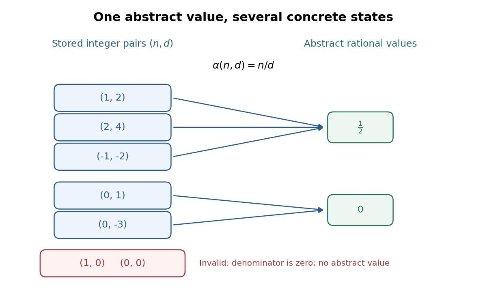
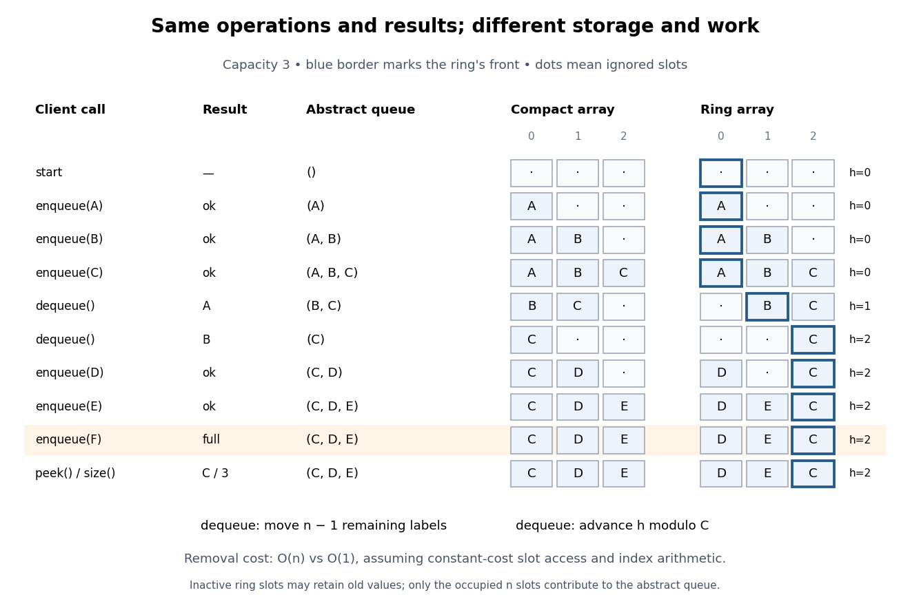
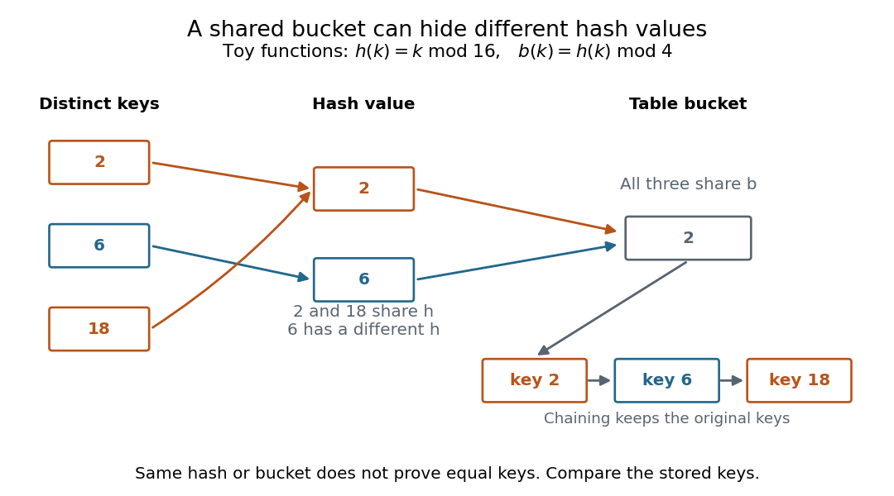
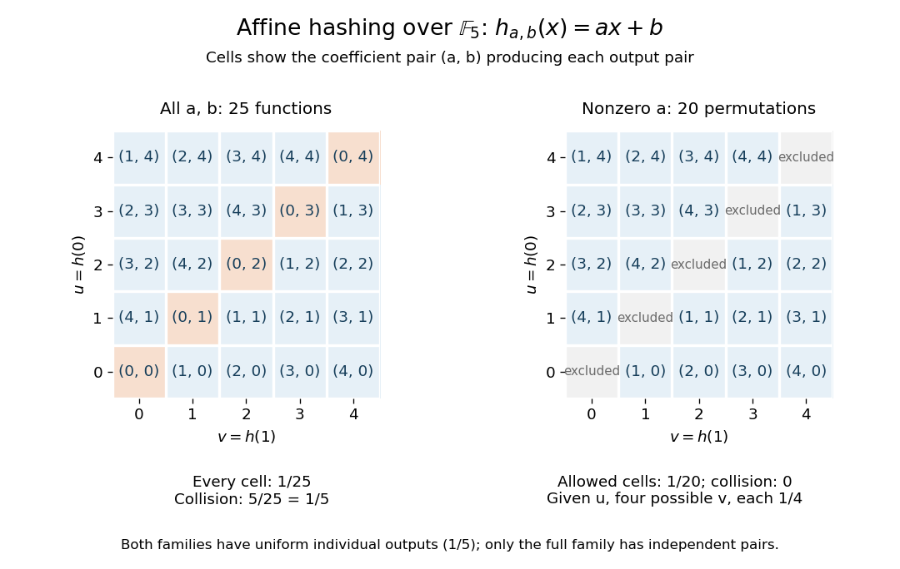
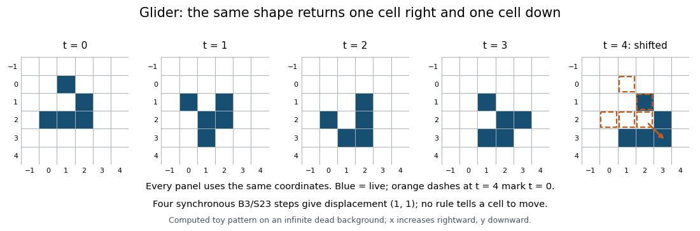
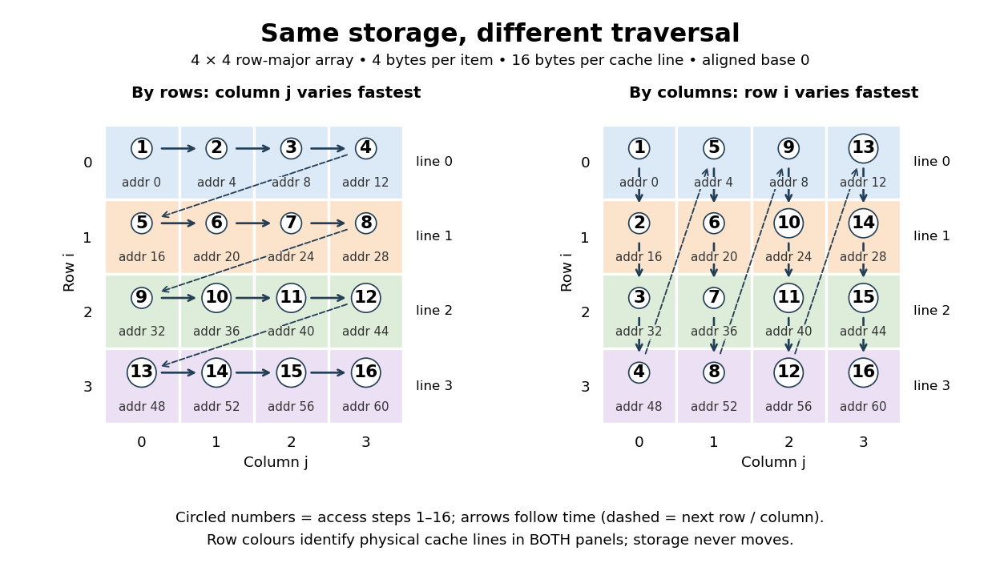
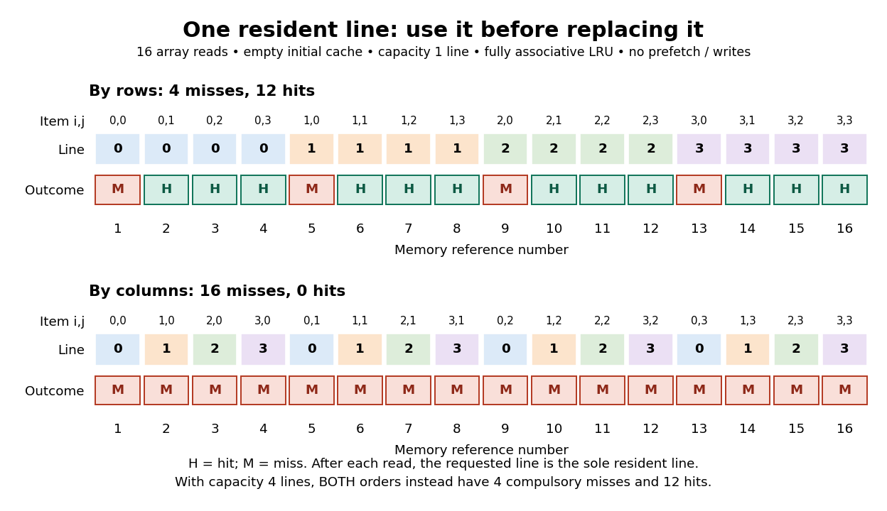
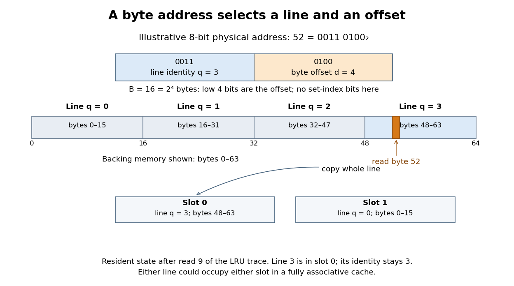
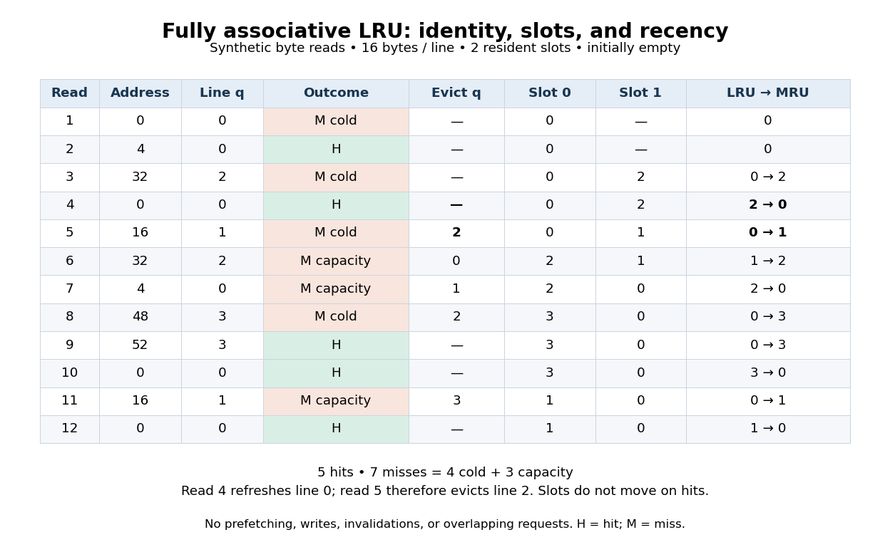

# Computer science

↑ **Parent:** [Codex Wiki](README.md)  
ⓦ [Wiki](https://en.wikipedia.org/wiki/Computer_science)

Computer science studies how information can be represented and transformed by [algorithms](algorithm.md), and what those transformations can achieve. Its central questions connect [mathematics](mathematics.md) to practical design: what answer should a procedure produce, why is it correct, and how much work does it require as its [input](theoretical-computer-science.md#input-computer-science) grows? [Computability theory](computability-theory.md) asks which tasks can be solved at all; [computational complexity theory](theoretical-computer-science.md#computational-complexity-theory) asks what resources a solution needs.

The beauty is that choosing a representation can change what is feasible. Finding a name among a million entries sounds like a million checks. Store the entries in a [sorted array](data-structure.md#sorted-array), and [binary search](algorithm.md#binary-search) needs at most twenty middle-entry comparisons. The order makes each unsuccessful comparison eliminate a whole region of possibilities. A [data structure](data-structure.md) supplies useful organization; an [algorithm](algorithm.md) exploits it; [time complexity](theoretical-computer-science.md#time-complexity) explains the resulting savings.

[Algorithm correctness](algorithm.md#algorithm-correctness) covers every permitted [input](theoretical-computer-science.md#input-computer-science), including absent names and empty collections. [Time complexity](theoretical-computer-science.md#time-complexity) predicts scaling; [statistical program profiling](algorithm.md#statistical-program-profiling) investigates a particular implementation.

**Table of contents**

- [Computer science author](computer-science-author.md)
  - [Massachusetts Institute of Technology, 6.006 course staff](computer-science-author.md#massachusetts-institute-of-technology-6-006-course-staff)
    - [Work by Massachusetts Institute of Technology, 6.006 course staff](computer-science-author.md#work-by-massachusetts-institute-of-technology-6-006-course-staff)
  - [Oracle](computer-science-author.md#oracle)
    - [Work by Oracle](computer-science-author.md#work-by-oracle)
  - [Pat Morin](computer-science-author.md#pat-morin)
    - [Work by Pat Morin](computer-science-author.md#work-by-pat-morin)
  - [Remzi H. Arpaci-Dusseau](computer-science-author.md#remzi-h-arpaci-dusseau)
    - [Work by Remzi H. Arpaci-Dusseau](computer-science-author.md#work-by-remzi-h-arpaci-dusseau)
  - [Andrea C. Arpaci-Dusseau](computer-science-author.md#andrea-c-arpaci-dusseau)
    - [Work by Andrea C. Arpaci-Dusseau](computer-science-author.md#work-by-andrea-c-arpaci-dusseau)
  - [David S. Miller](computer-science-author.md#david-s-miller)
    - [Work by David S. Miller](computer-science-author.md#work-by-david-s-miller)
  - [Bowen Alpern](computer-science-author.md#bowen-alpern)
    - [Work by Bowen Alpern](computer-science-author.md#work-by-bowen-alpern)
  - [Fred B. Schneider](computer-science-author.md#fred-b-schneider)
    - [Work by Fred B. Schneider](computer-science-author.md#work-by-fred-b-schneider)
  - [Leslie Lamport](computer-science-author.md#leslie-lamport)
    - [Work by Leslie Lamport](computer-science-author.md#work-by-leslie-lamport)
  - [Suzanne J. Matthews](computer-science-author.md#suzanne-j-matthews)
    - [Work by Suzanne J. Matthews](computer-science-author.md#work-by-suzanne-j-matthews)
  - [Tia Newhall](computer-science-author.md#tia-newhall)
    - [Work by Tia Newhall](computer-science-author.md#work-by-tia-newhall)
  - [Kevin C. Webb](computer-science-author.md#kevin-c-webb)
    - [Work by Kevin C. Webb](computer-science-author.md#work-by-kevin-c-webb)
  - [Ulrich Drepper](computer-science-author.md#ulrich-drepper)
    - [Work by Ulrich Drepper](computer-science-author.md#work-by-ulrich-drepper)
  - [Robert Sedgewick](computer-science-author.md#robert-sedgewick)
    - [Work by Robert Sedgewick](computer-science-author.md#work-by-robert-sedgewick)
  - [Kevin Wayne](computer-science-author.md#kevin-wayne)
    - [Work by Kevin Wayne](computer-science-author.md#work-by-kevin-wayne)
  - [The kernel development community](computer-science-author.md#the-kernel-development-community)
    - [Work by The kernel development community](computer-science-author.md#work-by-the-kernel-development-community)
  - [Linux man-pages project](computer-science-author.md#linux-man-pages-project)
    - [Work by Linux man-pages project](computer-science-author.md#work-by-linux-man-pages-project)
  - [John Kubiatowicz](computer-science-author.md#john-kubiatowicz)
    - [Work by John Kubiatowicz](computer-science-author.md#work-by-john-kubiatowicz)
  - [ARM Limited](computer-science-author.md#arm-limited)
    - [Work by ARM Limited](computer-science-author.md#work-by-arm-limited)
  - [Intel Corporation](computer-science-author.md#intel-corporation)
    - [Work by Intel Corporation](computer-science-author.md#work-by-intel-corporation)
  - [L. Peter Deutsch](computer-science-author.md#l-peter-deutsch)
    - [Work by L. Peter Deutsch](computer-science-author.md#work-by-l-peter-deutsch)
  - [Mark Adler](computer-science-author.md#mark-adler)
    - [Work by Mark Adler](computer-science-author.md#work-by-mark-adler)
  - [Thomas Boutell](computer-science-author.md#thomas-boutell)
    - [Work by Thomas Boutell](computer-science-author.md#work-by-thomas-boutell)
  - [Christian Brunschen](computer-science-author.md#christian-brunschen)
    - [Work by Christian Brunschen](computer-science-author.md#work-by-christian-brunschen)
  - [Adam M. Costello](computer-science-author.md#adam-m-costello)
    - [Work by Adam M. Costello](computer-science-author.md#work-by-adam-m-costello)
  - [Lee Daniel Crocker](computer-science-author.md#lee-daniel-crocker)
    - [Work by Lee Daniel Crocker](computer-science-author.md#work-by-lee-daniel-crocker)
  - [Andreas Dilger](computer-science-author.md#andreas-dilger)
    - [Work by Andreas Dilger](computer-science-author.md#work-by-andreas-dilger)
  - [Oliver Fromme](computer-science-author.md#oliver-fromme)
    - [Work by Oliver Fromme](computer-science-author.md#work-by-oliver-fromme)
  - [Jean-loup Gailly](computer-science-author.md#jean-loup-gailly)
    - [Work by Jean-loup Gailly](computer-science-author.md#work-by-jean-loup-gailly)
  - [Phil Harvey](computer-science-author.md#phil-harvey)
    - [Work by Phil Harvey](computer-science-author.md#work-by-phil-harvey)
  - [Chris Herborth](computer-science-author.md#chris-herborth)
    - [Work by Chris Herborth](computer-science-author.md#work-by-chris-herborth)
  - [Alex Jakulin](computer-science-author.md#alex-jakulin)
    - [Work by Alex Jakulin](computer-science-author.md#work-by-alex-jakulin)
  - [Neal Kettler](computer-science-author.md#neal-kettler)
    - [Work by Neal Kettler](computer-science-author.md#work-by-neal-kettler)
  - [Tom Lane](computer-science-author.md#tom-lane)
    - [Work by Tom Lane](computer-science-author.md#work-by-tom-lane)
  - [Alexander Lehmann](computer-science-author.md#alexander-lehmann)
    - [Work by Alexander Lehmann](computer-science-author.md#work-by-alexander-lehmann)
  - [Chris Lilley](computer-science-author.md#chris-lilley)
    - [Work by Chris Lilley](computer-science-author.md#work-by-chris-lilley)
  - [Dave Martindale](computer-science-author.md#dave-martindale)
    - [Work by Dave Martindale](computer-science-author.md#work-by-dave-martindale)
  - [Owen Mortensen](computer-science-author.md#owen-mortensen)
    - [Work by Owen Mortensen](computer-science-author.md#work-by-owen-mortensen)
  - [Stuart Parmenter](computer-science-author.md#stuart-parmenter)
    - [Work by Stuart Parmenter](computer-science-author.md#work-by-stuart-parmenter)
  - [Keith S. Pickens](computer-science-author.md#keith-s-pickens)
    - [Work by Keith S. Pickens](computer-science-author.md#work-by-keith-s-pickens)
  - [Robert P. Poole](computer-science-author.md#robert-p-poole)
    - [Work by Robert P. Poole](computer-science-author.md#work-by-robert-p-poole)
  - [Glenn Randers-Pehrson](computer-science-author.md#glenn-randers-pehrson)
    - [Work by Glenn Randers-Pehrson](computer-science-author.md#work-by-glenn-randers-pehrson)
  - [Greg Roelofs](computer-science-author.md#greg-roelofs)
    - [Work by Greg Roelofs](computer-science-author.md#work-by-greg-roelofs)
  - [Willem van Schaik](computer-science-author.md#willem-van-schaik)
    - [Work by Willem van Schaik](computer-science-author.md#work-by-willem-van-schaik)
  - [Guy Schalnat](computer-science-author.md#guy-schalnat)
    - [Work by Guy Schalnat](computer-science-author.md#work-by-guy-schalnat)
  - [Paul Schmidt](computer-science-author.md#paul-schmidt)
    - [Work by Paul Schmidt](computer-science-author.md#work-by-paul-schmidt)
  - [Andrew Smith](computer-science-author.md#andrew-smith)
    - [Work by Andrew Smith](computer-science-author.md#work-by-andrew-smith)
  - [Michael Stokes](computer-science-author.md#michael-stokes)
    - [Work by Michael Stokes](computer-science-author.md#work-by-michael-stokes)
  - [Vladimir Vukicevic](computer-science-author.md#vladimir-vukicevic)
    - [Work by Vladimir Vukicevic](computer-science-author.md#work-by-vladimir-vukicevic)
  - [Tim Wegner](computer-science-author.md#tim-wegner)
    - [Work by Tim Wegner](computer-science-author.md#work-by-tim-wegner)
  - [Jeremy Wohl](computer-science-author.md#jeremy-wohl)
    - [Work by Jeremy Wohl](computer-science-author.md#work-by-jeremy-wohl)
  - [D. L. Parnas](computer-science-author.md#d-l-parnas)
    - [Work by D. L. Parnas](computer-science-author.md#work-by-d-l-parnas)
  - [Microsoft](computer-science-author.md#microsoft)
    - [Work by Microsoft](computer-science-author.md#work-by-microsoft)
  - [RISC-V International](computer-science-author.md#risc-v-international)
    - [Work by RISC-V International](computer-science-author.md#work-by-risc-v-international)
  - [Sanjoy Dasgupta](computer-science-author.md#sanjoy-dasgupta)
    - [Work by Sanjoy Dasgupta](computer-science-author.md#work-by-sanjoy-dasgupta)
  - [Anupam Gupta](computer-science-author.md#anupam-gupta)
    - [Work by Anupam Gupta](computer-science-author.md#work-by-anupam-gupta)
  - [Jochen Liedtke](computer-science-author.md#jochen-liedtke)
    - [Work by Jochen Liedtke](computer-science-author.md#work-by-jochen-liedtke)
  - [seL4 Project](computer-science-author.md#sel4-project)
    - [Work by seL4 Project](computer-science-author.md#work-by-sel4-project)
  - [Albert R. Meyer](computer-science-author.md#albert-r-meyer)
    - [Work by Albert R. Meyer](computer-science-author.md#work-by-albert-r-meyer)
  - [Eric Lehman](computer-science-author.md#eric-lehman)
    - [Work by Eric Lehman](computer-science-author.md#work-by-eric-lehman)
  - [F. Thomson Leighton](computer-science-author.md#f-thomson-leighton)
    - [Work by F. Thomson Leighton](computer-science-author.md#work-by-f-thomson-leighton)
  - [Donald Michie](computer-science-author.md#donald-michie)
    - [Work by Donald Michie](computer-science-author.md#work-by-donald-michie)
  - [A. Karatsuba](computer-science-author.md#a-karatsuba)
    - [Work by A. Karatsuba](computer-science-author.md#work-by-a-karatsuba)
  - [Yu. Ofman](computer-science-author.md#yu-ofman)
    - [Work by Yu. Ofman](computer-science-author.md#work-by-yu-ofman)
  - [GNU MP development team](computer-science-author.md#gnu-mp-development-team)
    - [Work by GNU MP development team](computer-science-author.md#work-by-gnu-mp-development-team)
  - [IEEE](computer-science-author.md#ieee)
    - [Work by IEEE](computer-science-author.md#work-by-ieee)
  - [The Open Group](computer-science-author.md#the-open-group)
    - [Work by The Open Group](computer-science-author.md#work-by-the-open-group)
  - [Harry Buhrman](computer-science-author.md#harry-buhrman)
    - [Work by Harry Buhrman](computer-science-author.md#work-by-harry-buhrman)
  - [Ronald de Wolf](computer-science-author.md#ronald-de-wolf)
    - [Work by Ronald de Wolf](computer-science-author.md#work-by-ronald-de-wolf)
  - [Ryan O'Donnell](computer-science-author.md#ryan-o-donnell)
    - [Work by Ryan O'Donnell](computer-science-author.md#work-by-ryan-o-donnell)
  - [Michael Saks](computer-science-author.md#michael-saks)
    - [Work by Michael Saks](computer-science-author.md#work-by-michael-saks)
  - [Oded Schramm](computer-science-author.md#oded-schramm)
    - [Work by Oded Schramm](computer-science-author.md#work-by-oded-schramm)
  - [Rocco A. Servedio](computer-science-author.md#rocco-a-servedio)
    - [Work by Rocco A. Servedio](computer-science-author.md#work-by-rocco-a-servedio)
  - [David R. MacIver](computer-science-author.md#david-r-maciver)
    - [Work by David R. MacIver](computer-science-author.md#work-by-david-r-maciver)
  - [Tim Rohlfs](computer-science-author.md#tim-rohlfs)
    - [Work by Tim Rohlfs](computer-science-author.md#work-by-tim-rohlfs)
  - [Julie Sussman](computer-science-author.md#julie-sussman)
    - [Work by Julie Sussman](computer-science-author.md#work-by-julie-sussman)
  - [Jan Gaspar](computer-science-author.md#jan-gaspar)
    - [Work by Jan Gaspar](computer-science-author.md#work-by-jan-gaspar)
- [Computer science bibliography](computer-science-bibliography.md)
  - [Best Practices for Scientific Computing by Greg Wilson and others](computer-science-bibliography.md#best-practices-for-scientific-computing-by-greg-wilson-and-others)
  - [Opportunistic Data Structures with Applications by Paolo Ferragina and others](computer-science-bibliography.md#opportunistic-data-structures-with-applications-by-paolo-ferragina-and-others)
  - [6.006 Introduction to Algorithms, Fall 2011 by Massachusetts Institute of Technology, 6.006 course staff](computer-science-bibliography.md#6-006-introduction-to-algorithms-fall-2011-by-massachusetts-institute-of-technology-6-006-course-staff)
    - [Lecture 17: Shortest Paths III: Bellman-Ford](computer-science-bibliography.md#6-006-introduction-to-algorithms-fall-2011-by-massachusetts-institute-of-technology-6-006-course-staff/lecture-17-shortest-paths-iii-bellman-ford)
    - [Lecture 8: Hashing I](computer-science-bibliography.md#6-006-introduction-to-algorithms-fall-2011-by-massachusetts-institute-of-technology-6-006-course-staff/lecture-8-hashing-i)
    - [Lecture 9: Hashing II](computer-science-bibliography.md#6-006-introduction-to-algorithms-fall-2011-by-massachusetts-institute-of-technology-6-006-course-staff/lecture-9-hashing-ii)
    - [Lecture 14: Graphs II: Depth-First Search](computer-science-bibliography.md#6-006-introduction-to-algorithms-fall-2011-by-massachusetts-institute-of-technology-6-006-course-staff/lecture-14-graphs-ii-depth-first-search)
    - [Lecture 10: Hashing III: Open Addressing](computer-science-bibliography.md#6-006-introduction-to-algorithms-fall-2011-by-massachusetts-institute-of-technology-6-006-course-staff/lecture-10-hashing-iii-open-addressing)
    - [Lecture 21: Dynamic Programming III](computer-science-bibliography.md#6-006-introduction-to-algorithms-fall-2011-by-massachusetts-institute-of-technology-6-006-course-staff/lecture-21-dynamic-programming-iii)
    - [Lecture 3: Insertion sort, merge sort](computer-science-bibliography.md#6-006-introduction-to-algorithms-fall-2011-by-massachusetts-institute-of-technology-6-006-course-staff/lecture-3-insertion-sort-merge-sort)
    - [Lecture 11: Numerics I](computer-science-bibliography.md#6-006-introduction-to-algorithms-fall-2011-by-massachusetts-institute-of-technology-6-006-course-staff/lecture-11-numerics-i)
  - [Java Platform, Standard Edition 25 API Specification by Oracle](computer-science-bibliography.md#java-platform-standard-edition-25-api-specification-by-oracle)
    - [Object (Java SE 25 & JDK 25)](computer-science-bibliography.md#java-platform-standard-edition-25-api-specification-by-oracle/object-java-se-25-and-jdk-25)
  - [Open Data Structures: An Introduction by Pat Morin](computer-science-bibliography.md#open-data-structures-an-introduction-by-pat-morin)
    - [5.2 LinearHashTable: Linear Probing](computer-science-bibliography.md#open-data-structures-an-introduction-by-pat-morin/5-2-linearhashtable-linear-probing)
    - [5.1 ChainedHashTable: Hashing with Chaining](computer-science-bibliography.md#open-data-structures-an-introduction-by-pat-morin/5-1-chainedhashtable-hashing-with-chaining)
    - [11.1 Comparison-Based Sorting](computer-science-bibliography.md#open-data-structures-an-introduction-by-pat-morin/11-1-comparison-based-sorting)
    - [11.2 Counting Sort and Radix Sort](computer-science-bibliography.md#open-data-structures-an-introduction-by-pat-morin/11-2-counting-sort-and-radix-sort)
    - [6 Binary Trees](computer-science-bibliography.md#open-data-structures-an-introduction-by-pat-morin/6-binary-trees)
  - [Operating Systems: Three Easy Pieces by Remzi H. Arpaci-Dusseau and others](computer-science-bibliography.md#operating-systems-three-easy-pieces-by-remzi-h-arpaci-dusseau-and-others)
    - [Mechanism: Address Translation](computer-science-bibliography.md#operating-systems-three-easy-pieces-by-remzi-h-arpaci-dusseau-and-others/mechanism-address-translation)
    - [Paging: Faster Translations (TLBs)](computer-science-bibliography.md#operating-systems-three-easy-pieces-by-remzi-h-arpaci-dusseau-and-others/paging-faster-translations-tlbs)
    - [Beyond Physical Memory: Mechanisms](computer-science-bibliography.md#operating-systems-three-easy-pieces-by-remzi-h-arpaci-dusseau-and-others/beyond-physical-memory-mechanisms)
    - [Complete Virtual Memory Systems](computer-science-bibliography.md#operating-systems-three-easy-pieces-by-remzi-h-arpaci-dusseau-and-others/complete-virtual-memory-systems)
    - [Locks](computer-science-bibliography.md#operating-systems-three-easy-pieces-by-remzi-h-arpaci-dusseau-and-others/locks)
    - [Common Concurrency Problems](computer-science-bibliography.md#operating-systems-three-easy-pieces-by-remzi-h-arpaci-dusseau-and-others/common-concurrency-problems)
    - [Beyond Physical Memory: Policies](computer-science-bibliography.md#operating-systems-three-easy-pieces-by-remzi-h-arpaci-dusseau-and-others/beyond-physical-memory-policies)
    - [Crash Consistency: FSCK and Journaling](computer-science-bibliography.md#operating-systems-three-easy-pieces-by-remzi-h-arpaci-dusseau-and-others/crash-consistency-fsck-and-journaling)
    - [File System Implementation](computer-science-bibliography.md#operating-systems-three-easy-pieces-by-remzi-h-arpaci-dusseau-and-others/file-system-implementation)
  - [fork(2) — Linux manual page](computer-science-bibliography.md#fork-2-linux-manual-page)
  - [mmap(2) — Linux manual page](computer-science-bibliography.md#mmap-2-linux-manual-page)
  - [6.1810  and  Fall 2022](computer-science-bibliography.md#6-1810-and-fall-2022)
    - [Lab: Copy-on-Write Fork for xv6](computer-science-bibliography.md#6-1810-and-fall-2022/lab-copy-on-write-fork-for-xv6)
  - [Cache and TLB Flushing Under Linux by David S. Miller](computer-science-bibliography.md#cache-and-tlb-flushing-under-linux-by-david-s-miller)
  - [Working Draft, Standard for Programming Language C++ (N4861)](computer-science-bibliography.md#working-draft-standard-for-programming-language-c-plus-plus-n4861)
  - [Defining Liveness by Bowen Alpern and others](computer-science-bibliography.md#defining-liveness-by-bowen-alpern-and-others)
  - [How to Make a Multiprocessor Computer That Correctly Executes Multiprocess Programs by Leslie Lamport](computer-science-bibliography.md#how-to-make-a-multiprocessor-computer-that-correctly-executes-multiprocess-programs-by-leslie-lamport)
  - [Dive into Systems by Suzanne J. Matthews and others](computer-science-bibliography.md#dive-into-systems-by-suzanne-j-matthews-and-others)
    - [11.4. CPU Caches](computer-science-bibliography.md#dive-into-systems-by-suzanne-j-matthews-and-others/11-4-cpu-caches)
  - [Memory part 2: CPU caches by Ulrich Drepper](computer-science-bibliography.md#memory-part-2-cpu-caches-by-ulrich-drepper)
  - [Insertion.java by Robert Sedgewick and others](computer-science-bibliography.md#insertion-java-by-robert-sedgewick-and-others)
  - [3.6. Journal (jbd2) by The kernel development community](computer-science-bibliography.md#3-6-journal-jbd2-by-the-kernel-development-community)
  - [Explicit volatile write back cache control by The kernel development community](computer-science-bibliography.md#explicit-volatile-write-back-cache-control-by-the-kernel-development-community)
  - [ext4 General Information by The kernel development community](computer-science-bibliography.md#ext4-general-information-by-the-kernel-development-community)
  - [fsync(2) — Linux manual page by Linux man-pages project](computer-science-bibliography.md#fsync-2-linux-manual-page-by-linux-man-pages-project)
  - [xv6 RISC-V source code](computer-science-bibliography.md#xv6-risc-v-source-code)
    - [bio.c](computer-science-bibliography.md#xv6-risc-v-source-code/bio-c)
    - [buf.h](computer-science-bibliography.md#xv6-risc-v-source-code/buf-h)
    - [log.c](computer-science-bibliography.md#xv6-risc-v-source-code/log-c)
    - [vm.c](computer-science-bibliography.md#xv6-risc-v-source-code/vm-c)
  - [Buffer Heads by The kernel development community](computer-science-bibliography.md#buffer-heads-by-the-kernel-development-community)
  - [CS152: Computer Architecture and Engineering, Fall 1999](computer-science-bibliography.md#cs152-computer-architecture-and-engineering-fall-1999)
    - [Lecture 21: Buses and I and O](computer-science-bibliography.md#cs152-computer-architecture-and-engineering-fall-1999/lecture-21-buses-and-i-and-o)
  - [AMBA Specification (Rev 2.0) by ARM Limited](computer-science-bibliography.md#amba-specification-rev-2-0-by-arm-limited)
  - [An Introduction to the Intel QuickPath Interconnect by Intel Corporation](computer-science-bibliography.md#an-introduction-to-the-intel-quickpath-interconnect-by-intel-corporation)
  - [DEFLATE Compressed Data Format Specification version 1.3 by L. Peter Deutsch](computer-science-bibliography.md#deflate-compressed-data-format-specification-version-1-3-by-l-peter-deutsch)
  - [Portable Network Graphics (PNG) Specification (Third Edition) by Mark Adler and others](computer-science-bibliography.md#portable-network-graphics-png-specification-third-edition-by-mark-adler-and-others)
  - [Python 3.14 documentation](computer-science-bibliography.md#python-3-14-documentation)
    - [zlib — Compression compatible with gzip (Python 3.14 documentation)](computer-science-bibliography.md#python-3-14-documentation/zlib-compression-compatible-with-gzip-python-3-14-documentation)
    - [functools — Higher-order functions and operations on callable objects (Python 3.14 documentation)](computer-science-bibliography.md#python-3-14-documentation/functools-higher-order-functions-and-operations-on-callable-objects-python-3-14-documentation)
    - [ast — Abstract syntax trees, Python 3.14 documentation](computer-science-bibliography.md#python-3-14-documentation/ast-abstract-syntax-trees-python-3-14-documentation)
    - [Expressions, Python 3.14 language reference](computer-science-bibliography.md#python-3-14-documentation/expressions-python-3-14-language-reference)
    - [Simple statements, Python 3.14 language reference](computer-science-bibliography.md#python-3-14-documentation/simple-statements-python-3-14-language-reference)
    - [Built-in Types, Python 3.14 documentation](computer-science-bibliography.md#python-3-14-documentation/built-in-types-python-3-14-documentation)
    - [Glossary, Python 3.14 documentation](computer-science-bibliography.md#python-3-14-documentation/glossary-python-3-14-documentation)
    - [Built-in Functions, Python 3.14 documentation](computer-science-bibliography.md#python-3-14-documentation/built-in-functions-python-3-14-documentation)
  - [On the Criteria To Be Used in Decomposing Systems into Modules by D. L. Parnas](computer-science-bibliography.md#on-the-criteria-to-be-used-in-decomposing-systems-into-modules-by-d-l-parnas)
  - [6.005 Software Construction, Spring 2016](computer-science-bibliography.md#6-005-software-construction-spring-2016)
    - [Reading 13: Abstraction Functions & Rep Invariants](computer-science-bibliography.md#6-005-software-construction-spring-2016/reading-13-abstraction-functions-and-rep-invariants)
  - [Excel Recalculation by Microsoft](computer-science-bibliography.md#excel-recalculation-by-microsoft)
  - [Page Tables by The kernel development community](computer-science-bibliography.md#page-tables-by-the-kernel-development-community)
  - [The RISC-V Instruction Set Manual, Volume II: Privileged Architecture by RISC-V International](computer-science-bibliography.md#the-risc-v-instruction-set-manual-volume-ii-privileged-architecture-by-risc-v-international)
  - [On micro-kernel construction by Jochen Liedtke](computer-science-bibliography.md#on-micro-kernel-construction-by-jochen-liedtke)
  - [Capabilities tutorial by seL4 Project](computer-science-bibliography.md#capabilities-tutorial-by-sel4-project)
  - [IPC tutorial by seL4 Project](computer-science-bibliography.md#ipc-tutorial-by-sel4-project)
  - [seL4 Proofs by seL4 Project](computer-science-bibliography.md#sel4-proofs-by-sel4-project)
  - [What the Proofs Assume by seL4 Project](computer-science-bibliography.md#what-the-proofs-assume-by-sel4-project)
  - [Lecture 15: Recursive Algorithms (6.006 Spring 2020) by Massachusetts Institute of Technology, 6.006 course staff](computer-science-bibliography.md#lecture-15-recursive-algorithms-6-006-spring-2020-by-massachusetts-institute-of-technology-6-006-course-staff)
  - [“Memo” Functions and Machine Learning by Donald Michie](computer-science-bibliography.md#“memo”-functions-and-machine-learning-by-donald-michie)
  - [Multiplication of many-digital numbers by automatic computers by A. Karatsuba and Yu. Ofman](computer-science-bibliography.md#multiplication-of-many-digital-numbers-by-automatic-computers-by-a-karatsuba-and-yu-ofman)
  - [GNU MP 6.3.0 manual](computer-science-bibliography.md#gnu-mp-6-3-0-manual)
    - [Karatsuba Multiplication](computer-science-bibliography.md#gnu-mp-6-3-0-manual/karatsuba-multiplication)
    - [Basecase Multiplication](computer-science-bibliography.md#gnu-mp-6-3-0-manual/basecase-multiplication)
  - [The Open Group Base Specifications Issue 8, IEEE Std 1003.1-2024 by IEEE and others](computer-science-bibliography.md#the-open-group-base-specifications-issue-8-ieee-std-1003-1-2024-by-ieee-and-others)
    - [mmap — POSIX.1-2024](computer-science-bibliography.md#the-open-group-base-specifications-issue-8-ieee-std-1003-1-2024-by-ieee-and-others/mmap-posix-1-2024)
  - [Page Cache by The kernel development community](computer-science-bibliography.md#page-cache-by-the-kernel-development-community)
  - [msync(2) — Linux manual page by Linux man-pages project](computer-science-bibliography.md#msync-2-linux-manual-page-by-linux-man-pages-project)
  - [Abstract syntax schema for CPython 3.14](computer-science-bibliography.md#abstract-syntax-schema-for-cpython-3-14)
  - [Complexity Measures and Decision Tree Complexity: A Survey by Harry Buhrman and Ronald de Wolf](computer-science-bibliography.md#complexity-measures-and-decision-tree-complexity-a-survey-by-harry-buhrman-and-ronald-de-wolf)
  - [Every decision tree has an influential variable by Ryan O'Donnell and others](computer-science-bibliography.md#every-decision-tree-has-an-influential-variable-by-ryan-o-donnell-and-others)
  - [OCaml Programming: Correct + Efficient + Beautiful by Michael R. Clarkson and others](computer-science-bibliography.md#ocaml-programming-correct-plus-efficient-plus-beautiful-by-michael-r-clarkson-and-others)
    - [8.3 Module Documentation](computer-science-bibliography.md#ocaml-programming-correct-plus-efficient-plus-beautiful-by-michael-r-clarkson-and-others/8-3-module-documentation)
  - [Data Structures and Algorithms edited by Peter Ljunglöf and others](computer-science-bibliography.md#data-structures-and-algorithms-edited-by-peter-ljunglof-and-others)
    - [9.1 Binary trees](computer-science-bibliography.md#data-structures-and-algorithms-edited-by-peter-ljunglof-and-others/9-1-binary-trees)
  - [Introduction to Programming in Java: An Interdisciplinary Approach by Robert Sedgewick and others](computer-science-bibliography.md#introduction-to-programming-in-java-an-interdisciplinary-approach-by-robert-sedgewick-and-others)
    - [4.4 Symbol Tables](computer-science-bibliography.md#introduction-to-programming-in-java-an-interdisciplinary-approach-by-robert-sedgewick-and-others/4-4-symbol-tables)
  - [Recitation 19: Graph Representations and Traversals (Cornell course page)](computer-science-bibliography.md#recitation-19-graph-representations-and-traversals-cornell-course-page)
  - [Switch between relative, absolute, and mixed references, Microsoft Support](computer-science-bibliography.md#switch-between-relative-absolute-and-mixed-references-microsoft-support)
  - [Addresses and References, Absolute and Relative, LibreOffice Help](computer-science-bibliography.md#addresses-and-references-absolute-and-relative-libreoffice-help)
  - [LLVM 20.1.0 documentation](computer-science-bibliography.md#llvm-20-1-0-documentation)
    - [3. Kaleidoscope: Code generation to LLVM IR](computer-science-bibliography.md#llvm-20-1-0-documentation/3-kaleidoscope-code-generation-to-llvm-ir)
    - [4. Kaleidoscope: Adding JIT and Optimizer Support](computer-science-bibliography.md#llvm-20-1-0-documentation/4-kaleidoscope-adding-jit-and-optimizer-support)
  - [CMPT 710 and CMPT 407 - Computational Complexity - Fall 2007](computer-science-bibliography.md#cmpt-710-and-cmpt-407-computational-complexity-fall-2007)
    - [CMPT 710 - Complexity Theory: Lecture 18](computer-science-bibliography.md#cmpt-710-and-cmpt-407-computational-complexity-fall-2007/cmpt-710-complexity-theory-lecture-18)
  - [CPSC 536N: Randomized Algorithms](computer-science-bibliography.md#cpsc-536n-randomized-algorithms)
    - [Lecture 9: Polynomial Identity Testing by the Schwartz-Zippel Lemma](computer-science-bibliography.md#cpsc-536n-randomized-algorithms/lecture-9-polynomial-identity-testing-by-the-schwartz-zippel-lemma)
  - [The Complexity of Theorem-Proving Procedures by Stephen A. Cook](computer-science-bibliography.md#the-complexity-of-theorem-proving-procedures-by-stephen-a-cook)
  - [CS 252, Lecture 8: Constraint Satisfaction Problems (Carnegie Mellon University)](computer-science-bibliography.md#cs-252-lecture-8-constraint-satisfaction-problems-carnegie-mellon-university)
  - [CS 2112 Fall 2019](computer-science-bibliography.md#cs-2112-fall-2019)
    - [Loop invariants](computer-science-bibliography.md#cs-2112-fall-2019/loop-invariants)
  - [Matplotlib 3.10.7 documentation](computer-science-bibliography.md#matplotlib-3-10-7-documentation)
    - [Log scale](computer-science-bibliography.md#matplotlib-3-10-7-documentation/log-scale)
  - [Algorithms by Jeff Erickson](computer-science-bibliography.md#algorithms-by-jeff-erickson)
    - [Greedy Algorithms](computer-science-bibliography.md#algorithms-by-jeff-erickson/greedy-algorithms)
  - [6.046J Design and Analysis of Algorithms, Spring 2015](computer-science-bibliography.md#6-046j-design-and-analysis-of-algorithms-spring-2015)
    - [Lecture 1: Introduction](computer-science-bibliography.md#6-046j-design-and-analysis-of-algorithms-spring-2015/lecture-1-introduction)
  - [Structure and Interpretation of Computer Programs by Harold Abelson and others](computer-science-bibliography.md#structure-and-interpretation-of-computer-programs-by-harold-abelson-and-others)
  - [Discrete Probability by Jeff Erickson](computer-science-bibliography.md#discrete-probability-by-jeff-erickson)
  - [CS 4820: Algorithms, Spring 2011](computer-science-bibliography.md#cs-4820-algorithms-spring-2011)
    - [Lecture notes on randomized approximation algorithms](computer-science-bibliography.md#cs-4820-algorithms-spring-2011/lecture-notes-on-randomized-approximation-algorithms)
  - [Amortized Computational Complexity by Robert Endre Tarjan](computer-science-bibliography.md#amortized-computational-complexity-by-robert-endre-tarjan)
  - [CS 312 at Cornell University](computer-science-bibliography.md#cs-312-at-cornell-university)
    - [Lecture 20: Hash tables and amortized analysis](computer-science-bibliography.md#cs-312-at-cornell-university/lecture-20-hash-tables-and-amortized-analysis)
  - [COS 226 Bob’s Notes 1: Union-Find and Percolation (Version 2) by Robert Tarjan](computer-science-bibliography.md#cos-226-bob’s-notes-1-union-find-and-percolation-version-2-by-robert-tarjan)
  - [Efficiency of a Good But Not Linear Set Union Algorithm by Robert Endre Tarjan](computer-science-bibliography.md#efficiency-of-a-good-but-not-linear-set-union-algorithm-by-robert-endre-tarjan)
  - [An O(m) Algorithm for Cores Decomposition of Networks by Vladimir Batagelj and Matjaž Zaveršnik](computer-science-bibliography.md#an-o-m-algorithm-for-cores-decomposition-of-networks-by-vladimir-batagelj-and-matjaz-zaversnik)
  - [MIRK 2003 proceedings](computer-science-bibliography.md#mirk-2003-proceedings)
    - [NetLogo Workshop](computer-science-bibliography.md#mirk-2003-proceedings/netlogo-workshop)
  - [An Axiomatic Basis for Computer Programming by Tony Hoare](computer-science-bibliography.md#an-axiomatic-basis-for-computer-programming-by-tony-hoare)
  - [Circular Buffers by David Howells and Paul E. McKenney](computer-science-bibliography.md#circular-buffers-by-david-howells-and-paul-e-mckenney)
  - [Boost.Circular Buffer by Jan Gaspar](computer-science-bibliography.md#boost-circular-buffer-by-jan-gaspar)
    - [Implementation](computer-science-bibliography.md#boost-circular-buffer-by-jan-gaspar/implementation)
- [Competitive programming](#competitive-programming)
  - [Competitive programming website](#competitive-programming-website)
    - [Project Euler](project-euler.md)
      - [Project Euler problem](project-euler.md#project-euler-problem)
        - [Project Euler problem 1](project-euler.md#project-euler-problem-1)
        - [Project Euler problem 2](project-euler.md#project-euler-problem-2)
        - [Project Euler problem 3](project-euler.md#project-euler-problem-3)
        - [Project Euler problem 4](project-euler.md#project-euler-problem-4)
        - [Project Euler problem 5](project-euler.md#project-euler-problem-5)
        - [Project Euler problem 6](project-euler.md#project-euler-problem-6)
        - [Project Euler problem 7](project-euler.md#project-euler-problem-7)
        - [Project Euler problem 8](project-euler.md#project-euler-problem-8)
        - [Project Euler problem 9](project-euler.md#project-euler-problem-9)
        - [Project Euler problem 10](project-euler.md#project-euler-problem-10)
        - [Project Euler problem 11](project-euler.md#project-euler-problem-11)
        - [Project Euler problem 12](project-euler.md#project-euler-problem-12)
        - [Project Euler problem 13](project-euler.md#project-euler-problem-13)
        - [Project Euler problem 14](project-euler.md#project-euler-problem-14)
        - [Project Euler problem 15](project-euler.md#project-euler-problem-15)
        - [Project Euler problem 16](project-euler.md#project-euler-problem-16)
        - [Project Euler problem 17](project-euler.md#project-euler-problem-17)
        - [Project Euler problem 18](project-euler.md#project-euler-problem-18)
        - [Project Euler problem 19](project-euler.md#project-euler-problem-19)
        - [Project Euler problem 20](project-euler.md#project-euler-problem-20)
        - [Project Euler problem 21](project-euler.md#project-euler-problem-21)
        - [Project Euler problem 22](project-euler.md#project-euler-problem-22)
        - [Project Euler problem 23](project-euler.md#project-euler-problem-23)
        - [Project Euler problem 24](project-euler.md#project-euler-problem-24)
        - [Project Euler problem 25](project-euler.md#project-euler-problem-25)
        - [Project Euler problem 26](project-euler.md#project-euler-problem-26)
        - [Project Euler problem 27](project-euler.md#project-euler-problem-27)
        - [Project Euler problem 28](project-euler.md#project-euler-problem-28)
        - [Project Euler problem 29](project-euler.md#project-euler-problem-29)
        - [Project Euler problem 30](project-euler.md#project-euler-problem-30)
        - [Project Euler problem 31](project-euler.md#project-euler-problem-31)
        - [Project Euler problem 32](project-euler.md#project-euler-problem-32)
        - [Project Euler problem 33](project-euler.md#project-euler-problem-33)
        - [Project Euler problem 34](project-euler.md#project-euler-problem-34)
        - [Project Euler problem 35](project-euler.md#project-euler-problem-35)
        - [Project Euler problem 36](project-euler.md#project-euler-problem-36)
        - [Project Euler problem 37](project-euler.md#project-euler-problem-37)
        - [Project Euler problem 38](project-euler.md#project-euler-problem-38)
        - [Project Euler problem 39](project-euler.md#project-euler-problem-39)
        - [Project Euler problem 40](project-euler.md#project-euler-problem-40)
        - [Project Euler problem 41](project-euler.md#project-euler-problem-41)
        - [Project Euler problem 42](project-euler.md#project-euler-problem-42)
        - [Project Euler problem 43](project-euler.md#project-euler-problem-43)
        - [Project Euler problem 44](project-euler.md#project-euler-problem-44)
        - [Project Euler problem 45](project-euler.md#project-euler-problem-45)
        - [Project Euler problem 46](project-euler.md#project-euler-problem-46)
        - [Project Euler problem 47](project-euler.md#project-euler-problem-47)
        - [Project Euler problem 48](project-euler.md#project-euler-problem-48)
        - [Project Euler problem 49](project-euler.md#project-euler-problem-49)
        - [Project Euler problem 50](project-euler.md#project-euler-problem-50)
        - [Project Euler problem 51](project-euler.md#project-euler-problem-51)
        - [Project Euler problem 52](project-euler.md#project-euler-problem-52)
        - [Project Euler problem 53](project-euler.md#project-euler-problem-53)
        - [Project Euler problem 54](project-euler.md#project-euler-problem-54)
        - [Project Euler problem 55](project-euler.md#project-euler-problem-55)
        - [Project Euler problem 56](project-euler.md#project-euler-problem-56)
        - [Project Euler problem 57](project-euler.md#project-euler-problem-57)
        - [Project Euler problem 58](project-euler.md#project-euler-problem-58)
        - [Project Euler problem 59](project-euler.md#project-euler-problem-59)
        - [Project Euler problem 60](project-euler.md#project-euler-problem-60)
        - [Project Euler problem 61](project-euler.md#project-euler-problem-61)
        - [Project Euler problem 62](project-euler.md#project-euler-problem-62)
        - [Project Euler problem 63](project-euler.md#project-euler-problem-63)
        - [Project Euler problem 64](project-euler.md#project-euler-problem-64)
        - [Project Euler problem 65](project-euler.md#project-euler-problem-65)
        - [Project Euler problem 66](project-euler.md#project-euler-problem-66)
        - [Project Euler problem 67](project-euler.md#project-euler-problem-67)
        - [Project Euler problem 68](project-euler.md#project-euler-problem-68)
        - [Project Euler problem 69](project-euler.md#project-euler-problem-69)
        - [Project Euler problem 70](project-euler.md#project-euler-problem-70)
        - [Project Euler problem 71](project-euler.md#project-euler-problem-71)
        - [Project Euler problem 72](project-euler.md#project-euler-problem-72)
        - [Project Euler problem 73](project-euler.md#project-euler-problem-73)
        - [Project Euler problem 74](project-euler.md#project-euler-problem-74)
        - [Project Euler problem 75](project-euler.md#project-euler-problem-75)
        - [Project Euler problem 76](project-euler.md#project-euler-problem-76)
        - [Project Euler problem 77](project-euler.md#project-euler-problem-77)
        - [Project Euler problem 78](project-euler.md#project-euler-problem-78)
        - [Project Euler problem 79](project-euler.md#project-euler-problem-79)
        - [Project Euler problem 80](project-euler.md#project-euler-problem-80)
        - [Project Euler problem 81](project-euler.md#project-euler-problem-81)
        - [Project Euler problem 82](project-euler.md#project-euler-problem-82)
        - [Project Euler problem 83](project-euler.md#project-euler-problem-83)
        - [Project Euler problem 84](project-euler.md#project-euler-problem-84)
        - [Project Euler problem 85](project-euler.md#project-euler-problem-85)
        - [Project Euler problem 86](project-euler.md#project-euler-problem-86)
        - [Project Euler problem 87](project-euler.md#project-euler-problem-87)
        - [Project Euler problem 88](project-euler.md#project-euler-problem-88)
        - [Project Euler problem 89](project-euler.md#project-euler-problem-89)
        - [Project Euler problem 90](project-euler.md#project-euler-problem-90)
        - [Project Euler problem 91](project-euler.md#project-euler-problem-91)
        - [Project Euler problem 92](project-euler.md#project-euler-problem-92)
        - [Project Euler problem 93](project-euler.md#project-euler-problem-93)
        - [Project Euler problem 94](project-euler.md#project-euler-problem-94)
        - [Project Euler problem 95](project-euler.md#project-euler-problem-95)
        - [Project Euler problem 96](project-euler.md#project-euler-problem-96)
        - [Project Euler problem 97](project-euler.md#project-euler-problem-97)
        - [Project Euler problem 98](project-euler.md#project-euler-problem-98)
        - [Project Euler problem 99](project-euler.md#project-euler-problem-99)
        - [Project Euler problem 100](project-euler.md#project-euler-problem-100)
        - [Project Euler problem 101](project-euler.md#project-euler-problem-101)
        - [Project Euler problem 102](project-euler.md#project-euler-problem-102)
        - [Project Euler problem 103](project-euler.md#project-euler-problem-103)
        - [Project Euler problem 104](project-euler.md#project-euler-problem-104)
        - [Project Euler problem 105](project-euler.md#project-euler-problem-105)
        - [Project Euler problem 106](project-euler.md#project-euler-problem-106)
        - [Project Euler problem 107](project-euler.md#project-euler-problem-107)
        - [Project Euler problem 108](project-euler.md#project-euler-problem-108)
        - [Project Euler problem 109](project-euler.md#project-euler-problem-109)
        - [Project Euler problem 110](project-euler.md#project-euler-problem-110)
        - [Project Euler problem 111](project-euler.md#project-euler-problem-111)
        - [Project Euler problem 112](project-euler.md#project-euler-problem-112)
        - [Project Euler problem 113](project-euler.md#project-euler-problem-113)
        - [Project Euler problem 114](project-euler.md#project-euler-problem-114)
        - [Project Euler problem 115](project-euler.md#project-euler-problem-115)
        - [Project Euler problem 116](project-euler.md#project-euler-problem-116)
        - [Project Euler problem 117](project-euler.md#project-euler-problem-117)
        - [Project Euler problem 118](project-euler.md#project-euler-problem-118)
        - [Project Euler problem 119](project-euler.md#project-euler-problem-119)
        - [Project Euler problem 120](project-euler.md#project-euler-problem-120)
        - [Project Euler problem 121](project-euler.md#project-euler-problem-121)
        - [Project Euler problem 122](project-euler.md#project-euler-problem-122)
        - [Project Euler problem 123](project-euler.md#project-euler-problem-123)
        - [Project Euler problem 124](project-euler.md#project-euler-problem-124)
        - [Project Euler problem 125](project-euler.md#project-euler-problem-125)
        - [Project Euler problem 126](project-euler.md#project-euler-problem-126)
        - [Project Euler problem 127](project-euler.md#project-euler-problem-127)
        - [Project Euler problem 128](project-euler.md#project-euler-problem-128)
        - [Project Euler problem 129](project-euler.md#project-euler-problem-129)
        - [Project Euler problem 130](project-euler.md#project-euler-problem-130)
        - [Project Euler problem 131](project-euler.md#project-euler-problem-131)
        - [Project Euler problem 132](project-euler.md#project-euler-problem-132)
        - [Project Euler problem 133](project-euler.md#project-euler-problem-133)
        - [Project Euler problem 134](project-euler.md#project-euler-problem-134)
        - [Project Euler problem 135](project-euler.md#project-euler-problem-135)
        - [Project Euler problem 136](project-euler.md#project-euler-problem-136)
        - [Project Euler problem 137](project-euler.md#project-euler-problem-137)
        - [Project Euler problem 138](project-euler.md#project-euler-problem-138)
        - [Project Euler problem 139](project-euler.md#project-euler-problem-139)
        - [Project Euler problem 140](project-euler.md#project-euler-problem-140)
        - [Project Euler problem 141](project-euler.md#project-euler-problem-141)
        - [Project Euler problem 142](project-euler.md#project-euler-problem-142)
        - [Project Euler problem 143](project-euler.md#project-euler-problem-143)
        - [Project Euler problem 144](project-euler.md#project-euler-problem-144)
        - [Project Euler problem 145](project-euler.md#project-euler-problem-145)
        - [Project Euler problem 146](project-euler.md#project-euler-problem-146)
        - [Project Euler problem 147](project-euler.md#project-euler-problem-147)
        - [Project Euler problem 148](project-euler.md#project-euler-problem-148)
        - [Project Euler problem 149](project-euler.md#project-euler-problem-149)
        - [Project Euler problem 150](project-euler.md#project-euler-problem-150)
        - [Project Euler problem 151](project-euler.md#project-euler-problem-151)
        - [Project Euler problem 152](project-euler.md#project-euler-problem-152)
        - [Project Euler problem 153](project-euler.md#project-euler-problem-153)
        - [Project Euler problem 154](project-euler.md#project-euler-problem-154)
        - [Project Euler problem 155](project-euler.md#project-euler-problem-155)
        - [Project Euler problem 156](project-euler.md#project-euler-problem-156)
        - [Project Euler problem 157](project-euler.md#project-euler-problem-157)
        - [Project Euler problem 158](project-euler.md#project-euler-problem-158)
        - [Project Euler problem 159](project-euler.md#project-euler-problem-159)
        - [Project Euler problem 160](project-euler.md#project-euler-problem-160)
        - [Project Euler problem 161](project-euler.md#project-euler-problem-161)
        - [Project Euler problem 162](project-euler.md#project-euler-problem-162)
        - [Project Euler problem 163](project-euler.md#project-euler-problem-163)
        - [Project Euler problem 164](project-euler.md#project-euler-problem-164)
        - [Project Euler problem 165](project-euler.md#project-euler-problem-165)
        - [Project Euler problem 166](project-euler.md#project-euler-problem-166)
        - [Project Euler problem 167](project-euler.md#project-euler-problem-167)
        - [Project Euler problem 168](project-euler.md#project-euler-problem-168)
        - [Project Euler problem 169](project-euler.md#project-euler-problem-169)
        - [Project Euler problem 170](project-euler.md#project-euler-problem-170)
        - [Project Euler problem 171](project-euler.md#project-euler-problem-171)
        - [Project Euler problem 172](project-euler.md#project-euler-problem-172)
        - [Project Euler problem 173](project-euler.md#project-euler-problem-173)
        - [Project Euler problem 174](project-euler.md#project-euler-problem-174)
        - [Project Euler problem 175](project-euler.md#project-euler-problem-175)
        - [Project Euler problem 176](project-euler.md#project-euler-problem-176)
        - [Project Euler problem 177](project-euler.md#project-euler-problem-177)
        - [Project Euler problem 178](project-euler.md#project-euler-problem-178)
        - [Project Euler problem 179](project-euler.md#project-euler-problem-179)
        - [Project Euler problem 180](project-euler.md#project-euler-problem-180)
        - [Project Euler problem 181](project-euler.md#project-euler-problem-181)
        - [Project Euler problem 182](project-euler.md#project-euler-problem-182)
        - [Project Euler problem 183](project-euler.md#project-euler-problem-183)
        - [Project Euler problem 184](project-euler.md#project-euler-problem-184)
        - [Project Euler problem 185](project-euler.md#project-euler-problem-185)
        - [Project Euler problem 186](project-euler.md#project-euler-problem-186)
        - [Project Euler problem 187](project-euler.md#project-euler-problem-187)
        - [Project Euler problem 188](project-euler.md#project-euler-problem-188)
        - [Project Euler problem 189](project-euler.md#project-euler-problem-189)
        - [Project Euler problem 190](project-euler.md#project-euler-problem-190)
        - [Project Euler problem 191](project-euler.md#project-euler-problem-191)
        - [Project Euler problem 192](project-euler.md#project-euler-problem-192)
        - [Project Euler problem 193](project-euler.md#project-euler-problem-193)
        - [Project Euler problem 194](project-euler.md#project-euler-problem-194)
        - [Project Euler problem 195](project-euler.md#project-euler-problem-195)
        - [Project Euler problem 196](project-euler.md#project-euler-problem-196)
        - [Project Euler problem 197](project-euler.md#project-euler-problem-197)
        - [Project Euler problem 198](project-euler.md#project-euler-problem-198)
        - [Project Euler problem 199](project-euler.md#project-euler-problem-199)
        - [Project Euler problem 200](project-euler.md#project-euler-problem-200)
        - [Project Euler problem 201](project-euler.md#project-euler-problem-201)
        - [Project Euler problem 202](project-euler.md#project-euler-problem-202)
        - [Project Euler problem 203](project-euler.md#project-euler-problem-203)
        - [Project Euler problem 204](project-euler.md#project-euler-problem-204)
        - [Project Euler problem 205](project-euler.md#project-euler-problem-205)
        - [Project Euler problem 206](project-euler.md#project-euler-problem-206)
        - [Project Euler problem 207](project-euler.md#project-euler-problem-207)
        - [Project Euler problem 208](project-euler.md#project-euler-problem-208)
        - [Project Euler problem 209](project-euler.md#project-euler-problem-209)
        - [Project Euler problem 210](project-euler.md#project-euler-problem-210)
        - [Project Euler problem 211](project-euler.md#project-euler-problem-211)
        - [Project Euler problem 212](project-euler.md#project-euler-problem-212)
        - [Project Euler problem 213](project-euler.md#project-euler-problem-213)
        - [Project Euler problem 214](project-euler.md#project-euler-problem-214)
        - [Project Euler problem 215](project-euler.md#project-euler-problem-215)
        - [Project Euler problem 216](project-euler.md#project-euler-problem-216)
        - [Project Euler problem 217](project-euler.md#project-euler-problem-217)
        - [Project Euler problem 218](project-euler.md#project-euler-problem-218)
        - [Project Euler problem 219](project-euler.md#project-euler-problem-219)
        - [Project Euler problem 220](project-euler.md#project-euler-problem-220)
        - [Project Euler problem 221](project-euler.md#project-euler-problem-221)
        - [Project Euler problem 222](project-euler.md#project-euler-problem-222)
        - [Project Euler problem 223](project-euler.md#project-euler-problem-223)
        - [Project Euler problem 224](project-euler.md#project-euler-problem-224)
        - [Project Euler problem 225](project-euler.md#project-euler-problem-225)
        - [Project Euler problem 226](project-euler.md#project-euler-problem-226)
        - [Project Euler problem 227](project-euler.md#project-euler-problem-227)
        - [Project Euler problem 228](project-euler.md#project-euler-problem-228)
        - [Project Euler problem 229](project-euler.md#project-euler-problem-229)
        - [Project Euler problem 230](project-euler.md#project-euler-problem-230)
        - [Project Euler problem 231](project-euler.md#project-euler-problem-231)
        - [Project Euler problem 232](project-euler.md#project-euler-problem-232)
        - [Project Euler problem 233](project-euler.md#project-euler-problem-233)
        - [Project Euler problem 234](project-euler.md#project-euler-problem-234)
        - [Project Euler problem 235](project-euler.md#project-euler-problem-235)
        - [Project Euler problem 236](project-euler.md#project-euler-problem-236)
        - [Project Euler problem 237](project-euler.md#project-euler-problem-237)
        - [Project Euler problem 238](project-euler.md#project-euler-problem-238)
        - [Project Euler problem 239](project-euler.md#project-euler-problem-239)
        - [Project Euler problem 240](project-euler.md#project-euler-problem-240)
        - [Project Euler problem 241](project-euler.md#project-euler-problem-241)
        - [Project Euler problem 242](project-euler.md#project-euler-problem-242)
        - [Project Euler problem 243](project-euler.md#project-euler-problem-243)
        - [Project Euler problem 244](project-euler.md#project-euler-problem-244)
        - [Project Euler problem 245](project-euler.md#project-euler-problem-245)
        - [Project Euler problem 246](project-euler.md#project-euler-problem-246)
        - [Project Euler problem 247](project-euler.md#project-euler-problem-247)
        - [Project Euler problem 248](project-euler.md#project-euler-problem-248)
        - [Project Euler problem 249](project-euler.md#project-euler-problem-249)
        - [Project Euler problem 250](project-euler.md#project-euler-problem-250)
        - [Project Euler problem 251](project-euler.md#project-euler-problem-251)
        - [Project Euler problem 252](project-euler.md#project-euler-problem-252)
        - [Project Euler problem 253](project-euler.md#project-euler-problem-253)
        - [Project Euler problem 254](project-euler.md#project-euler-problem-254)
        - [Project Euler problem 255](project-euler.md#project-euler-problem-255)
        - [Project Euler problem 256](project-euler.md#project-euler-problem-256)
        - [Project Euler problem 257](project-euler.md#project-euler-problem-257)
        - [Project Euler problem 258](project-euler.md#project-euler-problem-258)
        - [Project Euler problem 259](project-euler.md#project-euler-problem-259)
        - [Project Euler problem 260](project-euler.md#project-euler-problem-260)
        - [Project Euler problem 261](project-euler.md#project-euler-problem-261)
        - [Project Euler problem 262](project-euler.md#project-euler-problem-262)
        - [Project Euler problem 263](project-euler.md#project-euler-problem-263)
        - [Project Euler problem 264](project-euler.md#project-euler-problem-264)
        - [Project Euler problem 265](project-euler.md#project-euler-problem-265)
        - [Project Euler problem 266](project-euler.md#project-euler-problem-266)
        - [Project Euler problem 267](project-euler.md#project-euler-problem-267)
        - [Project Euler problem 268](project-euler.md#project-euler-problem-268)
        - [Project Euler problem 269](project-euler.md#project-euler-problem-269)
        - [Project Euler problem 270](project-euler.md#project-euler-problem-270)
        - [Project Euler problem 271](project-euler.md#project-euler-problem-271)
        - [Project Euler problem 272](project-euler.md#project-euler-problem-272)
        - [Project Euler problem 273](project-euler.md#project-euler-problem-273)
        - [Project Euler problem 274](project-euler.md#project-euler-problem-274)
        - [Project Euler problem 275](project-euler.md#project-euler-problem-275)
        - [Project Euler problem 276](project-euler.md#project-euler-problem-276)
        - [Project Euler problem 277](project-euler.md#project-euler-problem-277)
        - [Project Euler problem 278](project-euler.md#project-euler-problem-278)
        - [Project Euler problem 279](project-euler.md#project-euler-problem-279)
        - [Project Euler problem 280](project-euler.md#project-euler-problem-280)
        - [Project Euler problem 281](project-euler.md#project-euler-problem-281)
        - [Project Euler problem 282](project-euler.md#project-euler-problem-282)
        - [Project Euler problem 283](project-euler.md#project-euler-problem-283)
        - [Project Euler problem 284](project-euler.md#project-euler-problem-284)
        - [Project Euler problem 285](project-euler.md#project-euler-problem-285)
        - [Project Euler problem 286](project-euler.md#project-euler-problem-286)
        - [Project Euler problem 287](project-euler.md#project-euler-problem-287)
        - [Project Euler problem 288](project-euler.md#project-euler-problem-288)
        - [Project Euler problem 289](project-euler.md#project-euler-problem-289)
        - [Project Euler problem 290](project-euler.md#project-euler-problem-290)
        - [Project Euler problem 291](project-euler.md#project-euler-problem-291)
        - [Project Euler problem 292](project-euler.md#project-euler-problem-292)
        - [Project Euler problem 293](project-euler.md#project-euler-problem-293)
        - [Project Euler problem 294](project-euler.md#project-euler-problem-294)
        - [Project Euler problem 295](project-euler.md#project-euler-problem-295)
        - [Project Euler problem 296](project-euler.md#project-euler-problem-296)
        - [Project Euler problem 297](project-euler.md#project-euler-problem-297)
        - [Project Euler problem 298](project-euler.md#project-euler-problem-298)
        - [Project Euler problem 299](project-euler.md#project-euler-problem-299)
        - [Project Euler problem 300](project-euler.md#project-euler-problem-300)
        - [Project Euler problem 301](project-euler.md#project-euler-problem-301)
        - [Project Euler problem 302](project-euler.md#project-euler-problem-302)
        - [Project Euler problem 303](project-euler.md#project-euler-problem-303)
        - [Project Euler problem 304](project-euler.md#project-euler-problem-304)
        - [Project Euler problem 305](project-euler.md#project-euler-problem-305)
        - [Project Euler problem 306](project-euler.md#project-euler-problem-306)
        - [Project Euler problem 307](project-euler.md#project-euler-problem-307)
        - [Project Euler problem 308](project-euler.md#project-euler-problem-308)
        - [Project Euler problem 309](project-euler.md#project-euler-problem-309)
        - [Project Euler problem 310](project-euler.md#project-euler-problem-310)
        - [Project Euler problem 311](project-euler.md#project-euler-problem-311)
        - [Project Euler problem 312](project-euler.md#project-euler-problem-312)
        - [Project Euler problem 313](project-euler.md#project-euler-problem-313)
        - [Project Euler problem 314](project-euler.md#project-euler-problem-314)
        - [Project Euler problem 315](project-euler.md#project-euler-problem-315)
        - [Project Euler problem 316](project-euler.md#project-euler-problem-316)
        - [Project Euler problem 317](project-euler.md#project-euler-problem-317)
        - [Project Euler problem 318](project-euler.md#project-euler-problem-318)
        - [Project Euler problem 319](project-euler.md#project-euler-problem-319)
        - [Project Euler problem 320](project-euler.md#project-euler-problem-320)
        - [Project Euler problem 321](project-euler.md#project-euler-problem-321)
        - [Project Euler problem 322](project-euler.md#project-euler-problem-322)
        - [Project Euler problem 323](project-euler.md#project-euler-problem-323)
        - [Project Euler problem 324](project-euler.md#project-euler-problem-324)
        - [Project Euler problem 325](project-euler.md#project-euler-problem-325)
        - [Project Euler problem 326](project-euler.md#project-euler-problem-326)
        - [Project Euler problem 327](project-euler.md#project-euler-problem-327)
        - [Project Euler problem 328](project-euler.md#project-euler-problem-328)
        - [Project Euler problem 329](project-euler.md#project-euler-problem-329)
        - [Project Euler problem 330](project-euler.md#project-euler-problem-330)
        - [Project Euler problem 331](project-euler.md#project-euler-problem-331)
        - [Project Euler problem 332](project-euler.md#project-euler-problem-332)
        - [Project Euler problem 333](project-euler.md#project-euler-problem-333)
        - [Project Euler problem 334](project-euler.md#project-euler-problem-334)
        - [Project Euler problem 335](project-euler.md#project-euler-problem-335)
        - [Project Euler problem 336](project-euler.md#project-euler-problem-336)
        - [Project Euler problem 337](project-euler.md#project-euler-problem-337)
        - [Project Euler problem 338](project-euler.md#project-euler-problem-338)
        - [Project Euler problem 339](project-euler.md#project-euler-problem-339)
        - [Project Euler problem 340](project-euler.md#project-euler-problem-340)
        - [Project Euler problem 341](project-euler.md#project-euler-problem-341)
        - [Project Euler problem 342](project-euler.md#project-euler-problem-342)
        - [Project Euler problem 343](project-euler.md#project-euler-problem-343)
        - [Project Euler problem 344](project-euler.md#project-euler-problem-344)
        - [Project Euler problem 345](project-euler.md#project-euler-problem-345)
        - [Project Euler problem 346](project-euler.md#project-euler-problem-346)
        - [Project Euler problem 347](project-euler.md#project-euler-problem-347)
        - [Project Euler problem 348](project-euler.md#project-euler-problem-348)
        - [Project Euler problem 349](project-euler.md#project-euler-problem-349)
        - [Project Euler problem 350](project-euler.md#project-euler-problem-350)
        - [Project Euler problem 351](project-euler.md#project-euler-problem-351)
        - [Project Euler problem 352](project-euler.md#project-euler-problem-352)
        - [Project Euler problem 353](project-euler.md#project-euler-problem-353)
        - [Project Euler problem 354](project-euler.md#project-euler-problem-354)
        - [Project Euler problem 355](project-euler.md#project-euler-problem-355)
        - [Project Euler problem 356](project-euler.md#project-euler-problem-356)
        - [Project Euler problem 357](project-euler.md#project-euler-problem-357)
        - [Project Euler problem 358](project-euler.md#project-euler-problem-358)
        - [Project Euler problem 359](project-euler.md#project-euler-problem-359)
        - [Project Euler problem 360](project-euler.md#project-euler-problem-360)
        - [Project Euler problem 361](project-euler.md#project-euler-problem-361)
        - [Project Euler problem 362](project-euler.md#project-euler-problem-362)
        - [Project Euler problem 363](project-euler.md#project-euler-problem-363)
        - [Project Euler problem 364](project-euler.md#project-euler-problem-364)
        - [Project Euler problem 365](project-euler.md#project-euler-problem-365)
        - [Project Euler problem 366](project-euler.md#project-euler-problem-366)
        - [Project Euler problem 367](project-euler.md#project-euler-problem-367)
        - [Project Euler problem 368](project-euler.md#project-euler-problem-368)
        - [Project Euler problem 369](project-euler.md#project-euler-problem-369)
        - [Project Euler problem 370](project-euler.md#project-euler-problem-370)
        - [Project Euler problem 371](project-euler.md#project-euler-problem-371)
        - [Project Euler problem 372](project-euler.md#project-euler-problem-372)
        - [Project Euler problem 373](project-euler.md#project-euler-problem-373)
        - [Project Euler problem 374](project-euler.md#project-euler-problem-374)
        - [Project Euler problem 375](project-euler.md#project-euler-problem-375)
        - [Project Euler problem 376](project-euler.md#project-euler-problem-376)
        - [Project Euler problem 377](project-euler.md#project-euler-problem-377)
        - [Project Euler problem 378](project-euler.md#project-euler-problem-378)
        - [Project Euler problem 379](project-euler.md#project-euler-problem-379)
        - [Project Euler problem 380](project-euler.md#project-euler-problem-380)
        - [Project Euler problem 381](project-euler.md#project-euler-problem-381)
        - [Project Euler problem 382](project-euler.md#project-euler-problem-382)
        - [Project Euler problem 383](project-euler.md#project-euler-problem-383)
        - [Project Euler problem 384](project-euler.md#project-euler-problem-384)
        - [Project Euler problem 385](project-euler.md#project-euler-problem-385)
        - [Project Euler problem 386](project-euler.md#project-euler-problem-386)
        - [Project Euler problem 387](project-euler.md#project-euler-problem-387)
        - [Project Euler problem 388](project-euler.md#project-euler-problem-388)
        - [Project Euler problem 389](project-euler.md#project-euler-problem-389)
        - [Project Euler problem 390](project-euler.md#project-euler-problem-390)
        - [Project Euler problem 391](project-euler.md#project-euler-problem-391)
        - [Project Euler problem 392](project-euler.md#project-euler-problem-392)
        - [Project Euler problem 393](project-euler.md#project-euler-problem-393)
        - [Project Euler problem 394](project-euler.md#project-euler-problem-394)
        - [Project Euler problem 395](project-euler.md#project-euler-problem-395)
        - [Project Euler problem 396](project-euler.md#project-euler-problem-396)
        - [Project Euler problem 397](project-euler.md#project-euler-problem-397)
        - [Project Euler problem 398](project-euler.md#project-euler-problem-398)
        - [Project Euler problem 399](project-euler.md#project-euler-problem-399)
        - [Project Euler problem 400](project-euler.md#project-euler-problem-400)
        - [Project Euler problem 401](project-euler.md#project-euler-problem-401)
        - [Project Euler problem 402](project-euler.md#project-euler-problem-402)
        - [Project Euler problem 403](project-euler.md#project-euler-problem-403)
        - [Project Euler problem 404](project-euler.md#project-euler-problem-404)
        - [Project Euler problem 405](project-euler.md#project-euler-problem-405)
        - [Project Euler problem 406](project-euler.md#project-euler-problem-406)
        - [Project Euler problem 407](project-euler.md#project-euler-problem-407)
        - [Project Euler problem 408](project-euler.md#project-euler-problem-408)
        - [Project Euler problem 409](project-euler.md#project-euler-problem-409)
        - [Project Euler problem 410](project-euler.md#project-euler-problem-410)
        - [Project Euler problem 411](project-euler.md#project-euler-problem-411)
        - [Project Euler problem 412](project-euler.md#project-euler-problem-412)
        - [Project Euler problem 413](project-euler.md#project-euler-problem-413)
        - [Project Euler problem 414](project-euler.md#project-euler-problem-414)
        - [Project Euler problem 415](project-euler.md#project-euler-problem-415)
        - [Project Euler problem 416](project-euler.md#project-euler-problem-416)
        - [Project Euler problem 417](project-euler.md#project-euler-problem-417)
        - [Project Euler problem 418](project-euler.md#project-euler-problem-418)
        - [Project Euler problem 419](project-euler.md#project-euler-problem-419)
        - [Project Euler problem 420](project-euler.md#project-euler-problem-420)
        - [Project Euler problem 421](project-euler.md#project-euler-problem-421)
        - [Project Euler problem 422](project-euler.md#project-euler-problem-422)
        - [Project Euler problem 423](project-euler.md#project-euler-problem-423)
        - [Project Euler problem 424](project-euler.md#project-euler-problem-424)
        - [Project Euler problem 425](project-euler.md#project-euler-problem-425)
        - [Project Euler problem 426](project-euler.md#project-euler-problem-426)
        - [Project Euler problem 427](project-euler.md#project-euler-problem-427)
        - [Project Euler problem 428](project-euler.md#project-euler-problem-428)
        - [Project Euler problem 429](project-euler.md#project-euler-problem-429)
        - [Project Euler problem 430](project-euler.md#project-euler-problem-430)
        - [Project Euler problem 431](project-euler.md#project-euler-problem-431)
        - [Project Euler problem 432](project-euler.md#project-euler-problem-432)
        - [Project Euler problem 433](project-euler.md#project-euler-problem-433)
        - [Project Euler problem 434](project-euler.md#project-euler-problem-434)
        - [Project Euler problem 435](project-euler.md#project-euler-problem-435)
        - [Project Euler problem 436](project-euler.md#project-euler-problem-436)
        - [Project Euler problem 437](project-euler.md#project-euler-problem-437)
        - [Project Euler problem 438](project-euler.md#project-euler-problem-438)
        - [Project Euler problem 439](project-euler.md#project-euler-problem-439)
        - [Project Euler problem 440](project-euler.md#project-euler-problem-440)
        - [Project Euler problem 441](project-euler.md#project-euler-problem-441)
        - [Project Euler problem 442](project-euler.md#project-euler-problem-442)
        - [Project Euler problem 443](project-euler.md#project-euler-problem-443)
        - [Project Euler problem 444](project-euler.md#project-euler-problem-444)
        - [Project Euler problem 445](project-euler.md#project-euler-problem-445)
        - [Project Euler problem 446](project-euler.md#project-euler-problem-446)
        - [Project Euler problem 447](project-euler.md#project-euler-problem-447)
        - [Project Euler problem 448](project-euler.md#project-euler-problem-448)
        - [Project Euler problem 449](project-euler.md#project-euler-problem-449)
        - [Project Euler problem 450](project-euler.md#project-euler-problem-450)
        - [Project Euler problem 451](project-euler.md#project-euler-problem-451)
        - [Project Euler problem 452](project-euler.md#project-euler-problem-452)
        - [Project Euler problem 453](project-euler.md#project-euler-problem-453)
        - [Project Euler problem 454](project-euler.md#project-euler-problem-454)
        - [Project Euler problem 455](project-euler.md#project-euler-problem-455)
        - [Project Euler problem 456](project-euler.md#project-euler-problem-456)
        - [Project Euler problem 457](project-euler.md#project-euler-problem-457)
        - [Project Euler problem 458](project-euler.md#project-euler-problem-458)
        - [Project Euler problem 459](project-euler.md#project-euler-problem-459)
        - [Project Euler problem 460](project-euler.md#project-euler-problem-460)
        - [Project Euler problem 461](project-euler.md#project-euler-problem-461)
        - [Project Euler problem 462](project-euler.md#project-euler-problem-462)
        - [Project Euler problem 463](project-euler.md#project-euler-problem-463)
        - [Project Euler problem 464](project-euler.md#project-euler-problem-464)
        - [Project Euler problem 465](project-euler.md#project-euler-problem-465)
        - [Project Euler problem 466](project-euler.md#project-euler-problem-466)
        - [Project Euler problem 467](project-euler.md#project-euler-problem-467)
        - [Project Euler problem 468](project-euler.md#project-euler-problem-468)
        - [Project Euler problem 469](project-euler.md#project-euler-problem-469)
        - [Project Euler problem 470](project-euler.md#project-euler-problem-470)
        - [Project Euler problem 471](project-euler.md#project-euler-problem-471)
        - [Project Euler problem 472](project-euler.md#project-euler-problem-472)
        - [Project Euler problem 473](project-euler.md#project-euler-problem-473)
        - [Project Euler problem 474](project-euler.md#project-euler-problem-474)
        - [Project Euler problem 475](project-euler.md#project-euler-problem-475)
        - [Project Euler problem 476](project-euler.md#project-euler-problem-476)
        - [Project Euler problem 477](project-euler.md#project-euler-problem-477)
        - [Project Euler problem 478](project-euler.md#project-euler-problem-478)
        - [Project Euler problem 479](project-euler.md#project-euler-problem-479)
        - [Project Euler problem 480](project-euler.md#project-euler-problem-480)
        - [Project Euler problem 481](project-euler.md#project-euler-problem-481)
        - [Project Euler problem 482](project-euler.md#project-euler-problem-482)
        - [Project Euler problem 483](project-euler.md#project-euler-problem-483)
        - [Project Euler problem 484](project-euler.md#project-euler-problem-484)
        - [Project Euler problem 485](project-euler.md#project-euler-problem-485)
        - [Project Euler problem 486](project-euler.md#project-euler-problem-486)
        - [Project Euler problem 487](project-euler.md#project-euler-problem-487)
        - [Project Euler problem 488](project-euler.md#project-euler-problem-488)
        - [Project Euler problem 489](project-euler.md#project-euler-problem-489)
        - [Project Euler problem 490](project-euler.md#project-euler-problem-490)
        - [Project Euler problem 491](project-euler.md#project-euler-problem-491)
        - [Project Euler problem 492](project-euler.md#project-euler-problem-492)
        - [Project Euler problem 493](project-euler.md#project-euler-problem-493)
        - [Project Euler problem 494](project-euler.md#project-euler-problem-494)
        - [Project Euler problem 495](project-euler.md#project-euler-problem-495)
        - [Project Euler problem 496](project-euler.md#project-euler-problem-496)
        - [Project Euler problem 497](project-euler.md#project-euler-problem-497)
        - [Project Euler problem 498](project-euler.md#project-euler-problem-498)
        - [Project Euler problem 499](project-euler.md#project-euler-problem-499)
        - [Project Euler problem 500](project-euler.md#project-euler-problem-500)
        - [Project Euler problem 501](project-euler.md#project-euler-problem-501)
        - [Project Euler problem 502](project-euler.md#project-euler-problem-502)
        - [Project Euler problem 503](project-euler.md#project-euler-problem-503)
        - [Project Euler problem 504](project-euler.md#project-euler-problem-504)
        - [Project Euler problem 505](project-euler.md#project-euler-problem-505)
        - [Project Euler problem 506](project-euler.md#project-euler-problem-506)
        - [Project Euler problem 507](project-euler.md#project-euler-problem-507)
        - [Project Euler problem 508](project-euler.md#project-euler-problem-508)
        - [Project Euler problem 509](project-euler.md#project-euler-problem-509)
        - [Project Euler problem 510](project-euler.md#project-euler-problem-510)
        - [Project Euler problem 511](project-euler.md#project-euler-problem-511)
        - [Project Euler problem 512](project-euler.md#project-euler-problem-512)
        - [Project Euler problem 513](project-euler.md#project-euler-problem-513)
        - [Project Euler problem 514](project-euler.md#project-euler-problem-514)
        - [Project Euler problem 515](project-euler.md#project-euler-problem-515)
        - [Project Euler problem 516](project-euler.md#project-euler-problem-516)
        - [Project Euler problem 517](project-euler.md#project-euler-problem-517)
        - [Project Euler problem 518](project-euler.md#project-euler-problem-518)
        - [Project Euler problem 519](project-euler.md#project-euler-problem-519)
        - [Project Euler problem 520](project-euler.md#project-euler-problem-520)
        - [Project Euler problem 521](project-euler.md#project-euler-problem-521)
        - [Project Euler problem 522](project-euler.md#project-euler-problem-522)
        - [Project Euler problem 523](project-euler.md#project-euler-problem-523)
        - [Project Euler problem 524](project-euler.md#project-euler-problem-524)
        - [Project Euler problem 525](project-euler.md#project-euler-problem-525)
        - [Project Euler problem 526](project-euler.md#project-euler-problem-526)
        - [Project Euler problem 527](project-euler.md#project-euler-problem-527)
        - [Project Euler problem 528](project-euler.md#project-euler-problem-528)
        - [Project Euler problem 529](project-euler.md#project-euler-problem-529)
        - [Project Euler problem 530](project-euler.md#project-euler-problem-530)
        - [Project Euler problem 531](project-euler.md#project-euler-problem-531)
        - [Project Euler problem 532](project-euler.md#project-euler-problem-532)
        - [Project Euler problem 533](project-euler.md#project-euler-problem-533)
        - [Project Euler problem 534](project-euler.md#project-euler-problem-534)
        - [Project Euler problem 535](project-euler.md#project-euler-problem-535)
        - [Project Euler problem 536](project-euler.md#project-euler-problem-536)
        - [Project Euler problem 537](project-euler.md#project-euler-problem-537)
        - [Project Euler problem 538](project-euler.md#project-euler-problem-538)
        - [Project Euler problem 539](project-euler.md#project-euler-problem-539)
        - [Project Euler problem 540](project-euler.md#project-euler-problem-540)
        - [Project Euler problem 541](project-euler.md#project-euler-problem-541)
        - [Project Euler problem 542](project-euler.md#project-euler-problem-542)
        - [Project Euler problem 543](project-euler.md#project-euler-problem-543)
        - [Project Euler problem 544](project-euler.md#project-euler-problem-544)
        - [Project Euler problem 545](project-euler.md#project-euler-problem-545)
        - [Project Euler problem 546](project-euler.md#project-euler-problem-546)
        - [Project Euler problem 547](project-euler.md#project-euler-problem-547)
        - [Project Euler problem 548](project-euler.md#project-euler-problem-548)
        - [Project Euler problem 549](project-euler.md#project-euler-problem-549)
        - [Project Euler problem 550](project-euler.md#project-euler-problem-550)
        - [Project Euler problem 551](project-euler.md#project-euler-problem-551)
        - [Project Euler problem 552](project-euler.md#project-euler-problem-552)
        - [Project Euler problem 553](project-euler.md#project-euler-problem-553)
        - [Project Euler problem 554](project-euler.md#project-euler-problem-554)
        - [Project Euler problem 555](project-euler.md#project-euler-problem-555)
        - [Project Euler problem 556](project-euler.md#project-euler-problem-556)
        - [Project Euler problem 557](project-euler.md#project-euler-problem-557)
        - [Project Euler problem 558](project-euler.md#project-euler-problem-558)
        - [Project Euler problem 559](project-euler.md#project-euler-problem-559)
        - [Project Euler problem 560](project-euler.md#project-euler-problem-560)
        - [Project Euler problem 561](project-euler.md#project-euler-problem-561)
        - [Project Euler problem 562](project-euler.md#project-euler-problem-562)
        - [Project Euler problem 563](project-euler.md#project-euler-problem-563)
        - [Project Euler problem 564](project-euler.md#project-euler-problem-564)
        - [Project Euler problem 565](project-euler.md#project-euler-problem-565)
        - [Project Euler problem 566](project-euler.md#project-euler-problem-566)
        - [Project Euler problem 567](project-euler.md#project-euler-problem-567)
        - [Project Euler problem 568](project-euler.md#project-euler-problem-568)
        - [Project Euler problem 569](project-euler.md#project-euler-problem-569)
        - [Project Euler problem 570](project-euler.md#project-euler-problem-570)
        - [Project Euler problem 571](project-euler.md#project-euler-problem-571)
        - [Project Euler problem 572](project-euler.md#project-euler-problem-572)
        - [Project Euler problem 573](project-euler.md#project-euler-problem-573)
        - [Project Euler problem 574](project-euler.md#project-euler-problem-574)
        - [Project Euler problem 575](project-euler.md#project-euler-problem-575)
        - [Project Euler problem 576](project-euler.md#project-euler-problem-576)
        - [Project Euler problem 577](project-euler.md#project-euler-problem-577)
        - [Project Euler problem 578](project-euler.md#project-euler-problem-578)
        - [Project Euler problem 579](project-euler.md#project-euler-problem-579)
        - [Project Euler problem 580](project-euler.md#project-euler-problem-580)
        - [Project Euler problem 581](project-euler.md#project-euler-problem-581)
        - [Project Euler problem 582](project-euler.md#project-euler-problem-582)
        - [Project Euler problem 583](project-euler.md#project-euler-problem-583)
        - [Project Euler problem 584](project-euler.md#project-euler-problem-584)
        - [Project Euler problem 585](project-euler.md#project-euler-problem-585)
        - [Project Euler problem 586](project-euler.md#project-euler-problem-586)
        - [Project Euler problem 587](project-euler.md#project-euler-problem-587)
        - [Project Euler problem 588](project-euler.md#project-euler-problem-588)
        - [Project Euler problem 589](project-euler.md#project-euler-problem-589)
        - [Project Euler problem 590](project-euler.md#project-euler-problem-590)
        - [Project Euler problem 591](project-euler.md#project-euler-problem-591)
        - [Project Euler problem 592](project-euler.md#project-euler-problem-592)
        - [Project Euler problem 593](project-euler.md#project-euler-problem-593)
        - [Project Euler problem 594](project-euler.md#project-euler-problem-594)
        - [Project Euler problem 595](project-euler.md#project-euler-problem-595)
        - [Project Euler problem 596](project-euler.md#project-euler-problem-596)
        - [Project Euler problem 597](project-euler.md#project-euler-problem-597)
        - [Project Euler problem 598](project-euler.md#project-euler-problem-598)
        - [Project Euler problem 599](project-euler.md#project-euler-problem-599)
        - [Project Euler problem 600](project-euler.md#project-euler-problem-600)
        - [Project Euler problem 601](project-euler.md#project-euler-problem-601)
        - [Project Euler problem 602](project-euler.md#project-euler-problem-602)
        - [Project Euler problem 603](project-euler.md#project-euler-problem-603)
        - [Project Euler problem 604](project-euler.md#project-euler-problem-604)
        - [Project Euler problem 605](project-euler.md#project-euler-problem-605)
        - [Project Euler problem 606](project-euler.md#project-euler-problem-606)
        - [Project Euler problem 607](project-euler.md#project-euler-problem-607)
        - [Project Euler problem 608](project-euler.md#project-euler-problem-608)
        - [Project Euler problem 609](project-euler.md#project-euler-problem-609)
        - [Project Euler problem 610](project-euler.md#project-euler-problem-610)
        - [Project Euler problem 611](project-euler.md#project-euler-problem-611)
        - [Project Euler problem 612](project-euler.md#project-euler-problem-612)
        - [Project Euler problem 613](project-euler.md#project-euler-problem-613)
        - [Project Euler problem 614](project-euler.md#project-euler-problem-614)
        - [Project Euler problem 615](project-euler.md#project-euler-problem-615)
        - [Project Euler problem 616](project-euler.md#project-euler-problem-616)
        - [Project Euler problem 617](project-euler.md#project-euler-problem-617)
        - [Project Euler problem 618](project-euler.md#project-euler-problem-618)
        - [Project Euler problem 619](project-euler.md#project-euler-problem-619)
        - [Project Euler problem 620](project-euler.md#project-euler-problem-620)
        - [Project Euler problem 621](project-euler.md#project-euler-problem-621)
        - [Project Euler problem 622](project-euler.md#project-euler-problem-622)
        - [Project Euler problem 623](project-euler.md#project-euler-problem-623)
        - [Project Euler problem 624](project-euler.md#project-euler-problem-624)
        - [Project Euler problem 625](project-euler.md#project-euler-problem-625)
        - [Project Euler problem 626](project-euler.md#project-euler-problem-626)
        - [Project Euler problem 627](project-euler.md#project-euler-problem-627)
        - [Project Euler problem 628](project-euler.md#project-euler-problem-628)
        - [Project Euler problem 629](project-euler.md#project-euler-problem-629)
        - [Project Euler problem 630](project-euler.md#project-euler-problem-630)
        - [Project Euler problem 631](project-euler.md#project-euler-problem-631)
        - [Project Euler problem 632](project-euler.md#project-euler-problem-632)
        - [Project Euler problem 633](project-euler.md#project-euler-problem-633)
        - [Project Euler problem 634](project-euler.md#project-euler-problem-634)
        - [Project Euler problem 635](project-euler.md#project-euler-problem-635)
        - [Project Euler problem 636](project-euler.md#project-euler-problem-636)
        - [Project Euler problem 637](project-euler.md#project-euler-problem-637)
        - [Project Euler problem 638](project-euler.md#project-euler-problem-638)
        - [Project Euler problem 639](project-euler.md#project-euler-problem-639)
        - [Project Euler problem 640](project-euler.md#project-euler-problem-640)
        - [Project Euler problem 641](project-euler.md#project-euler-problem-641)
        - [Project Euler problem 642](project-euler.md#project-euler-problem-642)
        - [Project Euler problem 643](project-euler.md#project-euler-problem-643)
        - [Project Euler problem 644](project-euler.md#project-euler-problem-644)
        - [Project Euler problem 645](project-euler.md#project-euler-problem-645)
        - [Project Euler problem 646](project-euler.md#project-euler-problem-646)
        - [Project Euler problem 647](project-euler.md#project-euler-problem-647)
        - [Project Euler problem 648](project-euler.md#project-euler-problem-648)
        - [Project Euler problem 649](project-euler.md#project-euler-problem-649)
        - [Project Euler problem 650](project-euler.md#project-euler-problem-650)
        - [Project Euler problem 651](project-euler.md#project-euler-problem-651)
        - [Project Euler problem 652](project-euler.md#project-euler-problem-652)
        - [Project Euler problem 653](project-euler.md#project-euler-problem-653)
        - [Project Euler problem 654](project-euler.md#project-euler-problem-654)
        - [Project Euler problem 655](project-euler.md#project-euler-problem-655)
        - [Project Euler problem 656](project-euler.md#project-euler-problem-656)
        - [Project Euler problem 657](project-euler.md#project-euler-problem-657)
        - [Project Euler problem 658](project-euler.md#project-euler-problem-658)
        - [Project Euler problem 659](project-euler.md#project-euler-problem-659)
        - [Project Euler problem 660](project-euler.md#project-euler-problem-660)
        - [Project Euler problem 661](project-euler.md#project-euler-problem-661)
        - [Project Euler problem 662](project-euler.md#project-euler-problem-662)
        - [Project Euler problem 663](project-euler.md#project-euler-problem-663)
        - [Project Euler problem 664](project-euler.md#project-euler-problem-664)
        - [Project Euler problem 665](project-euler.md#project-euler-problem-665)
        - [Project Euler problem 666](project-euler.md#project-euler-problem-666)
        - [Project Euler problem 667](project-euler.md#project-euler-problem-667)
        - [Project Euler problem 668](project-euler.md#project-euler-problem-668)
        - [Project Euler problem 669](project-euler.md#project-euler-problem-669)
        - [Project Euler problem 670](project-euler.md#project-euler-problem-670)
        - [Project Euler problem 671](project-euler.md#project-euler-problem-671)
        - [Project Euler problem 672](project-euler.md#project-euler-problem-672)
        - [Project Euler problem 673](project-euler.md#project-euler-problem-673)
        - [Project Euler problem 674](project-euler.md#project-euler-problem-674)
        - [Project Euler problem 675](project-euler.md#project-euler-problem-675)
        - [Project Euler problem 676](project-euler.md#project-euler-problem-676)
        - [Project Euler problem 677](project-euler.md#project-euler-problem-677)
        - [Project Euler problem 678](project-euler.md#project-euler-problem-678)
        - [Project Euler problem 679](project-euler.md#project-euler-problem-679)
        - [Project Euler problem 680](project-euler.md#project-euler-problem-680)
        - [Project Euler problem 681](project-euler.md#project-euler-problem-681)
        - [Project Euler problem 682](project-euler.md#project-euler-problem-682)
        - [Project Euler problem 683](project-euler.md#project-euler-problem-683)
        - [Project Euler problem 684](project-euler.md#project-euler-problem-684)
        - [Project Euler problem 685](project-euler.md#project-euler-problem-685)
        - [Project Euler problem 686](project-euler.md#project-euler-problem-686)
        - [Project Euler problem 687](project-euler.md#project-euler-problem-687)
        - [Project Euler problem 688](project-euler.md#project-euler-problem-688)
        - [Project Euler problem 689](project-euler.md#project-euler-problem-689)
        - [Project Euler problem 690](project-euler.md#project-euler-problem-690)
        - [Project Euler problem 691](project-euler.md#project-euler-problem-691)
        - [Project Euler problem 692](project-euler.md#project-euler-problem-692)
        - [Project Euler problem 693](project-euler.md#project-euler-problem-693)
        - [Project Euler problem 694](project-euler.md#project-euler-problem-694)
        - [Project Euler problem 695](project-euler.md#project-euler-problem-695)
        - [Project Euler problem 696](project-euler.md#project-euler-problem-696)
        - [Project Euler problem 697](project-euler.md#project-euler-problem-697)
        - [Project Euler problem 698](project-euler.md#project-euler-problem-698)
        - [Project Euler problem 699](project-euler.md#project-euler-problem-699)
        - [Project Euler problem 700](project-euler.md#project-euler-problem-700)
        - [Project Euler problem 701](project-euler.md#project-euler-problem-701)
        - [Project Euler problem 702](project-euler.md#project-euler-problem-702)
        - [Project Euler problem 703](project-euler.md#project-euler-problem-703)
        - [Project Euler problem 704](project-euler.md#project-euler-problem-704)
        - [Project Euler problem 705](project-euler.md#project-euler-problem-705)
        - [Project Euler problem 706](project-euler.md#project-euler-problem-706)
        - [Project Euler problem 707](project-euler.md#project-euler-problem-707)
        - [Project Euler problem 708](project-euler.md#project-euler-problem-708)
        - [Project Euler problem 709](project-euler.md#project-euler-problem-709)
        - [Project Euler problem 710](project-euler.md#project-euler-problem-710)
        - [Project Euler problem 711](project-euler.md#project-euler-problem-711)
        - [Project Euler problem 712](project-euler.md#project-euler-problem-712)
        - [Project Euler problem 713](project-euler.md#project-euler-problem-713)
        - [Project Euler problem 714](project-euler.md#project-euler-problem-714)
        - [Project Euler problem 715](project-euler.md#project-euler-problem-715)
        - [Project Euler problem 716](project-euler.md#project-euler-problem-716)
        - [Project Euler problem 717](project-euler.md#project-euler-problem-717)
        - [Project Euler problem 718](project-euler.md#project-euler-problem-718)
        - [Project Euler problem 719](project-euler.md#project-euler-problem-719)
        - [Project Euler problem 720](project-euler.md#project-euler-problem-720)
        - [Project Euler problem 721](project-euler.md#project-euler-problem-721)
        - [Project Euler problem 722](project-euler.md#project-euler-problem-722)
        - [Project Euler problem 723](project-euler.md#project-euler-problem-723)
        - [Project Euler problem 724](project-euler.md#project-euler-problem-724)
        - [Project Euler problem 725](project-euler.md#project-euler-problem-725)
        - [Project Euler problem 726](project-euler.md#project-euler-problem-726)
        - [Project Euler problem 727](project-euler.md#project-euler-problem-727)
        - [Project Euler problem 728](project-euler.md#project-euler-problem-728)
        - [Project Euler problem 729](project-euler.md#project-euler-problem-729)
        - [Project Euler problem 730](project-euler.md#project-euler-problem-730)
        - [Project Euler problem 731](project-euler.md#project-euler-problem-731)
        - [Project Euler problem 732](project-euler.md#project-euler-problem-732)
        - [Project Euler problem 733](project-euler.md#project-euler-problem-733)
        - [Project Euler problem 734](project-euler.md#project-euler-problem-734)
        - [Project Euler problem 735](project-euler.md#project-euler-problem-735)
        - [Project Euler problem 736](project-euler.md#project-euler-problem-736)
        - [Project Euler problem 737](project-euler.md#project-euler-problem-737)
        - [Project Euler problem 738](project-euler.md#project-euler-problem-738)
        - [Project Euler problem 739](project-euler.md#project-euler-problem-739)
        - [Project Euler problem 740](project-euler.md#project-euler-problem-740)
        - [Project Euler problem 741](project-euler.md#project-euler-problem-741)
        - [Project Euler problem 742](project-euler.md#project-euler-problem-742)
        - [Project Euler problem 743](project-euler.md#project-euler-problem-743)
        - [Project Euler problem 744](project-euler.md#project-euler-problem-744)
        - [Project Euler problem 745](project-euler.md#project-euler-problem-745)
        - [Project Euler problem 746](project-euler.md#project-euler-problem-746)
        - [Project Euler problem 747](project-euler.md#project-euler-problem-747)
        - [Project Euler problem 748](project-euler.md#project-euler-problem-748)
        - [Project Euler problem 749](project-euler.md#project-euler-problem-749)
        - [Project Euler problem 750](project-euler.md#project-euler-problem-750)
        - [Project Euler problem 751](project-euler.md#project-euler-problem-751)
        - [Project Euler problem 752](project-euler.md#project-euler-problem-752)
        - [Project Euler problem 753](project-euler.md#project-euler-problem-753)
        - [Project Euler problem 754](project-euler.md#project-euler-problem-754)
        - [Project Euler problem 755](project-euler.md#project-euler-problem-755)
        - [Project Euler problem 756](project-euler.md#project-euler-problem-756)
        - [Project Euler problem 757](project-euler.md#project-euler-problem-757)
        - [Project Euler problem 758](project-euler.md#project-euler-problem-758)
        - [Project Euler problem 759](project-euler.md#project-euler-problem-759)
        - [Project Euler problem 760](project-euler.md#project-euler-problem-760)
        - [Project Euler problem 761](project-euler.md#project-euler-problem-761)
        - [Project Euler problem 762](project-euler.md#project-euler-problem-762)
        - [Project Euler problem 763](project-euler.md#project-euler-problem-763)
        - [Project Euler problem 764](project-euler.md#project-euler-problem-764)
        - [Project Euler problem 765](project-euler.md#project-euler-problem-765)
        - [Project Euler problem 766](project-euler.md#project-euler-problem-766)
        - [Project Euler problem 767](project-euler.md#project-euler-problem-767)
        - [Project Euler problem 768](project-euler.md#project-euler-problem-768)
        - [Project Euler problem 769](project-euler.md#project-euler-problem-769)
        - [Project Euler problem 770](project-euler.md#project-euler-problem-770)
        - [Project Euler problem 771](project-euler.md#project-euler-problem-771)
        - [Project Euler problem 772](project-euler.md#project-euler-problem-772)
        - [Project Euler problem 773](project-euler.md#project-euler-problem-773)
        - [Project Euler problem 774](project-euler.md#project-euler-problem-774)
        - [Project Euler problem 775](project-euler.md#project-euler-problem-775)
        - [Project Euler problem 776](project-euler.md#project-euler-problem-776)
        - [Project Euler problem 777](project-euler.md#project-euler-problem-777)
        - [Project Euler problem 778](project-euler.md#project-euler-problem-778)
        - [Project Euler problem 779](project-euler.md#project-euler-problem-779)
        - [Project Euler problem 780](project-euler.md#project-euler-problem-780)
        - [Project Euler problem 781](project-euler.md#project-euler-problem-781)
        - [Project Euler problem 782](project-euler.md#project-euler-problem-782)
        - [Project Euler problem 783](project-euler.md#project-euler-problem-783)
        - [Project Euler problem 784](project-euler.md#project-euler-problem-784)
        - [Project Euler problem 785](project-euler.md#project-euler-problem-785)
        - [Project Euler problem 786](project-euler.md#project-euler-problem-786)
        - [Project Euler problem 787](project-euler.md#project-euler-problem-787)
        - [Project Euler problem 788](project-euler.md#project-euler-problem-788)
        - [Project Euler problem 789](project-euler.md#project-euler-problem-789)
        - [Project Euler problem 790](project-euler.md#project-euler-problem-790)
        - [Project Euler problem 791](project-euler.md#project-euler-problem-791)
        - [Project Euler problem 792](project-euler.md#project-euler-problem-792)
        - [Project Euler problem 793](project-euler.md#project-euler-problem-793)
        - [Project Euler problem 794](project-euler.md#project-euler-problem-794)
        - [Project Euler problem 795](project-euler.md#project-euler-problem-795)
        - [Project Euler problem 796](project-euler.md#project-euler-problem-796)
        - [Project Euler problem 797](project-euler.md#project-euler-problem-797)
        - [Project Euler problem 798](project-euler.md#project-euler-problem-798)
        - [Project Euler problem 799](project-euler.md#project-euler-problem-799)
        - [Project Euler problem 800](project-euler.md#project-euler-problem-800)
        - [Project Euler problem 801](project-euler.md#project-euler-problem-801)
        - [Project Euler problem 802](project-euler.md#project-euler-problem-802)
        - [Project Euler problem 803](project-euler.md#project-euler-problem-803)
        - [Project Euler problem 804](project-euler.md#project-euler-problem-804)
        - [Project Euler problem 805](project-euler.md#project-euler-problem-805)
        - [Project Euler problem 806](project-euler.md#project-euler-problem-806)
        - [Project Euler problem 807](project-euler.md#project-euler-problem-807)
        - [Project Euler problem 808](project-euler.md#project-euler-problem-808)
        - [Project Euler problem 809](project-euler.md#project-euler-problem-809)
        - [Project Euler problem 810](project-euler.md#project-euler-problem-810)
        - [Project Euler problem 811](project-euler.md#project-euler-problem-811)
        - [Project Euler problem 812](project-euler.md#project-euler-problem-812)
        - [Project Euler problem 813](project-euler.md#project-euler-problem-813)
        - [Project Euler problem 814](project-euler.md#project-euler-problem-814)
        - [Project Euler problem 815](project-euler.md#project-euler-problem-815)
        - [Project Euler problem 816](project-euler.md#project-euler-problem-816)
        - [Project Euler problem 817](project-euler.md#project-euler-problem-817)
        - [Project Euler problem 818](project-euler.md#project-euler-problem-818)
        - [Project Euler problem 819](project-euler.md#project-euler-problem-819)
        - [Project Euler problem 820](project-euler.md#project-euler-problem-820)
        - [Project Euler problem 821](project-euler.md#project-euler-problem-821)
        - [Project Euler problem 822](project-euler.md#project-euler-problem-822)
        - [Project Euler problem 823](project-euler.md#project-euler-problem-823)
        - [Project Euler problem 824](project-euler.md#project-euler-problem-824)
        - [Project Euler problem 825](project-euler.md#project-euler-problem-825)
        - [Project Euler problem 826](project-euler.md#project-euler-problem-826)
        - [Project Euler problem 827](project-euler.md#project-euler-problem-827)
        - [Project Euler problem 828](project-euler.md#project-euler-problem-828)
        - [Project Euler problem 829](project-euler.md#project-euler-problem-829)
        - [Project Euler problem 830](project-euler.md#project-euler-problem-830)
        - [Project Euler problem 831](project-euler.md#project-euler-problem-831)
        - [Project Euler problem 832](project-euler.md#project-euler-problem-832)
        - [Project Euler problem 833](project-euler.md#project-euler-problem-833)
        - [Project Euler problem 834](project-euler.md#project-euler-problem-834)
        - [Project Euler problem 835](project-euler.md#project-euler-problem-835)
        - [Project Euler problem 836](project-euler.md#project-euler-problem-836)
        - [Project Euler problem 837](project-euler.md#project-euler-problem-837)
        - [Project Euler problem 838](project-euler.md#project-euler-problem-838)
        - [Project Euler problem 839](project-euler.md#project-euler-problem-839)
        - [Project Euler problem 840](project-euler.md#project-euler-problem-840)
        - [Project Euler problem 841](project-euler.md#project-euler-problem-841)
        - [Project Euler problem 842](project-euler.md#project-euler-problem-842)
        - [Project Euler problem 843](project-euler.md#project-euler-problem-843)
        - [Project Euler problem 844](project-euler.md#project-euler-problem-844)
        - [Project Euler problem 845](project-euler.md#project-euler-problem-845)
        - [Project Euler problem 846](project-euler.md#project-euler-problem-846)
        - [Project Euler problem 847](project-euler.md#project-euler-problem-847)
        - [Project Euler problem 848](project-euler.md#project-euler-problem-848)
        - [Project Euler problem 849](project-euler.md#project-euler-problem-849)
        - [Project Euler problem 850](project-euler.md#project-euler-problem-850)
        - [Project Euler problem 851](project-euler.md#project-euler-problem-851)
        - [Project Euler problem 852](project-euler.md#project-euler-problem-852)
        - [Project Euler problem 853](project-euler.md#project-euler-problem-853)
        - [Project Euler problem 854](project-euler.md#project-euler-problem-854)
        - [Project Euler problem 855](project-euler.md#project-euler-problem-855)
        - [Project Euler problem 856](project-euler.md#project-euler-problem-856)
        - [Project Euler problem 857](project-euler.md#project-euler-problem-857)
        - [Project Euler problem 858](project-euler.md#project-euler-problem-858)
        - [Project Euler problem 859](project-euler.md#project-euler-problem-859)
        - [Project Euler problem 860](project-euler.md#project-euler-problem-860)
        - [Project Euler problem 861](project-euler.md#project-euler-problem-861)
        - [Project Euler problem 862](project-euler.md#project-euler-problem-862)
        - [Project Euler problem 863](project-euler.md#project-euler-problem-863)
        - [Project Euler problem 864](project-euler.md#project-euler-problem-864)
        - [Project Euler problem 865](project-euler.md#project-euler-problem-865)
        - [Project Euler problem 866](project-euler.md#project-euler-problem-866)
        - [Project Euler problem 867](project-euler.md#project-euler-problem-867)
        - [Project Euler problem 868](project-euler.md#project-euler-problem-868)
        - [Project Euler problem 869](project-euler.md#project-euler-problem-869)
        - [Project Euler problem 870](project-euler.md#project-euler-problem-870)
        - [Project Euler problem 871](project-euler.md#project-euler-problem-871)
        - [Project Euler problem 872](project-euler.md#project-euler-problem-872)
        - [Project Euler problem 873](project-euler.md#project-euler-problem-873)
        - [Project Euler problem 874](project-euler.md#project-euler-problem-874)
        - [Project Euler problem 875](project-euler.md#project-euler-problem-875)
        - [Project Euler problem 876](project-euler.md#project-euler-problem-876)
        - [Project Euler problem 877](project-euler.md#project-euler-problem-877)
        - [Project Euler problem 878](project-euler.md#project-euler-problem-878)
        - [Project Euler problem 879](project-euler.md#project-euler-problem-879)
        - [Project Euler problem 880](project-euler.md#project-euler-problem-880)
        - [Project Euler problem 881](project-euler.md#project-euler-problem-881)
        - [Project Euler problem 882](project-euler.md#project-euler-problem-882)
        - [Project Euler problem 883](project-euler.md#project-euler-problem-883)
        - [Project Euler problem 884](project-euler.md#project-euler-problem-884)
        - [Project Euler problem 885](project-euler.md#project-euler-problem-885)
        - [Project Euler problem 886](project-euler.md#project-euler-problem-886)
        - [Project Euler problem 887](project-euler.md#project-euler-problem-887)
        - [Project Euler problem 888](project-euler.md#project-euler-problem-888)
        - [Project Euler problem 889](project-euler.md#project-euler-problem-889)
        - [Project Euler problem 890](project-euler.md#project-euler-problem-890)
        - [Project Euler problem 891](project-euler.md#project-euler-problem-891)
        - [Project Euler problem 892](project-euler.md#project-euler-problem-892)
        - [Project Euler problem 893](project-euler.md#project-euler-problem-893)
        - [Project Euler problem 894](project-euler.md#project-euler-problem-894)
        - [Project Euler problem 895](project-euler.md#project-euler-problem-895)
        - [Project Euler problem 896](project-euler.md#project-euler-problem-896)
        - [Project Euler problem 897](project-euler.md#project-euler-problem-897)
        - [Project Euler problem 898](project-euler.md#project-euler-problem-898)
        - [Project Euler problem 899](project-euler.md#project-euler-problem-899)
        - [Project Euler problem 900](project-euler.md#project-euler-problem-900)
        - [Project Euler problem 901](project-euler.md#project-euler-problem-901)
        - [Project Euler problem 902](project-euler.md#project-euler-problem-902)
        - [Project Euler problem 903](project-euler.md#project-euler-problem-903)
        - [Project Euler problem 904](project-euler.md#project-euler-problem-904)
        - [Project Euler problem 905](project-euler.md#project-euler-problem-905)
        - [Project Euler problem 906](project-euler.md#project-euler-problem-906)
        - [Project Euler problem 907](project-euler.md#project-euler-problem-907)
        - [Project Euler problem 908](project-euler.md#project-euler-problem-908)
        - [Project Euler problem 909](project-euler.md#project-euler-problem-909)
        - [Project Euler problem 910](project-euler.md#project-euler-problem-910)
        - [Project Euler problem 911](project-euler.md#project-euler-problem-911)
        - [Project Euler problem 912](project-euler.md#project-euler-problem-912)
        - [Project Euler problem 913](project-euler.md#project-euler-problem-913)
        - [Project Euler problem 914](project-euler.md#project-euler-problem-914)
        - [Project Euler problem 915](project-euler.md#project-euler-problem-915)
        - [Project Euler problem 916](project-euler.md#project-euler-problem-916)
        - [Project Euler problem 917](project-euler.md#project-euler-problem-917)
        - [Project Euler problem 918](project-euler.md#project-euler-problem-918)
        - [Project Euler problem 919](project-euler.md#project-euler-problem-919)
        - [Project Euler problem 920](project-euler.md#project-euler-problem-920)
        - [Project Euler problem 921](project-euler.md#project-euler-problem-921)
        - [Project Euler problem 922](project-euler.md#project-euler-problem-922)
        - [Project Euler problem 923](project-euler.md#project-euler-problem-923)
        - [Project Euler problem 924](project-euler.md#project-euler-problem-924)
        - [Project Euler problem 925](project-euler.md#project-euler-problem-925)
        - [Project Euler problem 926](project-euler.md#project-euler-problem-926)
        - [Project Euler problem 927](project-euler.md#project-euler-problem-927)
        - [Project Euler problem 928](project-euler.md#project-euler-problem-928)
        - [Project Euler problem 929](project-euler.md#project-euler-problem-929)
        - [Project Euler problem 930](project-euler.md#project-euler-problem-930)
        - [Project Euler problem 931](project-euler.md#project-euler-problem-931)
        - [Project Euler problem 932](project-euler.md#project-euler-problem-932)
        - [Project Euler problem 933](project-euler.md#project-euler-problem-933)
        - [Project Euler problem 934](project-euler.md#project-euler-problem-934)
        - [Project Euler problem 935](project-euler.md#project-euler-problem-935)
        - [Project Euler problem 936](project-euler.md#project-euler-problem-936)
        - [Project Euler problem 937](project-euler.md#project-euler-problem-937)
        - [Project Euler problem 938](project-euler.md#project-euler-problem-938)
        - [Project Euler problem 939](project-euler.md#project-euler-problem-939)
        - [Project Euler problem 940](project-euler.md#project-euler-problem-940)
        - [Project Euler problem 941](project-euler.md#project-euler-problem-941)
        - [Project Euler problem 942](project-euler.md#project-euler-problem-942)
        - [Project Euler problem 943](project-euler.md#project-euler-problem-943)
        - [Project Euler problem 944](project-euler.md#project-euler-problem-944)
        - [Project Euler problem 945](project-euler.md#project-euler-problem-945)
        - [Project Euler problem 946](project-euler.md#project-euler-problem-946)
        - [Project Euler problem 947](project-euler.md#project-euler-problem-947)
        - [Project Euler problem 948](project-euler.md#project-euler-problem-948)
        - [Project Euler problem 949](project-euler.md#project-euler-problem-949)
        - [Project Euler problem 950](project-euler.md#project-euler-problem-950)
        - [Project Euler problem 951](project-euler.md#project-euler-problem-951)
        - [Project Euler problem 952](project-euler.md#project-euler-problem-952)
        - [Project Euler problem 953](project-euler.md#project-euler-problem-953)
        - [Project Euler problem 954](project-euler.md#project-euler-problem-954)
        - [Project Euler problem 955](project-euler.md#project-euler-problem-955)
        - [Project Euler problem 956](project-euler.md#project-euler-problem-956)
        - [Project Euler problem 957](project-euler.md#project-euler-problem-957)
        - [Project Euler problem 958](project-euler.md#project-euler-problem-958)
        - [Project Euler problem 959](project-euler.md#project-euler-problem-959)
        - [Project Euler problem 960](project-euler.md#project-euler-problem-960)
        - [Project Euler problem 961](project-euler.md#project-euler-problem-961)
        - [Project Euler problem 962](project-euler.md#project-euler-problem-962)
        - [Project Euler problem 963](project-euler.md#project-euler-problem-963)
        - [Project Euler problem 964](project-euler.md#project-euler-problem-964)
        - [Project Euler problem 965](project-euler.md#project-euler-problem-965)
        - [Project Euler problem 966](project-euler.md#project-euler-problem-966)
        - [Project Euler problem 967](project-euler.md#project-euler-problem-967)
        - [Project Euler problem 968](project-euler.md#project-euler-problem-968)
        - [Project Euler problem 969](project-euler.md#project-euler-problem-969)
        - [Project Euler problem 970](project-euler.md#project-euler-problem-970)
        - [Project Euler problem 971](project-euler.md#project-euler-problem-971)
        - [Project Euler problem 972](project-euler.md#project-euler-problem-972)
        - [Project Euler problem 973](project-euler.md#project-euler-problem-973)
        - [Project Euler problem 974](project-euler.md#project-euler-problem-974)
        - [Project Euler problem 975](project-euler.md#project-euler-problem-975)
        - [Project Euler problem 976](project-euler.md#project-euler-problem-976)
        - [Project Euler problem 977](project-euler.md#project-euler-problem-977)
        - [Project Euler problem 978](project-euler.md#project-euler-problem-978)
        - [Project Euler problem 979](project-euler.md#project-euler-problem-979)
        - [Project Euler problem 980](project-euler.md#project-euler-problem-980)
        - [Project Euler problem 981](project-euler.md#project-euler-problem-981)
        - [Project Euler problem 982](project-euler.md#project-euler-problem-982)
        - [Project Euler problem 983](project-euler.md#project-euler-problem-983)
        - [Project Euler problem 984](project-euler.md#project-euler-problem-984)
        - [Project Euler problem 985](project-euler.md#project-euler-problem-985)
        - [Project Euler problem 986](project-euler.md#project-euler-problem-986)
        - [Project Euler problem 987](project-euler.md#project-euler-problem-987)
        - [Project Euler problem 988](project-euler.md#project-euler-problem-988)
        - [Project Euler problem 989](project-euler.md#project-euler-problem-989)
        - [Project Euler problem 990](project-euler.md#project-euler-problem-990)
        - [Project Euler problem 991](project-euler.md#project-euler-problem-991)
        - [Project Euler problem 992](project-euler.md#project-euler-problem-992)
        - [Project Euler problem 993](project-euler.md#project-euler-problem-993)
        - [Project Euler problem 994](project-euler.md#project-euler-problem-994)
        - [Project Euler problem 995](project-euler.md#project-euler-problem-995)
        - [Project Euler problem 996](project-euler.md#project-euler-problem-996)
        - [Project Euler problem 997](project-euler.md#project-euler-problem-997)
        - [Project Euler problem 998](project-euler.md#project-euler-problem-998)
        - [Project Euler problem 999](project-euler.md#project-euler-problem-999)
        - [Project Euler problem 1000](project-euler.md#project-euler-problem-1000)
        - [Project Euler problem 1001](project-euler.md#project-euler-problem-1001)
        - [Project Euler problem 1002](project-euler.md#project-euler-problem-1002)
        - [Project Euler problem 1003](project-euler.md#project-euler-problem-1003)
        - [Project Euler problem 1004](project-euler.md#project-euler-problem-1004)
        - [Project Euler problem 1005](project-euler.md#project-euler-problem-1005)
        - [Project Euler problem 1006](project-euler.md#project-euler-problem-1006)
        - [Project Euler problem 1007](project-euler.md#project-euler-problem-1007)
        - [Project Euler problem 1008](project-euler.md#project-euler-problem-1008)
        - [Project Euler problem 1009](project-euler.md#project-euler-problem-1009)
        - [Project Euler problem 1010](project-euler.md#project-euler-problem-1010)
        - [Project Euler problem 1011](project-euler.md#project-euler-problem-1011)
        - [Project Euler problem 1012](project-euler.md#project-euler-problem-1012)
        - [Project Euler problem 1013](project-euler.md#project-euler-problem-1013)
        - [Project Euler problem Secret](project-euler.md#project-euler-problem-secret)
- [Quantum computing](#quantum-computing)
  - [DiVincenzo criteria](#divincenzo-criteria)
  - [Universal quantum computation](#universal-quantum-computation)
  - [Quantum computer](#quantum-computer)
- [Artificial intelligence](#artificial-intelligence)
  - [Machine learning](#machine-learning)
- [Computer](#computer)
- [Software](#software)
  - [Software container](#software-container)
  - [Version control](#version-control)
  - [Software bug](#software-bug)
  - [Software testing](#software-testing)
    - [Continuous integration](#continuous-integration)
    - [Metamorphic testing](#metamorphic-testing)
    - [Property-based testing](#property-based-testing)
    - [Regression testing](#regression-testing)
    - [Integration testing](#integration-testing)
    - [Unit testing](#unit-testing)
    - [Test coverage](#test-coverage)
  - [Software engineer](#software-engineer)
    - [List of software engineers](#list-of-software-engineers)
      - [Greg Wilson](#greg-wilson)
        - [Work by Greg Wilson](#work-by-greg-wilson)
      - [David Howells](#david-howells)
        - [Work by David Howells](#work-by-david-howells)
- [Machine word](#machine-word)
- [Computer scientist](#computer-scientist)
  - [List of computer scientists](#list-of-computer-scientists)
    - [Gilles Brassard](#gilles-brassard)
      - [Work by Gilles Brassard](#work-by-gilles-brassard)
    - [Lov Grover](#lov-grover)
      - [Work by Lov Grover](#work-by-lov-grover)
    - [John Jumper](#john-jumper)
      - [Work by John Jumper](#work-by-john-jumper)
    - [Josh Abramson](#josh-abramson)
      - [Work by Josh Abramson](#work-by-josh-abramson)
    - [Paolo Ferragina](#paolo-ferragina)
    - [Aaron Williams](#aaron-williams)
    - [Joe Sawada](#joe-sawada)
    - [David H. Ackley](#david-h-ackley)
      - [Work by David H. Ackley](#work-by-david-h-ackley)
    - [Geoffrey E. Hinton](#geoffrey-e-hinton)
      - [Work by Geoffrey E. Hinton](#work-by-geoffrey-e-hinton)
    - [John Watrous](#john-watrous)
      - [Work by John Watrous](#work-by-john-watrous)
    - [Gabriele Farina](#gabriele-farina)
      - [Work by Gabriele Farina](#work-by-gabriele-farina)
    - [Léo Ducas](#leo-ducas)
      - [Work by Léo Ducas](#work-by-leo-ducas)
    - [Peter Ljunglöf](#peter-ljunglof)
      - [Work by Peter Ljunglöf](#work-by-peter-ljunglof)
    - [Alex Gerdes](#alex-gerdes)
      - [Work by Alex Gerdes](#work-by-alex-gerdes)
    - [Jonas Almström Duregård](#jonas-almstrom-duregard)
      - [Work by Jonas Almström Duregård](#work-by-jonas-almstrom-duregard)
    - [Jean Gallier](#jean-gallier)
      - [Work by Jean Gallier](#work-by-jean-gallier)
    - [Emre Yolcu](#emre-yolcu)
      - [Work by Emre Yolcu](#work-by-emre-yolcu)
    - [Xinyu Wu](#xinyu-wu)
      - [Work by Xinyu Wu](#work-by-xinyu-wu)
    - [Marijn Heule](#marijn-heule)
      - [Work by Marijn Heule](#work-by-marijn-heule)
    - [Michael R. Clarkson](#michael-r-clarkson)
      - [Work by Michael R. Clarkson](#work-by-michael-r-clarkson)
    - [Valentine Kabanets](#valentine-kabanets)
      - [Work by Valentine Kabanets](#work-by-valentine-kabanets)
    - [Nicholas Harvey](#nicholas-harvey)
      - [Work by Nicholas Harvey](#work-by-nicholas-harvey)
    - [Stephen A. Cook](#stephen-a-cook)
      - [Work by Stephen A. Cook](#work-by-stephen-a-cook)
    - [Venkatesan Guruswami](#venkatesan-guruswami)
      - [Work by Venkatesan Guruswami](#work-by-venkatesan-guruswami)
    - [Jeff Erickson](#jeff-erickson)
      - [Work by Jeff Erickson](#work-by-jeff-erickson)
    - [Harold Abelson](#harold-abelson)
      - [Work by Harold Abelson](#work-by-harold-abelson)
    - [Gerald Jay Sussman](#gerald-jay-sussman)
      - [Work by Gerald Jay Sussman](#work-by-gerald-jay-sussman)
    - [Robert Tarjan](#robert-tarjan)
      - [Work by Robert Tarjan](#work-by-robert-tarjan)
    - [Scott Kirkpatrick](#scott-kirkpatrick)
      - [Work by Scott Kirkpatrick](#work-by-scott-kirkpatrick)
    - [Tony Hoare](#tony-hoare)
      - [Work by Tony Hoare](#work-by-tony-hoare)
    - [Paul E. McKenney](#paul-e-mckenney)
      - [Work by Paul E. McKenney](#work-by-paul-e-mckenney)
- [Computer graphics](computer-graphics.md)
  - [Color model](computer-graphics.md#color-model)
    - [RGB color model](computer-graphics.md#rgb-color-model)
  - [Raster graphics](computer-graphics.md#raster-graphics)
    - [Pixel](computer-graphics.md#pixel)
      - [Sample depth](computer-graphics.md#sample-depth)
    - [Grayscale](computer-graphics.md#grayscale)
    - [Raster sampling and reconstruction](computer-graphics.md#raster-sampling-and-reconstruction)
  - [sRGB](computer-graphics.md#srgb)
    - [Relative luminance](computer-graphics.md#relative-luminance)
  - [Vector graphics](computer-graphics.md#vector-graphics)
    - [SVG](computer-graphics.md#svg)
- [File format](#file-format)
  - [File header](#file-header)
- [Data compression](data-compression.md)
  - [Universal lossless shortening is impossible](data-compression.md#universal-lossless-shortening-is-impossible)
  - [Lossy compression](data-compression.md#lossy-compression)
    - [Lossy block averaging](data-compression.md#lossy-block-averaging)
  - [Run-length encoding](data-compression.md#run-length-encoding)
  - [Deflate](data-compression.md#deflate)
    - [Deflate literal byte](data-compression.md#deflate-literal-byte)
    - [Deflate backreference](data-compression.md#deflate-backreference)
      - [Deflate overlapping copy](data-compression.md#deflate-overlapping-copy)
    - [Deflate Huffman coding](data-compression.md#deflate-huffman-coding)
    - [Deflate block framing](data-compression.md#deflate-block-framing)
    - [Deflate compression overhead](data-compression.md#deflate-compression-overhead)
  - [Image compression](data-compression.md#image-compression)
    - [PNG](data-compression.md#png)
- [Software module](#software-module)
  - [Application programming interface](#application-programming-interface)
- [Encapsulation (computer programming)](#encapsulation-computer-programming)
  - [Information hiding](#information-hiding)
  - [Abstract data type](#abstract-data-type)
    - [Representation invariant](#representation-invariant)
    - [Abstraction function](#abstraction-function)
      - [Unreduced rational representation](#unreduced-rational-representation)
      - [Correct operations through an abstraction function](#correct-operations-through-an-abstraction-function)
  - [Bounded queue with encapsulation](#bounded-queue-with-encapsulation)
  - [Representation exposure](#representation-exposure)
  - [Representation independence](#representation-independence)
- [Hash function](#hash-function)
  - [Hash collision](#hash-collision)
    - [Birthday probability for hash outputs](#birthday-probability-for-hash-outputs)
  - [Almost strongly universal hash family](#almost-strongly-universal-hash-family)
    - [Polynomial almost strongly universal hashing](#polynomial-almost-strongly-universal-hashing)
  - [Universal hash family](#universal-hash-family)
    - [Strongly universal hash family](#strongly-universal-hash-family)
- [Conway Game of Life](#conway-game-of-life)
  - [Life oscillator](#life-oscillator)
    - [Life blinker](#life-blinker)
  - [Life glider](#life-glider)
  - [One-row in-place Life update](#one-row-in-place-life-update)
- [Cellular automaton](#cellular-automaton)
  - [Rule 90](#rule-90)
  - [Langton's ant](#langton-s-ant)
- [Instruction pointer](#instruction-pointer)
- [Computer bus](#computer-bus)
  - [Shared computer bus](#shared-computer-bus)
    - [Address bus](#address-bus)
    - [Data bus](#data-bus)
    - [Control bus](#control-bus)
  - [Bus transaction](#bus-transaction)
    - [Bus cycle](#bus-cycle)
    - [Bus wait state](#bus-wait-state)
    - [Bus burst](#bus-burst)
  - [Bus arbitration](#bus-arbitration)
    - [Bus ownership](#bus-ownership)
    - [Bus contention](#bus-contention)
  - [Bus throughput](#bus-throughput)
    - [Shared-bus timing example](#shared-bus-timing-example)
  - [Shared buses and point-to-point links](#shared-buses-and-point-to-point-links)
  - [PCI Express](#pci-express)
  - [Intel QuickPath Interconnect](#intel-quickpath-interconnect)
  - [Direct memory access](#direct-memory-access)
    - [DMA buffer](#dma-buffer)
    - [DMA address](#dma-address)
    - [DMA buffer synchronization](#dma-buffer-synchronization)
  - [Input-output memory management unit](#input-output-memory-management-unit)
- [Central processing unit](#central-processing-unit)
  - [Processor register](#processor-register)
    - [Stack pointer](#stack-pointer)
- [Input-output](#input-output)
- [Temporal locality](#temporal-locality)
- [Spatial locality](#spatial-locality)
- [Data structure](data-structure.md)
  - [Suffix array](data-structure.md#suffix-array)
  - [Wavelet tree](data-structure.md#wavelet-tree)
  - [Rank query](data-structure.md#rank-query)
  - [List (abstract data type)](data-structure.md#list-abstract-data-type)
  - [Heap data structure](data-structure.md#heap-data-structure)
    - [Meldable heap](data-structure.md#meldable-heap)
      - [Meldable min-heap](data-structure.md#meldable-min-heap)
      - [Leftist heap](data-structure.md#leftist-heap)
    - [Max-heap](data-structure.md#max-heap)
    - [Min-heap](data-structure.md#min-heap)
  - [Associative array](data-structure.md#associative-array)
  - [Treap](data-structure.md#treap)
    - [Implicit treap](data-structure.md#implicit-treap)
  - [Suffix automaton](data-structure.md#suffix-automaton)
  - [Double-ended queue](data-structure.md#double-ended-queue)
    - [Monotonic queue](data-structure.md#monotonic-queue)
  - [Trie](data-structure.md#trie)
    - [Binary trie](data-structure.md#binary-trie)
  - [Monotone stack](data-structure.md#monotone-stack)
    - [Monotone increasing stack](data-structure.md#monotone-increasing-stack)
  - [Fenwick tree](data-structure.md#fenwick-tree)
  - [Quadtree](data-structure.md#quadtree)
  - [Segment tree](data-structure.md#segment-tree)
    - [Lazy segment tree](data-structure.md#lazy-segment-tree)
    - [Lazy propagation](data-structure.md#lazy-propagation)
  - [Bitset](data-structure.md#bitset)
  - [Adjacency list](data-structure.md#adjacency-list)
    - [Adjacency list edge conventions](data-structure.md#adjacency-list-edge-conventions)
    - [Neighbour enumeration](data-structure.md#neighbour-enumeration)
    - [Adjacency list storage and query costs](data-structure.md#adjacency-list-storage-and-query-costs)
  - [Priority queue](data-structure.md#priority-queue)
    - [Binary heap](data-structure.md#binary-heap)
      - [Heap order](data-structure.md#heap-order)
      - [Sift up](data-structure.md#sift-up)
      - [Sift down](data-structure.md#sift-down)
  - [Hash table](data-structure.md#hash-table)
    - [Hash set](data-structure.md#hash-set)
    - [Hash map](data-structure.md#hash-map)
    - [Separate chaining](data-structure.md#separate-chaining)
      - [Simple uniform hashing](data-structure.md#simple-uniform-hashing)
    - [Open addressing](data-structure.md#open-addressing)
      - [Linear probing](data-structure.md#linear-probing)
        - [Linear probing cluster](data-structure.md#linear-probing-cluster)
          - [Primary clustering](data-structure.md#primary-clustering)
      - [Tombstone in open addressing](data-structure.md#tombstone-in-open-addressing)
      - [Hash table probe](data-structure.md#hash-table-probe)
    - [Hash bucket](data-structure.md#hash-bucket)
    - [Key equality](data-structure.md#key-equality)
    - [Load factor of a hash table](data-structure.md#load-factor-of-a-hash-table)
    - [Hash table resizing](data-structure.md#hash-table-resizing)
    - [Hash table key](data-structure.md#hash-table-key)
    - [Hash table record](data-structure.md#hash-table-record)
  - [Array (data structure)](data-structure.md#array-data-structure)
    - [Difference array](data-structure.md#difference-array)
    - [Row-major order](data-structure.md#row-major-order)
    - [Column-major order](data-structure.md#column-major-order)
    - [Sorted array](data-structure.md#sorted-array)
    - [Array index](data-structure.md#array-index)
    - [Dynamic array](data-structure.md#dynamic-array)
  - [Circular buffer](data-structure.md#circular-buffer)
    - [Circular buffer indices](data-structure.md#circular-buffer-indices)
    - [Circular buffer full and empty states](data-structure.md#circular-buffer-full-and-empty-states)
    - [Circular buffer operation trace](data-structure.md#circular-buffer-operation-trace)
    - [Circular buffer overflow policy](data-structure.md#circular-buffer-overflow-policy)
    - [Circular buffer operation costs](data-structure.md#circular-buffer-operation-costs)
  - [FIFO queue](data-structure.md#fifo-queue)
    - [Two-list functional queue](data-structure.md#two-list-functional-queue)
  - [Stack (data structure)](data-structure.md#stack-data-structure)
    - [Call stack](data-structure.md#call-stack)
      - [Stack frame](data-structure.md#stack-frame)
  - [Binary tree](data-structure.md#binary-tree)
    - [Binary expression tree](data-structure.md#binary-expression-tree)
    - [Binary tree child slot](data-structure.md#binary-tree-child-slot)
      - [Null child slot count](data-structure.md#null-child-slot-count)
    - [Subtree](data-structure.md#subtree)
    - [Height of a binary tree](data-structure.md#height-of-a-binary-tree)
    - [Inorder traversal](data-structure.md#inorder-traversal)
    - [Binary search tree](data-structure.md#binary-search-tree)
      - [Dictionary intersection](data-structure.md#dictionary-intersection)
    - [Complete binary tree](data-structure.md#complete-binary-tree)
    - [Full binary tree](data-structure.md#full-binary-tree)
    - [Perfect binary tree](data-structure.md#perfect-binary-tree)
  - [Linked list](data-structure.md#linked-list)
    - [Linked list node](data-structure.md#linked-list-node)
    - [Mutable list](data-structure.md#mutable-list)
    - [Lazy list](data-structure.md#lazy-list)
  - [Disjoint-set data structure](data-structure.md#disjoint-set-data-structure)
    - [Union by size](data-structure.md#union-by-size)
    - [Disjoint-set representative](data-structure.md#disjoint-set-representative)
    - [Disjoint-set find operation](data-structure.md#disjoint-set-find-operation)
    - [Disjoint-set union operation](data-structure.md#disjoint-set-union-operation)
    - [Disjoint-set forest](data-structure.md#disjoint-set-forest)
      - [Union by rank](data-structure.md#union-by-rank)
      - [Path compression](data-structure.md#path-compression)
    - [Union-find operation bounds](data-structure.md#union-find-operation-bounds)
- [Operating system](operating-system.md)
  - [POSIX](operating-system.md#posix)
  - [Unix](operating-system.md#unix)
  - [Windows XP](operating-system.md#windows-xp)
  - [Polled input-output](operating-system.md#polled-input-output)
  - [Access matrix](operating-system.md#access-matrix)
    - [Capability (computer security)](operating-system.md#capability-computer-security)
      - [Reply capability](operating-system.md#reply-capability)
  - [File system](file-system.md)
    - [Computer file](file-system.md#computer-file)
      - [File offset](file-system.md#file-offset)
      - [File metadata](file-system.md#file-metadata)
      - [File data block](file-system.md#file-data-block)
    - [File-system directory](file-system.md#file-system-directory)
      - [Directory entry](file-system.md#directory-entry)
    - [File-system namespace](file-system.md#file-system-namespace)
      - [Hard link](file-system.md#hard-link)
        - [Unlinking an open file](file-system.md#unlinking-an-open-file)
      - [Symbolic link](file-system.md#symbolic-link)
    - [Buffer cache](file-system.md#buffer-cache)
      - [Buffered device block](file-system.md#buffered-device-block)
        - [Buffer cache key](file-system.md#buffer-cache-key)
        - [Buffer cache validity](file-system.md#buffer-cache-validity)
        - [Dirty buffer](file-system.md#dirty-buffer)
        - [Clean buffer](file-system.md#clean-buffer)
        - [Pinned buffer](file-system.md#pinned-buffer)
      - [Buffer cache writeback](file-system.md#buffer-cache-writeback)
      - [Buffer cache eviction](file-system.md#buffer-cache-eviction)
      - [Buffer cache state model](file-system.md#buffer-cache-state-model)
        - [Buffer cache access trace](file-system.md#buffer-cache-access-trace)
      - [xv6 buffer cache](file-system.md#xv6-buffer-cache)
      - [Page cache](file-system.md#page-cache)
        - [Linux buffer head](file-system.md#linux-buffer-head)
        - [Linux folio](file-system.md#linux-folio)
        - [iomap](file-system.md#iomap)
    - [File-system journaling](file-system.md#file-system-journaling)
      - [File-system crash consistency](file-system.md#file-system-crash-consistency)
      - [File-system transaction](file-system.md#file-system-transaction)
        - [File-system transaction durability](file-system.md#file-system-transaction-durability)
          - [fsync](file-system.md#fsync)
      - [Write-ahead logging](file-system.md#write-ahead-logging)
        - [Journal payload](file-system.md#journal-payload)
        - [Journal commit record](file-system.md#journal-commit-record)
        - [Journal checkpoint](file-system.md#journal-checkpoint)
        - [Journal replay](file-system.md#journal-replay)
      - [File-system journaling mode](file-system.md#file-system-journaling-mode)
    - [File-system allocation bitmap](file-system.md#file-system-allocation-bitmap)
      - [Block allocation bitmap](file-system.md#block-allocation-bitmap)
      - [Inode allocation bitmap](file-system.md#inode-allocation-bitmap)
    - [Storage flush](file-system.md#storage-flush)
    - [Atomic storage write](file-system.md#atomic-storage-write)
    - [ext4](file-system.md#ext4)
    - [File-system backup](file-system.md#file-system-backup)
    - [Access control list](file-system.md#access-control-list)
    - [File Allocation Table](file-system.md#file-allocation-table)
      - [FAT32](file-system.md#fat32)
    - [NTFS](file-system.md#ntfs)
    - [Inode](file-system.md#inode)
  - [Synchronous processor exception](operating-system.md#synchronous-processor-exception)
  - [Device driver](operating-system.md#device-driver)
  - [Interrupt](operating-system.md#interrupt)
    - [Interrupt-driven input-output](operating-system.md#interrupt-driven-input-output)
    - [Interrupt handler](operating-system.md#interrupt-handler)
    - [Interrupt controller](operating-system.md#interrupt-controller)
    - [Interrupt masking](operating-system.md#interrupt-masking)
  - [Processor privilege level](operating-system.md#processor-privilege-level)
  - [Multics](operating-system.md#multics)
  - [Multiprogramming](operating-system.md#multiprogramming)
  - [Virtual memory](virtual-memory.md)
    - [Address space](virtual-memory.md#address-space)
      - [Virtual address](virtual-memory.md#virtual-address)
    - [Address translation](virtual-memory.md#address-translation)
    - [Memory management unit](virtual-memory.md#memory-management-unit)
    - [Memory protection](virtual-memory.md#memory-protection)
    - [Copy-on-write](virtual-memory.md#copy-on-write)
      - [Copy-on-write fault handling](virtual-memory.md#copy-on-write-fault-handling)
      - [Copy-on-write page accounting](virtual-memory.md#copy-on-write-page-accounting)
    - [Thrashing (computer science)](virtual-memory.md#thrashing-computer-science)
    - [Working set](virtual-memory.md#working-set)
      - [Working set size](virtual-memory.md#working-set-size)
    - [Resident set](virtual-memory.md#resident-set)
    - [Memory-mapped file](virtual-memory.md#memory-mapped-file)
      - [Backing file](virtual-memory.md#backing-file)
      - [mmap](virtual-memory.md#mmap)
        - [munmap](virtual-memory.md#munmap)
      - [Memory-mapped file offset translation](virtual-memory.md#memory-mapped-file-offset-translation)
      - [Shared file mapping](virtual-memory.md#shared-file-mapping)
      - [Private file mapping](virtual-memory.md#private-file-mapping)
      - [Memory-mapped file synchronization](virtual-memory.md#memory-mapped-file-synchronization)
        - [msync](virtual-memory.md#msync)
    - [Memory segmentation](virtual-memory.md#memory-segmentation)
    - [Paging](virtual-memory.md#paging)
      - [Memory page](virtual-memory.md#memory-page)
      - [Page frame](virtual-memory.md#page-frame)
      - [Demand paging](virtual-memory.md#demand-paging)
      - [Page replacement](virtual-memory.md#page-replacement)
        - [CLOCK page replacement](virtual-memory.md#clock-page-replacement)
        - [LRU replacement](virtual-memory.md#lru-replacement)
          - [LRU cache](virtual-memory.md#lru-cache)
          - [LRU stack property](virtual-memory.md#lru-stack-property)
        - [FIFO page replacement](virtual-memory.md#fifo-page-replacement)
          - [FIFO cache](virtual-memory.md#fifo-cache)
        - [Page-reference trace](virtual-memory.md#page-reference-trace)
        - [Optimal page replacement](virtual-memory.md#optimal-page-replacement)
        - [Bélády's anomaly](virtual-memory.md#belady-s-anomaly)
        - [Dirty memory page](virtual-memory.md#dirty-memory-page)
          - [Page writeback](virtual-memory.md#page-writeback)
        - [Page-replacement cost accounting](virtual-memory.md#page-replacement-cost-accounting)
      - [Page fault](virtual-memory.md#page-fault)
        - [Page fault rate](virtual-memory.md#page-fault-rate)
      - [Translation lookaside buffer](virtual-memory.md#translation-lookaside-buffer)
        - [TLB hit](virtual-memory.md#tlb-hit)
        - [TLB miss](virtual-memory.md#tlb-miss)
        - [Address space identifier](virtual-memory.md#address-space-identifier)
      - [Page table](virtual-memory.md#page-table)
        - [Page table entry](virtual-memory.md#page-table-entry)
        - [Multi-level page table](virtual-memory.md#multi-level-page-table)
          - [Two-level address translation](virtual-memory.md#two-level-address-translation)
          - [Sparse page table allocation](virtual-memory.md#sparse-page-table-allocation)
          - [Sv39 page table](virtual-memory.md#sv39-page-table)
        - [Page table walk](virtual-memory.md#page-table-walk)
  - [Set-user-ID execution](operating-system.md#set-user-id-execution)
  - [Protection domain](operating-system.md#protection-domain)
  - [User-space service](operating-system.md#user-space-service)
  - [Separation of mechanism and policy](operating-system.md#separation-of-mechanism-and-policy)
  - [Inter-process communication](operating-system.md#inter-process-communication)
    - [IPC endpoint](operating-system.md#ipc-endpoint)
  - [Kernel (operating system)](operating-system.md#kernel-operating-system)
    - [System call](operating-system.md#system-call)
      - [Fork (system call)](operating-system.md#fork-system-call)
    - [Linux kernel](operating-system.md#linux-kernel)
    - [Monolithic kernel](operating-system.md#monolithic-kernel)
    - [Microkernel](operating-system.md#microkernel)
      - [Microkernel file-read example](operating-system.md#microkernel-file-read-example)
      - [Microkernel service failure isolation](operating-system.md#microkernel-service-failure-isolation)
      - [Microkernel communication cost](operating-system.md#microkernel-communication-cost)
      - [seL4](operating-system.md#sel4)
        - [seL4 verification scope](operating-system.md#sel4-verification-scope)
    - [Kernel preemption](operating-system.md#kernel-preemption)
  - [Process scheduling](operating-system.md#process-scheduling)
    - [Ready queue](operating-system.md#ready-queue)
    - [CPU burst](operating-system.md#cpu-burst)
    - [Round-robin scheduling](operating-system.md#round-robin-scheduling)
      - [Scheduling quantum](operating-system.md#scheduling-quantum)
    - [Scheduling preemption](operating-system.md#scheduling-preemption)
    - [Scheduling response time](operating-system.md#scheduling-response-time)
    - [Scheduling turnaround time](operating-system.md#scheduling-turnaround-time)
    - [Scheduling waiting time](operating-system.md#scheduling-waiting-time)
    - [Context switch](operating-system.md#context-switch)
      - [Execution context](operating-system.md#execution-context)
  - [Process (computing)](operating-system.md#process-computing)
    - [File descriptor](operating-system.md#file-descriptor)
      - [Open file description](operating-system.md#open-file-description)
    - [Thread (computing)](operating-system.md#thread-computing)
      - [Race condition](operating-system.md#race-condition)
      - [Synchronization (computing)](operating-system.md#synchronization-computing)
        - [Mutual exclusion](operating-system.md#mutual-exclusion)
          - [Critical section](operating-system.md#critical-section)
          - [Mutex](operating-system.md#mutex)
            - [Spinlock](operating-system.md#spinlock)
              - [Test-and-set](operating-system.md#test-and-set)
          - [Thread interleaving](operating-system.md#thread-interleaving)
            - [Lost update](operating-system.md#lost-update)
        - [Safety property](operating-system.md#safety-property)
        - [Liveness property](operating-system.md#liveness-property)
          - [Starvation freedom](operating-system.md#starvation-freedom)
        - [Deadlock](operating-system.md#deadlock)
          - [Deadlock freedom](operating-system.md#deadlock-freedom)
          - [Lock ordering](operating-system.md#lock-ordering)
        - [Memory model](operating-system.md#memory-model)
          - [Sequential consistency](operating-system.md#sequential-consistency)
          - [Data race](operating-system.md#data-race)
          - [Happens-before](operating-system.md#happens-before)
            - [Acquire-release synchronization](operating-system.md#acquire-release-synchronization)
        - [Atomic operation](operating-system.md#atomic-operation)
          - [Atomic read-modify-write](operating-system.md#atomic-read-modify-write)
- [Programming language](programming-language.md)
  - [List comprehension](programming-language.md#list-comprehension)
  - [FRACTRAN](programming-language.md#fractran)
  - [Bit mask](programming-language.md#bit-mask)
    - [Submask enumeration](programming-language.md#submask-enumeration)
    - [Bitboard](programming-language.md#bitboard)
    - [Bitwise OR](programming-language.md#bitwise-or)
  - [Bit shift](programming-language.md#bit-shift)
    - [Left bit shift](programming-language.md#left-bit-shift)
  - [Two's complement](programming-language.md#two-s-complement)
  - [Hexadecimal](programming-language.md#hexadecimal)
  - [Abstract syntax tree](programming-language.md#abstract-syntax-tree)
    - [Abstract syntax tree precedence example](programming-language.md#abstract-syntax-tree-precedence-example)
    - [Abstract syntax tree traversal](programming-language.md#abstract-syntax-tree-traversal)
    - [Abstract syntax tree transformation](programming-language.md#abstract-syntax-tree-transformation)
      - [Constant folding](programming-language.md#constant-folding)
    - [Abstract syntax tree source location](programming-language.md#abstract-syntax-tree-source-location)
  - [Programming language syntax](programming-language.md#programming-language-syntax)
    - [Lexical analysis](programming-language.md#lexical-analysis)
      - [Lexical token](programming-language.md#lexical-token)
    - [Parser](programming-language.md#parser)
      - [Parsing](programming-language.md#parsing)
    - [Program identifier](programming-language.md#program-identifier)
    - [Literal value](programming-language.md#literal-value)
    - [Program expression](programming-language.md#program-expression)
      - [Operator precedence](programming-language.md#operator-precedence)
        - [Operator associativity](programming-language.md#operator-associativity)
    - [Variable assignment](programming-language.md#variable-assignment)
  - [Programming language semantics](programming-language.md#programming-language-semantics)
    - [Program state](programming-language.md#program-state)
    - [Integer overflow](programming-language.md#integer-overflow)
    - [Hoare logic](programming-language.md#hoare-logic)
      - [Hoare triple](programming-language.md#hoare-triple)
  - [Compiler](programming-language.md#compiler)
    - [Compilation](programming-language.md#compilation)
      - [Compilation arithmetic example](programming-language.md#compilation-arithmetic-example)
      - [Just-in-time compilation](programming-language.md#just-in-time-compilation)
    - [Intermediate representation](programming-language.md#intermediate-representation)
      - [Bytecode](programming-language.md#bytecode)
    - [LLVM](programming-language.md#llvm)
  - [Interpreter (computing)](programming-language.md#interpreter-computing)
    - [Interpreter arithmetic trace](programming-language.md#interpreter-arithmetic-trace)
  - [Machine code](programming-language.md#machine-code)
  - [Python (programming language)](programming-language.md#python-programming-language)
    - [CPython](programming-language.md#cpython)
  - [Object-oriented programming](programming-language.md#object-oriented-programming)
    - [Encapsulation in object-oriented programming](programming-language.md#encapsulation-in-object-oriented-programming)
    - [Class (programming)](programming-language.md#class-programming)
  - [Java (programming language)](programming-language.md#java-programming-language)
    - [Java interface](programming-language.md#java-interface)
    - [Private field in Java](programming-language.md#private-field-in-java)
    - [Final class in Java](programming-language.md#final-class-in-java)
    - [Protected method in Java](programming-language.md#protected-method-in-java)
    - [Java array](programming-language.md#java-array)
    - [Generics in Java](programming-language.md#generics-in-java)
      - [Generic method in Java](programming-language.md#generic-method-in-java)
      - [Generic type invariance](programming-language.md#generic-type-invariance)
      - [Type erasure](programming-language.md#type-erasure)
  - [Exception handling](programming-language.md#exception-handling)
    - [ML exception type](programming-language.md#ml-exception-type)
  - [Type system](programming-language.md#type-system)
    - [Simple type](programming-language.md#simple-type)
    - [Typing judgment](programming-language.md#typing-judgment)
      - [Typing context](programming-language.md#typing-context)
    - [Type safety](programming-language.md#type-safety)
    - [Type inference](programming-language.md#type-inference)
      - [Type unification](programming-language.md#type-unification)
    - [Type variable](programming-language.md#type-variable)
      - [Type substitution](programming-language.md#type-substitution)
      - [Type scheme](programming-language.md#type-scheme)
      - [Occurs check](programming-language.md#occurs-check)
    - [Recursive type](programming-language.md#recursive-type)
    - [Function type](programming-language.md#function-type)
    - [Parametric polymorphism](programming-language.md#parametric-polymorphism)
    - [Hindley-Milner type system](programming-language.md#hindley-milner-type-system)
      - [Algorithm W](programming-language.md#algorithm-w)
      - [Let polymorphism](programming-language.md#let-polymorphism)
  - [Imperative programming](programming-language.md#imperative-programming)
    - [Side effect (computer science)](programming-language.md#side-effect-computer-science)
  - [Functional programming](programming-language.md#functional-programming)
    - [Pure function](programming-language.md#pure-function)
    - [Structural recursion](programming-language.md#structural-recursion)
  - [Standard ML](programming-language.md#standard-ml)
    - [ML reference type](programming-language.md#ml-reference-type)
  - [Source code](programming-language.md#source-code)
- [Spreadsheet](spreadsheet.md)
  - [Spreadsheet tabular model](spreadsheet.md#spreadsheet-tabular-model)
  - [Spreadsheet dependency evaluation](spreadsheet.md#spreadsheet-dependency-evaluation)
    - [Spreadsheet dependency graph](spreadsheet.md#spreadsheet-dependency-graph)
      - [Spreadsheet circular reference](spreadsheet.md#spreadsheet-circular-reference)
        - [Iterative spreadsheet calculation](spreadsheet.md#iterative-spreadsheet-calculation)
    - [Cached cell value](spreadsheet.md#cached-cell-value)
  - [Spreadsheet cell](spreadsheet.md#spreadsheet-cell)
    - [Spreadsheet formula](spreadsheet.md#spreadsheet-formula)
      - [Spreadsheet cell reference](spreadsheet.md#spreadsheet-cell-reference)
        - [Relative spreadsheet reference](spreadsheet.md#relative-spreadsheet-reference)
        - [Absolute spreadsheet reference](spreadsheet.md#absolute-spreadsheet-reference)
        - [Mixed spreadsheet reference](spreadsheet.md#mixed-spreadsheet-reference)
- [Linial-Mansour-Nisan theorem](#linial-mansour-nisan-theorem)
- [Image processing](#image-processing)
  - [Quantization (signal processing)](#quantization-signal-processing)
    - [Uniform-quantization error bound](#uniform-quantization-error-bound)
  - [Nearest-neighbor interpolation](#nearest-neighbor-interpolation)
  - [Image segmentation](#image-segmentation)
    - [Cell segmentation](#cell-segmentation)
  - [Image signal](#image-signal)
    - [Image noise](#image-noise)
  - [Structure tensor](#structure-tensor)
  - [Image edge](#image-edge)
    - [Image edge enhancement](#image-edge-enhancement)
      - [Shock filter for image enhancement](#shock-filter-for-image-enhancement)
      - [Unsharp masking](#unsharp-masking)
  - [Diffusion image processing](#diffusion-image-processing)
    - [Diffusion tensor for image filtering](#diffusion-tensor-for-image-filtering)
    - [Image smoothing](#image-smoothing)
      - [Median filter](#median-filter)
        - [Disk-median curvature expansion](#disk-median-curvature-expansion)
      - [Gaussian blur](#gaussian-blur)
        - [Gaussian filtering Fourier multiplier](#gaussian-filtering-fourier-multiplier)
  - [Variational image processing](#variational-image-processing)
    - [Mumford–Shah functional](#mumford-shah-functional)
      - [Ambrosio–Tortorelli approximation](#ambrosio-tortorelli-approximation)
      - [Segmentation overfitting without an edge penalty](#segmentation-overfitting-without-an-edge-penalty)
      - [Nonconvexity of Mumford–Shah segmentation](#nonconvexity-of-mumford-shah-segmentation)
      - [Fixed-edge Euler-Lagrange equation for Mumford–Shah](#fixed-edge-euler-lagrange-equation-for-mumford-shah)
      - [Edge-free Mumford–Shah limit](#edge-free-mumford-shah-limit)
      - [Piecewise-constant Mumford–Shah problem](#piecewise-constant-mumford-shah-problem)
        - [Piecewise-constant segmentation contrast threshold](#piecewise-constant-segmentation-contrast-threshold)
        - [Segmentation interface curvature balance](#segmentation-interface-curvature-balance)
          - [Triple-junction angle in isotropic segmentation](#triple-junction-angle-in-isotropic-segmentation)
        - [Region means in piecewise-constant segmentation](#region-means-in-piecewise-constant-segmentation)
      - [Essential closedness of Mumford–Shah jump sets](#essential-closedness-of-mumford-shah-jump-sets)
- [Cryptography](#cryptography)
  - [Quantum cryptography](#quantum-cryptography)
  - [Post-quantum cryptography](#post-quantum-cryptography)
  - [Man-in-the-middle attack](#man-in-the-middle-attack)
  - [One-way function](#one-way-function)
    - [One-way permutation](#one-way-permutation)
  - [Hard-core predicate](#hard-core-predicate)
  - [Bit commitment](#bit-commitment)
    - [Ensemble-steering attack on quantum bit commitment](#ensemble-steering-attack-on-quantum-bit-commitment)
  - [Quantum key distribution](#quantum-key-distribution)
    - [Ekert protocol](#ekert-protocol)
    - [Intercept-resend attack](#intercept-resend-attack)
      - [Planar two-sided intercept-resend CHSH bound](#planar-two-sided-intercept-resend-chsh-bound)
    - [Premature basis announcement in quantum key distribution](#premature-basis-announcement-in-quantum-key-distribution)
  - [Coin flipping by telephone](#coin-flipping-by-telephone)
  - [Privacy amplification](#privacy-amplification)
  - [Message authentication](#message-authentication)
    - [Message authentication code](#message-authentication-code)
      - [Wegman–Carter authentication](#wegman-carter-authentication)
  - [Cryptographic nonce](#cryptographic-nonce)
  - [Public-key cryptography](#public-key-cryptography)
    - [Public key](#public-key)
    - [Private key](#private-key)
  - [Encryption](#encryption)
  - [Chosen-ciphertext attack](#chosen-ciphertext-attack)
  - [Cryptographic hash function](#cryptographic-hash-function)
    - [Collision resistance](#collision-resistance)
    - [Preimage resistance](#preimage-resistance)
  - [Digital signature](#digital-signature)
    - [ElGamal signature scheme](#elgamal-signature-scheme)
    - [RSA signature](#rsa-signature)
- [Algorithm](algorithm.md)
  - [Quantum algorithm](algorithm.md#quantum-algorithm)
  - [Heuristic algorithm](algorithm.md#heuristic-algorithm)
  - [Sweep-line algorithm](algorithm.md#sweep-line-algorithm)
  - [Four-sum problem](algorithm.md#four-sum-problem)
  - [Bit parallelism](algorithm.md#bit-parallelism)
  - [Memory usage](algorithm.md#memory-usage)
    - [Auxiliary space](algorithm.md#auxiliary-space)
  - [Running time](algorithm.md#running-time)
  - [Sorting](algorithm.md#sorting)
  - [Unification](algorithm.md#unification)
    - [First-order unification](algorithm.md#first-order-unification)
      - [Robinson unification algorithm](algorithm.md#robinson-unification-algorithm)
    - [Most general unifier](algorithm.md#most-general-unifier)
  - [Bostan-Mori algorithm](algorithm.md#bostan-mori-algorithm)
  - [Bitwise operation](algorithm.md#bitwise-operation)
    - [Bitwise complement](algorithm.md#bitwise-complement)
    - [Bitwise AND](algorithm.md#bitwise-and)
  - [Exponential search](algorithm.md#exponential-search)
  - [Coordinate compression](algorithm.md#coordinate-compression)
  - [Two-pointer technique](algorithm.md#two-pointer-technique)
  - [Aho-Corasick algorithm](algorithm.md#aho-corasick-algorithm)
    - [Aho-Corasick automaton](algorithm.md#aho-corasick-automaton)
  - [Tonelli-Shanks algorithm](algorithm.md#tonelli-shanks-algorithm)
  - [String-searching algorithm](algorithm.md#string-searching-algorithm)
    - [FM-index](algorithm.md#fm-index)
    - [Backward search](algorithm.md#backward-search)
    - [Last-to-first mapping](algorithm.md#last-to-first-mapping)
    - [Burrows-Wheeler transform](algorithm.md#burrows-wheeler-transform)
    - [Failure link](algorithm.md#failure-link)
    - [Knuth-Morris-Pratt algorithm](algorithm.md#knuth-morris-pratt-algorithm)
      - [Knuth-Morris-Pratt automaton](algorithm.md#knuth-morris-pratt-automaton)
    - [Border of a string](algorithm.md#border-of-a-string)
    - [Prefix function](algorithm.md#prefix-function)
  - [Redelmeier's algorithm](algorithm.md#redelmeier-s-algorithm)
  - [Cycle detection](algorithm.md#cycle-detection)
    - [Brent cycle-finding algorithm](algorithm.md#brent-cycle-finding-algorithm)
  - [Floyd's cycle-finding algorithm](algorithm.md#floyd-s-cycle-finding-algorithm)
  - [Rotating calipers](algorithm.md#rotating-calipers)
  - [Meet-in-the-middle algorithm](algorithm.md#meet-in-the-middle-algorithm)
  - [Maximum subarray problem](algorithm.md#maximum-subarray-problem)
    - [Kadane's algorithm](algorithm.md#kadane-s-algorithm)
  - [Search algorithm](algorithm.md#search-algorithm)
  - [Backtracking](algorithm.md#backtracking)
  - [Sliding-window algorithm](algorithm.md#sliding-window-algorithm)
  - [Brute-force search](algorithm.md#brute-force-search)
  - [Search pruning](algorithm.md#search-pruning)
  - [Number-theoretic sieve](algorithm.md#number-theoretic-sieve)
    - [Odd-only sieve](algorithm.md#odd-only-sieve)
    - [Totient sieve](algorithm.md#totient-sieve)
    - [Smallest prime factor sieve](algorithm.md#smallest-prime-factor-sieve)
    - [Prime sieve](algorithm.md#prime-sieve)
    - [Wheel factorization](algorithm.md#wheel-factorization)
      - [Wheel modulus](algorithm.md#wheel-modulus)
    - [Du Jiao sieve](algorithm.md#du-jiao-sieve)
    - [Min\_25 sieve](algorithm.md#min-25-sieve)
    - [Segmented sieve](algorithm.md#segmented-sieve)
      - [Odd-only segmented sieve](algorithm.md#odd-only-segmented-sieve)
    - [Linear sieve](algorithm.md#linear-sieve)
  - [Matrix-chain multiplication](algorithm.md#matrix-chain-multiplication)
    - [Matrix-chain cost model](algorithm.md#matrix-chain-cost-model)
    - [Matrix-chain dynamic programming](algorithm.md#matrix-chain-dynamic-programming)
    - [Matrix-chain split reconstruction](algorithm.md#matrix-chain-split-reconstruction)
  - [Greedy algorithm](algorithm.md#greedy-algorithm)
    - [Greedy-choice property](algorithm.md#greedy-choice-property)
      - [Exchange argument](algorithm.md#exchange-argument)
    - [Interval scheduling](algorithm.md#interval-scheduling)
      - [Shortest-duration interval scheduling counterexample](algorithm.md#shortest-duration-interval-scheduling-counterexample)
      - [Weighted interval scheduling](algorithm.md#weighted-interval-scheduling)
  - [Algorithm correctness](algorithm.md#algorithm-correctness)
    - [Partial correctness](algorithm.md#partial-correctness)
    - [Total correctness](algorithm.md#total-correctness)
      - [Algorithm termination](algorithm.md#algorithm-termination)
    - [Prefix maximum correctness example](algorithm.md#prefix-maximum-correctness-example)
    - [Formal verification](algorithm.md#formal-verification)
      - [Summation loop verification](algorithm.md#summation-loop-verification)
      - [Formal specification](algorithm.md#formal-specification)
        - [Precondition](algorithm.md#precondition)
        - [Postcondition](algorithm.md#postcondition)
      - [Binary correctness](algorithm.md#binary-correctness)
    - [Functional correctness](algorithm.md#functional-correctness)
    - [Loop invariant](algorithm.md#loop-invariant)
      - [Loop variant](algorithm.md#loop-variant)
  - [Linear search](algorithm.md#linear-search)
    - [Linear search comparison count](algorithm.md#linear-search-comparison-count)
    - [Linear search correctness](algorithm.md#linear-search-correctness)
  - [Equality test](algorithm.md#equality-test)
  - [Strength reduction](algorithm.md#strength-reduction)
  - [Statistical program profiling](algorithm.md#statistical-program-profiling)
  - [Depth-first search](algorithm.md#depth-first-search)
    - [Iterative deepening depth-first search](algorithm.md#iterative-deepening-depth-first-search)
  - [Memoization](algorithm.md#memoization)
    - [Overlapping subproblems](algorithm.md#overlapping-subproblems)
    - [Memoized Fibonacci evaluation](algorithm.md#memoized-fibonacci-evaluation)
    - [Memoization arithmetic and stack costs](algorithm.md#memoization-arithmetic-and-stack-costs)
    - [Memoization cache contract](algorithm.md#memoization-cache-contract)
      - [Memoization key](algorithm.md#memoization-key)
      - [Memoization cache lifetime](algorithm.md#memoization-cache-lifetime)
  - [Recursion (computer science)](algorithm.md#recursion-computer-science)
    - [McCarthy 91 function](algorithm.md#mccarthy-91-function)
      - [Generalized McCarthy function](algorithm.md#generalized-mccarthy-function)
    - [Recursive procedure](algorithm.md#recursive-procedure)
    - [Recursive process](algorithm.md#recursive-process)
    - [Factorial recursion and returning frames](algorithm.md#factorial-recursion-and-returning-frames)
    - [Binary array sum by recursion](algorithm.md#binary-array-sum-by-recursion)
    - [Well-founded progress in recursion](algorithm.md#well-founded-progress-in-recursion)
    - [Base case](algorithm.md#base-case)
    - [Recursive call](algorithm.md#recursive-call)
  - [Divide-and-conquer algorithm](algorithm.md#divide-and-conquer-algorithm)
    - [CDQ divide and conquer](algorithm.md#cdq-divide-and-conquer)
    - [Divide-and-conquer combination cost](algorithm.md#divide-and-conquer-combination-cost)
    - [Divide-and-conquer product ledger](algorithm.md#divide-and-conquer-product-ledger)
  - [Sorting algorithm](algorithm.md#sorting-algorithm)
    - [Patience sorting](algorithm.md#patience-sorting)
    - [Sort key](algorithm.md#sort-key)
      - [Sorting record](algorithm.md#sorting-record)
    - [Sortedness](algorithm.md#sortedness)
    - [Sorting permutation preservation](algorithm.md#sorting-permutation-preservation)
    - [Insertion sort](algorithm.md#insertion-sort)
    - [Comparison sort](algorithm.md#comparison-sort)
      - [Comparison sorting lower bound](algorithm.md#comparison-sorting-lower-bound)
    - [Counting sort](algorithm.md#counting-sort)
      - [Counting sort prefix ranges](algorithm.md#counting-sort-prefix-ranges)
      - [Stable record placement in counting sort](algorithm.md#stable-record-placement-in-counting-sort)
    - [Radix sort](algorithm.md#radix-sort)
      - [Least-significant-digit radix sort](algorithm.md#least-significant-digit-radix-sort)
        - [Radix sort suffix invariant](algorithm.md#radix-sort-suffix-invariant)
      - [Stable digit sort](algorithm.md#stable-digit-sort)
      - [Radix sort key encoding](algorithm.md#radix-sort-key-encoding)
    - [Stable sorting](algorithm.md#stable-sorting)
    - [Merge sort](algorithm.md#merge-sort)
  - [Merge algorithm](algorithm.md#merge-algorithm)
    - [K-way merge algorithm](algorithm.md#k-way-merge-algorithm)
  - [Binary search](algorithm.md#binary-search)
  - [Karatsuba multiplication](algorithm.md#karatsuba-multiplication)
    - [Karatsuba operand splitting](algorithm.md#karatsuba-operand-splitting)
    - [Karatsuba three-product identity](algorithm.md#karatsuba-three-product-identity)
    - [Karatsuba worked multiplication](algorithm.md#karatsuba-worked-multiplication)
    - [Karatsuba carry handling](algorithm.md#karatsuba-carry-handling)
    - [Karatsuba recursion termination](algorithm.md#karatsuba-recursion-termination)
    - [Karatsuba digit-operation cost](algorithm.md#karatsuba-digit-operation-cost)
    - [Karatsuba practical crossover](algorithm.md#karatsuba-practical-crossover)
  - [Randomized algorithm](algorithm.md#randomized-algorithm)
    - [Derandomization](algorithm.md#derandomization)
      - [Method of conditional probabilities](algorithm.md#method-of-conditional-probabilities)
        - [Conditional expectation choice invariant](algorithm.md#conditional-expectation-choice-invariant)
        - [Conditional expectations for maximum cut](algorithm.md#conditional-expectations-for-maximum-cut)
          - [Conditional expectation cut formula](algorithm.md#conditional-expectation-cut-formula)
          - [Conditional expectations cut example](algorithm.md#conditional-expectations-cut-example)
          - [Conditional expectations algorithm cost](algorithm.md#conditional-expectations-algorithm-cost)
    - [Probabilistic Turing machine](algorithm.md#probabilistic-turing-machine)
    - [One-sided error](algorithm.md#one-sided-error)
      - [RP (complexity)](algorithm.md#rp-complexity)
      - [co-RP](algorithm.md#co-rp)
    - [ZPP](algorithm.md#zpp)
    - [Error reduction for a randomized algorithm](algorithm.md#error-reduction-for-a-randomized-algorithm)
    - [Polynomial identity testing](algorithm.md#polynomial-identity-testing)
      - [Polynomial identity testing over a finite field](algorithm.md#polynomial-identity-testing-over-a-finite-field)
      - [Random evaluation test for a polynomial identity](algorithm.md#random-evaluation-test-for-a-polynomial-identity)
      - [Independent repetition of a polynomial identity test](algorithm.md#independent-repetition-of-a-polynomial-identity-test)
- [Theoretical computer science](theoretical-computer-science.md)
  - [Formal language](theoretical-computer-science.md#formal-language)
    - [L-system](theoretical-computer-science.md#l-system)
    - [Binary string](theoretical-computer-science.md#binary-string)
      - [Counting binary strings with bounded ones](theoretical-computer-science.md#counting-binary-strings-with-bounded-ones)
      - [Self-delimiting binary code](theoretical-computer-science.md#self-delimiting-binary-code)
    - [Concatenation of formal languages](theoretical-computer-science.md#concatenation-of-formal-languages)
    - [Empty language](theoretical-computer-science.md#empty-language)
  - [Turing machine](theoretical-computer-science.md#turing-machine)
    - [Instantaneous description of a Turing machine](theoretical-computer-science.md#instantaneous-description-of-a-turing-machine)
    - [Instruction of a Turing machine](theoretical-computer-science.md#instruction-of-a-turing-machine)
    - [Two-stack encoding of a Turing tape](theoretical-computer-science.md#two-stack-encoding-of-a-turing-tape)
    - [Modular machine](theoretical-computer-science.md#modular-machine)
      - [Group encoding of a modular machine](theoretical-computer-science.md#group-encoding-of-a-modular-machine)
      - [Halting set at a designated terminal configuration](theoretical-computer-science.md#halting-set-at-a-designated-terminal-configuration)
    - [Deterministic computation](theoretical-computer-science.md#deterministic-computation)
    - [Reversible computation](theoretical-computer-science.md#reversible-computation)
      - [Reversible circuit](theoretical-computer-science.md#reversible-circuit)
    - [Nondeterministic Turing machine](theoretical-computer-science.md#nondeterministic-turing-machine)
    - [Oracle machine](theoretical-computer-science.md#oracle-machine)
      - [Relativization (complexity theory)](theoretical-computer-science.md#relativization-complexity-theory)
  - [Boolean operation](theoretical-computer-science.md#boolean-operation)
    - [Boolean operations on events](theoretical-computer-science.md#boolean-operations-on-events)
    - [Exclusive or](theoretical-computer-science.md#exclusive-or)
      - [Exclusive or toggles and parity](theoretical-computer-science.md#exclusive-or-toggles-and-parity)
    - [Negation](theoretical-computer-science.md#negation)
    - [De Morgan's laws](theoretical-computer-science.md#de-morgan-s-laws)
      - [De Morgan dual of a Boolean function](theoretical-computer-science.md#de-morgan-dual-of-a-boolean-function)
  - [Computational complexity theory](theoretical-computer-science.md#computational-complexity-theory)
    - [Communication complexity](theoretical-computer-science.md#communication-complexity)
    - [Promise problem](theoretical-computer-science.md#promise-problem)
    - [Quantum complexity theory](theoretical-computer-science.md#quantum-complexity-theory)
      - [BQP](theoretical-computer-science.md#bqp)
        - [BQP error reduction](theoretical-computer-science.md#bqp-error-reduction)
      - [Quantum witness](theoretical-computer-science.md#quantum-witness)
      - [StoqMA](theoretical-computer-science.md#stoqma)
      - [QMA](theoretical-computer-science.md#qma)
        - [Witness acceptance operator](theoretical-computer-science.md#witness-acceptance-operator)
          - [Trace-power witness optimization](theoretical-computer-science.md#trace-power-witness-optimization)
        - [QMA error reduction](theoretical-computer-science.md#qma-error-reduction)
        - [QMA parallel repetition with entangled witnesses](theoretical-computer-science.md#qma-parallel-repetition-with-entangled-witnesses)
        - [Quantum verifier acceptance operator](theoretical-computer-science.md#quantum-verifier-acceptance-operator)
      - [Quantum query complexity](theoretical-computer-science.md#quantum-query-complexity)
        - [Polynomial method for quantum query lower bounds](theoretical-computer-science.md#polynomial-method-for-quantum-query-lower-bounds)
        - [Exact quantum query complexity](theoretical-computer-science.md#exact-quantum-query-complexity)
          - [Exact two-query majority algorithm](theoretical-computer-science.md#exact-two-query-majority-algorithm)
        - [Quantum collision finding](theoretical-computer-science.md#quantum-collision-finding)
          - [Brassard–Høyer–Tapp collision algorithm](theoretical-computer-science.md#brassard-hoyer-tapp-collision-algorithm)
    - [Decision tree model](theoretical-computer-science.md#decision-tree-model)
      - [Decision tree](theoretical-computer-science.md#decision-tree)
        - [Binary decision tree](theoretical-computer-science.md#binary-decision-tree)
        - [Three-bit majority decision tree](theoretical-computer-science.md#three-bit-majority-decision-tree)
        - [Parity lower bound for Boolean queries](theoretical-computer-science.md#parity-lower-bound-for-boolean-queries)
        - [Decision-tree query cost](theoretical-computer-science.md#decision-tree-query-cost)
          - [Expected query cost](theoretical-computer-science.md#expected-query-cost)
          - [Coordinate revealment](theoretical-computer-science.md#coordinate-revealment)
        - [Decision-tree depth](theoretical-computer-science.md#decision-tree-depth)
          - [Certificate complexity of a Boolean function](theoretical-computer-science.md#certificate-complexity-of-a-boolean-function)
            - [Query certificate](theoretical-computer-science.md#query-certificate)
          - [Evasive Boolean function](theoretical-computer-science.md#evasive-boolean-function)
            - [Alternating-sum criterion for decision-tree evasiveness](theoretical-computer-science.md#alternating-sum-criterion-for-decision-tree-evasiveness)
          - [Decision-tree adversary for a threshold function](theoretical-computer-science.md#decision-tree-adversary-for-a-threshold-function)
    - [Computational problem](theoretical-computer-science.md#computational-problem)
      - [Input (computer science)](theoretical-computer-science.md#input-computer-science)
      - [Output (computing)](theoretical-computer-science.md#output-computing)
      - [Decision problem](theoretical-computer-science.md#decision-problem)
      - [Search problem](theoretical-computer-science.md#search-problem)
        - [Search tree](theoretical-computer-science.md#search-tree)
          - [Branching factor](theoretical-computer-science.md#branching-factor)
        - [Constraint satisfaction problem](theoretical-computer-science.md#constraint-satisfaction-problem)
          - [Sudoku](theoretical-computer-science.md#sudoku)
          - [Kakuro](theoretical-computer-science.md#kakuro)
          - [Forward checking](theoretical-computer-science.md#forward-checking)
          - [Minimum remaining values](theoretical-computer-science.md#minimum-remaining-values)
          - [Constraint propagation](theoretical-computer-science.md#constraint-propagation)
          - [All-different constraint](theoretical-computer-science.md#all-different-constraint)
          - [Minimum remaining values heuristic](theoretical-computer-science.md#minimum-remaining-values-heuristic)
        - [Search-to-decision reduction](theoretical-computer-science.md#search-to-decision-reduction)
    - [Complexity class](theoretical-computer-science.md#complexity-class)
      - [Time complexity](theoretical-computer-science.md#time-complexity)
        - [Quadratic time](theoretical-computer-science.md#quadratic-time)
        - [Linear time](theoretical-computer-science.md#linear-time)
        - [Constant time](theoretical-computer-science.md#constant-time)
        - [Pseudo-polynomial time](theoretical-computer-science.md#pseudo-polynomial-time)
        - [Amortized analysis](theoretical-computer-science.md#amortized-analysis)
          - [Dynamic array doubling](theoretical-computer-science.md#dynamic-array-doubling)
          - [Potential method](theoretical-computer-science.md#potential-method)
            - [Amortized cost](theoretical-computer-science.md#amortized-cost)
          - [Aggregate analysis](theoretical-computer-science.md#aggregate-analysis)
          - [Accounting method](theoretical-computer-science.md#accounting-method)
        - [Polynomial time](theoretical-computer-science.md#polynomial-time)
          - [Polynomial-time algorithm](theoretical-computer-science.md#polynomial-time-algorithm)
          - [P (complexity)](theoretical-computer-science.md#p-complexity)
            - [P-completeness](theoretical-computer-science.md#p-completeness)
          - [NP (complexity)](theoretical-computer-science.md#np-complexity)
            - [Certificate (complexity)](theoretical-computer-science.md#certificate-complexity)
      - [Space complexity](theoretical-computer-science.md#space-complexity)
        - [Constant space](theoretical-computer-science.md#constant-space)
        - [Polynomial space](theoretical-computer-science.md#polynomial-space)
        - [Nondeterministic space complexity class](theoretical-computer-science.md#nondeterministic-space-complexity-class)
          - [Savitch's theorem](theoretical-computer-science.md#savitch-s-theorem)
            - [Space-bound discovery by exit reachability](theoretical-computer-science.md#space-bound-discovery-by-exit-reachability)
        - [Deterministic space complexity class](theoretical-computer-science.md#deterministic-space-complexity-class)
          - [PSPACE](theoretical-computer-science.md#pspace)
        - [Polynomial-register real-arithmetic computation](theoretical-computer-science.md#polynomial-register-real-arithmetic-computation)
        - [Logarithmic space](theoretical-computer-science.md#logarithmic-space)
          - [L (complexity)](theoretical-computer-science.md#l-complexity)
          - [NL (complexity)](theoretical-computer-science.md#nl-complexity)
            - [NL-complete](theoretical-computer-science.md#nl-complete)
              - [Directed cycle detection](theoretical-computer-science.md#directed-cycle-detection)
              - [ST-connectivity](theoretical-computer-science.md#st-connectivity)
                - [Configuration graph](theoretical-computer-science.md#configuration-graph)
            - [co-NL](theoretical-computer-science.md#co-nl)
              - [Immerman–Szelepcsényi theorem](theoretical-computer-science.md#immerman-szelepcsenyi-theorem)
                - [Inductive counting](theoretical-computer-science.md#inductive-counting)
    - [Polynomial-time reduction](theoretical-computer-science.md#polynomial-time-reduction)
      - [Polynomial-time many-one reduction](theoretical-computer-science.md#polynomial-time-many-one-reduction)
        - [Logspace many-one reduction](theoretical-computer-science.md#logspace-many-one-reduction)
        - [NP-hardness](theoretical-computer-science.md#np-hardness)
          - [NP-completeness](theoretical-computer-science.md#np-completeness)
            - [Set cover problem](theoretical-computer-science.md#set-cover-problem)
              - [Set cover reduction to equilibrium support](theoretical-computer-science.md#set-cover-reduction-to-equilibrium-support)
            - [Cook-Levin theorem](theoretical-computer-science.md#cook-levin-theorem)
            - [Subset sum problem](theoretical-computer-science.md#subset-sum-problem)
              - [Special sum set](theoretical-computer-science.md#special-sum-set)
            - [Boolean satisfiability problem](theoretical-computer-science.md#boolean-satisfiability-problem)
              - [Satisfying assignment](theoretical-computer-science.md#satisfying-assignment)
                - [Verifying a satisfying assignment](theoretical-computer-science.md#verifying-a-satisfying-assignment)
              - [Unsatisfiable Boolean formula](theoretical-computer-science.md#unsatisfiable-boolean-formula)
              - [Partial Boolean assignment](theoretical-computer-science.md#partial-boolean-assignment)
              - [2-satisfiability](theoretical-computer-science.md#2-satisfiability)
              - [Integer programming formulation of satisfiability](theoretical-computer-science.md#integer-programming-formulation-of-satisfiability)
              - [Maximum satisfiability](theoretical-computer-science.md#maximum-satisfiability)
                - [Literal-frequency greedy approximation for MAX-SAT](theoretical-computer-science.md#literal-frequency-greedy-approximation-for-max-sat)
              - [2UN-SAT](theoretical-computer-science.md#2un-sat)
              - [Maximum 2-satisfiability](theoretical-computer-science.md#maximum-2-satisfiability)
                - [Golden ratio approximation for MAX-2SAT](theoretical-computer-science.md#golden-ratio-approximation-for-max-2sat)
                - [Seven-clause gadget for MAX-2SAT](theoretical-computer-science.md#seven-clause-gadget-for-max-2sat)
              - [Boolean formula](theoretical-computer-science.md#boolean-formula)
                - [Disjunctive normal form](theoretical-computer-science.md#disjunctive-normal-form)
                - [Conjunctive normal form](theoretical-computer-science.md#conjunctive-normal-form)
                  - [Tseytin transformation](theoretical-computer-science.md#tseytin-transformation)
                - [Clause of a Boolean formula](theoretical-computer-science.md#clause-of-a-boolean-formula)
                - [Boolean literal](theoretical-computer-science.md#boolean-literal)
                - [Boolean variable](theoretical-computer-science.md#boolean-variable)
              - [3-SAT](theoretical-computer-science.md#3-sat)
              - [Horn clause](theoretical-computer-science.md#horn-clause)
                - [Horn-SAT](theoretical-computer-science.md#horn-sat)
                  - [Horn-SAT forward-chaining algorithm](theoretical-computer-science.md#horn-sat-forward-chaining-algorithm)
            - [Quadratic-equation satisfiability over F2](theoretical-computer-science.md#quadratic-equation-satisfiability-over-f2)
            - [Ladner's theorem](theoretical-computer-science.md#ladner-s-theorem)
    - [Circuit complexity](theoretical-computer-science.md#circuit-complexity)
      - [NC1](theoretical-computer-science.md#nc1)
        - [MOD3 binary divisibility problem](theoretical-computer-science.md#mod3-binary-divisibility-problem)
        - [Balanced finite-monoid reduction circuit](theoretical-computer-science.md#balanced-finite-monoid-reduction-circuit)
      - [Boolean circuit](theoretical-computer-science.md#boolean-circuit)
        - [Circuit size](theoretical-computer-science.md#circuit-size)
        - [Depth of a Boolean circuit](theoretical-computer-science.md#depth-of-a-boolean-circuit)
        - [Circuit value problem](theoretical-computer-science.md#circuit-value-problem)
          - [AND-NOT circuit value problem](theoretical-computer-science.md#and-not-circuit-value-problem)
        - [Circuit satisfiability problem](theoretical-computer-science.md#circuit-satisfiability-problem)
        - [Threshold function](theoretical-computer-science.md#threshold-function)
          - [Majority function](theoretical-computer-science.md#majority-function)
            - [Block conjunction of three-bit majorities](theoretical-computer-science.md#block-conjunction-of-three-bit-majorities)
        - [Dual Boolean function](theoretical-computer-science.md#dual-boolean-function)
      - [Circuit family](theoretical-computer-science.md#circuit-family)
        - [Circuit size class](theoretical-computer-science.md#circuit-size-class)
          - [Truth-table upper bound for circuit size](theoretical-computer-science.md#truth-table-upper-bound-for-circuit-size)
        - [Polynomial-size circuit family](theoretical-computer-science.md#polynomial-size-circuit-family)
          - [Undecidable unary languages with linear-size circuits](theoretical-computer-science.md#undecidable-unary-languages-with-linear-size-circuits)
          - [P/poly](theoretical-computer-science.md#p-poly)
      - [Constant-depth circuit complexity](theoretical-computer-science.md#constant-depth-circuit-complexity)
        - [Håstad switching lemma](theoretical-computer-science.md#hastad-switching-lemma)
          - [Switching-lemma depth reduction](theoretical-computer-science.md#switching-lemma-depth-reduction)
      - [Monotone circuit complexity](theoretical-computer-science.md#monotone-circuit-complexity)
        - [Monotone circuit](theoretical-computer-science.md#monotone-circuit)
        - [Superpolynomial monotone clique lower bound](theoretical-computer-science.md#superpolynomial-monotone-clique-lower-bound)
        - [Razborov approximation method](theoretical-computer-science.md#razborov-approximation-method)
          - [Finite lattice approximation for monotone clique circuits](theoretical-computer-science.md#finite-lattice-approximation-for-monotone-clique-circuits)
            - [Negative colouring error of a forced-set closure](theoretical-computer-science.md#negative-colouring-error-of-a-forced-set-closure)
            - [Positive clique error of a truncated lattice meet](theoretical-computer-science.md#positive-clique-error-of-a-truncated-lattice-meet)
          - [Razborov closure](theoretical-computer-science.md#razborov-closure)
            - [Sunflower bound for minimal members of a Razborov-closed family](theoretical-computer-science.md#sunflower-bound-for-minimal-members-of-a-razborov-closed-family)
            - [Minimal-member bound for a Razborov-closed family](theoretical-computer-science.md#minimal-member-bound-for-a-razborov-closed-family)
          - [Razborov gate-by-gate approximation lemma](theoretical-computer-science.md#razborov-gate-by-gate-approximation-lemma)
      - [Natural proof](theoretical-computer-science.md#natural-proof)
        - [Constructive property of Boolean functions](theoretical-computer-science.md#constructive-property-of-boolean-functions)
        - [Large property of Boolean functions](theoretical-computer-science.md#large-property-of-boolean-functions)
        - [Useful property against a circuit class](theoretical-computer-science.md#useful-property-against-a-circuit-class)
        - [Razborov–Rudich natural-proofs barrier](theoretical-computer-science.md#razborov-rudich-natural-proofs-barrier)
      - [Pseudorandom function family](theoretical-computer-science.md#pseudorandom-function-family)
      - [Arithmetic circuit](theoretical-computer-science.md#arithmetic-circuit)
    - [Counting complexity](theoretical-computer-science.md#counting-complexity)
      - [Valiant's permanent reduction](theoretical-computer-science.md#valiant-s-permanent-reduction)
        - [Variable gadget in Valiant's permanent reduction](theoretical-computer-science.md#variable-gadget-in-valiant-s-permanent-reduction)
        - [Clause gadget in Valiant's permanent reduction](theoretical-computer-science.md#clause-gadget-in-valiant-s-permanent-reduction)
        - [Exclusive-or gadget in Valiant's permanent reduction](theoretical-computer-science.md#exclusive-or-gadget-in-valiant-s-permanent-reduction)
        - [Binary path-counting gadget](theoretical-computer-science.md#binary-path-counting-gadget)
      - [Balanced number 3-SAT](theoretical-computer-science.md#balanced-number-3-sat)
    - [Polynomial hierarchy](theoretical-computer-science.md#polynomial-hierarchy)
      - [Second level of the polynomial hierarchy](theoretical-computer-science.md#second-level-of-the-polynomial-hierarchy)
      - [Karp–Lipton theorem](theoretical-computer-science.md#karp-lipton-theorem)
    - [Primality testing](theoretical-computer-science.md#primality-testing)
      - [Prime-proof number](theoretical-computer-science.md#prime-proof-number)
      - [Miller-Rabin primality test](theoretical-computer-science.md#miller-rabin-primality-test)
        - [Deterministic Miller-Rabin primality test](theoretical-computer-science.md#deterministic-miller-rabin-primality-test)
      - [Fermat primality test](theoretical-computer-science.md#fermat-primality-test)
      - [Pseudoprime base](theoretical-computer-science.md#pseudoprime-base)
      - [Agrawal–Biswas primality test](theoretical-computer-science.md#agrawal-biswas-primality-test)
  - [Abstract machine](theoretical-computer-science.md#abstract-machine)
    - [Stack machine](theoretical-computer-science.md#stack-machine)
- [Computer memory](#computer-memory)
  - [Reference counting](#reference-counting)
  - [Memory reference](#memory-reference)
    - [Memory access trace](#memory-access-trace)
  - [Physical address](#physical-address)
  - [Byte](#byte)
  - [Cache (computing)](#cache-computing)
    - [Cache line](#cache-line)
      - [Cache slot](#cache-slot)
        - [Cache tag](#cache-tag)
    - [Cache hit](#cache-hit)
      - [Cache hit rate](#cache-hit-rate)
    - [Cache miss](#cache-miss)
      - [Cache miss rate](#cache-miss-rate)
      - [Capacity miss](#capacity-miss)
      - [Conflict miss](#conflict-miss)
      - [Cache miss penalty](#cache-miss-penalty)
      - [Compulsory miss](#compulsory-miss)
    - [Fully associative cache](#fully-associative-cache)
    - [Direct-mapped cache](#direct-mapped-cache)
    - [Memory access latency](#memory-access-latency)
      - [Average memory access time](#average-memory-access-time)
- [x86](#x86)

## Computer science author

↑ **Parent:** [Computer science](computer-science.md)

[This section is present in another page, follow this link to view it.](computer-science-author.md)

## Computer science bibliography

↑ **Parent:** [Computer science](computer-science.md)

[This section is present in another page, follow this link to view it.](computer-science-bibliography.md)

## Competitive programming

↑ **Parent:** [Computer science](computer-science.md)  
ⓦ [Wiki](https://en.wikipedia.org/wiki/Competitive_programming)

Competitive programming asks participants to design and implement [algorithms](algorithm.md) for specified [computational problems](theoretical-computer-science.md#computational-problem), usually with constraints on [time complexity](theoretical-computer-science.md#time-complexity) and [space complexity](theoretical-computer-science.md#space-complexity). A successful solution combines a correctness argument with an implementation that fits the available resources.

### Competitive programming website

↑ **Parent:** [Competitive programming](#competitive-programming)

#### Project Euler

↑ **Parent:** [Competitive programming website](#competitive-programming-website)

[This section is present in another page, follow this link to view it.](project-euler.md)

## Quantum computing

↑ **Parent:** [Computer science](computer-science.md)  
ⓦ [Wiki](https://en.wikipedia.org/wiki/Quantum_computing)

[Quantum computing](#quantum-computing) processes [quantum information](quantum-information-theory.md#quantum-information) through controlled physical operations and [measurement in quantum measurements](quantum-measurement.md). The [quantum circuit](quantum-circuit.md) is one model of such a computation.

### DiVincenzo criteria

↑ **Parent:** [Quantum computing](#quantum-computing)

The requirements are scalable characterized [qubits](quantum-system.md#qubit), initialization, long relevant coherence times, a [universal quantum gate set](quantum-circuit.md#universal-quantum-gate-set), and selective readout. They concern the whole experimental information-processing cycle, including resources needed for [quantum error correction](quantum-error-correction.md).[Section III, requirements 1–5](physics-bibliography.md#the-physical-implementation-of-quantum-computation-by-david-p-divincenzo)

### Universal quantum computation

↑ **Parent:** [Quantum computing](#quantum-computing)

[Quantum computation](#quantum-computing) capable of approximating arbitrary finite quantum circuits using a specified [universal quantum gate set](quantum-circuit.md#universal-quantum-gate-set), with an error tolerance and resource scaling.

### Quantum computer

↑ **Parent:** [Quantum computing](#quantum-computing)

A [quantum computer](#quantum-computer) is a device that performs [quantum computing](#quantum-computing).

## Artificial intelligence

↑ **Parent:** [Computer science](computer-science.md)  
ⓦ [Wiki](https://en.wikipedia.org/wiki/Artificial_intelligence)

### Machine learning

↑ **Parent:** [Artificial intelligence](#artificial-intelligence)  
ⓦ [Wiki](https://en.wikipedia.org/wiki/Machine_learning)

[Machine learning](#machine-learning) develops computational methods whose behaviour is learned from data. [Statistical learning](statistical-learning.md) supplies methods for reasoning about prediction, uncertainty and generalization.

## Computer

↑ **Parent:** [Computer science](computer-science.md)  
ⓦ [Wiki](https://en.wikipedia.org/wiki/Computer)

## Software

↑ **Parent:** [Computer science](computer-science.md)  
ⓦ [Wiki](https://en.wikipedia.org/wiki/Software)

[Software](#software) consists of instructions and associated data used by a [computer](#computer). A [spreadsheet](spreadsheet.md) is [software](#software) that stores [spreadsheet cells](spreadsheet.md#spreadsheet-cell) and evaluates their [spreadsheet formulas](spreadsheet.md#spreadsheet-formula).

### Software container

↑ **Parent:** [Software](#software)

A packaged execution environment that reduces differences in software dependencies. It does not establish that the packaged analysis is scientifically correct.

### Version control

↑ **Parent:** [Software](#software)

Recording and identifying changes to files so that a particular computational analysis can be linked to the code that produced it.

### Software bug

↑ **Parent:** [Software](#software)

An implementation defect that makes a program behave contrary to its intended specification. A faithfully implemented but inappropriate scientific model is a different kind of error.

### Software testing

↑ **Parent:** [Software](#software)

#### Continuous integration

↑ **Parent:** [Software testing](#software-testing)

Automatically checking changes in a shared software project, commonly by running tests in a recorded environment.

#### Metamorphic testing

↑ **Parent:** [Software testing](#software-testing)

Testing relations between outputs for related inputs when an exact reference answer is unavailable. The expected relation must be valid for the scientific problem.

#### Property-based testing

↑ **Parent:** [Software testing](#software-testing)

Generating cases and checking general properties such as conservation, symmetry or bounds rather than only selected input-output pairs.

#### Regression testing

↑ **Parent:** [Software testing](#software-testing)

Checking whether a software change alters previously established behavior. A reference output must first be justified rather than merely copied from old software.

#### Integration testing

↑ **Parent:** [Software testing](#software-testing)

Testing interactions between software components, including data formats, units and ordering.

#### Unit testing

↑ **Parent:** [Software testing](#software-testing)

Testing a small software component against a specified expected behavior.

#### Test coverage

↑ **Parent:** [Software testing](#software-testing)

### Software engineer

↑ **Parent:** [Software](#software)  
ⓦ [Wiki](https://en.wikipedia.org/wiki/Software_engineer)

#### List of software engineers

↑ **Parent:** [Software engineer](#software-engineer)

##### Greg Wilson

↑ **Parent:** [List of software engineers](#list-of-software-engineers)

###### Work by Greg Wilson

↑ **Parent:** [Greg Wilson](#greg-wilson)

##### David Howells

↑ **Parent:** [List of software engineers](#list-of-software-engineers)

A [software engineer](#software-engineer).[Independent biography: identity and specialization](https://www.snia.org/sniadeveloper/events/sdc-2020/speakers)

###### Work by David Howells

↑ **Parent:** [David Howells](#david-howells)

## Machine word

↑ **Parent:** [Computer science](computer-science.md)

A fixed-size unit of stored information in a computational cost model. Counting [machine words](#machine-word) separately from [bits](information-theory.md#bit) makes assumptions about identifier and value sizes explicit: for example, the storage bound for an [adjacency list](data-structure.md#adjacency-list) assumes each [vertex](graph.md#vertex-graph-theory) identifier fits into a constant number of [machine words](#machine-word).

## Computer scientist

↑ **Parent:** [Computer science](computer-science.md)

### List of computer scientists

↑ **Parent:** [Computer scientist](#computer-scientist)

#### Gilles Brassard

↑ **Parent:** [List of computer scientists](#list-of-computer-scientists)  
ⓦ [Wiki](https://en.wikipedia.org/wiki/Gilles_Brassard)

##### Work by Gilles Brassard

↑ **Parent:** [Gilles Brassard](#gilles-brassard)

#### Lov Grover

↑ **Parent:** [List of computer scientists](#list-of-computer-scientists)  
ⓦ [Wiki](https://en.wikipedia.org/wiki/Lov_Grover)

##### Work by Lov Grover

↑ **Parent:** [Lov Grover](#lov-grover)

#### John Jumper

↑ **Parent:** [List of computer scientists](#list-of-computer-scientists)

##### Work by John Jumper

↑ **Parent:** [John Jumper](#john-jumper)

#### Josh Abramson

↑ **Parent:** [List of computer scientists](#list-of-computer-scientists)

##### Work by Josh Abramson

↑ **Parent:** [Josh Abramson](#josh-abramson)

#### Paolo Ferragina

↑ **Parent:** [List of computer scientists](#list-of-computer-scientists)

#### Aaron Williams

↑ **Parent:** [List of computer scientists](#list-of-computer-scientists)

#### Joe Sawada

↑ **Parent:** [List of computer scientists](#list-of-computer-scientists)

#### David H. Ackley

↑ **Parent:** [List of computer scientists](#list-of-computer-scientists)

A [computer scientist](#computer-scientist) researching adaptive and distributed computing.[Homepage: emeritus Computer Science professorship and computing research](physics-bibliography.md#david-h-ackley-by-david-h-ackley)

##### Work by David H. Ackley

↑ **Parent:** [David H. Ackley](#david-h-ackley)

#### Geoffrey E. Hinton

↑ **Parent:** [List of computer scientists](#list-of-computer-scientists)

A [computer scientist](#computer-scientist) researching [machine learning](#machine-learning) and [artificial neural networks](statistical-learning.md#neural-network).[Brief Biography: Computer Science faculty appointments and machine-learning research](physics-bibliography.md#geoffrey-e-hinton-by-geoffrey-e-hinton)

##### Work by Geoffrey E. Hinton

↑ **Parent:** [Geoffrey E. Hinton](#geoffrey-e-hinton)

#### John Watrous

↑ **Parent:** [List of computer scientists](#list-of-computer-scientists)

A [computer scientist](#computer-scientist) working on [quantum information theory](quantum-information-theory.md).[Official profile: computer science degrees and quantum computing research](https://uwaterloo.ca/institute-for-quantum-computing/profiles/john-watrous)

Institutional profile: [https://uwaterloo.ca/institute-for-quantum-computing/profiles/john-watrous](https://uwaterloo.ca/institute-for-quantum-computing/profiles/john-watrous)

##### Work by John Watrous

↑ **Parent:** [John Watrous](#john-watrous)

#### Gabriele Farina

↑ **Parent:** [List of computer scientists](#list-of-computer-scientists)

Homepage: [https://www.eecs.mit.edu/people/gabriele-farina/](https://www.eecs.mit.edu/people/gabriele-farina/)

**[Figure 1](#image-portrait-of-gabriele-farina). Portrait of Gabriele Farina**. Portrait identified on the [MIT EECS profile](https://www.eecs.mit.edu/people/gabriele-farina/).

##### Work by Gabriele Farina

↑ **Parent:** [Gabriele Farina](#gabriele-farina)

<h4 id="leo-ducas">Léo Ducas</h4>

↑ **Parent:** [List of computer scientists](#list-of-computer-scientists)

Homepage: [https://homepages.cwi.nl/~ducas/](https://homepages.cwi.nl/~ducas/)

**[Figure 2](#image-portrait-of-leo-ducas). Portrait of Léo Ducas**. Photograph linked on the [CWI personal homepage](https://homepages.cwi.nl/~ducas/).

<h5 id="work-by-leo-ducas">Work by Léo Ducas</h5>

↑ **Parent:** [Léo Ducas](#leo-ducas)

<h4 id="peter-ljunglof">Peter Ljunglöf</h4>

↑ **Parent:** [List of computer scientists](#list-of-computer-scientists)

Homepage: [https://www.chalmers.se/en/persons/peb/](https://www.chalmers.se/en/persons/peb/)

<h5 id="work-by-peter-ljunglof">Work by Peter Ljunglöf</h5>

↑ **Parent:** [Peter Ljunglöf](#peter-ljunglof)

#### Alex Gerdes

↑ **Parent:** [List of computer scientists](#list-of-computer-scientists)

Homepage: [https://www.chalmers.se/en/persons/alexg/](https://www.chalmers.se/en/persons/alexg/)

##### Work by Alex Gerdes

↑ **Parent:** [Alex Gerdes](#alex-gerdes)

<h4 id="jonas-almstrom-duregard">Jonas Almström Duregård</h4>

↑ **Parent:** [List of computer scientists](#list-of-computer-scientists)

Homepage: [https://www.chalmers.se/en/persons/almstroj/](https://www.chalmers.se/en/persons/almstroj/)

<h5 id="work-by-jonas-almstrom-duregard">Work by Jonas Almström Duregård</h5>

↑ **Parent:** [Jonas Almström Duregård](#jonas-almstrom-duregard)

#### Jean Gallier

↑ **Parent:** [List of computer scientists](#list-of-computer-scientists)

Homepage: [https://www.cis.upenn.edu/~jean/](https://www.cis.upenn.edu/~jean/)

##### Work by Jean Gallier

↑ **Parent:** [Jean Gallier](#jean-gallier)

#### Emre Yolcu

↑ **Parent:** [List of computer scientists](#list-of-computer-scientists)

Homepage: [https://emreyolcu.com/](https://emreyolcu.com/)

##### Work by Emre Yolcu

↑ **Parent:** [Emre Yolcu](#emre-yolcu)

#### Xinyu Wu

↑ **Parent:** [List of computer scientists](#list-of-computer-scientists)

**[Figure 3](#image-portrait-of-xinyu-wu). Portrait of Xinyu Wu**. Portrait identified on the [Carnegie Mellon University profile](https://www.cs.cmu.edu/news/2021/xinyu-wu-wins-ada-lovelace-fellowship).

##### Work by Xinyu Wu

↑ **Parent:** [Xinyu Wu](#xinyu-wu)

#### Marijn Heule

↑ **Parent:** [List of computer scientists](#list-of-computer-scientists)

**[Figure 4](#image-portrait-of-marijn-heule). Portrait of Marijn Heule**. Portrait identified on the [Carnegie Mellon University profile](https://csd.cmu.edu/people/faculty/marijn-heule).

##### Work by Marijn Heule

↑ **Parent:** [Marijn Heule](#marijn-heule)

#### Michael R. Clarkson

↑ **Parent:** [List of computer scientists](#list-of-computer-scientists)

**[Figure 5](#image-portrait-of-michael-r-clarkson). Portrait of Michael R. Clarkson**. Portrait identified on the [Cornell University profile](https://wchs.undergrad.cornell.edu/houses/flora-rose-house/people/michael-clarkson).

##### Work by Michael R. Clarkson

↑ **Parent:** [Michael R. Clarkson](#michael-r-clarkson)

#### Valentine Kabanets

↑ **Parent:** [List of computer scientists](#list-of-computer-scientists)

Identity source: [https://www2.cs.sfu.ca/~kabanets/](https://www2.cs.sfu.ca/~kabanets/)

**[Figure 6](#image-portrait-of-valentine-kabanets). Portrait of Valentine Kabanets**. Portrait identified on the cited institutional profile.

##### Work by Valentine Kabanets

↑ **Parent:** [Valentine Kabanets](#valentine-kabanets)

#### Nicholas Harvey

↑ **Parent:** [List of computer scientists](#list-of-computer-scientists)

Identity source: [https://www.cs.ubc.ca/~nickhar/W12/](https://www.cs.ubc.ca/~nickhar/W12/)

**[Figure 7](#image-portrait-of-nicholas-harvey). Portrait of Nicholas Harvey**. Portrait identified on the cited institutional profile.

##### Work by Nicholas Harvey

↑ **Parent:** [Nicholas Harvey](#nicholas-harvey)

#### Stephen A. Cook

↑ **Parent:** [List of computer scientists](#list-of-computer-scientists)

[https://www.cs.toronto.edu/~sacook/](https://www.cs.toronto.edu/~sacook/)

**[Figure 8](#image-portrait-of-stephen-a-cook). Portrait of Stephen A. Cook**.

##### Work by Stephen A. Cook

↑ **Parent:** [Stephen A. Cook](#stephen-a-cook)

#### Venkatesan Guruswami

↑ **Parent:** [List of computer scientists](#list-of-computer-scientists)

Identity source: [https://theory.cs.berkeley.edu/](https://theory.cs.berkeley.edu/)

##### Work by Venkatesan Guruswami

↑ **Parent:** [Venkatesan Guruswami](#venkatesan-guruswami)

#### Jeff Erickson

↑ **Parent:** [List of computer scientists](#list-of-computer-scientists)

Homepage: [https://jeffe.cs.illinois.edu/](https://jeffe.cs.illinois.edu/)

##### Work by Jeff Erickson

↑ **Parent:** [Jeff Erickson](#jeff-erickson)

#### Harold Abelson

↑ **Parent:** [List of computer scientists](#list-of-computer-scientists)

Biography: [https://groups.csail.mit.edu/mac/users/hal/bio.html](https://groups.csail.mit.edu/mac/users/hal/bio.html)

**[Figure 9](#image-portrait-of-harold-abelson). Portrait of Harold Abelson**. [Source](https://www.csail.mit.edu/person/hal-abelson).

##### Work by Harold Abelson

↑ **Parent:** [Harold Abelson](#harold-abelson)

#### Gerald Jay Sussman

↑ **Parent:** [List of computer scientists](#list-of-computer-scientists)

Biography: [https://www.csail.mit.edu/person/gerald-sussman](https://www.csail.mit.edu/person/gerald-sussman)

**[Figure 10](#image-portrait-of-gerald-jay-sussman). Portrait of Gerald Jay Sussman**. [Source](https://www.csail.mit.edu/person/gerald-sussman).

##### Work by Gerald Jay Sussman

↑ **Parent:** [Gerald Jay Sussman](#gerald-jay-sussman)

#### Robert Tarjan

↑ **Parent:** [List of computer scientists](#list-of-computer-scientists)  
ⓦ [Wiki](https://en.wikipedia.org/wiki/Robert_Tarjan)

A [computer scientist](#computer-scientist) whose work includes [amortized analysis](theoretical-computer-science.md#amortized-analysis).

Homepage: [https://www.cs.princeton.edu/~ret/](https://www.cs.princeton.edu/~ret/)

Institutional profile: [https://www.hertzfoundation.org/people/robert-tarjan/](https://www.hertzfoundation.org/people/robert-tarjan/)

**[Figure 11](#image-robert-tarjan). Robert Tarjan**.

##### Work by Robert Tarjan

↑ **Parent:** [Robert Tarjan](#robert-tarjan)

#### Scott Kirkpatrick

↑ **Parent:** [List of computer scientists](#list-of-computer-scientists)

A [computer scientist](#computer-scientist).[Independent biographical source: Institutional homepage identifies School of Computer Science and Engineering and research interests; self-authored January 2009 CV confirms physics PhD and computer science professorship. No life dates asserted.](https://www.cs.huji.ac.il/w~kirk/)

##### Work by Scott Kirkpatrick

↑ **Parent:** [Scott Kirkpatrick](#scott-kirkpatrick)

#### Tony Hoare

↑ **Parent:** [List of computer scientists](#list-of-computer-scientists)

A [computer scientist](#computer-scientist).[Institutional biography, opening identity and computer-science research](https://www.microsoft.com/en-us/research/people/thoare/)

**[Figure 12](#image-tony-hoare-photograph-linked-by-the-university-of-oxford-department-of-computer-science). Tony Hoare. Photograph linked by the University of Oxford Department of Computer Science.**

##### Work by Tony Hoare

↑ **Parent:** [Tony Hoare](#tony-hoare)

#### Paul E. McKenney

↑ **Parent:** [List of computer scientists](#list-of-computer-scientists)

A [computer scientist](#computer-scientist).[Independent biography: identity and specialization](https://engineering.oregonstate.edu/alumni-partners/oregon-stater-awards/searchable-awards-database/paul-e-mckenney-academy)

##### Work by Paul E. McKenney

↑ **Parent:** [Paul E. McKenney](#paul-e-mckenney)

## Computer graphics

↑ **Parent:** [Computer science](computer-science.md)

[This section is present in another page, follow this link to view it.](computer-graphics.md)

## File format

↑ **Parent:** [Computer science](computer-science.md)  
ⓦ [Wiki](https://en.wikipedia.org/wiki/File_format)

A [file format](#file-format) specifies how a [binary string](theoretical-computer-science.md#binary-string) is interpreted: field order, field widths, permitted values and where decoding stops. A [data compression](data-compression.md) comparison must include all fields required to recover the data.

### File header

↑ **Parent:** [File format](#file-format)

A [file header](#file-header) is leading information describing how to interpret the following data. Dimensions and a choice of compression method are examples. The two toy [image compression](data-compression.md#image-compression) examples explicitly count these fields.

## Data compression

↑ **Parent:** [Computer science](computer-science.md)

[This section is present in another page, follow this link to view it.](data-compression.md)

## Software module

↑ **Parent:** [Computer science](computer-science.md)

A [software module](#software-module) groups responsibilities behind an [application programming interface](#application-programming-interface). Its boundary can be maintained by procedures and hidden storage; it need not be a [class in object-oriented programming](programming-language.md#class-programming). [Information hiding](#information-hiding) guides which implementation decisions belong inside that boundary.

### Application programming interface

↑ **Parent:** [Software module](#software-module)

An [application programming interface](#application-programming-interface) defines the operations available to client code and their promised behavior, including [inputs](theoretical-computer-science.md#input-computer-science), [outputs](theoretical-computer-science.md#output-computing) and failure cases. For a [FIFO queue](data-structure.md#fifo-queue), operation names alone do not specify what happens on an empty or full queue. An [API](#application-programming-interface) should state those cases before clients depend on them.

## Encapsulation (computer programming)

↑ **Parent:** [Computer science](computer-science.md)  
ⓦ [Wiki](https://en.wikipedia.org/wiki/Encapsulation_(computer_programming))

[Encapsulation](#encapsulation-computer-programming) bundles related program state and operations or hides implementation details behind an interface. [Encapsulation in object-oriented programming](programming-language.md#encapsulation-in-object-oriented-programming) realizes this through objects and their permitted operations; encapsulation also applies to modules outside object-oriented programs.

The useful boundary is a promise: clients request operations through an [API](#application-programming-interface), and the implementation maintains a [representation invariant](#representation-invariant). Instead of proving that every client updates several storage fields consistently, prove that the permitted operations preserve the [representation invariant](#representation-invariant). [Information hiding](#information-hiding) also leaves room to replace the [data structure](data-structure.md) while keeping the client-facing behavior, a property called [representation independence](#representation-independence).

Bundling state and operations alone does not establish that promise. [Representation exposure](#representation-exposure) can let clients bypass the [API](#application-programming-interface). A `private` annotation alone is not a security guarantee: it does not establish correctness of operations, isolation from hostile code or safe handling of shared mutable storage. The examples below concern sequential calls with no concurrent access and no client access to internal storage; they do not claim protection against arbitrary memory modification.

### Information hiding

↑ **Parent:** [Encapsulation (computer programming)](#encapsulation-computer-programming)

[Information hiding](#information-hiding) makes an implementation decision the responsibility of one [software module](#software-module), whose [API](#application-programming-interface) lets other code work without knowing that decision. For a [FIFO queue](data-structure.md#fifo-queue), clients need the removal order and failure behavior; they need not know the current front index in an [array](data-structure.md#array-data-structure). This explains why [encapsulation](#encapsulation-computer-programming) is useful beyond [object-oriented programming](programming-language.md#object-oriented-programming): procedures with hidden storage can provide the same boundary.[Parnas, pp. 1054 and 1056, What Is Modularization? and The Criteria: responsibility assignments and hidden design decisions](computer-science-bibliography.md#on-the-criteria-to-be-used-in-decomposing-systems-into-modules-by-d-l-parnas)

In [On the Criteria To Be Used in Decomposing Systems into Modules by D. L. Parnas](computer-science-bibliography.md#on-the-criteria-to-be-used-in-decomposing-systems-into-modules-by-d-l-parnas) (December 1972, pp. 1054–1056), the example applies a [sorting algorithm](algorithm.md#sorting-algorithm) to word rotations of [input](theoretical-computer-science.md#input-computer-science) lines. One decomposition shares storage layouts among processing stages. The alternative exposes line-storage operations such as `CHAR` and `SETCHAR`, hiding whether characters are packed four to a machine word. Changing that packing then belongs to line storage rather than every client. The paper presents a design argument using a deliberately small example, not a universal measured speedup or a claim that classes are required. It also notes that an unnecessarily specified rotation order restricts future implementations (p. 1056, Improvement in Circular Shift Module).

### Abstract data type

↑ **Parent:** [Encapsulation (computer programming)](#encapsulation-computer-programming)  
ⓦ [Wiki](https://en.wikipedia.org/wiki/Abstract_data_type)

An [abstract data type](#abstract-data-type) specifies values and operations independently of their storage. A [FIFO queue](data-structure.md#fifo-queue) has ordered [sequences](sequence-and-series.md#sequence) as its abstract values; an [array](data-structure.md#array-data-structure) and a [linked list](data-structure.md#linked-list) can represent those same values. A [representation invariant](#representation-invariant) identifies valid storage states, and an [abstraction function](#abstraction-function) says what each valid state means.[Reading 13, Rep Invariant and Abstraction Function: representation values, abstract values, AF and RI](computer-science-bibliography.md#6-005-software-construction-spring-2016/reading-13-abstraction-functions-and-rep-invariants)

#### Representation invariant

↑ **Parent:** [Abstract data type](#abstract-data-type)

A [representation invariant](#representation-invariant) $I(r)$ specifies which concrete storage states $r$ are valid at the [API](#application-programming-interface) boundary. Construction must establish it, and each completed operation must preserve it. Internal steps may temporarily violate it only while that state is inaccessible to observers; callbacks or concurrent access would require further reasoning.[Reading 13, How to Establish Invariants: creation, preservation and absence of representation exposure](computer-science-bibliography.md#6-005-software-construction-spring-2016/reading-13-abstraction-functions-and-rep-invariants)

The short proof pattern is [mathematical induction](foundations-of-mathematics.md#mathematical-induction) on the number of completed calls: the initial state satisfies $I$; every permitted transition from an $I$-state ends in an $I$-state; hence every state observable through the [API](#application-programming-interface) satisfies $I$. An unrestricted external write falls outside this argument.

#### Abstraction function

↑ **Parent:** [Abstract data type](#abstract-data-type)

An [abstraction function](#abstraction-function) maps a valid concrete representation to its abstract value. Write $R_{\mathrm{valid}}=\{r:I(r)\}$ and $\alpha:R_{\mathrm{valid}}\to Q$. Different storage states can denote the same abstract value. Correct implementation requires both preservation of the [representation invariant](#representation-invariant) and agreement with the specified operation after applying the [abstraction function](#abstraction-function); preserving a length bound alone would not prove first-in, first-out behavior.

The [representation invariant](#representation-invariant) answers "is this storage state allowed?" The [abstraction function](#abstraction-function) answers "which value does it represent?" Thus $I(r)$ is a truth value, whereas $\alpha(r)$ is a value of the [abstract data type](#abstract-data-type). Treating $\alpha$ as a [partial function](function.md#partial-function) on all storage states, or as a [function](function.md) defined on $R_{\mathrm{valid}}$ only, expresses the same restriction. The [abstraction function](#abstraction-function) may forget storage details, and need not be executable code: its purpose is to connect an implementation to its [formal specification](algorithm.md#formal-specification).[Rep Invariant and Abstraction Function: representation space, abstract space, partial AF and boolean RI](computer-science-bibliography.md#6-005-software-construction-spring-2016/reading-13-abstraction-functions-and-rep-invariants)

This distinction makes [functional correctness](algorithm.md#functional-correctness) manageable one operation at a time. The [unreduced rational representation](#unreduced-rational-representation) below separates valid storage from mathematical meaning; [correct operations through an abstraction function](#correct-operations-through-an-abstraction-function) then checks whether an implementation performs the promised [addition](arithmetic.md#addition). For an example with hidden mutable storage and failure cases, the [bounded queue with encapsulation](#bounded-queue-with-encapsulation) supplies a different [abstraction function](#abstraction-function), reading an occupied prefix of an [array](data-structure.md#array-data-structure) as a [sequence](sequence-and-series.md#sequence).

##### Unreduced rational representation

↑ **Parent:** [Abstraction function](#abstraction-function)

Consider an original [abstract data type](#abstract-data-type) whose values are [rational numbers](number-theory.md#rational-number). Store an [ordered pair](set.md#ordered-pair) $(n,d)$ of [integers](integer.md), interpreted as a [numerator](number-theory.md#numerator) and a [denominator](number-theory.md#denominator). Use exact, unbounded [integer](integer.md) [arithmetic](arithmetic.md) in this model. The storage space, [representation invariant](#representation-invariant) and [abstraction function](#abstraction-function) are

$$
R=\mathbb Z\times\mathbb Z,\qquad I(n,d)\iff d\ne0,\qquad R_{\mathrm{valid}}=\{(n,d)\in R:d\ne0\},\qquad \alpha:R_{\mathrm{valid}}\to\mathbb Q,\quad \alpha(n,d)=\frac nd.
$$

The [representation invariant](#representation-invariant) does not require a positive [denominator](number-theory.md#denominator) or a [reduced fraction](number-theory.md#reduced-fraction). Consequently $(1,2)$, $(2,4)$ and $(-1,-2)$ are three different concrete states with the same abstract [rational number](number-theory.md#rational-number) $1/2$. Similarly, $(0,1)$ and $(0,-3)$ both represent zero. The [abstraction function](#abstraction-function) is a [surjection](algebra.md#surjective-function): every [rational number](number-theory.md#rational-number) has an [integer](integer.md) [numerator](number-theory.md#numerator) and a nonzero [integer](integer.md) [denominator](number-theory.md#denominator), so every abstract value has a representation.

**[Figure 13](#image-several-valid-integer-pairs-represent-one-rational-value-zero-denominators-have-no-abstract-value). Several valid integer pairs represent one rational value; zero denominators have no abstract value**.

Both $(1,0)$ and $(0,0)$ violate the [representation invariant](#representation-invariant); neither has a value under this [abstraction function](#abstraction-function). By contrast, $(2,4)$ is completely valid. Simplifying it to the [reduced fraction](number-theory.md#reduced-fraction) $1/2$ may be a useful implementation choice, but is not a requirement of this representation. Strengthening the [representation invariant](#representation-invariant) to require a positive [denominator](number-theory.md#denominator) and a [greatest common divisor](divisibility.md#greatest-common-divisor) of one would choose a unique stored representative for each [rational number](number-theory.md#rational-number); every constructor and operation would then need to establish that stronger condition.

Equality of abstract values is therefore different from equality of stored [ordered pairs](set.md#ordered-pair). For valid $(a,b)$ and $(c,d)$,

$$
\alpha(a,b)=\alpha(c,d)\iff ad=bc.
$$

This defines an [equivalence relation](set-theory.md#equivalence-relation) on $R_{\mathrm{valid}}$: each [equivalence class](set-theory.md#equivalence-class) contains all representations of one [rational number](number-theory.md#rational-number). An [API](#application-programming-interface) equality operation can compare these cross-products using exact [integer](integer.md) arithmetic. Comparing the two fields individually would incorrectly declare $(1,2)$ and $(2,4)$ unequal as [rational numbers](number-theory.md#rational-number). The general reason is that an [abstraction function](#abstraction-function) may map several concrete values to one abstract value.[Section 8.3.1, Abstraction Functions: several concrete values mapping to one abstract value; Section 8.3.4, Representation Invariants: valid domain of AF](computer-science-bibliography.md#ocaml-programming-correct-plus-efficient-plus-beautiful-by-michael-r-clarkson-and-others/8-3-module-documentation)

##### Correct operations through an abstraction function

↑ **Parent:** [Abstraction function](#abstraction-function)

For a deterministic [binary operation](algebraic-operation.md#binary-operation) on an [abstract data type](#abstract-data-type), let $f$ be its specified operation on abstract values and $F$ the implementation on concrete states. For every permitted valid [input](theoretical-computer-science.md#input-computer-science) pair $(r,s)$, require both

$$
I(F(r,s))\qquad\text{and}\qquad \alpha(F(r,s))=f(\alpha(r),\alpha(s)).
$$

The first condition preserves the [representation invariant](#representation-invariant). The second makes a [commutative diagram](homology.md#commutative-diagram): either execute $F$ and then apply the [abstraction function](#abstraction-function), or apply the [abstraction function](#abstraction-function) to both [inputs](theoretical-computer-science.md#input-computer-science) and then execute the abstract operation $f$; both paths reach the same value. These conditions state [functional correctness](algorithm.md#functional-correctness) of a completed operation; termination is an additional obligation for [algorithm correctness](algorithm.md#algorithm-correctness).[Sections 8.3.3, Commutative Diagrams, and 8.3.4, Representation Invariants: matching abstract results and preservation of valid representations](computer-science-bibliography.md#ocaml-programming-correct-plus-efficient-plus-beautiful-by-michael-r-clarkson-and-others/8-3-module-documentation)

For [addition](arithmetic.md#addition) in the [unreduced rational representation](#unreduced-rational-representation), choose

$$
f(x,y)=x+y,\qquad F((a,b),(c,d))=(ad+bc,bd).
$$

For example, $F((1,2),(1,3))=(5,6)$ represents $5/6$, precisely the [sum](arithmetic.md#sum) of $1/2$ and $1/3$. The short correctness argument uses nonzero [denominators](number-theory.md#denominator): $b\ne0$ and $d\ne0$ imply $bd\ne0$, preserving the [representation invariant](#representation-invariant), and

$$
\alpha(F((a,b),(c,d)))=\frac{ad+bc}{bd}=\frac ab+\frac cd=f(\alpha(a,b),\alpha(c,d)).
$$

**[Figure 14](#image-correct-rational-addition-makes-both-paths-agree-an-invariant-preserving-incorrect-operation-gives-a-different-value). Correct rational addition makes both paths agree; an invariant-preserving incorrect operation gives a different value**.

Now consider an incorrect implementation that uses [addition](arithmetic.md#addition) on the [numerators](number-theory.md#numerator) and [multiplication](arithmetic.md#multiplication) on the [denominators](number-theory.md#denominator):

$$
B((a,b),(c,d))=(a+c,bd).
$$

It preserves the [representation invariant](#representation-invariant) for every valid [input](theoretical-computer-science.md#input-computer-science) pair because its [denominator](number-theory.md#denominator) is still $bd\ne0$. Yet $B((1,2),(1,3))=(2,6)$ represents $1/3$, not the specified [sum](arithmetic.md#sum) $5/6$. Even perfect checks of the [representation invariant](#representation-invariant) before and after this call would miss the error: the result is a legal representation of the wrong [rational number](number-theory.md#rational-number).

The incorrect operation also exposes an accidental dependence on representation. Replace $(1,2)$ by the equivalent state $(2,4)$ while keeping $(1,3)$. The correct operation gives $(10,12)$, still representing $5/6$; the incorrect operation gives $(3,12)$, representing $1/4$ instead of its previous $1/3$. A correct [addition](arithmetic.md#addition) must yield the same abstract result for equivalent [inputs](theoretical-computer-science.md#input-computer-science), although its concrete [outputs](theoretical-computer-science.md#output-computing) may differ. This is why checks against the [formal specification](algorithm.md#formal-specification) should compare abstract values, including unreduced representations and representations with a negative [denominator](number-theory.md#denominator), rather than demand identical stored pairs.

The calculation assumes exact [integers](integer.md). An implementation with bounded storage must additionally specify how it handles products and [sums](arithmetic.md#sum) outside its supported range; the mathematical argument alone does not establish its [functional correctness](algorithm.md#functional-correctness). The [bounded queue with encapsulation](#bounded-queue-with-encapsulation) illustrates the corresponding need to account for returned status values and failed operations, alongside the abstract state transition.

### Bounded queue with encapsulation

↑ **Parent:** [Encapsulation (computer programming)](#encapsulation-computer-programming)

Consider an original [FIFO queue](data-structure.md#fifo-queue) example storing immutable labels, with fixed positive [integer](integer.md) capacity $C$. Its abstract state is a finite [sequence](sequence-and-series.md#sequence) $q=(x_0,\ldots,x_{n-1})$, with $0\leq n\leq C$. The [API](#application-programming-interface) has `enqueue(x)`, `dequeue()`, `peek()` and `size()`. Successful `enqueue` returns `ok`; a full queue returns `full` and is unchanged. Successful `dequeue` returns the first label and removes it; an empty queue returns `empty` and is unchanged. `peek` returns the first label or `empty` without modification, and `size` returns $n$. The status results are distinct from stored labels.

For a compact [array](data-structure.md#array-data-structure) representation $(A,n)$, fix $|A|=C$ and require the [representation invariant](#representation-invariant)

$$
I(A,n):\quad n\in\mathbb Z,\qquad 0\leq n\leq C.
$$

The [abstraction function](#abstraction-function) is $\alpha(A,n)=(A_0,\ldots,A_{n-1})$. Only these first $n$ entries matter; unused slots have no abstract meaning. On successful `enqueue(x)`, write $A_n=x$ and then set $n\leftarrow n+1$. On successful `dequeue()`, save $A_0$, shift the remaining $n-1$ entries left, and decrement $n$. Testing the full or empty case before updating gives the specified unchanged failure state.

**[Figure 15](#image-permitted-queue-calls-preserve-valid-states-an-unrestricted-count-write-bypasses-the-api). Permitted queue calls preserve valid states; an unrestricted count write bypasses the API**.

With $C=3$ and $q=(A,B)$, `enqueue(C)` produces $(A,B,C)$; `enqueue(D)` returns `full` without change. A raw write $n\leftarrow4$ violates the [representation invariant](#representation-invariant). More subtly, changing the count from two to one satisfies its bounds but discards $B$ without a permitted operation. Validity of the storage state and legality of the [API](#application-programming-interface) transition are different obligations. A setter for every storage field would surrender the useful boundary even if its name looked like an ordinary operation.

### Representation exposure

↑ **Parent:** [Encapsulation (computer programming)](#encapsulation-computer-programming)

[Representation exposure](#representation-exposure) gives outside code access that can modify storage on which the [representation invariant](#representation-invariant) or promised behavior depends. Returning the internal [array](data-structure.md#array-data-structure) exposes a route around the [API](#application-programming-interface); merely hiding the field name does not close it. Incoming shared mutable storage can create the same problem. Copies or immutable values can prevent such modification, but their costs and sharing rules belong in the design.[Reading 13, Invariants, Immutability: mutable aliases through both returned values and constructor arguments](computer-science-bibliography.md#6-005-software-construction-spring-2016/reading-13-abstraction-functions-and-rep-invariants)

The [bounded queue with encapsulation](#bounded-queue-with-encapsulation) deliberately stores immutable labels. A [FIFO queue](data-structure.md#fifo-queue) of mutable objects needs a separate promise about whether changing a returned object changes stored content; protecting the queue's ordering and size does not automatically make every stored object immutable.

### Representation independence

↑ **Parent:** [Encapsulation (computer programming)](#encapsulation-computer-programming)

[Representation independence](#representation-independence) means that clients restricted to the promised [API](#application-programming-interface) cannot distinguish implementations by the specified results and state transitions. State what observations count: equal returned labels and failure statuses do not imply equal running times, allocations or physical layouts. If the [API](#application-programming-interface) also promises a resource bound, a replacement must meet that bound too.

Replace the compact [array](data-structure.md#array-data-structure) in the [bounded queue with encapsulation](#bounded-queue-with-encapsulation) by a [circular buffer](data-structure.md#circular-buffer) with storage $B$, front index $h$ and count $n$. Its [representation invariant](#representation-invariant) is $|B|=C$, $h,n\in\mathbb Z$, $0\leq h<C$ and $0\leq n\leq C$. Its [abstraction function](#abstraction-function) reads the occupied slots using [modular arithmetic](modular-arithmetic.md):

$$
\alpha(B,h,n)=\bigl(B_{(h+i)\bmod C}\bigr)_{i=0}^{n-1}.
$$

On successful `enqueue(x)`, write $B_{(h+n)\bmod C}=x$ and increment $n$. On successful `dequeue()`, return $B_h$, replace $h$ by $(h+1)\bmod C$ and decrement $n$. Full and empty failures do not alter storage. `peek` and `size` have the same abstract meanings as before. Keeping a count distinguishes a full [circular buffer](data-structure.md#circular-buffer) from an empty one even when both would have the same next insertion index.

**[Figure 16](#image-the-same-bounded-queue-trace-uses-shifting-array-storage-or-a-wrapping-circular-buffer). The same bounded queue trace uses shifting array storage or a wrapping circular buffer**.

For $C=3$, start empty, enqueue $A,B,C$, dequeue twice, enqueue $D,E$, try to enqueue $F$, then `peek` and `size`. Both implementations return $A,B$ from the removals, report `full` for $F$, and finish with front $C$, size three and abstract [sequence](sequence-and-series.md#sequence) $(C,D,E)$. The compact [array](data-structure.md#array-data-structure) stores $(C,D,E)$ from index zero; the [circular buffer](data-structure.md#circular-buffer) stores $(D,E,C)$ with $h=2$. Their [abstraction functions](#abstraction-function) explain why different stored entries describe the same ordered content.

Under constant-cost slot access and index arithmetic, with no resizing and labels that fit in one slot, the compact [array](data-structure.md#array-data-structure) does $n-1$ slot moves on a successful removal: $O(n)$ worst-case [time complexity](theoretical-computer-science.md#time-complexity) as capacity varies. The [circular buffer](data-structure.md#circular-buffer) does no slot moves and uses $O(1)$ worst-case [time complexity](theoretical-computer-science.md#time-complexity) for all four operations. Both allocate $C$ slots initially; that construction cost is separate. These are operation-count claims in [Big O notation](real-analysis.md#big-o-notation), not measured timings. The short correctness outline checks that each implementation's [abstraction function](#abstraction-function) produces the specified new [sequence](sequence-and-series.md#sequence) and return value after every successful or rejected call. Repeating that check gives equal traces for clients using only this [API](#application-programming-interface).

## Hash function

↑ **Parent:** [Computer science](computer-science.md)  
ⓦ [Wiki](https://en.wikipedia.org/wiki/Hash_function)

A [hash function](#hash-function) is a [function](function.md) assigning each key in an [input](theoretical-computer-science.md#input-computer-science) [set](set.md) $U$ a value in an [output](theoretical-computer-science.md#output-computing) [set](set.md) $B$. Usually $B$ is much smaller: a long name or large [integer](integer.md) becomes a small bucket index. Equal keys must receive equal values from the same [hash function](#hash-function); different keys may also receive equal values. Such a [hash collision](#hash-collision) means "look in the same place", and does not establish key equality. If $|U|>|B|$, the [pigeonhole principle](combinatorics.md#pigeonhole-principle) makes some collisions unavoidable.

For example, [modular arithmetic](modular-arithmetic.md) gives the [hash function](#hash-function) $h(k)=k\bmod7$, with seven bucket indices $0,\ldots,6$. Store the seven keys $0,2,3,10,11,17,24$: their values are respectively $0,2,3,3,4,3,3$. In particular, $h(3)=h(10)=3$ although $3\ne10$. A [hash table](data-structure.md#hash-table) is a [data structure](data-structure.md) that uses these indices to locate records. With [separate chaining](data-structure.md#separate-chaining), each bucket holds a [linked list](data-structure.md#linked-list) of records, so bucket $3$ retains all four keys $3,10,17,24$. Inserting $10$ must not overwrite $3$ merely because their [hash function](#hash-function) values agree.

**[Figure 17](#image-seven-keys-stored-in-seven-buckets-using-the-hash-function-h-k-k-mod-7). Seven keys stored in seven buckets using the hash function h(k) = k mod 7**. Orange arrows identify four colliding keys. Bucket 3 keeps all four records in a linked list; equality is checked on the stored keys.

Searching for $10$ computes bucket $3$, then compares the actual keys until it reaches $10$. Searching for absent key $31$ reaches that same bucket and must reject every stored key. This [data structure](data-structure.md) trades a search through all records for a search through one short chain, provided the [hash function](#hash-function) distributes keys adequately. A fixed [hash function](#hash-function) can perform poorly on patterned keys: $3,10,17,24$ already demonstrate the problem. A [universal hash family](#universal-hash-family) introduces controlled randomness to limit the [expected value](expected-value.md) of this extra work. Neither indexing nor a small collision [probability](probability-theory.md#probability) inherently supplies [encryption](#encryption) or [message authentication](#message-authentication); a [cryptographic hash function](#cryptographic-hash-function) has additional requirements such as [collision resistance](#collision-resistance).

### Hash collision

↑ **Parent:** [Hash function](#hash-function)

A hash collision is a [function collision](function.md#function-collision) of a [hash function](#hash-function) $h:U\to B$: two distinct [inputs](theoretical-computer-science.md#input-computer-science) $x,y\in U$ have the same [output](theoretical-computer-science.md#output-computing), $h(x)=h(y)$. Repeating the same [input](theoretical-computer-science.md#input-computer-science) is not a [hash collision](#hash-collision). Unequal hash values prove the keys differ; equal hash values only identify candidates that might be equal. This makes a [hash function](#hash-function) useful as a compact filter before comparing the original data.

Here is a deliberately simple example using [modular arithmetic](modular-arithmetic.md). Let $h(k)=k\bmod16$ for nonnegative [integer](integer.md) keys, and let a four-bucket [hash table](data-structure.md#hash-table) use the further bucket index $b(k)=h(k)\bmod4$. For keys $2,6,18$, the hash values are $2,6,2$, while all three bucket indices are $2$. Thus $2$ and $18$ form a [hash collision](#hash-collision) for $h$; $2$ and $6$ share a table bucket even though their full hash values differ. Always specify which [function](function.md) is being compared: a table collision concerns the bucket-index [function](function.md), which may discard more information than the original [hash function](#hash-function).

**[Figure 18](#image-a-shared-hash-value-and-a-shared-table-bucket-discard-different-distinctions). A shared hash value and a shared table bucket discard different distinctions**. Constructed [integer](integer.md) keys $2,6,18$ pass through $h(k)=k\bmod16$ and $b(k)=h(k)\bmod4$. Orange highlights the [hash collision](#hash-collision) between $2$ and $18$; blue key $6$ joins them only after bucket reduction. [Separate chaining](data-structure.md#separate-chaining) retains all three keys. This is a toy calculation, not a measured workload or a [cryptographic hash function](#cryptographic-hash-function).

With [separate chaining](data-structure.md#separate-chaining), bucket $2$ holds all three records in a [linked list](data-structure.md#linked-list). A search for $18$ visits that bucket and compares the stored keys until it finds $18$; a search for $34$ visits the same bucket but rejects every stored key. A [hash collision](#hash-collision) changes the search work, while key comparison preserves correctness. Storing only one record per hash value would incorrectly merge distinct keys. This is the purpose of collision handling in a [hash table](data-structure.md#hash-table).[Lecture 8: Hashing I](computer-science-bibliography.md#6-006-introduction-to-algorithms-fall-2011-by-massachusetts-institute-of-technology-6-006-course-staff/lecture-8-hashing-i)

The [pigeonhole principle](combinatorics.md#pigeonhole-principle) explains inevitability: if a [hash function](#hash-function) has only $M$ possible [outputs](theoretical-computer-science.md#output-computing), any $M+1$ distinct [inputs](theoretical-computer-science.md#input-computer-science) contain a [hash collision](#hash-collision). In particular, a [function](function.md) whose [domain of a function](function.md#domain-of-a-function) is larger than its finite [codomain](function.md#codomain) cannot be an [injective function](algebra.md#injective-function). This is an existence statement; it gives neither an efficient way to find the pair nor a [probability](probability-theory.md#probability) for a smaller collection of keys. A particular small collection might have no [hash collision](#hash-collision) at all.

For a [cryptographic hash function](#cryptographic-hash-function), [collision resistance](#collision-resistance) asks that finding any two distinct messages with equal full digests be computationally infeasible under the specified model and resources. It does not mean that [hash collisions](#hash-collision) do not exist. [Preimage resistance](#preimage-resistance) asks a different question: given a target digest $t$, how hard is it to find a message $x$ with $h(x)=t$? The collision finder may choose both messages and their common digest; the [preimage](set-theory.md#preimage) finder is given the digest in advance. These definitions distinguish two search tasks, independently of how a [hash table](data-structure.md#hash-table) stores records.[Quynh Dang, NIST SP 800-107 Revision 1 (2012), section 3.1 and section 4.1, definitions of collision and preimage resistance](https://nvlpubs.nist.gov/nistpubs/Legacy/SP/nistspecialpublication800-107r1.pdf)

#### Birthday probability for hash outputs

↑ **Parent:** [Hash collision](#hash-collision)

How soon should a [hash collision](#hash-collision) appear? Specify the [probability distribution](probability-distribution.md) of the outputs first. Evaluate $n$ distinct keys and assume their hash values $Y_1,\ldots,Y_n$ are [independent random variables](random-variable.md#independent-random-variables), each with the [uniform distribution on a finite set](discrete-probability-distribution.md#discrete-uniform-distribution) of $M\geq1$ possible [outputs](theoretical-computer-science.md#output-computing). The randomness may come from an idealized randomly chosen [hash function](#hash-function); a fixed [hash function](#hash-function) and a fixed list of keys have a definite outcome. Sampling the same key twice creates a repeated hash value without creating a [hash collision](#hash-collision), so distinctness of the queried keys matters.

This is the existing [birthday problem](probability-and-statistics.md#birthday-problem), with hash values in place of birthdays. Let $p_M(n)$ be the [probability](probability-theory.md#probability) of at least one equal pair. The exact formula is

$$
p_M(n)=\begin{cases}
1-\displaystyle\prod_{j=0}^{n-1}\left(1-\frac{j}{M}\right),&0\leq n\leq M,\\
1,&n>M.
\end{cases}
$$

The empty product is $1$, so $p_M(0)=p_M(1)=0$. Given $j$ previous distinct hash values, the next value avoids them with [conditional probability](probability-theory.md#conditional-probability) $(M-j)/M$. Multiply these conditional chances and subtract from $1$. Equivalently, for $n\leq M$, exactly $M(M-1)\cdots(M-n+1)$ of the $M^n$ equally likely ordered outcomes have no repeated value. This derivation also explains why independence of all outputs, rather than merely uniform individual values, is required.[Menezes, van Oorschot and Vanstone, Handbook of Applied Cryptography, section 2.1.5, Fact 2.27(i), birthday probability](https://cacr.uwaterloo.ca/hac/about/chap2.pdf)

**[Figure 19](#image-any-matching-pair-appears-much-sooner-than-a-match-to-one-fixed-target). Any matching pair appears much sooner than a match to one fixed target**. Computed [probabilities](probability-theory.md#probability) for $M=256$ under the independent uniform hash-output model. Left: the exact [birthday problem](probability-and-statistics.md#birthday-problem) formula and its exponential approximation over the first 48 distinct queries. Right: any-pair collisions and hitting a digest fixed before the queries, over 256 distinct queries. Their first integer sample sizes reaching 50 percent are $20$ and $178$. These are theoretical toy curves, not measurements of a real [cryptographic hash function](#cryptographic-hash-function).

For $M=256$, the exact [hash collision](#hash-collision) [probabilities](probability-theory.md#probability) are $p_{256}(19)\approx0.495742$, $p_{256}(20)\approx0.533167$, and $p_{256}(32)\approx0.867643$. Thus only $20$ distinct queries already exceed a one-half chance of some pair matching. The striking feature is the number of opportunities: $n$ queries supply $\binom n2$ pairs. By [linearity of expectation](expected-value.md#linearity-of-expectation), the [expected value](expected-value.md) of the number of equal pairs is $\lambda=\binom n2/M$. This expectation counts pairs, not the [probability](probability-theory.md#probability) of at least one pair; three equal outputs contribute three pairs in one outcome. The [union bound](probability-inequality.md#boole-s-inequality) gives $p_M(n)\leq\min(1,\lambda)$.

Using the [natural logarithm](calculus.md#natural-logarithm) expansion $\log(1-u)=-u+O(u^2)$ in the exact product gives

$$
p_M(n)\approx1-\exp\left(-\frac{n(n-1)}{2M}\right).
$$

For $n\leq M/2$, the omitted correction in the logarithm of the no-collision [probability](probability-theory.md#probability) is $O(n^3/M^2)$. Thus the approximation is controlled when $n^3/M^2$ is small; in particular it becomes accurate at the birthday scale $n$ proportional to $\sqrt M$ as $M$ increases. The inequality $1-u\leq e^{-u}$ also shows that the displayed approximation is a lower bound for $p_M(n)$ when $n\leq M$. Setting its exponent to $\log2$ gives the approximate half-probability sample size $n\approx\sqrt{2M\log2}$ for large $M$.

For comparison, under the same independent uniform model the [probability](probability-theory.md#probability) of hitting one previously fixed digest $t$ in $n$ queries is

$$
q_M(n)=1-\left(1-\frac1M\right)^n.
$$

Each query supplies one chance to hit $t$, instead of a growing number of possible pairs. For $M=256$, $q_{256}(20)\approx0.075293$, and the first integer $n$ with $q_{256}(n)\geq1/2$ is $178$. In a toy model with $M=2^b$ possible $b$-[bit](information-theory.md#bit) digests, the any-pair transition therefore has scale $2^{b/2}$ queries, while the fixed-target transition has scale $2^b$. This explains the birthday-search distinction between [collision resistance](#collision-resistance) and [preimage resistance](#preimage-resistance).[Menezes, van Oorschot and Vanstone, Handbook of Applied Cryptography, Fact 9.33 and section 9.7.1, generic collision versus preimage searches](https://cacr.uwaterloo.ca/hac/about/chap9.pdf)

The assumptions are essential. Uniform marginals alone do not give the product formula: if all $Y_i$ equal one shared uniform [random variable](random-variable.md), every distinct pair collides with [probability](probability-theory.md#probability) $1$. A [universal hash family](#universal-hash-family) bounds each pair's [hash collision](#hash-collision) [probability](probability-theory.md#probability), but that condition alone does not supply joint independence of every output. Nor does a fixed output length establish [collision resistance](#collision-resistance) or [preimage resistance](#preimage-resistance): the toy $h(k)=k\bmod16$ has $h(k)=h(k+16)$, making deliberate [hash collisions](#hash-collision) immediate. The curves describe the specified model and do not establish the security of a concrete [cryptographic hash function](#cryptographic-hash-function).

### Almost strongly universal hash family

↑ **Parent:** [Hash function](#hash-function)

An [almost strongly universal hash family](#almost-strongly-universal-hash-family) relaxes the exact [ordered pair](set.md#ordered-pair) balance of a [strongly universal hash family](#strongly-universal-hash-family). In the convention used here, choose $h$ with the [uniform distribution on a finite set](discrete-probability-distribution.md#discrete-uniform-distribution) from a family with $q$ possible [outputs](theoretical-computer-science.md#output-computing). Every individual [output](theoretical-computer-science.md#output-computing) remains uniform, and for every distinct pair of [inputs](theoretical-computer-science.md#input-computer-science) $x,y$ and every specified [ordered pair](set.md#ordered-pair) of [outputs](theoretical-computer-science.md#output-computing) $u,v$,

$$
\Pr_h[h(x)=u,h(y)=v]\leq\frac{\varepsilon}{q}.
$$

Equivalently, the [conditional probability](probability-theory.md#conditional-probability) $\Pr_h[h(y)=v\mid h(x)=u]$ is at most $\varepsilon$. This asks how predictable a second [output](theoretical-computer-science.md#output-computing) can become after the first is known.

For $q=5$, [strongly universal hash families](#strongly-universal-hash-family) give $\varepsilon=1/5$: learning one [output](theoretical-computer-science.md#output-computing) leaves each specified second [output](theoretical-computer-science.md#output-computing) with [conditional probability](probability-theory.md#conditional-probability) $1/5$. A looser guarantee $\varepsilon=2/5$ permits a specified [ordered pair](set.md#ordered-pair) to have [probability](probability-theory.md#probability) as large as $2/25$, while each individual [output](theoretical-computer-science.md#output-computing) still has [probability](probability-theory.md#probability) $1/5$. Summing over the five equal [ordered pairs](set.md#ordered-pair) bounds the collision [probability](probability-theory.md#probability) by $2/5$, rather than the $1/5$ required of a [universal hash family](#universal-hash-family). Thus an [almost strongly universal hash family](#almost-strongly-universal-hash-family) need not be a [universal hash family](#universal-hash-family). Necessarily $\varepsilon\geq1/q$, because the $q$ conditional [probabilities](probability-theory.md#probability) sum to one; equality recovers a [strongly universal hash family](#strongly-universal-hash-family). This relaxation is useful in [Wegman–Carter authentication](#wegman-carter-authentication), where efficiency can be traded against a quantified forgery bound within a complete [message authentication](#message-authentication) protocol.

#### Polynomial almost strongly universal hashing

↑ **Parent:** [Almost strongly universal hash family](#almost-strongly-universal-hash-family)

For fixed-length messages in $\mathbb F_q^L$, choose independent uniform field elements $a,b$. Each output is uniform because $b$ masks it. For distinct messages and prescribed output difference $d$, the equation $\sum_{j=1}^L(m'_j-m_j)a^j=d$ is a nonzero polynomial equation of degree at most $L$, so the [root bound for a polynomial](polynomial.md#lagrange-root-bound-over-a-field) gives at most $L$ choices of $a$. The joint output probability is at most $L/q^2$. Thus the family is $(L/q)$-almost strongly universal when $L<q$. Starting the message polynomial at power one matters: using a freely varying message coefficient at power zero would permit a known constant tag shift after observing one tag.

### Universal hash family

↑ **Parent:** [Hash function](#hash-function)

A [universal hash family](#universal-hash-family) is a finite collection $\mathcal H$ of [hash functions](#hash-function) into an [output](theoretical-computer-science.md#output-computing) [set](set.md) of size $q$ such that, for any fixed distinct [inputs](theoretical-computer-science.md#input-computer-science) $x,y$,

$$
\Pr_{h\in\mathcal H}[h(x)=h(y)]\leq\frac1q.
$$

The choice of $h$ uses the [uniform distribution on a finite set](discrete-probability-distribution.md#discrete-uniform-distribution). The keys are fixed before that choice: the randomness belongs to the [hash function](#hash-function), so the guarantee does not assume naturally random keys. Choose one member and keep it while using the table; changing it requires redistributing the stored records. The bound holds separately for every distinct pair, without requiring uniform individual [outputs](theoretical-computer-science.md#output-computing) or [independent random variables](random-variable.md#independent-random-variables). A [strongly universal hash family](#strongly-universal-hash-family) supplies those stronger properties.

The practical payoff follows from [linearity of expectation](expected-value.md#linearity-of-expectation). If $n$ stored keys are distinct from a fixed query, let $C$ count how many share its bucket. Then $\mathbb E[C]\leq n/q$: each key contributes at most $1/q$ to the [expected value](expected-value.md). With $100$ stored keys and $100$ buckets, an unsuccessful search encounters at most one record on average over the random choice of [hash function](#hash-function). This is an [expected value](expected-value.md), not a limit on every search; one unlucky choice can still create a long chain.

This calculation needs no [independence](random-variable.md#independent-random-variables) between the collision events: [linearity of expectation](expected-value.md#linearity-of-expectation) adds their individual [probabilities](probability-theory.md#probability). The fixed-query condition matters, since deliberately choosing keys after inspecting the selected [hash function](#hash-function) can target a crowded bucket.

Carter and Wegman introduced this way of analyzing storage and retrieval in their 1977 paper: average over a chosen class of [hash functions](#hash-function) while allowing any fixed sequence of [inputs](theoretical-computer-science.md#input-computer-science). Their 1979 journal version develops the same universal-pair collision condition and constructions. The insight is useful because a [randomized algorithm](algorithm.md#randomized-algorithm) can obtain a performance guarantee through its own choices, even when its [inputs](theoretical-computer-science.md#input-computer-science) have inconvenient patterns.[Carter and Wegman, Universal classes of hash functions, STOC 1977](https://dl.acm.org/doi/10.1145/800105.803400)[Carter and Wegman, Universal Classes of Hash Functions, 1979](https://www.cs.princeton.edu/courses/archive/fall09/cos521/Handouts/universalclasses.pdf)

#### Strongly universal hash family

↑ **Parent:** [Universal hash family](#universal-hash-family)

A [strongly universal hash family](#strongly-universal-hash-family) makes every [ordered pair](set.md#ordered-pair) of [outputs](theoretical-computer-science.md#output-computing) equally likely: for distinct [inputs](theoretical-computer-science.md#input-computer-science) $x,y$ and arbitrary specified [outputs](theoretical-computer-science.md#output-computing) $u,v$,

$$
\Pr_h[h(x)=u,h(y)=v]=\frac1{q^2}.
$$

Thus the two [outputs](theoretical-computer-science.md#output-computing) are [independent random variables](random-variable.md#independent-random-variables), each with the [uniform distribution on a finite set](discrete-probability-distribution.md#discrete-uniform-distribution). Adding the $q$ equal [ordered pairs](set.md#ordered-pair) gives collision [probability](probability-theory.md#probability) $q/q^2=1/q$, so the family is also a [universal hash family](#universal-hash-family).

Here is a completely enumerable example. In the [finite field](algebra.md#finite-field) $\mathbb F_5$, take the [affine functions](vector-space.md#affine-function) $h_{a,b}(x)=ax+b$, using [modular arithmetic](modular-arithmetic.md) modulo $5$. Choose $a$ and $b$ as [independent random variables](random-variable.md#independent-random-variables), each with the [uniform distribution on a finite set](discrete-probability-distribution.md#discrete-uniform-distribution) of all five [finite field](algebra.md#finite-field) elements $0,1,2,3,4$, including $a=0$. There are $25$ equally likely [hash functions](#hash-function). For $x=0,y=1$, the [ordered pair](set.md#ordered-pair) is $(b,a+b)$. For instance $(a,b)=(2,3)$ gives $(h(0),h(1))=(3,0)$; $(0,3)$ gives $(3,3)$. Every prescribed $(u,v)$ occurs exactly once, at $b=u,a=v-u$.

**[Figure 20](#image-enumerating-all-affine-hash-functions-over-the-finite-field-with-five-elements). Enumerating all affine hash functions over the finite field with five elements**. Each cell shows the unique coefficient pair (a,b) producing the displayed outputs at 0 and 1. Removing a = 0 deletes the diagonal and leaves dependent outputs despite uniform individual values.

Each row contains five choices, so each individual [output](theoretical-computer-science.md#output-computing) has [probability](probability-theory.md#probability) $5/25=1/5$. Each cell has [probability](probability-theory.md#probability) $1/25$, and the five diagonal cells give collision [probability](probability-theory.md#probability) $5/25=1/5$. For any distinct $x,y$, the same conclusion follows from $a=(v-u)/(y-x)$ and $b=u-ax$: a nonzero [finite field](algebra.md#finite-field) element has a unique inverse. This is the beauty of the construction: two small random coefficients provide exact pair balance without choosing five unrelated values.

The example uses equal-sized [input](theoretical-computer-science.md#input-computer-science) and [output](theoretical-computer-science.md#output-computing) [sets](set.md) to make every choice visible; it illustrates the family definitions rather than compression. In a larger [input](theoretical-computer-science.md#input-computer-science) [set](set.md), a [hash function](#hash-function) cannot avoid all collisions into five buckets. What a [universal hash family](#universal-hash-family) controls is the fraction of its members that collide on each fixed pair, rather than the existence of any collision anywhere.

Restricting to $a\ne0$ leaves $20$ [permutations](combinatorics.md#permutation) with zero collision [probability](probability-theory.md#probability) for distinct [inputs](theoretical-computer-science.md#input-computer-science). Individual [outputs](theoretical-computer-science.md#output-computing) remain uniform, but given $h(0)=u$, the four values other than $u$ each have [conditional probability](probability-theory.md#conditional-probability) $1/4$ and $u$ has zero. Hence these [outputs](theoretical-computer-science.md#output-computing) are not [independent random variables](random-variable.md#independent-random-variables): this is a [universal hash family](#universal-hash-family) but not a [strongly universal hash family](#strongly-universal-hash-family). Finally, the full $25$-member example contains five constant [functions](function.md), with immediately visible collisions. Its pair guarantee concerns a random choice of [hash function](#hash-function), and makes no claim of cryptographic [collision resistance](#collision-resistance).

## Conway Game of Life

↑ **Parent:** [Computer science](computer-science.md)

[Conway's Game of Life](#conway-game-of-life) is a [cellular automaton](#cellular-automaton) in which a simple local rule produces patterns that remain still, pulse, or travel across a square grid. Choose the starting pattern; after that there are no player decisions. The [Life blinker](#life-blinker) and [Life glider](#life-glider) below make the surprise concrete: the rule mentions only births and survival, yet repeated applications create a clock and a moving shape.

The standard board is infinite, with cells at [ordered pairs](set.md#ordered-pair) $(x,y)\in\mathbb Z^2$ of [integers](integer.md). At generation $t\in\{0,1,2,\ldots\}$ let $a_t(x,y)$ be $1$ for a live cell and $0$ for a dead cell. Count all eight cells sharing an edge or a corner, excluding the center itself:

$$
n_t(x,y)=\sum_{\substack{i,j\in\{-1,0,1\}\\(i,j)\ne(0,0)}}a_t(x+i,y+j).
$$

The local [Boolean function](analysis-of-boolean-functions.md#boolean-function) defining the next generation is

$$
a_{t+1}(x,y)=\begin{cases}1,&n_t(x,y)=3,\\1,&a_t(x,y)=1\text{ and }n_t(x,y)=2,\\0,&\text{otherwise}.\end{cases}
$$

This is the rule `B3/S23`: a dead cell is born with exactly three live neighbors; a live cell survives with exactly two or three. A live cell with zero or one, or with four through eight, dies. A dead cell with two stays dead. All counts and center states come from generation $t$: this is a synchronous update, even if an [algorithm](algorithm.md) computes its cells one at a time.[Johnston and Greene, Conway's Game of Life: Mathematics and Construction, chapter 1: simultaneous updates and B3/S23 notation](https://github.com/nathanieljohnston/game-of-life-book/blob/master/early_life.tex)

In particular, the two births in the [Life blinker](#life-blinker) do not help any other cell survive until the following generation. Writing each answer over its old value and then reading that new value for another count changes the rule. The simplest correct [algorithm](algorithm.md) reads one [array](data-structure.md#array-data-structure) and writes the next generation into a second [array](data-structure.md#array-data-structure); swap their roles after the entire step. The [one-row in-place Life update](#one-row-in-place-life-update) achieves the same rule with less auxiliary storage by preserving the old values that later counts still need.

A finite implementation must specify its boundary convention. Holding all cells outside the rectangle permanently dead can destroy a [Life glider](#life-glider) when it reaches the edge. Wrapping neighbor coordinates from one edge to the opposite edge allows interaction with patterns on the other side. Neither convention is the infinite board. The figures display finite windows into an infinite board initially dead everywhere except the stated live cells; the windows do not impose walls.

[Conway's Game of Life](#conway-game-of-life) illustrates [emergence](physics.md#emergence) in a precise, modest sense: the [Life glider](#life-glider)'s motion is a collective pattern derived from local birth and death, without a motion command. It has [deterministic evolution](dynamical-systems.md#deterministic-evolution); visually surprising behavior introduces no random choices. Nor do the words "alive" and "dead" make it an experimentally validated model of [biology](biology.md). The beauty is that the same rule yields a stable four-cell square, the [Life blinker](#life-blinker), and the [Life glider](#life-glider): three qualitatively different behaviors from a handful of cells.

For the stable square, take the live [set](set.md) $\{(0,0),(1,0),(0,1),(1,1)\}$. Each live cell has three live neighbors, and every dead cell has at most two. The next generation is identical: this configuration is a [fixed point](function.md#fixed-point) of the global update [function](function.md). In contrast, the [Life blinker](#life-blinker) returns after two generations, and the [Life glider](#life-glider) returns only after allowing a [translation](geometry-and-topology.md#translation-geometry).

The patterns are useful as small, exact checks of an [algorithm](algorithm.md): the square checks survival without births, the [Life blinker](#life-blinker) checks births and deaths in one simultaneous step, and the [Life glider](#life-glider) checks several steps and diagonal neighbors. More elaborate constructions can encode data and assemble [Boolean circuits](theoretical-computer-science.md#boolean-circuit); Johnston and Greene develop constructions that simulate arbitrary computation in their chapter 9. This is a statement about suitably designed patterns with enough space and time, not a claim that every starting pattern computes something useful or that a fixed finite board has unlimited [computer memory](#computer-memory).[Johnston and Greene, chapter 9: universal computation constructions](https://github.com/nathanieljohnston/game-of-life-book/blob/master/universal_computation.tex)

Martin Gardner introduced [Conway's Game of Life](#conway-game-of-life) to his Scientific American readers in October 1970, reporting that Conway selected the rules after experimentation with patterns. The aim was sustained, varied behavior rather than immediate extinction or trivially demonstrable unlimited growth. These were mathematical explorations of chosen rules.[Gardner, The fantastic combinations of John Conway's new solitaire game life, Scientific American 223, October 1970, pp. 120–123](https://www.ibiblio.org/lifepatterns/october1970.html)

Gardner's hands-on procedure is still a useful experiment: place black counters for the current live cells; mark doomed counters by stacking another black counter; mark births with white counters; finish checking before removing the doomed stacks and turning white counters black. Count only the original black occupants. Repeat with three adjacent counters to obtain the [Life blinker](#life-blinker), then with the five coordinates of the [Life glider](#life-glider). Recording each generation tests whether the procedure implements the rule; it does not measure a natural population.[Gardner, October 1970: two-color procedure for simultaneous births and deaths](https://www.ibiblio.org/lifepatterns/october1970.html)

### Life oscillator

↑ **Parent:** [Conway Game of Life](#conway-game-of-life)

A [Life oscillator](#life-oscillator) is a nonconstant [periodic orbit](dynamical-systems.md#periodic-orbit) of the [Conway's Game of Life](#conway-game-of-life) update [function](function.md) $F$. Its period is the least positive [integer](integer.md) $p$ for which $F^p(A)=A$, comparing the entire live-cell [set](set.md) at the same coordinates. A configuration that never changes is instead a [fixed point](function.md#fixed-point); a [Life glider](#life-glider) is not a [Life oscillator](#life-oscillator) on the infinite board because it returns at displaced coordinates. The [Life blinker](#life-blinker) has period two.[Johnston and Greene, chapter 3: oscillators and their periods](https://github.com/nathanieljohnston/game-of-life-book/blob/master/oscillators.tex)

#### Life blinker

↑ **Parent:** [Life oscillator](#life-oscillator)

The [Life blinker](#life-blinker) alternates between horizontal and vertical lines of three live cells. Start with $B_0=\{(-1,0),(0,0),(1,0)\}$ and every other cell dead. The two endpoints each have one live neighbor and die; the center has two and survives. The dead cells $(0,-1)$ and $(0,1)$ each have three live neighbors and are born. No other dead cell has three. Therefore

$$
B_1=\{(0,-1),(0,0),(0,1)\},\qquad B_2=B_0.
$$

The same neighbor-count argument with horizontal and vertical exchanged gives the second step. Since $B_1\ne B_0$, the period is exactly two, rather than merely a divisor of two.

**[Figure 21](#image-the-life-blinker-old-neighbor-counts-produce-a-period-two-life-oscillator). The Life blinker: old neighbor counts produce a period-two Life oscillator**. Original computed toy configuration, not measured data. The count panel shows all old neighbor counts in a five-by-five window; the center is excluded. Orange outlines mark the two births. All unshown cells initially are dead, and all panels use the same coordinates with y increasing downward.

The [Life blinker](#life-blinker) is a minimal hands-on check of synchronous updating. Mark both endpoints for death and both births before changing anything. Removing an endpoint early would make a prospective birth see only two neighbors; adding a birth early would alter other counts. A correct implementation reproduces both [sets](set.md) above exactly, rather than merely keeping the live population equal to three.

### Life glider

↑ **Parent:** [Conway Game of Life](#conway-game-of-life)  
ⓦ [Wiki](https://en.wikipedia.org/wiki/Glider_(Conway's_Game_of_Life))

The [Life glider](#life-glider) is a five-cell pattern that recreates its shape after four generations, shifted one cell along each coordinate. Use $x$ increasing rightward and $y$ increasing downward, as in the figure, and start from the live [set](set.md)

$$
G_0=\{(1,0),(2,1),(0,2),(1,2),(2,2)\}.
$$

Every cell outside $G_0$ starts dead. Applying the [Conway's Game of Life](#conway-game-of-life) rule, rather than moving the drawing by hand, gives:

**[Figure 22](#image-four-synchronous-conway-s-game-of-life-steps-translate-the-life-glider-by-1-1). Four synchronous Conway's Game of Life steps translate the Life glider by (1,1)** Original computed toy configuration, not measured data. All five panels use fixed coordinates. Orange dashed outlines in the last panel mark the original live cells; blue cells show the computed fourth generation. The displayed window is part of an infinite board, not a finite boundary.

For an exact check of every frame, the intermediate live [sets](set.md) are

$$
\begin{aligned}
G_1&=\{(0,1),(2,1),(1,2),(2,2),(1,3)\},\\
G_2&=\{(2,1),(0,2),(2,2),(1,3),(2,3)\},\\
G_3&=\{(1,1),(2,2),(3,2),(1,3),(2,3)\},\\
G_4&=\{(2,1),(3,2),(1,3),(2,3),(3,3)\}=G_0+(1,1).
\end{aligned}
$$

Here $G_0+(1,1)$ means add $(1,1)$ to each [ordered pair](set.md#ordered-pair) in $G_0$. In the first step, the live cells $(1,0)$ and $(0,2)$ have respectively one and one live neighbors, so die; the other three have respectively three, three and two and survive. Exactly $(0,1)$ and $(1,3)$ are born, with three live neighbors each. This derives $G_1$ and explains how motion can occur while individual cells merely switch states.

Because the rule uses the same relative neighbors at every position, applying the global update [function](function.md) and applying a [translation](geometry-and-topology.md#translation-geometry) commute. Thus $G_{t+4}=G_t+(1,1)$ for every generation $t$; the four-step calculation establishes continued motion on the infinite board. The average displacement is $(1/4,1/4)$ cells per generation, or [Euclidean distance](topological-analysis.md#euclidean-distance) $\sqrt{2}/4$ per generation. The live-cell count happens to stay five in these frames, but the rule does not conserve live-cell count in general: a single isolated live cell dies immediately. The [Life glider](#life-glider) persists indefinitely in an otherwise empty infinite board; encounters with other patterns or a finite implementation's edge can change that conclusion.

// Destination: computer-science.bigb

### One-row in-place Life update

↑ **Parent:** [Conway Game of Life](#conway-game-of-life)

On a finite rectangular [Conway's Game of Life](#conway-game-of-life) board stored as an [array](data-structure.md#array-data-structure) of [Boolean variables](theoretical-computer-science.md#boolean-variable), retain the preceding row's old values in one auxiliary row. Before overwriting a column, retain rolling sums of the old three-cell vertical columns. Their sum minus the old center is the old neighbor count. Read the next column before changing the current one; replace the saved row entry by the old current cell. The invariant is that every count uses the previous generation, just as in the two-[array](data-structure.md#array-data-structure) [algorithm](algorithm.md). For a board with $H$ rows and $W$ columns this uses $O(W)$ auxiliary storage and $O(HW)$ time. The boundary convention must still be implemented explicitly. The [Life blinker](#life-blinker) and [Life glider](#life-glider) provide exact expected generations for checking it.

## Cellular automaton

↑ **Parent:** [Computer science](computer-science.md)  
ⓦ [Wiki](https://en.wikipedia.org/wiki/Cellular_automaton)

A [cellular automaton](#cellular-automaton) assigns one of finitely many states to each cell of a regular grid and updates cells in discrete generations using a fixed local rule. In the synchronous convention, each new state depends only on old states in a finite neighborhood. [Conway's Game of Life](#conway-game-of-life) supplies a concrete example with two states and eight neighbors; its global update is a [function](function.md) on complete configurations, with [deterministic evolution](dynamical-systems.md#deterministic-evolution).[Johnston and Greene, chapter 1: Life and cellular automata](https://github.com/nathanieljohnston/game-of-life-book/blob/master/early_life.tex)

// Destination: foundations-of-mathematics.bigb

### Rule 90

↑ **Parent:** [Cellular automaton](#cellular-automaton)

Rule 90 is the binary one-dimensional [cellular automaton](#cellular-automaton) whose update replaces each cell by the [exclusive or](theoretical-computer-science.md#exclusive-or) of its two neighbors.

<h3 id="langton-s-ant">Langton's ant</h3>

↑ **Parent:** [Cellular automaton](#cellular-automaton)

A discrete dynamical system with an ant moving on a colored square lattice. In its standard two-color form, the ant turns right on white, left on black, flips the current cell's color, and advances one cell. From an all-white board it eventually exhibits a repeating pattern that translates across the lattice.

## Instruction pointer

↑ **Parent:** [Computer science](computer-science.md)

A processor register identifying the current or next instruction according to the architecture. A timer interrupt can record the saved instruction address of a running process, permitting [statistical program profiling](algorithm.md#statistical-program-profiling) without source code.

// Destination: computer-science.bigb

## Computer bus

↑ **Parent:** [Computer science](computer-science.md)

A [computer bus](#computer-bus) connects components through agreed communication paths and transfer rules. On a [shared computer bus](#shared-computer-bus), a [CPU](#central-processing-unit) and a [DMA](#direct-memory-access) engine can both want the same path to [computer memory](#computer-memory): attaching another initiator does not create another independent path. [Bus arbitration](#bus-arbitration) chooses who may start; [bus ownership](#bus-ownership) states who may use each resource; [bus throughput](#bus-throughput) measures the useful data delivered. This makes sharing a performance question as well as a correctness question.

**[Figure 23](#image-shared-computer-bus-paths-bus-arbitration-and-address-data-and-control-roles). Shared computer bus paths, bus arbitration, and address, data and control roles**.

### Shared computer bus

↑ **Parent:** [Computer bus](#computer-bus)

A [computer bus](#computer-bus) whose communication resources serve multiple attached components. A common physical path reduces wiring, but competing [bus transactions](#bus-transaction) must share its capacity. [Address bus](#address-bus), [data bus](#data-bus) and [control bus](#control-bus) name logical roles; they need not be three permanently separate bundles of wires. Some designs reuse lines for addresses and data in different phases.[John Kubiatowicz, CS152 lecture 21, slides 20–24 and 33: shared paths, bus organization and transaction roles](computer-science-bibliography.md#cs152-computer-architecture-and-engineering-fall-1999/lecture-21-buses-and-i-and-o)

#### Address bus

↑ **Parent:** [Shared computer bus](#shared-computer-bus)

The [computer bus](#computer-bus) path identifying the destination or location of a [bus transaction](#bus-transaction). An initiator supplies an address; decoding selects the intended target. Address width describes the available address encodings, whereas [data bus](#data-bus) width describes how many [bits](information-theory.md#bit) can be carried at once.[AMBA Specification, revision 2.0, section 1.5, pp. 1-7–1-8: master, slave and address decoder](computer-science-bibliography.md#amba-specification-rev-2-0-by-arm-limited)

#### Data bus

↑ **Parent:** [Shared computer bus](#shared-computer-bus)

The [computer bus](#computer-bus) path carrying payload. A write sends data from the initiator to the target; a read returns data from the target. Owning the request path does not mean driving the [data bus](#data-bus) in both directions.[CS152 lecture 21, slide 24: initiator commands, data in either direction](computer-science-bibliography.md#cs152-computer-architecture-and-engineering-fall-1999/lecture-21-buses-and-i-and-o)

#### Control bus

↑ **Parent:** [Shared computer bus](#shared-computer-bus)

The [computer bus](#computer-bus) paths specifying operations and coordinating progress, including requests and acknowledgments. Some control travels from initiator to target and some returns. In the diagram, [bus arbitration](#bus-arbitration) requests and grants are shown separately from transfer control to distinguish choosing an initiator from executing its [bus transaction](#bus-transaction).[CS152 lecture 21, slides 22 and 33–36: control signals, sequencing, request and grant](computer-science-bibliography.md#cs152-computer-architecture-and-engineering-fall-1999/lecture-21-buses-and-i-and-o)

### Bus transaction

↑ **Parent:** [Computer bus](#computer-bus)

One requested operation and its completion, potentially including several payload transfers. A [bus transaction](#bus-transaction) identifies a target, specifies an operation and exchanges data or status. A [CPU](#central-processing-unit) or [DMA](#direct-memory-access) engine can initiate one; a target responds. The terms “master” and “slave” in older hardware documents refer to these initiator and target roles.[AMBA Specification, revision 2.0, sections 1.4–1.5: transfer, initiator and responding target](computer-science-bibliography.md#amba-specification-rev-2-0-by-arm-limited)

#### Bus cycle

↑ **Parent:** [Bus transaction](#bus-transaction)

One clock period in a synchronous [computer bus](#computer-bus). A [bus transaction](#bus-transaction) can occupy several [bus cycles](#bus-cycle). An asynchronous [computer bus](#computer-bus) instead coordinates progress through acknowledgments, so a clock-based count requires an additional timing model.[CS152 lecture 21, slides 32–33: synchronous and asynchronous sequencing](computer-science-bibliography.md#cs152-computer-architecture-and-engineering-fall-1999/lecture-21-buses-and-i-and-o)

#### Bus wait state

↑ **Parent:** [Bus transaction](#bus-transaction)

An extension while a [bus transaction](#bus-transaction) awaits readiness. A [bus wait state](#bus-wait-state) spends time without completing the next payload transfer. In a blocking design it also postpones another initiator's access; completion and [bus ownership](#bus-ownership) changes must follow the protocol.[AMBA Specification, revision 2.0, section 3.11.3, pp. 3-30–3-31, figures 3-16–3-17: readiness and ownership handover](computer-science-bibliography.md#amba-specification-rev-2-0-by-arm-limited)

#### Bus burst

↑ **Parent:** [Bus transaction](#bus-transaction)

A group of related payload transfers, often to consecutive addresses, arranged under one transfer sequence. A [bus burst](#bus-burst) can amortize setup and [bus arbitration](#bus-arbitration) overhead; a longer period of exclusive [bus ownership](#bus-ownership) can also make another initiator wait longer. The exact overhead and permitted handover boundaries depend on the protocol.[AMBA Specification, revision 2.0, section 1.4 and section 3.11.4: burst operation and early burst termination](computer-science-bibliography.md#amba-specification-rev-2-0-by-arm-limited)

### Bus arbitration

↑ **Parent:** [Computer bus](#computer-bus)

Selecting among initiators requesting a shared resource. An arbiter grants permission before an initiator starts its [bus transaction](#bus-transaction). Fixed priority can indefinitely postpone a lower-priority requester under continuing higher-priority demand. Rotating priority can provide [starvation freedom](operating-system.md#starvation-freedom) when every owner releases the resource after bounded work. Neither policy alone determines [bus throughput](#bus-throughput): waiting, setup and target readiness also matter.[CS152 lecture 21, slides 35–36: reservation, priority and fairness](computer-science-bibliography.md#cs152-computer-architecture-and-engineering-fall-1999/lecture-21-buses-and-i-and-o)

#### Bus ownership

↑ **Parent:** [Bus arbitration](#bus-arbitration)

The permission to use a particular [computer bus](#computer-bus) resource during a specified phase. A pending grant need not authorize immediate use. Arm's [AMBA Specification, revision 2.0](https://documentation-service.arm.com/static/642569a2314e245d086bc87e) (section 3.11.3, figures 3-15–3-17) makes address-path handover depend on completion, and delays [data bus](#data-bus) ownership relative to [address bus](#address-bus) ownership. Consequently, a single whole-[bus transaction](#bus-transaction) owner is a useful simple model, but does not describe every overlapping implementation.

#### Bus contention

↑ **Parent:** [Bus arbitration](#bus-arbitration)

Here, competition between pending initiators for the same [shared computer bus](#shared-computer-bus) resource. Correct [bus arbitration](#bus-arbitration) converts this competition into waiting. Simultaneously driving incompatible values on the same electrical lines is a different, erroneous kind of [bus contention](#bus-contention); multiple pending requests need not cause it.

### Bus throughput

↑ **Parent:** [Computer bus](#computer-bus)

Useful payload completed per unit elapsed time, with the observation interval stated. A raw [data bus](#data-bus) rate counts available transfer capacity; achieved [bus throughput](#bus-throughput) also depends on setup, [bus wait states](#bus-wait-state), idle intervals and sharing. [Bus contention](#bus-contention) can increase a requester's delay even when the aggregate [bus throughput](#bus-throughput) remains unchanged, as the [shared-bus timing example](#shared-bus-timing-example) shows.

#### Shared-bus timing example

↑ **Parent:** [Bus throughput](#bus-throughput)

Consider a stipulated synchronous [shared computer bus](#shared-computer-bus), rather than a timing claim about any named hardware protocol. Assume a 32-[bit](information-theory.md#bit) [data bus](#data-bus), a 100 MHz clock, and one four-[byte](#byte) payload transfer per [bus cycle](#bus-cycle) during the data phase. Both initiators $A$ and $B$ request at time zero. $A$ has one four-transfer write [bus burst](#bus-burst) and $B$ one two-transfer write [bus burst](#bus-burst), to an immediately ready target in [computer memory](#computer-memory). Each [bus burst](#bus-burst) pays one [bus cycle](#bus-cycle) for [bus arbitration](#bus-arbitration) and one for its starting address and command; subsequent addresses advance implicitly. The arbiter chooses $A$ first, owners finish their entire [bus bursts](#bus-burst), and no phases overlap. There are no [bus wait states](#bus-wait-state), retries, extra completion cycles, direction changes or intervening requests. Payload is counted when each data phase completes; the observation interval starts at the first [bus arbitration](#bus-arbitration) cycle and ends at the last payload completion.

**[Figure 24](#image-stipulated-bus-arbitration-and-payload-timing-for-two-competing-bus-bursts). Stipulated bus arbitration and payload timing for two competing bus bursts**.

A [bus cycle](#bus-cycle) lasts

$$
T=\frac{1}{100\times10^6\ \mathrm{s}^{-1}}=10\ \mathrm{ns}.
$$

The timeline uses half-open intervals of [bus cycles](#bus-cycle): $A$ has [bus arbitration](#bus-arbitration) on $[0,1)$, address and command on $[1,2)$, and four payload transfers on $[2,6)$. Then $B$ has [bus arbitration](#bus-arbitration) on $[6,7)$, address and command on $[7,8)$, and two payload transfers on $[8,10)$. Their final payload completions are at 60 ns and 100 ns respectively. $B$ waits 60 ns before its own selection cycle even though both requests arrived together.

The six payload transfers contain 24 [bytes](#byte). Ten [bus cycles](#bus-cycle) take 100 ns, giving finite-interval [bus throughput](#bus-throughput)

$$
R=\frac{24\ \mathrm{bytes}}{100\ \mathrm{ns}}=240\times10^6\ \mathrm{bytes/s}=240\ \mathrm{MB/s},
$$

where MB means $10^6$ [bytes](#byte). The raw [data bus](#data-bus) rate is $4\ \mathrm{bytes}\times100\times10^6\ \mathrm{s}^{-1}=400\ \mathrm{MB/s}$. Payload occupies $6/10=60\%$ of the interval. If this same pair repeats with no gaps, its long-run [bus throughput](#bus-throughput) equals the finite-interval value; isolated observations need not predict a later workload.

Reverse the [bus arbitration](#bus-arbitration) order, keeping these assumptions. $B$ finishes after four [bus cycles](#bus-cycle), at 40 ns; $A$ finishes at 100 ns. Aggregate [bus throughput](#bus-throughput) stays 240 MB/s, but $B$'s request-to-completion time falls from 100 ns to 40 ns and $A$'s rises from 60 ns to 100 ns. Scheduling changes who waits without changing the available payload capacity in this example.

For an independent perturbation, retain $A$ first and add two [bus wait states](#bus-wait-state) before $B$'s final payload transfer. The interval grows to 120 ns with the same 24 [bytes](#byte), so [bus throughput](#bus-throughput) falls to 200 MB/s. For another workload, one initiator sends all six transfers in a single [bus burst](#bus-burst): the stipulated overhead is paid once, giving eight [bus cycles](#bus-cycle), 80 ns and 300 MB/s. This latter comparison assumes one combined request is valid; combining different initiators' operations is not automatically permitted.

### Shared buses and point-to-point links

↑ **Parent:** [Computer bus](#computer-bus)

The word “bus” is also used for interconnect families that do not give all components a single shared electrical path. Intel's [An Introduction to the Intel QuickPath Interconnect](https://www.intel.com/content/dam/doc/white-paper/quick-path-interconnect-introduction-paper.pdf) (January 2009, p. 8, “Interconnect Overview”) explicitly describes [Intel QuickPath Interconnect](#intel-quickpath-interconnect) as a point-to-point link despite the serial-bus terminology, and compares it with [PCI Express](#pci-express). Here each link connects two endpoints. Independent links can carry traffic concurrently; traffic converging on one link or target still competes for that resource. The [shared-bus timing example](#shared-bus-timing-example)'s single owner and serialized service must therefore not be assumed for a whole network of links merely because its interfaces are called buses. Serial versus parallel transfer and shared versus point-to-point topology are separate distinctions.

### PCI Express

↑ **Parent:** [Computer bus](#computer-bus)

An interconnect family using point-to-point links; the topology distinction is explained under [shared buses and point-to-point links](#shared-buses-and-point-to-point-links).

### Intel QuickPath Interconnect

↑ **Parent:** [Computer bus](#computer-bus)

A processor interconnect using point-to-point links; [shared buses and point-to-point links](#shared-buses-and-point-to-point-links) explains why the word “bus” alone does not determine its topology.

// Destination: computer-science.bigb

### Direct memory access

↑ **Parent:** [Computer bus](#computer-bus)

[Direct memory access](#direct-memory-access) transfers data between a device and [computer memory](#computer-memory) without the [CPU](#central-processing-unit) executing a copy instruction for each item. The [CPU](#central-processing-unit) still sets up the operation and observes completion. [DMA](#direct-memory-access) answers who moves the data; an [interrupt](operating-system.md#interrupt) answers how a need for attention is announced. A [DMA](#direct-memory-access) transfer can therefore finish with [interrupt-driven input-output](operating-system.md#interrupt-driven-input-output) or with [polled input-output](operating-system.md#polled-input-output). [Arpaci-Dusseau and Arpaci-Dusseau, OSTEP chapter 36, section 36.5: DMA](https://pages.cs.wisc.edu/~remzi/OSTEP/file-devices.pdf)

For a toy receive operation, the [CPU](#central-processing-unit) arranges a four-[byte](#byte) [DMA buffer](#dma-buffer) and tells the device its [DMA address](#dma-address), length and direction. The device writes the [bytes](#byte) `A`, `B`, `C`, `D` into that [DMA buffer](#dma-buffer). After completion and any required [DMA buffer synchronization](#dma-buffer-synchronization), the [CPU](#central-processing-unit) can read those four [bytes](#byte). There are four payload [bytes](#byte), but no four-item [CPU](#central-processing-unit) copy loop on the device-to-[computer memory](#computer-memory) path. This is a schematic example, not an instruction to operate real hardware.

**[Figure 25](#image-dma-separates-the-device-to-computer-memory-data-path-from-cpu-setup-and-completion-control). DMA separates the device-to-computer memory data path from CPU setup and completion control**.

The useful separation is that the [CPU](#central-processing-unit) can perform other work while a larger transfer proceeds. The reasoning is a division of responsibilities: setup specifies the destination and extent once; the transfer engine advances through the payload; completion reports the result. The data still crosses an interconnect such as a [computer bus](#computer-bus), which must share access among competing initiators. Setup, mapping, synchronization and completion cost work, so [DMA](#direct-memory-access) does not promise a speedup for every transfer size. [James E. J. Bottomley, Linux DMA API, parts Ic–Id: mapping costs, addressing constraints and transfer directions](https://docs.kernel.org/core-api/dma-api.html)

Correctness also requires keeping the [DMA buffer](#dma-buffer) alive and coordinating its ownership until the device is finished. A [DMA address](#dma-address) need not equal a [CPU](#central-processing-unit) [virtual address](virtual-memory.md#virtual-address) or [physical address](#physical-address). An [IOMMU](#input-output-memory-management-unit), when present and configured, translates device addresses and can restrict access to authorized [computer memory](#computer-memory); it is not the [CPU](#central-processing-unit)'s [memory management unit](virtual-memory.md#memory-management-unit). [Operating-system process](operating-system.md#process-computing) isolation through [virtual memory](virtual-memory.md) alone does not establish those device-access restrictions. [Linux kernel documentation, Dynamic DMA mapping Guide: CPU and DMA addresses](https://docs.kernel.org/core-api/dma-api-howto.html)[Linux kernel documentation, VFIO: IOMMU protection and device isolation](https://docs.kernel.org/driver-api/vfio.html)

#### DMA buffer

↑ **Parent:** [Direct memory access](#direct-memory-access)

A region of [computer memory](#computer-memory) prepared for [DMA](#direct-memory-access). In the four-[byte](#byte) receive example it is the payload destination, and must remain available until the transfer and required [DMA buffer synchronization](#dma-buffer-synchronization) are complete.

#### DMA address

↑ **Parent:** [Direct memory access](#direct-memory-access)

An address supplied to a device for [DMA](#direct-memory-access), in the device's address system. The [Linux kernel](operating-system.md#linux-kernel)'s mapping interface returns this separately from the [CPU](#central-processing-unit)'s [virtual address](virtual-memory.md#virtual-address); an [IOMMU](#input-output-memory-management-unit) can translate it to a [physical address](#physical-address). [Linux kernel documentation, Dynamic DMA mapping Guide: CPU and DMA addresses](https://docs.kernel.org/core-api/dma-api-howto.html)

#### DMA buffer synchronization

↑ **Parent:** [Direct memory access](#direct-memory-access)

Coordinating [CPU](#central-processing-unit) and device access to a [DMA buffer](#dma-buffer), including any required [memory cache](#cache-computing) maintenance and ordering. A completed device write must be made visible before the [CPU](#central-processing-unit) consumes it. The [Linux kernel](operating-system.md#linux-kernel) distinguishes coherent mappings from streaming mappings needing synchronization at ownership changes; even coherent mappings can require ordering of writes. [Linux kernel documentation, Dynamic DMA mapping Guide: types of DMA mappings and using streaming DMA mappings](https://docs.kernel.org/core-api/dma-api-howto.html)[James E. J. Bottomley, Linux DMA API, part Ia: coherent buffers and write ordering](https://docs.kernel.org/core-api/dma-api.html)

### Input-output memory management unit

↑ **Parent:** [Computer bus](#computer-bus)  
ⓦ [Wiki](https://en.wikipedia.org/wiki/Input–output_memory_management_unit)

Hardware translating device [DMA addresses](#dma-address) to [physical addresses](#physical-address), with access restrictions used for device isolation. Availability, configuration and isolation boundaries depend on the platform; merely having an [IOMMU](#input-output-memory-management-unit) does not establish complete isolation. [Linux kernel documentation, VFIO: IOMMUs, device topology and isolation groups](https://docs.kernel.org/driver-api/vfio.html)

## Central processing unit

↑ **Parent:** [Computer science](computer-science.md)  
ⓦ [Wiki](https://en.wikipedia.org/wiki/Central_processing_unit)

The processor executing a program's instructions. In [polled input-output](operating-system.md#polled-input-output) the [CPU](#central-processing-unit) explicitly checks status; in [interrupt-driven input-output](operating-system.md#interrupt-driven-input-output) it enters an [interrupt handler](operating-system.md#interrupt-handler); in [DMA](#direct-memory-access) it delegates payload movement while retaining setup and completion work.

### Processor register

↑ **Parent:** [Central processing unit](#central-processing-unit)

A small storage location within a [CPU](#central-processing-unit) used by its instructions. Some hold data; others describe control state, such as the [program counter](#instruction-pointer) or [stack pointer](#stack-pointer). Saving and restoring [processor registers](#processor-register) lets different [software threads](operating-system.md#thread-computing) reuse the same [CPU](#central-processing-unit) while retaining separate [execution contexts](operating-system.md#execution-context).

#### Stack pointer

↑ **Parent:** [Processor register](#processor-register)

A [processor register](#processor-register) identifying the current position in a stack, commonly a [call stack](data-structure.md#call-stack); the exact convention depends on the architecture. Restoring a [stack pointer](#stack-pointer) selects the saved stack position, rather than copying the whole [call stack](data-structure.md#call-stack).

## Input-output

↑ **Parent:** [Computer science](computer-science.md)

Transfers of data between a computer and its devices or external environment. An [operating-system process](operating-system.md#process-computing) can need to wait for an [input-output](#input-output) operation to complete, leaving the [CPU](#central-processing-unit) available for other runnable work. [Polled input-output](operating-system.md#polled-input-output), [interrupt-driven input-output](operating-system.md#interrupt-driven-input-output) and [DMA](#direct-memory-access) describe different aspects of arranging and observing such transfers.

// Destination: computer-science.bigb

## Temporal locality

↑ **Parent:** [Computer science](computer-science.md)

Temporal locality is the tendency for the same item to be accessed again soon after an earlier access. For [computer memory](#computer-memory), the item might be an [array](data-structure.md#array-data-structure) element, a [cache line](#cache-line) or a [memory page](virtual-memory.md#memory-page); always specify the unit. [Temporal locality](#temporal-locality) concerns reuse over time, whereas [spatial locality](#spatial-locality) concerns accesses to nearby addresses. Both are properties of a workload, rather than guarantees about its next [memory reference](#memory-reference). [Remzi H. Arpaci-Dusseau and Andrea C. Arpaci-Dusseau, Operating Systems: Three Easy Pieces, chapter 22, section 22.5 and the Types of Locality aside](computer-science-bibliography.md#operating-systems-three-easy-pieces-by-remzi-h-arpaci-dusseau-and-others/beyond-physical-memory-policies)

For a worked example, let $A$ and $B$ denote two distinct [cache blocks](#cache-line) at unrelated, nonadjacent [physical addresses](#physical-address). An initially empty [fully associative cache](#fully-associative-cache) holding two [cache lines](#cache-line), with [LRU replacement](virtual-memory.md#lru-replacement), receives the [sequence](sequence-and-series.md#sequence) $A,B,A$. The first $A$ causes a [cache miss](#cache-miss) and leaves $A$ resident; $B$ causes another [cache miss](#cache-miss) and leaves both $A$ and $B$ resident; the last $A$ is a [cache hit](#cache-hit). [LRU replacement](virtual-memory.md#lru-replacement) now regards $B$ as older than $A$. The benefit comes from [temporal locality](#temporal-locality) of $A$, irrespective of how far apart the [cache blocks](#cache-line) lie. With capacity one, the same [sequence](sequence-and-series.md#sequence) gives three [cache misses](#cache-miss): reuse helps only if the item survives until it is needed.

The appealing idea is that a small [memory cache](#cache-computing) can serve a large computation when its currently useful data stay small. Repeatedly reading a counter or executing the same instructions can exploit [temporal locality](#temporal-locality). [LRU replacement](virtual-memory.md#lru-replacement) and recency-based approximations try to retain recently used items. A [working set](virtual-memory.md#working-set) records recent demand; if the active [working set](virtual-memory.md#working-set) cannot fit in resident [memory pages](virtual-memory.md#memory-page), [memory thrashing](virtual-memory.md#thrashing-computer-science) can defeat this benefit. At [cache line](#cache-line) granularity, even accesses to different [array](data-structure.md#array-data-structure) elements can reuse the same [cache block](#cache-line), as the [spatial locality](#spatial-locality) example shows.

Peter J. Denning's May 1968 paper connected recent [memory page](virtual-memory.md#memory-page) use to near-future demand through the [working set](virtual-memory.md#working-set). Section 3 explicitly discusses the clustering of references to the same [memory page](virtual-memory.md#memory-page) in time. This is a documented early treatment of the reasoning behind [temporal locality](#temporal-locality), rather than a claim about who first coined the term. [Peter J. Denning, The Working Set Model for Program Behavior, Communications of the ACM 11(5), section 3: Definition and Properties, especially P2: Prediction](https://denninginstitute.com/pjd/PUBS/WSModel_1968.pdf)

## Spatial locality

↑ **Parent:** [Computer science](computer-science.md)

Spatial locality is the tendency to access nearby locations in [computer memory](#computer-memory) within a short interval. A sequential scan of a contiguous [array](data-structure.md#array-data-structure) has [spatial locality](#spatial-locality) even when each element is read only once. A [memory cache](#cache-computing) can exploit [spatial locality](#spatial-locality) by fetching a whole [cache line](#cache-line) on a [cache miss](#cache-miss): later reads of neighbouring elements become [cache hits](#cache-hit). Proximity is in the address layout, so visually adjacent entries in a table need not be adjacent [bytes](#byte).

Consider a $4\times4$ [array](data-structure.md#array-data-structure) of 32-[bit](information-theory.md#bit) [integers](integer.md), each occupying four eight-[bit](information-theory.md#bit) [bytes](#byte), stored contiguously in [row-major order](data-structure.md#row-major-order). Use toy [physical addresses](#physical-address) starting at zero, aligned to a 16-[byte](#byte) [cache line](#cache-line) boundary. For row $i$ and column $j$, with $0\leq i,j<4$, the address and [cache block](#cache-line) number are

$$
\operatorname{address}(i,j)=4(4i+j),\qquad
\operatorname{line}(i,j)=\left\lfloor\frac{\operatorname{address}(i,j)}{16}\right\rfloor=i.
$$

Here $\lfloor\cdot\rfloor$ is the [floor function](calculus.md#floor-function). Each row occupies exactly one [cache line](#cache-line): row zero begins at addresses $0,4,8,12$, row one at $16,20,24,28$, and so on. [Row-major order](data-structure.md#row-major-order) describes this storage layout; traversal can follow rows or columns without moving the elements.

**[Figure 26](#image-two-traversal-paths-through-the-same-row-major-array-coloured-by-physical-cache-line). Two traversal paths through the same row-major array, coloured by physical cache line**.

Read all sixteen elements and compute their [integer](integer.md) sum, keeping the accumulator outside the modelled [memory cache](#cache-computing). Only the sixteen [array](data-structure.md#array-data-structure) reads count as [memory references](#memory-reference). The toy [fully associative cache](#fully-associative-cache) starts empty, holds exactly one 16-[byte](#byte) [cache line](#cache-line), fetches the requested [cache block](#cache-line) on every [cache miss](#cache-miss), and uses [LRU replacement](virtual-memory.md#lru-replacement). No [cache block](#cache-line) is fetched ahead of a request, and no writeback costs are counted because the modelled accesses are reads.

- Traversing by rows, with $j$ varying fastest, requests [cache blocks](#cache-line) $0,0,0,0,1,1,1,1,2,2,2,2,3,3,3,3$. Each first read in a row is a [cache miss](#cache-miss); the next three are [cache hits](#cache-hit). Total: four [cache misses](#cache-miss) and twelve [cache hits](#cache-hit) in sixteen [memory references](#memory-reference).
- Traversing by columns, with $i$ varying fastest, requests [cache blocks](#cache-line) $0,1,2,3$ four times. Every read replaces the sole resident [cache line](#cache-line), so the next read always causes a [cache miss](#cache-miss). Total: sixteen [cache misses](#cache-miss) and zero [cache hits](#cache-hit) in sixteen [memory references](#memory-reference).

**[Figure 27](#image-all-sixteen-memory-references-and-their-cache-hits-or-cache-misses-with-capacity-one-cache-line). All sixteen memory references and their cache hits or cache misses with capacity one cache line**.

Every element is read once in both traversals. The row traversal exploits [spatial locality](#spatial-locality) between distinct elements and [temporal locality](#temporal-locality) of their shared [cache block](#cache-line). The column traversal returns to each [cache block](#cache-line) after three other distinct [cache blocks](#cache-line), too late for the one-line [memory cache](#cache-computing). Increase the [fully associative cache](#fully-associative-cache) to four [cache lines](#cache-line) and both traversals give four [compulsory misses](#compulsory-miss) and twelve [cache hits](#cache-hit): no loaded [cache block](#cache-line) needs eviction. The difference therefore depends on capacity as well as access order and layout.

This makes [spatial locality](#spatial-locality) useful and beautiful: the same logical operation on the same elements can use a fetched [cache line](#cache-line) much more fully simply by changing traversal order. The toy counts do not predict a universal speed ratio on real hardware. Actual [cache line](#cache-line) sizes, capacities, placement rules, fetching ahead of requests and overlapping work affect runtime; measure a concrete implementation with [statistical program profiling](algorithm.md#statistical-program-profiling). Ulrich Drepper's November 2007 authored paper explains [cache line](#cache-line) transfers and gives [array](data-structure.md#array-data-structure) and [matrix](vector-space.md#matrix) access examples connecting layout, [temporal locality](#temporal-locality) and [spatial locality](#spatial-locality). Its hardware measurements are historical examples, rather than specifications for every present-day [CPU](#central-processing-unit). [Ulrich Drepper, What Every Programmer Should Know About Memory, sections 3.2 and 6.2.1: cache operation and optimizing data-cache access](https://www.akkadia.org/drepper/cpumemory.pdf)

// Destination: computer-science.bigb

## Data structure

↑ **Parent:** [Computer science](computer-science.md)

[This section is present in another page, follow this link to view it.](data-structure.md)

## Operating system

↑ **Parent:** [Computer science](computer-science.md)

[This section is present in another page, follow this link to view it.](operating-system.md)

## Programming language

↑ **Parent:** [Computer science](computer-science.md)

[This section is present in another page, follow this link to view it.](programming-language.md)

## Spreadsheet

↑ **Parent:** [Computer science](computer-science.md)

[This section is present in another page, follow this link to view it.](spreadsheet.md)

## Linial-Mansour-Nisan theorem

↑ **Parent:** [Computer science](computer-science.md)

The Linial-Mansour-Nisan theorem bounds the high-degree Fourier weight of a Boolean function computed by a small bounded-depth circuit.

## Image processing

↑ **Parent:** [Computer science](computer-science.md)

[Image processing](#image-processing) transforms recorded [image signal](#image-signal) data to remove noise, recover detail or extract structure. [Variational image processing](#variational-image-processing) describes desired reconstructions through energies, while [diffusion image processing](#diffusion-image-processing) describes filtering through evolution equations.

### Quantization (signal processing)

↑ **Parent:** [Image processing](#image-processing)  
ⓦ [Wiki](https://en.wikipedia.org/wiki/Quantization_(signal_processing))

[Quantization](#quantization-signal-processing) maps numerical values to a specified discrete collection of representable values. In [lossy block averaging](data-compression.md#lossy-block-averaging), $Q(m)=\lfloor m+1/2\rfloor$ maps block [arithmetic means](arithmetic.md#arithmetic-mean) in $[0,255]$ to eight-[bit](information-theory.md#bit) [integers](integer.md). Thus $Q(40.25)=40$ and $Q(40.5)=41$. Different means can share a stored value, making this step irreversible.

#### Uniform-quantization error bound

↑ **Parent:** [Quantization (signal processing)](#quantization-signal-processing)

Rounding a voltage to the nearest level in a uniform grid of spacing $q$ gives a [quantization](#quantization-signal-processing) error of magnitude at most $q/2$, provided the input is within the converter's range. This follows because each grid point represents the interval bounded by the midpoints to its two neighbors. Clipping invalidates the bound.

The bound concerns recorded samples, whereas the [Nyquist–Shannon sampling theorem](fourier-analysis.md#nyquist-shannon-sampling-theorem) concerns reconstruction from exact samples of a [bandlimited function](fourier-transform.md#bandlimited-function). If a reconstruction is $\widetilde v(t)=\sum_n Q_q(v_n)w_n(t)$, its error is $\sum_n\epsilon_nw_n(t)$, so a general bound involves $(q/2)\sum_n|w_n(t)|$, not simply $q/2$. Thus sampling bandwidth and per-sample rounding precision are distinct specifications. Under an additional uniform independent-error model, the quantization-noise [standard deviation](variance.md#standard-deviation) is $q/\sqrt{12}$, an rms statement rather than a worst-case reconstruction guarantee.

### Nearest-neighbor interpolation

↑ **Parent:** [Image processing](#image-processing)  
ⓦ [Wiki](https://en.wikipedia.org/wiki/Nearest-neighbor_interpolation)

[Nearest-neighbor interpolation](#nearest-neighbor-interpolation) assigns each requested location the value of its nearest available sample, with a specified convention for ties. In [lossy block averaging](data-compression.md#lossy-block-averaging), samples are placed at block centres and each is copied into its four original [pixel](computer-graphics.md#pixel) positions. This enlarges the [raster image](computer-graphics.md#raster-graphics) without recovering discarded detail.

### Image segmentation

↑ **Parent:** [Image processing](#image-processing)  
ⓦ [Wiki](https://en.wikipedia.org/wiki/Image_segmentation)

[Image segmentation](#image-segmentation) divides an [image signal](#image-signal) domain into regions according to a chosen criterion, such as approximately constant or smoothly varying intensity. The [Mumford–Shah segmentation model](#mumford-shah-functional) balances fidelity, within-region smoothness and [image edge](#image-edge) length. An intensity segmentation need not coincide with semantic object identities.

#### Cell segmentation

↑ **Parent:** [Image segmentation](#image-segmentation)

### Image signal

↑ **Parent:** [Image processing](#image-processing)

A grey-value [image signal](#image-signal) is a scalar function on an [image signal](#image-signal) domain or an array of pixel values. Continuous [image processing](#image-processing) models use spaces such as $L^2$, [Sobolev spaces](sobolev-space.md) or the [BV space](inverse-problem.md#function-of-bounded-variation-on-a-domain), while discrete models use finite-dimensional arrays. The chosen representation distinguishes smooth transitions, noise and [image edges](#image-edge).

#### Image noise

↑ **Parent:** [Image signal](#image-signal)

Image noise is unwanted variation in an observed [image signal](#image-signal). In an additive model $g=u+\eta$, Gaussian noise motivates a squared data-fidelity penalty, while other statistics require different penalties. [Image smoothing](#image-smoothing) suppresses rapid fluctuations, but a filter must distinguish noise from genuine [image edges](#image-edge).

### Structure tensor

↑ **Parent:** [Image processing](#image-processing)

For a smoothed [image signal](#image-signal) $u_\sigma$, average the [gradient](multivariable-calculus.md#gradient) outer product as $J_\rho=G_\rho*(\nabla u_\sigma\nabla u_\sigma^T)$. The dominant [eigenvector](linear-operator-theory.md#eigenvector) estimates the normal to a coherent [image edge](#image-edge), and [eigenvalue](linear-operator-theory.md#eigenvalue) contrast [measures](measure.md) local directional structure. Two distinct scales separate differentiation from orientation averaging.

### Image edge

↑ **Parent:** [Image processing](#image-processing)

An [image edge](#image-edge) is a rapid grey-value transition, modeled as a large [gradient](multivariable-calculus.md#gradient) or a jump discontinuity. It differs from an [edge of a graph](graph-theory.md#edge-of-a-graph). Variational models can penalize [image edge](#image-edge) length, while [diffusion image processing](#diffusion-image-processing) estimates [image edge](#image-edge) directions to limit [image smoothing](#image-smoothing) across them.

#### Image edge enhancement

↑ **Parent:** [Image edge](#image-edge)

[image edge](#image-edge) enhancement increases the apparent sharpness or contrast of an [image edge](#image-edge). [Unsharp masking](#unsharp-masking) gives bounded linear high-frequency amplification; backward normal diffusion in the [Perona-Malik equation](diffusion-equation.md#perona-malik-equation) gives formal nonlinear sharpening with [ill-posedness](partial-differential-equation.md#ill-posed-problem) risks. Positive diffusion tensors chiefly preserve or connect structure rather than perform unbounded backward diffusion.

##### Shock filter for image enhancement

↑ **Parent:** [Image edge enhancement](#image-edge-enhancement)

The formal shock-filter equation $u_t=-\operatorname{sign}(\Delta u)|\nabla u|$ steepens transitions around inflection boundaries. It is a Hamilton–Jacobi-type transport mechanism rather than positive diffusion. Combining it with controlled forward [image smoothing](#image-smoothing) limits noise amplification.

##### Unsharp masking

↑ **Parent:** [Image edge enhancement](#image-edge-enhancement)

Subtract a smoothed [image signal](#image-signal) and add a scaled residual: $u=g+\lambda(g-G_t*g)$. The Fourier multiplier $1+\lambda(1-e^{-t|\xi|^2})$ is bounded by $1+\lambda$. This enhances apparent contrast but also amplifies noise; it is not a stable exact inverse of heat [image smoothing](#image-smoothing).

### Diffusion image processing

↑ **Parent:** [Image processing](#image-processing)

Diffusion filtering evolves an observed [image signal](#image-signal) using a [diffusion equation](diffusion-equation.md). The [heat equation](diffusion-equation.md#heat-equation) gives Gaussian [image smoothing](#image-smoothing), while gradient-dependent or tensor-dependent diffusion can reduce transport across [image edges](#image-edge). A [image smoothing](#image-smoothing) scale, stopping rule and appropriate boundary conditions are part of the filter.

#### Diffusion tensor for image filtering

↑ **Parent:** [Diffusion image processing](#diffusion-image-processing)

A positive tensor $D=a_ne_ne_n^T+a_te_te_t^T$ selects different diffusion strengths normal and tangent to an estimated [image edge](#image-edge). Taking $0<a_n\ll a_t$ smooths along the [image edge](#image-edge) while reducing mixing across it. A [structure tensor](#structure-tensor) provides robust orientation estimates. Positive [eigenvalues](linear-operator-theory.md#eigenvalue) ensure forward local parabolicity.

#### Image smoothing

↑ **Parent:** [Diffusion image processing](#diffusion-image-processing)

[Image smoothing](#image-smoothing) suppresses rapid fluctuations attributed to noise. Linear [heat equation](diffusion-equation.md#heat-equation) [image smoothing](#image-smoothing) attenuates Fourier frequencies by $e^{-t|\xi|^2}$ but also blurs [image edges](#image-edge). Nonlinear filtering uses [image signal](#image-signal) geometry to distinguish fluctuations from meaningful transitions.

##### Median filter

↑ **Parent:** [Image smoothing](#image-smoothing)  
ⓦ [Wiki](https://en.wikipedia.org/wiki/Median_filter)

A [median filter](#median-filter) replaces an [image signal](#image-signal) value by the [median](probability-distribution.md#median) of nearby values. Unlike a linear average, it can reject isolated extreme observations without averaging both sides of an [image edge](#image-edge). The small-radius response depends on neighbourhood geometry and measure; a uniform disk-area [median](probability-distribution.md#median) and a circle-boundary [median](probability-distribution.md#median) have different time scales.

###### Disk-median curvature expansion

↑ **Parent:** [Median filter](#median-filter)

At a smooth point with nonzero [gradient](multivariable-calculus.md#gradient), rotate coordinates so $\nabla u=G e_2$. Write $u=u_0+Gy+\tfrac12(Ax^2+2Bxy+Cy^2)+O(|(x,y)|^3)$. A candidate [median](probability-distribution.md#median) $u_0+dh^2$ has level boundary $y=(dh^2-Ax^2/2)/G+O(h^3)$ in the disk. The area imbalance is $(2d-A/3)h^3/G+o(h^3)$; equal half-areas force $d=A/6$. Here $A=\Delta u-\nabla u^T(D^2u)\nabla u/|\nabla u|^2$ is the tangential second [derivative](calculus.md#derivative), giving the formula. The disk uses uniform area measure, not its boundary measure.

##### Gaussian blur

↑ **Parent:** [Image smoothing](#image-smoothing)  
ⓦ [Wiki](https://en.wikipedia.org/wiki/Gaussian_blur)

[Gaussian blur](#gaussian-blur) applies [convolution](fourier-analysis.md#convolution) with $G_\sigma(x)=(2\pi\sigma^2)^{-n/2}e^{-|x|^2/(2\sigma^2)}$ to an [image signal](#image-signal). It averages over a spatial scale $\sigma$, suppressing rapid variation while also blurring [image edges](#image-edge). The [heat-kernel convolution](diffusion-equation.md#heat-kernel-convolution) realizes this filter at time $t=\sigma^2/2$.

###### Gaussian filtering Fourier multiplier

↑ **Parent:** [Gaussian blur](#gaussian-blur)

The [Fourier transform of a Gaussian](fourier-analysis.md#fourier-transform-of-a-gaussian) and the [convolution theorem](fourier-analysis.md#convolution-theorem) give this multiplier with the angular-frequency convention $e^{-ix\cdot\xi}$. In cycles-per-length [frequencies](wave.md#frequency) $k$, it is $e^{-2\pi^2\sigma^2|k|^2}$. Each coordinate has variance $\sigma^2$, and higher [frequencies](wave.md#frequency) receive stronger attenuation.

### Variational image processing

↑ **Parent:** [Image processing](#image-processing)

A variational model balances agreement with observed data against a regularity or geometric penalty. Examples include [total variation denoising](inverse-problem.md#total-variation-denoising), the [relaxed graph-area functional](inverse-problem.md#relaxed-graph-area-functional), and the [Mumford–Shah functional](#mumford-shah-functional). Convex penalties support unique reconstruction, while segmentation energies can have multiple competing partitions.

<h4 id="mumford-shah-functional">Mumford–Shah functional</h4>

↑ **Parent:** [Variational image processing](#variational-image-processing)  
ⓦ [Wiki](https://en.wikipedia.org/wiki/Mumford–Shah_functional)

The energy $\int_{\Omega\setminus K}(u-g)^2+\alpha\int_{\Omega\setminus K}|\nabla u|^2+\beta\mathcal H^1(K)$ balances data fidelity, within-region smoothness and [image edge](#image-edge) length. In its relaxed [SBV space](inverse-problem.md#special-bounded-variation-space) formulation the [image edge](#image-edge) set is $J_u$. Clipping to the bounded data range, the [SBV compactness theorem](inverse-problem.md#sbv-compactness-theorem) and [lower semicontinuity](calculus.md#lower-semicontinuity) prove existence; the full segmentation problem is not [strictly convex](real-analysis.md#strictly-convex-function).

<h5 id="ambrosio-tortorelli-approximation">Ambrosio–Tortorelli approximation</h5>

↑ **Parent:** [Mumford–Shah functional](#mumford-shah-functional)

The [Mumford–Shah functional](#mumford-shah-functional) can be approximated by an auxiliary edge field $0\le v\le1$ and energy

$$
E_\varepsilon=\int(u-g)^2+\alpha(v^2+\eta_\varepsilon)|\nabla u|^2+\beta\left[\varepsilon|\nabla v|^2+\frac{(1-v)^2}{4\varepsilon}\right],\qquad0<\eta_\varepsilon=o(\varepsilon).
$$

The field is near one inside regions and near zero across an [image edge](#image-edge), weakening smoothing there. The profile $v(s)=1-e^{-|s|/(2\varepsilon)}$ has unit edge energy per unit length in this normalization. The [1990 construction](https://onlinelibrary.wiley.com/doi/10.1002/cpa.3160430805) is a [Gamma-convergence](calculus-of-variations.md#gamma-convergence) approximation; its global-minimizer [limit](calculus.md#limit-of-a-function) does not guarantee global optimality of an alternating numerical solve. Each fixed-field subproblem is quadratic, but the joint energy is nonconvex.

##### Segmentation overfitting without an edge penalty

↑ **Parent:** [Mumford–Shah functional](#mumford-shah-functional)

Removing the jump-length cost from the [Mumford–Shah functional](#mumford-shah-functional) lets finer piecewise-constant partitions reduce squared fidelity without charging for their proliferating [image edges](#image-edge). For [continuous](calculus.md#continuous-function) data on a compact image domain, fine-cell averages converge in squared error while the ordinary within-cell [gradient](multivariable-calculus.md#gradient) is zero. A finite interface penalty makes that geometry costly.

<h5 id="nonconvexity-of-mumford-shah-segmentation">Nonconvexity of Mumford–Shah segmentation</h5>

↑ **Parent:** [Mumford–Shah functional](#mumford-shah-functional)

On the unit square, let $g=0$ and take $u_0=\chi_{\{x_1>0.4\}}$, $u_1=\chi_{\{x_1>0.6\}}$. Both have one unit-length jump and zero ordinary [gradient](multivariable-calculus.md#gradient). Their mean has two unit-length jumps. For squared-error coefficient one, $[E(u_0)+E(u_1)]/2=0.5+\beta$ while $E((u_0+u_1)/2)=0.45+2\beta$, violating [convexity](real-analysis.md#convex-function) when $\beta>0.05$. The [Mumford–Shah functional](#mumford-shah-functional) can therefore be nonconvex even though the fixed-edge reconstruction subproblem is [strictly convex](real-analysis.md#strictly-convex-function).

<h5 id="fixed-edge-euler-lagrange-equation-for-mumford-shah">Fixed-edge Euler-Lagrange equation for Mumford–Shah</h5>

↑ **Parent:** [Mumford–Shah functional](#mumford-shah-functional)

For a fixed sufficiently regular [image edge](#image-edge) set, the [Mumford–Shah functional](#mumford-shah-functional) is a [strictly convex](real-analysis.md#strictly-convex-function) quadratic energy on the [Sobolev space](sobolev-space.md) of its complement. A [first variation](calculus-of-variations.md#first-variation) gives $u-\alpha\Delta u=g$ within each region and separate one-sided [Neumann boundary conditions](differential-equation.md#neumann-boundary-condition) on free edges. A jump need not vanish across an edge. The weak solution is unique by the [Lax-Milgram theorem](functional-analysis.md#lax-milgram-theorem); this does not prove uniqueness when the edge set is also optimized.

<h5 id="edge-free-mumford-shah-limit">Edge-free Mumford–Shah limit</h5>

↑ **Parent:** [Mumford–Shah functional](#mumford-shah-functional)

As the jump-length weight tends to infinity with the [gradient](multivariable-calculus.md#gradient) weight fixed, the limiting problem minimizes $\|u-g\|_2^2+\alpha\|\nabla u\|_2^2$ on $H^1$. It has a unique [minimizer](analysis.md#global-minimizer) by the [Lax-Milgram theorem](functional-analysis.md#lax-milgram-theorem) and strict convexity. Without prescribed boundary values, its weak equation is $u-\alpha\Delta u=g$ with natural [Neumann boundary conditions](differential-equation.md#neumann-boundary-condition).

<h5 id="piecewise-constant-mumford-shah-problem">Piecewise-constant Mumford–Shah problem</h5>

↑ **Parent:** [Mumford–Shah functional](#mumford-shah-functional)

The infinite gradient-weight limit restricts to [SBV space](inverse-problem.md#special-bounded-variation-space) [image signals](#image-signal) with $\nabla u=0$ almost everywhere. Their energy is fidelity plus jump length, represented by constants on a [Caccioppoli partition](inverse-problem.md#caccioppoli-partition). Internal perimeter is counted once by $\tfrac12\sum_i\operatorname{Per}(E_i;\Omega)$; adjacent equal-valued regions can be merged.

###### Piecewise-constant segmentation contrast threshold

↑ **Parent:** [Piecewise-constant Mumford–Shah problem](#piecewise-constant-mumford-shah-problem)

Suppose two constant data intensities differ by $d$, have areas $a$ and $A-a$, and share an internal boundary of length $L$. Keeping the boundary costs $\beta L$ with zero fidelity; merging the two regions costs $a(A-a)d^2/A$ after fitting their common mean. The displayed inequality makes splitting cheaper among these two candidate geometries. This comparison does not prove either geometry is globally optimal among all partitions.

###### Segmentation interface curvature balance

↑ **Parent:** [Piecewise-constant Mumford–Shah problem](#piecewise-constant-mumford-shah-problem)

When grey values are fixed but region labels vary, a smooth interface satisfies $\beta\kappa=(c_j-g)^2-(c_i-g)^2$. The [curvature](differential-geometry.md#curvature) uses the normal pointing out of region $i$, positive on an outward-oriented circle. It balances the change in data cost against the first variation of interface length. Fixing a full spatial [image signal](#image-signal) instead fixes its jumps and leaves no such boundary-relocation freedom.

###### Triple-junction angle in isotropic segmentation

↑ **Parent:** [Segmentation interface curvature balance](#segmentation-interface-curvature-balance)

At a freely moving regular junction of three smooth [image edges](#image-edge) with equal isotropic length weights, the endpoint [first variation](calculus-of-variations.md#first-variation) requires the sum of their outward unit tangent vectors to vanish. Three unit vectors with zero sum have pairwise angles of $120$ degrees. Different interface weights instead give a weighted force balance, and constrained or singular junctions require separate hypotheses.

###### Region means in piecewise-constant segmentation

↑ **Parent:** [Piecewise-constant Mumford–Shah problem](#piecewise-constant-mumford-shah-problem)

For a fixed positive-area region $E_i$, its least-squares grey value is $c_i=|E_i|^{-1}\int_{E_i}g$. The minimum fidelity equals $\int g^2-\sum_i(\int_{E_i}g)^2/|E_i|$. This eliminates the grey values before optimizing the partition geometry.

<h5 id="essential-closedness-of-mumford-shah-jump-sets">Essential closedness of Mumford–Shah jump sets</h5>

↑ **Parent:** [Mumford–Shah functional](#mumford-shah-functional)

A [minimizer](analysis.md#global-minimizer) of the [Mumford–Shah functional](#mumford-shah-functional) with bounded [image signal](#image-signal) data has an essentially closed jump set: replacing $J_u$ by its relative closure adds no $(n-1)$-dimensional [measure](measure.md). Its complement supports a Sobolev representative. This regularity theorem connects a relaxed [SBV space](inverse-problem.md#special-bounded-variation-space) [minimizer](analysis.md#global-minimizer) to the classical closed-edge formulation; it is not a property of every special bounded-variation function.

## Cryptography

↑ **Parent:** [Computer science](computer-science.md)  
ⓦ [Wiki](https://en.wikipedia.org/wiki/Cryptography)

The design and analysis of protocols that protect information or authenticate messages in the presence of adversaries. It includes [ciphers](coding-theory.md#cipher), [digital signatures](#digital-signature) and [cryptographic hash functions](#cryptographic-hash-function).

### Quantum cryptography

↑ **Parent:** [Cryptography](#cryptography)  
ⓦ [Wiki](https://en.wikipedia.org/wiki/Quantum_cryptography)

Cryptographic tasks and protocols using quantum systems. [Quantum key distribution](#quantum-key-distribution) is one application; it should not be confused with [post-quantum cryptography](#post-quantum-cryptography), which studies classical schemes intended to resist quantum computation.

### Post-quantum cryptography

↑ **Parent:** [Cryptography](#cryptography)

[Cryptography](#cryptography) intended to remain secure against adversaries with quantum computers. It includes classical algorithms based on problems other than the [integer factorization](number-theory.md#integer-factorization) and [discrete logarithm](coding-theory.md#discrete-logarithm-problem) problems efficiently treated by [Shor's algorithm](quantum-theory.md#shor-s-algorithm). A candidate's security still depends on its precise construction, parameters and known attacks; the label alone is not a proof. It is distinct from requiring quantum hardware for [quantum key distribution](#quantum-key-distribution).

### Man-in-the-middle attack

↑ **Parent:** [Cryptography](#cryptography)

### One-way function

↑ **Parent:** [Cryptography](#cryptography)  
ⓦ [Wiki](https://en.wikipedia.org/wiki/One-way_function)

A [one-way function](#one-way-function) is efficiently computable but computationally infeasible to invert on a randomly sampled input with nonnegligible success probability, under its stated security assumption. An [RSA cryptosystem](algebra.md#rsa-cryptosystem) supplies the candidate map $x\mapsto x^e\bmod N$ on units modulo $N$. Inversion hardness is an assumption; it is not a proved consequence of merely choosing large primes.

#### One-way permutation

↑ **Parent:** [One-way function](#one-way-function)  
ⓦ [Wiki](https://en.wikipedia.org/wiki/One-way_permutation)

A [one-way permutation](#one-way-permutation) is a bijective [one-way function](#one-way-function) on its input domain. Injectivity is useful for binding in [bit commitment](#bit-commitment), because an output has only one possible preimage even if a dishonest sender has unlimited computation.

### Hard-core predicate

↑ **Parent:** [Cryptography](#cryptography)  
ⓦ [Wiki](https://en.wikipedia.org/wiki/Hard-core_predicate)

A [hard-core predicate](#hard-core-predicate) is an efficiently computable bit of an input to a [one-way function](#one-way-function) that cannot be predicted from the function output with nonnegligible advantage over random guessing. For a [one-way function](#one-way-function) $f$, padding it to $F(x,r)=(f(x),r)$ gives the inner-product predicate $h(x,r)=\sum_jx_jr_j\bmod2$. This is the Goldreich–Levin construction. It provides a way to mask a bit using an otherwise publicly revealed [one-way function](#one-way-function) value.

### Bit commitment

↑ **Parent:** [Cryptography](#cryptography)

A bit commitment allows a sender to fix a bit while concealing it from the receiver until an opening phase. Binding prevents a sender from opening the same commitment as either bit; hiding prevents the receiver from learning the bit prematurely. With a [one-way permutation](#one-way-permutation) $F$ and a [hard-core predicate](#hard-core-predicate) $h$, a commitment can consist of $F(x)$ and the masked bit $b\mathbin{\oplus}h(x)$. Opening reveals $x$. Injectivity gives binding, while unpredictability of the [hard-core predicate](#hard-core-predicate) gives computational hiding. For an [RSA cryptosystem](algebra.md#rsa-cryptosystem), the receiver must not possess the inverse trapdoor.

#### Ensemble-steering attack on quantum bit commitment

↑ **Parent:** [Bit commitment](#bit-commitment)

If the two honest [quantum state ensembles](density-matrix.md#quantum-state-ensemble) have the same [density operator](density-matrix.md), their independently prepared blocks are perfectly hiding. A dishonest sender can instead send one half of a [purification of a density operator](density-matrix.md#purification-of-a-density-operator) and retain the other. The [Hughston–Jozsa–Wootters theorem](density-matrix.md#hughston-jozsa-wootters-theorem) allows a measurement of the retained system to prepare either honest ensemble after commitment. If verification checks only the declared states, either opening is then accepted with the honest probabilities. This gives a concrete failure of binding while preserving perfect hiding.

### Quantum key distribution

↑ **Parent:** [Cryptography](#cryptography)  
ⓦ [Wiki](https://en.wikipedia.org/wiki/Quantum_key_distribution)

Quantum key distribution uses a quantum channel and an authenticated public classical channel to establish matching random keys for two parties while limiting an eavesdropper's information. The public transcript is included in the adversary's information. In an ideal successful protocol, a key of length $\ell$ is uniform and independent of that information. Actual protocols allow small disagreement and secrecy errors and may abort. [Measurement in quantum mechanics](quantum-measurement.md) disturbance provides parameter tests, while [privacy amplification](#privacy-amplification) removes residual knowledge after classical reconciliation. The [BB84 protocol](quantum-theory.md#bb84) and entanglement-based protocols are examples.

#### Ekert protocol

↑ **Parent:** [Quantum key distribution](#quantum-key-distribution)

Entanglement-based key distribution that tests correlations with a [Bell inequality](foundations-of-quantum-mechanics.md#bell-inequality). Equal measurement axes generate correlated key data; other settings test the quantum channel. Authentication, statistical parameter estimation, information reconciliation and [privacy amplification](#privacy-amplification) are needed to turn observed correlations into a secure shared key under specified assumptions.[1991 primary proposal](physics-bibliography.md#quantum-cryptography-based-on-bell-s-theorem-by-artur-k-ekert)

#### Intercept-resend attack

↑ **Parent:** [Quantum key distribution](#quantum-key-distribution)

An eavesdropper measures quantum carriers and forwards states consistent with the outcomes. The resulting disturbance is tested statistically by the legitimate users. For a singlet measured by Eve on both sides along $\mathbf n_a,\mathbf n_b$, the forwarded correlation is $-(\mathbf a\cdot\mathbf n_a)(\mathbf n_a\cdot\mathbf n_b)(\mathbf b\cdot\mathbf n_b)$. It follows by averaging the product of the conditional local outcome means over Eve's correlated outcomes. This model does not cover every general quantum attack.

##### Planar two-sided intercept-resend CHSH bound

↑ **Parent:** [Intercept-resend attack](#intercept-resend-attack)

Use Alice's CHSH axes $\hat x,\hat y$ and Bob's $(\hat x+\hat y)/\sqrt2,(-\hat x+\hat y)/\sqrt2$, with sign pattern $S=C_{11}-C_{13}+C_{31}+C_{33}$. If Eve measures both singlet particles along planar angles $\alpha,\beta$, the [intercept-resend attack](#intercept-resend-attack) correlation gives $S=-\sqrt2\cos^2(\alpha-\beta)$. Consequently $-\sqrt2\le S\le0$. Randomly mixing axes independently of the users' secret settings preserves this interval by averaging. The bound is specific to these settings and this attack, rather than a general security theorem.

#### Premature basis announcement in quantum key distribution

↑ **Parent:** [Quantum key distribution](#quantum-key-distribution)

If basis information and test positions are announced before the receiver confirms receipt of quantum carriers, an eavesdropper can store the carriers until learning that information. In a scheme sending one half of each [Bell pair](bell-state.md#bell-pair) after a [Hadamard gate](quantum-theory.md#hadamard-gate) encoding, the eavesdropper then forwards test qubits untouched and measures all data qubits in their now-known correct bases. Every test passes, while data are changed to classically correlated [product states](bell-state.md#product-state) whose bit labels the eavesdropper knows. This invalidates the sampling argument needed to justify [entanglement purification](bell-state.md#entanglement-distillation) and [quantum key distribution](#quantum-key-distribution). A sound additional purification certification could detect this attack and abort; it cannot generate private [Bell pairs](bell-state.md#bell-pair) from the separable attacked data. Announcing bases only after receipt prevents this particular delayed-carrier attack.

### Coin flipping by telephone

↑ **Parent:** [Cryptography](#cryptography)

A protocol for two distant parties to agree on a random bit without trusting either party to announce an unverified coin toss. In the [Rabin-Williams scheme](coding-theory.md#rabin-cryptosystem), a publicly committed square hides which of two half-interval roots the sender selected. The other party guesses a digit distinguishing those roots; subsequent root and factor revelations verify the completed exchange. The protocol's fairness relies on prescribed randomness and the difficulty of finding a second root; it does not force a party to complete communication.

### Privacy amplification

↑ **Parent:** [Cryptography](#cryptography)

[Privacy amplification](#privacy-amplification) compresses a partially secret random string into a shorter key by a publicly selected hash function, reducing an adversary's information about the final key. In the [BB84 protocol](quantum-theory.md#bb84) it follows parameter estimation and error correction, and accounts for information leaked in the public reconciliation transcript. Authentication of the public channel remains necessary.

### Message authentication

↑ **Parent:** [Cryptography](#cryptography)

Assurance of the source and integrity of a message against specified adversarial capabilities. [Digital signatures](#digital-signature) permit public verification, whereas a [message authentication](#message-authentication) code uses a shared secret; [encryption](#encryption) alone need not authenticate.

#### Message authentication code

↑ **Parent:** [Message authentication](#message-authentication)

A keyed function producing a tag that a holder of the shared secret can verify. Its [message authentication](#message-authentication) security requires that valid tags for new messages cannot be forged under the allowed adversarial queries. Unlike a [digital signature](#digital-signature), verification is not inherently public and the verifier also knows a key capable of making tags.

<h5 id="wegman-carter-authentication">Wegman–Carter authentication</h5>

↑ **Parent:** [Message authentication code](#message-authentication-code)

Combine a secret randomly selected [almost strongly universal hash family](#almost-strongly-universal-hash-family) member with a fresh secret output mask. An observed [message authentication code](#message-authentication-code) tag leaves the hash-selection key hidden, and the conditional hash bound controls substitution forgery probability. The message itself need not be encrypted. Mask reuse can reveal hash differences; repeated-use guarantees require fresh masks and an appropriate analysis of verification information. A one-use polynomial construction needs only two secret field elements, even for a much longer message.

### Cryptographic nonce

↑ **Parent:** [Cryptography](#cryptography)

A protocol value intended to be used only once under a specified key. In the [ElGamal signature scheme](#elgamal-signature-scheme) the signing nonce must also be secret and invertible modulo the group order; mere distinctness does not imply unpredictability.

### Public-key cryptography

↑ **Parent:** [Cryptography](#cryptography)

[Cryptography](#cryptography) using a [public key](#public-key) and a corresponding [private key](#private-key). Public-key [encryption](#encryption) lets others encrypt for the private-key holder; a [digital signature](#digital-signature) instead lets the holder authenticate messages for public verification.

#### Public key

↑ **Parent:** [Public-key cryptography](#public-key-cryptography)

The published member of a public-key cryptographic key pair. Its association with a particular identity must itself be authenticated; mere knowledge of a purported [public key](#public-key) does not establish that identity.

#### Private key

↑ **Parent:** [Public-key cryptography](#public-key-cryptography)

The secret member of a public-key cryptographic key pair, used for decryption or signing according to the scheme. In the [RSA cryptosystem](algebra.md#rsa-cryptosystem) the private exponent is not interchangeable with a security proof for textbook signing.

### Encryption

↑ **Parent:** [Cryptography](#cryptography)

The transformation of a message into a ciphertext using a key, with decryption recovering the message using an appropriate key. Confidentiality and [message authentication](#message-authentication) are separate properties; an [encryption](#encryption) scheme needs explicit security hypotheses.

### Chosen-ciphertext attack

↑ **Parent:** [Cryptography](#cryptography)  
ⓦ [Wiki](https://en.wikipedia.org/wiki/Chosen-ciphertext_attack)

An attack in which an adversary obtains decryptions of selected ciphertexts, subject to the protocol’s restrictions. The multiplicative structure of textbook [RSA cryptosystem](algebra.md#rsa-cryptosystem) permits blinding an intercepted ciphertext by a known invertible factor.

### Cryptographic hash function

↑ **Parent:** [Cryptography](#cryptography)  
ⓦ [Wiki](https://en.wikipedia.org/wiki/Cryptographic_hash_function)

A function mapping messages of arbitrary length to fixed-length digests, designed to provide [preimage resistance](#preimage-resistance) and [collision resistance](#collision-resistance). In a [digital signature](#digital-signature) protocol the digest also needs an encoding and security properties appropriate to that protocol.

#### Collision resistance

↑ **Parent:** [Cryptographic hash function](#cryptographic-hash-function)

Finding any distinct messages with equal cryptographic hash values should be computationally infeasible under the specified security model. A collision can let a signed digest authenticate an unintended message.

#### Preimage resistance

↑ **Parent:** [Cryptographic hash function](#cryptographic-hash-function)

Given a target digest h, finding a message m with H(m)=h should be computationally infeasible under the specified security model. This is distinct from finding two messages with equal digests.

### Digital signature

↑ **Parent:** [Cryptography](#cryptography)  
ⓦ [Wiki](https://en.wikipedia.org/wiki/Digital_signature)

A public-verification [message authentication](#message-authentication) scheme with key generation, signing using a [private key](#private-key), and verification using the corresponding [public key](#public-key). Signing an appropriate digest binds the signature to the message; [encryption](#encryption) alone does not provide this authenticity.

#### ElGamal signature scheme

↑ **Parent:** [Digital signature](#digital-signature)  
ⓦ [Wiki](https://en.wikipedia.org/wiki/ElGamal_signature_scheme)

For a [prime number](prime-number.md) $p$, [primitive root](number-theory.md#primitive-root-modulo-n) $g$ and [public key](#public-key) $y=g^a$, choose a fresh secret $k$ [coprime](divisibility.md#coprime-integers) to $p-1$, set $r=g^k\pmod p$ and $s=k^{-1}(H(m)-ar)\pmod{p-1}$, and verify $g^{H(m)}=y^r r^s\pmod p$. Reusing the [cryptographic nonce](#cryptographic-nonce) can reveal secret information. The unhashed historical construction allows existential forgery of specially chosen message exponents, so authentication claims require suitable hashing and protocol assumptions.

#### RSA signature

↑ **Parent:** [Digital signature](#digital-signature)

A signature based on private [RSA cryptosystem](algebra.md#rsa-cryptosystem) exponentiation, with public exponentiation used for verification. Textbook $s=m^d\pmod N$ is multiplicatively forgeable; a secure scheme requires an appropriate encoding and message digest rather than raw message exponentiation.

## Algorithm

↑ **Parent:** [Computer science](computer-science.md)

[This section is present in another page, follow this link to view it.](algorithm.md)

## Theoretical computer science

↑ **Parent:** [Computer science](computer-science.md)

[This section is present in another page, follow this link to view it.](theoretical-computer-science.md)

## Computer memory

↑ **Parent:** [Computer science](computer-science.md)  
ⓦ [Wiki](https://en.wikipedia.org/wiki/Computer_memory)

Storage holding information used by a computer. Here, resident [memory pages](virtual-memory.md#memory-page) occupy main [computer memory](#computer-memory); a [physical address](#physical-address) identifies a location in the physical address system rather than an [operating-system process](operating-system.md#process-computing)'s private numbering.

### Reference counting

↑ **Parent:** [Computer memory](#computer-memory)  
ⓦ [Wiki](https://en.wikipedia.org/wiki/Reference_counting)

Tracking how many references retain an object. For the [copy-on-write](virtual-memory.md#copy-on-write) model, the object is a [page frame](virtual-memory.md#page-frame) and each mapping retains it; removing the last reference permits reclamation. Real [operating-system kernels](operating-system.md#kernel-operating-system) can track other kinds of ownership too. [Lab: Copy-on-Write Fork for xv6](computer-science-bibliography.md#6-1810-and-fall-2022/lab-copy-on-write-fork-for-xv6)

### Memory reference

↑ **Parent:** [Computer memory](#computer-memory)

An access to a location in [computer memory](#computer-memory), such as an instruction fetch, a read or a write. A page-level reference [sequence](sequence-and-series.md#sequence) records the corresponding [memory page](virtual-memory.md#memory-page) for each access, retaining repetitions and order.

#### Memory access trace

↑ **Parent:** [Memory reference](#memory-reference)

An ordered [sequence](sequence-and-series.md#sequence) of [memory references](#memory-reference), recording repetitions as well as addresses. The example under [memory cache](#cache-computing) records twelve reads in decimal [physical addresses](#physical-address); the trace itself does not determine [cache hits](#cache-hit) until [cache line](#cache-line) size, capacity, initial contents, placement and replacement are specified.

### Physical address

↑ **Parent:** [Computer memory](#computer-memory)  
ⓦ [Wiki](https://en.wikipedia.org/wiki/Physical_address)

An address in the physical address system, obtained from a [virtual address](virtual-memory.md#virtual-address) by [address translation](virtual-memory.md#address-translation) in the examples here. Physical address ranges can also identify devices, so not every [physical address](#physical-address) denotes ordinary [computer memory](#computer-memory).

### Byte

↑ **Parent:** [Computer memory](#computer-memory)  
ⓦ [Wiki](https://en.wikipedia.org/wiki/Byte)

A unit of information; throughout these examples, one [byte](#byte) contains eight [bits](information-theory.md#bit) and is the smallest independently addressed unit of [computer memory](#computer-memory).

### Cache (computing)

↑ **Parent:** [Computer memory](#computer-memory)  
ⓦ [Wiki](https://en.wikipedia.org/wiki/Cache_(computing))

A store of selected information kept for faster reuse. A [translation lookaside buffer](virtual-memory.md#translation-lookaside-buffer) is a [memory cache](#cache-computing) of [address translations](virtual-memory.md#address-translation); a [buffer cache](file-system.md#buffer-cache) instead holds device-block contents.

For a data [memory cache](#cache-computing), the useful bargain is to keep a small selection of [computer memory](#computer-memory) close to the [CPU](#central-processing-unit). A [cache hit](#cache-hit) serves a read from that selection; a [cache miss](#cache-miss) requires obtaining the contents elsewhere. [Temporal locality](#temporal-locality) helps a retained [cache block](#cache-line) serve repeated reads, and [spatial locality](#spatial-locality) helps one transferred [cache line](#cache-line) serve neighbouring [bytes](#byte). Placement, capacity and [LRU replacement](virtual-memory.md#lru-replacement) determine whether that opportunity survives until the next read. [11.4. CPU Caches](computer-science-bibliography.md#dive-into-systems-by-suzanne-j-matthews-and-others/11-4-cpu-caches)

The worked [memory access trace](#memory-access-trace) below uses twelve single-[byte](#byte) reads at these decimal [physical addresses](#physical-address), in this fixed order:

$$
0,4,32,0,16,32,4,48,52,0,16,0.
$$

Assume an initially empty [fully associative cache](#fully-associative-cache), 16-[byte](#byte) aligned [cache blocks](#cache-line), and capacity two [cache slots](#cache-slot): 32 [bytes](#byte) of cached data, excluding metadata. Use exact [LRU replacement](virtual-memory.md#lru-replacement), refreshing recency on every read, including [cache hits](#cache-hit). Every [cache miss](#cache-miss) fetches its requested [cache line](#cache-line) completely before the next read; only a full [memory cache](#cache-computing) needs an eviction. There are no writes, fetching ahead of requests, external invalidations, or overlapping reads. All addresses denote ordinary cacheable [computer memory](#computer-memory), and [address translation](virtual-memory.md#address-translation) is outside this model. These are deliberately synthetic assumptions, not specifications of a particular [CPU](#central-processing-unit).

This makes the outcome reproducible from the [memory access trace](#memory-access-trace), rather than from an informal impression that data are “nearby” or “recent”. The [cache line](#cache-line) geometry below identifies the requested unit; [fully associative cache](#fully-associative-cache) enumerates the resulting states; [average memory access time](#average-memory-access-time) translates the counts into a simple timing calculation.

#### Cache line

↑ **Parent:** [Cache (computing)](#cache-computing)

A fixed-sized, aligned block of consecutive [bytes](#byte) transferred and tracked as a unit by a data [memory cache](#cache-computing). Here [cache line](#cache-line) and [cache block](#cache-line) name that unit of data, including its identity in backing [computer memory](#computer-memory); a resident slot holds a copy. Reading one element can bring neighbouring elements into the same [cache line](#cache-line), exploiting [spatial locality](#spatial-locality).

For a nonnegative [integer](integer.md) [physical address](#physical-address) $a$ and a [cache line](#cache-line) size $B$ [bytes](#byte), [Euclidean division](integer.md#euclidean-division) gives the backing [cache block](#cache-line) number $q$ and offset $d$:

$$
q=\left\lfloor\frac{a}{B}\right\rfloor,\qquad d=a\bmod B,\qquad a=Bq+d,\qquad 0\leq d<B.
$$

Here the brackets denote the [floor function](calculus.md#floor-function) and $\bmod$ gives the [remainder](integer.md#remainder). [Cache line](#cache-line) $q$ contains [bytes](#byte) at [physical addresses](#physical-address) $Bq$ through $Bq+B-1$. With $B=16$, read address 52 selects [cache block](#cache-line) 3, spanning addresses 48–63, and offset 4. Addresses 48 and 52 therefore request the same [cache line](#cache-line); addresses 15 and 16 request different [cache lines](#cache-line) despite being adjacent.

**[Figure 28](#image-physical-address-52-selects-cache-line-3-and-offset-4-the-resident-copy-occupies-cache-slot-0). Physical address 52 selects cache line 3 and offset 4; the resident copy occupies cache slot 0**.

For a [cache line](#cache-line) size $B=2^b$, the low $b$ [bits](information-theory.md#bit) give the offset. In a [fully associative cache](#fully-associative-cache), all remaining [bits](information-theory.md#bit) identify the backing [cache block](#cache-line) as its [cache tag](#cache-tag); there are no address [bits](information-theory.md#bit) selecting a particular [cache slot](#cache-slot). An eight-[bit](information-theory.md#bit) illustration gives $52=\mathtt{00110100}_2$: four [bits](information-theory.md#bit) `0011` for [cache block](#cache-line) 3 and four [bits](information-theory.md#bit) `0100` for offset 4 in the [binary numeral system](integer.md#binary-numeral-system). The eight-[bit](information-theory.md#bit) width is illustrative; the trace does not assume an actual eight-[bit](information-theory.md#bit) machine. [Memory part 2: CPU caches by Ulrich Drepper](computer-science-bibliography.md#memory-part-2-cpu-caches-by-ulrich-drepper)

Distinguish this identity from a [cache slot](#cache-slot), which can hold different [cache blocks](#cache-line) over time. After read nine in the [memory cache](#cache-computing) example, [cache slot](#cache-slot) 0 contains [cache line](#cache-line) 3 and [cache slot](#cache-slot) 1 contains [cache line](#cache-line) 0. Their [cache tags](#cache-tag) identify 3 and 0; neither [cache line](#cache-line) number is its slot number. Some texts use “cache line” for the storage entry itself; this article reserves [cache slot](#cache-slot) for that role.

##### Cache slot

↑ **Parent:** [Cache line](#cache-line)

A resident storage entry that can hold one [cache block](#cache-line) and metadata identifying its contents. [Cache line](#cache-line) identity belongs to backing [computer memory](#computer-memory); [cache slot](#cache-slot) identity belongs to the consulted [memory cache](#cache-computing).

###### Cache tag

↑ **Parent:** [Cache slot](#cache-slot)

Metadata identifying which eligible backing [cache block](#cache-line) a valid [cache slot](#cache-slot) currently holds. In the [fully associative cache](#fully-associative-cache) example, the [cache tag](#cache-tag) is the full [cache block](#cache-line) number $q$; in the two-slot [direct-mapped cache](#direct-mapped-cache) example, the slot supplies $q\bmod2$ and the [cache tag](#cache-tag) can store $\lfloor q/2\rfloor$ using the [floor function](calculus.md#floor-function).

#### Cache hit

↑ **Parent:** [Cache (computing)](#cache-computing)

A request whose required data are already available in the consulted [memory cache](#cache-computing). In the read-only model of [spatial locality](#spatial-locality), a requested [cache block](#cache-line) being resident is sufficient for a [cache hit](#cache-hit).

The [memory access trace](#memory-access-trace) under [memory cache](#cache-computing) has [cache hits](#cache-hit) at reads 2, 4, 9, 10 and 12. Read 2, at address 4, benefits from the [cache line](#cache-line) fetched by read 1 at address 0; read 9, at address 52, benefits from read 8 at address 48. These reads use different [bytes](#byte) of the same [cache blocks](#cache-line), illustrating [spatial locality](#spatial-locality). Read 4 returns to address 0 while its [cache block](#cache-line) remains resident, illustrating [temporal locality](#temporal-locality).

A [cache hit](#cache-hit) still takes time to identify the matching [cache tag](#cache-tag) and obtain the requested [byte](#byte). It is relative to the particular [memory cache](#cache-computing) consulted: a [cache miss](#cache-miss) in one level may be a [cache hit](#cache-hit) in another. The model here has one consulted level and treats a valid matching resident copy as sufficient; it makes no prediction about writes or accesses whose permissions or contents change.

##### Cache hit rate

↑ **Parent:** [Cache hit](#cache-hit)

The fraction of $R>0$ [memory references](#memory-reference) yielding [cache hits](#cache-hit), with $H$ their count: $h=H/R$. The two-slot [fully associative cache](#fully-associative-cache) example has $h=5/12$. Count the same reference unit and consulted level for both [cache hit rate](#cache-hit-rate) and [cache miss rate](#cache-miss-rate).

#### Cache miss

↑ **Parent:** [Cache (computing)](#cache-computing)

A request whose required data are unavailable in the consulted [memory cache](#cache-computing). The model in [spatial locality](#spatial-locality) fetches the requested [cache block](#cache-line) and evicts a resident [cache line](#cache-line) only when capacity is full.

In the fixed [memory access trace](#memory-access-trace) under [memory cache](#cache-computing), reads 1, 3, 5 and 8 first request [cache blocks](#cache-line) 0, 2, 1 and 3: four [compulsory misses](#compulsory-miss), also called cold misses. Reads 6, 7 and 11 revisit [cache blocks](#cache-line) that [LRU replacement](virtual-memory.md#lru-replacement) has evicted: three [capacity misses](#capacity-miss). Read 5 is a [compulsory miss](#compulsory-miss) even though it also causes an eviction; a full [memory cache](#cache-computing) alone does not determine the classification. The [fully associative cache](#fully-associative-cache) permits every [cache block](#cache-line) in every [cache slot](#cache-slot), so this example has no [conflict misses](#conflict-miss).

For a precise comparison, run the same [memory access trace](#memory-access-trace) through an initially empty [direct-mapped cache](#direct-mapped-cache) with the same 16-[byte](#byte) [cache lines](#cache-line) and two [cache slots](#cache-slot), placing [cache block](#cache-line) $q$ only in slot $q\bmod2$. Read 3 brings in [cache block](#cache-line) 2 and displaces [cache block](#cache-line) 0, leaving the other [cache slot](#cache-slot) unused. Read 4 consequently misses at address 0, whereas the [fully associative cache](#fully-associative-cache) still has [cache block](#cache-line) 0. That read is a [conflict miss](#conflict-miss): increasing placement freedom at the same capacity removes it. The complete [direct-mapped cache](#direct-mapped-cache) trace has eight [cache misses](#cache-miss): four [compulsory misses](#compulsory-miss), three [capacity misses](#capacity-miss) and one [conflict miss](#conflict-miss).

The convention here classifies each [cache miss](#cache-miss) by first asking whether its [cache block](#cache-line) has ever been requested. If so, compare with an initially empty [fully associative cache](#fully-associative-cache) of the same capacity and [cache line](#cache-line) size using [LRU replacement](virtual-memory.md#lru-replacement) on the same [memory access trace](#memory-access-trace): a miss there is a [capacity miss](#capacity-miss), while a hit there identifies a [conflict miss](#conflict-miss) in the restricted design. This makes the comparison policy explicit; “capacity” is not a claim that no other replacement choice could save that individual read. The three categories describe this read-only demand model; external invalidations or fetching ahead of requests require additional reasoning. [11.4. CPU Caches](computer-science-bibliography.md#dive-into-systems-by-suzanne-j-matthews-and-others/11-4-cpu-caches)

##### Cache miss rate

↑ **Parent:** [Cache miss](#cache-miss)

The fraction of $R>0$ [memory references](#memory-reference) yielding [cache misses](#cache-miss), with $M$ their count: $m=M/R$. When each reference is classified as exactly one [cache hit](#cache-hit) or [cache miss](#cache-miss), $h+m=1$; the two-slot [fully associative cache](#fully-associative-cache) example has $m=7/12$.

##### Capacity miss

↑ **Parent:** [Cache miss](#cache-miss)

A repeated [cache block](#cache-line) access that misses even in the comparison [fully associative cache](#fully-associative-cache) of the same capacity and [cache line](#cache-line) size using [LRU replacement](virtual-memory.md#lru-replacement). In the [memory cache](#cache-computing) example these are reads 6, 7 and 11. The replacement assumption matters to this classification.

##### Conflict miss

↑ **Parent:** [Cache miss](#cache-miss)

A repeated [cache block](#cache-line) access that misses in a restricted design but hits in the comparison [fully associative cache](#fully-associative-cache) of the same capacity and [cache line](#cache-line) size using [LRU replacement](virtual-memory.md#lru-replacement). Read 4 of the [direct-mapped cache](#direct-mapped-cache) comparison under [cache miss](#cache-miss) isolates this effect while another [cache slot](#cache-slot) is unused.

##### Cache miss penalty

↑ **Parent:** [Cache miss](#cache-miss)

The additional [memory access latency](#memory-access-latency) charged for a [cache miss](#cache-miss) beyond a common lookup time in the [average memory access time](#average-memory-access-time) model. It includes obtaining the requested [cache block](#cache-line) and making the read complete; this model excludes extra costs from writes and overlapping requests.

##### Compulsory miss

↑ **Parent:** [Cache miss](#cache-miss)

A [cache miss](#cache-miss) on the first access to a [cache block](#cache-line) in an initially empty [memory cache](#cache-computing) with no fetching ahead of requests. Larger capacity cannot eliminate these first fetches; subsequent [cache misses](#cache-miss) can have other causes.

#### Fully associative cache

↑ **Parent:** [Cache (computing)](#cache-computing)

A [memory cache](#cache-computing) allowing any [cache block](#cache-line) to occupy any resident slot. When full, its replacement policy chooses a victim from all resident [cache lines](#cache-line). The examples in [temporal locality](#temporal-locality) and [spatial locality](#spatial-locality) use [LRU replacement](virtual-memory.md#lru-replacement), so no additional placement restriction causes eviction.

The diagram enumerates every read of the fixed [memory access trace](#memory-access-trace) under [memory cache](#cache-computing). Keep [cache slots](#cache-slot) fixed: fill the lowest-numbered unused slot first, and subsequently reuse the victim's slot. Separately list recency from least recently used to most recently used. A [cache hit](#cache-hit) refreshes that recency without moving the resident data to another [cache slot](#cache-slot).

**[Figure 29](#image-every-read-cache-hit-or-cache-miss-eviction-cache-slot-and-recency-state-of-the-synthetic-two-slot-fully-associative-cache-with-lru-replacement). Every read, cache hit or cache miss, eviction, cache slot and recency state of the synthetic two-slot fully associative cache with LRU replacement**.

After read 3, [cache block](#cache-line) 0 is older than [cache block](#cache-line) 2. Read 4 hits [cache block](#cache-line) 0, making [cache block](#cache-line) 2 older; read 5 must therefore evict [cache block](#cache-line) 2 to load [cache block](#cache-line) 1. Omitting recency updates on [cache hits](#cache-hit) would choose the wrong victim. Read 6 immediately needs the evicted [cache block](#cache-line) 2, showing that [LRU replacement](virtual-memory.md#lru-replacement) uses past demand rather than knowledge of future demand.

With capacity four [cache slots](#cache-slot) and the same [cache line](#cache-line) size, the same [memory access trace](#memory-access-trace) has just its four [compulsory misses](#compulsory-miss) and eight [cache hits](#cache-hit), since all four distinct [cache blocks](#cache-line) fit. Greater capacity helps this trace, but full associativity alone does not make [LRU replacement](virtual-memory.md#lru-replacement) optimal. Its attraction is freedom from placement restrictions; a hardware implementation must still identify a matching [cache tag](#cache-tag) among eligible entries, and exact recency tracking adds work. [Memory part 2: CPU caches by Ulrich Drepper](computer-science-bibliography.md#memory-part-2-cpu-caches-by-ulrich-drepper)

#### Direct-mapped cache

↑ **Parent:** [Cache (computing)](#cache-computing)

A [memory cache](#cache-computing) in which each backing [cache block](#cache-line) has exactly one eligible [cache slot](#cache-slot). The example under [cache miss](#cache-miss) maps [cache block](#cache-line) $q$ to slot $q\bmod2$: [cache blocks](#cache-line) 0 and 2 compete for slot 0 despite free space in slot 1.

#### Memory access latency

↑ **Parent:** [Cache (computing)](#cache-computing)

The time from a [memory reference](#memory-reference)'s request until the requested data become available. [Average memory access time](#average-memory-access-time) averages this delay in the stated serial model; it does not directly measure whole-program runtime.

##### Average memory access time

↑ **Parent:** [Memory access latency](#memory-access-latency)

The [arithmetic mean](arithmetic.md#arithmetic-mean) of [memory access latencies](#memory-access-latency). Suppose each read completes before the next begins, every [cache hit](#cache-hit) costs $t_h$, and every [cache miss](#cache-miss) costs $t_h+p$, with the same additional [cache miss penalty](#cache-miss-penalty) $p$. If $h$ is [cache hit rate](#cache-hit-rate) and $m=1-h$ is [cache miss rate](#cache-miss-rate), the [weighted arithmetic mean](arithmetic.md#weighted-arithmetic-mean) is

$$
\operatorname{AMAT}=h\,t_h+m(t_h+p)=t_h+mp.
$$

The common lookup cost is paid on both outcomes. This additive assumption matches the simple model in [Beyond Physical Memory: Policies](computer-science-bibliography.md#operating-systems-three-easy-pieces-by-remzi-h-arpaci-dusseau-and-others/beyond-physical-memory-policies) (§22.1, equation 22.1, pp. 1–2), where main [computer memory](#computer-memory) acts as a [memory cache](#cache-computing) for [memory pages](virtual-memory.md#memory-page) backed by disk; here the same accounting is applied to a toy data [memory cache](#cache-computing).

Assign synthetic values $t_h=2\,\mathrm{ns}$ and $p=30\,\mathrm{ns}$. The twelve-read, two-slot [fully associative cache](#fully-associative-cache) example has five [cache hits](#cache-hit) and seven [cache misses](#cache-miss), giving

$$
\operatorname{AMAT}=2+\frac{7}{12}\,30=19.5\,\mathrm{ns},\qquad T=5\cdot2+7\cdot32=234\,\mathrm{ns}.
$$

With four [cache slots](#cache-slot), its four [compulsory misses](#compulsory-miss) instead give $\operatorname{AMAT}=12\,\mathrm{ns}$. This comparison holds the timing costs fixed as capacity changes, which is a model assumption rather than a hardware promise.

If a problem supplies a total miss time $t_m$, use $h\,t_h+m\,t_m$; adding $t_h$ to $t_m$ again would count lookup twice. Variable [cache miss penalties](#cache-miss-penalty), multiple consulted levels, or overlapping requests require a richer timing model. Real [CPU](#central-processing-unit) work can overlap a pending read, so this [arithmetic mean](arithmetic.md#arithmetic-mean) cannot by itself predict program speed or stall time. [Memory part 2: CPU caches by Ulrich Drepper](computer-science-bibliography.md#memory-part-2-cpu-caches-by-ulrich-drepper)

## x86

↑ **Parent:** [Computer science](computer-science.md)  
ⓦ [Wiki](https://en.wikipedia.org/wiki/x86)

## ↑ Ancestors (1)

1. [Codex Wiki](README.md)

## ← Incoming links (1)

- [Metric embedding](metric-embedding.md)
