# Computer science

↑ **Parent:** [Codex Wiki](README.md)  
ⓦ [Wiki](https://en.wikipedia.org/wiki/Computer_science)

Computer science studies how information can be represented and transformed by [algorithms](algorithm.md), and what those transformations can achieve. Its central questions connect [mathematics](mathematics.md) to practical design: what answer should a procedure produce, why is it correct, and how much work does it require as its [input](theoretical-computer-science.md#input-computer-science) grows? [Computability theory](computability-theory.md) asks which tasks can be solved at all; [computational complexity theory](theoretical-computer-science.md#computational-complexity-theory) asks what resources a solution needs.

The beauty is that choosing a representation can change what is feasible. Finding a name among a million entries sounds like a million checks. Store the entries in a [sorted array](data-structure.md#sorted-array), and [binary search](algorithm.md#binary-search) needs at most twenty middle-entry comparisons. The order makes each unsuccessful comparison eliminate a whole region of possibilities. A [data structure](data-structure.md) supplies useful organization; an [algorithm](algorithm.md) exploits it; [time complexity](theoretical-computer-science.md#time-complexity) explains the resulting savings.

[Algorithm correctness](algorithm.md#algorithm-correctness) covers every permitted [input](theoretical-computer-science.md#input-computer-science), including absent names and empty collections. [Time complexity](theoretical-computer-science.md#time-complexity) predicts scaling; [statistical program profiling](algorithm.md#statistical-program-profiling) investigates a particular implementation.

**Table of contents**

- [Computer science author](computer-science-author.md)
  - [MIPS Technologies](computer-science-author.md#mips-technologies)
  - [MathWorks](computer-science-author.md#mathworks)
  - [Massachusetts Institute of Technology, 6.006 course staff](computer-science-author.md#massachusetts-institute-of-technology-6-006-course-staff)
  - [Oracle](computer-science-author.md#oracle)
  - [Pat Morin](computer-science-author.md#pat-morin)
  - [Remzi H. Arpaci-Dusseau](computer-science-author.md#remzi-h-arpaci-dusseau)
  - [Andrea C. Arpaci-Dusseau](computer-science-author.md#andrea-c-arpaci-dusseau)
  - [David S. Miller](computer-science-author.md#david-s-miller)
  - [Bowen Alpern](computer-science-author.md#bowen-alpern)
  - [Fred B. Schneider](computer-science-author.md#fred-b-schneider)
  - [Leslie Lamport](computer-science-author.md#leslie-lamport)
  - [Suzanne J. Matthews](computer-science-author.md#suzanne-j-matthews)
  - [Tia Newhall](computer-science-author.md#tia-newhall)
  - [Kevin C. Webb](computer-science-author.md#kevin-c-webb)
  - [Ulrich Drepper](computer-science-author.md#ulrich-drepper)
  - [Robert Sedgewick (computer scientist)](computer-science-author.md#robert-sedgewick-computer-scientist)
  - [Kevin Wayne](computer-science-author.md#kevin-wayne)
  - [The kernel development community](computer-science-author.md#the-kernel-development-community)
  - [Linux man-pages project](computer-science-author.md#linux-man-pages-project)
  - [John Kubiatowicz](computer-science-author.md#john-kubiatowicz)
  - [ARM Limited](computer-science-author.md#arm-limited)
  - [Intel Corporation](computer-science-author.md#intel-corporation)
  - [L. Peter Deutsch](computer-science-author.md#l-peter-deutsch)
  - [Mark Adler](computer-science-author.md#mark-adler)
  - [Thomas Boutell](computer-science-author.md#thomas-boutell)
  - [Christian Brunschen](computer-science-author.md#christian-brunschen)
  - [Adam M. Costello](computer-science-author.md#adam-m-costello)
  - [Lee Daniel Crocker](computer-science-author.md#lee-daniel-crocker)
  - [Andreas Dilger](computer-science-author.md#andreas-dilger)
  - [Oliver Fromme](computer-science-author.md#oliver-fromme)
  - [Jean-loup Gailly](computer-science-author.md#jean-loup-gailly)
  - [Phil Harvey](computer-science-author.md#phil-harvey)
  - [Chris Herborth](computer-science-author.md#chris-herborth)
  - [Alex Jakulin](computer-science-author.md#alex-jakulin)
  - [Neal Kettler](computer-science-author.md#neal-kettler)
  - [Tom Lane](computer-science-author.md#tom-lane)
  - [Alexander Lehmann](computer-science-author.md#alexander-lehmann)
  - [Chris Lilley](computer-science-author.md#chris-lilley)
  - [Dave Martindale](computer-science-author.md#dave-martindale)
  - [Owen Mortensen](computer-science-author.md#owen-mortensen)
  - [Stuart Parmenter](computer-science-author.md#stuart-parmenter)
  - [Keith S. Pickens](computer-science-author.md#keith-s-pickens)
  - [Robert P. Poole](computer-science-author.md#robert-p-poole)
  - [Glenn Randers-Pehrson](computer-science-author.md#glenn-randers-pehrson)
  - [Greg Roelofs](computer-science-author.md#greg-roelofs)
  - [Willem van Schaik](computer-science-author.md#willem-van-schaik)
  - [Guy Schalnat](computer-science-author.md#guy-schalnat)
  - [Paul Schmidt](computer-science-author.md#paul-schmidt)
  - [Andrew Smith](computer-science-author.md#andrew-smith)
  - [Michael Stokes](computer-science-author.md#michael-stokes)
  - [Vladimir Vukićević](computer-science-author.md#vladimir-vukicevic)
  - [Tim Wegner](computer-science-author.md#tim-wegner)
  - [Jeremy Wohl](computer-science-author.md#jeremy-wohl)
  - [David Parnas](computer-science-author.md#david-parnas)
  - [Microsoft](computer-science-author.md#microsoft)
  - [RISC-V International](computer-science-author.md#risc-v-international)
  - [Sanjoy Dasgupta](computer-science-author.md#sanjoy-dasgupta)
  - [Anupam Gupta](computer-science-author.md#anupam-gupta)
  - [Jochen Liedtke](computer-science-author.md#jochen-liedtke)
  - [seL4 Project](computer-science-author.md#sel4-project)
  - [Albert R. Meyer](computer-science-author.md#albert-r-meyer)
  - [Eric Lehman](computer-science-author.md#eric-lehman)
  - [F. Thomson Leighton](computer-science-author.md#f-thomson-leighton)
  - [Donald Michie](computer-science-author.md#donald-michie)
  - [Anatoly Karatsuba](computer-science-author.md#anatoly-karatsuba)
  - [Yu. Ofman](computer-science-author.md#yu-ofman)
  - [GNU MP development team](computer-science-author.md#gnu-mp-development-team)
  - [IEEE](computer-science-author.md#ieee)
  - [The Open Group](computer-science-author.md#the-open-group)
  - [Harry Buhrman](computer-science-author.md#harry-buhrman)
  - [Ronald de Wolf](computer-science-author.md#ronald-de-wolf)
  - [Ryan O'Donnell (computer scientist)](computer-science-author.md#ryan-o-donnell-computer-scientist)
  - [Michael Saks (mathematician)](computer-science-author.md#michael-saks-mathematician)
  - [Oded Schramm](computer-science-author.md#oded-schramm)
  - [Rocco A. Servedio](computer-science-author.md#rocco-a-servedio)
  - [David R. MacIver](computer-science-author.md#david-r-maciver)
  - [Tim Rohlfs](computer-science-author.md#tim-rohlfs)
  - [Julie Sussman](computer-science-author.md#julie-sussman)
  - [Jan Gaspar](computer-science-author.md#jan-gaspar)
- [Computer science bibliography](computer-science-bibliography.md)
  - [Functional programming, data structures and algorithms, procedural programming, and digital hardware examination paper by the University of Oxford (2003)](computer-science-bibliography.md#functional-programming-data-structures-and-algorithms-procedural-programming-and-digital-hardware-examination-paper-by-the-university-of-oxford-2003)
  - [Calculus, probability, linear algebra, discrete mathematics, logic and proof, and models of computation examination paper by the University of Oxford (2003)](computer-science-bibliography.md#calculus-probability-linear-algebra-discrete-mathematics-logic-and-proof-and-models-of-computation-examination-paper-by-the-university-of-oxford-2003)
  - [Functional programming, data structures and algorithms, procedural programming, and digital hardware examination paper by the University of Oxford (2005)](computer-science-bibliography.md#functional-programming-data-structures-and-algorithms-procedural-programming-and-digital-hardware-examination-paper-by-the-university-of-oxford-2005)
  - [Calculus, linear algebra, discrete mathematics, logic and proof, and models of computation examination paper by the University of Oxford (2005)](computer-science-bibliography.md#calculus-linear-algebra-discrete-mathematics-logic-and-proof-and-models-of-computation-examination-paper-by-the-university-of-oxford-2005)
  - [Digital systems, linear algebra, introduction to formal proof examination paper by the University of Oxford (2013)](computer-science-bibliography.md#digital-systems-linear-algebra-introduction-to-formal-proof-examination-paper-by-the-university-of-oxford-2013)
  - [Imperative Programming examination paper by the University of Oxford (2013)](computer-science-bibliography.md#imperative-programming-examination-paper-by-the-university-of-oxford-2013)
  - [Functional programming, design and analysis of algorithms examination paper by the University of Oxford (2013)](computer-science-bibliography.md#functional-programming-design-and-analysis-of-algorithms-examination-paper-by-the-university-of-oxford-2013)
  - [Discrete mathematics, probability and continuous mathematics examination paper by the University of Oxford (2013)](computer-science-bibliography.md#discrete-mathematics-probability-and-continuous-mathematics-examination-paper-by-the-university-of-oxford-2013)
  - [Imperative Programming examination paper by the University of Oxford (2014)](computer-science-bibliography.md#imperative-programming-examination-paper-by-the-university-of-oxford-2014)
  - [Functional programming, design and analysis of algorithms examination paper by the University of Oxford (2014)](computer-science-bibliography.md#functional-programming-design-and-analysis-of-algorithms-examination-paper-by-the-university-of-oxford-2014)
  - [Digital systems, linear algebra, introduction to formal proof examination paper by the University of Oxford (2014)](computer-science-bibliography.md#digital-systems-linear-algebra-introduction-to-formal-proof-examination-paper-by-the-university-of-oxford-2014)
  - [Discrete Mathematics, Continuous Mathematics and Probability examination paper by the University of Oxford (2014)](computer-science-bibliography.md#discrete-mathematics-continuous-mathematics-and-probability-examination-paper-by-the-university-of-oxford-2014)
  - [Probability and Computing examination paper by the University of Oxford (2015)](computer-science-bibliography.md#probability-and-computing-examination-paper-by-the-university-of-oxford-2015)
  - [Principles of Programming Languages examination paper by the University of Oxford (2015)](computer-science-bibliography.md#principles-of-programming-languages-examination-paper-by-the-university-of-oxford-2015)
  - [Java 8 iteration API documentation](computer-science-bibliography.md#java-8-iteration-api-documentation)
  - [Object Oriented Programming examination paper of the University of Oxford (2015)](computer-science-bibliography.md#object-oriented-programming-examination-paper-of-the-university-of-oxford-2015)
  - [OWL 2 Web Ontology Language Profiles (Second Edition)](computer-science-bibliography.md#owl-2-web-ontology-language-profiles-second-edition)
  - [Rewriting Conjunctive Queries under Description Logic Constraints](computer-science-bibliography.md#rewriting-conjunctive-queries-under-description-logic-constraints)
  - [Knowledge representation and reasoning examination paper of the University of Oxford (2015)](computer-science-bibliography.md#knowledge-representation-and-reasoning-examination-paper-of-the-university-of-oxford-2015)
  - [Geometric Modelling examination paper by the University of Oxford (2015)](computer-science-bibliography.md#geometric-modelling-examination-paper-by-the-university-of-oxford-2015)
  - [Logic and Proof examination paper of the University of Oxford (2015)](computer-science-bibliography.md#logic-and-proof-examination-paper-of-the-university-of-oxford-2015)
  - [Aggregate Functions in the PostgreSQL documentation](computer-science-bibliography.md#aggregate-functions-in-the-postgresql-documentation)
  - [Databases examination paper by the University of Oxford (2015)](computer-science-bibliography.md#databases-examination-paper-by-the-university-of-oxford-2015)
  - [Lambda Calculus and Types examination paper of the University of Oxford (2015)](computer-science-bibliography.md#lambda-calculus-and-types-examination-paper-of-the-university-of-oxford-2015)
  - [Intelligent Systems examination paper by the University of Oxford (2015)](computer-science-bibliography.md#intelligent-systems-examination-paper-by-the-university-of-oxford-2015)
  - [Java 8 Object API documentation](computer-science-bibliography.md#java-8-object-api-documentation)
  - [Oxford Concurrent Programming examination paper (2015)](computer-science-bibliography.md#oxford-concurrent-programming-examination-paper-2015)
  - [Communicating Scala Objects by Bernard Sufrin](computer-science-bibliography.md#communicating-scala-objects-by-bernard-sufrin)
  - [FDR2 User Manual](computer-science-bibliography.md#fdr2-user-manual)
  - [Concurrency examination paper by the University of Oxford (2015)](computer-science-bibliography.md#concurrency-examination-paper-by-the-university-of-oxford-2015)
  - [Computer Security examination paper by the University of Oxford (2015)](computer-science-bibliography.md#computer-security-examination-paper-by-the-university-of-oxford-2015)
  - [Requirements for Internet Hosts - Communication Layers (RFC 1122)](computer-science-bibliography.md#requirements-for-internet-hosts-communication-layers-rfc-1122)
  - [Congestion Control in IP/TCP Internetworks (RFC 896)](computer-science-bibliography.md#congestion-control-in-ip-tcp-internetworks-rfc-896)
  - [TCP Congestion Control (RFC 5681)](computer-science-bibliography.md#tcp-congestion-control-rfc-5681)
  - [Distance Vector Multicast Routing Protocol (RFC 1075)](computer-science-bibliography.md#distance-vector-multicast-routing-protocol-rfc-1075)
  - [Host Extensions for IP Multicasting (RFC 1112)](computer-science-bibliography.md#host-extensions-for-ip-multicasting-rfc-1112)
  - [PPP in HDLC-like Framing (RFC 1662)](computer-science-bibliography.md#ppp-in-hdlc-like-framing-rfc-1662)
  - [Computer Networks examination paper of the University of Oxford (2015)](computer-science-bibliography.md#computer-networks-examination-paper-of-the-university-of-oxford-2015)
  - [Computer Graphics examination paper by the University of Oxford (2015)](computer-science-bibliography.md#computer-graphics-examination-paper-by-the-university-of-oxford-2015)
  - [Understanding POWER Multiprocessors (2011)](computer-science-bibliography.md#understanding-power-multiprocessors-2011)
  - [Computer Architecture examination paper by the University of Oxford (2015)](computer-science-bibliography.md#computer-architecture-examination-paper-by-the-university-of-oxford-2015)
  - [Computational Complexity examination paper of the University of Oxford (2015)](computer-science-bibliography.md#computational-complexity-examination-paper-of-the-university-of-oxford-2015)
  - [Models of computation examination paper of the University of Oxford (2015)](computer-science-bibliography.md#models-of-computation-examination-paper-of-the-university-of-oxford-2015)
  - [Symbolic Model Checking without BDDs by Armin Biere and others](computer-science-bibliography.md#symbolic-model-checking-without-bdds-by-armin-biere-and-others)
  - [Learnability and VC Dimension in MIT 6.790](computer-science-bibliography.md#learnability-and-vc-dimension-in-mit-6-790)
  - [Computational Complexity, slides 1 by Paul W. Goldberg (2023)](computer-science-bibliography.md#computational-complexity-slides-1-by-paul-w-goldberg-2023)
  - [Oxford Compilers examination paper (2015)](computer-science-bibliography.md#oxford-compilers-examination-paper-2015)
  - [Advanced Data Structures and Algorithms examination paper by the University of Oxford (2015)](computer-science-bibliography.md#advanced-data-structures-and-algorithms-examination-paper-by-the-university-of-oxford-2015)
  - [Scala 2.11 basic declarations and definitions specification](computer-science-bibliography.md#scala-2-11-basic-declarations-and-definitions-specification)
  - [Discrete mathematics, continuous mathematics, and probability examination (2015) by University of Oxford](computer-science-bibliography.md#discrete-mathematics-continuous-mathematics-and-probability-examination-2015-by-university-of-oxford)
  - [Discrete mathematics, continuous mathematics, and probability resit examination by the University of Oxford (2015)](computer-science-bibliography.md#discrete-mathematics-continuous-mathematics-and-probability-resit-examination-by-the-university-of-oxford-2015)
  - [Digital systems, linear algebra, introduction to formal proof examination paper by the University of Oxford (2015)](computer-science-bibliography.md#digital-systems-linear-algebra-introduction-to-formal-proof-examination-paper-by-the-university-of-oxford-2015)
  - [Scala 2.11.12 method type inference implementation](computer-science-bibliography.md#scala-2-11-12-method-type-inference-implementation)
  - [Scala 2.11 expressions specification](computer-science-bibliography.md#scala-2-11-expressions-specification)
  - [Scala 2.11 classes and objects specification](computer-science-bibliography.md#scala-2-11-classes-and-objects-specification)
  - [Scala 2.12 Stream API documentation](computer-science-bibliography.md#scala-2-12-stream-api-documentation)
  - [O jistém problému minimálním by Otakar Borůvka](computer-science-bibliography.md#o-jistem-problemu-minimalnim-by-otakar-boruvka)
  - [Scala 2.12 mutable Stack API documentation](computer-science-bibliography.md#scala-2-12-mutable-stack-api-documentation)
  - [Self-Adjusting Binary Search Trees by Daniel Sleator and Robert Tarjan](computer-science-bibliography.md#self-adjusting-binary-search-trees-by-daniel-sleator-and-robert-tarjan)
  - [Digital Systems course archive of the University of Oxford](computer-science-bibliography.md#digital-systems-course-archive-of-the-university-of-oxford)
  - [Move Function in the Refactoring catalog](computer-science-bibliography.md#move-function-in-the-refactoring-catalog)
  - [Scala 2.12 types specification](computer-science-bibliography.md#scala-2-12-types-specification)
  - [Scala 2.12 iterator API documentation](computer-science-bibliography.md#scala-2-12-iterator-api-documentation)
  - [Code Smell by Martin Fowler](computer-science-bibliography.md#code-smell-by-martin-fowler)
  - [Scala 2.12 BigInt API documentation](computer-science-bibliography.md#scala-2-12-bigint-api-documentation)
  - [DescTools documentation for gamma, Somers' D and lambda](computer-science-bibliography.md#desctools-documentation-for-gamma-somers-d-and-lambda)
  - [QUIC: A UDP-Based Multiplexed and Secure Transport (Internet-Draft 24)](computer-science-bibliography.md#quic-a-udp-based-multiplexed-and-secure-transport-internet-draft-24)
  - [Simple Mail Transfer Protocol (RFC 5321)](computer-science-bibliography.md#simple-mail-transfer-protocol-rfc-5321)
  - [Internet Transparency (RFC 2775)](computer-science-bibliography.md#internet-transparency-rfc-2775)
  - [Internet Protocol, Version 6 (IPv6) Specification (RFC 8200)](computer-science-bibliography.md#internet-protocol-version-6-ipv6-specification-rfc-8200)
  - [The Transport Layer Security Protocol Version 1.3 (RFC 8446)](computer-science-bibliography.md#the-transport-layer-security-protocol-version-1-3-rfc-8446)
  - [Report from the IAB Workshop on Stack Evolution in a Middlebox Internet (RFC 7663)](computer-science-bibliography.md#report-from-the-iab-workshop-on-stack-evolution-in-a-middlebox-internet-rfc-7663)
  - [Framework for Content Distribution Network Interconnection (RFC 7336)](computer-science-bibliography.md#framework-for-content-distribution-network-interconnection-rfc-7336)
  - [The Rise of the Middle and the Future of End-to-End (RFC 3724)](computer-science-bibliography.md#the-rise-of-the-middle-and-the-future-of-end-to-end-rfc-3724)
  - [Middleboxes: Taxonomy and Issues (RFC 3234)](computer-science-bibliography.md#middleboxes-taxonomy-and-issues-rfc-3234)
  - [Traditional IP Network Address Translator (Traditional NAT) (RFC 3022)](computer-science-bibliography.md#traditional-ip-network-address-translator-traditional-nat-rfc-3022)
  - [Transmission Control Protocol (RFC 793)](computer-science-bibliography.md#transmission-control-protocol-rfc-793)
  - [Domain Names - Concepts and Facilities (RFC 1034)](computer-science-bibliography.md#domain-names-concepts-and-facilities-rfc-1034)
  - [Architectural Principles of the Internet (RFC 1958)](computer-science-bibliography.md#architectural-principles-of-the-internet-rfc-1958)
  - [The design philosophy of the DARPA Internet protocols by David D. Clark](computer-science-bibliography.md#the-design-philosophy-of-the-darpa-internet-protocols-by-david-d-clark)
  - [End-to-end arguments in system design by Jerome H. Saltzer and others](computer-science-bibliography.md#end-to-end-arguments-in-system-design-by-jerome-h-saltzer-and-others)
  - [One-sided matchings: house allocation problems in the Cornell networks and markets text](computer-science-bibliography.md#one-sided-matchings-house-allocation-problems-in-the-cornell-networks-and-markets-text)
  - [Ordinal association measures in the DescTools documentation](computer-science-bibliography.md#ordinal-association-measures-in-the-desctools-documentation)
  - [Summarizing Linear Model Fits in the R documentation](computer-science-bibliography.md#summarizing-linear-model-fits-in-the-r-documentation)
  - [Student's t-Test in the R documentation](computer-science-bibliography.md#student-s-t-test-in-the-r-documentation)
  - [CS 188 stochastic and general game notes](computer-science-bibliography.md#cs-188-stochastic-and-general-game-notes)
  - [CS 188 minimax notes](computer-science-bibliography.md#cs-188-minimax-notes)
  - [CS 188 constraint ordering and structure notes](computer-science-bibliography.md#cs-188-constraint-ordering-and-structure-notes)
  - [CS 188 constraint filtering notes](computer-science-bibliography.md#cs-188-constraint-filtering-notes)
  - [CMSIS-Core register access documentation by Arm](computer-science-bibliography.md#cmsis-core-register-access-documentation-by-arm)
  - [MIPS32 Architecture For Programmers Volume II by MIPS Technologies](computer-science-bibliography.md#mips32-architecture-for-programmers-volume-ii-by-mips-technologies)
  - [Java 8 Double API documentation](computer-science-bibliography.md#java-8-double-api-documentation)
  - [Test-driven development in the Agile Alliance glossary](computer-science-bibliography.md#test-driven-development-in-the-agile-alliance-glossary)
  - [Scala Swing event-system documentation](computer-science-bibliography.md#scala-swing-event-system-documentation)
  - [Scala 2.13 iterator API documentation](computer-science-bibliography.md#scala-2-13-iterator-api-documentation)
  - [Object Oriented Programming course synopsis of the University of Oxford (2015-2016)](computer-science-bibliography.md#object-oriented-programming-course-synopsis-of-the-university-of-oxford-2015-2016)
  - [Scala 2.13 basic declarations and definitions specification](computer-science-bibliography.md#scala-2-13-basic-declarations-and-definitions-specification)
  - [Planning as satisfiability by Henry Kautz and Bart Selman](computer-science-bibliography.md#planning-as-satisfiability-by-henry-kautz-and-bart-selman)
  - [Informed search and exploration by Stuart Russell and Peter Norvig](computer-science-bibliography.md#informed-search-and-exploration-by-stuart-russell-and-peter-norvig)
  - [Gradient Estimation Using Stochastic Computation Graphs by John Schulman and others](computer-science-bibliography.md#gradient-estimation-using-stochastic-computation-graphs-by-john-schulman-and-others)
  - [Depth-first search by Jeff Erickson](computer-science-bibliography.md#depth-first-search-by-jeff-erickson)
  - [Dynamic programming by Jeff Erickson](computer-science-bibliography.md#dynamic-programming-by-jeff-erickson)
  - [Finding structure in time by Jeffrey L. Elman](computer-science-bibliography.md#finding-structure-in-time-by-jeffrey-l-elman)
  - [Generalization without Systematicity: On the Compositional Skills of Sequence-to-Sequence Recurrent Networks by Brenden M. Lake and others](computer-science-bibliography.md#generalization-without-systematicity-on-the-compositional-skills-of-sequence-to-sequence-recurrent-networks-by-brenden-m-lake-and-others)
  - [Human-level concept learning through probabilistic program induction by Brenden M. Lake and others](computer-science-bibliography.md#human-level-concept-learning-through-probabilistic-program-induction-by-brenden-m-lake-and-others)
  - [Computer science as empirical inquiry: symbols and search by Allen Newell and others](computer-science-bibliography.md#computer-science-as-empirical-inquiry-symbols-and-search-by-allen-newell-and-others)
  - [Learning to predict by the methods of temporal differences by Richard S. Sutton](computer-science-bibliography.md#learning-to-predict-by-the-methods-of-temporal-differences-by-richard-s-sutton)
  - [Random synaptic feedback weights support error backpropagation for deep learning by Timothy P. Lillicrap and others](computer-science-bibliography.md#random-synaptic-feedback-weights-support-error-backpropagation-for-deep-learning-by-timothy-p-lillicrap-and-others)
  - [Learning representations by back-propagating errors by David E. Rumelhart and others](computer-science-bibliography.md#learning-representations-by-back-propagating-errors-by-david-e-rumelhart-and-others)
  - [Performance Characteristics of Scala 2.13 collections](computer-science-bibliography.md#performance-characteristics-of-scala-2-13-collections)
  - [Functional programming, design and analysis of algorithms, Long Vacation 2022 by University of Oxford](computer-science-bibliography.md#functional-programming-design-and-analysis-of-algorithms-long-vacation-2022-by-university-of-oxford)
  - [Procedure Call Standard for the Arm Architecture by ARM Limited](computer-science-bibliography.md#procedure-call-standard-for-the-arm-architecture-by-arm-limited)
  - [Pearson's Chi-squared Test for Count Data in the R documentation](computer-science-bibliography.md#pearson-s-chi-squared-test-for-count-data-in-the-r-documentation)
  - [Class Composition with Mixins in the Scala documentation](computer-science-bibliography.md#class-composition-with-mixins-in-the-scala-documentation)
  - [Scala Int API documentation](computer-science-bibliography.md#scala-int-api-documentation)
  - [Scala 2.13 variance annotations specification](computer-science-bibliography.md#scala-2-13-variance-annotations-specification)
  - [Scala 2.13 types specification](computer-science-bibliography.md#scala-2-13-types-specification)
  - [Scala 2.13 expressions specification](computer-science-bibliography.md#scala-2-13-expressions-specification)
  - [Scala 2.13 classes and objects specification](computer-science-bibliography.md#scala-2-13-classes-and-objects-specification)
  - [Haskell 2010 Language Report](computer-science-bibliography.md#haskell-2010-language-report)
  - [Thumb 16-bit instruction set quick reference by Arm](computer-science-bibliography.md#thumb-16-bit-instruction-set-quick-reference-by-arm)
  - [C11 committee draft N1570](computer-science-bibliography.md#c11-committee-draft-n1570)
  - [Lecture 15: Repeated Games by Asu Ozdaglar](computer-science-bibliography.md#lecture-15-repeated-games-by-asu-ozdaglar)
  - [Maximum-weight matching documentation by NetworkX](computer-science-bibliography.md#maximum-weight-matching-documentation-by-networkx)
  - [fft2 documentation by MathWorks](computer-science-bibliography.md#fft2-documentation-by-mathworks)
  - [Best Practices for Scientific Computing by Greg Wilson and others](computer-science-bibliography.md#best-practices-for-scientific-computing-by-greg-wilson-and-others)
  - [Opportunistic Data Structures with Applications by Paolo Ferragina and others](computer-science-bibliography.md#opportunistic-data-structures-with-applications-by-paolo-ferragina-and-others)
  - [6.006 Introduction to Algorithms, Fall 2011 by Massachusetts Institute of Technology, 6.006 course staff](computer-science-bibliography.md#6-006-introduction-to-algorithms-fall-2011-by-massachusetts-institute-of-technology-6-006-course-staff)
  - [Java Platform, Standard Edition 25 API Specification by Oracle](computer-science-bibliography.md#java-platform-standard-edition-25-api-specification-by-oracle)
  - [Open Data Structures: An Introduction by Pat Morin](computer-science-bibliography.md#open-data-structures-an-introduction-by-pat-morin)
  - [Operating Systems: Three Easy Pieces by Remzi H. Arpaci-Dusseau and others](computer-science-bibliography.md#operating-systems-three-easy-pieces-by-remzi-h-arpaci-dusseau-and-others)
  - [fork(2) — Linux manual page](computer-science-bibliography.md#fork-2-linux-manual-page)
  - [mmap(2) — Linux manual page](computer-science-bibliography.md#mmap-2-linux-manual-page)
  - [6.1810  and  Fall 2022](computer-science-bibliography.md#6-1810-and-fall-2022)
  - [Cache and TLB Flushing Under Linux by David S. Miller](computer-science-bibliography.md#cache-and-tlb-flushing-under-linux-by-david-s-miller)
  - [Working Draft, Standard for Programming Language C++ (N4861)](computer-science-bibliography.md#working-draft-standard-for-programming-language-c-plus-plus-n4861)
  - [Defining Liveness by Bowen Alpern and others](computer-science-bibliography.md#defining-liveness-by-bowen-alpern-and-others)
  - [How to Make a Multiprocessor Computer That Correctly Executes Multiprocess Programs by Leslie Lamport](computer-science-bibliography.md#how-to-make-a-multiprocessor-computer-that-correctly-executes-multiprocess-programs-by-leslie-lamport)
  - [Dive into Systems by Suzanne J. Matthews and others](computer-science-bibliography.md#dive-into-systems-by-suzanne-j-matthews-and-others)
  - [Memory part 2: CPU caches by Ulrich Drepper](computer-science-bibliography.md#memory-part-2-cpu-caches-by-ulrich-drepper)
  - [Insertion.java by Robert Sedgewick and others](computer-science-bibliography.md#insertion-java-by-robert-sedgewick-and-others)
  - [3.6. Journal (jbd2) by The kernel development community](computer-science-bibliography.md#3-6-journal-jbd2-by-the-kernel-development-community)
  - [Explicit volatile write back cache control by The kernel development community](computer-science-bibliography.md#explicit-volatile-write-back-cache-control-by-the-kernel-development-community)
  - [ext4 General Information by The kernel development community](computer-science-bibliography.md#ext4-general-information-by-the-kernel-development-community)
  - [fsync(2) — Linux manual page by Linux man-pages project](computer-science-bibliography.md#fsync-2-linux-manual-page-by-linux-man-pages-project)
  - [xv6 RISC-V source code](computer-science-bibliography.md#xv6-risc-v-source-code)
  - [Buffer Heads by The kernel development community](computer-science-bibliography.md#buffer-heads-by-the-kernel-development-community)
  - [CS152: Computer Architecture and Engineering, Fall 1999](computer-science-bibliography.md#cs152-computer-architecture-and-engineering-fall-1999)
  - [AMBA Specification (Rev 2.0) by ARM Limited](computer-science-bibliography.md#amba-specification-rev-2-0-by-arm-limited)
  - [An Introduction to the Intel QuickPath Interconnect by Intel Corporation](computer-science-bibliography.md#an-introduction-to-the-intel-quickpath-interconnect-by-intel-corporation)
  - [DEFLATE Compressed Data Format Specification version 1.3 by L. Peter Deutsch](computer-science-bibliography.md#deflate-compressed-data-format-specification-version-1-3-by-l-peter-deutsch)
  - [Portable Network Graphics (PNG) Specification (Third Edition) by Mark Adler and others](computer-science-bibliography.md#portable-network-graphics-png-specification-third-edition-by-mark-adler-and-others)
  - [Python 3.14 documentation](computer-science-bibliography.md#python-3-14-documentation)
  - [On the Criteria To Be Used in Decomposing Systems into Modules by D. L. Parnas](computer-science-bibliography.md#on-the-criteria-to-be-used-in-decomposing-systems-into-modules-by-d-l-parnas)
  - [6.005 Software Construction, Spring 2016](computer-science-bibliography.md#6-005-software-construction-spring-2016)
  - [Excel Recalculation by Microsoft](computer-science-bibliography.md#excel-recalculation-by-microsoft)
  - [Page Tables by The kernel development community](computer-science-bibliography.md#page-tables-by-the-kernel-development-community)
  - [The RISC-V Instruction Set Manual, Volume II: Privileged Architecture by RISC-V International](computer-science-bibliography.md#the-risc-v-instruction-set-manual-volume-ii-privileged-architecture-by-risc-v-international)
  - [On micro-kernel construction by Jochen Liedtke](computer-science-bibliography.md#on-micro-kernel-construction-by-jochen-liedtke)
  - [Capabilities tutorial by seL4 Project](computer-science-bibliography.md#capabilities-tutorial-by-sel4-project)
  - [IPC tutorial by seL4 Project](computer-science-bibliography.md#ipc-tutorial-by-sel4-project)
  - [seL4 Proofs by seL4 Project](computer-science-bibliography.md#sel4-proofs-by-sel4-project)
  - [What the Proofs Assume by seL4 Project](computer-science-bibliography.md#what-the-proofs-assume-by-sel4-project)
  - [Lecture 15: Recursive Algorithms (6.006 Spring 2020) by Massachusetts Institute of Technology, 6.006 course staff](computer-science-bibliography.md#lecture-15-recursive-algorithms-6-006-spring-2020-by-massachusetts-institute-of-technology-6-006-course-staff)
  - [“Memo” Functions and Machine Learning by Donald Michie](computer-science-bibliography.md#“memo”-functions-and-machine-learning-by-donald-michie)
  - [Multiplication of many-digital numbers by automatic computers by A. Karatsuba and Yu. Ofman](computer-science-bibliography.md#multiplication-of-many-digital-numbers-by-automatic-computers-by-a-karatsuba-and-yu-ofman)
  - [GNU MP 6.3.0 manual](computer-science-bibliography.md#gnu-mp-6-3-0-manual)
  - [The Open Group Base Specifications Issue 8, IEEE Std 1003.1-2024 by IEEE and others](computer-science-bibliography.md#the-open-group-base-specifications-issue-8-ieee-std-1003-1-2024-by-ieee-and-others)
  - [Page Cache by The kernel development community](computer-science-bibliography.md#page-cache-by-the-kernel-development-community)
  - [msync(2) — Linux manual page by Linux man-pages project](computer-science-bibliography.md#msync-2-linux-manual-page-by-linux-man-pages-project)
  - [Abstract syntax schema for CPython 3.14](computer-science-bibliography.md#abstract-syntax-schema-for-cpython-3-14)
  - [Complexity Measures and Decision Tree Complexity: A Survey by Harry Buhrman and Ronald de Wolf](computer-science-bibliography.md#complexity-measures-and-decision-tree-complexity-a-survey-by-harry-buhrman-and-ronald-de-wolf)
  - [Every decision tree has an influential variable by Ryan O'Donnell and others](computer-science-bibliography.md#every-decision-tree-has-an-influential-variable-by-ryan-o-donnell-and-others)
  - [OCaml Programming: Correct + Efficient + Beautiful by Michael R. Clarkson and others](computer-science-bibliography.md#ocaml-programming-correct-plus-efficient-plus-beautiful-by-michael-r-clarkson-and-others)
  - [Data Structures and Algorithms edited by Peter Ljunglöf and others](computer-science-bibliography.md#data-structures-and-algorithms-edited-by-peter-ljunglof-and-others)
  - [Introduction to Programming in Java: An Interdisciplinary Approach by Robert Sedgewick and others](computer-science-bibliography.md#introduction-to-programming-in-java-an-interdisciplinary-approach-by-robert-sedgewick-and-others)
  - [Recitation 19: Graph Representations and Traversals (Cornell course page)](computer-science-bibliography.md#recitation-19-graph-representations-and-traversals-cornell-course-page)
  - [Switch between relative, absolute, and mixed references, Microsoft Support](computer-science-bibliography.md#switch-between-relative-absolute-and-mixed-references-microsoft-support)
  - [Addresses and References, Absolute and Relative, LibreOffice Help](computer-science-bibliography.md#addresses-and-references-absolute-and-relative-libreoffice-help)
  - [LLVM 20.1.0 documentation](computer-science-bibliography.md#llvm-20-1-0-documentation)
  - [CMPT 710 and CMPT 407 - Computational Complexity - Fall 2007](computer-science-bibliography.md#cmpt-710-and-cmpt-407-computational-complexity-fall-2007)
  - [CPSC 536N: Randomized Algorithms](computer-science-bibliography.md#cpsc-536n-randomized-algorithms)
  - [The Complexity of Theorem-Proving Procedures by Stephen A. Cook](computer-science-bibliography.md#the-complexity-of-theorem-proving-procedures-by-stephen-a-cook)
  - [CS 252, Lecture 8: Constraint Satisfaction Problems (Carnegie Mellon University)](computer-science-bibliography.md#cs-252-lecture-8-constraint-satisfaction-problems-carnegie-mellon-university)
  - [CS 2112 Fall 2019](computer-science-bibliography.md#cs-2112-fall-2019)
  - [Matplotlib 3.10.7 documentation](computer-science-bibliography.md#matplotlib-3-10-7-documentation)
  - [Algorithms by Jeff Erickson](computer-science-bibliography.md#algorithms-by-jeff-erickson)
  - [6.046J Design and Analysis of Algorithms, Spring 2015](computer-science-bibliography.md#6-046j-design-and-analysis-of-algorithms-spring-2015)
  - [Structure and Interpretation of Computer Programs by Harold Abelson and others](computer-science-bibliography.md#structure-and-interpretation-of-computer-programs-by-harold-abelson-and-others)
  - [Discrete Probability by Jeff Erickson](computer-science-bibliography.md#discrete-probability-by-jeff-erickson)
  - [CS 4820: Algorithms, Spring 2011](computer-science-bibliography.md#cs-4820-algorithms-spring-2011)
  - [Amortized Computational Complexity by Robert Endre Tarjan](computer-science-bibliography.md#amortized-computational-complexity-by-robert-endre-tarjan)
  - [CS 312 at Cornell University](computer-science-bibliography.md#cs-312-at-cornell-university)
  - [COS 226 Bob’s Notes 1: Union-Find and Percolation (Version 2) by Robert Tarjan](computer-science-bibliography.md#cos-226-bob’s-notes-1-union-find-and-percolation-version-2-by-robert-tarjan)
  - [Efficiency of a Good But Not Linear Set Union Algorithm by Robert Endre Tarjan](computer-science-bibliography.md#efficiency-of-a-good-but-not-linear-set-union-algorithm-by-robert-endre-tarjan)
  - [An O(m) Algorithm for Cores Decomposition of Networks by Vladimir Batagelj and Matjaž Zaveršnik](computer-science-bibliography.md#an-o-m-algorithm-for-cores-decomposition-of-networks-by-vladimir-batagelj-and-matjaz-zaversnik)
  - [MIRK 2003 proceedings](computer-science-bibliography.md#mirk-2003-proceedings)
  - [An Axiomatic Basis for Computer Programming by Tony Hoare](computer-science-bibliography.md#an-axiomatic-basis-for-computer-programming-by-tony-hoare)
  - [Circular Buffers by David Howells and Paul E. McKenney](computer-science-bibliography.md#circular-buffers-by-david-howells-and-paul-e-mckenney)
  - [Boost.Circular Buffer by Jan Gaspar](computer-science-bibliography.md#boost-circular-buffer-by-jan-gaspar)
- [Logic programming](#logic-programming)
  - [Negation as failure](#negation-as-failure)
  - [Forward chaining](#forward-chaining)
  - [Backward chaining](#backward-chaining)
  - [Datalog](#datalog)
- [Knowledge base](#knowledge-base)
- [Database](#database)
  - [Entity-relationship model](#entity-relationship-model)
  - [Database transaction](#database-transaction)
  - [Database page](#database-page)
  - [Database query](#database-query)
  - [Relational database](#relational-database)
- [Computer architecture](#computer-architecture)
  - [Floating-point unit](#floating-point-unit)
- [Unicode](#unicode)
- [Data redundancy](#data-redundancy)
- [Concurrent computing](#concurrent-computing)
  - [Communicating Scala Objects](#communicating-scala-objects)
  - [Process algebra](#process-algebra)
  - [Thread safety](#thread-safety)
- [Computer security](#computer-security)
  - [Proof of work](#proof-of-work)
  - [Denial-of-service attack](#denial-of-service-attack)
  - [Replay attack](#replay-attack)
  - [Trusted third party](#trusted-third-party)
  - [Data integrity](#data-integrity)
  - [Information confidentiality](#information-confidentiality)
  - [Access control](#access-control)
  - [Authentication](#authentication)
- [Distributed system](#distributed-system)
  - [Termination detection](#termination-detection)
  - [Hard state](#hard-state)
  - [Soft state](#soft-state)
  - [Mandatory service dependency](#mandatory-service-dependency)
  - [Client-server model](#client-server-model)
  - [Data portability](#data-portability)
  - [Fault tolerance](#fault-tolerance)
  - [Data replication](#data-replication)
  - [Cloud computing](#cloud-computing)
- [Computer network](computer-network.md)
  - [Ring network](computer-network.md#ring-network)
  - [Unicast](computer-network.md#unicast)
  - [Multicast](computer-network.md#multicast)
  - [Line code](computer-network.md#line-code)
  - [Symbol rate](computer-network.md#symbol-rate)
  - [Bit rate](computer-network.md#bit-rate)
  - [Network latency](computer-network.md#network-latency)
  - [Router](computer-network.md#router)
  - [Packet switching](computer-network.md#packet-switching)
  - [Layered network architecture](computer-network.md#layered-network-architecture)
  - [Internet](computer-network.md#internet)
  - [Communication protocol](computer-network.md#communication-protocol)
- [Instruction set architecture](#instruction-set-architecture)
  - [POWER architecture](#power-architecture)
  - [Zero-address instruction](#zero-address-instruction)
  - [Addressing mode](#addressing-mode)
  - [Machine instruction](#machine-instruction)
  - [MIPS architecture](#mips-architecture)
  - [ARM architecture family](#arm-architecture-family)
- [Clock edge](#clock-edge)
- [Reduced instruction set computer](#reduced-instruction-set-computer)
- [Competitive programming](#competitive-programming)
  - [Competitive programming website](#competitive-programming-website)
- [Quantum computing](#quantum-computing)
  - [Liquid-state NMR quantum computing](#liquid-state-nmr-quantum-computing)
  - [DiVincenzo criteria](#divincenzo-criteria)
  - [Universal quantum computation](#universal-quantum-computation)
  - [Quantum computer](#quantum-computer)
- [Artificial intelligence](artificial-intelligence.md)
  - [Planning](artificial-intelligence.md#planning)
  - [World model](artificial-intelligence.md#world-model)
  - [Neuro-symbolic artificial intelligence](artificial-intelligence.md#neuro-symbolic-artificial-intelligence)
  - [Symbol grounding](artificial-intelligence.md#symbol-grounding)
  - [Subsymbolic computation](artificial-intelligence.md#subsymbolic-computation)
  - [Symbolic computation](artificial-intelligence.md#symbolic-computation)
  - [Intelligent agent](artificial-intelligence.md#intelligent-agent)
  - [Planning fluent](artificial-intelligence.md#planning-fluent)
  - [STRIPS](artificial-intelligence.md#strips)
  - [Automated planning](artificial-intelligence.md#automated-planning)
  - [Machine learning](artificial-intelligence.md#machine-learning)
- [Computer](#computer)
- [Software](#software)
  - [Software engineering](#software-engineering)
  - [Refactoring](#refactoring)
  - [Software container](#software-container)
  - [Version control](#version-control)
  - [Software bug](#software-bug)
  - [Software testing](#software-testing)
  - [Software engineer](#software-engineer)
- [Machine word](#machine-word)
- [Computer scientist](#computer-scientist)
  - [List of computer scientists](#list-of-computer-scientists)
- [Computer graphics](computer-graphics.md)
  - [Rendering equation](computer-graphics.md#rendering-equation)
  - [Ray tracing (computer graphics)](computer-graphics.md#ray-tracing-computer-graphics)
  - [Phong reflection model](computer-graphics.md#phong-reflection-model)
  - [Back-face culling](computer-graphics.md#back-face-culling)
  - [Perspective projection](computer-graphics.md#perspective-projection)
  - [Color model](computer-graphics.md#color-model)
  - [Raster graphics](computer-graphics.md#raster-graphics)
  - [sRGB](computer-graphics.md#srgb)
  - [Vector graphics](computer-graphics.md#vector-graphics)
- [File format](#file-format)
  - [File header](#file-header)
- [Data compression](data-compression.md)
  - [Universal lossless shortening is impossible](data-compression.md#universal-lossless-shortening-is-impossible)
  - [Lossy compression](data-compression.md#lossy-compression)
  - [Run-length encoding](data-compression.md#run-length-encoding)
  - [Deflate](data-compression.md#deflate)
  - [Image compression](data-compression.md#image-compression)
- [Software module](#software-module)
  - [Application programming interface](#application-programming-interface)
- [Encapsulation (computer programming)](#encapsulation-computer-programming)
  - [Defensive copying](#defensive-copying)
  - [Information hiding](#information-hiding)
  - [Abstract data type](#abstract-data-type)
  - [Bounded queue with encapsulation](#bounded-queue-with-encapsulation)
  - [Representation exposure](#representation-exposure)
  - [Representation independence](#representation-independence)
- [Hash function](#hash-function)
  - [Hash code](#hash-code)
  - [Hash collision](#hash-collision)
  - [Almost strongly universal hash family](#almost-strongly-universal-hash-family)
  - [Universal hash family](#universal-hash-family)
- [Conway Game of Life](#conway-game-of-life)
  - [Life oscillator](#life-oscillator)
  - [Life glider](#life-glider)
  - [One-row in-place Life update](#one-row-in-place-life-update)
- [Cellular automaton](#cellular-automaton)
  - [Rule 90](#rule-90)
  - [Langton's ant](#langton-s-ant)
- [Instruction pointer](#instruction-pointer)
- [Computer bus](#computer-bus)
  - [Shared computer bus](#shared-computer-bus)
  - [Bus transaction](#bus-transaction)
  - [Bus arbitration](#bus-arbitration)
  - [Bus throughput](#bus-throughput)
  - [Shared buses and point-to-point links](#shared-buses-and-point-to-point-links)
  - [PCI Express](#pci-express)
  - [Intel QuickPath Interconnect](#intel-quickpath-interconnect)
  - [Direct memory access](#direct-memory-access)
  - [Input-output memory management unit](#input-output-memory-management-unit)
- [Central processing unit](#central-processing-unit)
  - [Out-of-order execution](#out-of-order-execution)
  - [Multicore processor](#multicore-processor)
  - [Speculative execution](#speculative-execution)
  - [Instruction pipelining](#instruction-pipelining)
  - [Datapath](#datapath)
  - [Arithmetic logic unit](#arithmetic-logic-unit)
  - [Busy waiting](#busy-waiting)
  - [Processor register](#processor-register)
- [Input-output](#input-output)
  - [Latency (engineering)](#latency-engineering)
  - [Data storage device](#data-storage-device)
  - [Device independence](#device-independence)
  - [Device register](#device-register)
  - [Memory-mapped input-output](#memory-mapped-input-output)
- [Temporal locality](#temporal-locality)
- [Spatial locality](#spatial-locality)
- [Data structure](data-structure.md)
  - [List-based set representation](data-structure.md#list-based-set-representation)
  - [Skip list](data-structure.md#skip-list)
  - [B+ tree](data-structure.md#b-plus-tree)
  - [Sentinel value](data-structure.md#sentinel-value)
  - [Decimal counter](data-structure.md#decimal-counter)
  - [Referential integrity](data-structure.md#referential-integrity)
  - [Persistent data structure](data-structure.md#persistent-data-structure)
  - [Optional value](data-structure.md#optional-value)
  - [Cursor](data-structure.md#cursor)
  - [Iterator](data-structure.md#iterator)
  - [Occurrence-position representation of a sequence](data-structure.md#occurrence-position-representation-of-a-sequence)
  - [Suffix array](data-structure.md#suffix-array)
  - [Wavelet tree](data-structure.md#wavelet-tree)
  - [Rank query](data-structure.md#rank-query)
  - [List (abstract data type)](data-structure.md#list-abstract-data-type)
  - [Heap data structure](data-structure.md#heap-data-structure)
  - [Associative array](data-structure.md#associative-array)
  - [Treap](data-structure.md#treap)
  - [Suffix automaton](data-structure.md#suffix-automaton)
  - [Double-ended queue](data-structure.md#double-ended-queue)
  - [Trie](data-structure.md#trie)
  - [Monotone stack](data-structure.md#monotone-stack)
  - [Fenwick tree](data-structure.md#fenwick-tree)
  - [Quadtree](data-structure.md#quadtree)
  - [Segment tree](data-structure.md#segment-tree)
  - [Bitset](data-structure.md#bitset)
  - [Adjacency list](data-structure.md#adjacency-list)
  - [Priority queue](data-structure.md#priority-queue)
  - [Hash table](data-structure.md#hash-table)
  - [Array (data structure)](data-structure.md#array-data-structure)
  - [Circular buffer](data-structure.md#circular-buffer)
  - [FIFO queue](data-structure.md#fifo-queue)
  - [Stack (data structure)](data-structure.md#stack-data-structure)
  - [Binary tree](data-structure.md#binary-tree)
  - [Linked list](data-structure.md#linked-list)
  - [Disjoint-set data structure](data-structure.md#disjoint-set-data-structure)
- [Operating system](operating-system.md)
  - [Multiuser operating system](operating-system.md#multiuser-operating-system)
  - [Phōs](operating-system.md#phos)
  - [POSIX](operating-system.md#posix)
  - [Unix](operating-system.md#unix)
  - [Windows XP](operating-system.md#windows-xp)
  - [Polled input-output](operating-system.md#polled-input-output)
  - [Access matrix](operating-system.md#access-matrix)
  - [File system](file-system.md)
  - [Synchronous processor exception](operating-system.md#synchronous-processor-exception)
  - [Device driver](operating-system.md#device-driver)
  - [Interrupt](operating-system.md#interrupt)
  - [Processor privilege level](operating-system.md#processor-privilege-level)
  - [Multics](operating-system.md#multics)
  - [Multiprogramming](operating-system.md#multiprogramming)
  - [Virtual memory](virtual-memory.md)
  - [Set-user-ID execution](operating-system.md#set-user-id-execution)
  - [Protection domain](operating-system.md#protection-domain)
  - [User-space service](operating-system.md#user-space-service)
  - [Separation of mechanism and policy](operating-system.md#separation-of-mechanism-and-policy)
  - [Inter-process communication](operating-system.md#inter-process-communication)
  - [Kernel (operating system)](operating-system.md#kernel-operating-system)
  - [Process scheduling](operating-system.md#process-scheduling)
  - [Process (computing)](operating-system.md#process-computing)
- [Programming language](programming-language.md)
  - [Implicit conversion](programming-language.md#implicit-conversion)
  - [Oberon (programming language)](programming-language.md#oberon-programming-language)
  - [Tail call](programming-language.md#tail-call)
  - [Probabilistic programming](programming-language.md#probabilistic-programming)
  - [Pattern matching](programming-language.md#pattern-matching)
  - [C programming language](programming-language.md#c-programming-language)
  - [Assembly language](programming-language.md#assembly-language)
  - [String data type](programming-language.md#string-data-type)
  - [Scala](programming-language.md#scala)
  - [Haskell](programming-language.md#haskell)
  - [MATLAB](programming-language.md#matlab)
  - [R (programming language)](programming-language.md#r-programming-language)
  - [List comprehension](programming-language.md#list-comprehension)
  - [FRACTRAN](programming-language.md#fractran)
  - [Bit mask](programming-language.md#bit-mask)
  - [Bit shift](programming-language.md#bit-shift)
  - [Two's complement](programming-language.md#two-s-complement)
  - [Hexadecimal](programming-language.md#hexadecimal)
  - [Abstract syntax tree](programming-language.md#abstract-syntax-tree)
  - [Programming language syntax](programming-language.md#programming-language-syntax)
  - [Programming language semantics](programming-language.md#programming-language-semantics)
  - [Compiler](programming-language.md#compiler)
  - [Interpreter (computing)](programming-language.md#interpreter-computing)
  - [Machine code](programming-language.md#machine-code)
  - [Python (programming language)](programming-language.md#python-programming-language)
  - [Object-oriented programming](programming-language.md#object-oriented-programming)
  - [Java (programming language)](programming-language.md#java-programming-language)
  - [Exception handling](programming-language.md#exception-handling)
  - [Type system](programming-language.md#type-system)
  - [Imperative programming](programming-language.md#imperative-programming)
  - [Functional programming](programming-language.md#functional-programming)
  - [Standard ML](programming-language.md#standard-ml)
  - [Source code](programming-language.md#source-code)
- [Spreadsheet](spreadsheet.md)
  - [Spreadsheet tabular model](spreadsheet.md#spreadsheet-tabular-model)
  - [Spreadsheet dependency evaluation](spreadsheet.md#spreadsheet-dependency-evaluation)
  - [Spreadsheet cell](spreadsheet.md#spreadsheet-cell)
- [Linial-Mansour-Nisan theorem](#linial-mansour-nisan-theorem)
- [Image processing](#image-processing)
  - [Quantization (signal processing)](#quantization-signal-processing)
  - [Nearest-neighbor interpolation](#nearest-neighbor-interpolation)
  - [Image segmentation](#image-segmentation)
  - [Image signal](#image-signal)
  - [Structure tensor](#structure-tensor)
  - [Image edge](#image-edge)
  - [Diffusion image processing](#diffusion-image-processing)
  - [Variational image processing](#variational-image-processing)
- [Cryptography](#cryptography)
  - [Exhaustive key search](#exhaustive-key-search)
  - [Chosen-plaintext attack](#chosen-plaintext-attack)
  - [Known-plaintext attack](#known-plaintext-attack)
  - [Ciphertext-only attack](#ciphertext-only-attack)
  - [Dolev-Yao model](#dolev-yao-model)
  - [Cryptographic protocol](#cryptographic-protocol)
  - [Session key](#session-key)
  - [Cryptographic confidentiality](#cryptographic-confidentiality)
  - [Transport Layer Security](#transport-layer-security)
  - [Quantum cryptography](#quantum-cryptography)
  - [Post-quantum cryptography](#post-quantum-cryptography)
  - [Man-in-the-middle attack](#man-in-the-middle-attack)
  - [One-way function](#one-way-function)
  - [Hard-core predicate](#hard-core-predicate)
  - [Bit commitment](#bit-commitment)
  - [Quantum key distribution](#quantum-key-distribution)
  - [Coin flipping by telephone](#coin-flipping-by-telephone)
  - [Privacy amplification](#privacy-amplification)
  - [Message authentication](#message-authentication)
  - [Cryptographic nonce](#cryptographic-nonce)
  - [Public-key cryptography](#public-key-cryptography)
  - [Encryption](#encryption)
  - [Chosen-ciphertext attack](#chosen-ciphertext-attack)
  - [Cryptographic hash function](#cryptographic-hash-function)
  - [Digital signature](#digital-signature)
- [Algorithm](algorithm.md)
  - [Permutation generation](algorithm.md#permutation-generation)
  - [Maximum all-true rectangle](algorithm.md#maximum-all-true-rectangle)
  - [Analysis of algorithms](algorithm.md#analysis-of-algorithms)
  - [Algorithm design](algorithm.md#algorithm-design)
  - [Two-way array partition](algorithm.md#two-way-array-partition)
  - [Fair enumeration](algorithm.md#fair-enumeration)
  - [Multiselection by balanced rank partitioning](algorithm.md#multiselection-by-balanced-rank-partitioning)
  - [Median of medians](algorithm.md#median-of-medians)
  - [Selection algorithm](algorithm.md#selection-algorithm)
  - [Comparison lower bound for interval disjointness](algorithm.md#comparison-lower-bound-for-interval-disjointness)
  - [Finite candidate elimination bound](algorithm.md#finite-candidate-elimination-bound)
  - [Duplicate-aware positional scoring](algorithm.md#duplicate-aware-positional-scoring)
  - [Quantum algorithm](algorithm.md#quantum-algorithm)
  - [Heuristic algorithm](algorithm.md#heuristic-algorithm)
  - [Sweep-line algorithm](algorithm.md#sweep-line-algorithm)
  - [Four-sum problem](algorithm.md#four-sum-problem)
  - [Bit parallelism](algorithm.md#bit-parallelism)
  - [Memory usage](algorithm.md#memory-usage)
  - [Running time](algorithm.md#running-time)
  - [Sorting](algorithm.md#sorting)
  - [Unification](algorithm.md#unification)
  - [Bostan-Mori algorithm](algorithm.md#bostan-mori-algorithm)
  - [Bitwise operation](algorithm.md#bitwise-operation)
  - [Exponential search](algorithm.md#exponential-search)
  - [Coordinate compression](algorithm.md#coordinate-compression)
  - [Two-pointer technique](algorithm.md#two-pointer-technique)
  - [Aho-Corasick algorithm](algorithm.md#aho-corasick-algorithm)
  - [Tonelli-Shanks algorithm](algorithm.md#tonelli-shanks-algorithm)
  - [String-searching algorithm](algorithm.md#string-searching-algorithm)
  - [Redelmeier's algorithm](algorithm.md#redelmeier-s-algorithm)
  - [Cycle detection](algorithm.md#cycle-detection)
  - [Floyd's cycle-finding algorithm](algorithm.md#floyd-s-cycle-finding-algorithm)
  - [Rotating calipers](algorithm.md#rotating-calipers)
  - [Meet-in-the-middle algorithm](algorithm.md#meet-in-the-middle-algorithm)
  - [Maximum subarray problem](algorithm.md#maximum-subarray-problem)
  - [Search algorithm](algorithm.md#search-algorithm)
  - [Backtracking](algorithm.md#backtracking)
  - [Sliding-window algorithm](algorithm.md#sliding-window-algorithm)
  - [Brute-force search](algorithm.md#brute-force-search)
  - [Search pruning](algorithm.md#search-pruning)
  - [Number-theoretic sieve](algorithm.md#number-theoretic-sieve)
  - [Matrix-chain multiplication](algorithm.md#matrix-chain-multiplication)
  - [Greedy algorithm](algorithm.md#greedy-algorithm)
  - [Algorithm correctness](algorithm.md#algorithm-correctness)
  - [Linear search](algorithm.md#linear-search)
  - [Equality test](algorithm.md#equality-test)
  - [Strength reduction](algorithm.md#strength-reduction)
  - [Statistical program profiling](algorithm.md#statistical-program-profiling)
  - [Depth-first search](algorithm.md#depth-first-search)
  - [Memoization](algorithm.md#memoization)
  - [Recursion (computer science)](algorithm.md#recursion-computer-science)
  - [Divide-and-conquer algorithm](algorithm.md#divide-and-conquer-algorithm)
  - [Sorting algorithm](algorithm.md#sorting-algorithm)
  - [Merge algorithm](algorithm.md#merge-algorithm)
  - [Binary search](algorithm.md#binary-search)
  - [Karatsuba multiplication](algorithm.md#karatsuba-multiplication)
  - [Randomized algorithm](algorithm.md#randomized-algorithm)
- [Theoretical computer science](theoretical-computer-science.md)
  - [Formal language](theoretical-computer-science.md#formal-language)
  - [Turing machine](theoretical-computer-science.md#turing-machine)
  - [Boolean operation](theoretical-computer-science.md#boolean-operation)
  - [Computational complexity theory](theoretical-computer-science.md#computational-complexity-theory)
  - [Abstract machine](theoretical-computer-science.md#abstract-machine)
- [Computer memory](computer-memory.md)
  - [Non-volatile memory](computer-memory.md#non-volatile-memory)
  - [Memory location](computer-memory.md#memory-location)
  - [Store buffer](computer-memory.md#store-buffer)
  - [Volatile memory access](computer-memory.md#volatile-memory-access)
  - [Read-only memory](computer-memory.md#read-only-memory)
  - [Endianness](computer-memory.md#endianness)
  - [Pointer (computer programming)](computer-memory.md#pointer-computer-programming)
  - [Memory address](computer-memory.md#memory-address)
  - [Heap memory](computer-memory.md#heap-memory)
  - [Heap allocation](computer-memory.md#heap-allocation)
  - [Garbage collection](computer-memory.md#garbage-collection)
  - [Reference counting](computer-memory.md#reference-counting)
  - [Memory reference](computer-memory.md#memory-reference)
  - [Physical address](computer-memory.md#physical-address)
  - [Byte](computer-memory.md#byte)
  - [Cache (computing)](computer-memory.md#cache-computing)
- [x86](#x86)

## Computer science author

↑ **Parent:** [Computer science](computer-science.md)

[This section is present in another page, follow this link to view it.](computer-science-author.md)

## Computer science bibliography

↑ **Parent:** [Computer science](computer-science.md)

[This section is present in another page, follow this link to view it.](computer-science-bibliography.md)

## Logic programming

↑ **Parent:** [Computer science](computer-science.md)  
ⓦ [Wiki](https://en.wikipedia.org/wiki/Logic_programming)

### Negation as failure

↑ **Parent:** [Logic programming](#logic-programming)  
ⓦ [Wiki](https://en.wikipedia.org/wiki/Negation_as_failure)

A negative rule premise interpreted through a specified rule semantics rather than as an independently asserted classical negative fact. [Stable model semantics](#stable-model-semantics) evaluates such premises through a candidate interpretation and its [stable model reduct](#stable-model-reduct).

### Forward chaining

↑ **Parent:** [Logic programming](#logic-programming)  
ⓦ [Wiki](https://en.wikipedia.org/wiki/Forward_chaining)

Rule evaluation that repeatedly adds consequences of premises already known to hold. Positive [Datalog](#datalog) evaluation computes its [least Herbrand model](mathematical-logic.md#least-herbrand-model) in this way.

### Backward chaining

↑ **Parent:** [Logic programming](#logic-programming)  
ⓦ [Wiki](https://en.wikipedia.org/wiki/Backward_chaining)

Goal-directed rule evaluation that replaces a goal by premises of a matching rule. Shared variables require consistent answer [first-order substitutions](mathematical-logic.md#first-order-substitution) across the premises.

### Datalog

↑ **Parent:** [Logic programming](#logic-programming)  
ⓦ [Wiki](https://en.wikipedia.org/wiki/Datalog)

A function-free rule language based on definite [first-order Horn clauses](theoretical-computer-science.md#first-order-horn-clause), normally with safety conditions on rule variables. Positive [Datalog](#datalog) has a [least Herbrand model](mathematical-logic.md#least-herbrand-model) obtained by [forward chaining](#forward-chaining).

#### Disjunctive Datalog

↑ **Parent:** [Datalog](#datalog)

[Datalog](#datalog) allowing disjunctions of positive atoms in rule heads. A satisfiable program can have incomparable minimal [Herbrand models](mathematical-logic.md#herbrand-model) and no [least Herbrand model](mathematical-logic.md#least-herbrand-model).

#### Datalog with negation

↑ **Parent:** [Datalog](#datalog)

[Datalog](#datalog) with negative body premises. Its meaning depends on the specified semantics, such as [stable model semantics](#stable-model-semantics) or evaluation of a [stratified Datalog](#stratified-datalog) program.

##### Stratified Datalog

↑ **Parent:** [Datalog with negation](#datalog-with-negation)

A [Datalog with negation](#datalog-with-negation) program whose predicates can be assigned levels so that positive premises do not exceed their head's level and negative premises have strictly lower levels. Finite programs of this form can be evaluated stratum by stratum and have a unique [stable model](#stable-model).

##### Stable model semantics

↑ **Parent:** [Datalog with negation](#datalog-with-negation)  
ⓦ [Wiki](https://en.wikipedia.org/wiki/Stable_model_semantics)

A semantics in which an interpretation must equal the [least Herbrand model](mathematical-logic.md#least-herbrand-model) of its own [stable model reduct](#stable-model-reduct). Some programs have no [stable model](#stable-model), and others have several.

###### Skeptical entailment

↑ **Parent:** [Stable model semantics](#stable-model-semantics)

A consequence holds skeptically if it is true in every admitted model, in particular every [stable model](#stable-model) when using [stable model semantics](#stable-model-semantics). Exhibiting one supporting [stable model](#stable-model) establishes only existence of support, not [skeptical entailment](#skeptical-entailment).

###### Stable model reduct

↑ **Parent:** [Stable model semantics](#stable-model-semantics)

Ground the rules, delete every rule having a negative body atom true in the candidate $I$, and remove all remaining negative premises. The result is a positive program whose [least Herbrand model](mathematical-logic.md#least-herbrand-model) is compared with $I$.

###### Stable model

↑ **Parent:** [Stable model semantics](#stable-model-semantics)

A [Herbrand interpretation](mathematical-logic.md#herbrand-structure) equal to the [least Herbrand model](mathematical-logic.md#least-herbrand-model) of the positive reduct obtained relative to that interpretation.

## Knowledge base

↑ **Parent:** [Computer science](computer-science.md)  
ⓦ [Wiki](https://en.wikipedia.org/wiki/Knowledge_base)

A collection of assertions and rules interpreted together. A logical [knowledge base](#knowledge-base) can be studied through its models, its consequences, or a specified nonclassical semantics.

## Database

↑ **Parent:** [Computer science](computer-science.md)  
ⓦ [Wiki](https://en.wikipedia.org/wiki/Database)

An organized collection of data together with rules for its representation and access.

### Entity-relationship model

↑ **Parent:** [Database](#database)  
ⓦ [Wiki](https://en.wikipedia.org/wiki/Entity-relationship_model)

Represents entity types, their identifiers and [database attributes](#database-attribute), and relationships with participation and cardinality constraints.

#### Entity subtype

↑ **Parent:** [Entity-relationship model](#entity-relationship-model)

An entity type whose instances inherit the identifier, [database attributes](#database-attribute) and relationships of a more general entity type. A total disjoint specialization requires every parent instance to belong to exactly one listed subtype.

#### Entity-relationship diagram

↑ **Parent:** [Entity-relationship model](#entity-relationship-model)

A diagram of an [entity-relationship model](#entity-relationship-model), including relationship cardinalities and, when needed, subtype and identification constraints.

### Database transaction

↑ **Parent:** [Database](#database)

A sequence of operations treated as one unit of [database](#database) work.

#### Database schedule

↑ **Parent:** [Database transaction](#database-transaction)

An ordering of operations of several [database transactions](#database-transaction) that preserves the operation order within each [database transaction](#database-transaction).

##### Conflict-serializable database schedule

↑ **Parent:** [Database schedule](#database-schedule)

A [database schedule](#database-schedule) that can be turned into a [serial database schedule](#serial-database-schedule) by swapping adjacent operations of different [database transactions](#database-transaction) that do not conflict. Reads and writes of the same object conflict when at least one is a write.

###### Database precedence graph

↑ **Parent:** [Conflict-serializable database schedule](#conflict-serializable-database-schedule)

A [directed graph](graph-theory.md#directed-graph) with a vertex for each [database transaction](#database-transaction) and an edge from the earlier to the later participant in each conflicting pair of operations. A [database schedule](#database-schedule) is a [conflict-serializable database schedule](#conflict-serializable-database-schedule) exactly when this [directed graph](graph-theory.md#directed-graph) has no directed cycle.

##### Serial database schedule

↑ **Parent:** [Database schedule](#database-schedule)

A [database schedule](#database-schedule) in which every [database transaction](#database-transaction) runs as one contiguous group, without interleaving another [database transaction](#database-transaction).

### Database page

↑ **Parent:** [Database](#database)

A block transferred between storage and memory; [database query plan](#database-query-plan) costs are often estimated by the number of such transfers.

### Database query

↑ **Parent:** [Database](#database)

#### Database query plan

↑ **Parent:** [Database query](#database-query)

A physical recipe for evaluating a [database query](#database-query), specifying scans, index accesses and implementations of [relational joins](#relational-join) and duplicate elimination.

##### Block nested-loop join

↑ **Parent:** [Database query plan](#database-query-plan)

A [relational join](#relational-join) implementation that retains a block of outer records in memory while scanning the inner input. With $b$ outer pages per block, $p$ outer pages and $q$ inner pages, its data-read cost is $p+\lceil p/b\rceil q$, before temporary output costs.

##### Clustered database index

↑ **Parent:** [Database query plan](#database-query-plan)

An index whose search order determines, or closely follows, the physical placement of the data records. Clustering by one [database attribute](#database-attribute) does not give indexed access by an unrelated [database attribute](#database-attribute).

#### Database aggregation

↑ **Parent:** [Database query](#database-query)

Computes a summary such as a count, sum or [arithmetic mean](arithmetic.md#arithmetic-mean) over a collection of records.

#### Bag semantics

↑ **Parent:** [Database query](#database-query)

[Database query](#database-query) results may contain repeated records, with their multiplicities retained.

#### Set semantics

↑ **Parent:** [Database query](#database-query)

[Database query](#database-query) results contain no repeated [database tuples](#database-tuple). SQL usually uses [bag semantics](#bag-semantics) unless duplicate elimination is requested.

#### Database query language

↑ **Parent:** [Database query](#database-query)

##### Domain relational calculus

↑ **Parent:** [Database query language](#database-query-language)  
ⓦ [Wiki](https://en.wikipedia.org/wiki/Domain_relational_calculus)

A [database query language](#database-query-language) using [first-order logic](mathematical-logic.md#first-order-logic) variables for individual values rather than whole [database tuples](#database-tuple).

###### Database query safety

↑ **Parent:** [Domain relational calculus](#domain-relational-calculus)

The requirement that a [database query](#database-query) have a finite, appropriately range-restricted answer on finite input. In the usual domain-independent interpretation, extending the ambient value domain with unused values must not change the answer. The absence of a negation symbol alone does not ensure safety.

###### Domain independence of a database query

↑ **Parent:** [Database query safety](#database-query-safety)

A [database query](#database-query) has the same result when its ambient domain is extended while all input [database relations](#database-relation) are unchanged.

##### SQL

↑ **Parent:** [Database query language](#database-query-language)  
ⓦ [Wiki](https://en.wikipedia.org/wiki/SQL)

###### SQL NULL

↑ **Parent:** [SQL](#sql)

SQL's marker for an unknown or absent value. [Database aggregation](#database-aggregation) generally ignores these markers, and `AVG` returns this marker when there are no non-null inputs.[Section 9.21, general-purpose aggregate functions and empty-input behavior](computer-science-bibliography.md#aggregate-functions-in-the-postgresql-documentation)

##### Relational algebra

↑ **Parent:** [Database query language](#database-query-language)  
ⓦ [Wiki](https://en.wikipedia.org/wiki/Relational_algebra)

An algebra of operations on [database relations](#database-relation). Classical [relational algebra](#relational-algebra) has [relational selection](#relational-selection), [relational projection](#relational-projection), [relational join](#relational-join), [Cartesian product](set-theory.md#cartesian-product), union and [relational difference](#relational-difference); [database aggregation](#database-aggregation) requires an extension.

###### Relational division

↑ **Parent:** [Relational algebra](#relational-algebra)

A [relational algebra](#relational-algebra) operation expressing a universal matching requirement. An explicit [relational difference](#relational-difference) construction can specify the intended candidate universe, including the case of an empty divisor.

###### Relational difference

↑ **Parent:** [Relational algebra](#relational-algebra)

For two [database relations](#database-relation) with compatible [database attributes](#database-attribute), retains the [database tuples](#database-tuple) in the first and absent from the second.

###### Relational join

↑ **Parent:** [Relational algebra](#relational-algebra)

Combines [database tuples](#database-tuple) satisfying a matching condition. A [natural join](#natural-join) uses equality of all shared [database attribute](#database-attribute) names.

###### Natural join

↑ **Parent:** [Relational join](#relational-join)

###### Relational projection

↑ **Parent:** [Relational algebra](#relational-algebra)

Retains specified [database attributes](#database-attribute), eliminating repeated [database tuples](#database-tuple) under [set semantics](#set-semantics).

###### Relational selection

↑ **Parent:** [Relational algebra](#relational-algebra)

Retains the [database tuples](#database-tuple) satisfying a condition.

### Relational database

↑ **Parent:** [Database](#database)  
ⓦ [Wiki](https://en.wikipedia.org/wiki/Relational_database)

A [database](#database) organized using the [relational model](#relational-model).

#### Relational model

↑ **Parent:** [Relational database](#relational-database)  
ⓦ [Wiki](https://en.wikipedia.org/wiki/Relational_model)

Data are represented as [database relations](#database-relation) whose [database tuples](#database-tuple) have named [database attributes](#database-attribute).

##### Relational schema

↑ **Parent:** [Relational model](#relational-model)

Names of [database relations](#database-relation), their [database attributes](#database-attribute) and value domains, together with applicable [database integrity constraints](#database-integrity-constraint).

###### Database normalization

↑ **Parent:** [Relational schema](#relational-schema)  
ⓦ [Wiki](https://en.wikipedia.org/wiki/Database_normalization)

###### Dependency-preserving decomposition

↑ **Parent:** [Database normalization](#database-normalization)

A decomposition in which the [database integrity constraints](#database-integrity-constraint) can be enforced using constraints on individual component [database relations](#database-relation), without computing their [relational join](#relational-join).

###### Lossless-join decomposition

↑ **Parent:** [Database normalization](#database-normalization)  
ⓦ [Wiki](https://en.wikipedia.org/wiki/Lossless-join_decomposition)

A decomposition of a [relational schema](#relational-schema) whose component [relational projections](#relational-projection) always reconstruct the original [database relation](#database-relation) by [natural join](#natural-join), without extra [database tuples](#database-tuple).

###### Fourth normal form

↑ **Parent:** [Database normalization](#database-normalization)  
ⓦ [Wiki](https://en.wikipedia.org/wiki/Fourth_normal_form)

A [relational schema](#relational-schema) is in [fourth normal form](#fourth-normal-form) if the determinant of every non-trivial [multivalued dependency](#multivalued-dependency) is a [superkey](#superkey). This implies [Boyce-Codd normal form](#boyce-codd-normal-form) because every [functional dependency](#functional-dependency) implies a [multivalued dependency](#multivalued-dependency).

###### Boyce-Codd normal form

↑ **Parent:** [Database normalization](#database-normalization)  
ⓦ [Wiki](https://en.wikipedia.org/wiki/Boyce–Codd_normal_form)

A [relational schema](#relational-schema) is in [Boyce-Codd normal form](#boyce-codd-normal-form) if the determinant of every non-trivial [functional dependency](#functional-dependency) is a [superkey](#superkey).

###### Multivalued dependency

↑ **Parent:** [Relational schema](#relational-schema)  
ⓦ [Wiki](https://en.wikipedia.org/wiki/Multivalued_dependency)

For [database tuples](#database-tuple) agreeing on $X$, requires the combinations obtained by swapping their values on $Y\setminus X$ and on the remaining [database attributes](#database-attribute) to occur too. A [functional dependency](#functional-dependency) implies the corresponding [multivalued dependency](#multivalued-dependency); complementation exchanges $Y$ with the remaining [database attributes](#database-attribute). A [multivalued dependency](#multivalued-dependency) is trivial if $Y\subseteq X$ or $X\cup Y$ is the full [relational schema](#relational-schema).

###### Functional dependency

↑ **Parent:** [Relational schema](#relational-schema)  
ⓦ [Wiki](https://en.wikipedia.org/wiki/Functional_dependency)

A [database integrity constraint](#database-integrity-constraint) saying that any two [database tuples](#database-tuple) agreeing on [database attributes](#database-attribute) $X$ also agree on [database attributes](#database-attribute) $Y$.

###### Attribute closure

↑ **Parent:** [Functional dependency](#functional-dependency)

The set of [database attributes](#database-attribute) determined by $X$ under given [functional dependencies](#functional-dependency). Start from $X$ and repeatedly add the right-hand side of each [functional dependency](#functional-dependency) whose left-hand side is already included.

###### Foreign key

↑ **Parent:** [Relational schema](#relational-schema)  
ⓦ [Wiki](https://en.wikipedia.org/wiki/Foreign_key)

A [database integrity constraint](#database-integrity-constraint) requiring values of specified [database attributes](#database-attribute) to occur in a referenced identifier of another [database relation](#database-relation).

###### Superkey

↑ **Parent:** [Relational schema](#relational-schema)  
ⓦ [Wiki](https://en.wikipedia.org/wiki/Superkey)

A set of [database attributes](#database-attribute) that determines every [database attribute](#database-attribute) of a [database relation](#database-relation) under its [database integrity constraints](#database-integrity-constraint).

###### Candidate key

↑ **Parent:** [Superkey](#superkey)  
ⓦ [Wiki](https://en.wikipedia.org/wiki/Candidate_key)

An inclusion-minimal [superkey](#superkey): removing any of its [database attributes](#database-attribute) destroys the [superkey](#superkey) property. Minimal means inclusion-minimal, not necessarily smallest in size.

###### Database primary key

↑ **Parent:** [Candidate key](#candidate-key)

The [candidate key](#candidate-key) selected as the principal identifier for [database tuples](#database-tuple) of a [database relation](#database-relation).

###### Database integrity constraint

↑ **Parent:** [Relational schema](#relational-schema)

A condition required of every legal instance of a [relational schema](#relational-schema).

##### Database attribute

↑ **Parent:** [Relational model](#relational-model)

A named component of a [database tuple](#database-tuple).

##### Database tuple

↑ **Parent:** [Relational model](#relational-model)

One record of a [database relation](#database-relation), assigning a value to each [database attribute](#database-attribute).

##### Database relation

↑ **Parent:** [Relational model](#relational-model)

A [set](set.md) of [database tuples](#database-tuple) with the same named [database attributes](#database-attribute); unlike an SQL result without duplicate elimination, a mathematical [database relation](#database-relation) has no repeated [database tuples](#database-tuple).

## Computer architecture

↑ **Parent:** [Computer science](computer-science.md)  
ⓦ [Wiki](https://en.wikipedia.org/wiki/Computer_architecture)

The organization and behavior of computing systems, including their [instruction set architecture](#instruction-set-architecture), [CPU](#central-processing-unit) execution machinery and [computer memory](computer-memory.md) interfaces.

### Floating-point unit

↑ **Parent:** [Computer architecture](#computer-architecture)  
ⓦ [Wiki](https://en.wikipedia.org/wiki/Floating-point_unit)

Hardware for [floating-point arithmetic](floating-point-arithmetic.md). Its cost and historical absence on some processors motivate [integer arithmetic](arithmetic.md#integer-arithmetic) implementations of [raster graphics](computer-graphics.md#raster-graphics) algorithms.

## Unicode

↑ **Parent:** [Computer science](computer-science.md)  
ⓦ [Wiki](https://en.wikipedia.org/wiki/Unicode)

## Data redundancy

↑ **Parent:** [Computer science](computer-science.md)

Storing information that is also derivable from other stored information. A [hard link](file-system.md#hard-link) count summarizes [directory entries](file-system.md#directory-entry), while a [block allocation bitmap](file-system.md#block-allocation-bitmap) summarizes block ownership in a [file system](file-system.md). Such summaries accelerate common operations and permit consistency comparisons; replicated data can additionally assist recovery. Every update must maintain the redundant relationship, or establish a protocol for detecting and repairing divergence.

## Concurrent computing

↑ **Parent:** [Computer science](computer-science.md)  
ⓦ [Wiki](https://en.wikipedia.org/wiki/Concurrent_computing)

### Communicating Scala Objects

↑ **Parent:** [Concurrent computing](#concurrent-computing)

A [Scala](programming-language.md#scala) library for constructing communicating concurrent processes with typed [message-passing channels](operating-system.md#message-passing-channel), parallel composition and [guarded alternation](#guarded-alternation).[§§1–5](computer-science-bibliography.md#communicating-scala-objects-by-bernard-sufrin)

#### Guarded alternation

↑ **Parent:** [Communicating Scala Objects](#communicating-scala-objects)

A choice among enabled communication events, committing one ready event. An event whose Boolean guard is false is not offered. Output events must be selected before their value-producing expression or post-send state update is performed.

### Process algebra

↑ **Parent:** [Concurrent computing](#concurrent-computing)  
ⓦ [Wiki](https://en.wikipedia.org/wiki/Process_algebra)

A [process algebra](#process-algebra) describes interacting systems through [CSP events](#csp-event), composition operators and equations relating their behaviours. [Communicating sequential processes](#communicating-sequential-processes) is one such framework.

#### Communicating sequential processes

↑ **Parent:** [Process algebra](#process-algebra)  
ⓦ [Wiki](https://en.wikipedia.org/wiki/Communicating_sequential_processes)

A [process algebra](#process-algebra) in which components communicate through synchronized [CSP events](#csp-event). Its operational description uses a [labelled transition system](algorithm.md#labelled-transition-system); standard observations include [CSP traces](#csp-trace), [CSP stable failures](#csp-stable-failure) and [CSP divergences](#csp-divergence).[§1.2, The CSP View of the World, opening paragraphs and list of semantic models](computer-science-bibliography.md#fdr2-user-manual)

##### CSP operational semantics

↑ **Parent:** [Communicating sequential processes](#communicating-sequential-processes)

Rules deriving the [labelled transition system](algorithm.md#labelled-transition-system) of a composite [CSP process](#csp-process) from transitions of its components.

###### CSP step law

↑ **Parent:** [CSP operational semantics](#csp-operational-semantics)

An algebraic expansion listing the initially possible [CSP events](#csp-event) and their continuations. It translates operational transition cases into [CSP external choice](#csp-external-choice) expressions.

##### Unique fixed point principle

↑ **Parent:** [Communicating sequential processes](#communicating-sequential-processes)

For a suitably [guarded recursion](algorithm.md#guarded-recursion), two solutions of the same defining equation denote the same [CSP process](#csp-process). There is also a mutually recursive version, comparing tuples of solutions.

##### CSP semantic model

↑ **Parent:** [Communicating sequential processes](#communicating-sequential-processes)

A representation of a [CSP process](#csp-process) by specified kinds of observable behaviour. The [CSP traces model](#csp-traces-model), [CSP stable-failures model](#csp-stable-failures-model) and [CSP failures-divergences model](#csp-failures-divergences-model) record progressively more information about refusals and internal activity.

###### CSP refinement

↑ **Parent:** [CSP semantic model](#csp-semantic-model)

Implementation $I$ has only behaviours permitted by specification $S$ in [CSP semantic model](#csp-semantic-model) $M$. In particular, [CSP traces model](#csp-traces-model) refinement means $\operatorname{traces}(I)\subseteq\operatorname{traces}(S)$; the other models additionally constrain [CSP stable failures](#csp-stable-failure) or [CSP divergences](#csp-divergence).

###### CSP failures-divergences model

↑ **Parent:** [CSP semantic model](#csp-semantic-model)

Record [CSP stable failures](#csp-stable-failure) and [CSP divergences](#csp-divergence), treating behaviour after a [CSP divergence](#csp-divergence) as unrestricted. This can detect both stable refusal of progress and endless internal activity.

###### CSP stable-failures model

↑ **Parent:** [CSP semantic model](#csp-semantic-model)

Represent a [CSP process](#csp-process) by its [CSP traces](#csp-trace) and [CSP stable failures](#csp-stable-failure).

###### CSP traces model

↑ **Parent:** [CSP semantic model](#csp-semantic-model)

Represent a [CSP process](#csp-process) by its set of [CSP traces](#csp-trace).

###### CSP divergence

↑ **Parent:** [CSP semantic model](#csp-semantic-model)

The possibility, after a finite visible [CSP trace](#csp-trace), of an infinite sequence of consecutive [CSP internal actions](#csp-internal-action). The [CSP failures-divergences model](#csp-failures-divergences-model) records this possibility explicitly.[§1.2, failures/divergences model bullet](computer-science-bibliography.md#fdr2-user-manual)

###### CSP stable failure

↑ **Parent:** [CSP semantic model](#csp-semantic-model)

After [CSP trace](#csp-trace) $s$, the [CSP process](#csp-process) can reach a [CSP stable state](#csp-stable-state) offering no event in the refusal set $X$. Refusal is existential over reachable stable alternatives.[§1.2, stable failures model bullet](computer-science-bibliography.md#fdr2-user-manual)

###### CSP trace

↑ **Parent:** [CSP semantic model](#csp-semantic-model)

A finite [sequence](sequence-and-series.md#sequence) of visible [CSP events](#csp-event) performed by a [CSP process](#csp-process), omitting [CSP internal actions](#csp-internal-action).

##### CSP process

↑ **Parent:** [Communicating sequential processes](#communicating-sequential-processes)

A component specified by possible [CSP events](#csp-event) and successor behaviours. $\mathrm{STOP}$ has no transitions. [CSP prefixing](#csp-prefixing), [CSP choice](#csp-choice) and [CSP parallel composition](#csp-parallel-composition) construct larger components.

###### CSP exception

↑ **Parent:** [CSP process](#csp-process)

Behave as $P$ until it performs a visible [CSP event](#csp-event) in $A$, then switch to $Q$. The triggering event is included in the visible [CSP trace](#csp-trace).

###### CSP interrupt

↑ **Parent:** [CSP process](#csp-process)

Allow $P$ to proceed while $Q$ is ready to interrupt. The first visible [CSP event](#csp-event) of $Q$ discards $P$ and leaves the derivative of $Q$. A [CSP internal action](#csp-internal-action) of $Q$ alone does not discard $P$.

###### CSP hiding

↑ **Parent:** [CSP process](#csp-process)

Turn [CSP events](#csp-event) in $A$ into [CSP internal actions](#csp-internal-action). Infinite hidden activity can create [CSP divergence](#csp-divergence).

###### CSP event renaming

↑ **Parent:** [CSP process](#csp-process)

Relabel visible [CSP events](#csp-event) according to a function or relation, preserving [CSP internal actions](#csp-internal-action). An [injective](algebra.md#injective-function) relabelling preserves event identity; a non-injective one can merge distinct actions. In relational renaming, an original event with no image is disabled. Thus partial relational renaming can also restrict an interface.

###### CSP parallel composition

↑ **Parent:** [CSP process](#csp-process)

Events in $A$ require both [CSP processes](#csp-process); other visible [CSP events](#csp-event) advance one participant independently. [CSP internal actions](#csp-internal-action) do not synchronize.

###### CSP alphabetized parallel composition

↑ **Parent:** [CSP parallel composition](#csp-parallel-composition)

The alphabets assigned to participants determine their shared [CSP events](#csp-event). An event in both assigned alphabets requires both participants; one assigned only to a single participant advances that participant. Replicated composition synchronizes all participants whose assigned alphabets contain the event.

###### CSP choice

↑ **Parent:** [CSP process](#csp-process)

###### CSP internal choice

↑ **Parent:** [CSP choice](#csp-choice)

The process may internally choose either branch, independently of the environment's offered [CSP events](#csp-event). Consequently it can have more [CSP stable failures](#csp-stable-failure) than the corresponding [CSP external choice](#csp-external-choice), despite having the same [CSP traces](#csp-trace).

###### CSP external choice

↑ **Parent:** [CSP choice](#csp-choice)

The first visible [CSP event](#csp-event) resolves the choice; the environment can select an event offered by only one branch. [CSP internal actions](#csp-internal-action) can advance a branch without selecting it.

###### CSP prefixing

↑ **Parent:** [CSP process](#csp-process)

Perform [CSP event](#csp-event) $a$, then behave as [CSP process](#csp-process) $P$.

###### CSP internal action

↑ **Parent:** [CSP process](#csp-process)

An unobservable transition that the environment cannot block. [CSP hiding](#csp-hiding) turns selected visible [CSP events](#csp-event) into [CSP internal actions](#csp-internal-action).

###### CSP stable state

↑ **Parent:** [CSP internal action](#csp-internal-action)

A state with no outgoing [CSP internal action](#csp-internal-action). A [CSP stable failure](#csp-stable-failure) records a refusal only after such a state has been reached.

###### CSP event

↑ **Parent:** [CSP process](#csp-process)

An instantaneous visible interaction. A channel event such as $\mathit{left}.x$ combines a channel name with a communicated value. Participants synchronize on one event rather than separately sending and receiving it.

### Thread safety

↑ **Parent:** [Concurrent computing](#concurrent-computing)

A property of a component whose specified behavior remains correct when operations are invoked concurrently by several threads under the stated synchronization assumptions.

## Computer security

↑ **Parent:** [Computer science](computer-science.md)  
ⓦ [Wiki](https://en.wikipedia.org/wiki/Computer_security)

### Proof of work

↑ **Parent:** [Computer security](#computer-security)  
ⓦ [Wiki](https://en.wikipedia.org/wiki/Proof_of_work)

A moderately expensive computation whose result can be checked cheaply. Request-specific puzzles can mitigate a computational [denial-of-service attack](#denial-of-service-attack) if verification precedes expensive service and solved puzzles cannot be reused indefinitely.

### Denial-of-service attack

↑ **Parent:** [Computer security](#computer-security)  
ⓦ [Wiki](https://en.wikipedia.org/wiki/Denial-of-service_attack)

An attack on [service availability](#service-availability) by exhausting resources or preventing useful work. Requiring inexpensive unauthenticated messages to trigger expensive private-key operations creates an amplification opportunity.

### Replay attack

↑ **Parent:** [Computer security](#computer-security)  
ⓦ [Wiki](https://en.wikipedia.org/wiki/Replay_attack)

Reuse of previously observed valid messages to obtain an acceptance or action in a different context. [Cryptographic nonces](#cryptographic-nonce), fresh [session keys](#session-key) and explicit context binding can prevent particular replay patterns.

#### Preplay attack

↑ **Parent:** [Replay attack](#replay-attack)

Obtaining valid responses to a predicted future challenge before that challenge is issued, then delivering them when the predicted value becomes current. Challenge uniqueness alone need not establish freshness when challenges are predictable.

### Trusted third party

↑ **Parent:** [Computer security](#computer-security)  
ⓦ [Wiki](https://en.wikipedia.org/wiki/Trusted_third_party)

A participant whose correct behaviour and protection of secret state are assumptions of a security argument. It can mediate [authentication](#authentication) and [session key transport](#session-key-transport), but the [protocol](computer-network.md#communication-protocol) still needs to authenticate its responses.

### Data integrity

↑ **Parent:** [Computer security](#computer-security)  
ⓦ [Wiki](https://en.wikipedia.org/wiki/Data_integrity)

Protection of data against unauthorised or accidental alteration. It is distinct from [information confidentiality](#information-confidentiality) and [service availability](#service-availability).

### Information confidentiality

↑ **Parent:** [Computer security](#computer-security)

Protection against unauthorised disclosure of information. [Access control](#access-control) can prevent a subject from reading a file, while [cryptographic confidentiality](#cryptographic-confidentiality) protects message contents against specified adversaries using [cryptography](#cryptography).

#### Declassification

↑ **Parent:** [Information confidentiality](#information-confidentiality)

An authorised release of information from a more restrictive protection level to a less restrictive one. Its policy must identify who may release which information, rather than treating every downward flow as acceptable.

### Access control

↑ **Parent:** [Computer security](#computer-security)  
ⓦ [Wiki](https://en.wikipedia.org/wiki/Access_control)

Rules and mechanisms deciding which subjects may perform which operations on protected objects. [Discretionary access control](#discretionary-access-control) permits designated owners to grant rights; the [Bell-LaPadula model](#bell-lapadula-model) instead constrains information flow by classification.

#### Readwrite

↑ **Parent:** [Access control](#access-control)

An access right combining reading and writing, as opposed to a blind write that reveals no existing contents. Its precise meaning is part of the access model.

#### Bell-LaPadula model

↑ **Parent:** [Access control](#access-control)  
ⓦ [Wiki](https://en.wikipedia.org/wiki/Bell–LaPadula_model)

A classification-based [information confidentiality](#information-confidentiality) model restricting subject accesses to prevent forbidden information flow. The [simple security property](#simple-security-property) restricts reading above clearance; the [Bell-LaPadula star property](#bell-lapadula-star-property) restricts information flow through current reads and writes. It is not a complete [data integrity](#data-integrity) policy.

##### Bell-LaPadula star property

↑ **Parent:** [Bell-LaPadula model](#bell-lapadula-model)

The [Bell-LaPadula model](#bell-lapadula-model) restriction that a subject operating at its current level reads only at or below that level and writes only at or above it. An access combining both operations therefore requires equal levels. Safe changes of current level must also control retained information.

##### Simple security property

↑ **Parent:** [Bell-LaPadula model](#bell-lapadula-model)

The [Bell-LaPadula model](#bell-lapadula-model) restriction that a readable object's classification must not exceed the subject's maximum clearance.

#### Discretionary access control

↑ **Parent:** [Access control](#access-control)  
ⓦ [Wiki](https://en.wikipedia.org/wiki/Discretionary_access_control)

### Authentication

↑ **Parent:** [Computer security](#computer-security)  
ⓦ [Wiki](https://en.wikipedia.org/wiki/Authentication)

#### Bilateral authentication

↑ **Parent:** [Authentication](#authentication)

An [authentication](#authentication) goal in which both participants establish the identity and relevant participation of the other. Freshness, agreement on parameters and completed participation are separate properties that a [protocol](computer-network.md#communication-protocol) should specify.

#### Identity provider

↑ **Parent:** [Authentication](#authentication)  
ⓦ [Wiki](https://en.wikipedia.org/wiki/Identity_provider)

## Distributed system

↑ **Parent:** [Computer science](computer-science.md)

A [distributed system](#distributed-system) contains communicating computing components whose coordination crosses machine boundaries. Distribution can improve capacity or [fault tolerance](#fault-tolerance), but it introduces communication and partial-failure problems. The physical placement of components does not by itself determine who controls them.

### Termination detection

↑ **Parent:** [Distributed system](#distributed-system)

A [protocol](computer-network.md#communication-protocol) for detecting that a distributed computation has completed. Merely observing each participant idle at different instants need not establish a simultaneous idle state; the [protocol](computer-network.md#communication-protocol) must account for intervening changes and communications.

### Hard state

↑ **Parent:** [Distributed system](#distributed-system)

[Hard state](#hard-state) persists until explicitly changed or deleted. The distinction from [soft state](#soft-state) concerns maintenance and recovery rules rather than simply whether the storage is volatile.

### Soft state

↑ **Parent:** [Distributed system](#distributed-system)

[Soft state](#soft-state) is maintained through refreshes and expires when they cease. Continuing participants can rebuild it through later communication, trading refresh overhead and temporary inconsistency for automatic cleanup and recovery.

### Mandatory service dependency

↑ **Parent:** [Distributed system](#distributed-system)

Fix the operation being considered and the conditions under which it must complete. A [mandatory service dependency](#mandatory-service-dependency) $u\to v$ means that completing the designated operation of $u$ requires $v$ to supply its designated service. Dependencies can be represented by a [directed graph](graph-theory.md#directed-graph). The operation and conditions matter: an operation that can use an already retained result need not require a new response from its original source.

A [directed path](graph-theory.md#directed-path) of mandatory dependencies propagates necessity. This follows by [mathematical induction](foundations-of-mathematics.md#mathematical-induction) on the path length: one edge is the definition, and composing one further necessary condition gives the induction step. Consequently, if every replica requires the same component, losing that component can block the operation at every replica. Keeping copies of other components does not remove the shared requirement. Conversely, the availability of every dependency is not by itself a proof that an operation will complete.

### Client-server model

↑ **Parent:** [Distributed system](#distributed-system)

In the [client-server model](#client-server-model), a [network client](#network-client) requests a service supplied by a [network server](#network-server). It can be used within a federated deployment or a centralised one; it does not by itself determine whether an application respects the [end-to-end principle](computer-network.md#end-to-end-principle).

#### Network server

↑ **Parent:** [Client-server model](#client-server-model)

A [network server](#network-server) supplies a service to [clients](#network-client). Its role is logical rather than necessarily a single machine or location.

#### Network client

↑ **Parent:** [Client-server model](#client-server-model)

A [network client](#network-client) initiates requests for a service. In an encrypted [protocol](computer-network.md#communication-protocol) it may be a cryptographic [endpoint](computer-network.md#communication-endpoint) even though the service implementation has several further internal components.

### Data portability

↑ **Parent:** [Distributed system](#distributed-system)

[Data portability](#data-portability) permits moving useful application data between implementations or providers. An export format alone need not reproduce a provider's interfaces, credentials or service behaviour, so portability and service interoperability are distinct design questions.

### Fault tolerance

↑ **Parent:** [Distributed system](#distributed-system)

[Fault tolerance](#fault-tolerance) is the ability to continue satisfying a specified service property despite a stated class of component failures. The failure model and the property matter: preserving stored bytes, accepting new connections and finishing an operation are different requirements.

#### Service availability

↑ **Parent:** [Fault tolerance](#fault-tolerance)

For an observation period of duration $T>0$, let $T_{\mathrm{up}}$ be the total time during which a service meets a specified condition. Its measured [service availability](#service-availability) is $A=T_{\mathrm{up}}/T$. The condition must say which operation can be performed: accepting a new user and serving an already admitted user can have different dependencies. A [mandatory service dependency](#mandatory-service-dependency) can reduce [service availability](#service-availability) even when all data copies remain intact.

#### Failure domain

↑ **Parent:** [Fault tolerance](#fault-tolerance)  
ⓦ [Wiki](https://en.wikipedia.org/wiki/Failure_domain)

A [failure domain](#failure-domain) groups components that can be affected by a specified shared failure. The relevant grouping can follow physical infrastructure or an administrative dependency. Distinct sites do not establish independent behaviour when they still depend on the same component or decision. The grouping must therefore be stated relative to the failures under consideration, rather than inferred from distance alone.

### Data replication

↑ **Parent:** [Distributed system](#distributed-system)

[Data replication](#data-replication) maintains multiple copies of data. Its value for [fault tolerance](#fault-tolerance) depends on failure independence, update behaviour and other service dependencies; several copies can still share one operator or a common point of failure.

### Cloud computing

↑ **Parent:** [Distributed system](#distributed-system)

[Cloud computing](#cloud-computing) offers remotely supplied computing resources and services through a service interface. It can make capacity easier to obtain while moving operational and state dependencies to a provider. A distributed physical implementation can remain centrally controlled.

## Computer network

↑ **Parent:** [Computer science](computer-science.md)

[This section is present in another page, follow this link to view it.](computer-network.md)

## Instruction set architecture

↑ **Parent:** [Computer science](computer-science.md)

The programmer-visible machine instruction repertoire and its semantics, including accessible [processor registers](#processor-register) and permitted operand forms. Different processors can implement the same [instruction set architecture](#instruction-set-architecture) using different internal designs.

### POWER architecture

↑ **Parent:** [Instruction set architecture](#instruction-set-architecture)

The POWER processor architecture family, whose shared-memory ordering uses dependency rules and barriers such as `sync`, `lwsync` and `isync`. The relevant ordering examples are documented in [Understanding POWER Multiprocessors (2011)](computer-science-bibliography.md#understanding-power-multiprocessors-2011).

### Zero-address instruction

↑ **Parent:** [Instruction set architecture](#instruction-set-architecture)

An instruction whose encoding contains no explicit operand addresses. A [stack machine](theoretical-computer-science.md#stack-machine) obtains operands implicitly from its operand [stack](data-structure.md#stack-data-structure), but absence of explicit addresses does not logically force that design: fixed implicit [processor registers](#processor-register) are another possibility. A zero-address indirect-load instruction can still obtain an arbitrary [memory address](computer-memory.md#memory-address) from the [stack](data-structure.md#stack-data-structure); “zero-address” describes the instruction's encoding, not the absence of address-valued data.

### Addressing mode

↑ **Parent:** [Instruction set architecture](#instruction-set-architecture)

An [addressing mode](#addressing-mode) specifies how an instruction obtains an operand or forms an effective memory address. Examples include [immediate operands](#immediate-operand), [processor register](#processor-register) operands, base-plus-displacement memory access and scaled [processor register](#processor-register) indexing.

#### Immediate operand

↑ **Parent:** [Addressing mode](#addressing-mode)

An [immediate operand](#immediate-operand) is a value encoded in an instruction rather than fetched from a [processor register](#processor-register) or a separate memory location. Its width and interpretation limit the available values; scaling an encoded field can trade address granularity for displacement range.

##### Byte-lane immediate

↑ **Parent:** [Immediate operand](#immediate-operand)

An [instruction encoding](#instruction-encoding) that stores an eight-bit byte and a two-bit byte-position selector, expanding them to a 32-bit [machine word](#machine-word) as $b2^{8j}$ for $0\leq j\leq3$. Four such values can construct any 32-bit constant using [bitwise OR](programming-language.md#bitwise-or) or addition [modulo](modular-arithmetic.md#modulo-operation) $2^{32}$.

##### Zero extension

↑ **Parent:** [Immediate operand](#immediate-operand)

Widen an $m$-[bit](information-theory.md#bit) [binary representation](arithmetic.md#binary-number) to $w>m$ [bits](information-theory.md#bit) by retaining the original low positions and filling every new high position with zero. This preserves the [unsigned interpretation](arithmetic.md#unsigned-interpretation-of-a-bit-string). A [MIPS instruction](#mips-instruction) such as `ori` uses [zero extension](#zero-extension) of its [immediate operand](#immediate-operand), whereas `addi` uses [sign extension](programming-language.md#sign-extension).

#### Scaled index addressing

↑ **Parent:** [Addressing mode](#addressing-mode)

[Scaled index addressing](#scaled-index-addressing) forms a memory address $B+sI$ from a base $B$ and index $I$. For element size $s=2^k$, a [barrel shifter](theoretical-computer-science.md#barrel-shifter) forms the displacement by a [left bit shift](programming-language.md#left-bit-shift) before the [arithmetic logic unit](#arithmetic-logic-unit) adds the base. This directly implements [array](data-structure.md#array-data-structure) indexing without a separate multiplication instruction.

#### SP-relative addressing

↑ **Parent:** [Addressing mode](#addressing-mode)

[SP-relative addressing](#sp-relative-addressing) adds an encoded displacement to the [stack pointer](#stack-pointer). Scaling an [immediate operand](#immediate-operand) by a power of two reaches farther with the same field width but restricts the address grid. An eight-bit nonnegative field scaled by four reaches $0,4,\ldots,1020$, whereas scaling it by sixteen reaches $0,16,\ldots,4080$; it does not provide every intervening byte address.

### Machine instruction

↑ **Parent:** [Instruction set architecture](#instruction-set-architecture)

A machine-encoded operation executed by a processor. An [assembly language](programming-language.md#assembly-language) mnemonic can denote one [machine instruction](#machine-instruction) or an assembler expansion into several.

#### Conditional execution

↑ **Parent:** [Machine instruction](#machine-instruction)

An instruction changes architectural state only if a specified predicate holds. With [register renaming](#register-renaming), a false conditional write must preserve the preceding logical destination value and satisfy younger consumers of that version.

#### Store instruction

↑ **Parent:** [Machine instruction](#machine-instruction)

A [machine instruction](#machine-instruction) that writes data to [computer memory](computer-memory.md). A [store buffer](computer-memory.md#store-buffer) can separate local completion from visibility to other [CPU cores](#cpu-core).

#### Load instruction

↑ **Parent:** [Machine instruction](#machine-instruction)

A [machine instruction](#machine-instruction) that reads a value from [computer memory](computer-memory.md) into a [processor register](#processor-register). A demand [cache miss](computer-memory.md#cache-miss) may delay its result; a [software prefetch](computer-memory.md#software-prefetch) has no such architectural result.

#### Instruction encoding

↑ **Parent:** [Machine instruction](#machine-instruction)

The arrangement of [bits](information-theory.md#bit) specifying an operation, its operands and any immediate constants. A fixed-width encoding has a finite budget shared between these fields.

##### Opcode

↑ **Parent:** [Instruction encoding](#instruction-encoding)

An operation-selecting field of a [machine instruction](#machine-instruction). A primary [opcode](#opcode) can select a family whose individual operations are distinguished by secondary function fields.

### MIPS architecture

↑ **Parent:** [Instruction set architecture](#instruction-set-architecture)

A family of reduced instruction set computer architectures. The classic 32-[bit](information-theory.md#bit) [integer](integer.md) encoding has five-[bit](information-theory.md#bit) [processor register](#processor-register) fields, while many branch and jump instructions execute a [branch delay slot](#branch-delay-slot). These conventions differ from later revisions and must be stated when presenting [assembly language](programming-language.md#assembly-language).

#### MIPS instruction

↑ **Parent:** [MIPS architecture](#mips-architecture)

An instruction in the [MIPS architecture](#mips-architecture), with a specified binary encoding and architectural effect. Educational datapaths often simplify details such as [branch delay slots](#branch-delay-slot); instruction behavior in a particular circuit must follow that circuit's stated specification. [MIPS R-type instructions](#mips-r-type-instruction) use register and function fields; [MIPS I-type instructions](#mips-i-type-instruction) use an immediate field as well as register fields.

#### Branch delay slot

↑ **Parent:** [MIPS architecture](#mips-architecture)

In classic delayed-control-transfer MIPS, the instruction immediately after a branch or jump executes before control transfers. A harmless `sll $zero,$zero,0` can fill that slot. A jump-and-link records the address after this slot as its [return address](programming-language.md#return-address).[Revision 2.00, JAL entry, p. 139](computer-science-bibliography.md#mips32-architecture-for-programmers-volume-ii-by-mips-technologies)

#### MIPS I-type instruction

↑ **Parent:** [MIPS architecture](#mips-architecture)

The classic 32-[bit](information-theory.md#bit) layout is $\mathrm{op}:6,\mathrm{rs}:5,\mathrm{rt}:5,\mathrm{immediate}:16$. The second register field is named $\mathrm{rt}$, including when it denotes a destination; there is no separate $\mathrm{rd}$ field.

#### MIPS R-type instruction

↑ **Parent:** [MIPS architecture](#mips-architecture)

The classic 32-[bit](information-theory.md#bit) layout is $\mathrm{op}:6,\mathrm{rs}:5,\mathrm{rt}:5,\mathrm{rd}:5,\mathrm{shamt}:5,\mathrm{funct}:6$. Not every operation uses every field.

### ARM architecture family

↑ **Parent:** [Instruction set architecture](#instruction-set-architecture)

A family of processor architectures with several execution states and instruction encodings. The 32-[bit](information-theory.md#bit) instruction sets include the compact [Thumb instruction set](#thumb-instruction-set); the 32-[bit](information-theory.md#bit) [AAPCS32](programming-language.md#aapcs32) [calling convention](programming-language.md#calling-convention) specifies interoperation at subroutine boundaries.

#### Thumb instruction set

↑ **Parent:** [ARM architecture family](#arm-architecture-family)

A compact instruction encoding for the [ARM architecture family](#arm-architecture-family), with sixteen-bit encodings and, in later versions, additional thirty-two-bit encodings. Operand restrictions depend on the selected architecture. The original sixteen-bit signed halfword load uses a register offset, whereas an ordinary halfword load also offers an immediate offset.[Load entries: halfword immediate/register and signed halfword register](computer-science-bibliography.md#thumb-16-bit-instruction-set-quick-reference-by-arm)

## Clock edge

↑ **Parent:** [Computer science](computer-science.md)

A designated transition of a clock signal at which a [synchronous sequential circuit](foundations-of-mathematics.md#synchronous-sequential-circuit) updates its stored [bits](information-theory.md#bit). Next-state functions use the state immediately before the edge, and all stored [bits](information-theory.md#bit) update together. This convention is essential when composing circuits: a combinational output computed from the old state can be sampled at that edge, while an additional stored output introduces another cycle of delay.

## Reduced instruction set computer

↑ **Parent:** [Computer science](computer-science.md)

A processor design using a relatively regular instruction repertoire and explicit restrictions on operand forms. Immediate constants may have limited encodings, so extracting low [bits](information-theory.md#bit) with two [bit shifts](programming-language.md#bit-shift) can avoid constructing a large [bit mask](programming-language.md#bit-mask) in a temporary [processor register](#processor-register). The benefit depends on the actual instruction set. A compact example appears in the [Thumb 16-bit instruction set quick reference by Arm](computer-science-bibliography.md#thumb-16-bit-instruction-set-quick-reference-by-arm), whose logical [bitwise AND](algorithm.md#bitwise-and) instruction uses a [processor register](#processor-register) operand while shifts accept small immediate counts.

## Competitive programming

↑ **Parent:** [Computer science](computer-science.md)  
ⓦ [Wiki](https://en.wikipedia.org/wiki/Competitive_programming)

Competitive programming asks participants to design and implement [algorithms](algorithm.md) for specified [computational problems](theoretical-computer-science.md#computational-problem), usually with constraints on [time complexity](theoretical-computer-science.md#time-complexity) and [space complexity](theoretical-computer-science.md#space-complexity). A successful solution combines a correctness argument with an implementation that fits the available resources.

### Competitive programming website

↑ **Parent:** [Competitive programming](#competitive-programming)

#### Project Euler

↑ **Parent:** [Competitive programming website](#competitive-programming-website)

[This section is present in another page, follow this link to view it.](project-euler.md)

## Quantum computing

↑ **Parent:** [Computer science](computer-science.md)  
ⓦ [Wiki](https://en.wikipedia.org/wiki/Quantum_computing)

[Quantum computing](#quantum-computing) processes [quantum information](quantum-information-theory.md#quantum-information) through controlled physical operations and [quantum measurements](quantum-measurement.md). The [quantum circuit](quantum-circuit.md) is one model of such a computation.

### Liquid-state NMR quantum computing

↑ **Parent:** [Quantum computing](#quantum-computing)

[Liquid-state NMR quantum computing](#liquid-state-nmr-quantum-computing) encodes [qubits](quantum-system.md#qubit) in distinguishable nuclear [spins](angular-momentum-operator.md#spin) of molecules in solution. Selective radiofrequency pulses implement one-spin control; [NMR scalar coupling](nuclear-magnetic-resonance.md#nmr-scalar-coupling) supplies entangling evolution. Under $H_J=(\pi\hbar J/2)Z_1Z_2$, evolution for $1/(2J)$ with $J>0$, followed by $-\pi/2$ rotations about each $z$ axis, produces a [Controlled-Z gate](quantum-theory.md#controlled-z-gate) up to [global phase](quantum-system.md#global-phase). Ensemble detection and common pseudo-pure preparations make small demonstrations distinct from scalable pure-state initialization.

#### Pseudo-pure state

↑ **Parent:** [Liquid-state NMR quantum computing](#liquid-state-nmr-quantum-computing)

A mixture of the maximally mixed state and a chosen pure state. Unitary conjugation preserves its identity part; every traceless observable has expectation $p\langle\psi|O|\psi\rangle$. The coefficient $p$ is effective polarization rather than literal purity: $\operatorname{tr}\rho^2=1/d+(1-1/d)p^2$. Preserving the largest population of $n$ weakly polarized equal spins and averaging the rest gives $p\simeq n\epsilon/[2(2^n-1)]$, displaying the signal penalty of this high-temperature ensemble preparation.

#### Controlled-transfer gate

↑ **Parent:** [Liquid-state NMR quantum computing](#liquid-state-nmr-quantum-computing)

A controlled [rotation gate](quantum-circuit.md#rotation-gate) followed by computational-basis [dephasing](quantum-information-theory.md#dephasing-channel) mixes the two target populations in the control-one subspace. If they are $c,d$, their sum is preserved and their difference is multiplied by $\cos\theta$. The operation is not unitary after dephasing. On a two-qubit diagonal state, the population of $|00\rangle$ is unchanged when either qubit is the target, because the other control bit is zero.

### DiVincenzo criteria

↑ **Parent:** [Quantum computing](#quantum-computing)

The requirements are scalable characterized [qubits](quantum-system.md#qubit), initialization, long relevant coherence times, a [universal quantum gate set](quantum-circuit.md#universal-quantum-gate-set), and selective readout. They concern the whole experimental information-processing cycle, including resources needed for [quantum error correction](quantum-error-correction.md).[Section III, requirements 1–5](physics-bibliography.md#the-physical-implementation-of-quantum-computation-by-david-p-divincenzo)

### Universal quantum computation

↑ **Parent:** [Quantum computing](#quantum-computing)

[Quantum computation](#quantum-computing) capable of approximating arbitrary finite quantum circuits using a specified [universal quantum gate set](quantum-circuit.md#universal-quantum-gate-set), with an error tolerance and resource scaling.

### Quantum computer

↑ **Parent:** [Quantum computing](#quantum-computing)

A [quantum computer](#quantum-computer) is a device that performs [quantum computing](#quantum-computing).

## Artificial intelligence

↑ **Parent:** [Computer science](computer-science.md)

[This section is present in another page, follow this link to view it.](artificial-intelligence.md)

## Computer

↑ **Parent:** [Computer science](computer-science.md)  
ⓦ [Wiki](https://en.wikipedia.org/wiki/Computer)

## Software

↑ **Parent:** [Computer science](computer-science.md)  
ⓦ [Wiki](https://en.wikipedia.org/wiki/Software)

[Software](#software) consists of instructions and associated data used by a [computer](#computer). A [spreadsheet](spreadsheet.md) is [software](#software) that stores [spreadsheet cells](spreadsheet.md#spreadsheet-cell) and evaluates their [spreadsheet formulas](spreadsheet.md#spreadsheet-formula).

### Software engineering

↑ **Parent:** [Software](#software)  
ⓦ [Wiki](https://en.wikipedia.org/wiki/Software_engineering)

#### Unified Modeling Language

↑ **Parent:** [Software engineering](#software-engineering)  
ⓦ [Wiki](https://en.wikipedia.org/wiki/Unified_Modeling_Language)

A modeling language for describing software structures and behavior. A [class diagram](#class-diagram) records types and relationships; a [sequence diagram](#sequence-diagram) records ordered interactions; a [state diagram](#state-diagram) records states and event-triggered transitions.

##### State diagram

↑ **Parent:** [Unified Modeling Language](#unified-modeling-language)  
ⓦ [Wiki](https://en.wikipedia.org/wiki/State_diagram)

Describe the possible states of a system and transitions triggered by events, optionally constrained by guards and accompanied by actions. The diagram emphasizes a component's lifecycle and permitted reactions. It can describe many interaction traces, while a [sequence diagram](#sequence-diagram) focuses on the temporal ordering of messages in an interaction.

##### Sequence diagram

↑ **Parent:** [Unified Modeling Language](#unified-modeling-language)  
ⓦ [Wiki](https://en.wikipedia.org/wiki/Sequence_diagram)

Describe an interaction through participant lifelines and ordered messages. Time usually proceeds downward. Calls, replies and execution intervals show how participants cooperate in one scenario, with optional fragments for alternatives or repetition. The diagram emphasizes message ordering across participants.

##### Class diagram

↑ **Parent:** [Unified Modeling Language](#unified-modeling-language)  
ⓦ [Wiki](https://en.wikipedia.org/wiki/Class_diagram)

A structural diagram showing [software classes](programming-language.md#class-programming) or [object interfaces](programming-language.md#object-interface), their attributes and operations, and relationships such as [class inheritance](programming-language.md#class-inheritance) and associations. A hollow triangle points toward a more general classifier; a dashed realization line distinguishes implementation of an interface. A plain association does not assert exclusive lifetime ownership of the referenced object.

###### Composition in UML

↑ **Parent:** [Class diagram](#class-diagram)

A strong whole-part relationship in a [UML class diagram](#class-diagram), conventionally marked by a filled diamond at the whole. It expresses exclusive composite ownership and associated lifetime constraints. A stored reference or observer-registration association alone does not establish composition: the same observer may be registered with several subjects unless the design forbids it.

#### Software architecture

↑ **Parent:** [Software engineering](#software-engineering)  
ⓦ [Wiki](https://en.wikipedia.org/wiki/Software_architecture)

The organization of a [software](#software) system's major components, their responsibilities and their interactions. A [software architecture](#software-architecture) constrains which components own state and which may request or observe changes. [Model-view-controller](#model-view-controller) is one example for interactive applications.

##### Model-view-controller

↑ **Parent:** [Software architecture](#software-architecture)  
ⓦ [Wiki](https://en.wikipedia.org/wiki/Model–view–controller)

Separate an application's domain state and rules into a model, its presentation into a view, and interpretation of user actions into a controller. The controller requests model operations; the view renders coherent model state. A playlist model, for example, owns song order independently of whether a menu, button or keyboard action requests a move. The [Observer pattern](programming-language.md#observer-pattern) often carries model-change notifications to views, but [model-view-controller](#model-view-controller) defines responsibilities rather than requiring a particular notification mechanism. This supports [separation of concerns](#separation-of-concerns) and testing domain logic independently of a graphical interface.

#### Separation of concerns

↑ **Parent:** [Software engineering](#software-engineering)  
ⓦ [Wiki](https://en.wikipedia.org/wiki/Separation_of_concerns)

Assign distinct responsibilities to components with explicit interfaces, so one responsibility can change without requiring unrelated changes elsewhere. For example, a [model-view-controller](#model-view-controller) application separates domain state, presentation and input interpretation. The [Observer pattern](programming-language.md#observer-pattern) can communicate a coherent state change to several views while keeping concrete display details out of the model. The separation should follow actual responsibilities; multiplying classes without a clear boundary does not establish it.

### Refactoring

↑ **Parent:** [Software](#software)

Change internal software structure while preserving its specified observable behavior. Extracting a coherent operation into a named method or moving a responsibility behind an interface can improve clarity without changing results. Regression tests provide evidence of preservation, while contracts and invariants supply stronger reasoning about the changed structure.

#### Code smell

↑ **Parent:** [Refactoring](#refactoring)

An observable feature of source code suggesting a possible underlying design problem. It prompts investigation rather than proving a defect. [Duplicate code](#duplicate-code), [feature envy](#feature-envy) and a [long method](#long-method) suggest potential transformations, and context can justify leaving an apparent smell unchanged.[Definition and warning that smells are not automatically bad](computer-science-bibliography.md#code-smell-by-martin-fowler)

##### Feature envy

↑ **Parent:** [Code smell](#code-smell)

An operation depends heavily on another object's data or responsibilities. Moving the operation, or the relevant coherent part, to that object's abstraction can reduce exposed internals and misplaced coupling. The appropriate home follows responsibility and behavior, not merely the number of field references.[Moving behavior to the context that serves it better](computer-science-bibliography.md#move-function-in-the-refactoring-catalog)

##### Long method

↑ **Parent:** [Code smell](#code-smell)

A method whose size or mixture of responsibilities makes its purpose and structure difficult to follow. Extract meaningful steps with clear interfaces, preserving behavior. A fixed line-count threshold is not a proof of poor design; the useful question is whether the method hides coherent separable responsibilities.

##### Duplicate code

↑ **Parent:** [Code smell](#code-smell)

Multiple fragments may encode the same decision or responsibility, increasing the risk that a later correction reaches only one copy. A shared operation or component can consolidate genuinely shared knowledge. Independent concepts that merely look similar should not be forced into a common abstraction prematurely.

### Software container

↑ **Parent:** [Software](#software)

A packaged execution environment that reduces differences in software dependencies. It does not establish that the packaged analysis is scientifically correct.

### Version control

↑ **Parent:** [Software](#software)

Recording and identifying changes to files so that a particular computational analysis can be linked to the code that produced it.

### Software bug

↑ **Parent:** [Software](#software)

An implementation defect that makes a program behave contrary to its intended specification. A faithfully implemented but inappropriate scientific model is a different kind of error.

### Software testing

↑ **Parent:** [Software](#software)

#### Round-trip testing

↑ **Parent:** [Software testing](#software-testing)

Test a conversion together with its intended inverse. Equality of representations may need normalization, while equality of numerical values can be limited by [floating-point rounding](floating-point-arithmetic.md#floating-point-rounding) or truncation. Distinct [strings](foundations-of-mathematics.md#string) can encode the same value, so a value round trip and a character-for-character round trip are different properties.

An independent oracle is still needed: the wrong [functions](function.md) $f(x)=x+1$ and $g(y)=y-1$ satisfy both composition identities on [integers](integer.md), although neither implements an intended identity conversion. Thus passing inverse-consistency tests does not alone establish the specification of either conversion.

#### Equivalence partitioning

↑ **Parent:** [Software testing](#software-testing)

Select tests by dividing an input domain into classes expected to exercise the same relevant behavior, then choosing representatives, including boundaries. [Integer](integer.md)-only and point-containing inputs can exercise different paths in a positional-number parser. The classes are part of the test design, not a proof that one representative detects every possible defect in its class. Invalid-format classes need an explicit validation contract before an expected rejection can be asserted.

#### White-box testing

↑ **Parent:** [Software testing](#software-testing)

Choose tests using knowledge of internal structure, such as branches, paths or representation cases. Covering all branches is still not generally a proof of correctness for every input. This selection criterion can be combined with specification-based tests within [test-driven development](#test-driven-development).

#### Black-box testing

↑ **Parent:** [Software testing](#software-testing)

Choose tests from externally specified input/output behaviour without using the implementation's internal control structure as the selection criterion. Boundary cases can be black-box tests when the boundary comes from the contract. Test authorship by the implementer does not alone determine this classification.

#### Test-driven development

↑ **Parent:** [Software testing](#software-testing)

A development cycle that starts with a small expected-to-fail behavioural test, adds implementation until it passes, and refactors while preserving the tests. Its workflow is distinct from the source of test cases: public-contract tests are black-box tests, while implementation-informed branch cases can be white-box tests. The practice does not by itself prove completeness of the test suite.

#### Continuous integration

↑ **Parent:** [Software testing](#software-testing)

Automatically checking changes in a shared software project, commonly by running tests in a recorded environment.

#### Metamorphic testing

↑ **Parent:** [Software testing](#software-testing)

Testing relations between outputs for related inputs when an exact reference answer is unavailable. The expected relation must be valid for the scientific problem.

#### Property-based testing

↑ **Parent:** [Software testing](#software-testing)

Generating cases and checking general properties such as conservation, symmetry or bounds rather than only selected input-output pairs.

#### Regression testing

↑ **Parent:** [Software testing](#software-testing)

Checking whether a software change alters previously established behavior. A reference output must first be justified rather than merely copied from old software.

#### Integration testing

↑ **Parent:** [Software testing](#software-testing)

Testing interactions between software components, including data formats, units and ordering.

#### Unit testing

↑ **Parent:** [Software testing](#software-testing)

Testing a small software component against a specified expected behavior.

#### Test coverage

↑ **Parent:** [Software testing](#software-testing)

### Software engineer

↑ **Parent:** [Software](#software)  
ⓦ [Wiki](https://en.wikipedia.org/wiki/Software_engineer)

#### List of software engineers

↑ **Parent:** [Software engineer](#software-engineer)

##### Martin Fowler (software engineer)

↑ **Parent:** [List of software engineers](#list-of-software-engineers)  
ⓦ [Wiki](https://en.wikipedia.org/wiki/Martin_Fowler_(software_engineer))

A [software engineer](#software-engineer) and author writing about [refactoring](#refactoring) and software design. His short essay [Code Smell by Martin Fowler](computer-science-bibliography.md#code-smell-by-martin-fowler) explains the distinction between noticing a symptom and establishing the design problem behind it.

**[Figure 1](#image-martin-fowler-speaking-in-2015). Martin Fowler speaking in 2015**. [Source](https://commons.wikimedia.org/wiki/File:Webysther\_20150414193208\_-\_Martin\_Fowler.jpg). Photograph by [Webysther Nunes](photography.md#webysther-nunes), at the Institute of Mathematics and Statistics of the University of São Paulo. [CC BY-SA 4.0](https://creativecommons.org/licenses/by-sa/4.0/).

###### Work by Martin Fowler

↑ **Parent:** [Martin Fowler (software engineer)](#martin-fowler-software-engineer)

##### Greg Wilson

↑ **Parent:** [List of software engineers](#list-of-software-engineers)

###### Work by Greg Wilson

↑ **Parent:** [Greg Wilson](#greg-wilson)

##### David Howells

↑ **Parent:** [List of software engineers](#list-of-software-engineers)

A [software engineer](#software-engineer).[Independent biography: identity and specialization](https://www.snia.org/sniadeveloper/events/sdc-2020/speakers)

###### Work by David Howells

↑ **Parent:** [David Howells](#david-howells)

## Machine word

↑ **Parent:** [Computer science](computer-science.md)

A fixed-size unit of stored information in a computational cost model. Counting [machine words](#machine-word) separately from [bits](information-theory.md#bit) makes assumptions about identifier and value sizes explicit: for example, the storage bound for an [adjacency list](data-structure.md#adjacency-list) assumes each [vertex](graph.md#vertex-graph-theory) identifier fits into a constant number of [machine words](#machine-word).

## Computer scientist

↑ **Parent:** [Computer science](computer-science.md)

### List of computer scientists

↑ **Parent:** [Computer scientist](#computer-scientist)

#### Andrew Yao

↑ **Parent:** [List of computer scientists](#list-of-computer-scientists)  
ⓦ [Wiki](https://en.wikipedia.org/wiki/Andrew_Yao)

A [computer scientist](#computer-scientist) whose work with [Danny Dolev](#danny-dolev) includes the [Dolev-Yao model](#dolev-yao-model) of [cryptographic protocols](#cryptographic-protocol).

**[Figure 2](#image-portrait-of-andrew-yao). Portrait of Andrew Yao**. [Source](https://simons.berkeley.edu/people/andrew-yao).

#### Danny Dolev

↑ **Parent:** [List of computer scientists](#list-of-computer-scientists)  
ⓦ [Wiki](https://en.wikipedia.org/wiki/Danny_Dolev)

A [computer scientist](#computer-scientist) whose work with [Andrew Yao](#andrew-yao) includes the [Dolev-Yao model](#dolev-yao-model) of [cryptographic protocols](#cryptographic-protocol).

#### Leonard J. LaPadula

↑ **Parent:** [List of computer scientists](#list-of-computer-scientists)

Developed the [Bell-LaPadula model](#bell-lapadula-model) with [David Elliott Bell](#david-elliott-bell).

#### David Elliott Bell

↑ **Parent:** [List of computer scientists](#list-of-computer-scientists)  
ⓦ [Wiki](https://en.wikipedia.org/wiki/David_Elliott_Bell)

Developed the [Bell-LaPadula model](#bell-lapadula-model) with [Leonard J. LaPadula](#leonard-j-lapadula).

#### Bui Tuong Phong

↑ **Parent:** [List of computer scientists](#list-of-computer-scientists)  
ⓦ [Wiki](https://en.wikipedia.org/wiki/Bui_Tuong_Phong)

A [computer scientist](#computer-scientist) whose work in [computer graphics](computer-graphics.md) includes the [Phong reflection model](computer-graphics.md#phong-reflection-model).

#### Jack Elton Bresenham

↑ **Parent:** [List of computer scientists](#list-of-computer-scientists)  
ⓦ [Wiki](https://en.wikipedia.org/wiki/Jack_Elton_Bresenham)

A [computer scientist](#computer-scientist) known for [Bresenham's line algorithm](computer-graphics.md#bresenham-s-line-algorithm) in [raster graphics](computer-graphics.md#raster-graphics).

#### Bernard Sufrin

↑ **Parent:** [List of computer scientists](#list-of-computer-scientists)

Homepage: [https://www.cs.ox.ac.uk/people/bernard.sufrin/](https://www.cs.ox.ac.uk/people/bernard.sufrin/)

**[Figure 3](#image-portrait-of-bernard-sufrin). Portrait of Bernard Sufrin**. [Source](https://www.cs.ox.ac.uk/people/bernard.sufrin/).

##### Work by Bernard Sufrin

↑ **Parent:** [Bernard Sufrin](#bernard-sufrin)

#### Yunshan Zhu

↑ **Parent:** [List of computer scientists](#list-of-computer-scientists)

#### Edmund Clarke

↑ **Parent:** [List of computer scientists](#list-of-computer-scientists)

#### Alessandro Cimatti

↑ **Parent:** [List of computer scientists](#list-of-computer-scientists)

#### Armin Biere

↑ **Parent:** [List of computer scientists](#list-of-computer-scientists)

#### Paul W. Goldberg

↑ **Parent:** [List of computer scientists](#list-of-computer-scientists)

[Computer scientist](#computer-scientist) whose work includes [algorithms](algorithm.md), [computational complexity theory](theoretical-computer-science.md#computational-complexity-theory) and [algorithmic game theory](game-theory.md#algorithmic-game-theory).

Official profile: [https://www.cs.ox.ac.uk/people/paul.goldberg/](https://www.cs.ox.ac.uk/people/paul.goldberg/)

**[Figure 4](#image-paul-w-goldberg-portrait-hosted-by-the-university-of-oxford-department-of-computer-science). Paul W. Goldberg, portrait hosted by the University of Oxford Department of Computer Science**.

##### Work by Paul W. Goldberg

↑ **Parent:** [Paul W. Goldberg](#paul-w-goldberg)

#### Daniel Sleator

↑ **Parent:** [List of computer scientists](#list-of-computer-scientists)  
ⓦ [Wiki](https://en.wikipedia.org/wiki/Daniel_Sleator)

A [computer scientist](#computer-scientist) whose work with [Robert Tarjan](#robert-tarjan) includes [splay trees](data-structure.md#splay-tree) and [amortized analysis](theoretical-computer-science.md#amortized-analysis). His Carnegie Mellon University homepage identifies his full name and academic role.[Named author homepage: Daniel Dominic Kaplan Sleator, professor of computer science](https://www.cs.cmu.edu/~sleator/)

**[Figure 5](#image-portrait-of-daniel-sleator). Portrait of Daniel Sleator**. [Source](https://www.cs.cmu.edu/~sleator/pictures/pics.html). Photograph from the author's Carnegie Mellon University gallery, Some pictures of me.

##### Work by Daniel Sleator

↑ **Parent:** [Daniel Sleator](#daniel-sleator)

#### David D. Clark

↑ **Parent:** [List of computer scientists](#list-of-computer-scientists)  
ⓦ [Wiki](https://en.wikipedia.org/wiki/David_D._Clark)

[Computer scientist](#computer-scientist) whose work includes [End-to-end arguments in system design by Jerome H. Saltzer and others](computer-science-bibliography.md#end-to-end-arguments-in-system-design-by-jerome-h-saltzer-and-others) and [The design philosophy of the DARPA Internet protocols by David D. Clark](computer-science-bibliography.md#the-design-philosophy-of-the-darpa-internet-protocols-by-david-d-clark).

**[Figure 6](#image-david-d-clark-in-his-office-at-mit-2009). David D. Clark in his office at MIT, 2009**. [Source](https://commons.wikimedia.org/wiki/File:David\_D\_Clark\_in\_office.jpg). Photograph by Garrett A. Wollman, 19 March 2009. [CC BY 3.0](https://creativecommons.org/licenses/by/3.0/), via Wikimedia Commons.

##### Work by David D. Clark

↑ **Parent:** [David D. Clark](#david-d-clark)

#### David P. Reed

↑ **Parent:** [List of computer scientists](#list-of-computer-scientists)  
ⓦ [Wiki](https://en.wikipedia.org/wiki/David_P._Reed)

[Computer scientist](#computer-scientist) and coauthor of [End-to-end arguments in system design by Jerome H. Saltzer and others](computer-science-bibliography.md#end-to-end-arguments-in-system-design-by-jerome-h-saltzer-and-others).

**[Figure 7](#image-portrait-of-david-p-reed). Portrait of David P. Reed**. [Source](https://deepplum.com/biography/). Source: David P. Reed's author biography, Deep Plum Research. Photographer not established. External portrait hosted by Deep Plum Research.

##### Work by David P. Reed

↑ **Parent:** [David P. Reed](#david-p-reed)

#### Jerry Saltzer

↑ **Parent:** [List of computer scientists](#list-of-computer-scientists)  
ⓦ [Wiki](https://en.wikipedia.org/wiki/Jerry_Saltzer)

[Computer scientist](#computer-scientist) and coauthor of [End-to-end arguments in system design by Jerome H. Saltzer and others](computer-science-bibliography.md#end-to-end-arguments-in-system-design-by-jerome-h-saltzer-and-others).

Institutional profile: [https://www.csail.mit.edu/person/jerry-saltzer](https://www.csail.mit.edu/person/jerry-saltzer)

**[Figure 8](#image-portrait-of-jerry-saltzer). Portrait of Jerry Saltzer**. [Source](https://www.csail.mit.edu/person/jerry-saltzer). Source: MIT Computer Science and Artificial Intelligence Laboratory, Jerry Saltzer profile. Photographer not established. External portrait hosted by MIT Computer Science and Artificial Intelligence Laboratory.

##### Work by Jerry Saltzer

↑ **Parent:** [Jerry Saltzer](#jerry-saltzer)

#### Christos Papadimitriou

↑ **Parent:** [List of computer scientists](#list-of-computer-scientists)  
ⓦ [Wiki](https://en.wikipedia.org/wiki/Christos_Papadimitriou)

A [computer scientist](#computer-scientist) working on [algorithms](algorithm.md), [computational complexity theory](theoretical-computer-science.md#computational-complexity-theory) and [game theory](game-theory.md). Co-author with [Xiaotie Deng](#xiaotie-deng) of [On the Complexity of Cooperative Solution Concepts by Xiaotie Deng and Christos Papadimitriou](mathematics-bibliography.md#on-the-complexity-of-cooperative-solution-concepts-by-xiaotie-deng-and-christos-papadimitriou).

Primary profile: [Columbia University faculty profile](https://www.engineering.columbia.edu/faculty-staff/directory/christos-papadimitriou).

**[Figure 9](#image-christos-papadimitriou-speaking-at-epfl-on-30-june-2009). Christos Papadimitriou speaking at EPFL on 30 June 2009**. [Source](https://commons.wikimedia.org/wiki/File:Christos\_Papadimitriou\_mg\_7717.cr2.jpg). Photograph by Rama, via Wikimedia Commons. [CC BY-SA 2.0 France](https://creativecommons.org/licenses/by-sa/2.0/fr/deed.en).

##### Work by Christos Papadimitriou

↑ **Parent:** [Christos Papadimitriou](#christos-papadimitriou)

#### Xiaotie Deng

↑ **Parent:** [List of computer scientists](#list-of-computer-scientists)

A [computer scientist](#computer-scientist) working on [game theory](game-theory.md), [algorithms](algorithm.md) and [computational complexity theory](theoretical-computer-science.md#computational-complexity-theory). Co-author with [Christos Papadimitriou](#christos-papadimitriou) of [On the Complexity of Cooperative Solution Concepts by Xiaotie Deng and Christos Papadimitriou](mathematics-bibliography.md#on-the-complexity-of-cooperative-solution-concepts-by-xiaotie-deng-and-christos-papadimitriou), which studies [induced subgraph games](game-theory.md#induced-subgraph-game).

Primary profile: [Peking University profile identifying Xiaotie Deng and his research interests](https://cs.pku.edu.cn/info/1211/1974.htm).

**[Figure 10](#image-portrait-displayed-on-the-peking-university-profile-of-xiaotie-deng). Portrait displayed on the Peking University profile of Xiaotie Deng**. [Source](https://cs.pku.edu.cn/info/1211/1974.htm). External institutional image credited to its source profile. The individual photographer and image licence are not stated in the inspected material.

##### Work by Xiaotie Deng

↑ **Parent:** [Xiaotie Deng](#xiaotie-deng)

#### Bart Selman

↑ **Parent:** [List of computer scientists](#list-of-computer-scientists)  
ⓦ [Wiki](https://en.wikipedia.org/wiki/Bart_Selman)

A [computer scientist](#computer-scientist) working on [Boolean satisfiability](theoretical-computer-science.md#boolean-satisfiability-problem) and [automated planning](artificial-intelligence.md#automated-planning), including [SATPlan](artificial-intelligence.md#satplan) with [Henry Kautz](#henry-kautz).

Primary profile: [https://carlsaganinstitute.cornell.edu/bart-selman](https://carlsaganinstitute.cornell.edu/bart-selman)

**[Figure 11](#image-portrait-of-bart-selman). Portrait of Bart Selman**. [Source](https://www.cs.cornell.edu/selman/). Photograph from Bart Selman’s Cornell University homepage.

##### Work by Bart Selman

↑ **Parent:** [Bart Selman](#bart-selman)

#### Henry Kautz

↑ **Parent:** [List of computer scientists](#list-of-computer-scientists)  
ⓦ [Wiki](https://en.wikipedia.org/wiki/Henry_Kautz)

A [computer scientist](#computer-scientist) whose work with [Bart Selman](#bart-selman) introduced [SATPlan](artificial-intelligence.md#satplan).

Primary profile: [https://anon.cs.rochester.edu/people/faculty/kautz_henry/index.html](https://anon.cs.rochester.edu/people/faculty/kautz_henry/index.html)

**[Figure 12](#image-portrait-of-henry-kautz). Portrait of Henry Kautz**. [Source](https://anon.cs.rochester.edu/people/faculty/kautz\_henry/index.html). Portrait hosted on the University of Rochester Department of Computer Science faculty profile.

##### Work by Henry Kautz

↑ **Parent:** [Henry Kautz](#henry-kautz)

#### Peter Norvig

↑ **Parent:** [List of computer scientists](#list-of-computer-scientists)  
ⓦ [Wiki](https://en.wikipedia.org/wiki/Peter_Norvig)

A [computer scientist](#computer-scientist) working in [artificial intelligence](artificial-intelligence.md), and co-author with [Stuart J. Russell](#stuart-j-russell) of a major textbook on the subject.

**[Figure 13](#image-portrait-of-peter-norvig-in-2019). Portrait of Peter Norvig in 2019**. [Source](https://commons.wikimedia.org/wiki/File:Peter\_Norvig\_in\_2019\_(cropped).jpg). Christopher Michel, photograph; Filetime, existing Commons crop. [CC BY-SA 4.0](https://creativecommons.org/licenses/by-sa/4.0/).

##### Work by Peter Norvig

↑ **Parent:** [Peter Norvig](#peter-norvig)

#### Stuart J. Russell

↑ **Parent:** [List of computer scientists](#list-of-computer-scientists)  
ⓦ [Wiki](https://en.wikipedia.org/wiki/Stuart_J._Russell)

A [computer scientist](#computer-scientist) working in [artificial intelligence](artificial-intelligence.md), and co-author with [Peter Norvig](#peter-norvig) of a major textbook on the subject.

**[Figure 14](#image-portrait-of-stuart-j-russell-at-the-2019-nobel-week-dialogue). Portrait of Stuart J. Russell at the 2019 Nobel Week Dialogue**. [Source](https://commons.wikimedia.org/wiki/File:Stuart\_Russell\_01.jpg). Bengt Oberger. [CC BY-SA 4.0](https://creativecommons.org/licenses/by-sa/4.0/), via Wikimedia Commons.

##### Work by Stuart J. Russell

↑ **Parent:** [Stuart J. Russell](#stuart-j-russell)

#### John Schulman

↑ **Parent:** [List of computer scientists](#list-of-computer-scientists)  
ⓦ [Wiki](https://en.wikipedia.org/wiki/John_Schulman)

[Computer scientist](#computer-scientist) and coauthor of [Gradient Estimation Using Stochastic Computation Graphs by John Schulman and others](computer-science-bibliography.md#gradient-estimation-using-stochastic-computation-graphs-by-john-schulman-and-others). The 2015 paper gives a common framework for [score-function gradient estimators](statistical-modelling.md#score-function-gradient-estimator) and [pathwise gradients](bayesian-statistics.md#reparameterization-gradient). [Publication identifying the author and affiliation](https://proceedings.neurips.cc/paper/2015/file/de03beffeed9da5f3639a621bcab5dd4-Paper.pdf).

##### Work by John Schulman

↑ **Parent:** [John Schulman](#john-schulman)

#### Will Dabney

↑ **Parent:** [List of computer scientists](#list-of-computer-scientists)

A [computer scientist](#computer-scientist) studying [reinforcement learning](statistical-learning.md#reinforcement-learning) and its connections with [neuroscience](neuroscience.md).[Identity and authorship record](https://willdabney.com/)

##### Work by Will Dabney

↑ **Parent:** [Will Dabney](#will-dabney)

#### Demis Hassabis

↑ **Parent:** [List of computer scientists](#list-of-computer-scientists)  
ⓦ [Wiki](https://en.wikipedia.org/wiki/Demis_Hassabis)

A [computer scientist](#computer-scientist) whose research includes computational intelligence and the neural basis of constructing imagined experiences.[Author identification and the research contribution described in this paper](neuroscience-bibliography.md#patients-with-hippocampal-amnesia-cannot-imagine-new-experiences-by-demis-hassabis-and-others)

**[Figure 15](#image-portrait-of-demis-hassabis). Portrait of Demis Hassabis**. [Source](https://commons.wikimedia.org/wiki/File:Demis\_Hassabis,\_2024\_Nobel\_Prize\_Laureate\_in\_Chemistry\_7\_(cropped).jpg). John Sears. [CC BY-SA 4.0](https://creativecommons.org/licenses/by-sa/4.0/), via Wikimedia Commons.

##### Work by Demis Hassabis

↑ **Parent:** [Demis Hassabis](#demis-hassabis)

#### Robert Geirhos

↑ **Parent:** [List of computer scientists](#list-of-computer-scientists)

A [computer scientist](#computer-scientist) whose research includes learned visual representations and model–human comparison.[Author identification and the research contribution described in this paper](neuroscience-bibliography.md#imagenet-trained-cnns-are-biased-towards-texture-increasing-shape-bias-improves-accuracy-and-robustness-by-robert-geirhos-and-others)

##### Work by Robert Geirhos

↑ **Parent:** [Robert Geirhos](#robert-geirhos)

#### Allen Newell

↑ **Parent:** [List of computer scientists](#list-of-computer-scientists)  
ⓦ [Wiki](https://en.wikipedia.org/wiki/Allen_Newell)

A [computer scientist](#computer-scientist) whose research includes structured [symbolic computation](artificial-intelligence.md#symbolic-computation) and problem solving.[Author identification and the research contribution described in this paper](computer-science-bibliography.md#computer-science-as-empirical-inquiry-symbols-and-search-by-allen-newell-and-others)

**[Figure 16](#image-portrait-of-allen-newell). Portrait of Allen Newell**. [Source](https://en.wikipedia.org/wiki/File:Allen\_Newell.jpg). Source: Wikipedia.

##### Work by Allen Newell

↑ **Parent:** [Allen Newell](#allen-newell)

#### Joshua M. Susskind

↑ **Parent:** [List of computer scientists](#list-of-computer-scientists)

Researcher whose work includes [Expressing fear enhances sensory acquisition by Joshua M. Susskind and others](psychology-bibliography.md#expressing-fear-enhances-sensory-acquisition-by-joshua-m-susskind-and-others).

##### Work by Joshua M. Susskind

↑ **Parent:** [Joshua M. Susskind](#joshua-m-susskind)

#### Richard S. Sutton

↑ **Parent:** [List of computer scientists](#list-of-computer-scientists)  
ⓦ [Wiki](https://en.wikipedia.org/wiki/Richard_S._Sutton)

A [computer scientist](#computer-scientist) whose work includes the research documented below.[Author identification and research contribution](computer-science-bibliography.md#learning-to-predict-by-the-methods-of-temporal-differences-by-richard-s-sutton)

**[Figure 17](#image-portrait-of-richard-s-sutton-27-october-2016). Portrait of Richard S. Sutton, 27 October 2016**. [Source](https://commons.wikimedia.org/wiki/File:Richard\_Sutton,\_October\_27,\_2016.jpg). Steve Jurvetson; extracted from Deep Thinkers on Deep Learning. [CC BY 2.0](https://creativecommons.org/licenses/by/2.0/), via Wikimedia Commons.

##### Work by Richard S. Sutton

↑ **Parent:** [Richard S. Sutton](#richard-s-sutton)

#### Robert C. Prim

↑ **Parent:** [List of computer scientists](#list-of-computer-scientists)  
ⓦ [Wiki](https://en.wikipedia.org/wiki/Robert_C._Prim)

[Computer scientist](#computer-scientist) associated with [Prim's algorithm](tree-graph-theory.md#prim-s-algorithm).

#### Edsger W. Dijkstra

↑ **Parent:** [List of computer scientists](#list-of-computer-scientists)  
ⓦ [Wiki](https://en.wikipedia.org/wiki/Edsger_W._Dijkstra)

[Computer scientist](#computer-scientist) associated with the [Dijkstra algorithm](shortest-path-problem.md#dijkstra-algorithm).

**[Figure 18](#image-portrait-of-edsger-w-dijkstra). Portrait of Edsger W. Dijkstra**. [Source](https://commons.wikimedia.org/wiki/File:Edsger\_Wybe\_Dijkstra.jpg). Hamilton Richards. [CC BY-SA 3.0](https://creativecommons.org/licenses/by-sa/3.0/), via Wikimedia Commons.

#### Matthew McKague

↑ **Parent:** [List of computer scientists](#list-of-computer-scientists)

##### Work by Matthew McKague

↑ **Parent:** [Matthew McKague](#matthew-mckague)

#### Gilles Brassard

↑ **Parent:** [List of computer scientists](#list-of-computer-scientists)  
ⓦ [Wiki](https://en.wikipedia.org/wiki/Gilles_Brassard)

**[Figure 19](#image-portrait-of-gilles-brassard). Portrait of Gilles Brassard**. [Source](https://commons.wikimedia.org/wiki/File:Gilles\_Brassard\_(2019)\_(cropped1).jpg). Lëa-Kim Châteauneuf. [CC BY-SA 4.0](https://creativecommons.org/licenses/by-sa/4.0/), via Wikimedia Commons.

##### Work by Gilles Brassard

↑ **Parent:** [Gilles Brassard](#gilles-brassard)

#### Lov Grover

↑ **Parent:** [List of computer scientists](#list-of-computer-scientists)  
ⓦ [Wiki](https://en.wikipedia.org/wiki/Lov_Grover)

##### Work by Lov Grover

↑ **Parent:** [Lov Grover](#lov-grover)

#### John M. Jumper

↑ **Parent:** [List of computer scientists](#list-of-computer-scientists)  
ⓦ [Wiki](https://en.wikipedia.org/wiki/John_M._Jumper)

**[Figure 20](#image-portrait-of-john-m-jumper). Portrait of John M. Jumper**. [Source](https://commons.wikimedia.org/wiki/File:John\_Jumper,\_2024\_Nobel\_Prize\_Laureate\_in\_Chemistry\_7\_(cropped).jpg). John Sears. [CC BY-SA 4.0](https://creativecommons.org/licenses/by-sa/4.0/), via Wikimedia Commons.

##### Work by John Jumper

↑ **Parent:** [John M. Jumper](#john-m-jumper)

#### Josh Abramson

↑ **Parent:** [List of computer scientists](#list-of-computer-scientists)

##### Work by Josh Abramson

↑ **Parent:** [Josh Abramson](#josh-abramson)

#### Paolo Ferragina

↑ **Parent:** [List of computer scientists](#list-of-computer-scientists)

#### Aaron Williams

↑ **Parent:** [List of computer scientists](#list-of-computer-scientists)

#### Joe Sawada

↑ **Parent:** [List of computer scientists](#list-of-computer-scientists)

#### David H. Ackley

↑ **Parent:** [List of computer scientists](#list-of-computer-scientists)

A [computer scientist](#computer-scientist) researching adaptive and distributed computing.[Homepage: emeritus Computer Science professorship and computing research](physics-bibliography.md#david-h-ackley-by-david-h-ackley)

##### Work by David H. Ackley

↑ **Parent:** [David H. Ackley](#david-h-ackley)

#### Geoffrey Hinton

↑ **Parent:** [List of computer scientists](#list-of-computer-scientists)  
ⓦ [Wiki](https://en.wikipedia.org/wiki/Geoffrey_Hinton)

A [computer scientist](#computer-scientist) researching [machine learning](artificial-intelligence.md#machine-learning) and [artificial neural networks](statistical-learning.md#neural-network).[Brief Biography: Computer Science faculty appointments and machine-learning research](physics-bibliography.md#geoffrey-e-hinton-by-geoffrey-e-hinton)

**[Figure 21](#image-portrait-of-geoffrey-hinton). Portrait of Geoffrey Hinton**. [Source](https://commons.wikimedia.org/wiki/File:Geoffrey\_Hinton\_in\_2026.jpg). Cmichel67. [CC BY-SA 4.0](https://creativecommons.org/licenses/by-sa/4.0/), via Wikimedia Commons.

##### Work by Geoffrey E. Hinton

↑ **Parent:** [Geoffrey Hinton](#geoffrey-hinton)

#### John Watrous (computer scientist)

↑ **Parent:** [List of computer scientists](#list-of-computer-scientists)  
ⓦ [Wiki](https://en.wikipedia.org/wiki/John_Watrous_(computer_scientist))

A [computer scientist](#computer-scientist) working on [quantum information theory](quantum-information-theory.md).[Official profile: computer science degrees and quantum computing research](https://uwaterloo.ca/institute-for-quantum-computing/profiles/john-watrous)

Institutional profile: [https://uwaterloo.ca/institute-for-quantum-computing/profiles/john-watrous](https://uwaterloo.ca/institute-for-quantum-computing/profiles/john-watrous)

##### Work by John Watrous

↑ **Parent:** [John Watrous (computer scientist)](#john-watrous-computer-scientist)

#### Gabriele Farina

↑ **Parent:** [List of computer scientists](#list-of-computer-scientists)

Homepage: [https://www.eecs.mit.edu/people/gabriele-farina/](https://www.eecs.mit.edu/people/gabriele-farina/)

**[Figure 22](#image-portrait-of-gabriele-farina). Portrait of Gabriele Farina**. Portrait identified on the [MIT EECS profile](https://www.eecs.mit.edu/people/gabriele-farina/).

##### Work by Gabriele Farina

↑ **Parent:** [Gabriele Farina](#gabriele-farina)

<h4 id="leo-ducas">Léo Ducas</h4>

↑ **Parent:** [List of computer scientists](#list-of-computer-scientists)

Homepage: [https://homepages.cwi.nl/~ducas/](https://homepages.cwi.nl/~ducas/)

**[Figure 23](#image-portrait-of-leo-ducas). Portrait of Léo Ducas**. Photograph linked on the [CWI personal homepage](https://homepages.cwi.nl/~ducas/).

<h5 id="work-by-leo-ducas">Work by Léo Ducas</h5>

↑ **Parent:** [Léo Ducas](#leo-ducas)

<h4 id="peter-ljunglof">Peter Ljunglöf</h4>

↑ **Parent:** [List of computer scientists](#list-of-computer-scientists)

Homepage: [https://www.chalmers.se/en/persons/peb/](https://www.chalmers.se/en/persons/peb/)

<h5 id="work-by-peter-ljunglof">Work by Peter Ljunglöf</h5>

↑ **Parent:** [Peter Ljunglöf](#peter-ljunglof)

#### Alex Gerdes

↑ **Parent:** [List of computer scientists](#list-of-computer-scientists)

Homepage: [https://www.chalmers.se/en/persons/alexg/](https://www.chalmers.se/en/persons/alexg/)

##### Work by Alex Gerdes

↑ **Parent:** [Alex Gerdes](#alex-gerdes)

<h4 id="jonas-almstrom-duregard">Jonas Almström Duregård</h4>

↑ **Parent:** [List of computer scientists](#list-of-computer-scientists)

Homepage: [https://www.chalmers.se/en/persons/almstroj/](https://www.chalmers.se/en/persons/almstroj/)

<h5 id="work-by-jonas-almstrom-duregard">Work by Jonas Almström Duregård</h5>

↑ **Parent:** [Jonas Almström Duregård](#jonas-almstrom-duregard)

#### Jean Gallier

↑ **Parent:** [List of computer scientists](#list-of-computer-scientists)

Homepage: [https://www.cis.upenn.edu/~jean/](https://www.cis.upenn.edu/~jean/)

##### Work by Jean Gallier

↑ **Parent:** [Jean Gallier](#jean-gallier)

#### Emre Yolcu

↑ **Parent:** [List of computer scientists](#list-of-computer-scientists)

Homepage: [https://emreyolcu.com/](https://emreyolcu.com/)

##### Work by Emre Yolcu

↑ **Parent:** [Emre Yolcu](#emre-yolcu)

#### Xinyu Wu

↑ **Parent:** [List of computer scientists](#list-of-computer-scientists)

**[Figure 24](#image-portrait-of-xinyu-wu). Portrait of Xinyu Wu**. Portrait identified on the [Carnegie Mellon University profile](https://www.cs.cmu.edu/news/2021/xinyu-wu-wins-ada-lovelace-fellowship).

##### Work by Xinyu Wu

↑ **Parent:** [Xinyu Wu](#xinyu-wu)

#### Marijn Heule

↑ **Parent:** [List of computer scientists](#list-of-computer-scientists)

**[Figure 25](#image-portrait-of-marijn-heule). Portrait of Marijn Heule**. Portrait identified on the [Carnegie Mellon University profile](https://csd.cmu.edu/people/faculty/marijn-heule).

##### Work by Marijn Heule

↑ **Parent:** [Marijn Heule](#marijn-heule)

#### Michael R. Clarkson

↑ **Parent:** [List of computer scientists](#list-of-computer-scientists)

**[Figure 26](#image-portrait-of-michael-r-clarkson). Portrait of Michael R. Clarkson**. Portrait identified on the [Cornell University profile](https://wchs.undergrad.cornell.edu/houses/flora-rose-house/people/michael-clarkson).

##### Work by Michael R. Clarkson

↑ **Parent:** [Michael R. Clarkson](#michael-r-clarkson)

#### Valentine Kabanets

↑ **Parent:** [List of computer scientists](#list-of-computer-scientists)

Identity source: [https://www2.cs.sfu.ca/~kabanets/](https://www2.cs.sfu.ca/~kabanets/)

**[Figure 27](#image-portrait-of-valentine-kabanets). Portrait of Valentine Kabanets**. Portrait identified on the cited institutional profile.

##### Work by Valentine Kabanets

↑ **Parent:** [Valentine Kabanets](#valentine-kabanets)

#### Nicholas Harvey

↑ **Parent:** [List of computer scientists](#list-of-computer-scientists)

Identity source: [https://www.cs.ubc.ca/~nickhar/W12/](https://www.cs.ubc.ca/~nickhar/W12/)

**[Figure 28](#image-portrait-of-nicholas-harvey). Portrait of Nicholas Harvey**. Portrait identified on the cited institutional profile.

##### Work by Nicholas Harvey

↑ **Parent:** [Nicholas Harvey](#nicholas-harvey)

#### Stephen Cook

↑ **Parent:** [List of computer scientists](#list-of-computer-scientists)  
ⓦ [Wiki](https://en.wikipedia.org/wiki/Stephen_Cook)

[https://www.cs.toronto.edu/~sacook/](https://www.cs.toronto.edu/~sacook/)

**[Figure 29](#image-portrait-of-stephen-cook). Portrait of Stephen Cook**. [Source](https://commons.wikimedia.org/wiki/File:2012-06-15\_Stephen\_A.\_Cook.jpg). orcmid, Flickr photograph, 15 June 2012. [Creative Commons Attribution 2.0 Generic.](https://creativecommons.org/licenses/by/2.0/), via Wikimedia Commons.

##### Work by Stephen A. Cook

↑ **Parent:** [Stephen Cook](#stephen-cook)

#### Venkatesan Guruswami

↑ **Parent:** [List of computer scientists](#list-of-computer-scientists)  
ⓦ [Wiki](https://en.wikipedia.org/wiki/Venkatesan_Guruswami)

Identity source: [https://theory.cs.berkeley.edu/](https://theory.cs.berkeley.edu/)

**[Figure 30](#image-portrait-of-venkatesan-guruswami). Portrait of Venkatesan Guruswami**. [Source](https://people.eecs.berkeley.edu/~venkatg/). Photograph from University of California, Berkeley's official researcher profile.

##### Work by Venkatesan Guruswami

↑ **Parent:** [Venkatesan Guruswami](#venkatesan-guruswami)

#### Jeff Erickson

↑ **Parent:** [List of computer scientists](#list-of-computer-scientists)

Homepage: [https://jeffe.cs.illinois.edu/](https://jeffe.cs.illinois.edu/)

**[Figure 31](#image-portrait-drawing-of-jeff-erickson). Portrait drawing of Jeff Erickson**. [Source](https://jeffe.cs.illinois.edu/). Drawing by [Damien Erickson](README.md#damien-erickson) (2018), from University of Illinois Urbana-Champaign's official researcher profile.

##### Work by Jeff Erickson

↑ **Parent:** [Jeff Erickson](#jeff-erickson)

#### Hal Abelson

↑ **Parent:** [List of computer scientists](#list-of-computer-scientists)  
ⓦ [Wiki](https://en.wikipedia.org/wiki/Hal_Abelson)

Biography: [https://groups.csail.mit.edu/mac/users/hal/bio.html](https://groups.csail.mit.edu/mac/users/hal/bio.html)

**[Figure 32](#image-portrait-of-hal-abelson). Portrait of Hal Abelson**. [Source](https://commons.wikimedia.org/wiki/File:Hal\_Abelson.jpg). Joi, Flickr photograph, 23 June 2011; Commons records a successful CC BY 2.0 Flickr review. [Creative Commons Attribution 2.0 Generic.](https://creativecommons.org/licenses/by/2.0/), via Wikimedia Commons.

##### Work by Harold Abelson

↑ **Parent:** [Hal Abelson](#hal-abelson)

#### Gerald Jay Sussman

↑ **Parent:** [List of computer scientists](#list-of-computer-scientists)  
ⓦ [Wiki](https://en.wikipedia.org/wiki/Gerald_Jay_Sussman)

Biography: [https://www.csail.mit.edu/person/gerald-sussman](https://www.csail.mit.edu/person/gerald-sussman)

**[Figure 33](#image-portrait-of-gerald-jay-sussman). Portrait of Gerald Jay Sussman**. [Source](https://commons.wikimedia.org/wiki/File:Gerald\_Sussman\_1\_%28crop%29.jpg). Phoebe, own photograph at MIT, 29 January 2024; existing Commons crop. [Creative Commons Attribution-Share Alike 4.0 International.](https://creativecommons.org/licenses/by-sa/4.0/), via Wikimedia Commons.

##### Work by Gerald Jay Sussman

↑ **Parent:** [Gerald Jay Sussman](#gerald-jay-sussman)

#### Robert Tarjan

↑ **Parent:** [List of computer scientists](#list-of-computer-scientists)  
ⓦ [Wiki](https://en.wikipedia.org/wiki/Robert_Tarjan)

A [computer scientist](#computer-scientist) whose work includes [amortized analysis](theoretical-computer-science.md#amortized-analysis).

Homepage: [https://www.cs.princeton.edu/~ret/](https://www.cs.princeton.edu/~ret/)

Institutional profile: [https://www.hertzfoundation.org/people/robert-tarjan/](https://www.hertzfoundation.org/people/robert-tarjan/)

**[Figure 34](#image-robert-tarjan). Robert Tarjan**.

##### Work by Robert Tarjan

↑ **Parent:** [Robert Tarjan](#robert-tarjan)

#### Scott Kirkpatrick

↑ **Parent:** [List of computer scientists](#list-of-computer-scientists)  
ⓦ [Wiki](https://en.wikipedia.org/wiki/Scott_Kirkpatrick)

A [computer scientist](#computer-scientist).[Independent biographical source: Institutional homepage identifies School of Computer Science and Engineering and research interests; self-authored January 2009 CV confirms physics PhD and computer science professorship. No life dates asserted.](https://www.cs.huji.ac.il/w~kirk/)

**[Figure 35](#image-portrait-of-scott-kirkpatrick). Portrait of Scott Kirkpatrick**. [Source](https://www.cs.huji.ac.il/w~kirk/). Photograph from Hebrew University of Jerusalem's official researcher profile.

##### Work by Scott Kirkpatrick

↑ **Parent:** [Scott Kirkpatrick](#scott-kirkpatrick)

#### Tony Hoare

↑ **Parent:** [List of computer scientists](#list-of-computer-scientists)  
ⓦ [Wiki](https://en.wikipedia.org/wiki/Tony_Hoare)

A [computer scientist](#computer-scientist).[Institutional biography, opening identity and computer-science research](https://www.microsoft.com/en-us/research/people/thoare/)

**[Figure 36](#image-portrait-of-tony-hoare). Portrait of Tony Hoare**. [Source](https://commons.wikimedia.org/wiki/File:Tony\_Hoare\_%28FLoC\_2006%29.jpg). Dennis Hamilton (orcmid), Flickr; File caption identifies FLoC 2006, 18 August 2006. [Creative Commons Attribution 2.0 Generic.](https://creativecommons.org/licenses/by/2.0/), via Wikimedia Commons.

##### Work by Tony Hoare

↑ **Parent:** [Tony Hoare](#tony-hoare)

#### Paul E. McKenney

↑ **Parent:** [List of computer scientists](#list-of-computer-scientists)

A [computer scientist](#computer-scientist).[Independent biography: identity and specialization](https://engineering.oregonstate.edu/alumni-partners/oregon-stater-awards/searchable-awards-database/paul-e-mckenney-academy)

##### Work by Paul E. McKenney

↑ **Parent:** [Paul E. McKenney](#paul-e-mckenney)

## Computer graphics

↑ **Parent:** [Computer science](computer-science.md)

[This section is present in another page, follow this link to view it.](computer-graphics.md)

## File format

↑ **Parent:** [Computer science](computer-science.md)  
ⓦ [Wiki](https://en.wikipedia.org/wiki/File_format)

A [file format](#file-format) specifies how a [binary string](theoretical-computer-science.md#binary-string) is interpreted: field order, field widths, permitted values and where decoding stops. A [data compression](data-compression.md) comparison must include all fields required to recover the data.

### File header

↑ **Parent:** [File format](#file-format)

A [file header](#file-header) is leading information describing how to interpret the following data. Dimensions and a choice of compression method are examples. The two toy [image compression](data-compression.md#image-compression) examples explicitly count these fields.

## Data compression

↑ **Parent:** [Computer science](computer-science.md)

[This section is present in another page, follow this link to view it.](data-compression.md)

## Software module

↑ **Parent:** [Computer science](computer-science.md)

A [software module](#software-module) groups responsibilities behind an [application programming interface](#application-programming-interface). Its boundary can be maintained by procedures and hidden storage; it need not be a [class in object-oriented programming](programming-language.md#class-programming). [Information hiding](#information-hiding) guides which implementation decisions belong inside that boundary.

### Application programming interface

↑ **Parent:** [Software module](#software-module)

An [application programming interface](#application-programming-interface) defines the operations available to client code and their promised behavior, including [inputs](theoretical-computer-science.md#input-computer-science), [outputs](theoretical-computer-science.md#output-computing) and failure cases. For a [FIFO queue](data-structure.md#fifo-queue), operation names alone do not specify what happens on an empty or full queue. An [API](#application-programming-interface) should state those cases before clients depend on them.

## Encapsulation (computer programming)

↑ **Parent:** [Computer science](computer-science.md)  
ⓦ [Wiki](https://en.wikipedia.org/wiki/Encapsulation_(computer_programming))

[Encapsulation](#encapsulation-computer-programming) bundles related program state and operations or hides implementation details behind an interface. [Encapsulation in object-oriented programming](programming-language.md#encapsulation-in-object-oriented-programming) realizes this through objects and their permitted operations; encapsulation also applies to modules outside object-oriented programs.

The useful boundary is a promise: clients request operations through an [API](#application-programming-interface), and the implementation maintains a [representation invariant](#representation-invariant). Instead of proving that every client updates several storage fields consistently, prove that the permitted operations preserve the [representation invariant](#representation-invariant). [Information hiding](#information-hiding) also leaves room to replace the [data structure](data-structure.md) while keeping the client-facing behavior, a property called [representation independence](#representation-independence).

Bundling state and operations alone does not establish that promise. [Representation exposure](#representation-exposure) can let clients bypass the [API](#application-programming-interface). A `private` annotation alone is not a security guarantee: it does not establish correctness of operations, isolation from hostile code or safe handling of shared mutable storage. The examples below concern sequential calls with no concurrent access and no client access to internal storage; they do not claim protection against arbitrary memory modification.

### Defensive copying

↑ **Parent:** [Encapsulation (computer programming)](#encapsulation-computer-programming)

Protect an owned mutable representation by copying mutable data received from clients and by returning independent copies instead of internal mutable objects. Copying only on entry leaves an accessor leak; copying only on exit leaves the constructor argument aliased. For an object containing only primitive fields, a field-by-field copy suffices. Nested mutable references can require a [deep copy](computer-memory.md#deep-copy), immutable components or a stronger ownership contract.

The correctness argument follows aliases: after copying, no client-held reference reaches the owned mutable fields, and every public mutation goes through operations preserving the owner's [representation invariant](#representation-invariant). Copying is one technique for [encapsulation](#encapsulation-computer-programming), not a substitute for deciding which state is meant to remain mutable.

### Information hiding

↑ **Parent:** [Encapsulation (computer programming)](#encapsulation-computer-programming)

[Information hiding](#information-hiding) makes an implementation decision the responsibility of one [software module](#software-module), whose [API](#application-programming-interface) lets other code work without knowing that decision. For a [FIFO queue](data-structure.md#fifo-queue), clients need the removal order and failure behavior; they need not know the current front index in an [array](data-structure.md#array-data-structure). This explains why [encapsulation](#encapsulation-computer-programming) is useful beyond [object-oriented programming](programming-language.md#object-oriented-programming): procedures with hidden storage can provide the same boundary.[Parnas, pp. 1054 and 1056, What Is Modularization? and The Criteria: responsibility assignments and hidden design decisions](computer-science-bibliography.md#on-the-criteria-to-be-used-in-decomposing-systems-into-modules-by-d-l-parnas)

In [On the Criteria To Be Used in Decomposing Systems into Modules by D. L. Parnas](computer-science-bibliography.md#on-the-criteria-to-be-used-in-decomposing-systems-into-modules-by-d-l-parnas) (December 1972, pp. 1054–1056), the example applies a [sorting algorithm](algorithm.md#sorting-algorithm) to word rotations of [input](theoretical-computer-science.md#input-computer-science) lines. One decomposition shares storage layouts among processing stages. The alternative exposes line-storage operations such as `CHAR` and `SETCHAR`, hiding whether characters are packed four to a machine word. Changing that packing then belongs to line storage rather than every client. The paper presents a design argument using a deliberately small example, not a universal measured speedup or a claim that classes are required. It also notes that an unnecessarily specified rotation order restricts future implementations (p. 1056, Improvement in Circular Shift Module).

### Abstract data type

↑ **Parent:** [Encapsulation (computer programming)](#encapsulation-computer-programming)  
ⓦ [Wiki](https://en.wikipedia.org/wiki/Abstract_data_type)

An [abstract data type](#abstract-data-type) specifies values and operations independently of their storage. A [FIFO queue](data-structure.md#fifo-queue) has ordered [sequences](sequence-and-series.md#sequence) as its abstract values; an [array](data-structure.md#array-data-structure) and a [linked list](data-structure.md#linked-list) can represent those same values. A [representation invariant](#representation-invariant) identifies valid storage states, and an [abstraction function](#abstraction-function) says what each valid state means.[Reading 13, Rep Invariant and Abstraction Function: representation values, abstract values, AF and RI](computer-science-bibliography.md#6-005-software-construction-spring-2016/reading-13-abstraction-functions-and-rep-invariants)

#### Data refinement

↑ **Parent:** [Abstract data type](#abstract-data-type)

Implementation of an abstract state and operations using a more concrete representation, justified by a [coupling invariant](#coupling-invariant). For example, an insertion-history [list](data-structure.md#list-abstract-data-type) may be implemented by a [sorted array](data-structure.md#sorted-array) when clients observe only occurrence counts and [order statistics](probability-theory.md#order-statistic). The observable behavior, rather than insertion order internally, must agree.

##### Coupling invariant

↑ **Parent:** [Data refinement](#data-refinement)

A relation between abstract and concrete states used to prove [data refinement](#data-refinement). Establish it initially; show that each concrete operation simulates the specified abstract operation and restores the relation; show that returned observations agree. For a rank collection, $u[0..n)=\operatorname{sort}(xs)$ and $n=\operatorname{length}(xs)$ justify constant-time indexed queries on a [sorted array](data-structure.md#sorted-array).

#### Abstract data type invariant

↑ **Parent:** [Abstract data type](#abstract-data-type)

A condition describing legal abstract states, independently of their concrete storage. A bounded-key [multiset](set.md#multiset) has nonnegative counts and zero counts outside its allowed range. A [representation invariant](#representation-invariant) instead constrains implementation states; an [abstraction function](#abstraction-function) connects a valid representation to its abstract state. The two kinds of [invariant](mathematics.md#invariant-mathematics) should not be conflated.

#### Representation invariant

↑ **Parent:** [Abstract data type](#abstract-data-type)

A [representation invariant](#representation-invariant) $I(r)$ specifies which concrete storage states $r$ are valid at the [API](#application-programming-interface) boundary. Construction must establish it, and each completed operation must preserve it. Internal steps may temporarily violate it only while that state is inaccessible to observers; callbacks or concurrent access would require further reasoning.[Reading 13, How to Establish Invariants: creation, preservation and absence of representation exposure](computer-science-bibliography.md#6-005-software-construction-spring-2016/reading-13-abstraction-functions-and-rep-invariants)

The short proof pattern is [mathematical induction](foundations-of-mathematics.md#mathematical-induction) on the number of completed calls: the initial state satisfies $I$; every permitted transition from an $I$-state ends in an $I$-state; hence every state observable through the [API](#application-programming-interface) satisfies $I$. An unrestricted external write falls outside this argument.

#### Abstraction function

↑ **Parent:** [Abstract data type](#abstract-data-type)

An [abstraction function](#abstraction-function) maps a valid concrete representation to its abstract value. Write $R_{\mathrm{valid}}=\{r:I(r)\}$ and $\alpha:R_{\mathrm{valid}}\to Q$. Different storage states can denote the same abstract value. Correct implementation requires both preservation of the [representation invariant](#representation-invariant) and agreement with the specified operation after applying the [abstraction function](#abstraction-function); preserving a length bound alone would not prove first-in, first-out behavior.

The [representation invariant](#representation-invariant) answers "is this storage state allowed?" The [abstraction function](#abstraction-function) answers "which value does it represent?" Thus $I(r)$ is a truth value, whereas $\alpha(r)$ is a value of the [abstract data type](#abstract-data-type). Treating $\alpha$ as a [partial function](function.md#partial-function) on all storage states, or as a [function](function.md) defined on $R_{\mathrm{valid}}$ only, expresses the same restriction. The [abstraction function](#abstraction-function) may forget storage details, and need not be executable code: its purpose is to connect an implementation to its [formal specification](algorithm.md#formal-specification).[Rep Invariant and Abstraction Function: representation space, abstract space, partial AF and boolean RI](computer-science-bibliography.md#6-005-software-construction-spring-2016/reading-13-abstraction-functions-and-rep-invariants)

This distinction makes [functional correctness](algorithm.md#functional-correctness) manageable one operation at a time. The [unreduced rational representation](#unreduced-rational-representation) below separates valid storage from mathematical meaning; [correct operations through an abstraction function](#correct-operations-through-an-abstraction-function) then checks whether an implementation performs the promised [addition](arithmetic.md#addition). For an example with hidden mutable storage and failure cases, the [bounded queue with encapsulation](#bounded-queue-with-encapsulation) supplies a different [abstraction function](#abstraction-function), reading an occupied prefix of an [array](data-structure.md#array-data-structure) as a [sequence](sequence-and-series.md#sequence).

##### Unreduced rational representation

↑ **Parent:** [Abstraction function](#abstraction-function)

Consider an original [abstract data type](#abstract-data-type) whose values are [rational numbers](number-theory.md#rational-number). Store an [ordered pair](set.md#ordered-pair) $(n,d)$ of [integers](integer.md), interpreted as a [numerator](number-theory.md#numerator) and a [denominator](number-theory.md#denominator). Use exact, unbounded [integer](integer.md) [arithmetic](arithmetic.md) in this model. The storage space, [representation invariant](#representation-invariant) and [abstraction function](#abstraction-function) are

$$
R=\mathbb Z\times\mathbb Z,\qquad I(n,d)\iff d\ne0,\qquad R_{\mathrm{valid}}=\{(n,d)\in R:d\ne0\},\qquad \alpha:R_{\mathrm{valid}}\to\mathbb Q,\quad \alpha(n,d)=\frac nd.
$$

The [representation invariant](#representation-invariant) does not require a positive [denominator](number-theory.md#denominator) or a [reduced fraction](number-theory.md#reduced-fraction). Consequently $(1,2)$, $(2,4)$ and $(-1,-2)$ are three different concrete states with the same abstract [rational number](number-theory.md#rational-number) $1/2$. Similarly, $(0,1)$ and $(0,-3)$ both represent zero. The [abstraction function](#abstraction-function) is a [surjection](algebra.md#surjective-function): every [rational number](number-theory.md#rational-number) has an [integer](integer.md) [numerator](number-theory.md#numerator) and a nonzero [integer](integer.md) [denominator](number-theory.md#denominator), so every abstract value has a representation.

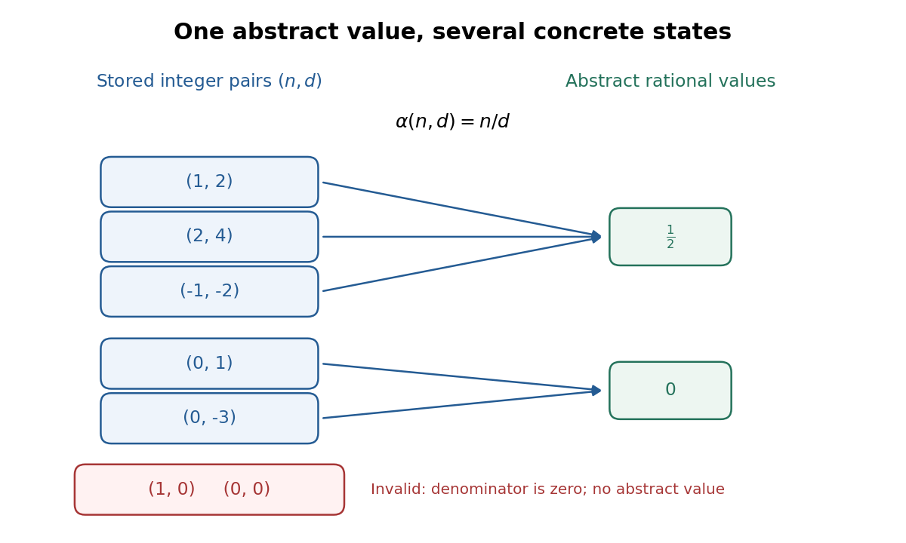

**[Figure 37](#image-several-valid-integer-pairs-represent-one-rational-value-zero-denominators-have-no-abstract-value). Several valid integer pairs represent one rational value; zero denominators have no abstract value**.

Both $(1,0)$ and $(0,0)$ violate the [representation invariant](#representation-invariant); neither has a value under this [abstraction function](#abstraction-function). By contrast, $(2,4)$ is completely valid. Simplifying it to the [reduced fraction](number-theory.md#reduced-fraction) $1/2$ may be a useful implementation choice, but is not a requirement of this representation. Strengthening the [representation invariant](#representation-invariant) to require a positive [denominator](number-theory.md#denominator) and a [greatest common divisor](divisibility.md#greatest-common-divisor) of one would choose a unique stored representative for each [rational number](number-theory.md#rational-number); every constructor and operation would then need to establish that stronger condition.

Equality of abstract values is therefore different from equality of stored [ordered pairs](set.md#ordered-pair). For valid $(a,b)$ and $(c,d)$,

$$
\alpha(a,b)=\alpha(c,d)\iff ad=bc.
$$

This defines an [equivalence relation](set-theory.md#equivalence-relation) on $R_{\mathrm{valid}}$: each [equivalence class](set-theory.md#equivalence-class) contains all representations of one [rational number](number-theory.md#rational-number). An [API](#application-programming-interface) equality operation can compare these cross-products using exact [integer](integer.md) arithmetic. Comparing the two fields individually would incorrectly declare $(1,2)$ and $(2,4)$ unequal as [rational numbers](number-theory.md#rational-number). The general reason is that an [abstraction function](#abstraction-function) may map several concrete values to one abstract value.[Section 8.3.1, Abstraction Functions: several concrete values mapping to one abstract value; Section 8.3.4, Representation Invariants: valid domain of AF](computer-science-bibliography.md#ocaml-programming-correct-plus-efficient-plus-beautiful-by-michael-r-clarkson-and-others/8-3-module-documentation)

##### Correct operations through an abstraction function

↑ **Parent:** [Abstraction function](#abstraction-function)

For a deterministic [binary operation](algebraic-operation.md#binary-operation) on an [abstract data type](#abstract-data-type), let $f$ be its specified operation on abstract values and $F$ the implementation on concrete states. For every permitted valid [input](theoretical-computer-science.md#input-computer-science) pair $(r,s)$, require both

$$
I(F(r,s))\qquad\text{and}\qquad \alpha(F(r,s))=f(\alpha(r),\alpha(s)).
$$

The first condition preserves the [representation invariant](#representation-invariant). The second makes a [commutative diagram](homology.md#commutative-diagram): either execute $F$ and then apply the [abstraction function](#abstraction-function), or apply the [abstraction function](#abstraction-function) to both [inputs](theoretical-computer-science.md#input-computer-science) and then execute the abstract operation $f$; both paths reach the same value. These conditions state [functional correctness](algorithm.md#functional-correctness) of a completed operation; termination is an additional obligation for [algorithm correctness](algorithm.md#algorithm-correctness).[Sections 8.3.3, Commutative Diagrams, and 8.3.4, Representation Invariants: matching abstract results and preservation of valid representations](computer-science-bibliography.md#ocaml-programming-correct-plus-efficient-plus-beautiful-by-michael-r-clarkson-and-others/8-3-module-documentation)

For [addition](arithmetic.md#addition) in the [unreduced rational representation](#unreduced-rational-representation), choose

$$
f(x,y)=x+y,\qquad F((a,b),(c,d))=(ad+bc,bd).
$$

For example, $F((1,2),(1,3))=(5,6)$ represents $5/6$, precisely the [sum](arithmetic.md#sum) of $1/2$ and $1/3$. The short correctness argument uses nonzero [denominators](number-theory.md#denominator): $b\ne0$ and $d\ne0$ imply $bd\ne0$, preserving the [representation invariant](#representation-invariant), and

$$
\alpha(F((a,b),(c,d)))=\frac{ad+bc}{bd}=\frac ab+\frac cd=f(\alpha(a,b),\alpha(c,d)).
$$

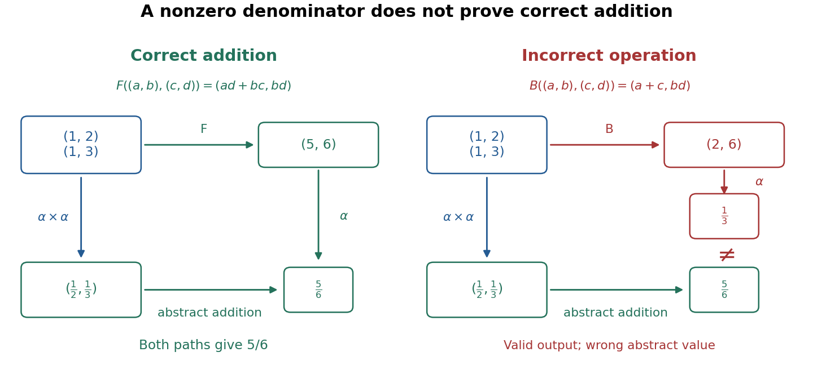

**[Figure 38](#image-correct-rational-addition-makes-both-paths-agree-an-invariant-preserving-incorrect-operation-gives-a-different-value). Correct rational addition makes both paths agree; an invariant-preserving incorrect operation gives a different value**.

Now consider an incorrect implementation that uses [addition](arithmetic.md#addition) on the [numerators](number-theory.md#numerator) and [multiplication](arithmetic.md#multiplication) on the [denominators](number-theory.md#denominator):

$$
B((a,b),(c,d))=(a+c,bd).
$$

It preserves the [representation invariant](#representation-invariant) for every valid [input](theoretical-computer-science.md#input-computer-science) pair because its [denominator](number-theory.md#denominator) is still $bd\ne0$. Yet $B((1,2),(1,3))=(2,6)$ represents $1/3$, not the specified [sum](arithmetic.md#sum) $5/6$. Even perfect checks of the [representation invariant](#representation-invariant) before and after this call would miss the error: the result is a legal representation of the wrong [rational number](number-theory.md#rational-number).

The incorrect operation also exposes an accidental dependence on representation. Replace $(1,2)$ by the equivalent state $(2,4)$ while keeping $(1,3)$. The correct operation gives $(10,12)$, still representing $5/6$; the incorrect operation gives $(3,12)$, representing $1/4$ instead of its previous $1/3$. A correct [addition](arithmetic.md#addition) must yield the same abstract result for equivalent [inputs](theoretical-computer-science.md#input-computer-science), although its concrete [outputs](theoretical-computer-science.md#output-computing) may differ. This is why checks against the [formal specification](algorithm.md#formal-specification) should compare abstract values, including unreduced representations and representations with a negative [denominator](number-theory.md#denominator), rather than demand identical stored pairs.

The calculation assumes exact [integers](integer.md). An implementation with bounded storage must additionally specify how it handles products and [sums](arithmetic.md#sum) outside its supported range; the mathematical argument alone does not establish its [functional correctness](algorithm.md#functional-correctness). The [bounded queue with encapsulation](#bounded-queue-with-encapsulation) illustrates the corresponding need to account for returned status values and failed operations, alongside the abstract state transition.

### Bounded queue with encapsulation

↑ **Parent:** [Encapsulation (computer programming)](#encapsulation-computer-programming)

Consider an original [FIFO queue](data-structure.md#fifo-queue) example storing immutable labels, with fixed positive [integer](integer.md) capacity $C$. Its abstract state is a finite [sequence](sequence-and-series.md#sequence) $q=(x_0,\ldots,x_{n-1})$, with $0\leq n\leq C$. The [API](#application-programming-interface) has `enqueue(x)`, `dequeue()`, `peek()` and `size()`. Successful `enqueue` returns `ok`; a full queue returns `full` and is unchanged. Successful `dequeue` returns the first label and removes it; an empty queue returns `empty` and is unchanged. `peek` returns the first label or `empty` without modification, and `size` returns $n$. The status results are distinct from stored labels.

For a compact [array](data-structure.md#array-data-structure) representation $(A,n)$, fix $|A|=C$ and require the [representation invariant](#representation-invariant)

$$
I(A,n):\quad n\in\mathbb Z,\qquad 0\leq n\leq C.
$$

The [abstraction function](#abstraction-function) is $\alpha(A,n)=(A_0,\ldots,A_{n-1})$. Only these first $n$ entries matter; unused slots have no abstract meaning. On successful `enqueue(x)`, write $A_n=x$ and then set $n\leftarrow n+1$. On successful `dequeue()`, save $A_0$, shift the remaining $n-1$ entries left, and decrement $n$. Testing the full or empty case before updating gives the specified unchanged failure state.

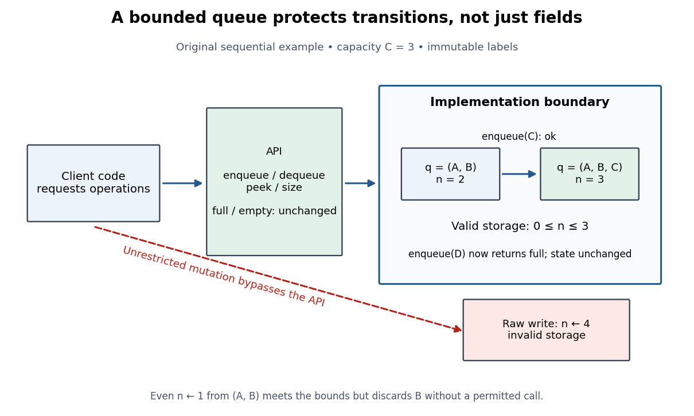

**[Figure 39](#image-permitted-queue-calls-preserve-valid-states-an-unrestricted-count-write-bypasses-the-api). Permitted queue calls preserve valid states; an unrestricted count write bypasses the API**.

With $C=3$ and $q=(A,B)$, `enqueue(C)` produces $(A,B,C)$; `enqueue(D)` returns `full` without change. A raw write $n\leftarrow4$ violates the [representation invariant](#representation-invariant). More subtly, changing the count from two to one satisfies its bounds but discards $B$ without a permitted operation. Validity of the storage state and legality of the [API](#application-programming-interface) transition are different obligations. A setter for every storage field would surrender the useful boundary even if its name looked like an ordinary operation.

### Representation exposure

↑ **Parent:** [Encapsulation (computer programming)](#encapsulation-computer-programming)

[Representation exposure](#representation-exposure) gives outside code access that can modify storage on which the [representation invariant](#representation-invariant) or promised behavior depends. Returning the internal [array](data-structure.md#array-data-structure) exposes a route around the [API](#application-programming-interface); merely hiding the field name does not close it. Incoming shared mutable storage can create the same problem. Copies or immutable values can prevent such modification, but their costs and sharing rules belong in the design.[Reading 13, Invariants, Immutability: mutable aliases through both returned values and constructor arguments](computer-science-bibliography.md#6-005-software-construction-spring-2016/reading-13-abstraction-functions-and-rep-invariants)

The [bounded queue with encapsulation](#bounded-queue-with-encapsulation) deliberately stores immutable labels. A [FIFO queue](data-structure.md#fifo-queue) of mutable objects needs a separate promise about whether changing a returned object changes stored content; protecting the queue's ordering and size does not automatically make every stored object immutable.

### Representation independence

↑ **Parent:** [Encapsulation (computer programming)](#encapsulation-computer-programming)

[Representation independence](#representation-independence) means that clients restricted to the promised [API](#application-programming-interface) cannot distinguish implementations by the specified results and state transitions. State what observations count: equal returned labels and failure statuses do not imply equal running times, allocations or physical layouts. If the [API](#application-programming-interface) also promises a resource bound, a replacement must meet that bound too.

Replace the compact [array](data-structure.md#array-data-structure) in the [bounded queue with encapsulation](#bounded-queue-with-encapsulation) by a [circular buffer](data-structure.md#circular-buffer) with storage $B$, front index $h$ and count $n$. Its [representation invariant](#representation-invariant) is $|B|=C$, $h,n\in\mathbb Z$, $0\leq h<C$ and $0\leq n\leq C$. Its [abstraction function](#abstraction-function) reads the occupied slots using [modular arithmetic](modular-arithmetic.md):

$$
\alpha(B,h,n)=\bigl(B_{(h+i)\bmod C}\bigr)_{i=0}^{n-1}.
$$

On successful `enqueue(x)`, write $B_{(h+n)\bmod C}=x$ and increment $n$. On successful `dequeue()`, return $B_h$, replace $h$ by $(h+1)\bmod C$ and decrement $n$. Full and empty failures do not alter storage. `peek` and `size` have the same abstract meanings as before. Keeping a count distinguishes a full [circular buffer](data-structure.md#circular-buffer) from an empty one even when both would have the same next insertion index.

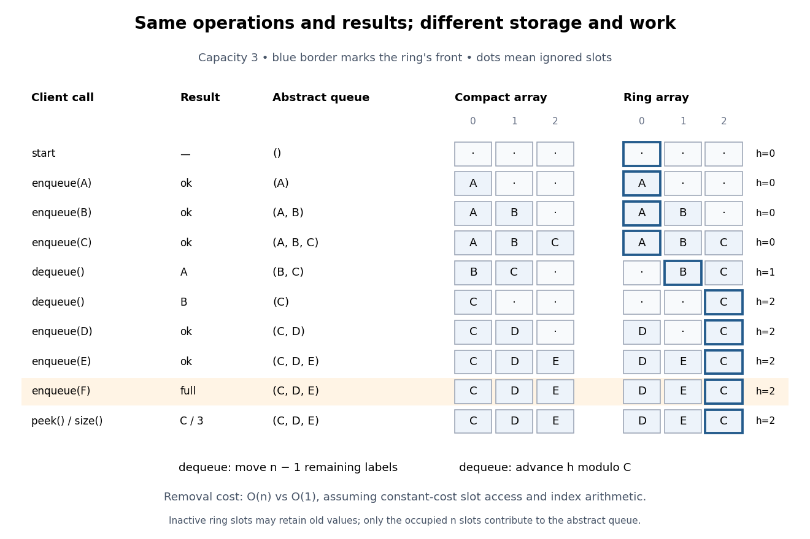

**[Figure 40](#image-the-same-bounded-queue-trace-uses-shifting-array-storage-or-a-wrapping-circular-buffer). The same bounded queue trace uses shifting array storage or a wrapping circular buffer**.

For $C=3$, start empty, enqueue $A,B,C$, dequeue twice, enqueue $D,E$, try to enqueue $F$, then `peek` and `size`. Both implementations return $A,B$ from the removals, report `full` for $F$, and finish with front $C$, size three and abstract [sequence](sequence-and-series.md#sequence) $(C,D,E)$. The compact [array](data-structure.md#array-data-structure) stores $(C,D,E)$ from index zero; the [circular buffer](data-structure.md#circular-buffer) stores $(D,E,C)$ with $h=2$. Their [abstraction functions](#abstraction-function) explain why different stored entries describe the same ordered content.

Under constant-cost slot access and index arithmetic, with no resizing and labels that fit in one slot, the compact [array](data-structure.md#array-data-structure) does $n-1$ slot moves on a successful removal: $O(n)$ worst-case [time complexity](theoretical-computer-science.md#time-complexity) as capacity varies. The [circular buffer](data-structure.md#circular-buffer) does no slot moves and uses $O(1)$ worst-case [time complexity](theoretical-computer-science.md#time-complexity) for all four operations. Both allocate $C$ slots initially; that construction cost is separate. These are operation-count claims in [Big O notation](real-analysis.md#big-o-notation), not measured timings. The short correctness outline checks that each implementation's [abstraction function](#abstraction-function) produces the specified new [sequence](sequence-and-series.md#sequence) and return value after every successful or rejected call. Repeating that check gives equal traces for clients using only this [API](#application-programming-interface).

## Hash function

↑ **Parent:** [Computer science](computer-science.md)  
ⓦ [Wiki](https://en.wikipedia.org/wiki/Hash_function)

A [hash function](#hash-function) is a [function](function.md) assigning each key in an [input](theoretical-computer-science.md#input-computer-science) [set](set.md) $U$ a value in an [output](theoretical-computer-science.md#output-computing) [set](set.md) $B$. Usually $B$ is much smaller: a long name or large [integer](integer.md) becomes a small bucket index. Equal keys must receive equal values from the same [hash function](#hash-function); different keys may also receive equal values. Such a [hash collision](#hash-collision) means "look in the same place", and does not establish key equality. If $|U|>|B|$, the [pigeonhole principle](combinatorics.md#pigeonhole-principle) makes some collisions unavoidable.

For example, [modular arithmetic](modular-arithmetic.md) gives the [hash function](#hash-function) $h(k)=k\bmod7$, with seven bucket indices $0,\ldots,6$. Store the seven keys $0,2,3,10,11,17,24$: their values are respectively $0,2,3,3,4,3,3$. In particular, $h(3)=h(10)=3$ although $3\ne10$. A [hash table](data-structure.md#hash-table) is a [data structure](data-structure.md) that uses these indices to locate records. With [separate chaining](data-structure.md#separate-chaining), each bucket holds a [linked list](data-structure.md#linked-list) of records, so bucket $3$ retains all four keys $3,10,17,24$. Inserting $10$ must not overwrite $3$ merely because their [hash function](#hash-function) values agree.

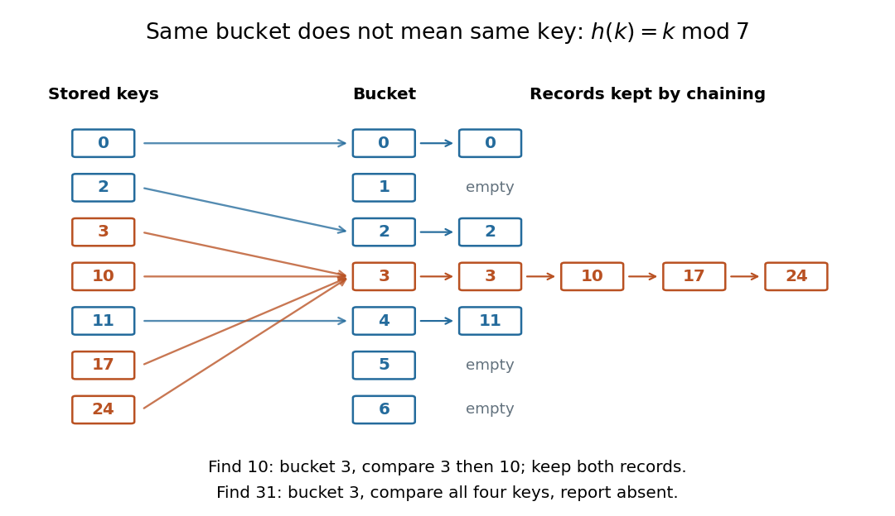

**[Figure 41](#image-seven-keys-stored-in-seven-buckets-using-the-hash-function-h-k-k-mod-7). Seven keys stored in seven buckets using the hash function h(k) = k mod 7**. Orange arrows identify four colliding keys. Bucket 3 keeps all four records in a linked list; equality is checked on the stored keys.

Searching for $10$ computes bucket $3$, then compares the actual keys until it reaches $10$. Searching for absent key $31$ reaches that same bucket and must reject every stored key. This [data structure](data-structure.md) trades a search through all records for a search through one short chain, provided the [hash function](#hash-function) distributes keys adequately. A fixed [hash function](#hash-function) can perform poorly on patterned keys: $3,10,17,24$ already demonstrate the problem. A [universal hash family](#universal-hash-family) introduces controlled randomness to limit the [expected value](expected-value.md) of this extra work. Neither indexing nor a small collision [probability](probability-theory.md#probability) inherently supplies [encryption](#encryption) or [message authentication](#message-authentication); a [cryptographic hash function](#cryptographic-hash-function) has additional requirements such as [collision resistance](#collision-resistance).

### Hash code

↑ **Parent:** [Hash function](#hash-function)

A bounded value used to organize entries in a [hash table](data-structure.md#hash-table). An equality-based collection requires equal keys to have equal hash codes, while unequal keys may collide. A [Java](programming-language.md#java-programming-language) `hashCode()` override must therefore use information invariant under the chosen [value equality](programming-language.md#value-equality). Hashing internal subdivisions is invalid when those subdivisions are deliberately ignored by equality.[equals(Object) and hashCode() contracts](computer-science-bibliography.md#java-8-object-api-documentation)

### Hash collision

↑ **Parent:** [Hash function](#hash-function)

A hash collision is a [function collision](function.md#function-collision) of a [hash function](#hash-function) $h:U\to B$: two distinct [inputs](theoretical-computer-science.md#input-computer-science) $x,y\in U$ have the same [output](theoretical-computer-science.md#output-computing), $h(x)=h(y)$. Repeating the same [input](theoretical-computer-science.md#input-computer-science) is not a [hash collision](#hash-collision). Unequal hash values prove the keys differ; equal hash values only identify candidates that might be equal. This makes a [hash function](#hash-function) useful as a compact filter before comparing the original data.

Here is a deliberately simple example using [modular arithmetic](modular-arithmetic.md). Let $h(k)=k\bmod16$ for nonnegative [integer](integer.md) keys, and let a four-bucket [hash table](data-structure.md#hash-table) use the further bucket index $b(k)=h(k)\bmod4$. For keys $2,6,18$, the hash values are $2,6,2$, while all three bucket indices are $2$. Thus $2$ and $18$ form a [hash collision](#hash-collision) for $h$; $2$ and $6$ share a table bucket even though their full hash values differ. Always specify which [function](function.md) is being compared: a table collision concerns the bucket-index [function](function.md), which may discard more information than the original [hash function](#hash-function).

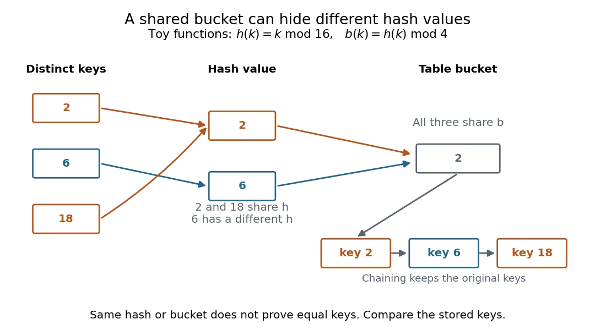

**[Figure 42](#image-a-shared-hash-value-and-a-shared-table-bucket-discard-different-distinctions). A shared hash value and a shared table bucket discard different distinctions**. Constructed [integer](integer.md) keys $2,6,18$ pass through $h(k)=k\bmod16$ and $b(k)=h(k)\bmod4$. Orange highlights the [hash collision](#hash-collision) between $2$ and $18$; blue key $6$ joins them only after bucket reduction. [Separate chaining](data-structure.md#separate-chaining) retains all three keys. This is a toy calculation, not a measured workload or a [cryptographic hash function](#cryptographic-hash-function).

With [separate chaining](data-structure.md#separate-chaining), bucket $2$ holds all three records in a [linked list](data-structure.md#linked-list). A search for $18$ visits that bucket and compares the stored keys until it finds $18$; a search for $34$ visits the same bucket but rejects every stored key. A [hash collision](#hash-collision) changes the search work, while key comparison preserves correctness. Storing only one record per hash value would incorrectly merge distinct keys. This is the purpose of collision handling in a [hash table](data-structure.md#hash-table).[Lecture 8: Hashing I](computer-science-bibliography.md#6-006-introduction-to-algorithms-fall-2011-by-massachusetts-institute-of-technology-6-006-course-staff/lecture-8-hashing-i)

The [pigeonhole principle](combinatorics.md#pigeonhole-principle) explains inevitability: if a [hash function](#hash-function) has only $M$ possible [outputs](theoretical-computer-science.md#output-computing), any $M+1$ distinct [inputs](theoretical-computer-science.md#input-computer-science) contain a [hash collision](#hash-collision). In particular, a [function](function.md) whose [domain of a function](function.md#domain-of-a-function) is larger than its finite [codomain](function.md#codomain) cannot be an [injective function](algebra.md#injective-function). This is an existence statement; it gives neither an efficient way to find the pair nor a [probability](probability-theory.md#probability) for a smaller collection of keys. A particular small collection might have no [hash collision](#hash-collision) at all.

For a [cryptographic hash function](#cryptographic-hash-function), [collision resistance](#collision-resistance) asks that finding any two distinct messages with equal full digests be computationally infeasible under the specified model and resources. It does not mean that [hash collisions](#hash-collision) do not exist. [Preimage resistance](#preimage-resistance) asks a different question: given a target digest $t$, how hard is it to find a message $x$ with $h(x)=t$? The collision finder may choose both messages and their common digest; the [preimage](set-theory.md#preimage) finder is given the digest in advance. These definitions distinguish two search tasks, independently of how a [hash table](data-structure.md#hash-table) stores records.[Quynh Dang, NIST SP 800-107 Revision 1 (2012), section 3.1 and section 4.1, definitions of collision and preimage resistance](https://nvlpubs.nist.gov/nistpubs/Legacy/SP/nistspecialpublication800-107r1.pdf)

#### Birthday probability for hash outputs

↑ **Parent:** [Hash collision](#hash-collision)

How soon should a [hash collision](#hash-collision) appear? Specify the [probability distribution](probability-distribution.md) of the outputs first. Evaluate $n$ distinct keys and assume their hash values $Y_1,\ldots,Y_n$ are [independent random variables](random-variable.md#independent-random-variables), each with the [uniform distribution on a finite set](discrete-probability-distribution.md#discrete-uniform-distribution) of $M\geq1$ possible [outputs](theoretical-computer-science.md#output-computing). The randomness may come from an idealized randomly chosen [hash function](#hash-function); a fixed [hash function](#hash-function) and a fixed list of keys have a definite outcome. Sampling the same key twice creates a repeated hash value without creating a [hash collision](#hash-collision), so distinctness of the queried keys matters.

This is the existing [birthday problem](probability-and-statistics.md#birthday-problem), with hash values in place of birthdays. Let $p_M(n)$ be the [probability](probability-theory.md#probability) of at least one equal pair. The exact formula is

$$
p_M(n)=\begin{cases}
1-\displaystyle\prod_{j=0}^{n-1}\left(1-\frac{j}{M}\right),&0\leq n\leq M,\\
1,&n>M.
\end{cases}
$$

The empty product is $1$, so $p_M(0)=p_M(1)=0$. Given $j$ previous distinct hash values, the next value avoids them with [conditional probability](probability-theory.md#conditional-probability) $(M-j)/M$. Multiply these conditional chances and subtract from $1$. Equivalently, for $n\leq M$, exactly $M(M-1)\cdots(M-n+1)$ of the $M^n$ equally likely ordered outcomes have no repeated value. This derivation also explains why independence of all outputs, rather than merely uniform individual values, is required.[Menezes, van Oorschot and Vanstone, Handbook of Applied Cryptography, section 2.1.5, Fact 2.27(i), birthday probability](https://cacr.uwaterloo.ca/hac/about/chap2.pdf)

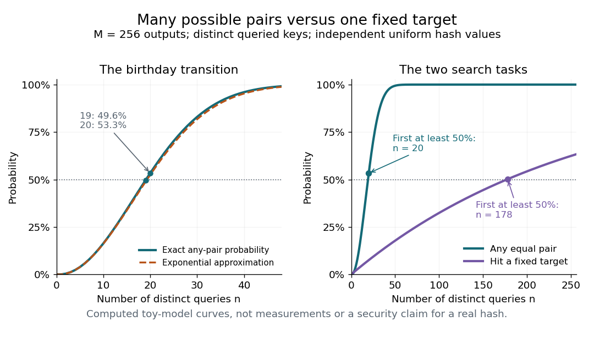

**[Figure 43](#image-any-matching-pair-appears-much-sooner-than-a-match-to-one-fixed-target). Any matching pair appears much sooner than a match to one fixed target**. Computed [probabilities](probability-theory.md#probability) for $M=256$ under the independent uniform hash-output model. Left: the exact [birthday problem](probability-and-statistics.md#birthday-problem) formula and its exponential approximation over the first 48 distinct queries. Right: any-pair collisions and hitting a digest fixed before the queries, over 256 distinct queries. Their first integer sample sizes reaching 50 percent are $20$ and $178$. These are theoretical toy curves, not measurements of a real [cryptographic hash function](#cryptographic-hash-function).

For $M=256$, the exact [hash collision](#hash-collision) [probabilities](probability-theory.md#probability) are $p_{256}(19)\approx0.495742$, $p_{256}(20)\approx0.533167$, and $p_{256}(32)\approx0.867643$. Thus only $20$ distinct queries already exceed a one-half chance of some pair matching. The striking feature is the number of opportunities: $n$ queries supply $\binom n2$ pairs. By [linearity of expectation](expected-value.md#linearity-of-expectation), the [expected value](expected-value.md) of the number of equal pairs is $\lambda=\binom n2/M$. This expectation counts pairs, not the [probability](probability-theory.md#probability) of at least one pair; three equal outputs contribute three pairs in one outcome. The [union bound](probability-inequality.md#boole-s-inequality) gives $p_M(n)\leq\min(1,\lambda)$.

Using the [natural logarithm](calculus.md#natural-logarithm) expansion $\log(1-u)=-u+O(u^2)$ in the exact product gives

$$
p_M(n)\approx1-\exp\left(-\frac{n(n-1)}{2M}\right).
$$

For $n\leq M/2$, the omitted correction in the logarithm of the no-collision [probability](probability-theory.md#probability) is $O(n^3/M^2)$. Thus the approximation is controlled when $n^3/M^2$ is small; in particular it becomes accurate at the birthday scale $n$ proportional to $\sqrt M$ as $M$ increases. The inequality $1-u\leq e^{-u}$ also shows that the displayed approximation is a lower bound for $p_M(n)$ when $n\leq M$. Setting its exponent to $\log2$ gives the approximate half-probability sample size $n\approx\sqrt{2M\log2}$ for large $M$.

For comparison, under the same independent uniform model the [probability](probability-theory.md#probability) of hitting one previously fixed digest $t$ in $n$ queries is

$$
q_M(n)=1-\left(1-\frac1M\right)^n.
$$

Each query supplies one chance to hit $t$, instead of a growing number of possible pairs. For $M=256$, $q_{256}(20)\approx0.075293$, and the first integer $n$ with $q_{256}(n)\geq1/2$ is $178$. In a toy model with $M=2^b$ possible $b$-[bit](information-theory.md#bit) digests, the any-pair transition therefore has scale $2^{b/2}$ queries, while the fixed-target transition has scale $2^b$. This explains the birthday-search distinction between [collision resistance](#collision-resistance) and [preimage resistance](#preimage-resistance).[Menezes, van Oorschot and Vanstone, Handbook of Applied Cryptography, Fact 9.33 and section 9.7.1, generic collision versus preimage searches](https://cacr.uwaterloo.ca/hac/about/chap9.pdf)

The assumptions are essential. Uniform marginals alone do not give the product formula: if all $Y_i$ equal one shared uniform [random variable](random-variable.md), every distinct pair collides with [probability](probability-theory.md#probability) $1$. A [universal hash family](#universal-hash-family) bounds each pair's [hash collision](#hash-collision) [probability](probability-theory.md#probability), but that condition alone does not supply joint independence of every output. Nor does a fixed output length establish [collision resistance](#collision-resistance) or [preimage resistance](#preimage-resistance): the toy $h(k)=k\bmod16$ has $h(k)=h(k+16)$, making deliberate [hash collisions](#hash-collision) immediate. The curves describe the specified model and do not establish the security of a concrete [cryptographic hash function](#cryptographic-hash-function).

### Almost strongly universal hash family

↑ **Parent:** [Hash function](#hash-function)

An [almost strongly universal hash family](#almost-strongly-universal-hash-family) relaxes the exact [ordered pair](set.md#ordered-pair) balance of a [strongly universal hash family](#strongly-universal-hash-family). In the convention used here, choose $h$ with the [uniform distribution on a finite set](discrete-probability-distribution.md#discrete-uniform-distribution) from a family with $q$ possible [outputs](theoretical-computer-science.md#output-computing). Every individual [output](theoretical-computer-science.md#output-computing) remains uniform, and for every distinct pair of [inputs](theoretical-computer-science.md#input-computer-science) $x,y$ and every specified [ordered pair](set.md#ordered-pair) of [outputs](theoretical-computer-science.md#output-computing) $u,v$,

$$
\Pr_h[h(x)=u,h(y)=v]\leq\frac{\varepsilon}{q}.
$$

Equivalently, the [conditional probability](probability-theory.md#conditional-probability) $\Pr_h[h(y)=v\mid h(x)=u]$ is at most $\varepsilon$. This asks how predictable a second [output](theoretical-computer-science.md#output-computing) can become after the first is known.

For $q=5$, [strongly universal hash families](#strongly-universal-hash-family) give $\varepsilon=1/5$: learning one [output](theoretical-computer-science.md#output-computing) leaves each specified second [output](theoretical-computer-science.md#output-computing) with [conditional probability](probability-theory.md#conditional-probability) $1/5$. A looser guarantee $\varepsilon=2/5$ permits a specified [ordered pair](set.md#ordered-pair) to have [probability](probability-theory.md#probability) as large as $2/25$, while each individual [output](theoretical-computer-science.md#output-computing) still has [probability](probability-theory.md#probability) $1/5$. Summing over the five equal [ordered pairs](set.md#ordered-pair) bounds the collision [probability](probability-theory.md#probability) by $2/5$, rather than the $1/5$ required of a [universal hash family](#universal-hash-family). Thus an [almost strongly universal hash family](#almost-strongly-universal-hash-family) need not be a [universal hash family](#universal-hash-family). Necessarily $\varepsilon\geq1/q$, because the $q$ conditional [probabilities](probability-theory.md#probability) sum to one; equality recovers a [strongly universal hash family](#strongly-universal-hash-family). This relaxation is useful in [Wegman–Carter authentication](#wegman-carter-authentication), where efficiency can be traded against a quantified forgery bound within a complete [message authentication](#message-authentication) protocol.

#### Polynomial almost strongly universal hashing

↑ **Parent:** [Almost strongly universal hash family](#almost-strongly-universal-hash-family)

For fixed-length messages in $\mathbb F_q^L$, choose independent uniform field elements $a,b$. Each output is uniform because $b$ masks it. For distinct messages and prescribed output difference $d$, the equation $\sum_{j=1}^L(m'_j-m_j)a^j=d$ is a nonzero polynomial equation of degree at most $L$, so the [root bound for a polynomial](polynomial.md#lagrange-root-bound-over-a-field) gives at most $L$ choices of $a$. The joint output probability is at most $L/q^2$. Thus the family is $(L/q)$-almost strongly universal when $L<q$. Starting the message polynomial at power one matters: using a freely varying message coefficient at power zero would permit a known constant tag shift after observing one tag.

### Universal hash family

↑ **Parent:** [Hash function](#hash-function)

A [universal hash family](#universal-hash-family) is a finite collection $\mathcal H$ of [hash functions](#hash-function) into an [output](theoretical-computer-science.md#output-computing) [set](set.md) of size $q$ such that, for any fixed distinct [inputs](theoretical-computer-science.md#input-computer-science) $x,y$,

$$
\Pr_{h\in\mathcal H}[h(x)=h(y)]\leq\frac1q.
$$

The choice of $h$ uses the [uniform distribution on a finite set](discrete-probability-distribution.md#discrete-uniform-distribution). The keys are fixed before that choice: the randomness belongs to the [hash function](#hash-function), so the guarantee does not assume naturally random keys. Choose one member and keep it while using the table; changing it requires redistributing the stored records. The bound holds separately for every distinct pair, without requiring uniform individual [outputs](theoretical-computer-science.md#output-computing) or [independent random variables](random-variable.md#independent-random-variables). A [strongly universal hash family](#strongly-universal-hash-family) supplies those stronger properties.

The practical payoff follows from [linearity of expectation](expected-value.md#linearity-of-expectation). If $n$ stored keys are distinct from a fixed query, let $C$ count how many share its bucket. Then $\mathbb E[C]\leq n/q$: each key contributes at most $1/q$ to the [expected value](expected-value.md). With $100$ stored keys and $100$ buckets, an unsuccessful search encounters at most one record on average over the random choice of [hash function](#hash-function). This is an [expected value](expected-value.md), not a limit on every search; one unlucky choice can still create a long chain.

This calculation needs no [independence](random-variable.md#independent-random-variables) between the collision events: [linearity of expectation](expected-value.md#linearity-of-expectation) adds their individual [probabilities](probability-theory.md#probability). The fixed-query condition matters, since deliberately choosing keys after inspecting the selected [hash function](#hash-function) can target a crowded bucket.

Carter and Wegman introduced this way of analyzing storage and retrieval in their 1977 paper: average over a chosen class of [hash functions](#hash-function) while allowing any fixed sequence of [inputs](theoretical-computer-science.md#input-computer-science). Their 1979 journal version develops the same universal-pair collision condition and constructions. The insight is useful because a [randomized algorithm](algorithm.md#randomized-algorithm) can obtain a performance guarantee through its own choices, even when its [inputs](theoretical-computer-science.md#input-computer-science) have inconvenient patterns.[Carter and Wegman, Universal classes of hash functions, STOC 1977](https://dl.acm.org/doi/10.1145/800105.803400)[Carter and Wegman, Universal Classes of Hash Functions, 1979](https://www.cs.princeton.edu/courses/archive/fall09/cos521/Handouts/universalclasses.pdf)

#### Strongly universal hash family

↑ **Parent:** [Universal hash family](#universal-hash-family)

A [strongly universal hash family](#strongly-universal-hash-family) makes every [ordered pair](set.md#ordered-pair) of [outputs](theoretical-computer-science.md#output-computing) equally likely: for distinct [inputs](theoretical-computer-science.md#input-computer-science) $x,y$ and arbitrary specified [outputs](theoretical-computer-science.md#output-computing) $u,v$,

$$
\Pr_h[h(x)=u,h(y)=v]=\frac1{q^2}.
$$

Thus the two [outputs](theoretical-computer-science.md#output-computing) are [independent random variables](random-variable.md#independent-random-variables), each with the [uniform distribution on a finite set](discrete-probability-distribution.md#discrete-uniform-distribution). Adding the $q$ equal [ordered pairs](set.md#ordered-pair) gives collision [probability](probability-theory.md#probability) $q/q^2=1/q$, so the family is also a [universal hash family](#universal-hash-family).

Here is a completely enumerable example. In the [finite field](algebra.md#finite-field) $\mathbb F_5$, take the [affine functions](vector-space.md#affine-function) $h_{a,b}(x)=ax+b$, using [modular arithmetic](modular-arithmetic.md) modulo $5$. Choose $a$ and $b$ as [independent random variables](random-variable.md#independent-random-variables), each with the [uniform distribution on a finite set](discrete-probability-distribution.md#discrete-uniform-distribution) of all five [finite field](algebra.md#finite-field) elements $0,1,2,3,4$, including $a=0$. There are $25$ equally likely [hash functions](#hash-function). For $x=0,y=1$, the [ordered pair](set.md#ordered-pair) is $(b,a+b)$. For instance $(a,b)=(2,3)$ gives $(h(0),h(1))=(3,0)$; $(0,3)$ gives $(3,3)$. Every prescribed $(u,v)$ occurs exactly once, at $b=u,a=v-u$.

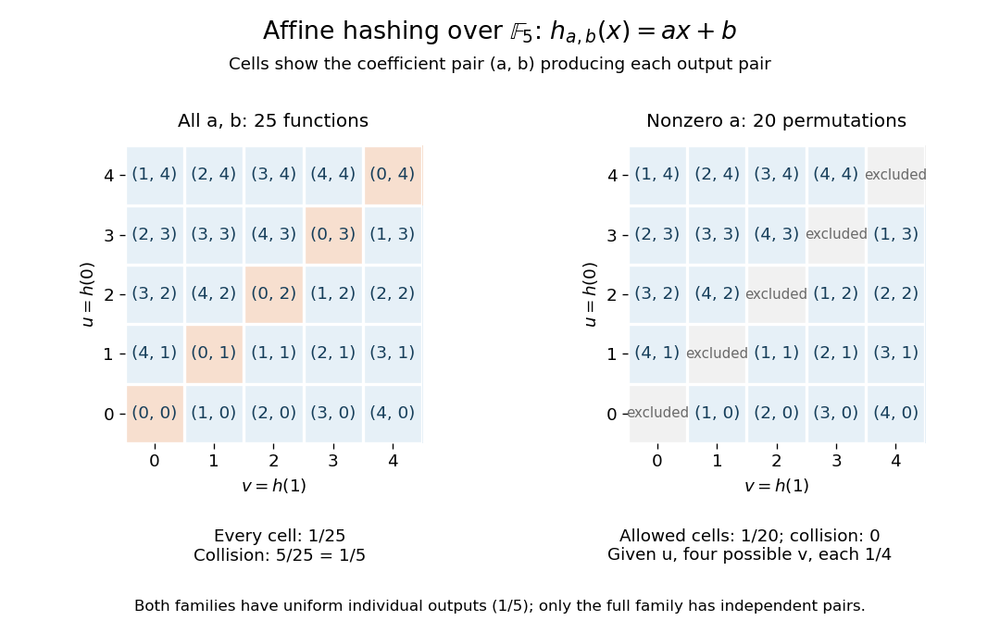

**[Figure 44](#image-enumerating-all-affine-hash-functions-over-the-finite-field-with-five-elements). Enumerating all affine hash functions over the finite field with five elements**. Each cell shows the unique coefficient pair (a,b) producing the displayed outputs at 0 and 1. Removing a = 0 deletes the diagonal and leaves dependent outputs despite uniform individual values.

Each row contains five choices, so each individual [output](theoretical-computer-science.md#output-computing) has [probability](probability-theory.md#probability) $5/25=1/5$. Each cell has [probability](probability-theory.md#probability) $1/25$, and the five diagonal cells give collision [probability](probability-theory.md#probability) $5/25=1/5$. For any distinct $x,y$, the same conclusion follows from $a=(v-u)/(y-x)$ and $b=u-ax$: a nonzero [finite field](algebra.md#finite-field) element has a unique inverse. This is the beauty of the construction: two small random coefficients provide exact pair balance without choosing five unrelated values.

The example uses equal-sized [input](theoretical-computer-science.md#input-computer-science) and [output](theoretical-computer-science.md#output-computing) [sets](set.md) to make every choice visible; it illustrates the family definitions rather than compression. In a larger [input](theoretical-computer-science.md#input-computer-science) [set](set.md), a [hash function](#hash-function) cannot avoid all collisions into five buckets. What a [universal hash family](#universal-hash-family) controls is the fraction of its members that collide on each fixed pair, rather than the existence of any collision anywhere.

Restricting to $a\ne0$ leaves $20$ [permutations](combinatorics.md#permutation) with zero collision [probability](probability-theory.md#probability) for distinct [inputs](theoretical-computer-science.md#input-computer-science). Individual [outputs](theoretical-computer-science.md#output-computing) remain uniform, but given $h(0)=u$, the four values other than $u$ each have [conditional probability](probability-theory.md#conditional-probability) $1/4$ and $u$ has zero. Hence these [outputs](theoretical-computer-science.md#output-computing) are not [independent random variables](random-variable.md#independent-random-variables): this is a [universal hash family](#universal-hash-family) but not a [strongly universal hash family](#strongly-universal-hash-family). Finally, the full $25$-member example contains five constant [functions](function.md), with immediately visible collisions. Its pair guarantee concerns a random choice of [hash function](#hash-function), and makes no claim of cryptographic [collision resistance](#collision-resistance).

## Conway Game of Life

↑ **Parent:** [Computer science](computer-science.md)

[Conway's Game of Life](#conway-game-of-life) is a [cellular automaton](#cellular-automaton) in which a simple local rule produces patterns that remain still, pulse, or travel across a square grid. Choose the starting pattern; after that there are no player decisions. The [Life blinker](#life-blinker) and [Life glider](#life-glider) below make the surprise concrete: the rule mentions only births and survival, yet repeated applications create a clock and a moving shape.

The standard board is infinite, with cells at [ordered pairs](set.md#ordered-pair) $(x,y)\in\mathbb Z^2$ of [integers](integer.md). At generation $t\in\{0,1,2,\ldots\}$ let $a_t(x,y)$ be $1$ for a live cell and $0$ for a dead cell. Count all eight cells sharing an edge or a corner, excluding the center itself:

$$
n_t(x,y)=\sum_{\substack{i,j\in\{-1,0,1\}\\(i,j)\ne(0,0)}}a_t(x+i,y+j).
$$

The local [Boolean function](analysis-of-boolean-functions.md#boolean-function) defining the next generation is

$$
a_{t+1}(x,y)=\begin{cases}1,&n_t(x,y)=3,\\1,&a_t(x,y)=1\text{ and }n_t(x,y)=2,\\0,&\text{otherwise}.\end{cases}
$$

This is the rule `B3/S23`: a dead cell is born with exactly three live neighbors; a live cell survives with exactly two or three. A live cell with zero or one, or with four through eight, dies. A dead cell with two stays dead. All counts and center states come from generation $t$: this is a synchronous update, even if an [algorithm](algorithm.md) computes its cells one at a time.[Johnston and Greene, Conway's Game of Life: Mathematics and Construction, chapter 1: simultaneous updates and B3/S23 notation](https://github.com/nathanieljohnston/game-of-life-book/blob/master/early_life.tex)

In particular, the two births in the [Life blinker](#life-blinker) do not help any other cell survive until the following generation. Writing each answer over its old value and then reading that new value for another count changes the rule. The simplest correct [algorithm](algorithm.md) reads one [array](data-structure.md#array-data-structure) and writes the next generation into a second [array](data-structure.md#array-data-structure); swap their roles after the entire step. The [one-row in-place Life update](#one-row-in-place-life-update) achieves the same rule with less auxiliary storage by preserving the old values that later counts still need.

A finite implementation must specify its boundary convention. Holding all cells outside the rectangle permanently dead can destroy a [Life glider](#life-glider) when it reaches the edge. Wrapping neighbor coordinates from one edge to the opposite edge allows interaction with patterns on the other side. Neither convention is the infinite board. The figures display finite windows into an infinite board initially dead everywhere except the stated live cells; the windows do not impose walls.

[Conway's Game of Life](#conway-game-of-life) illustrates [emergence](physics.md#emergence) in a precise, modest sense: the [Life glider](#life-glider)'s motion is a collective pattern derived from local birth and death, without a motion command. It has [deterministic evolution](dynamical-systems.md#deterministic-evolution); visually surprising behavior introduces no random choices. Nor do the words "alive" and "dead" make it an experimentally validated model of [biology](biology.md). The beauty is that the same rule yields a stable four-cell square, the [Life blinker](#life-blinker), and the [Life glider](#life-glider): three qualitatively different behaviors from a handful of cells.

For the stable square, take the live [set](set.md) $\{(0,0),(1,0),(0,1),(1,1)\}$. Each live cell has three live neighbors, and every dead cell has at most two. The next generation is identical: this configuration is a [fixed point](function.md#fixed-point) of the global update [function](function.md). In contrast, the [Life blinker](#life-blinker) returns after two generations, and the [Life glider](#life-glider) returns only after allowing a [translation](geometry-and-topology.md#translation-geometry).

The patterns are useful as small, exact checks of an [algorithm](algorithm.md): the square checks survival without births, the [Life blinker](#life-blinker) checks births and deaths in one simultaneous step, and the [Life glider](#life-glider) checks several steps and diagonal neighbors. More elaborate constructions can encode data and assemble [Boolean circuits](theoretical-computer-science.md#boolean-circuit); Johnston and Greene develop constructions that simulate arbitrary computation in their chapter 9. This is a statement about suitably designed patterns with enough space and time, not a claim that every starting pattern computes something useful or that a fixed finite board has unlimited [computer memory](computer-memory.md).[Johnston and Greene, chapter 9: universal computation constructions](https://github.com/nathanieljohnston/game-of-life-book/blob/master/universal_computation.tex)

Martin Gardner introduced [Conway's Game of Life](#conway-game-of-life) to his Scientific American readers in October 1970, reporting that Conway selected the rules after experimentation with patterns. The aim was sustained, varied behavior rather than immediate extinction or trivially demonstrable unlimited growth. These were mathematical explorations of chosen rules.[Gardner, The fantastic combinations of John Conway's new solitaire game life, Scientific American 223, October 1970, pp. 120–123](https://www.ibiblio.org/lifepatterns/october1970.html)

Gardner's hands-on procedure is still a useful experiment: place black counters for the current live cells; mark doomed counters by stacking another black counter; mark births with white counters; finish checking before removing the doomed stacks and turning white counters black. Count only the original black occupants. Repeat with three adjacent counters to obtain the [Life blinker](#life-blinker), then with the five coordinates of the [Life glider](#life-glider). Recording each generation tests whether the procedure implements the rule; it does not measure a natural population.[Gardner, October 1970: two-color procedure for simultaneous births and deaths](https://www.ibiblio.org/lifepatterns/october1970.html)

### Life oscillator

↑ **Parent:** [Conway Game of Life](#conway-game-of-life)

A [Life oscillator](#life-oscillator) is a nonconstant [periodic orbit](dynamical-systems.md#periodic-orbit) of the [Conway's Game of Life](#conway-game-of-life) update [function](function.md) $F$. Its period is the least positive [integer](integer.md) $p$ for which $F^p(A)=A$, comparing the entire live-cell [set](set.md) at the same coordinates. A configuration that never changes is instead a [fixed point](function.md#fixed-point); a [Life glider](#life-glider) is not a [Life oscillator](#life-oscillator) on the infinite board because it returns at displaced coordinates. The [Life blinker](#life-blinker) has period two.[Johnston and Greene, chapter 3: oscillators and their periods](https://github.com/nathanieljohnston/game-of-life-book/blob/master/oscillators.tex)

#### Life blinker

↑ **Parent:** [Life oscillator](#life-oscillator)

The [Life blinker](#life-blinker) alternates between horizontal and vertical lines of three live cells. Start with $B_0=\{(-1,0),(0,0),(1,0)\}$ and every other cell dead. The two endpoints each have one live neighbor and die; the center has two and survives. The dead cells $(0,-1)$ and $(0,1)$ each have three live neighbors and are born. No other dead cell has three. Therefore

$$
B_1=\{(0,-1),(0,0),(0,1)\},\qquad B_2=B_0.
$$

The same neighbor-count argument with horizontal and vertical exchanged gives the second step. Since $B_1\ne B_0$, the period is exactly two, rather than merely a divisor of two.

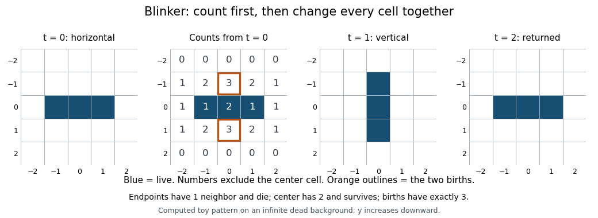

**[Figure 45](#image-the-life-blinker-old-neighbor-counts-produce-a-period-two-life-oscillator). The Life blinker: old neighbor counts produce a period-two Life oscillator**. Original computed toy configuration, not measured data. The count panel shows all old neighbor counts in a five-by-five window; the center is excluded. Orange outlines mark the two births. All unshown cells initially are dead, and all panels use the same coordinates with y increasing downward.

The [Life blinker](#life-blinker) is a minimal hands-on check of synchronous updating. Mark both endpoints for death and both births before changing anything. Removing an endpoint early would make a prospective birth see only two neighbors; adding a birth early would alter other counts. A correct implementation reproduces both [sets](set.md) above exactly, rather than merely keeping the live population equal to three.

### Life glider

↑ **Parent:** [Conway Game of Life](#conway-game-of-life)  
ⓦ [Wiki](https://en.wikipedia.org/wiki/Glider_(Conway's_Game_of_Life))

The [Life glider](#life-glider) is a five-cell pattern that recreates its shape after four generations, shifted one cell along each coordinate. Use $x$ increasing rightward and $y$ increasing downward, as in the figure, and start from the live [set](set.md)

$$
G_0=\{(1,0),(2,1),(0,2),(1,2),(2,2)\}.
$$

Every cell outside $G_0$ starts dead. Applying the [Conway's Game of Life](#conway-game-of-life) rule, rather than moving the drawing by hand, gives:

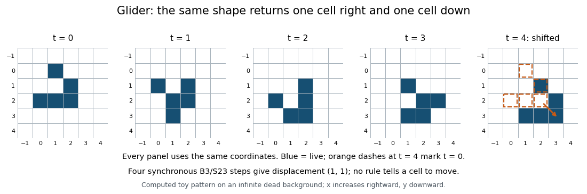

**[Figure 46](#image-four-synchronous-conway-s-game-of-life-steps-translate-the-life-glider-by-1-1). Four synchronous Conway's Game of Life steps translate the Life glider by (1,1)** Original computed toy configuration, not measured data. All five panels use fixed coordinates. Orange dashed outlines in the last panel mark the original live cells; blue cells show the computed fourth generation. The displayed window is part of an infinite board, not a finite boundary.

For an exact check of every frame, the intermediate live [sets](set.md) are

$$
\begin{aligned}
G_1&=\{(0,1),(2,1),(1,2),(2,2),(1,3)\},\\
G_2&=\{(2,1),(0,2),(2,2),(1,3),(2,3)\},\\
G_3&=\{(1,1),(2,2),(3,2),(1,3),(2,3)\},\\
G_4&=\{(2,1),(3,2),(1,3),(2,3),(3,3)\}=G_0+(1,1).
\end{aligned}
$$

Here $G_0+(1,1)$ means add $(1,1)$ to each [ordered pair](set.md#ordered-pair) in $G_0$. In the first step, the live cells $(1,0)$ and $(0,2)$ have respectively one and one live neighbors, so die; the other three have respectively three, three and two and survive. Exactly $(0,1)$ and $(1,3)$ are born, with three live neighbors each. This derives $G_1$ and explains how motion can occur while individual cells merely switch states.

Because the rule uses the same relative neighbors at every position, applying the global update [function](function.md) and applying a [translation](geometry-and-topology.md#translation-geometry) commute. Thus $G_{t+4}=G_t+(1,1)$ for every generation $t$; the four-step calculation establishes continued motion on the infinite board. The average displacement is $(1/4,1/4)$ cells per generation, or [Euclidean distance](topological-analysis.md#euclidean-distance) $\sqrt{2}/4$ per generation. The live-cell count happens to stay five in these frames, but the rule does not conserve live-cell count in general: a single isolated live cell dies immediately. The [Life glider](#life-glider) persists indefinitely in an otherwise empty infinite board; encounters with other patterns or a finite implementation's edge can change that conclusion.

// Destination: computer-science.bigb

### One-row in-place Life update

↑ **Parent:** [Conway Game of Life](#conway-game-of-life)

On a finite rectangular [Conway's Game of Life](#conway-game-of-life) board stored as an [array](data-structure.md#array-data-structure) of [Boolean variables](theoretical-computer-science.md#boolean-variable), retain the preceding row's old values in one auxiliary row. Before overwriting a column, retain rolling sums of the old three-cell vertical columns. Their sum minus the old center is the old neighbor count. Read the next column before changing the current one; replace the saved row entry by the old current cell. The invariant is that every count uses the previous generation, just as in the two-[array](data-structure.md#array-data-structure) [algorithm](algorithm.md). For a board with $H$ rows and $W$ columns this uses $O(W)$ auxiliary storage and $O(HW)$ time. The boundary convention must still be implemented explicitly. The [Life blinker](#life-blinker) and [Life glider](#life-glider) provide exact expected generations for checking it.

## Cellular automaton

↑ **Parent:** [Computer science](computer-science.md)  
ⓦ [Wiki](https://en.wikipedia.org/wiki/Cellular_automaton)

A [cellular automaton](#cellular-automaton) assigns one of finitely many states to each cell of a regular grid and updates cells in discrete generations using a fixed local rule. In the synchronous convention, each new state depends only on old states in a finite neighborhood. [Conway's Game of Life](#conway-game-of-life) supplies a concrete example with two states and eight neighbors; its global update is a [function](function.md) on complete configurations, with [deterministic evolution](dynamical-systems.md#deterministic-evolution).[Johnston and Greene, chapter 1: Life and cellular automata](https://github.com/nathanieljohnston/game-of-life-book/blob/master/early_life.tex)

// Destination: foundations-of-mathematics.bigb

### Rule 90

↑ **Parent:** [Cellular automaton](#cellular-automaton)

Rule 90 is the binary one-dimensional [cellular automaton](#cellular-automaton) whose update replaces each cell by the [exclusive or](theoretical-computer-science.md#exclusive-or) of its two neighbors.

<h3 id="langton-s-ant">Langton's ant</h3>

↑ **Parent:** [Cellular automaton](#cellular-automaton)

A discrete dynamical system with an ant moving on a colored square lattice. In its standard two-color form, the ant turns right on white, left on black, flips the current cell's color, and advances one cell. From an all-white board it eventually exhibits a repeating pattern that translates across the lattice.

## Instruction pointer

↑ **Parent:** [Computer science](computer-science.md)

A processor register identifying the current or next instruction according to the architecture. A timer interrupt can record the saved instruction address of a running process, permitting [statistical program profiling](algorithm.md#statistical-program-profiling) without source code.

// Destination: computer-science.bigb

## Computer bus

↑ **Parent:** [Computer science](computer-science.md)

A [computer bus](#computer-bus) connects components through agreed communication paths and transfer rules. On a [shared computer bus](#shared-computer-bus), a [CPU](#central-processing-unit) and a [DMA](#direct-memory-access) engine can both want the same path to [computer memory](computer-memory.md): attaching another initiator does not create another independent path. [Bus arbitration](#bus-arbitration) chooses who may start; [bus ownership](#bus-ownership) states who may use each resource; [bus throughput](#bus-throughput) measures the useful data delivered. This makes sharing a performance question as well as a correctness question.

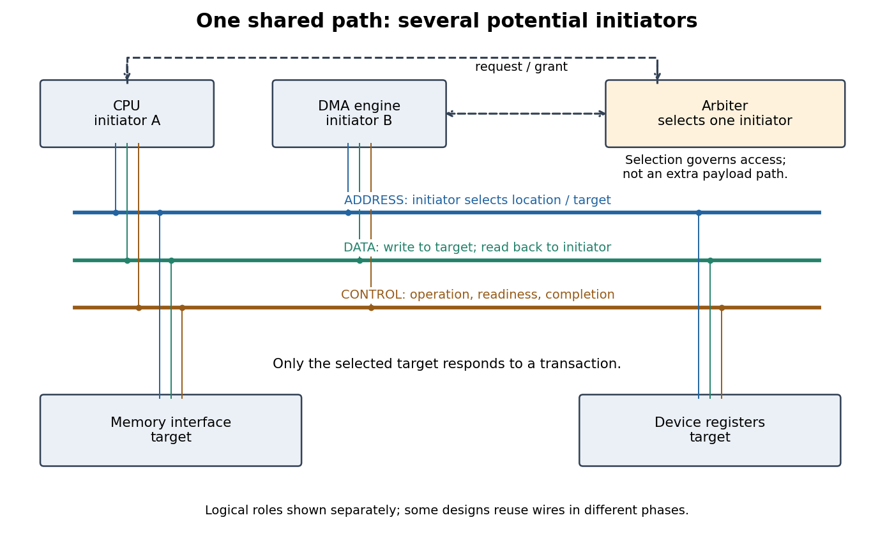

**[Figure 47](#image-shared-computer-bus-paths-bus-arbitration-and-address-data-and-control-roles). Shared computer bus paths, bus arbitration, and address, data and control roles**.

### Shared computer bus

↑ **Parent:** [Computer bus](#computer-bus)

A [computer bus](#computer-bus) whose communication resources serve multiple attached components. A common physical path reduces wiring, but competing [bus transactions](#bus-transaction) must share its capacity. [Address bus](#address-bus), [data bus](#data-bus) and [control bus](#control-bus) name logical roles; they need not be three permanently separate bundles of wires. Some designs reuse lines for addresses and data in different phases.[John Kubiatowicz, CS152 lecture 21, slides 20–24 and 33: shared paths, bus organization and transaction roles](computer-science-bibliography.md#cs152-computer-architecture-and-engineering-fall-1999/lecture-21-buses-and-i-and-o)

#### Address bus

↑ **Parent:** [Shared computer bus](#shared-computer-bus)

The [computer bus](#computer-bus) path identifying the destination or location of a [bus transaction](#bus-transaction). An initiator supplies an address; decoding selects the intended target. Address width describes the available address encodings, whereas [data bus](#data-bus) width describes how many [bits](information-theory.md#bit) can be carried at once.[AMBA Specification, revision 2.0, section 1.5, pp. 1-7–1-8: master, slave and address decoder](computer-science-bibliography.md#amba-specification-rev-2-0-by-arm-limited)

#### Data bus

↑ **Parent:** [Shared computer bus](#shared-computer-bus)

The [computer bus](#computer-bus) path carrying payload. A write sends data from the initiator to the target; a read returns data from the target. Owning the request path does not mean driving the [data bus](#data-bus) in both directions.[CS152 lecture 21, slide 24: initiator commands, data in either direction](computer-science-bibliography.md#cs152-computer-architecture-and-engineering-fall-1999/lecture-21-buses-and-i-and-o)

#### Control bus

↑ **Parent:** [Shared computer bus](#shared-computer-bus)

The [computer bus](#computer-bus) paths specifying operations and coordinating progress, including requests and acknowledgments. Some control travels from initiator to target and some returns. In the diagram, [bus arbitration](#bus-arbitration) requests and grants are shown separately from transfer control to distinguish choosing an initiator from executing its [bus transaction](#bus-transaction).[CS152 lecture 21, slides 22 and 33–36: control signals, sequencing, request and grant](computer-science-bibliography.md#cs152-computer-architecture-and-engineering-fall-1999/lecture-21-buses-and-i-and-o)

### Bus transaction

↑ **Parent:** [Computer bus](#computer-bus)

One requested operation and its completion, potentially including several payload transfers. A [bus transaction](#bus-transaction) identifies a target, specifies an operation and exchanges data or status. A [CPU](#central-processing-unit) or [DMA](#direct-memory-access) engine can initiate one; a target responds. The terms “master” and “slave” in older hardware documents refer to these initiator and target roles.[AMBA Specification, revision 2.0, sections 1.4–1.5: transfer, initiator and responding target](computer-science-bibliography.md#amba-specification-rev-2-0-by-arm-limited)

#### Bus cycle

↑ **Parent:** [Bus transaction](#bus-transaction)

One clock period in a synchronous [computer bus](#computer-bus). A [bus transaction](#bus-transaction) can occupy several [bus cycles](#bus-cycle). An asynchronous [computer bus](#computer-bus) instead coordinates progress through acknowledgments, so a clock-based count requires an additional timing model.[CS152 lecture 21, slides 32–33: synchronous and asynchronous sequencing](computer-science-bibliography.md#cs152-computer-architecture-and-engineering-fall-1999/lecture-21-buses-and-i-and-o)

#### Bus wait state

↑ **Parent:** [Bus transaction](#bus-transaction)

An extension while a [bus transaction](#bus-transaction) awaits readiness. A [bus wait state](#bus-wait-state) spends time without completing the next payload transfer. In a blocking design it also postpones another initiator's access; completion and [bus ownership](#bus-ownership) changes must follow the protocol.[AMBA Specification, revision 2.0, section 3.11.3, pp. 3-30–3-31, figures 3-16–3-17: readiness and ownership handover](computer-science-bibliography.md#amba-specification-rev-2-0-by-arm-limited)

#### Bus burst

↑ **Parent:** [Bus transaction](#bus-transaction)

A group of related payload transfers, often to consecutive addresses, arranged under one transfer sequence. A [bus burst](#bus-burst) can amortize setup and [bus arbitration](#bus-arbitration) overhead; a longer period of exclusive [bus ownership](#bus-ownership) can also make another initiator wait longer. The exact overhead and permitted handover boundaries depend on the protocol.[AMBA Specification, revision 2.0, section 1.4 and section 3.11.4: burst operation and early burst termination](computer-science-bibliography.md#amba-specification-rev-2-0-by-arm-limited)

### Bus arbitration

↑ **Parent:** [Computer bus](#computer-bus)

Selecting among initiators requesting a shared resource. An arbiter grants permission before an initiator starts its [bus transaction](#bus-transaction). Fixed priority can indefinitely postpone a lower-priority requester under continuing higher-priority demand. Rotating priority can provide [starvation freedom](operating-system.md#starvation-freedom) when every owner releases the resource after bounded work. Neither policy alone determines [bus throughput](#bus-throughput): waiting, setup and target readiness also matter.[CS152 lecture 21, slides 35–36: reservation, priority and fairness](computer-science-bibliography.md#cs152-computer-architecture-and-engineering-fall-1999/lecture-21-buses-and-i-and-o)

#### Bus ownership

↑ **Parent:** [Bus arbitration](#bus-arbitration)

The permission to use a particular [computer bus](#computer-bus) resource during a specified phase. A pending grant need not authorize immediate use. Arm's [AMBA Specification, revision 2.0](https://documentation-service.arm.com/static/642569a2314e245d086bc87e) (section 3.11.3, figures 3-15–3-17) makes address-path handover depend on completion, and delays [data bus](#data-bus) ownership relative to [address bus](#address-bus) ownership. Consequently, a single whole-[bus transaction](#bus-transaction) owner is a useful simple model, but does not describe every overlapping implementation.

#### Bus contention

↑ **Parent:** [Bus arbitration](#bus-arbitration)

Here, competition between pending initiators for the same [shared computer bus](#shared-computer-bus) resource. Correct [bus arbitration](#bus-arbitration) converts this competition into waiting. Simultaneously driving incompatible values on the same electrical lines is a different, erroneous kind of [bus contention](#bus-contention); multiple pending requests need not cause it.

### Bus throughput

↑ **Parent:** [Computer bus](#computer-bus)

Useful payload completed per unit elapsed time, with the observation interval stated. A raw [data bus](#data-bus) rate counts available transfer capacity; achieved [bus throughput](#bus-throughput) also depends on setup, [bus wait states](#bus-wait-state), idle intervals and sharing. [Bus contention](#bus-contention) can increase a requester's delay even when the aggregate [bus throughput](#bus-throughput) remains unchanged, as the [shared-bus timing example](#shared-bus-timing-example) shows.

#### Shared-bus timing example

↑ **Parent:** [Bus throughput](#bus-throughput)

Consider a stipulated synchronous [shared computer bus](#shared-computer-bus), rather than a timing claim about any named hardware protocol. Assume a 32-[bit](information-theory.md#bit) [data bus](#data-bus), a 100 MHz clock, and one four-[byte](computer-memory.md#byte) payload transfer per [bus cycle](#bus-cycle) during the data phase. Both initiators $A$ and $B$ request at time zero. $A$ has one four-transfer write [bus burst](#bus-burst) and $B$ one two-transfer write [bus burst](#bus-burst), to an immediately ready target in [computer memory](computer-memory.md). Each [bus burst](#bus-burst) pays one [bus cycle](#bus-cycle) for [bus arbitration](#bus-arbitration) and one for its starting address and command; subsequent addresses advance implicitly. The arbiter chooses $A$ first, owners finish their entire [bus bursts](#bus-burst), and no phases overlap. There are no [bus wait states](#bus-wait-state), retries, extra completion cycles, direction changes or intervening requests. Payload is counted when each data phase completes; the observation interval starts at the first [bus arbitration](#bus-arbitration) cycle and ends at the last payload completion.

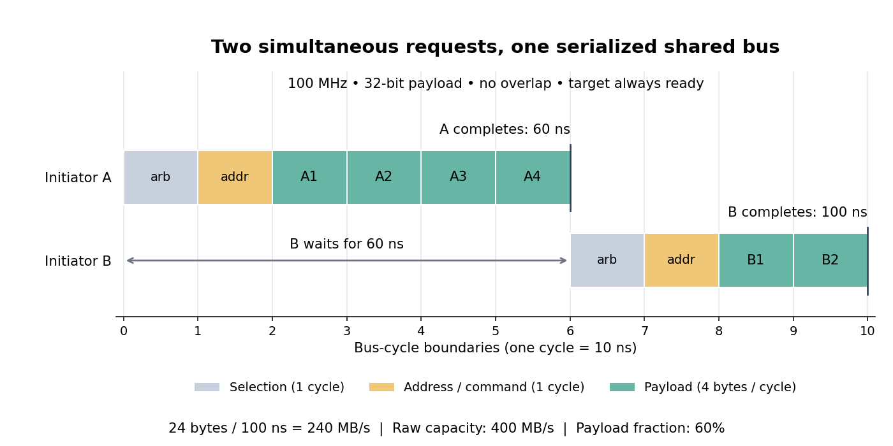

**[Figure 48](#image-stipulated-bus-arbitration-and-payload-timing-for-two-competing-bus-bursts). Stipulated bus arbitration and payload timing for two competing bus bursts**.

A [bus cycle](#bus-cycle) lasts

$$
T=\frac{1}{100\times10^6\ \mathrm{s}^{-1}}=10\ \mathrm{ns}.
$$

The timeline uses half-open intervals of [bus cycles](#bus-cycle): $A$ has [bus arbitration](#bus-arbitration) on $[0,1)$, address and command on $[1,2)$, and four payload transfers on $[2,6)$. Then $B$ has [bus arbitration](#bus-arbitration) on $[6,7)$, address and command on $[7,8)$, and two payload transfers on $[8,10)$. Their final payload completions are at 60 ns and 100 ns respectively. $B$ waits 60 ns before its own selection cycle even though both requests arrived together.

The six payload transfers contain 24 [bytes](computer-memory.md#byte). Ten [bus cycles](#bus-cycle) take 100 ns, giving finite-interval [bus throughput](#bus-throughput)

$$
R=\frac{24\ \mathrm{bytes}}{100\ \mathrm{ns}}=240\times10^6\ \mathrm{bytes/s}=240\ \mathrm{MB/s},
$$

where MB means $10^6$ [bytes](computer-memory.md#byte). The raw [data bus](#data-bus) rate is $4\ \mathrm{bytes}\times100\times10^6\ \mathrm{s}^{-1}=400\ \mathrm{MB/s}$. Payload occupies $6/10=60\%$ of the interval. If this same pair repeats with no gaps, its long-run [bus throughput](#bus-throughput) equals the finite-interval value; isolated observations need not predict a later workload.

Reverse the [bus arbitration](#bus-arbitration) order, keeping these assumptions. $B$ finishes after four [bus cycles](#bus-cycle), at 40 ns; $A$ finishes at 100 ns. Aggregate [bus throughput](#bus-throughput) stays 240 MB/s, but $B$'s request-to-completion time falls from 100 ns to 40 ns and $A$'s rises from 60 ns to 100 ns. Scheduling changes who waits without changing the available payload capacity in this example.

For an independent perturbation, retain $A$ first and add two [bus wait states](#bus-wait-state) before $B$'s final payload transfer. The interval grows to 120 ns with the same 24 [bytes](computer-memory.md#byte), so [bus throughput](#bus-throughput) falls to 200 MB/s. For another workload, one initiator sends all six transfers in a single [bus burst](#bus-burst): the stipulated overhead is paid once, giving eight [bus cycles](#bus-cycle), 80 ns and 300 MB/s. This latter comparison assumes one combined request is valid; combining different initiators' operations is not automatically permitted.

### Shared buses and point-to-point links

↑ **Parent:** [Computer bus](#computer-bus)

The word “bus” is also used for interconnect families that do not give all components a single shared electrical path. Intel's [An Introduction to the Intel QuickPath Interconnect](https://www.intel.com/content/dam/doc/white-paper/quick-path-interconnect-introduction-paper.pdf) (January 2009, p. 8, “Interconnect Overview”) explicitly describes [Intel QuickPath Interconnect](#intel-quickpath-interconnect) as a point-to-point link despite the serial-bus terminology, and compares it with [PCI Express](#pci-express). Here each link connects two endpoints. Independent links can carry traffic concurrently; traffic converging on one link or target still competes for that resource. The [shared-bus timing example](#shared-bus-timing-example)'s single owner and serialized service must therefore not be assumed for a whole network of links merely because its interfaces are called buses. Serial versus parallel transfer and shared versus point-to-point topology are separate distinctions.

### PCI Express

↑ **Parent:** [Computer bus](#computer-bus)

An interconnect family using point-to-point links; the topology distinction is explained under [shared buses and point-to-point links](#shared-buses-and-point-to-point-links).

### Intel QuickPath Interconnect

↑ **Parent:** [Computer bus](#computer-bus)

A processor interconnect using point-to-point links; [shared buses and point-to-point links](#shared-buses-and-point-to-point-links) explains why the word “bus” alone does not determine its topology.

// Destination: computer-science.bigb

### Direct memory access

↑ **Parent:** [Computer bus](#computer-bus)

[Direct memory access](#direct-memory-access) transfers data between a device and [computer memory](computer-memory.md) without the [CPU](#central-processing-unit) executing a copy instruction for each item. The [CPU](#central-processing-unit) still sets up the operation and observes completion. [DMA](#direct-memory-access) answers who moves the data; an [interrupt](operating-system.md#interrupt) answers how a need for attention is announced. A [DMA](#direct-memory-access) transfer can therefore finish with [interrupt-driven input-output](operating-system.md#interrupt-driven-input-output) or with [polled input-output](operating-system.md#polled-input-output). [Arpaci-Dusseau and Arpaci-Dusseau, OSTEP chapter 36, section 36.5: DMA](https://pages.cs.wisc.edu/~remzi/OSTEP/file-devices.pdf)

For a toy receive operation, the [CPU](#central-processing-unit) arranges a four-[byte](computer-memory.md#byte) [DMA buffer](#dma-buffer) and tells the device its [DMA address](#dma-address), length and direction. The device writes the [bytes](computer-memory.md#byte) `A`, `B`, `C`, `D` into that [DMA buffer](#dma-buffer). After completion and any required [DMA buffer synchronization](#dma-buffer-synchronization), the [CPU](#central-processing-unit) can read those four [bytes](computer-memory.md#byte). There are four payload [bytes](computer-memory.md#byte), but no four-item [CPU](#central-processing-unit) copy loop on the device-to-[computer memory](computer-memory.md) path. This is a schematic example, not an instruction to operate real hardware.

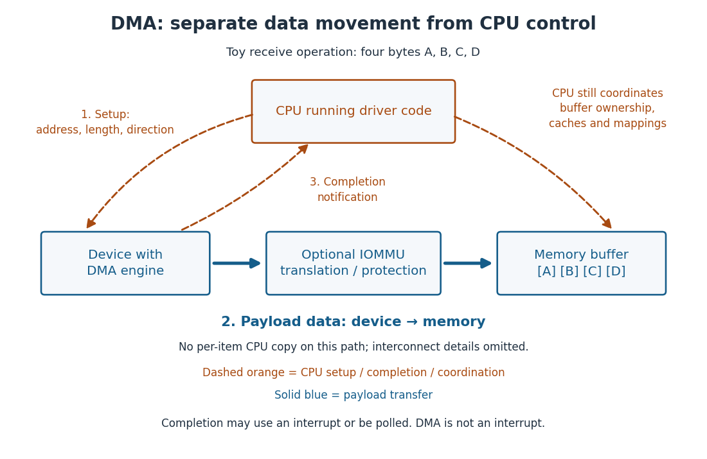

**[Figure 49](#image-dma-separates-the-device-to-computer-memory-data-path-from-cpu-setup-and-completion-control). DMA separates the device-to-computer memory data path from CPU setup and completion control**.

The useful separation is that the [CPU](#central-processing-unit) can perform other work while a larger transfer proceeds. The reasoning is a division of responsibilities: setup specifies the destination and extent once; the transfer engine advances through the payload; completion reports the result. The data still crosses an interconnect such as a [computer bus](#computer-bus), which must share access among competing initiators. Setup, mapping, synchronization and completion cost work, so [DMA](#direct-memory-access) does not promise a speedup for every transfer size. [James E. J. Bottomley, Linux DMA API, parts Ic–Id: mapping costs, addressing constraints and transfer directions](https://docs.kernel.org/core-api/dma-api.html)

Correctness also requires keeping the [DMA buffer](#dma-buffer) alive and coordinating its ownership until the device is finished. A [DMA address](#dma-address) need not equal a [CPU](#central-processing-unit) [virtual address](virtual-memory.md#virtual-address) or [physical address](computer-memory.md#physical-address). An [IOMMU](#input-output-memory-management-unit), when present and configured, translates device addresses and can restrict access to authorized [computer memory](computer-memory.md); it is not the [CPU](#central-processing-unit)'s [memory management unit](virtual-memory.md#memory-management-unit). [Operating-system process](operating-system.md#process-computing) isolation through [virtual memory](virtual-memory.md) alone does not establish those device-access restrictions. [Linux kernel documentation, Dynamic DMA mapping Guide: CPU and DMA addresses](https://docs.kernel.org/core-api/dma-api-howto.html)[Linux kernel documentation, VFIO: IOMMU protection and device isolation](https://docs.kernel.org/driver-api/vfio.html)

#### DMA buffer

↑ **Parent:** [Direct memory access](#direct-memory-access)

A region of [computer memory](computer-memory.md) prepared for [DMA](#direct-memory-access). In the four-[byte](computer-memory.md#byte) receive example it is the payload destination, and must remain available until the transfer and required [DMA buffer synchronization](#dma-buffer-synchronization) are complete.

#### DMA address

↑ **Parent:** [Direct memory access](#direct-memory-access)

An address supplied to a device for [DMA](#direct-memory-access), in the device's address system. The [Linux kernel](operating-system.md#linux-kernel)'s mapping interface returns this separately from the [CPU](#central-processing-unit)'s [virtual address](virtual-memory.md#virtual-address); an [IOMMU](#input-output-memory-management-unit) can translate it to a [physical address](computer-memory.md#physical-address). [Linux kernel documentation, Dynamic DMA mapping Guide: CPU and DMA addresses](https://docs.kernel.org/core-api/dma-api-howto.html)

#### DMA buffer synchronization

↑ **Parent:** [Direct memory access](#direct-memory-access)

Coordinating [CPU](#central-processing-unit) and device access to a [DMA buffer](#dma-buffer), including any required [memory cache](computer-memory.md#cache-computing) maintenance and ordering. A completed device write must be made visible before the [CPU](#central-processing-unit) consumes it. The [Linux kernel](operating-system.md#linux-kernel) distinguishes coherent mappings from streaming mappings needing synchronization at ownership changes; even coherent mappings can require ordering of writes. [Linux kernel documentation, Dynamic DMA mapping Guide: types of DMA mappings and using streaming DMA mappings](https://docs.kernel.org/core-api/dma-api-howto.html)[James E. J. Bottomley, Linux DMA API, part Ia: coherent buffers and write ordering](https://docs.kernel.org/core-api/dma-api.html)

### Input-output memory management unit

↑ **Parent:** [Computer bus](#computer-bus)  
ⓦ [Wiki](https://en.wikipedia.org/wiki/Input–output_memory_management_unit)

Hardware translating device [DMA addresses](#dma-address) to [physical addresses](computer-memory.md#physical-address), with access restrictions used for device isolation. Availability, configuration and isolation boundaries depend on the platform; merely having an [IOMMU](#input-output-memory-management-unit) does not establish complete isolation. [Linux kernel documentation, VFIO: IOMMUs, device topology and isolation groups](https://docs.kernel.org/driver-api/vfio.html)

## Central processing unit

↑ **Parent:** [Computer science](computer-science.md)  
ⓦ [Wiki](https://en.wikipedia.org/wiki/Central_processing_unit)

The processor executing a program's instructions. In [polled input-output](operating-system.md#polled-input-output) the [CPU](#central-processing-unit) explicitly checks status; in [interrupt-driven input-output](operating-system.md#interrupt-driven-input-output) it enters an [interrupt handler](operating-system.md#interrupt-handler); in [DMA](#direct-memory-access) it delegates payload movement while retaining setup and completion work.

### Out-of-order execution

↑ **Parent:** [Central processing unit](#central-processing-unit)  
ⓦ [Wiki](https://en.wikipedia.org/wiki/Out-of-order_execution)

Executing ready instructions before older instructions whose operands or resources are unavailable, while preserving the specified architectural behavior. [Reservation stations](#reservation-station), [register renaming](#register-renaming) and a [reorder buffer](#reorder-buffer) support different parts of this organization.

#### Reorder buffer

↑ **Parent:** [Out-of-order execution](#out-of-order-execution)

An age-ordered structure holding issued instructions' results and completion or exception status until [instruction retirement](#instruction-retirement). It permits execution to complete out of order while commitment follows program order.

##### Instruction retirement

↑ **Parent:** [Reorder buffer](#reorder-buffer)

Committing a completed instruction's architectural effects in program order. An instruction with no register result still needs completion status before [instruction retirement](#instruction-retirement) can pass it.

#### Common data bus

↑ **Parent:** [Out-of-order execution](#out-of-order-execution)

A shared path carrying tagged results or completion information to waiting [reservation stations](#reservation-station), the [register file](#register-file) or a [reorder buffer](#reorder-buffer). A tag identifies the particular producer, not merely the destination's logical name.

#### Register renaming

↑ **Parent:** [Out-of-order execution](#out-of-order-execution)  
ⓦ [Wiki](https://en.wikipedia.org/wiki/Register_renaming)

Mapping logical [processor registers](#processor-register) to versions identified by producer tags or [physical registers](#physical-register). A conditional destination must still deliver the old logical value when its predicate is false.

##### Physical register

↑ **Parent:** [Register renaming](#register-renaming)

A hardware value-storage location distinguished from an architectural [processor register](#processor-register) name. Several live versions of one logical register can occupy different [physical registers](#physical-register).

#### Reservation station

↑ **Parent:** [Out-of-order execution](#out-of-order-execution)

Storage for an issued instruction and its operands or producer tags until execution can proceed. In a scheme using station identifiers as persistent result tags, the identifier cannot be reused before the old result has completed writeback.

### Multicore processor

↑ **Parent:** [Central processing unit](#central-processing-unit)

A processor with several [CPU cores](#cpu-core) that can execute instruction streams concurrently. Shared [computer memory](computer-memory.md) requires attention to [cache coherence](computer-memory.md#cache-coherence) and the architecture's [memory model](operating-system.md#memory-model).

#### CPU core

↑ **Parent:** [Multicore processor](#multicore-processor)

An execution core within a processor. Each [CPU core](#cpu-core) can have a private [memory cache](computer-memory.md#cache-computing) and [store buffer](computer-memory.md#store-buffer) while participating in a coherent memory system.

### Speculative execution

↑ **Parent:** [Central processing unit](#central-processing-unit)  
ⓦ [Wiki](https://en.wikipedia.org/wiki/Speculative_execution)

Executing work before a condition validating it is resolved. Correctness requires suppressing or recovering its architectural effects if the condition fails. A [reorder buffer](#reorder-buffer) supports controlled [instruction retirement](#instruction-retirement) of such work.

#### Branch prediction

↑ **Parent:** [Speculative execution](#speculative-execution)  
ⓦ [Wiki](https://en.wikipedia.org/wiki/Branch_prediction)

Predicting a branch's continuation before its outcome is known, allowing instruction fetch and potentially execution to proceed. An incorrect prediction requires recovery of younger speculative work.

### Instruction pipelining

↑ **Parent:** [Central processing unit](#central-processing-unit)

[Instruction pipelining](#instruction-pipelining) divides execution into stages with stored intermediate state, allowing different instructions to occupy different stages simultaneously. The [processor clock period](electrical-engineering.md#processor-clock-period) is constrained by stage timing; moving a [barrel shifter](theoretical-computer-science.md#barrel-shifter) and [arithmetic logic unit](#arithmetic-logic-unit) into the same stage can lengthen that stage's [combinational critical path](theoretical-computer-science.md#combinational-critical-path).

#### Data hazard

↑ **Parent:** [Instruction pipelining](#instruction-pipelining)

An execution-timing conflict arising from the ordering of accesses to a value. A [read-after-write hazard](#read-after-write-hazard) occurs when a consumer would read before its required producer's value becomes available.

##### Read-after-write hazard

↑ **Parent:** [Data hazard](#data-hazard)

A younger instruction needs a value produced by an older instruction before the ordinary writeback/read path would deliver it. [Register forwarding](#register-forwarding) or a [pipeline stall](#pipeline-stall) can enforce the true dependence.

###### Register forwarding

↑ **Parent:** [Read-after-write hazard](#read-after-write-hazard)

Sending an already produced result directly to a consumer without waiting for its write to the [register file](#register-file). The bypass must choose the youngest older writer whose value is ready.

#### Pipeline stall

↑ **Parent:** [Instruction pipelining](#instruction-pipelining)

An interval in which some stage cannot advance its instruction. A [data hazard](#data-hazard), occupied resource or unresolved [cache miss](computer-memory.md#cache-miss) can cause a [pipeline stall](#pipeline-stall).

#### Pipeline register

↑ **Parent:** [Instruction pipelining](#instruction-pipelining)

Storage between stages of an [instruction pipelining](#instruction-pipelining) implementation, holding intermediate operands, results and control information across a clock boundary.

#### In-order pipeline

↑ **Parent:** [Instruction pipelining](#instruction-pipelining)

An [instruction pipelining](#instruction-pipelining) organization in which instructions advance through execution in program order. Different instructions can occupy different stages simultaneously, and [register forwarding](#register-forwarding) can remove some [data hazards](#data-hazard).

### Datapath

↑ **Parent:** [Central processing unit](#central-processing-unit)

A [datapath](#datapath) comprises the [processor registers](#processor-register), functional units and connections through which instruction operands and results move. Control signals select operand sources, operations, memory access and [processor register](#processor-register) writeback. Connecting a [barrel shifter](theoretical-computer-science.md#barrel-shifter) before an [arithmetic logic unit](#arithmetic-logic-unit) permits shift-and-add operations in one pass, but puts their delays in series.

#### Functional unit

↑ **Parent:** [Datapath](#datapath)

A component executing a class of operations, such as addition or multiplication. Operand availability, unit occupancy and result-broadcast capacity can independently constrain its scheduling.

### Arithmetic logic unit

↑ **Parent:** [Central processing unit](#central-processing-unit)

An [arithmetic logic unit](#arithmetic-logic-unit) is a [combinational logic](theoretical-computer-science.md#combinational-logic) component that performs selected arithmetic or bitwise operations on its input [machine words](#machine-word). Its result and status outputs, such as a [carry flag](#carry-flag), depend on the operation control. A [datapath](#datapath) may require a pass-through operation as well as addition, particularly when a [barrel shifter](theoretical-computer-science.md#barrel-shifter) feeds an operand.

### Busy waiting

↑ **Parent:** [Central processing unit](#central-processing-unit)

[Busy waiting](#busy-waiting) repeatedly tests a condition while keeping the processor occupied. A delay based only on instruction counts also depends on instruction timing and time spent handling [interrupts](operating-system.md#interrupt). Polling a [hardware timer](foundations-of-mathematics.md#hardware-timer) avoids that calibration dependence but still occupies the processor.

### Processor register

↑ **Parent:** [Central processing unit](#central-processing-unit)

A small storage location within a [CPU](#central-processing-unit) used by its instructions. Some hold data; others describe control state, such as the [program counter](#instruction-pointer) or [stack pointer](#stack-pointer). Saving and restoring [processor registers](#processor-register) lets different [software threads](operating-system.md#thread-computing) reuse the same [CPU](#central-processing-unit) while retaining separate [execution contexts](operating-system.md#execution-context).

#### Processor condition flag

↑ **Parent:** [Processor register](#processor-register)

State bits recording properties of an instruction's result for later conditional operations. A branch must use the flags established by the intended preceding instruction: an intervening flag-setting operation can change its meaning.

##### Zero flag

↑ **Parent:** [Processor condition flag](#processor-condition-flag)

A [processor condition flag](#processor-condition-flag) set when the relevant result is zero. A loop that decrements its remaining count and immediately branches on nonzero uses this flag as its termination test. A preceding logical shift's zero result is a different condition.

#### Carry flag

↑ **Parent:** [Processor register](#processor-register)

A processor status [bit](information-theory.md#bit) recording [arithmetic carry](arithmetic.md#carry-arithmetic). For unsigned addition of $n$-bit inputs, $X+Y=Z+2^nC$, where $Z$ is the stored result. In the [ARM architecture family](#arm-architecture-family), subtraction instead uses $X-Y=Z-2^n(1-C)$, so a set [arithmetic carry](arithmetic.md#carry-arithmetic) means no borrow. This convention must be checked for the target instruction set; it is not a signed-overflow test.

##### Subtract with carry

↑ **Parent:** [Carry flag](#carry-flag)

With the [ARM architecture family](#arm-architecture-family)'s no-borrow convention, [subtract with carry](#subtract-with-carry) forms $X-Y-(1-C_{\rm in})$. The same [adder](theoretical-computer-science.md#adder) used for addition can form $X+(2^n-1-Y)+C_{\rm in}$. If its output is $Z+2^nC_{\rm out}$, rearranging proves $X-Y-(1-C_{\rm in})=Z-2^n(1-C_{\rm out})$. Thus complementing the second operand implements both the result and the correctly chained borrow information.[Page 1, Subtract with carry](computer-science-bibliography.md#thumb-16-bit-instruction-set-quick-reference-by-arm)

##### Add with carry

↑ **Parent:** [Carry flag](#carry-flag)

For $n$-bit operands, an [add with carry](#add-with-carry) operation forms $X+Y+C_{\rm in}$, retains its residue [modulo](modular-arithmetic.md#modulo-operation) $2^n$, and outputs its [arithmetic carry](arithmetic.md#carry-arithmetic). Adding low limbs first and feeding each [arithmetic carry](arithmetic.md#carry-arithmetic) into the next limb implements multiword unsigned addition. With $M=2^n$, the identities $X_0+Y_0=Z_0+Mc$ and $X_1+Y_1+c=Z_1+Md$ combine into $(MX_1+X_0)+(MY_1+Y_0)=MZ_1+Z_0+M^2d$.[Page 1, Add with carry](computer-science-bibliography.md#thumb-16-bit-instruction-set-quick-reference-by-arm)

#### Register file

↑ **Parent:** [Processor register](#processor-register)

A collection of indexed [processor registers](#processor-register). Selecting one of $R$ registers requires at least $\lceil\log_2 R\rceil$ [bits](information-theory.md#bit) in a register index field.

##### Write-suppression destination

↑ **Parent:** [Register file](#register-file)

A destination code whose writes have no architectural effect. Replacing a disabled write by a write to such a destination can remove a global register-file enable input: every actual register enable becomes its address-decode line, and the suppression code activates none. The instruction control must still select that code whenever a write should be suppressed. This transformation preserves the register-state update, rather than making the control decision unnecessary.

##### MIPS zero register

↑ **Parent:** [Register file](#register-file)

Register zero in the [MIPS architecture](#mips-architecture) reads as zero and discards writes. An implementation can omit its data storage, hardwire its read output to zero and suppress its write selection. This property permits using zero as a [write-suppression destination](#write-suppression-destination) without changing the visible register values.

##### Spilling a register

↑ **Parent:** [Register file](#register-file)

Moving a live value from a [processor register](#processor-register) to memory so the register can be reused, then loading it again when needed.

#### Stack pointer

↑ **Parent:** [Processor register](#processor-register)

A [processor register](#processor-register) identifying the current position in a stack, commonly a [call stack](data-structure.md#call-stack); the exact convention depends on the architecture. Restoring a [stack pointer](#stack-pointer) selects the saved stack position, rather than copying the whole [call stack](data-structure.md#call-stack).

## Input-output

↑ **Parent:** [Computer science](computer-science.md)

Transfers of data between a computer and its devices or external environment. An [operating-system process](operating-system.md#process-computing) can need to wait for an [input-output](#input-output) operation to complete, leaving the [CPU](#central-processing-unit) available for other runnable work. [Polled input-output](operating-system.md#polled-input-output), [interrupt-driven input-output](operating-system.md#interrupt-driven-input-output) and [DMA](#direct-memory-access) describe different aspects of arranging and observing such transfers.

// Destination: computer-science.bigb

### Latency (engineering)

↑ **Parent:** [Input-output](#input-output)

The elapsed delay between a request or event and the corresponding response. A latency model must specify whether setup, waiting, transfer and processing overhead are included.

#### Data transfer time

↑ **Parent:** [Latency (engineering)](#latency-engineering)

At constant transfer rate $v$ bytes per second, moving $B$ bytes takes $B/v$ seconds. The size and rate must use compatible units. This term alone does not include [seek time](#seek-time), [rotational latency](#rotational-latency) or controller setup costs.

#### Expected latency

↑ **Parent:** [Latency (engineering)](#latency-engineering)

The [expected value](expected-value.md) of a latency random variable. If a [cache hit](computer-memory.md#cache-hit) takes total time $t_h$, a [cache miss](computer-memory.md#cache-miss) takes total time $t_m$, and the [cache hit rate](computer-memory.md#cache-hit-rate) is $h$, conditioning gives $\mathbb E[T]=ht_h+(1-h)t_m$. An overhead already included in either total should not be charged again.

### Data storage device

↑ **Parent:** [Input-output](#input-output)

#### Block device

↑ **Parent:** [Data storage device](#data-storage-device)

A [data storage device](#data-storage-device) accessed in numbered fixed-size blocks. This interface amortizes command overhead and accommodates the physical transfer granularity of the storage medium.

#### Hard disk drive

↑ **Parent:** [Data storage device](#data-storage-device)  
ⓦ [Wiki](https://en.wikipedia.org/wiki/Hard_disk_drive)

A [data storage device](#data-storage-device) that records information magnetically on rotating platters. Accessing a sector can require moving a head to its track, waiting for the sector to rotate beneath it, and transferring the data. These contributions are [seek time](#seek-time), [rotational latency](#rotational-latency) and [data transfer time](#data-transfer-time).[Chapter 37, Hard Disk Drives, §37.3, seek, rotation and transfer phases](computer-science-bibliography.md#operating-systems-three-easy-pieces-by-remzi-h-arpaci-dusseau-and-others)

##### Rotational latency

↑ **Parent:** [Hard disk drive](#hard-disk-drive)

The wait for the requested sector to reach the disk head after positioning on its track. For a uniformly distributed arrival phase and rotation period $T_{\rm rot}$, its [expected value](expected-value.md) is half a rotation. At $r$ revolutions per minute, this is $30/r$ seconds.

##### Seek time

↑ **Parent:** [Hard disk drive](#hard-disk-drive)

The time required to move and settle the disk head over the desired track. It is distinct from [seek distance](#seek-distance) and from waiting for a sector's rotation.

##### Disk scheduling

↑ **Parent:** [Hard disk drive](#hard-disk-drive)

Choose the order of pending [input-output](#input-output) requests. Physical head movement, [rotational latency](#rotational-latency), request arrival times and fairness can favour different orders. A [seek distance](#seek-distance) calculation is a simplified model; real [seek time](#seek-time) is not necessarily linear in track displacement.

###### Seek distance

↑ **Parent:** [Disk scheduling](#disk-scheduling)

Total absolute track displacement along a head route $t_0,t_1,\ldots$. Include physical turnaround points in the route if the scheduling policy visits them, even if they do not service a request.

###### LOOK disk scheduling

↑ **Parent:** [Disk scheduling](#disk-scheduling)

Sweep in one direction through pending requests, reversing at the last pending track rather than travelling to the disk's physical endpoint. It shares the directional sweep of [SCAN disk scheduling](#scan-disk-scheduling) but can avoid movement into an empty end region.

###### SCAN disk scheduling

↑ **Parent:** [Disk scheduling](#disk-scheduling)

Sweep in one direction, servicing requests encountered in track order, continue to the physical endpoint, and then reverse. A calculation must state the initial direction and whether movement after the final requested service is included. [LOOK disk scheduling](#look-disk-scheduling) instead turns around at the last pending request in that direction.

###### Shortest-seek-time-first disk scheduling

↑ **Parent:** [Disk scheduling](#disk-scheduling)

Serve the pending request whose track is nearest to the current head position, with an explicit tie rule when necessary. This minimizes the next [seek distance](#seek-distance), rather than the total distance of every future request; a continuing stream of nearby requests can starve a distant request.

###### First-come-first-served disk scheduling

↑ **Parent:** [Disk scheduling](#disk-scheduling)

Serve requests in arrival order. This preserves queue order but can cause repeated long seeks when successive requests lie far apart.

### Device independence

↑ **Parent:** [Input-output](#input-output)

A device-independent interface expresses requests without exposing each peripheral's control registers or protocol to the client. A [device driver](operating-system.md#device-driver) translates these requests into device-specific operations. This lets an application retain its interface when the supported hardware changes.

### Device register

↑ **Parent:** [Input-output](#input-output)

A [device register](#device-register) exposes a device's status, control or data to software. Its access semantics can include side effects: a status flag may need an explicit acknowledgement operation before another event is detectable. A [device register](#device-register) is not necessarily a [processor register](#processor-register). [Memory-mapped input-output](#memory-mapped-input-output) input-output is one way to access it.

### Memory-mapped input-output

↑ **Parent:** [Input-output](#input-output)

[Memory-mapped input-output](#memory-mapped-input-output) exposes device registers through addresses accessed by load and store operations. A target-specific [C programming language](programming-language.md#c-programming-language) port maps the documented registers to suitably qualified objects and implements any required access barriers. Register layout, access width and acknowledgment semantics belong to the device specification; a register's name alone does not establish its numerical address.

## Temporal locality

↑ **Parent:** [Computer science](computer-science.md)

Temporal locality is the tendency for the same item to be accessed again soon after an earlier access. For [computer memory](computer-memory.md), the item might be an [array](data-structure.md#array-data-structure) element, a [cache line](computer-memory.md#cache-line) or a [memory page](virtual-memory.md#memory-page); always specify the unit. [Temporal locality](#temporal-locality) concerns reuse over time, whereas [spatial locality](#spatial-locality) concerns accesses to nearby addresses. Both are properties of a workload, rather than guarantees about its next [memory reference](computer-memory.md#memory-reference). [Remzi H. Arpaci-Dusseau and Andrea C. Arpaci-Dusseau, Operating Systems: Three Easy Pieces, chapter 22, section 22.5 and the Types of Locality aside](computer-science-bibliography.md#operating-systems-three-easy-pieces-by-remzi-h-arpaci-dusseau-and-others/beyond-physical-memory-policies)

For a worked example, let $A$ and $B$ denote two distinct [cache blocks](computer-memory.md#cache-line) at unrelated, nonadjacent [physical addresses](computer-memory.md#physical-address). An initially empty [fully associative cache](computer-memory.md#fully-associative-cache) holding two [cache lines](computer-memory.md#cache-line), with [LRU replacement](virtual-memory.md#lru-replacement), receives the [sequence](sequence-and-series.md#sequence) $A,B,A$. The first $A$ causes a [cache miss](computer-memory.md#cache-miss) and leaves $A$ resident; $B$ causes another [cache miss](computer-memory.md#cache-miss) and leaves both $A$ and $B$ resident; the last $A$ is a [cache hit](computer-memory.md#cache-hit). [LRU replacement](virtual-memory.md#lru-replacement) now regards $B$ as older than $A$. The benefit comes from [temporal locality](#temporal-locality) of $A$, irrespective of how far apart the [cache blocks](computer-memory.md#cache-line) lie. With capacity one, the same [sequence](sequence-and-series.md#sequence) gives three [cache misses](computer-memory.md#cache-miss): reuse helps only if the item survives until it is needed.

The appealing idea is that a small [memory cache](computer-memory.md#cache-computing) can serve a large computation when its currently useful data stay small. Repeatedly reading a counter or executing the same instructions can exploit [temporal locality](#temporal-locality). [LRU replacement](virtual-memory.md#lru-replacement) and recency-based approximations try to retain recently used items. A [working set](virtual-memory.md#working-set) records recent demand; if the active [working set](virtual-memory.md#working-set) cannot fit in resident [memory pages](virtual-memory.md#memory-page), [memory thrashing](virtual-memory.md#thrashing-computer-science) can defeat this benefit. At [cache line](computer-memory.md#cache-line) granularity, even accesses to different [array](data-structure.md#array-data-structure) elements can reuse the same [cache block](computer-memory.md#cache-line), as the [spatial locality](#spatial-locality) example shows.

Peter J. Denning's May 1968 paper connected recent [memory page](virtual-memory.md#memory-page) use to near-future demand through the [working set](virtual-memory.md#working-set). Section 3 explicitly discusses the clustering of references to the same [memory page](virtual-memory.md#memory-page) in time. This is a documented early treatment of the reasoning behind [temporal locality](#temporal-locality), rather than a claim about who first coined the term. [Peter J. Denning, The Working Set Model for Program Behavior, Communications of the ACM 11(5), section 3: Definition and Properties, especially P2: Prediction](https://denninginstitute.com/pjd/PUBS/WSModel_1968.pdf)

## Spatial locality

↑ **Parent:** [Computer science](computer-science.md)

Spatial locality is the tendency to access nearby locations in [computer memory](computer-memory.md) within a short interval. A sequential scan of a contiguous [array](data-structure.md#array-data-structure) has [spatial locality](#spatial-locality) even when each element is read only once. A [memory cache](computer-memory.md#cache-computing) can exploit [spatial locality](#spatial-locality) by fetching a whole [cache line](computer-memory.md#cache-line) on a [cache miss](computer-memory.md#cache-miss): later reads of neighbouring elements become [cache hits](computer-memory.md#cache-hit). Proximity is in the address layout, so visually adjacent entries in a table need not be adjacent [bytes](computer-memory.md#byte).

Consider a $4\times4$ [array](data-structure.md#array-data-structure) of 32-[bit](information-theory.md#bit) [integers](integer.md), each occupying four eight-[bit](information-theory.md#bit) [bytes](computer-memory.md#byte), stored contiguously in [row-major order](data-structure.md#row-major-order). Use toy [physical addresses](computer-memory.md#physical-address) starting at zero, aligned to a 16-[byte](computer-memory.md#byte) [cache line](computer-memory.md#cache-line) boundary. For row $i$ and column $j$, with $0\leq i,j<4$, the address and [cache block](computer-memory.md#cache-line) number are

$$
\operatorname{address}(i,j)=4(4i+j),\qquad
\operatorname{line}(i,j)=\left\lfloor\frac{\operatorname{address}(i,j)}{16}\right\rfloor=i.
$$

Here $\lfloor\cdot\rfloor$ is the [floor function](calculus.md#floor-function). Each row occupies exactly one [cache line](computer-memory.md#cache-line): row zero begins at addresses $0,4,8,12$, row one at $16,20,24,28$, and so on. [Row-major order](data-structure.md#row-major-order) describes this storage layout; traversal can follow rows or columns without moving the elements.

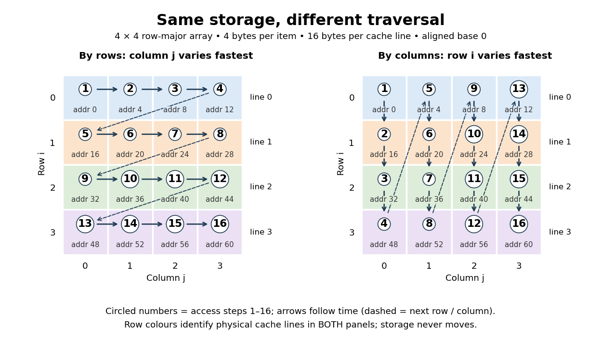

**[Figure 50](#image-two-traversal-paths-through-the-same-row-major-array-coloured-by-physical-cache-line). Two traversal paths through the same row-major array, coloured by physical cache line**.

Read all sixteen elements and compute their [integer](integer.md) sum, keeping the accumulator outside the modelled [memory cache](computer-memory.md#cache-computing). Only the sixteen [array](data-structure.md#array-data-structure) reads count as [memory references](computer-memory.md#memory-reference). The toy [fully associative cache](computer-memory.md#fully-associative-cache) starts empty, holds exactly one 16-[byte](computer-memory.md#byte) [cache line](computer-memory.md#cache-line), fetches the requested [cache block](computer-memory.md#cache-line) on every [cache miss](computer-memory.md#cache-miss), and uses [LRU replacement](virtual-memory.md#lru-replacement). No [cache block](computer-memory.md#cache-line) is fetched ahead of a request, and no writeback costs are counted because the modelled accesses are reads.

- Traversing by rows, with $j$ varying fastest, requests [cache blocks](computer-memory.md#cache-line) $0,0,0,0,1,1,1,1,2,2,2,2,3,3,3,3$. Each first read in a row is a [cache miss](computer-memory.md#cache-miss); the next three are [cache hits](computer-memory.md#cache-hit). Total: four [cache misses](computer-memory.md#cache-miss) and twelve [cache hits](computer-memory.md#cache-hit) in sixteen [memory references](computer-memory.md#memory-reference).
- Traversing by columns, with $i$ varying fastest, requests [cache blocks](computer-memory.md#cache-line) $0,1,2,3$ four times. Every read replaces the sole resident [cache line](computer-memory.md#cache-line), so the next read always causes a [cache miss](computer-memory.md#cache-miss). Total: sixteen [cache misses](computer-memory.md#cache-miss) and zero [cache hits](computer-memory.md#cache-hit) in sixteen [memory references](computer-memory.md#memory-reference).

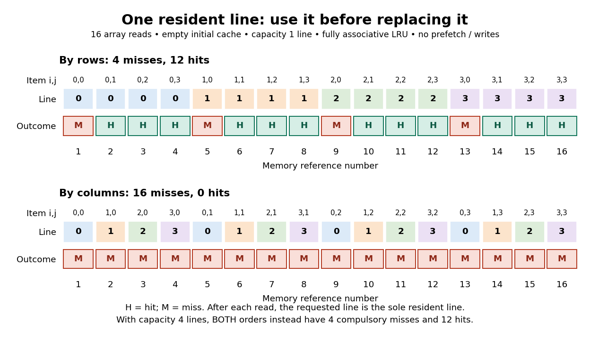

**[Figure 51](#image-all-sixteen-memory-references-and-their-cache-hits-or-cache-misses-with-capacity-one-cache-line). All sixteen memory references and their cache hits or cache misses with capacity one cache line**.

Every element is read once in both traversals. The row traversal exploits [spatial locality](#spatial-locality) between distinct elements and [temporal locality](#temporal-locality) of their shared [cache block](computer-memory.md#cache-line). The column traversal returns to each [cache block](computer-memory.md#cache-line) after three other distinct [cache blocks](computer-memory.md#cache-line), too late for the one-line [memory cache](computer-memory.md#cache-computing). Increase the [fully associative cache](computer-memory.md#fully-associative-cache) to four [cache lines](computer-memory.md#cache-line) and both traversals give four [compulsory misses](computer-memory.md#compulsory-miss) and twelve [cache hits](computer-memory.md#cache-hit): no loaded [cache block](computer-memory.md#cache-line) needs eviction. The difference therefore depends on capacity as well as access order and layout.

This makes [spatial locality](#spatial-locality) useful and beautiful: the same logical operation on the same elements can use a fetched [cache line](computer-memory.md#cache-line) much more fully simply by changing traversal order. The toy counts do not predict a universal speed ratio on real hardware. Actual [cache line](computer-memory.md#cache-line) sizes, capacities, placement rules, fetching ahead of requests and overlapping work affect runtime; measure a concrete implementation with [statistical program profiling](algorithm.md#statistical-program-profiling). Ulrich Drepper's November 2007 authored paper explains [cache line](computer-memory.md#cache-line) transfers and gives [array](data-structure.md#array-data-structure) and [matrix](vector-space.md#matrix) access examples connecting layout, [temporal locality](#temporal-locality) and [spatial locality](#spatial-locality). Its hardware measurements are historical examples, rather than specifications for every present-day [CPU](#central-processing-unit). [Ulrich Drepper, What Every Programmer Should Know About Memory, sections 3.2 and 6.2.1: cache operation and optimizing data-cache access](https://www.akkadia.org/drepper/cpumemory.pdf)

// Destination: computer-science.bigb

## Data structure

↑ **Parent:** [Computer science](computer-science.md)

[This section is present in another page, follow this link to view it.](data-structure.md)

## Operating system

↑ **Parent:** [Computer science](computer-science.md)

[This section is present in another page, follow this link to view it.](operating-system.md)

## Programming language

↑ **Parent:** [Computer science](computer-science.md)

[This section is present in another page, follow this link to view it.](programming-language.md)

## Spreadsheet

↑ **Parent:** [Computer science](computer-science.md)

[This section is present in another page, follow this link to view it.](spreadsheet.md)

## Linial-Mansour-Nisan theorem

↑ **Parent:** [Computer science](computer-science.md)

The Linial-Mansour-Nisan theorem bounds the high-degree Fourier weight of a Boolean function computed by a small bounded-depth circuit.

## Image processing

↑ **Parent:** [Computer science](computer-science.md)

[Image processing](#image-processing) transforms recorded [image signal](#image-signal) data to remove noise, recover detail or extract structure. [Variational image processing](#variational-image-processing) describes desired reconstructions through energies, while [diffusion image processing](#diffusion-image-processing) describes filtering through evolution equations.

### Quantization (signal processing)

↑ **Parent:** [Image processing](#image-processing)  
ⓦ [Wiki](https://en.wikipedia.org/wiki/Quantization_(signal_processing))

[Quantization](#quantization-signal-processing) maps numerical values to a specified discrete collection of representable values. In [lossy block averaging](data-compression.md#lossy-block-averaging), $Q(m)=\lfloor m+1/2\rfloor$ maps block [arithmetic means](arithmetic.md#arithmetic-mean) in $[0,255]$ to eight-[bit](information-theory.md#bit) [integers](integer.md). Thus $Q(40.25)=40$ and $Q(40.5)=41$. Different means can share a stored value, making this step irreversible.

#### Uniform-quantization error bound

↑ **Parent:** [Quantization (signal processing)](#quantization-signal-processing)

Rounding a voltage to the nearest level in a uniform grid of spacing $q$ gives a [quantization](#quantization-signal-processing) error of magnitude at most $q/2$, provided the input is within the converter's range. This follows because each grid point represents the interval bounded by the midpoints to its two neighbors. Clipping invalidates the bound.

The bound concerns recorded samples, whereas the [Nyquist–Shannon sampling theorem](fourier-analysis.md#nyquist-shannon-sampling-theorem) concerns reconstruction from exact samples of a [bandlimited function](fourier-transform.md#bandlimited-function). If a reconstruction is $\widetilde v(t)=\sum_n Q_q(v_n)w_n(t)$, its error is $\sum_n\epsilon_nw_n(t)$, so a general bound involves $(q/2)\sum_n|w_n(t)|$, not simply $q/2$. Thus sampling bandwidth and per-sample rounding precision are distinct specifications. Under an additional uniform independent-error model, the quantization-noise [standard deviation](variance.md#standard-deviation) is $q/\sqrt{12}$, an rms statement rather than a worst-case reconstruction guarantee.

### Nearest-neighbor interpolation

↑ **Parent:** [Image processing](#image-processing)  
ⓦ [Wiki](https://en.wikipedia.org/wiki/Nearest-neighbor_interpolation)

[Nearest-neighbor interpolation](#nearest-neighbor-interpolation) assigns each requested location the value of its nearest available sample, with a specified convention for ties. In [lossy block averaging](data-compression.md#lossy-block-averaging), samples are placed at block centres and each is copied into its four original [pixel](computer-graphics.md#pixel) positions. This enlarges the [raster image](computer-graphics.md#raster-graphics) without recovering discarded detail.

### Image segmentation

↑ **Parent:** [Image processing](#image-processing)  
ⓦ [Wiki](https://en.wikipedia.org/wiki/Image_segmentation)

[Image segmentation](#image-segmentation) divides an [image signal](#image-signal) domain into regions according to a chosen criterion, such as approximately constant or smoothly varying intensity. The [Mumford–Shah segmentation model](#mumford-shah-functional) balances fidelity, within-region smoothness and [image edge](#image-edge) length. An intensity segmentation need not coincide with semantic object identities.

#### Cell segmentation

↑ **Parent:** [Image segmentation](#image-segmentation)

### Image signal

↑ **Parent:** [Image processing](#image-processing)

A grey-value [image signal](#image-signal) is a scalar function on an [image signal](#image-signal) domain or an array of pixel values. Continuous [image processing](#image-processing) models use spaces such as $L^2$, [Sobolev spaces](sobolev-space.md) or the [BV space](inverse-problem.md#function-of-bounded-variation-on-a-domain), while discrete models use finite-dimensional arrays. The chosen representation distinguishes smooth transitions, noise and [image edges](#image-edge).

#### Image noise

↑ **Parent:** [Image signal](#image-signal)

Image noise is unwanted variation in an observed [image signal](#image-signal). In an additive model $g=u+\eta$, Gaussian noise motivates a squared data-fidelity penalty, while other statistics require different penalties. [Image smoothing](#image-smoothing) suppresses rapid fluctuations, but a filter must distinguish noise from genuine [image edges](#image-edge).

### Structure tensor

↑ **Parent:** [Image processing](#image-processing)

For a smoothed [image signal](#image-signal) $u_\sigma$, average the [gradient](multivariable-calculus.md#gradient) outer product as $J_\rho=G_\rho*(\nabla u_\sigma\nabla u_\sigma^T)$. The dominant [eigenvector](linear-operator-theory.md#eigenvector) estimates the normal to a coherent [image edge](#image-edge), and [eigenvalue](linear-operator-theory.md#eigenvalue) contrast [measures](measure.md) local directional structure. Two distinct scales separate differentiation from orientation averaging.

### Image edge

↑ **Parent:** [Image processing](#image-processing)

An [image edge](#image-edge) is a rapid grey-value transition, modeled as a large [gradient](multivariable-calculus.md#gradient) or a jump discontinuity. It differs from an [edge of a graph](graph-theory.md#edge-of-a-graph). Variational models can penalize [image edge](#image-edge) length, while [diffusion image processing](#diffusion-image-processing) estimates [image edge](#image-edge) directions to limit [image smoothing](#image-smoothing) across them.

#### Image edge enhancement

↑ **Parent:** [Image edge](#image-edge)

[image edge](#image-edge) enhancement increases the apparent sharpness or contrast of an [image edge](#image-edge). [Unsharp masking](#unsharp-masking) gives bounded linear high-frequency amplification; backward normal diffusion in the [Perona-Malik equation](diffusion-equation.md#perona-malik-equation) gives formal nonlinear sharpening with [ill-posedness](partial-differential-equation.md#ill-posed-problem) risks. Positive diffusion tensors chiefly preserve or connect structure rather than perform unbounded backward diffusion.

##### Shock filter for image enhancement

↑ **Parent:** [Image edge enhancement](#image-edge-enhancement)

The formal shock-filter equation $u_t=-\operatorname{sign}(\Delta u)|\nabla u|$ steepens transitions around inflection boundaries. It is a Hamilton–Jacobi-type transport mechanism rather than positive diffusion. Combining it with controlled forward [image smoothing](#image-smoothing) limits noise amplification.

##### Unsharp masking

↑ **Parent:** [Image edge enhancement](#image-edge-enhancement)

Subtract a smoothed [image signal](#image-signal) and add a scaled residual: $u=g+\lambda(g-G_t*g)$. The Fourier multiplier $1+\lambda(1-e^{-t|\xi|^2})$ is bounded by $1+\lambda$. This enhances apparent contrast but also amplifies noise; it is not a stable exact inverse of heat [image smoothing](#image-smoothing).

### Diffusion image processing

↑ **Parent:** [Image processing](#image-processing)

Diffusion filtering evolves an observed [image signal](#image-signal) using a [diffusion equation](diffusion-equation.md). The [heat equation](diffusion-equation.md#heat-equation) gives Gaussian [image smoothing](#image-smoothing), while gradient-dependent or tensor-dependent diffusion can reduce transport across [image edges](#image-edge). A [image smoothing](#image-smoothing) scale, stopping rule and appropriate boundary conditions are part of the filter.

#### Diffusion tensor for image filtering

↑ **Parent:** [Diffusion image processing](#diffusion-image-processing)

A positive tensor $D=a_ne_ne_n^T+a_te_te_t^T$ selects different diffusion strengths normal and tangent to an estimated [image edge](#image-edge). Taking $0<a_n\ll a_t$ smooths along the [image edge](#image-edge) while reducing mixing across it. A [structure tensor](#structure-tensor) provides robust orientation estimates. Positive [eigenvalues](linear-operator-theory.md#eigenvalue) ensure forward local parabolicity.

#### Image smoothing

↑ **Parent:** [Diffusion image processing](#diffusion-image-processing)

[Image smoothing](#image-smoothing) suppresses rapid fluctuations attributed to noise. Linear [heat equation](diffusion-equation.md#heat-equation) [image smoothing](#image-smoothing) attenuates Fourier frequencies by $e^{-t|\xi|^2}$ but also blurs [image edges](#image-edge). Nonlinear filtering uses [image signal](#image-signal) geometry to distinguish fluctuations from meaningful transitions.

##### Median filter

↑ **Parent:** [Image smoothing](#image-smoothing)  
ⓦ [Wiki](https://en.wikipedia.org/wiki/Median_filter)

A [median filter](#median-filter) replaces an [image signal](#image-signal) value by the [median](probability-distribution.md#median) of nearby values. Unlike a linear average, it can reject isolated extreme observations without averaging both sides of an [image edge](#image-edge). The small-radius response depends on neighbourhood geometry and measure; a uniform disk-area [median](probability-distribution.md#median) and a circle-boundary [median](probability-distribution.md#median) have different time scales.

###### Disk-median curvature expansion

↑ **Parent:** [Median filter](#median-filter)

At a smooth point with nonzero [gradient](multivariable-calculus.md#gradient), rotate coordinates so $\nabla u=G e_2$. Write $u=u_0+Gy+\tfrac12(Ax^2+2Bxy+Cy^2)+O(|(x,y)|^3)$. A candidate [median](probability-distribution.md#median) $u_0+dh^2$ has level boundary $y=(dh^2-Ax^2/2)/G+O(h^3)$ in the disk. The area imbalance is $(2d-A/3)h^3/G+o(h^3)$; equal half-areas force $d=A/6$. Here $A=\Delta u-\nabla u^T(D^2u)\nabla u/|\nabla u|^2$ is the tangential second [derivative](calculus.md#derivative), giving the formula. The disk uses uniform area measure, not its boundary measure.

##### Gaussian blur

↑ **Parent:** [Image smoothing](#image-smoothing)  
ⓦ [Wiki](https://en.wikipedia.org/wiki/Gaussian_blur)

[Gaussian blur](#gaussian-blur) applies [convolution](fourier-analysis.md#convolution) with $G_\sigma(x)=(2\pi\sigma^2)^{-n/2}e^{-|x|^2/(2\sigma^2)}$ to an [image signal](#image-signal). It averages over a spatial scale $\sigma$, suppressing rapid variation while also blurring [image edges](#image-edge). The [heat-kernel convolution](diffusion-equation.md#heat-kernel-convolution) realizes this filter at time $t=\sigma^2/2$.

###### Gaussian filtering Fourier multiplier

↑ **Parent:** [Gaussian blur](#gaussian-blur)

The [Fourier transform of a Gaussian](fourier-analysis.md#fourier-transform-of-a-gaussian) and the [convolution theorem](fourier-analysis.md#convolution-theorem) give this multiplier with the angular-frequency convention $e^{-ix\cdot\xi}$. In cycles-per-length [frequencies](wave.md#frequency) $k$, it is $e^{-2\pi^2\sigma^2|k|^2}$. Each coordinate has variance $\sigma^2$, and higher [frequencies](wave.md#frequency) receive stronger attenuation.

### Variational image processing

↑ **Parent:** [Image processing](#image-processing)

A variational model balances agreement with observed data against a regularity or geometric penalty. Examples include [total variation denoising](inverse-problem.md#total-variation-denoising), the [relaxed graph-area functional](inverse-problem.md#relaxed-graph-area-functional), and the [Mumford–Shah functional](#mumford-shah-functional). Convex penalties support unique reconstruction, while segmentation energies can have multiple competing partitions.

<h4 id="mumford-shah-functional">Mumford–Shah functional</h4>

↑ **Parent:** [Variational image processing](#variational-image-processing)  
ⓦ [Wiki](https://en.wikipedia.org/wiki/Mumford–Shah_functional)

The energy $\int_{\Omega\setminus K}(u-g)^2+\alpha\int_{\Omega\setminus K}|\nabla u|^2+\beta\mathcal H^1(K)$ balances data fidelity, within-region smoothness and [image edge](#image-edge) length. In its relaxed [SBV space](inverse-problem.md#special-bounded-variation-space) formulation the [image edge](#image-edge) set is $J_u$. Clipping to the bounded data range, the [SBV compactness theorem](inverse-problem.md#sbv-compactness-theorem) and [lower semicontinuity](calculus.md#lower-semicontinuity) prove existence; the full segmentation problem is not [strictly convex](real-analysis.md#strictly-convex-function).

<h5 id="ambrosio-tortorelli-approximation">Ambrosio–Tortorelli approximation</h5>

↑ **Parent:** [Mumford–Shah functional](#mumford-shah-functional)

The [Mumford–Shah functional](#mumford-shah-functional) can be approximated by an auxiliary edge field $0\le v\le1$ and energy

$$
E_\varepsilon=\int(u-g)^2+\alpha(v^2+\eta_\varepsilon)|\nabla u|^2+\beta\left[\varepsilon|\nabla v|^2+\frac{(1-v)^2}{4\varepsilon}\right],\qquad0<\eta_\varepsilon=o(\varepsilon).
$$

The field is near one inside regions and near zero across an [image edge](#image-edge), weakening smoothing there. The profile $v(s)=1-e^{-|s|/(2\varepsilon)}$ has unit edge energy per unit length in this normalization. The [1990 construction](https://onlinelibrary.wiley.com/doi/10.1002/cpa.3160430805) is a [Gamma-convergence](calculus-of-variations.md#gamma-convergence) approximation; its global-minimizer [limit](calculus.md#limit-of-a-function) does not guarantee global optimality of an alternating numerical solve. Each fixed-field subproblem is quadratic, but the joint energy is nonconvex.

##### Segmentation overfitting without an edge penalty

↑ **Parent:** [Mumford–Shah functional](#mumford-shah-functional)

Removing the jump-length cost from the [Mumford–Shah functional](#mumford-shah-functional) lets finer piecewise-constant partitions reduce squared fidelity without charging for their proliferating [image edges](#image-edge). For [continuous](calculus.md#continuous-function) data on a compact image domain, fine-cell averages converge in squared error while the ordinary within-cell [gradient](multivariable-calculus.md#gradient) is zero. A finite interface penalty makes that geometry costly.

<h5 id="nonconvexity-of-mumford-shah-segmentation">Nonconvexity of Mumford–Shah segmentation</h5>

↑ **Parent:** [Mumford–Shah functional](#mumford-shah-functional)

On the unit square, let $g=0$ and take $u_0=\chi_{\{x_1>0.4\}}$, $u_1=\chi_{\{x_1>0.6\}}$. Both have one unit-length jump and zero ordinary [gradient](multivariable-calculus.md#gradient). Their mean has two unit-length jumps. For squared-error coefficient one, $[E(u_0)+E(u_1)]/2=0.5+\beta$ while $E((u_0+u_1)/2)=0.45+2\beta$, violating [convexity](real-analysis.md#convex-function) when $\beta>0.05$. The [Mumford–Shah functional](#mumford-shah-functional) can therefore be nonconvex even though the fixed-edge reconstruction subproblem is [strictly convex](real-analysis.md#strictly-convex-function).

<h5 id="fixed-edge-euler-lagrange-equation-for-mumford-shah">Fixed-edge Euler-Lagrange equation for Mumford–Shah</h5>

↑ **Parent:** [Mumford–Shah functional](#mumford-shah-functional)

For a fixed sufficiently regular [image edge](#image-edge) set, the [Mumford–Shah functional](#mumford-shah-functional) is a [strictly convex](real-analysis.md#strictly-convex-function) quadratic energy on the [Sobolev space](sobolev-space.md) of its complement. A [first variation](calculus-of-variations.md#first-variation) gives $u-\alpha\Delta u=g$ within each region and separate one-sided [Neumann boundary conditions](differential-equation.md#neumann-boundary-condition) on free edges. A jump need not vanish across an edge. The weak solution is unique by the [Lax-Milgram theorem](functional-analysis.md#lax-milgram-theorem); this does not prove uniqueness when the edge set is also optimized.

<h5 id="edge-free-mumford-shah-limit">Edge-free Mumford–Shah limit</h5>

↑ **Parent:** [Mumford–Shah functional](#mumford-shah-functional)

As the jump-length weight tends to infinity with the [gradient](multivariable-calculus.md#gradient) weight fixed, the limiting problem minimizes $\|u-g\|_2^2+\alpha\|\nabla u\|_2^2$ on $H^1$. It has a unique [minimizer](analysis.md#global-minimizer) by the [Lax-Milgram theorem](functional-analysis.md#lax-milgram-theorem) and strict convexity. Without prescribed boundary values, its weak equation is $u-\alpha\Delta u=g$ with natural [Neumann boundary conditions](differential-equation.md#neumann-boundary-condition).

<h5 id="piecewise-constant-mumford-shah-problem">Piecewise-constant Mumford–Shah problem</h5>

↑ **Parent:** [Mumford–Shah functional](#mumford-shah-functional)

The infinite gradient-weight limit restricts to [SBV space](inverse-problem.md#special-bounded-variation-space) [image signals](#image-signal) with $\nabla u=0$ almost everywhere. Their energy is fidelity plus jump length, represented by constants on a [Caccioppoli partition](inverse-problem.md#caccioppoli-partition). Internal perimeter is counted once by $\tfrac12\sum_i\operatorname{Per}(E_i;\Omega)$; adjacent equal-valued regions can be merged.

###### Piecewise-constant segmentation contrast threshold

↑ **Parent:** [Piecewise-constant Mumford–Shah problem](#piecewise-constant-mumford-shah-problem)

Suppose two constant data intensities differ by $d$, have areas $a$ and $A-a$, and share an internal boundary of length $L$. Keeping the boundary costs $\beta L$ with zero fidelity; merging the two regions costs $a(A-a)d^2/A$ after fitting their common mean. The displayed inequality makes splitting cheaper among these two candidate geometries. This comparison does not prove either geometry is globally optimal among all partitions.

###### Segmentation interface curvature balance

↑ **Parent:** [Piecewise-constant Mumford–Shah problem](#piecewise-constant-mumford-shah-problem)

When grey values are fixed but region labels vary, a smooth interface satisfies $\beta\kappa=(c_j-g)^2-(c_i-g)^2$. The [curvature](differential-geometry.md#curvature) uses the normal pointing out of region $i$, positive on an outward-oriented circle. It balances the change in data cost against the first variation of interface length. Fixing a full spatial [image signal](#image-signal) instead fixes its jumps and leaves no such boundary-relocation freedom.

###### Triple-junction angle in isotropic segmentation

↑ **Parent:** [Segmentation interface curvature balance](#segmentation-interface-curvature-balance)

At a freely moving regular junction of three smooth [image edges](#image-edge) with equal isotropic length weights, the endpoint [first variation](calculus-of-variations.md#first-variation) requires the sum of their outward unit tangent vectors to vanish. Three unit vectors with zero sum have pairwise angles of $120$ degrees. Different interface weights instead give a weighted force balance, and constrained or singular junctions require separate hypotheses.

###### Region means in piecewise-constant segmentation

↑ **Parent:** [Piecewise-constant Mumford–Shah problem](#piecewise-constant-mumford-shah-problem)

For a fixed positive-area region $E_i$, its least-squares grey value is $c_i=|E_i|^{-1}\int_{E_i}g$. The minimum fidelity equals $\int g^2-\sum_i(\int_{E_i}g)^2/|E_i|$. This eliminates the grey values before optimizing the partition geometry.

<h5 id="essential-closedness-of-mumford-shah-jump-sets">Essential closedness of Mumford–Shah jump sets</h5>

↑ **Parent:** [Mumford–Shah functional](#mumford-shah-functional)

A [minimizer](analysis.md#global-minimizer) of the [Mumford–Shah functional](#mumford-shah-functional) with bounded [image signal](#image-signal) data has an essentially closed jump set: replacing $J_u$ by its relative closure adds no $(n-1)$-dimensional [measure](measure.md). Its complement supports a Sobolev representative. This regularity theorem connects a relaxed [SBV space](inverse-problem.md#special-bounded-variation-space) [minimizer](analysis.md#global-minimizer) to the classical closed-edge formulation; it is not a property of every special bounded-variation function.

## Cryptography

↑ **Parent:** [Computer science](computer-science.md)  
ⓦ [Wiki](https://en.wikipedia.org/wiki/Cryptography)

The design and analysis of protocols that protect information or authenticate messages in the presence of adversaries. It includes [ciphers](coding-theory.md#cipher), [digital signatures](#digital-signature) and [cryptographic hash functions](#cryptographic-hash-function).

### Exhaustive key search

↑ **Parent:** [Cryptography](#cryptography)

Trying candidate keys and testing them against known [plaintext](coding-theory.md#plaintext)–[ciphertext](coding-theory.md#ciphertext) pairs or another available verification condition. A uniformly selected key in a space of size $2^m$ appears at average position $(2^m+1)/2$ in a fixed enumeration.

### Chosen-plaintext attack

↑ **Parent:** [Cryptography](#cryptography)  
ⓦ [Wiki](https://en.wikipedia.org/wiki/Chosen-plaintext_attack)

An attack in which an adversary selects [plaintexts](coding-theory.md#plaintext) and obtains their [encryptions](#encryption), possibly choosing later requests adaptively.

### Known-plaintext attack

↑ **Parent:** [Cryptography](#cryptography)  
ⓦ [Wiki](https://en.wikipedia.org/wiki/Known-plaintext_attack)

An attack using one or more known [plaintext](coding-theory.md#plaintext)–[ciphertext](coding-theory.md#ciphertext) pairs, without necessarily controlling the [plaintexts](coding-theory.md#plaintext).

### Ciphertext-only attack

↑ **Parent:** [Cryptography](#cryptography)  
ⓦ [Wiki](https://en.wikipedia.org/wiki/Ciphertext-only_attack)

An attack using observed [ciphertexts](coding-theory.md#ciphertext) without supplied corresponding [plaintexts](coding-theory.md#plaintext). Recognisable message redundancy or publicly testable relations can sometimes provide key-testing predicates.

### Dolev-Yao model

↑ **Parent:** [Cryptography](#cryptography)  
ⓦ [Wiki](https://en.wikipedia.org/wiki/Dolev–Yao_model)

A symbolic adversarial model of [Danny Dolev](#danny-dolev) and [Andrew Yao](#andrew-yao) granting control of the network while treating cryptographic operations as ideal constructors and destructors. An adversary may split unprotected tuples, replay messages and encrypt with known [public keys](#public-key), but cannot decrypt without the required key. Separate encrypted components are not automatically bound to adjacent clear fields.

### Cryptographic protocol

↑ **Parent:** [Cryptography](#cryptography)

### Session key

↑ **Parent:** [Cryptography](#cryptography)

A cryptographic key used for one communication session or bounded context. Its freshness and association with the intended peers need [authentication](#authentication); the fact that it arrives in an encrypted message does not by itself establish either property.

#### Session key transport

↑ **Parent:** [Session key](#session-key)

Conveying a [session key](#session-key) selected by one participant to its intended users with the required secrecy and [authentication](#authentication). It differs from jointly contributing to a key-agreement calculation.

### Cryptographic confidentiality

↑ **Parent:** [Cryptography](#cryptography)

[Cryptographic confidentiality](#cryptographic-confidentiality) protects the content of a message against specified adversaries. The security claim must identify which participants are excluded from learning the protected content and what side information or metadata is outside the claim. A provider that receives plaintext is not excluded merely because its incoming connection uses [encryption](#encryption).

### Transport Layer Security

↑ **Parent:** [Cryptography](#cryptography)

[Transport Layer Security](#transport-layer-security) creates a protected channel between [protocol](computer-network.md#communication-protocol) peers. The application determines the intended peer and how its authentication is interpreted; a provider-authorised [CDN edge](computer-network.md#cdn-edge) can be such a peer. Channel protection does not make that peer unable to read data delivered to it.[§1: channel properties and application authentication interpretation](computer-science-bibliography.md#the-transport-layer-security-protocol-version-1-3-rfc-8446)

#### TLS termination

↑ **Parent:** [Transport Layer Security](#transport-layer-security)

[TLS termination](#tls-termination) occurs at a [TLS](#transport-layer-security) peer that decrypts incoming records and participates in the channel authentication and key agreement. An intermediary terminating one [TLS](#transport-layer-security) channel and initiating another is an [endpoint](computer-network.md#communication-endpoint) of each channel, not an opaque forwarder.

##### TLS termination moves the confidentiality boundary

↑ **Parent:** [TLS termination](#tls-termination)

Suppose [client](#network-client) A uses a protected channel to proxy P, which reads the message and sends it over a second protected channel to service B. Even if both channels protect against outsiders, P has the plaintext by construction. Therefore the conjunction of those channel protections does not imply [cryptographic confidentiality](#cryptographic-confidentiality) from P. This counterexample does not imply that P is unauthorised; it identifies a trust assumption that application designers must state.

### Quantum cryptography

↑ **Parent:** [Cryptography](#cryptography)  
ⓦ [Wiki](https://en.wikipedia.org/wiki/Quantum_cryptography)

Cryptographic tasks and protocols using quantum systems. [Quantum key distribution](#quantum-key-distribution) is one application; it should not be confused with [post-quantum cryptography](#post-quantum-cryptography), which studies classical schemes intended to resist quantum computation.

#### Quantum money

↑ **Parent:** [Quantum cryptography](#quantum-cryptography)  
ⓦ [Wiki](https://en.wikipedia.org/wiki/Quantum_money)

A verification scheme using [quantum states](quantum-system.md#quantum-state) as part of a banknote or token. Secret-basis [qubits](quantum-system.md#qubit) can make extra copies hard to produce because their encodings are nonorthogonal. Security claims must specify the adversary's information, access to original tokens and the verification procedure; the [no-cloning theorem](quantum-theory.md#no-cloning-theorem) alone does not fix every forging [probability](probability-theory.md#probability).

##### Known-bit quantum money forgery

↑ **Parent:** [Quantum money](#quantum-money)

If a known classical bit is independently encoded in a secret uniformly chosen X or Z eigenbasis, the averaged verification operator is $A_b=I/2+(-1)^b(X+Z)/4$. Its largest [eigenvalue](linear-operator-theory.md#eigenvalue) is the displayed optimal acceptance [probability](probability-theory.md#probability) for a [counterfeit](#known-bit-quantum-money-forgery) prepared without the original [qubit](quantum-system.md#qubit). The maximizing state bisects the two candidate Bloch directions. For $n$ independent secret bases, the maximal all-pass [probability](probability-theory.md#probability) is the $n$th [power](energy.md#power), because the total acceptance operator is a [tensor product](multilinear-algebra.md#tensor-product). Randomly choosing one of the legitimate encodings instead passes with [probability](probability-theory.md#probability) $3/4$ per bit.

### Post-quantum cryptography

↑ **Parent:** [Cryptography](#cryptography)

[Cryptography](#cryptography) intended to remain secure against adversaries with quantum computers. It includes classical algorithms based on problems other than the [integer factorization](number-theory.md#integer-factorization) and [discrete logarithm](coding-theory.md#discrete-logarithm-problem) problems efficiently treated by [Shor's algorithm](quantum-theory.md#shor-s-algorithm). A candidate's security still depends on its precise construction, parameters and known attacks; the label alone is not a proof. It is distinct from requiring quantum hardware for [quantum key distribution](#quantum-key-distribution).

### Man-in-the-middle attack

↑ **Parent:** [Cryptography](#cryptography)

### One-way function

↑ **Parent:** [Cryptography](#cryptography)  
ⓦ [Wiki](https://en.wikipedia.org/wiki/One-way_function)

A [one-way function](#one-way-function) is efficiently computable but computationally infeasible to invert on a randomly sampled input with nonnegligible success probability, under its stated security assumption. An [RSA cryptosystem](algebra.md#rsa-cryptosystem) supplies the candidate map $x\mapsto x^e\bmod N$ on units modulo $N$. Inversion hardness is an assumption; it is not a proved consequence of merely choosing large primes.

#### One-way permutation

↑ **Parent:** [One-way function](#one-way-function)  
ⓦ [Wiki](https://en.wikipedia.org/wiki/One-way_permutation)

A [one-way permutation](#one-way-permutation) is a bijective [one-way function](#one-way-function) on its input domain. Injectivity is useful for binding in [bit commitment](#bit-commitment), because an output has only one possible preimage even if a dishonest sender has unlimited computation.

### Hard-core predicate

↑ **Parent:** [Cryptography](#cryptography)  
ⓦ [Wiki](https://en.wikipedia.org/wiki/Hard-core_predicate)

A [hard-core predicate](#hard-core-predicate) is an efficiently computable bit of an input to a [one-way function](#one-way-function) that cannot be predicted from the function output with nonnegligible advantage over random guessing. For a [one-way function](#one-way-function) $f$, padding it to $F(x,r)=(f(x),r)$ gives the inner-product predicate $h(x,r)=\sum_jx_jr_j\bmod2$. This is the Goldreich–Levin construction. It provides a way to mask a bit using an otherwise publicly revealed [one-way function](#one-way-function) value.

### Bit commitment

↑ **Parent:** [Cryptography](#cryptography)

A bit commitment allows a sender to fix a bit while concealing it from the receiver until an opening phase. Binding prevents a sender from opening the same commitment as either bit; hiding prevents the receiver from learning the bit prematurely. With a [one-way permutation](#one-way-permutation) $F$ and a [hard-core predicate](#hard-core-predicate) $h$, a commitment can consist of $F(x)$ and the masked bit $b\mathbin{\oplus}h(x)$. Opening reveals $x$. Injectivity gives binding, while unpredictability of the [hard-core predicate](#hard-core-predicate) gives computational hiding. For an [RSA cryptosystem](algebra.md#rsa-cryptosystem), the receiver must not possess the inverse trapdoor.

#### Ensemble-steering attack on quantum bit commitment

↑ **Parent:** [Bit commitment](#bit-commitment)

If the two honest [quantum state ensembles](density-matrix.md#quantum-state-ensemble) have the same [density operator](density-matrix.md), their independently prepared blocks are perfectly hiding. A dishonest sender can instead send one half of a [purification of a density operator](density-matrix.md#purification-of-a-density-operator) and retain the other. The [Hughston–Jozsa–Wootters theorem](density-matrix.md#hughston-jozsa-wootters-theorem) allows a measurement of the retained system to prepare either honest ensemble after commitment. If verification checks only the declared states, either opening is then accepted with the honest probabilities. This gives a concrete failure of binding while preserving perfect hiding.

### Quantum key distribution

↑ **Parent:** [Cryptography](#cryptography)  
ⓦ [Wiki](https://en.wikipedia.org/wiki/Quantum_key_distribution)

Quantum key distribution uses a quantum channel and an authenticated public classical channel to establish matching random keys for two parties while limiting an eavesdropper's information. The public transcript is included in the adversary's information. In an ideal successful protocol, a key of length $\ell$ is uniform and independent of that information. Actual protocols allow small disagreement and secrecy errors and may abort. [Quantum measurement](quantum-measurement.md) disturbance provides parameter tests, while [privacy amplification](#privacy-amplification) removes residual knowledge after classical reconciliation. The [BB84 protocol](quantum-theory.md#bb84) and entanglement-based protocols are examples.

#### Quantum bit error rate

↑ **Parent:** [Quantum key distribution](#quantum-key-distribution)

The disagreement probability of Alice's and Bob's sifted bits under their agreed outcome-to-bit maps. A finite test sample estimates this probability; the estimate and its uncertainty enter parameter estimation before [information reconciliation](#information-reconciliation) and [privacy amplification](#privacy-amplification).

#### Information reconciliation

↑ **Parent:** [Quantum key distribution](#quantum-key-distribution)

Classical [error correction](coding-theory.md#error-correction) used to make two candidate keys agree. The disclosed information is part of the eavesdropper's side information and must be included when choosing the amount of [privacy amplification](#privacy-amplification).

#### Key sifting

↑ **Parent:** [Quantum key distribution](#quantum-key-distribution)

Selecting the [raw key](#raw-key) rounds from announced measurement settings and other public acceptance data. Outcomes revealed for parameter estimation must be excluded from the secret raw key. Basis announcements follow receipt of the quantum systems; [premature basis announcement in quantum key distribution](#premature-basis-announcement-in-quantum-key-distribution) can permit a memory attack.

##### Raw key

↑ **Parent:** [Key sifting](#key-sifting)

#### Authenticated public classical channel

↑ **Parent:** [Quantum key distribution](#quantum-key-distribution)

A communication channel whose messages are public but whose origin and integrity are authenticated. In [quantum key distribution](#quantum-key-distribution), Eve may read basis announcements and reconciliation data, but must not be able to replace them while impersonating a legitimate party. Authentication itself consumes a prior trust resource; the quantum transmission does not authenticate the classical peer automatically.

#### Ekert protocol

↑ **Parent:** [Quantum key distribution](#quantum-key-distribution)

Entanglement-based key distribution that tests correlations with a [Bell inequality](foundations-of-quantum-mechanics.md#bell-inequality). Equal measurement axes generate correlated key data; other settings test the quantum channel. Authentication, statistical parameter estimation, information reconciliation and [privacy amplification](#privacy-amplification) are needed to turn observed correlations into a secure shared key under specified assumptions.[1991 primary proposal](physics-bibliography.md#quantum-cryptography-based-on-bell-s-theorem-by-artur-k-ekert)

#### Intercept-resend attack

↑ **Parent:** [Quantum key distribution](#quantum-key-distribution)

An eavesdropper measures quantum carriers and forwards states consistent with the outcomes. The resulting disturbance is tested statistically by the legitimate users. For a singlet measured by Eve on both sides along $\mathbf n_a,\mathbf n_b$, the forwarded correlation is $-(\mathbf a\cdot\mathbf n_a)(\mathbf n_a\cdot\mathbf n_b)(\mathbf b\cdot\mathbf n_b)$. It follows by averaging the product of the conditional local outcome means over Eve's correlated outcomes. This model does not cover every general quantum attack.

##### Computational-basis intercept-resend attack

↑ **Parent:** [Intercept-resend attack](#intercept-resend-attack)

Measuring the transmitted [qubit](quantum-system.md#qubit) in the [computational basis](quantum-theory.md#computational-basis) and forwarding its measured state produces a [dephasing channel](quantum-information-theory.md#dephasing-channel) for users who do not know the outcome. For a [Bell state](bell-state.md) $|\Psi^+\rangle$, the reduced state becomes $(|01\rangle\langle01|+|10\rangle\langle10|)/2$. It retains perfect $Z$ anticorrelation while destroying $X$ correlation. Thus a single perfectly correlated key basis need not reveal an [intercept-resend attack](#intercept-resend-attack); incompatible-basis correlation tests can.

##### Planar two-sided intercept-resend CHSH bound

↑ **Parent:** [Intercept-resend attack](#intercept-resend-attack)

Use Alice's CHSH axes $\hat x,\hat y$ and Bob's $(\hat x+\hat y)/\sqrt2,(-\hat x+\hat y)/\sqrt2$, with sign pattern $S=C_{11}-C_{13}+C_{31}+C_{33}$. If Eve measures both singlet particles along planar angles $\alpha,\beta$, the [intercept-resend attack](#intercept-resend-attack) correlation gives $S=-\sqrt2\cos^2(\alpha-\beta)$. Consequently $-\sqrt2\le S\le0$. Randomly mixing axes independently of the users' secret settings preserves this interval by averaging. The bound is specific to these settings and this attack, rather than a general security theorem.

#### Premature basis announcement in quantum key distribution

↑ **Parent:** [Quantum key distribution](#quantum-key-distribution)

If basis information and test positions are announced before the receiver confirms receipt of quantum carriers, an eavesdropper can store the carriers until learning that information. In a scheme sending one half of each [Bell pair](bell-state.md#bell-pair) after a [Hadamard gate](quantum-theory.md#hadamard-gate) encoding, the eavesdropper then forwards test qubits untouched and measures all data qubits in their now-known correct bases. Every test passes, while data are changed to classically correlated [product states](bell-state.md#product-state) whose bit labels the eavesdropper knows. This invalidates the sampling argument needed to justify [entanglement purification](bell-state.md#entanglement-distillation) and [quantum key distribution](#quantum-key-distribution). A sound additional purification certification could detect this attack and abort; it cannot generate private [Bell pairs](bell-state.md#bell-pair) from the separable attacked data. Announcing bases only after receipt prevents this particular delayed-carrier attack.

### Coin flipping by telephone

↑ **Parent:** [Cryptography](#cryptography)

A protocol for two distant parties to agree on a random bit without trusting either party to announce an unverified coin toss. In the [Rabin-Williams scheme](coding-theory.md#rabin-cryptosystem), a publicly committed square hides which of two half-interval roots the sender selected. The other party guesses a digit distinguishing those roots; subsequent root and factor revelations verify the completed exchange. The protocol's fairness relies on prescribed randomness and the difficulty of finding a second root; it does not force a party to complete communication.

### Privacy amplification

↑ **Parent:** [Cryptography](#cryptography)

[Privacy amplification](#privacy-amplification) compresses a partially secret random string into a shorter key by a publicly selected hash function, reducing an adversary's information about the final key. In the [BB84 protocol](quantum-theory.md#bb84) it follows parameter estimation and error correction, and accounts for information leaked in the public reconciliation transcript. Authentication of the public channel remains necessary.

### Message authentication

↑ **Parent:** [Cryptography](#cryptography)

Assurance of the source and integrity of a message against specified adversarial capabilities. [Digital signatures](#digital-signature) permit public verification, whereas a [message authentication](#message-authentication) code uses a shared secret; [encryption](#encryption) alone need not authenticate.

#### Message authentication code

↑ **Parent:** [Message authentication](#message-authentication)

A keyed function producing a tag that a holder of the shared secret can verify. Its [message authentication](#message-authentication) security requires that valid tags for new messages cannot be forged under the allowed adversarial queries. Unlike a [digital signature](#digital-signature), verification is not inherently public and the verifier also knows a key capable of making tags.

<h5 id="wegman-carter-authentication">Wegman–Carter authentication</h5>

↑ **Parent:** [Message authentication code](#message-authentication-code)

Combine a secret randomly selected [almost strongly universal hash family](#almost-strongly-universal-hash-family) member with a fresh secret output mask. An observed [message authentication code](#message-authentication-code) tag leaves the hash-selection key hidden, and the conditional hash bound controls substitution forgery probability. The message itself need not be encrypted. Mask reuse can reveal hash differences; repeated-use guarantees require fresh masks and an appropriate analysis of verification information. A one-use polynomial construction needs only two secret field elements, even for a much longer message.

### Cryptographic nonce

↑ **Parent:** [Cryptography](#cryptography)

A protocol value intended to be used only once under a specified key. In the [ElGamal signature scheme](#elgamal-signature-scheme) the signing nonce must also be secret and invertible modulo the group order; mere distinctness does not imply unpredictability.

### Public-key cryptography

↑ **Parent:** [Cryptography](#cryptography)

[Cryptography](#cryptography) using a [public key](#public-key) and a corresponding [private key](#private-key). Public-key [encryption](#encryption) lets others encrypt for the private-key holder; a [digital signature](#digital-signature) instead lets the holder authenticate messages for public verification.

#### Public key

↑ **Parent:** [Public-key cryptography](#public-key-cryptography)

The published member of a public-key cryptographic key pair. Its association with a particular identity must itself be authenticated; mere knowledge of a purported [public key](#public-key) does not establish that identity.

#### Private key

↑ **Parent:** [Public-key cryptography](#public-key-cryptography)

The secret member of a public-key cryptographic key pair, used for decryption or signing according to the scheme. In the [RSA cryptosystem](algebra.md#rsa-cryptosystem) the private exponent is not interchangeable with a security proof for textbook signing.

### Encryption

↑ **Parent:** [Cryptography](#cryptography)

The transformation of a message into a ciphertext using a key, with decryption recovering the message using an appropriate key. Confidentiality and [message authentication](#message-authentication) are separate properties; an [encryption](#encryption) scheme needs explicit security hypotheses.

#### Decryption

↑ **Parent:** [Encryption](#encryption)

Recovery of a [plaintext](coding-theory.md#plaintext) from a [ciphertext](coding-theory.md#ciphertext) using an appropriate key. Correctness requires the [decryption](#decryption) operation to invert the specified [encryption](#encryption) operation on supported messages.

#### End-to-end encryption

↑ **Parent:** [Encryption](#encryption)

[End-to-end encryption](#end-to-end-encryption) protects content between specified ultimate application [endpoints](computer-network.md#communication-endpoint), rather than merely protecting transport to an intermediary that may read it. A claimed provider-excluding secrecy property requires that provider to lack the relevant decryption capability. [Endpoint](computer-network.md#communication-endpoint) compromise and communication metadata remain separate issues.

### Chosen-ciphertext attack

↑ **Parent:** [Cryptography](#cryptography)  
ⓦ [Wiki](https://en.wikipedia.org/wiki/Chosen-ciphertext_attack)

An attack in which an adversary obtains decryptions of selected ciphertexts, subject to the protocol’s restrictions. The multiplicative structure of textbook [RSA cryptosystem](algebra.md#rsa-cryptosystem) permits blinding an intercepted ciphertext by a known invertible factor.

### Cryptographic hash function

↑ **Parent:** [Cryptography](#cryptography)  
ⓦ [Wiki](https://en.wikipedia.org/wiki/Cryptographic_hash_function)

A function mapping messages of arbitrary length to fixed-length digests, designed to provide [preimage resistance](#preimage-resistance) and [collision resistance](#collision-resistance). In a [digital signature](#digital-signature) protocol the digest also needs an encoding and security properties appropriate to that protocol.

#### Second-preimage resistance

↑ **Parent:** [Cryptographic hash function](#cryptographic-hash-function)

Given a particular input $x$, finding a different input $x'$ with the same digest should be computationally infeasible. [Preimage resistance](#preimage-resistance) asks for any input matching a given digest; [collision resistance](#collision-resistance) allows choosing both colliding inputs. These are different security requirements.

#### Collision resistance

↑ **Parent:** [Cryptographic hash function](#cryptographic-hash-function)

Finding any distinct messages with equal cryptographic hash values should be computationally infeasible under the specified security model. A collision can let a signed digest authenticate an unintended message.

#### Preimage resistance

↑ **Parent:** [Cryptographic hash function](#cryptographic-hash-function)

Given a target digest h, finding a message m with H(m)=h should be computationally infeasible under the specified security model. This is distinct from finding two messages with equal digests.

### Digital signature

↑ **Parent:** [Cryptography](#cryptography)  
ⓦ [Wiki](https://en.wikipedia.org/wiki/Digital_signature)

A public-verification [message authentication](#message-authentication) scheme with key generation, signing using a [private key](#private-key), and verification using the corresponding [public key](#public-key). Signing an appropriate digest binds the signature to the message; [encryption](#encryption) alone does not provide this authenticity.

#### Chosen-message signature attack

↑ **Parent:** [Digital signature](#digital-signature)

A [digital signature](#digital-signature) attack with a signing oracle for adversary-selected messages. A forgery must authenticate a message not previously submitted to that oracle.

#### Known-message signature attack

↑ **Parent:** [Digital signature](#digital-signature)

A [digital signature](#digital-signature) attack using legitimate message–signature pairs whose messages were not selected by the adversary.

#### Key-only signature attack

↑ **Parent:** [Digital signature](#digital-signature)

A [digital signature](#digital-signature) attack using the public scheme and verification [public key](#public-key), without supplied signed-message examples or a signing oracle.

#### Universal forgery

↑ **Parent:** [Digital signature](#digital-signature)

The ability to produce a valid [digital signature](#digital-signature) for an arbitrary specified target message. Under a [chosen-message signature attack](#chosen-message-signature-attack), the target must not have been submitted to the signing oracle.

#### Existential forgery

↑ **Parent:** [Digital signature](#digital-signature)

Producing a valid [digital signature](#digital-signature) on some new message under the specified attack model, without necessarily controlling that message's content in advance.

#### ElGamal signature scheme

↑ **Parent:** [Digital signature](#digital-signature)  
ⓦ [Wiki](https://en.wikipedia.org/wiki/ElGamal_signature_scheme)

For a [prime number](prime-number.md) $p$, [primitive root](number-theory.md#primitive-root-modulo-n) $g$ and [public key](#public-key) $y=g^a$, choose a fresh secret $k$ [coprime](divisibility.md#coprime-integers) to $p-1$, set $r=g^k\pmod p$ and $s=k^{-1}(H(m)-ar)\pmod{p-1}$, and verify $g^{H(m)}=y^r r^s\pmod p$. Reusing the [cryptographic nonce](#cryptographic-nonce) can reveal secret information. The unhashed historical construction allows existential forgery of specially chosen message exponents, so authentication claims require suitable hashing and protocol assumptions.

#### RSA signature

↑ **Parent:** [Digital signature](#digital-signature)

A signature based on private [RSA cryptosystem](algebra.md#rsa-cryptosystem) exponentiation, with public exponentiation used for verification. Textbook $s=m^d\pmod N$ is multiplicatively forgeable; a secure scheme requires an appropriate encoding and message digest rather than raw message exponentiation.

## Algorithm

↑ **Parent:** [Computer science](computer-science.md)

[This section is present in another page, follow this link to view it.](algorithm.md)

## Theoretical computer science

↑ **Parent:** [Computer science](computer-science.md)

[This section is present in another page, follow this link to view it.](theoretical-computer-science.md)

## Computer memory

↑ **Parent:** [Computer science](computer-science.md)

[This section is present in another page, follow this link to view it.](computer-memory.md)

## x86

↑ **Parent:** [Computer science](computer-science.md)  
ⓦ [Wiki](https://en.wikipedia.org/wiki/x86)

## ↑ Ancestors (1)

1. [Codex Wiki](README.md)

## ← Incoming links (26)

- [Calculus, probability, linear algebra, discrete mathematics, logic and proof, and models of computation examination paper by the University of Oxford (2003)](computer-science-bibliography.md#calculus-probability-linear-algebra-discrete-mathematics-logic-and-proof-and-models-of-computation-examination-paper-by-the-university-of-oxford-2003)
- [Computational Complexity examination paper of the University of Oxford (2015)](computer-science-bibliography.md#computational-complexity-examination-paper-of-the-university-of-oxford-2015)
- [Computer Networks examination paper of the University of Oxford (2015)](computer-science-bibliography.md#computer-networks-examination-paper-of-the-university-of-oxford-2015)
- [Digital systems, linear algebra, introduction to formal proof examination paper by the University of Oxford (2013)](computer-science-bibliography.md#digital-systems-linear-algebra-introduction-to-formal-proof-examination-paper-by-the-university-of-oxford-2013)
- [Discrete mathematics, continuous mathematics, and probability examination (2015) by University of Oxford](computer-science-bibliography.md#discrete-mathematics-continuous-mathematics-and-probability-examination-2015-by-university-of-oxford)
- [Geometric Modelling examination paper by the University of Oxford (2015)](computer-science-bibliography.md#geometric-modelling-examination-paper-by-the-university-of-oxford-2015)
- [Group design practical of the computer science course of the University of Oxford](university-of-oxford.md#group-design-practical-of-the-computer-science-course-of-the-university-of-oxford)
- [Lambda Calculus and Types examination paper of the University of Oxford (2015)](computer-science-bibliography.md#lambda-calculus-and-types-examination-paper-of-the-university-of-oxford-2015)
- [Logic and Proof examination paper of the University of Oxford (2015)](computer-science-bibliography.md#logic-and-proof-examination-paper-of-the-university-of-oxford-2015)
- [Metric embedding](metric-embedding.md)
- [Models of computation examination paper of the University of Oxford (2015)](computer-science-bibliography.md#models-of-computation-examination-paper-of-the-university-of-oxford-2015)
- [MSc in advanced computer science (artificial intelligence) course of the University of Oxford](university-of-oxford.md#msc-in-advanced-computer-science-artificial-intelligence-course-of-the-university-of-oxford)
- [MSc in advanced computer science (foundations of computer science) course of the University of Oxford](university-of-oxford.md#msc-in-advanced-computer-science-foundations-of-computer-science-course-of-the-university-of-oxford)
- [Object Oriented Programming examination paper of the University of Oxford (2015)](computer-science-bibliography.md#object-oriented-programming-examination-paper-of-the-university-of-oxford-2015)
- [Computational complexity](past-exam-of-the-computer-science-course-of-the-university-of-oxford/2015/computational-complexity.md)
- [Lambda calculus and types](past-exam-of-the-computer-science-course-of-the-university-of-oxford/2015/lambda-calculus-and-types.md)
- [Logic and proof](past-exam-of-the-computer-science-course-of-the-university-of-oxford/2015/logic-and-proof.md)
- [Models of computation](past-exam-of-the-computer-science-course-of-the-university-of-oxford/2015/models-of-computation.md)
- [Algorithms](past-exam-of-the-computer-science-course-of-the-university-of-oxford/2018/algorithms.md)
- [Discrete mathematics, continuous mathematics, and probability resit](past-exam-of-the-year-1-of-the-computer-science-course-of-the-university-of-oxford/2019/discrete-mathematics-continuous-mathematics-and-probability-resit.md)
- [Principles of Programming Languages examination paper by the University of Oxford (2015)](computer-science-bibliography.md#principles-of-programming-languages-examination-paper-by-the-university-of-oxford-2015)
- [University of Oxford](university-of-oxford.md)
- [Year 2 of the mathematics and computer science course of the University of Oxford](university-of-oxford.md#year-2-of-the-mathematics-and-computer-science-course-of-the-university-of-oxford)
- [Year 3 of the computer science and philosophy course of the University of Oxford](university-of-oxford.md#year-3-of-the-computer-science-and-philosophy-course-of-the-university-of-oxford)
- [Year 4 of the computer science and philosophy course of the University of Oxford](university-of-oxford.md#year-4-of-the-computer-science-and-philosophy-course-of-the-university-of-oxford)
- [Year 4 of the mathematics and computer science course of the University of Oxford](university-of-oxford.md#year-4-of-the-mathematics-and-computer-science-course-of-the-university-of-oxford)
