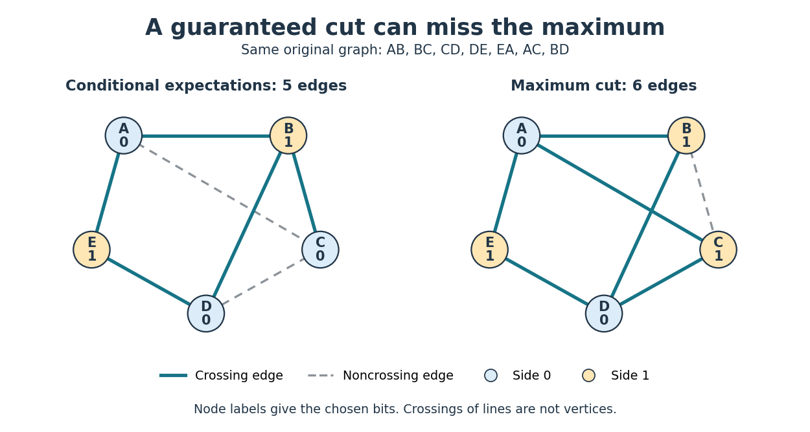
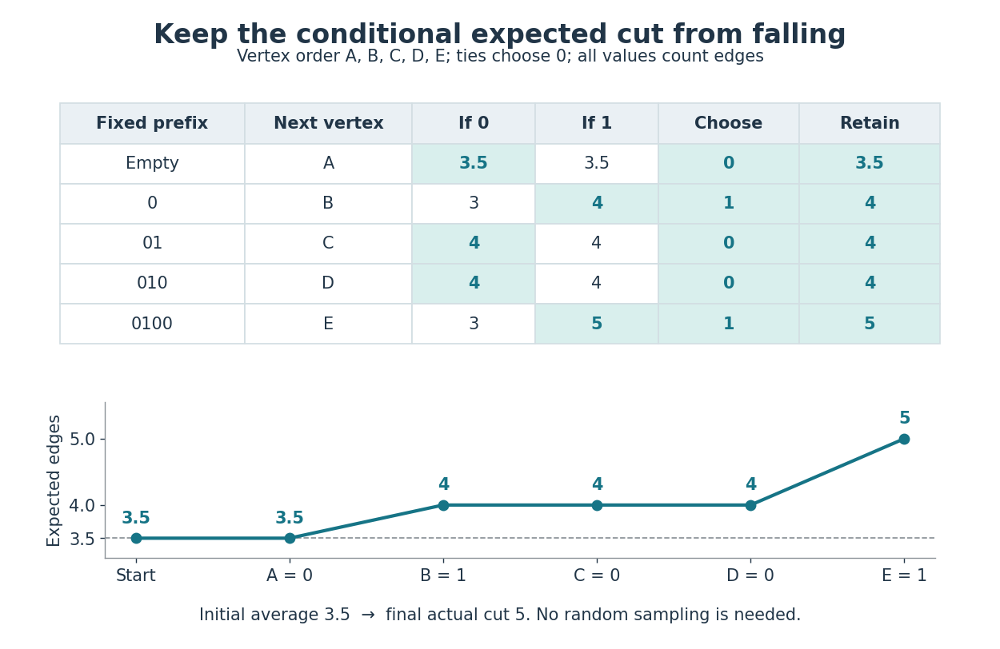

# Conditional expectations cut example

↑ **Parent:** [Conditional expectations for maximum cut](conditional-expectations-for-maximum-cut.md)

Consider the following original five-[vertex](vertex-graph-theory.md) [simple graph](simple-graph.md), where $AB$ denotes the undirected [edge](edge-of-a-graph.md) $\{A,B\}$:

$$
V=\{A,B,C,D,E\},\qquad E=\{AB,BC,CD,DE,EA,AC,BD\}.
$$

Its seven [edges](edge-of-a-graph.md) give initial [expected value](expected-value-split.md) $q(\varnothing)=7/2=3.5$. Use [vertex](vertex-graph-theory.md) order $A,B,C,D,E$ and choose zero whenever the two child [conditional expectations](conditional-expectation.md) tie.

**[Figure 29](#image-a-guaranteed-five-edge-cut-and-a-six-edge-maximum-cut-of-the-same-graph). A guaranteed five-edge cut and a six-edge maximum cut of the same graph**. The [conditional expectations cut example](conditional-expectations-cut-example.md) uses the same original [simple graph](simple-graph.md) in both panels. Node colours and labels identify the two sides of each [cut of a graph](cut-graph-theory.md). Solid teal [edges](edge-of-a-graph.md) cross; dashed grey [edges](edge-of-a-graph.md) do not. The deterministic choices on the left give five crossing [edges](edge-of-a-graph.md); the assignment on the right gives six. Crossings of drawn lines are not additional [vertices](vertex-graph-theory.md).

The complete decision ledger is below. A prefix lists fixed labels in [vertex](vertex-graph-theory.md) order; all later labels remain hypothetically [independent](independent-random-variables.md) fair [bits](bit.md). Each candidate entry is the [conditional expectation](conditional-expectation.md) of the final [cut of a graph](cut-graph-theory.md), including the contribution of unresolved [edges](edge-of-a-graph.md).

| Prefix before choice | Next [vertex](vertex-graph-theory.md) | Set to 0 | Set to 1 | Chosen label | Retained [conditional expectation](conditional-expectation.md) |
| --- | --- | --- | --- | --- | --- |
| Empty | $A$ | $3.5$ | $3.5$ | $0$ | $3.5$ |
| $0$ | $B$ | $3$ | $4$ | $1$ | $4$ |
| $01$ | $C$ | $4$ | $4$ | $0$ | $4$ |
| $010$ | $D$ | $4$ | $4$ | $0$ | $4$ |
| $0100$ | $E$ | $3$ | $5$ | $1$ | $5$ |

For example, after $A=0,B=1$, [edge](edge-of-a-graph.md) $AB$ is fixed crossing and the other six [edges](edge-of-a-graph.md) are unresolved, giving $1+6/2=4$. Setting $C=0$ fixes $BC$ crossing and $AC$ noncrossing, leaving four unresolved [edges](edge-of-a-graph.md): $2+4/2=4$. Setting $C=1$ instead fixes $AC$ crossing and $BC$ noncrossing, giving the same [conditional expectation](conditional-expectation.md).

**[Figure 30](#image-conditional-expected-cut-values-along-every-chosen-branch). Conditional expected cut values along every chosen branch**. At each step, both candidate values are computed by the [conditional expectation cut formula](conditional-expectation-cut-formula.md). The highlighted cell is chosen; ties choose zero. Below, the retained [conditional expectation](conditional-expectation.md) follows $3.5,3.5,4,4,4,5$, starting before any label is fixed. The last value is the actual size of the resulting [cut of a graph](cut-graph-theory.md), rather than an average over remaining choices.

The final labels are $(0,1,0,0,1)$, so the two sides are $\{A,C,D\}$ and $\{B,E\}$. The five crossing [edges](edge-of-a-graph.md) are $AB,BC,DE,EA,BD$; $AC,CD$ do not cross. This exceeds $m/2=3.5$, and hence also the rounded-up guarantee of four [edges](edge-of-a-graph.md).

It is not a [maximum cut](maximum-cut.md). Labels $(0,1,1,0,1)$ cross all [edges](edge-of-a-graph.md) except $BC$, giving six. Seven are impossible because the [triangle in a graph](triangle-in-a-graph.md) $ABC$ cannot have all three [edges](edge-of-a-graph.md) crossing a two-sided [cut of a graph](cut-graph-theory.md). An independent enumeration of all $2^5=32$ complete label assignments gives the following distribution, counting an assignment and its label-swapped counterpart separately:

| Size of [cut of a graph](cut-graph-theory.md) | Number of label assignments |
| --- | --- |
| $0$ | $2$ |
| $1$ | $0$ |
| $2$ | $2$ |
| $3$ | $12$ |
| $4$ | $10$ |
| $5$ | $4$ |
| $6$ | $2$ |
| $7$ | $0$ |

The weighted sum is $112$, so the average is $112/32=3.5$, agreeing with [linearity of expectation](linearity-of-expectation.md). Choosing $C=0$ in the earlier tie discards the remaining size-six completion while preserving the average of four. The method protects an [expected value](expected-value-split.md) guarantee; it need not preserve the best possible completion.

## ↑ Ancestors (7)

1. [Conditional expectations for maximum cut](conditional-expectations-for-maximum-cut.md)
2. [Method of conditional probabilities](method-of-conditional-probabilities.md)
3. [Derandomization](derandomization.md)
4. [Randomized algorithm](randomized-algorithm.md)
5. [Algorithm](algorithm-split.md)
6. [Computer science](computer-science-split.md)
7. [Codex Wiki](split.md)

## ← Incoming links (2)

- [Conditional expectations cut example](conditional-expectations-cut-example.md)
- [Method of conditional probabilities](method-of-conditional-probabilities.md)
