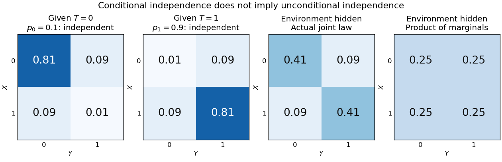

# Conditional independence

↑ **Parent:** [Independent random variables](independent-random-variables.md)  
ⓦ [Wiki](https://en.wikipedia.org/wiki/Conditional_independence)

[Random variables](random-variable-split.md) $X$ and $Y$ are conditionally independent given $Z$ when, for every pair of [Borel sets](borel-set.md) $A,B$, the following identity holds [almost surely](almost-sure-convergence.md):

$$
\mathbb P(X\in A,Y\in B\mid Z)
=\mathbb P(X\in A\mid Z)\mathbb P(Y\in B\mid Z).
$$

Here [conditional probabilities](conditional-probability.md) are [conditional expectations](conditional-expectation.md) of the corresponding [indicator random variables](indicator-random-variable.md) given the [sigma-algebra](sigma-algebra.md) generated by $Z$. This defines the condition even when $\mathbb P(Z=z)=0$. In terms of [regular conditional distributions](regular-conditional-distribution.md), the conditional joint law is the product of the conditional [marginal distributions](marginal-distribution.md) for almost every conditioning value.

For [discrete random variables](discrete-random-variable.md), at every $z$ with $\mathbb P(Z=z)>0$, the condition becomes

$$
p_{X,Y\mid Z=z}(x,y)=p_{X\mid Z=z}(x)p_{Y\mid Z=z}(y).
$$

Where $\mathbb P(X=x,Z=z)>0$, this is equivalent to $\mathbb P(Y=y\mid X=x,Z=z)=\mathbb P(Y=y\mid Z=z)$. Once $Z$ is known, observing $X$ provides no further information about $Y$.[Information Theory I — Scene Setting and Statistical Applications, Lecture 9, section Conditional independence and conditional mutual information: conditional factorization and predictive irrelevance](information-theory-i-scene-setting-and-statistical-applications-lecture-9.md)

For a worked example, suppose a [latent variable](latent-variable-split.md) $T$ chooses between two environments with $\mathbb P(T=0)=\mathbb P(T=1)=1/2$. Given $T=t$, take $X,Y$ to be [independent and identically distributed](independent-and-identically-distributed-random-variables.md) with a [Bernoulli distribution](bernoulli-distribution.md) of parameter $p_t$, where $p_0=0.1$ and $p_1=0.9$. Think of two separate trials run under the same quiet or active environment. Their conditional [joint probability mass functions](joint-probability-mass-function.md), with rows $X=0,1$ and columns $Y=0,1$, are

$$
J_0=\begin{pmatrix}0.81&0.09\\0.09&0.01\end{pmatrix},\qquad
J_1=\begin{pmatrix}0.01&0.09\\0.09&0.81\end{pmatrix}.
$$

Each is exactly the product of its own conditional [marginal distributions](marginal-distribution.md): $(0.9,0.1)$ for $T=0$, and $(0.1,0.9)$ for $T=1$. Thus $X,Y$ are [conditionally independent](conditional-independence.md) given $T$.

If the environment is unobserved, the [law of total probability](law-of-total-probability.md) averages the two tables:

$$
J=\tfrac12J_0+\tfrac12J_1
=\begin{pmatrix}0.41&0.09\\0.09&0.41\end{pmatrix}.
$$

Both unconditional [marginal distributions](marginal-distribution.md) are fair, but $0.41\ne0.5\times0.5$. The [law of total expectation](law-of-total-expectation.md) gives

$$
\mathbb E[X]=\mathbb E[Y]=0.5,\qquad
\mathbb E[XY]=\tfrac12(0.1^2+0.9^2)=0.41,\qquad
\operatorname{Cov}(X,Y)=0.41-0.25=0.16.
$$

**[Figure 4](#image-an-unobserved-shared-environment-creates-statistical-dependence-between-conditionally-independent-trials). An unobserved shared environment creates statistical dependence between conditionally independent trials**. The first two tables show independent [Bernoulli trials](bernoulli-trial.md) at conditional success [probabilities](probability.md) $0.1$ and $0.9$. Averaging them with equal weights gives the third table. The fourth table is the product of the resulting unconditional [marginal distributions](marginal-distribution.md), which differs from the actual joint table. These are stipulated model probabilities, not observed frequencies.

Observing $X=1$ makes the active environment more plausible, so it raises $\mathbb P(Y=1\mid X=1)$ to $0.41/0.5=0.82$. Knowing the actual environment removes this source of [statistical dependence](statistical-dependence.md). The [covariance induced by a shared latent variable](covariance-induced-by-a-shared-latent-variable.md) lemma explains the calculation without listing all the outcomes.

This is why [conditional independence](conditional-independence.md) is useful in [statistical modelling](statistical-modelling-split.md): a model can multiply simple conditional laws and then average over a shared [latent variable](latent-variable-split.md). The resulting observations can remain statistically dependent. [Conditional independence graphs](conditional-independence-graph.md) organize such information relations; their interpretation as causes requires additional assumptions from [causal inference](causal-inference-split.md). Conditioning describes the information available to an observer. It does not, by itself, describe what would happen if an experimenter changed a variable.

**Table of contents**

- [Conditioning can destroy independence](conditioning-can-destroy-independence.md)
- [Conditioning on a sum can create dependence](conditioning-on-a-sum-can-create-dependence.md)
- [Covariance induced by a shared latent variable](covariance-induced-by-a-shared-latent-variable.md)
- [Conditional independence graph](conditional-independence-graph.md)
  - [Nodewise regression](nodewise-regression.md)
    - [Profiling intercepts in nodewise regression](profiling-intercepts-in-nodewise-regression.md)
    - [AND rule for nodewise graph selection](and-rule-for-nodewise-graph-selection.md)
    - [OR rule for nodewise graph selection](or-rule-for-nodewise-graph-selection.md)
  - [Gaussian graphical model](gaussian-graphical-model.md)
  - [Neighbourhood selection](neighbourhood-selection.md)
  - [Moral graph equals the conditional independence graph under faithfulness](moral-graph-equals-the-conditional-independence-graph-under-faithfulness.md)
- [Contraction axiom for conditional independence](contraction-axiom-for-conditional-independence.md)
- [Decomposition axiom for conditional independence](decomposition-axiom-for-conditional-independence.md)
- [Generalized covariance measure statistic](generalized-covariance-measure-statistic.md)
  - [Studentization of the generalized covariance measure statistic](studentization-of-the-generalized-covariance-measure-statistic.md)

## ↑ Ancestors (7)

1. [Independent random variables](independent-random-variables.md)
2. [Random variable](random-variable-split.md)
3. [Probability theory](probability-theory-split.md)
4. [Probability and statistics](probability-and-statistics-split.md)
5. [Area of mathematics](area-of-mathematics.md)
6. [Mathematics](mathematics-split.md)
7. [Codex Wiki](split.md)

## ← Incoming links (66)

- [Additional conditioning reduces entropy](additional-conditioning-reduces-entropy.md)
- [Bayes' theorem](bayes-theorem.md)
- [Bayesian network](bayesian-network.md)
- [Causal minimality](causal-minimality.md)
- [Coeval binary population](coeval-binary-population.md)
- [Conditional independence](conditional-independence.md)
- [Conditional mutual information](conditional-mutual-information.md)
- [Conditioning on a sum can create dependence](conditioning-on-a-sum-can-create-dependence.md)
- [Covariance induced by a shared latent variable](covariance-induced-by-a-shared-latent-variable.md)
- [Data processing inequality](data-processing-inequality.md)
- [Equality in data processing inequality](equality-in-data-processing-inequality.md)
- [Gamma–Poisson hierarchical model](gamma-poisson-hierarchical-model.md)
- [Gaussian Bayesian network](gaussian-bayesian-network.md)
- [Gaussian process classification](gaussian-process-classification.md)
- [Global Markov property for a directed acyclic graph](global-markov-property-for-a-directed-acyclic-graph.md)
- [Independent assortment](independent-assortment.md)
- [Independent censoring](independent-censoring.md)
- [Kolmogorov-Smirnov statistic](kolmogorov-smirnov-statistic.md)
- [Markov process](markov-process-split.md)
- [Moral graph equals the conditional independence graph under faithfulness](moral-graph-equals-the-conditional-independence-graph-under-faithfulness.md)
- [Solution](past-exam-of-the-mathematical-and-computational-biology-course-of-the-university-of-cambridge/2025/paper-2/2/e/solution.md)
- [Solution](past-exam-of-the-mathematics-course-of-the-university-of-cambridge/2001/iii/paper-28/2/ii/solution.md)
- [Solution](past-exam-of-the-mathematics-course-of-the-university-of-cambridge/2002/iii/paper-42/3/solution.md)
- [Solution](past-exam-of-the-mathematics-course-of-the-university-of-cambridge/2003/iii/paper-39/4/solution.md)
- [Solution](past-exam-of-the-mathematics-course-of-the-university-of-cambridge/2004/iii/paper-39/3/d/ii/solution.md)
- [Solution](past-exam-of-the-mathematics-course-of-the-university-of-cambridge/2004/iii/paper-41/4/solution.md)
- [Solution](past-exam-of-the-mathematics-course-of-the-university-of-cambridge/2005/iii/paper-43/1/solution.md)
- [Solution](past-exam-of-the-mathematics-course-of-the-university-of-cambridge/2005/iii/paper-47/5/b/solution.md)
- [Solution](past-exam-of-the-mathematics-course-of-the-university-of-cambridge/2006/iii/paper-43/4/solution.md)
- [Solution](past-exam-of-the-mathematics-course-of-the-university-of-cambridge/2006/iii/paper-45/1/a/solution.md)
- [Solution](past-exam-of-the-mathematics-course-of-the-university-of-cambridge/2008/iii/paper-44/1/g/solution.md)
- [Solution](past-exam-of-the-mathematics-course-of-the-university-of-cambridge/2008/iii/paper-44/2/h/solution.md)
- [Solution](past-exam-of-the-mathematics-course-of-the-university-of-cambridge/2009/iii/paper-41/2/a/solution.md)
- [Solution](past-exam-of-the-mathematics-course-of-the-university-of-cambridge/2009/iii/paper-41/2/b/ii/solution.md)
- [Solution](past-exam-of-the-mathematics-course-of-the-university-of-cambridge/2009/iii/paper-41/2/b/iii/solution.md)
- [Solution](past-exam-of-the-mathematics-course-of-the-university-of-cambridge/2010/iii/paper-28/4/c/solution.md)
- [Solution](past-exam-of-the-mathematics-course-of-the-university-of-cambridge/2010/iii/paper-38/4/solution.md)
- [Solution](past-exam-of-the-mathematics-course-of-the-university-of-cambridge/2012/iii/paper-40/4/solution.md)
- [Solution](past-exam-of-the-mathematics-course-of-the-university-of-cambridge/2013/iii/paper-34/1/e/solution.md)
- [Solution](past-exam-of-the-mathematics-course-of-the-university-of-cambridge/2013/iii/paper-34/3/c/solution.md)
- [Solution](past-exam-of-the-mathematics-course-of-the-university-of-cambridge/2014/iii/paper-31/4/b/solution.md)
- [Solution](past-exam-of-the-mathematics-course-of-the-university-of-cambridge/2014/iii/paper-31/4/solution.md)
- [Solution](past-exam-of-the-mathematics-course-of-the-university-of-cambridge/2015/iii/paper-13/2/i/solution.md)
- [Solution](past-exam-of-the-mathematics-course-of-the-university-of-cambridge/2015/iii/paper-34/4/solution.md)
- [Solution](past-exam-of-the-mathematics-course-of-the-university-of-cambridge/2016/iii/paper-205/1/solution.md)
- [1](past-exam-of-the-mathematics-course-of-the-university-of-cambridge/2016/iii/paper-322/1.md)
- [Solution](past-exam-of-the-mathematics-course-of-the-university-of-cambridge/2016/iii/paper-322/1/ii/solution.md)
- [Solution](past-exam-of-the-mathematics-course-of-the-university-of-cambridge/2016/iii/paper-322/1/iii/solution.md)
- [Solution](past-exam-of-the-mathematics-course-of-the-university-of-cambridge/2017/iii/paper-205/4/solution.md)
- [Solution](past-exam-of-the-mathematics-course-of-the-university-of-cambridge/2017/iii/paper-207/2/b/ii/solution.md)
- [Solution](past-exam-of-the-mathematics-course-of-the-university-of-cambridge/2017/iii/paper-216/5/b/solution.md)
- [Solution](past-exam-of-the-mathematics-course-of-the-university-of-cambridge/2017/iii/paper-322/1/i/solution.md)
- [Solution](past-exam-of-the-mathematics-course-of-the-university-of-cambridge/2017/iii/paper-322/1/ii/solution.md)
- [Solution](past-exam-of-the-mathematics-course-of-the-university-of-cambridge/2018/iii/paper-216/3/b/i/solution.md)
- [Solution](past-exam-of-the-mathematics-course-of-the-university-of-cambridge/2019/iii/paper-205/1/solution.md)
- [Solution](past-exam-of-the-mathematics-course-of-the-university-of-cambridge/2019/iii/paper-219/2/d/solution.md)
- [Solution](past-exam-of-the-mathematics-course-of-the-university-of-cambridge/2019/iii/paper-219/4/a/solution.md)
- [Solution](past-exam-of-the-mathematics-course-of-the-university-of-cambridge/2021/iii/paper-221/3/a/solution.md)
- [Solution](past-exam-of-the-mathematics-course-of-the-university-of-cambridge/2022/iii/paper-205/3/solution.md)
- [Solution](past-exam-of-the-mathematics-course-of-the-university-of-cambridge/2023/iii/paper-205/3/a/solution.md)
- [Solution](past-exam-of-the-mathematics-course-of-the-university-of-cambridge/2023/iii/paper-205/3/b/solution.md)
- [Solution](past-exam-of-the-mathematics-course-of-the-university-of-cambridge/2023/iii/paper-221/3/iii/solution.md)
- [Solution](past-exam-of-the-mathematics-course-of-the-university-of-cambridge/2024/iii/paper-221/2/ii/solution.md)
- [PC algorithm](pc-algorithm.md)
- [Population PC correctness under faithfulness](population-pc-correctness-under-faithfulness.md)
- [Unshielded collider](unshielded-collider.md)
