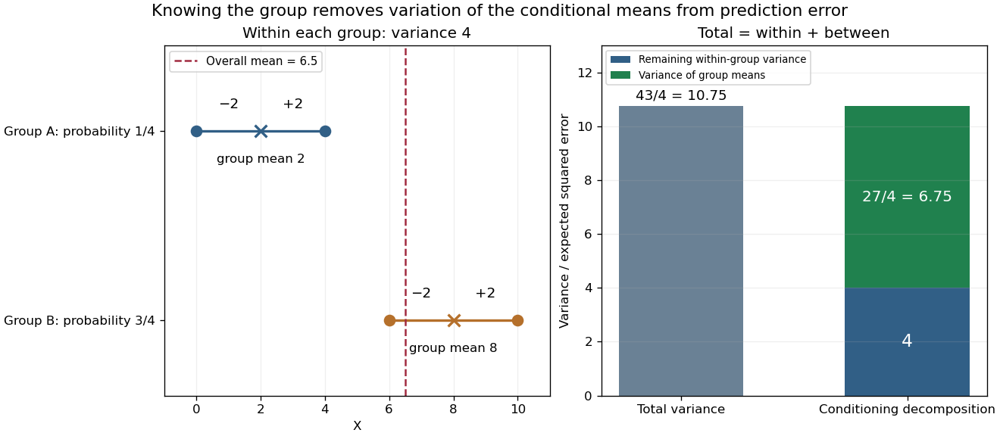

# Conditional variance

↑ **Parent:** [Variance](variance-split.md)  
ⓦ [Wiki](https://en.wikipedia.org/wiki/Conditional_variance)

The conditional variance measures the remaining squared uncertainty after specified information has been used to form a [conditional mean](conditional-expectation.md). For a real [square-integrable](square-integrable-function.md) [random variable](random-variable-split.md) $X$ and a sub-[sigma-algebra](sigma-algebra.md) $\mathcal G$, let $m=\mathbb E[X\mid\mathcal G]$. Then

$$
\operatorname{Var}(X\mid\mathcal G)
=\mathbb E[(X-m)^2\mid\mathcal G]
=\mathbb E[X^2\mid\mathcal G]-m^2.
$$

It is a $\mathcal G$-measurable [random variable](random-variable-split.md), nonnegative [almost surely](almost-sure-convergence.md), rather than necessarily a single number. With the information $\mathcal G=\sigma(Y)$, its value is the [variance](variance-split.md) in the group identified by $Y$. Its [expected value](expected-value-split.md) is the [mean squared error](mean-squared-error.md) of predicting $X$ by its [conditional mean](conditional-expectation.md).[Theorem 4.1.15, p. 213](probability-theory-and-examples-fifth-edition-by-rick-durrett/4-1-conditional-expectation.md)

In the exact [mixture distribution](mixture-distribution.md) in [law of total expectation](law-of-total-expectation.md), group $A$ contains $0,4$ around mean two, and group $B$ contains $6,10$ around mean eight. Both groups have [conditional variance](conditional-variance.md) four because their deviations from their own means are $-2,2$ with equal probabilities. Therefore $\mathbb E[\operatorname{Var}(X\mid Y)]=4$. Meanwhile, the two group means have [variance](variance-split.md) $\frac14(2-13/2)^2+\frac34(8-13/2)^2=27/4$. The [law of total variance](law-of-total-variance.md) gives

$$
\boxed{\operatorname{Var}(X)=4+\frac{27}{4}=\frac{43}{4}.}
$$

Direct calculation gives $\mathbb E[X^2]=53$ and $\operatorname{Var}(X)=53-(13/2)^2=43/4$, checking the decomposition.

**[Figure 1](#image-total-variance-separates-remaining-within-group-error-from-variation-of-group-means). Total variance separates remaining within-group error from variation of group means**. Left: in the stipulated finite [mixture distribution](mixture-distribution.md), each group's values deviate by $\pm2$ from its [conditional mean](conditional-expectation.md). Right: the total [variance](variance-split.md) $43/4$ separates into expected [conditional variance](conditional-variance.md) four and [variance](variance-split.md) of the [conditional mean](conditional-expectation.md) $27/4$. Knowing the group removes the latter part from the average squared prediction error. Values and weights are exact model choices, not measured data.

For any square-integrable $\mathcal G$-measurable predictor $Z$, the error identity is

$$
\mathbb E[(X-Z)^2]=\mathbb E[\operatorname{Var}(X\mid\mathcal G)]+\mathbb E[(m-Z)^2].
$$

The cross term vanishes because $\mathbb E[X-m\mid\mathcal G]=0$. Thus using the [conditional mean](conditional-expectation.md) minimizes [mean squared error](mean-squared-error.md), while [conditional variance](conditional-variance.md) quantifies what this information still cannot predict. This is the [orthogonal projection](orthogonal-projection.md) interpretation in [L2 space](l2-space-is-a-hilbert-space.md).[4.1 Conditional Expectation](probability-theory-and-examples-fifth-edition-by-rick-durrett/4-1-conditional-expectation.md)

**Table of contents**

- [Average conditional variance decreases with more information](average-conditional-variance-decreases-with-more-information.md)

## ↑ Ancestors (7)

1. [Variance](variance-split.md)
2. [Expected value](expected-value-split.md)
3. [Probability theory](probability-theory-split.md)
4. [Probability and statistics](probability-and-statistics-split.md)
5. [Area of mathematics](area-of-mathematics.md)
6. [Mathematics](mathematics-split.md)
7. [Codex Wiki](split.md)

## ← Incoming links (33)

- [Autoregressive conditional heteroscedasticity](autoregressive-conditional-heteroscedasticity.md)
- [Average conditional variance decreases with more information](average-conditional-variance-decreases-with-more-information.md)
- [Bühlmann model](buhlmann-model.md)
- [Bühlmann–Straub model](buhlmann-straub-model.md)
- [Conditional correlation](conditional-correlation.md)
- [Conditional expectation](conditional-expectation.md)
- [Conditional variance](conditional-variance.md)
- [EM for an independent missing normal coordinate](em-for-an-independent-missing-normal-coordinate.md)
- [Expected process variance](expected-process-variance.md)
- [Gaussian conditional variance from precision](gaussian-conditional-variance-from-precision.md)
- [Gaussian regression toward the mean](gaussian-regression-toward-the-mean.md)
- [Insurance exposure](insurance-exposure.md)
- [Law of total variance](law-of-total-variance.md)
- [Solution](past-exam-of-the-mathematics-course-of-the-university-of-cambridge/2002/iii/paper-37/6/ii/solution.md)
- [Solution](past-exam-of-the-mathematics-course-of-the-university-of-cambridge/2004/iii/paper-43/1/iii/solution.md)
- [Solution](past-exam-of-the-mathematics-course-of-the-university-of-cambridge/2005/iii/paper-46/1/iii/solution.md)
- [Solution](past-exam-of-the-mathematics-course-of-the-university-of-cambridge/2006/iii/paper-43/4/solution.md)
- [Solution](past-exam-of-the-mathematics-course-of-the-university-of-cambridge/2009/iii/paper-33/4/solution.md)
- [Solution](past-exam-of-the-mathematics-course-of-the-university-of-cambridge/2012/iii/paper-40/4/solution.md)
- [Solution](past-exam-of-the-mathematics-course-of-the-university-of-cambridge/2013/ia/paper-2/10f/solution.md)
- [Solution](past-exam-of-the-mathematics-course-of-the-university-of-cambridge/2013/ib/paper-2/8h/solution.md)
- [Solution](past-exam-of-the-mathematics-course-of-the-university-of-cambridge/2013/iii/paper-28/4/b/i/solution.md)
- [Solution](past-exam-of-the-mathematics-course-of-the-university-of-cambridge/2014/iii/paper-31/4/solution.md)
- [Solution](past-exam-of-the-mathematics-course-of-the-university-of-cambridge/2014/iii/paper-34/3/solution.md)
- [Solution](past-exam-of-the-mathematics-course-of-the-university-of-cambridge/2014/iii/paper-38/2/d/solution.md)
- [Solution](past-exam-of-the-mathematics-course-of-the-university-of-cambridge/2015/iii/paper-34/1/b/solution.md)
- [Solution](past-exam-of-the-mathematics-course-of-the-university-of-cambridge/2015/iii/paper-34/4/solution.md)
- [Solution](past-exam-of-the-mathematics-course-of-the-university-of-cambridge/2015/iii/paper-37/2/b/solution.md)
- [Solution](past-exam-of-the-mathematics-course-of-the-university-of-cambridge/2015/iii/paper-37/2/d/solution.md)
- [Solution](past-exam-of-the-mathematics-course-of-the-university-of-cambridge/2022/iii/paper-208/2/a/solution.md)
- [Solution](past-exam-of-the-mathematics-course-of-the-university-of-cambridge/2022/iii/paper-219/2/a/solution.md)
- [Variance tensorization](variance-tensorization.md)
- [Volatility clustering](volatility-clustering.md)
