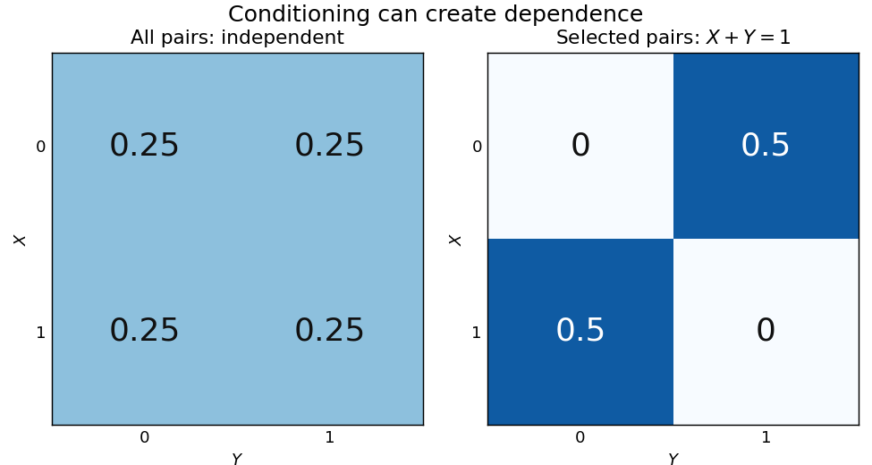

# Conditioning on a sum can create dependence

↑ **Parent:** [Conditional independence](conditional-independence.md)

Let $X,Y$ be [independent random variables](independent-random-variables.md), each with a [Bernoulli distribution](bernoulli-distribution.md) of parameter $1/2$, and put $S=X+Y$. Unconditionally, the four ordered pairs $(0,0),(0,1),(1,0),(1,1)$ each have [probability](probability.md) $1/4$. On the [event](event.md) $S=1$, only $(0,1)$ and $(1,0)$ remain, each with [conditional probability](conditional-probability.md) $1/2$. Thus

$$
\mathbb P(X=1,Y=1\mid S=1)=0
\ne\mathbb P(X=1\mid S=1)\mathbb P(Y=1\mid S=1)=\frac14.
$$

Knowing that exactly one trial succeeded makes observing one outcome informative about the other. This violates [conditional independence](conditional-independence.md) given $S$, even though the original [random variables](random-variable-split.md) are independent. Given $S=0$ or $S=2$, both variables are [constant random variables](constant-random-variable.md) and are [conditionally independent](conditional-independence.md) there; that does not repair the failure at $S=1$, an [event](event.md) of positive [probability](probability.md).

**[Figure 5](#image-selecting-pairs-with-exactly-one-success-makes-independent-trials-dependent). Selecting pairs with exactly one success makes independent trials dependent**. Left: four equally probable outcomes of independent fair [Bernoulli trials](bernoulli-trial.md). The selection $S=X+Y=1$ retains exactly two pairs. Right: their conditional joint table has zero mass on the diagonal and $1/2$ off it. Within this selected model the [conditional covariance](conditional-covariance.md) is $-1/4$; the two conditional [marginal distributions](marginal-distribution.md) remain fair.

The [conditional covariance](conditional-covariance.md) here is $\mathbb E[XY\mid S=1]-\mathbb E[X\mid S=1]\mathbb E[Y\mid S=1]=0-1/4=-1/4$. Both conditional [variances](variance-split.md) are $1/4$, so the conditional [correlation coefficient](pearson-correlation-coefficient.md) is $-1$: within the selected group, $Y=1-X$. These conclusions follow from restricting a finite [sample space](sample-space.md), without positing any physical interaction between the trials.

This example and the shared-environment example establish both logical directions: [independent random variables](independent-random-variables.md) need not be [conditionally independent](conditional-independence.md), and [conditionally independent](conditional-independence.md) variables need not be independent. When $S$ is represented as the joint result of two inputs in a [causal directed acyclic graph](causal-directed-acyclic-graph.md), conditioning on it has the [collider](collider.md) structure associated with [collider bias](collider-bias.md). A probability calculation by itself establishes a dependence relation, not a physical causal mechanism or an [intervention](treatment.md).

## ↑ Ancestors (8)

1. [Conditional independence](conditional-independence.md)
2. [Independent random variables](independent-random-variables.md)
3. [Random variable](random-variable-split.md)
4. [Probability theory](probability-theory-split.md)
5. [Probability and statistics](probability-and-statistics-split.md)
6. [Area of mathematics](area-of-mathematics.md)
7. [Mathematics](mathematics-split.md)
8. [Codex Wiki](split.md)
