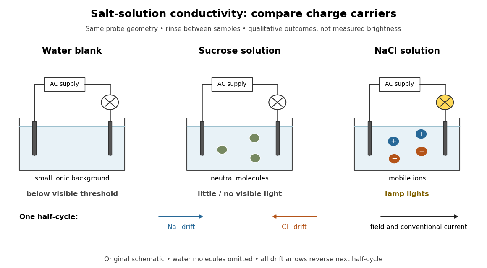

# Conductivity experiment on salt solutions

↑ **Parent:** [Physical properties of salts](physical-properties-of-salts.md)

How can a clear [chemical solution](solution-chemistry.md) reveal otherwise invisible mobile [ions](ion.md)? The documented [Conductivity of Solutions by Harvard Natural Sciences Lecture Demonstrations](conductivity-of-solutions-by-harvard-natural-sciences-lecture-demonstrations.md) demonstration uses metal [electrodes](electrode.md) enclosed in tubing, an electrical supply, and a lamp in the circuit. The protocol specifies about $150\,\mathrm{mL}$ samples in labeled $250\,\mathrm{mL}$ beakers and a separate deionized-[water](water.md) rinse station. The recorded readout is lamp brightness after the [electrodes](electrode.md) enter each sample; the simplified variant tests [water](water.md) before and after adding [sodium chloride](sodium-chloride.md). These are apparatus and procedure specifications, not new measurements reported here.[Conductivity of Solutions by Harvard Natural Sciences Lecture Demonstrations](conductivity-of-solutions-by-harvard-natural-sciences-lecture-demonstrations.md)

**[Figure 21](#image-salt-solution-conductivity-controls). Electrical conductivity comparisons with a lamp tester, and the opposite motions of cations and anions in an electric field**. Original circuit schematic and qualitative model outcomes, not photographs or recorded brightness data. A dark lamp means a signal below this tester's visible threshold, not identically zero [electrical conductivity](electrical-conductivity.md). Arrows show [drift velocities](drift-velocity.md) during one half-cycle of an alternating supply; both signs contribute to the same [conventional current](conventional-current.md). [Water](water.md) [molecules](molecule.md) and [hydration of ions](hydration-of-ions.md) are omitted from the microscopic panel.

The useful comparison is [water](water.md), a [sucrose](sucrose.md) [chemical solution](solution-chemistry.md), and a [sodium chloride](sodium-chloride.md) [chemical solution](solution-chemistry.md) with the same probe geometry. A documented university account reports no visible light with [water](water.md), a glowing lamp with dissolved [sodium chloride](sodium-chloride.md), and a weak filament glow with its [sucrose](sucrose.md) sample. The diagram summarizes the latter as little or no visible light; the precise detection threshold depends on the tester. [Sucrose](sucrose.md) is a control for the idea that any dissolved material must conduct: its dispersed neutral [molecules](molecule.md) do not provide the abundant mobile [ions](ion.md) supplied by the [salt](salt-chemistry.md). This contrast is a documented teaching observation, not a numerical calibration of lamp brightness.[§11.1, sucrose dissolves as molecules; §11.2, Figure 11.6 and ionic versus nonionic charge carriers](chemistry-2e-by-paul-flowers-and-others.md)[Conductivity of solutions by the migration of ions](conductivity-of-solutions-by-the-migration-of-ions.md)

Rinsing the [electrodes](electrode.md) between samples controls carryover of dissolved [ions](ion.md), and the [water](water.md) blank checks the solvent background. Repeating the blank after the [salt](salt-chemistry.md) sample would test whether that rinse was effective. Additional methodological controls are fixed immersed area, electrode separation, supply setting, [temperature](temperature.md), and comparison at stated [concentrations](concentration.md). These additional controls are proposed checks, not undocumented claims about the source demonstration.

The inference is that mobile [electric charge](electric-charge.md) carriers complete the circuit. In the [chemical solution](solution-chemistry.md), an [electric field](electric-field.md) drives positive [ions](ion.md) along the field and negative [ions](ion.md) against it; multiplying each [drift velocity](drift-velocity.md) by its [electric charge](electric-charge.md) makes both contributions to [conventional current](conventional-current.md) point the same way. With an alternating supply the direction reverses each half-cycle. The external wires instead carry [electric current](electric-current.md) through [Electrons](electron.md). The lamp alone identifies neither the species nor an exact [electrical conductivity](electrical-conductivity.md).

Important limits remain. [Water](water.md) has a small intrinsic population of [hydronium](hydronium.md) and [hydroxide](hydroxide.md), so a dark lamp does not prove absence of [ions](ion.md). Changes in probe geometry affect measured [electrical conductance](electrical-conductance.md); [electrolysis](electrolysis.md), electrode interfaces, contamination, and heating can also affect a real circuit. The comparison supports a transport model but does not independently measure a [coordination number](coordination-number.md), a partitioned [partial atomic charge](partial-atomic-charge.md), or a [lattice energy](lattice-energy.md).

Nor does poor conduction by ordinary dry [sodium chloride](sodium-chloride.md) establish that all [ionic crystals](ionic-crystal.md) are electrical insulators. [Crystallographic defects](crystallographic-defect.md) can allow transport, and [solid electrolytes](solid-electrolyte.md) can have substantial ionic [electrical conductivity](electrical-conductivity.md) without [melting](melting.md). The authored abstract of [A lithium superionic conductor by Noriaki Kamaya and others](a-lithium-superionic-conductor-by-noriaki-kamaya-and-others.md) reports room-[temperature](temperature.md) ionic conduction in a [solid electrolyte](solid-electrolyte.md); the full experimental article was not accessible here.[A lithium superionic conductor by Noriaki Kamaya and others](a-lithium-superionic-conductor-by-noriaki-kamaya-and-others.md)

## ↑ Ancestors (5)

1. [Physical properties of salts](physical-properties-of-salts.md)
2. [Ionic bonding](ionic-bonding.md)
3. [Chemical bond](chemical-bond.md)
4. [Chemistry](chemistry-split.md)
5. [Codex Wiki](split.md)

## ← Incoming links (2)

- [Ionic bonding](ionic-bonding.md)
- [Spectroscopic measurement of hydration dynamics](spectroscopic-measurement-of-hydration-dynamics.md)
