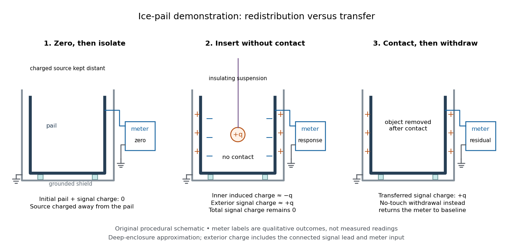

# Conductor in electrostatic equilibrium

↑ **Parent:** [Electrostatics](electrostatics.md)

A [conductor in electrostatic equilibrium](conductor-in-electrostatic-equilibrium.md) is an [electrical conductor](electrical-conductor.md) at rest whose mobile [charge carriers](charge-carrier.md) have finished redistributing, with no maintained bulk [electric current](electric-current.md). In the ideal macroscopic model,

$$
\mathbf E_{\rm metal}=\mathbf0,\qquad \Phi=V_c\ \text{on each connected conductor},\qquad \rho_{\rm metal}=0.
$$

A residual bulk [electric field](electric-field.md) would drive further [electric charge](electric-charge.md) redistribution. The [electric potential difference](electric-potential-difference.md) between any two points joined through the metal is $-\int\mathbf E\cdot d\mathbf l=0$, so each connected piece is an [equipotential](equipotential.md). [Gauss's law](gauss-s-law.md) then gives zero net bulk [charge density](charge-density.md). This is a statement about net macroscopic [electric charge](electric-charge.md), not the absence of positive [atomic nuclei](atomic-nucleus.md) and negative [Electrons](electron.md). Excess [electric charge](electric-charge.md) is represented by [surface charge density](surface-charge-density.md); atomic surface structure is outside this continuum model. [Samuel Ling, William Moebs and Jeff Sanny, Conductors in electrostatic equilibrium](https://openstax.org/books/university-physics-volume-2/pages/6-4-conductors-in-electrostatic-equilibrium).

The word **inside** must distinguish metal from a [cavity in a conductor](cavity-in-a-conductor.md). A completely enclosed, charge-free [cavity in a conductor](cavity-in-a-conductor.md) has constant boundary [electric potential](electric-potential.md) $V_c$. The constant solution of [Laplace's equation](laplace-equation.md) and [Uniqueness of the Dirichlet problem](uniqueness-of-the-dirichlet-problem.md) give $\Phi=V_c$ and $\mathbf E=\mathbf0$ throughout the [cavity in a conductor](cavity-in-a-conductor.md), regardless of its shape or external [electric charges](electric-charge.md). Grounding is unnecessary for this inward [electrostatic shielding](electrostatic-shielding.md); an isolated enclosure can change its overall [electric potential](electric-potential.md) without producing an internal [electric field](electric-field.md). Zero enclosed net [electric charge](electric-charge.md) alone would only give zero [electric flux](electric-flux.md). A positive and negative pair inside a [cavity in a conductor](cavity-in-a-conductor.md) can have zero total [electric charge](electric-charge.md) and a nonzero [electric field](electric-field.md). [Richard Fitzpatrick, Ideal Conductors: charge-free cavities and uniqueness](intermediate-college-physics-by-richard-fitzpatrick/ideal-conductors.md).

If fixed [electric charges](electric-charge.md) inside a [cavity in a conductor](cavity-in-a-conductor.md) sum to $q$, a [Gaussian surface](gaussian-surface.md) lying entirely in the metal and enclosing that [cavity in a conductor](cavity-in-a-conductor.md) has zero [electric flux](electric-flux.md). Thus the total induced inner-wall [electric charge](electric-charge.md) is $-q$. For one such [cavity in a conductor](cavity-in-a-conductor.md) and an isolated enclosure with total metal [electric charge](electric-charge.md) $Q_c$, the outer-wall [electric charge](electric-charge.md) is $Q_c+q$. In particular, an initially neutral isolated enclosure generally has an exterior [electric field](electric-field.md) when $q\ne0$. For fixed internal sources, external changes only shift the constant [electric potential](electric-potential.md) inside an isolated enclosure, leaving the internal [electric field](electric-field.md) unchanged. [Aritro Pathak, On the electrostatic equilibrium of charges and cavities in a conductor](https://arxiv.org/abs/1609.04248).

A grounded enclosure fixes $V_c=0$ and can acquire metal [electric charge](electric-charge.md) $-q$; with no exterior sources and $\Phi\to0$ at infinity, [Uniqueness of the Dirichlet problem](uniqueness-of-the-dirichlet-problem.md) gives zero exterior [electric field](electric-field.md). With external sources present, the exterior [electric field](electric-field.md) need not vanish, but it is independent of the internal sources at fixed grounded boundary [electric potential](electric-potential.md). [Feynman, Leighton and Sands, II.5.10: shielding by a closed grounded enclosure](https://www.feynmanlectures.caltech.edu/II_05.html#Ch5-S10).

[Faraday's ice pail experiment](faraday-s-ice-pail-experiment.md) makes the distinction between redistribution and transfer visible. In his letter of 4 February 1843, Faraday described an insulated pewter pail connected by wire to a gold-leaf [electrometer](electrometer.md), and a brass ball suspended on a long dry silk thread to reduce the hand's influence. He discharged the pail and charged the ball away from it. Lowering the ball without contact produced leaf divergence, which grew during entry and became approximately independent of further depth; withdrawing it collapsed the leaves. Contact with the bottom transferred [electric charge](electric-charge.md), and the withdrawn ball was discharged. The readout was leaf divergence, not a direct map of the internal [electric field](electric-field.md). These observations distinguish [electrostatic induction](electrostatic-induction.md) from contact transfer of [electric charge](electric-charge.md). [Thomas B. Greenslade Jr., Faraday Ice Pail, reproducing Faraday's 1843 letter](https://physics.kenyon.edu/EarlyApparatus/Static_Electricity/Faradays_Ice_Pail/Faraday_Ice_Pail.html).

For a modern version of [Faraday's ice pail experiment](faraday-s-ice-pail-experiment.md), connect an insulated inner metal pail to the signal input of a high-input-impedance [electrometer](electrometer.md), with its reference lead and an outer shield grounded. Zero and momentarily ground the pail, then isolate the signal side. Lower a charged paddle deeply without touching and record the [electric potential difference](electric-potential-difference.md); withdraw it and check return to zero. Repeat with contact, then withdrawal: a residual reading indicates transferred [electric charge](electric-charge.md). Reverse the paddle's sign and repeat. The [electrometer](electrometer.md) reads [volts](volt.md); inferring [electric charge](electric-charge.md) requires the effective [capacitance](capacitance.md) of pail, cable and input, so a stable reading at fixed geometry is a relative measure, not automatically a value in [coulombs](coulomb.md). Keep supports clean, nearby charged objects distant, and the operator grounded; humidity can cause leakage. [PASCO, Basic Electrostatics System manual, equipment description and demonstration 1A](https://cdn.pasco.com/product_document/Basic-Electrostatics-Sys-Manual-ES-9080B1.pdf#page=13).

**[Figure 41](#image-faraday-s-ice-pail-experiment-insertion-without-contact-versus-transfer-by-contact). Faraday's ice pail experiment: insertion without contact versus transfer by contact**. Original procedural schematic, not measured data or a reproduction of historical apparatus. The deep-insertion charge accounting idealizes a nearly enclosing pail; positive exterior [electric charge](electric-charge.md) is shared over the pail and connected signal assembly. The grounded outer shield and reference connection are shown in the insertion panel. Exact closed-enclosure predictions apply to a fully enclosed [cavity in a conductor](cavity-in-a-conductor.md), not automatically to an open pail near its rim.

A complementary [electrostatic shielding](electrostatic-shielding.md) demonstration uses a charged hollow metal enclosure, a small metal sampling ball on an insulating handle, and an [electrometer](electrometer.md). Discharge the sampling ball between trials; touch it to the exterior, withdraw it, and transfer its collected [electric charge](electric-charge.md) to the [electrometer](electrometer.md). Repeat by touching the inner wall without touching the exterior during withdrawal. The exterior sample produces a response, whereas the inner sample gives a null within instrument sensitivity. This compares accessible surface responses rather than assuming a perfectly spherical enclosure. [Feynman, Leighton and Sands, II.5.8: inner and outer sampling of a charged conductor](https://www.feynmanlectures.caltech.edu/II_05.html#Ch5-S8). Useful additional controls are an uncharged enclosure baseline, a repeat exterior sample to verify sensitivity, and repeated trials at different depths. An access hole, charged handle, leakage or disturbed [surface charge density](surface-charge-density.md) limits the inference; a null bounds detectable transfer, rather than proving an exactly zero [electric field](electric-field.md). An open pail's depth plateau tests good enclosure empirically. Neither demonstration establishes shielding of arbitrary time-dependent [electromagnetic fields](electromagnetic-field.md).

**Table of contents**

- [Cavity in a conductor](cavity-in-a-conductor.md)
- [Electrostatic shielding](electrostatic-shielding.md)
- [Electrostatic boundary conditions at a conductor](electrostatic-boundary-conditions-at-a-conductor.md)
  - [Surface charge density](surface-charge-density.md)
- [Charge sharing between distant connected spheres](charge-sharing-between-distant-connected-spheres.md)
- [Charge on connected concentric spherical shells](charge-on-connected-concentric-spherical-shells.md)
- [Induced charge on a conducting sphere in a uniform electric field](induced-charge-on-a-conducting-sphere-in-a-uniform-electric-field.md)

## ↑ Ancestors (5)

1. [Electrostatics](electrostatics.md)
2. [Electromagnetism](electromagnetism-split.md)
3. [Branches of physics](branches-of-physics.md)
4. [Physics](physics-split.md)
5. [Codex Wiki](split.md)

## ← Incoming links (10)

- [Conductor in electrostatic equilibrium](conductor-in-electrostatic-equilibrium.md)
- [Electric field of a uniformly charged ball](electric-field-of-a-uniformly-charged-ball.md)
- [Electrostatic boundary conditions at a conductor](electrostatic-boundary-conditions-at-a-conductor.md)
- [Electrostatic equilibrium](electrostatic-equilibrium.md)
- [Electrostatic shielding](electrostatic-shielding.md)
- [Electrostatics](electrostatics.md)
- [Fringing field of a capacitor](fringing-field-of-a-capacitor.md)
- [Solution](past-exam-of-the-mathematics-course-of-the-university-of-cambridge/2014/ib/paper-1/16a/i/solution.md)
- [Solution](past-exam-of-the-mathematics-course-of-the-university-of-cambridge/2014/ib/paper-2/18a/solution.md)
- [Solution](past-exam-of-the-mathematics-course-of-the-university-of-cambridge/2016/ib/paper-1/16d/c/solution.md)
