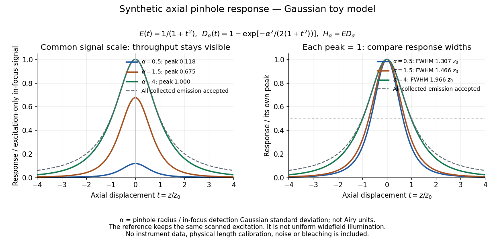

# Confocal excitation and detection point spread function

↑ **Parent:** [Confocal microscopy](confocal-microscopy.md)

For an isolated fluorescent molecule at displacement $\mathbf r$ from the scanning [optical focus](focus-optics.md), write $E(\mathbf r)$ for relative excitation [light intensity](light-intensity.md) and $D_a(\mathbf r)$ for the fraction of its collected emission passed by a centred detection pinhole of radius $a$. The expected response, apart from a common brightness and collection factor, is

$$
H_a(\mathbf r)=E(\mathbf r)D_a(\mathbf r),\qquad
D_a(\mathbf r)=\int_{|\mathbf u|\leq a}p_{\rm em}(\mathbf u;\mathbf r)\,d^2\mathbf u,\qquad
\int_{\mathbb R^2}p_{\rm em}(\mathbf u;\mathbf r)\,d^2\mathbf u=1.
$$

Here $\mathbf u$ is position in the detection-pinhole plane and $p_{\rm em}$ is the emitted [light intensity](light-intensity.md) distribution there conditional on collection, with units of inverse [area](surface-area.md). This [point spread function normalization](point-spread-function-normalization.md) retains throughput: $D_a$ is a fraction, not a curve rescaled to have peak one. The product expresses excitation followed by detection; it is an intensity/probability product, not multiplication of coherent [wave amplitudes](wave-amplitude.md) from different molecules. [Manuscript p. 16, Fig. 4 discussion; Appendix §5, p. 37, Eq. A17: illumination-times-detection response](confocal-microscopy-chapter-manuscript-by-brad-amos-and-others.md)

Assume linear, unsaturated [fluorescence](fluorescence-split.md), independent emitters whose [light intensities](light-intensity.md) add, a stationary specimen, fixed collection efficiency and [quantum efficiency](quantum-efficiency.md), and negligible changes from scattering, absorption or bleaching during a scan. Different excitation and emission [wavelengths](wavelength.md) generally give different excitation and detection responses. For a sufficiently small pinhole, $D_a$ is approximately its [area](surface-area.md) times $p_{\rm em}$ at the centre; this is the familiar excitation-times-detection [point spread function](point-spread-function-split.md). It is not universally the square of one [point spread function](point-spread-function-split.md). A spatially invariant response further allows the image to be expressed as a [convolution](convolution.md) with the emitter distribution; depth-dependent [optical aberrations](optical-aberration.md) can invalidate that approximation.

For an explicitly synthetic axial example, put $t=z/z_0$ and choose an on-axis excitation $E(t)=1/(1+t^2)$, inspired by a [Gaussian beam](gaussian-beam.md). Stipulate a circular [Gaussian function](gaussian-function.md) for the detection-plane [light intensity](light-intensity.md), with standard deviation $s(t)=s_0\sqrt{1+t^2}$. In dimensionless coordinates $\mathbf v=\mathbf u/s_0$, put $\alpha=a/s_0$. Then

$$
p(\mathbf v;t)=\frac{\exp[-|\mathbf v|^2/(2(1+t^2))]}{2\pi(1+t^2)},\qquad
D_\alpha(t)=1-\exp\!\left[-\frac{\alpha^2}{2(1+t^2)}\right],\qquad
H_\alpha(t)=\frac{D_\alpha(t)}{1+t^2}.
$$

The expression for $D_\alpha$ follows by integrating $p$ over a [disk](disk-mathematics.md) using [polar coordinates](polar-coordinates.md). The assumptions specify a toy model with matched axial scales; its parameters are not a calibration for a real objective [optical lens](lens-optics.md). It omits [Airy disk](airy-disk.md) rings, vector [diffraction](diffraction.md), and unequal excitation and emission [wavelengths](wavelength.md).

**[Figure 4](#confocal-synthetic-axial-pinhole-response). Synthetic axial response: narrower pinholes reduce throughput and suppress defocus**. Original Gaussian toy model, not measurements. The left panel keeps a common signal scale; the right divides each response by its own peak to compare widths. Here $\alpha=a/s_0$ is a radius in units of detection-plane Gaussian standard deviation, not an Airy-unit diameter. The dashed reference is the same scanned excitation with all collected emission accepted, not conventional uniform widefield illumination. Both panels retain nonzero out-of-focus tails.

For a vanishingly small pinhole, the peak-normalized synthetic response tends to $(1+t^2)^{-2}$, whose [full width at half maximum](full-width-at-half-maximum.md) is $2\sqrt{\sqrt2-1}\,z_0\simeq1.2872z_0$. With all collected emission accepted it tends to $(1+t^2)^{-1}$, of width $2z_0$. Meanwhile $H_\alpha(0)=1-e^{-\alpha^2/2}\to0$ as the pinhole closes. The narrower normalized curve therefore accompanies a vanishing detected signal; peak normalization must not conceal that loss.

## ↑ Ancestors (8)

1. [Confocal microscopy](confocal-microscopy.md)
2. [Fluorescence microscope](fluorescence-microscope.md)
3. [Fluorescence](fluorescence-split.md)
4. [Physical optics](physical-optics-split.md)
5. [Optics](optics-split.md)
6. [Branches of physics](branches-of-physics.md)
7. [Physics](physics-split.md)
8. [Codex Wiki](split.md)
