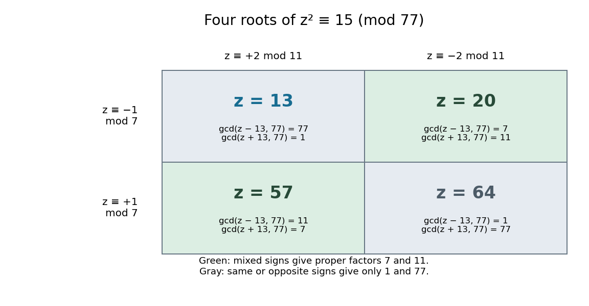

# Congruence of squares

↑ **Parent:** [Integer factorization](integer-factorization.md)

A congruence of squares says that two [integers](integer.md) $a,b$ have the same square modulo a positive [integer](integer.md) $N$. Factoring their difference of squares gives

$$
a^2\equiv b^2\pmod N\quad\Longrightarrow\quad N\mid(a-b)(a+b).
$$

A useful [integer factorization](integer-factorization.md) results when $\gcd(a-b,N)$ or $\gcd(a+b,N)$ is a proper [divisor](divisor.md) of $N$. Divisibility of a product does not generally force divisibility of either factor by all of $N$: different [prime factors](prime-factor.md) of $N$ can divide different parts of that product.

For $N=77$, $20^2-13^2=231=3\cdot77$. Therefore

$$
\gcd(20-13,77)=\gcd(7,77)=7,\qquad
\gcd(20+13,77)=\gcd(33,77)=11.
$$

**Thus $77=7\cdot11$.** The prime seven divides the difference, while eleven divides the sum. These computations already give a complete [prime factorization](fundamental-theorem-of-arithmetic.md) because seven and eleven are [prime numbers](prime-number.md).

The [Chinese remainder theorem](chinese-remainder-theorem.md) explains the hidden sign choices. The four [congruence classes](congruence-class.md) solving $z^2\equiv15\pmod{77}$ have representatives $13,20,57,64$. Modulo seven each is $1$ or $-1$; modulo eleven each is $2$ or $-2$. Two independent sign choices produce four roots. The inputs thirteen and twenty agree modulo seven and disagree by sign modulo eleven, allowing their sum and difference to separate the two [prime factors](prime-factor.md).

**[Figure 2](#image-the-chinese-remainder-theorem-exposes-four-sign-choices-behind-one-square-residue-modulo-77). The Chinese remainder theorem exposes four sign choices behind one square residue modulo $77$**. Each cell gives the unique residue modulo $77$ with its indicated residues modulo seven and eleven. Relative to input thirteen, input twenty agrees modulo seven and has the opposite sign modulo eleven. The resulting [greatest common divisors](greatest-common-divisor.md) are seven and eleven. Diagonal all-same or all-opposite choices give only the trivial factors one and $77$.

For distinct odd [prime numbers](prime-number.md) $p,q$, $N=pq$ and $\gcd(b,N)=1$, a solution $a^2\equiv b^2\pmod N$ with $a\not\equiv b$ and $a\not\equiv-b$ modulo $N$ yields both proper factors by the two [greatest common divisors](greatest-common-divisor.md). For a general composite [integer](integer.md), a proper [divisor](divisor.md) need not itself be prime; further factoring can remain. If $a\equiv b$ or $a\equiv-b\pmod N$ in the coprime case, the two calculations return $N$ and one instead. A [factor base](factor-base.md) helps generate relations, but does not ensure every resulting relation is useful.

For historical context, Pomerance describes Kraitchik's 1920s enhancement of the difference-of-squares approach associated with Fermat: seek a difference that is a multiple of $N$, rather than exactly $N$. His account also notes antecedents in Gauss and Seelhoff, so this is not an attribution of the whole idea to a single inventor. [Carl Pomerance, A Tale of Two Sieves (1996), pp. 1474–1475: difference-of-squares and congruent squares](https://math.dartmouth.edu/~carlp/PDF/paper109.pdf).

**Table of contents**

- [Nontrivial square root of unity modulo an integer](nontrivial-square-root-of-unity-modulo-an-integer.md)

## ↑ Ancestors (5)

1. [Integer factorization](integer-factorization.md)
2. [Number theory](number-theory-split.md)
3. [Area of mathematics](area-of-mathematics.md)
4. [Mathematics](mathematics-split.md)
5. [Codex Wiki](split.md)

## ← Incoming links (4)

- [Factor base](factor-base.md)
- [Integer factorization](integer-factorization.md)
- [Nontrivial square root of unity modulo an integer](nontrivial-square-root-of-unity-modulo-an-integer.md)
- [Solution](past-exam-of-the-mathematics-course-of-the-university-of-cambridge/2009/ii/paper-2/4h/solution.md)
