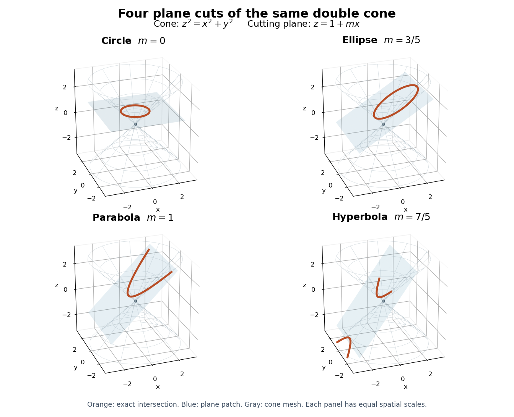

# Conic section

↑ **Parent:** [Euclidean geometry](euclidean-geometry-split.md)  
ⓦ [Wiki](https://en.wikipedia.org/wiki/Conic_section)

A conic section is obtained by intersecting a [plane](plane.md) with a [double circular cone](double-circular-cone.md). Cuts away from the vertex produce an [ellipse](ellipse.md), a [parabola](parabola.md) or a [hyperbola](hyperbola.md); a perpendicular cut is the [circle](circle.md) case of an [ellipse](ellipse.md). A cut through the vertex can instead produce a [degenerate conic](degenerate-conic.md). One simple surface therefore connects several familiar [plane curves](plane-curve.md).[Precalculus 2e, §10.1, Writing Equations of Ellipses in Standard Form, Figure 2](precalculus-2e-by-jay-abramson/10-1-the-ellipse.md)

Consider the original family

$$
z^2=x^2+y^2,\qquad z=1+mx.
$$

Substituting the [plane equation](cartesian-equation-of-a-plane.md) into the [double circular cone](double-circular-cone.md) equation gives

$$
(1-m^2)x^2+y^2-2mx-1=0.
$$

Thus $m=0$ gives a [circle](circle.md), $m=3/5$ an [ellipse](ellipse.md), $m=1$ a [parabola](parabola.md), and $m=7/5$ a [hyperbola](hyperbola.md). The last cut meets both sheets of the [double circular cone](double-circular-cone.md), producing its two branches. These parameters specify a mathematical family, rather than measurements of a physical object.

**[Figure 6](#image-circle-ellipse-parabola-and-hyperbola-from-four-cuts-of-one-double-circular-cone). Circle, ellipse, parabola and hyperbola from four cuts of one double circular cone**. Original three-dimensional intersections of $z^2=x^2+y^2$ with $z=1+mx$. The cone meshes and planes are finite displayed patches. The [circle](circle.md) can look elliptical in the perspective view; its intrinsic geometry is circular.

The [Cartesian coordinate system](cartesian-coordinate-system.md) descriptions of these curves are second-degree equations

$$
Ax^2+Bxy+Cy^2+Dx+Ey+F=0.
$$

A [rotation](rotation-mathematics.md) and a [translation](translation-geometry.md) expose their principal directions and offsets. The [conic type discriminant](conic-type-discriminant.md) identifies the ordinary nondegenerate real type, while a separate [degenerate conic](degenerate-conic.md) check prevents confusing two crossing [straight lines](straight-line.md) with a [hyperbola](hyperbola.md).

This is useful because a difficult-looking equation can be understood through a small set of geometric features: [foci of a conic](focus-of-a-conic.md), [directrices of a conic](directrix-of-a-conic.md), [eccentricity of a conic](eccentricity-of-a-conic.md) and the [semi-major and semi-minor axes](semi-major-and-semi-minor-axes.md). The same [ellipse](ellipse.md) can be traced by a constant-length string or parametrized by $x=a\cos t$, $y=b\sin t$. These are different descriptions of one curve, with different advantages for construction and calculation.

**Table of contents**

- [Conic type discriminant](conic-type-discriminant.md)
- [Degenerate conic](degenerate-conic.md)
- [Directrix of a conic](directrix-of-a-conic.md)
- [Focus of a conic](focus-of-a-conic.md)
- [Eccentricity of a conic](eccentricity-of-a-conic.md)
- [Semilatus rectum](semilatus-rectum.md)
- [Parabola](parabola.md)
  - [Vertex of a parabola](vertex-of-a-parabola.md)
- [Hyperbola](hyperbola.md)
  - [Rectangular hyperbola](rectangular-hyperbola.md)
  - [Hyperbolic parametrization of a hyperbola](hyperbolic-parametrization-of-a-hyperbola.md)
  - [Focal-distance identity for a hyperbola](focal-distance-identity-for-a-hyperbola.md)
- [Ellipse](ellipse.md)
  - [Steiner inellipse](steiner-inellipse.md)
  - [Affine image of a circle](affine-image-of-a-circle.md)
  - [Semi-major and semi-minor axes](semi-major-and-semi-minor-axes.md)
  - [Ellipse perimeter expansion near a circle](ellipse-perimeter-expansion-near-a-circle.md)
  - [Nondegenerate ellipse](nondegenerate-ellipse.md)
    - [Parity and upper bound for transverse ellipse intersections](parity-and-upper-bound-for-transverse-ellipse-intersections.md)
  - [Focal line](focal-line.md)

## ↑ Ancestors (5)

1. [Euclidean geometry](euclidean-geometry-split.md)
2. [Geometry and topology](geometry-and-topology-split.md)
3. [Area of mathematics](area-of-mathematics.md)
4. [Mathematics](mathematics-split.md)
5. [Codex Wiki](split.md)

## ← Incoming links (16)

- [Conic type discriminant](conic-type-discriminant.md)
- [Directrix of a conic](directrix-of-a-conic.md)
- [Eccentricity of a conic](eccentricity-of-a-conic.md)
- [Focus of a conic](focus-of-a-conic.md)
- [Hyperbola](hyperbola.md)
- [Solution](past-exam-of-the-mathematics-course-of-the-university-of-cambridge/2004/ia/paper-4/10a/solution.md)
- [Solution](past-exam-of-the-mathematics-course-of-the-year-1-of-the-natural-sciences-course-of-the-university-of-cambridge/2020/paper-1/4/solution.md)
- [Solution](past-exam-of-the-mathematics-course-of-the-year-1-of-the-natural-sciences-course-of-the-university-of-cambridge/2021/paper-2/12/d/solution.md)
- [Solution](past-exam-of-the-physics-b-course-of-the-university-of-cambridge/2012/paper-1/section-c/c11/i/solution.md)
- [Solution](past-exam-of-the-physics-b-course-of-the-university-of-cambridge/2016/paper-2/section-b/b8/d/solution.md)
- [Solution](past-exam-of-the-physics-course-of-the-year-1-of-the-natural-sciences-course-of-the-university-of-cambridge/2014/paper-1/e15/d/solution.md)
- [Solution](past-exam-of-the-physics-course-of-the-year-1-of-the-natural-sciences-course-of-the-university-of-cambridge/2015/paper-1/section-e/e15/c/solution.md)
- [Solution](past-exam-of-the-physics-course-of-the-year-1-of-the-natural-sciences-course-of-the-university-of-cambridge/2016/paper-1/section-e/e15/a/solution.md)
- [Solution](past-exam-of-the-physics-course-of-the-year-1-of-the-natural-sciences-course-of-the-university-of-cambridge/2018/section-e/15/d/solution.md)
- [Semi-major and semi-minor axes](semi-major-and-semi-minor-axes.md)
- [Semilatus rectum](semilatus-rectum.md)
