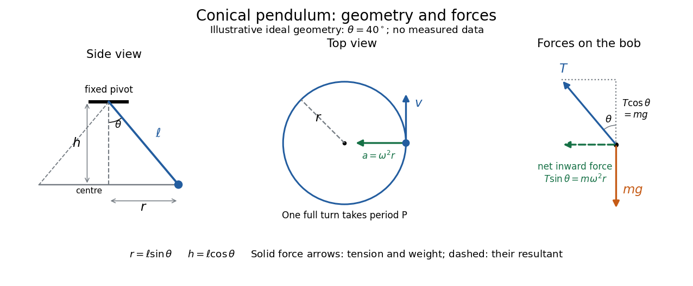

# Conical pendulum

↑ **Parent:** [Simple pendulum](simple-pendulum.md)  
ⓦ [Wiki](https://en.wikipedia.org/wiki/Conical_pendulum)

A [conical pendulum](conical-pendulum.md) is a pendulum whose bob executes uniform horizontal [circular motion](circular-motion.md) beneath a fixed pivot, with its string at a constant [angle](angle.md) $\theta$ to the downward vertical. The string sweeps a [right circular conical surface](right-circular-conical-surface.md); the bob follows its circular rim, without any physical cone supporting it. The ideal model has a [point mass](point-mass.md) $m>0$, a taut, massless, inextensible string of length $\ell>0$, uniform [gravitational acceleration](gravitational-acceleration.md) of magnitude $g>0$, and negligible [drag force](drag-physics.md) and pivot [friction](friction.md). A nonzero circular motion requires $0<\theta<\pi/2$. This geometry and the corresponding [forces](force.md) are described in [Richard Fitzpatrick, The conical pendulum, equations 262–267](https://farside.ph.utexas.edu/teaching/301/lectures/node88.html).

**[Figure 2](#image-conical-pendulum-geometry-horizontal-orbit-and-the-two-forces-on-the-bob). Conical pendulum geometry, horizontal orbit, and the two forces on the bob**.

The [right triangle](right-triangle.md) formed by the pivot, the orbit centre, and the bob gives $r=\ell\sin\theta$ and $h=\ell\cos\theta$. Here $r$ is the orbit radius and $h$ is the vertical drop from the pivot to the bob's horizontal plane, not the bob's height above a table. Write $T$ for [tension](tension.md), $P$ for the [oscillation period](period-of-an-oscillation.md) of one revolution, and $\omega=2\pi/P$ for the [angular speed](angular-speed.md); then the bob's [speed](speed.md) is $v=\omega r$. A side view compresses the horizontal circle to a line segment; the top view reveals the circle and its tangent [velocity](velocity.md).

The two actual [forces](force.md) on the bob are [tension](tension.md) toward the pivot and [gravitational weight](weight-physics.md) vertically downward. The vertical [acceleration](acceleration.md) is zero, while the horizontal [centripetal acceleration](centripetal-acceleration.md) is $v^2/r=\omega^2r$. Thus [Newton's second law](newton-s-second-law.md) gives

$$
T\cos\theta=mg,\qquad T\sin\theta=m\omega^2r=\frac{mv^2}{r}.
$$

The inward net [force](force.md) is the horizontal component of [tension](tension.md), rather than an extra interaction to add to these two [forces](force.md). Constant [speed](speed.md) still requires [acceleration](acceleration.md) because the [velocity](velocity.md) changes direction. [Ling, Sanny and Moebs, University Physics 1, §6.3: centripetal acceleration and net force](https://openstax.org/books/university-physics-volume-1/pages/6-3-centripetal-force)

Dividing the two component equations and using $r=\ell\sin\theta$ gives the useful collection of predictions

$$
\omega^2\cos\theta=\frac g\ell,\qquad T=\frac{mg}{\cos\theta},\qquad v^2=g\ell\frac{\sin^2\theta}{\cos\theta},\qquad P=2\pi\sqrt{\frac{\ell\cos\theta}{g}}=2\pi\sqrt{\frac hg}.
$$

If $\phi$ is the azimuthal [angle](angle.md), then $\dot\phi=\pm\omega$; either direction of rotation satisfies $\dot\phi^2\cos\theta=g/\ell$. The [mass](mass.md) cancels from the [angular speed](angular-speed.md) and [oscillation period](period-of-an-oscillation.md), but not from the [tension](tension.md). The motion is a [relative equilibrium](relative-equilibrium.md): in a [rotating frame](rotating-reference-frame.md) following the bob at [angular speed](angular-speed.md) $\omega$, its [position](position.md) is fixed. This is a concrete way to see how rotational [symmetry](symmetry-physics.md) can turn an apparently moving solution into a stationary one.

**Table of contents**

- [Rotating bob experiment for a conical pendulum](rotating-bob-experiment-for-a-conical-pendulum.md)
- [Period and small-angle limit of a conical pendulum](period-and-small-angle-limit-of-a-conical-pendulum.md)

## ↑ Ancestors (5)

1. [Simple pendulum](simple-pendulum.md)
2. [Classical mechanics](classical-mechanics-split.md)
3. [Branches of physics](branches-of-physics.md)
4. [Physics](physics-split.md)
5. [Codex Wiki](split.md)

## ← Incoming links (4)

- [Conical pendulum](conical-pendulum.md)
- [Solution](past-exam-of-the-mathematics-course-of-the-university-of-cambridge/2006/ii/paper-3/15c/ii/solution.md)
- [Period and small-angle limit of a conical pendulum](period-and-small-angle-limit-of-a-conical-pendulum.md)
- [Rotating bob experiment for a conical pendulum](rotating-bob-experiment-for-a-conical-pendulum.md)
