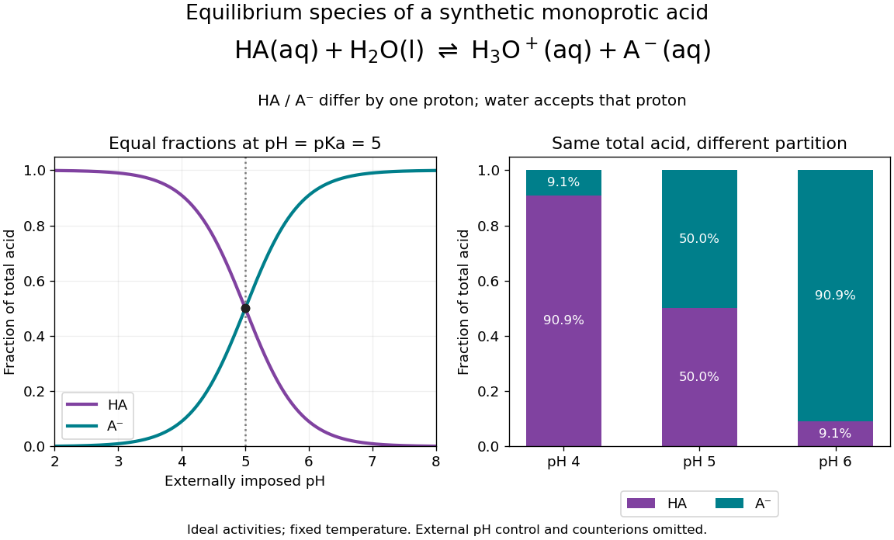

# Conjugate base

↑ **Parent:** [Base (chemistry)](base-chemistry.md)

A [conjugate base](conjugate-base.md) is what remains after a [chemical acid](acid-chemistry.md) donates one [proton](proton.md). In the [conjugate acid-base pair](conjugate-acid-base-pair.md) $\mathrm{HA}/\mathrm A^-$, $\mathrm{HA}$ is the [conjugate acid](conjugate-acid.md) of $\mathrm A^-$; accepting a [proton](proton.md) reverses the conversion. For example, [acetic acid](acetic-acid.md) $\mathrm{CH_3COOH}$ loses a [proton](proton.md) to give its [conjugate base](conjugate-base.md) $\mathrm{CH_3COO^-}$. Partners differ by one [proton](proton.md) and one unit of [electric charge](electric-charge-split.md); they need not always be neutral and negative. [Hydronium](hydronium.md)/[water](water.md) and [water](water.md)/[hydroxide](hydroxide.md) are also [conjugate acid-base pairs](conjugate-acid-base-pair.md).

At a prescribed [pH](ph.md), the ideal dilute [acid dissociation constant](acid-dissociation-constant.md) determines the partition of a [monoprotic acid](monoprotic-acid.md) inventory between its [chemical species](chemical-species.md):

$$
\alpha_{\mathrm A^-}=\frac{K_a}{K_a+10^{-\mathrm{pH}}},\qquad
\alpha_{\mathrm{HA}}=\frac{10^{-\mathrm{pH}}}{K_a+10^{-\mathrm{pH}}}.
$$

These [dimensionless](dimensionless-quantity.md) fractions sum to one. They are the [weak acid dissociation fraction](weak-acid-dissociation-fraction.md) and its complement when the only acid-bearing [chemical species](chemical-species.md) are $\mathrm{HA}$ and $\mathrm A^-$. Equal fractions occur at $\mathrm{pH}=\mathrm pK_a$ in this ideal approximation. For nonideal [chemical solutions](solution-chemistry.md), equality of [thermodynamic activities](thermodynamic-activity.md) need not mean equality of [concentrations](concentration.md).

**[Figure 6](#weak-acid-equilibrium-species). A synthetic monoprotic acid partitions between conjugate acid and conjugate base as imposed pH changes**.

For stipulated [pKa](pka.md) $5$, the [conjugate base](conjugate-base.md) fractions at [pH](ph.md) $4$, $5$ and $6$ are $1/11$, $1/2$ and $10/11$. Here an external reservoir sets [pH](ph.md); its [ions](ion.md) must supply the additional [electric charge](electric-charge-split.md) balance. The diagram omits those [ions](ion.md) and [water](water.md) populations. It does not represent three pure $\mathrm{HA}$ samples at identical [analytical concentration](analytical-concentration.md) with freely chosen [pH](ph.md). In the latter experiment, the [weak acid mass and charge balances](weak-acid-mass-and-charge-balances.md) determine [pH](ph.md) as well as the partition.

**Table of contents**

- [Conjugate acid](conjugate-acid.md)
- [Conjugate acid-base pair](conjugate-acid-base-pair.md)
- [Base dissociation constant](base-dissociation-constant.md)

## ↑ Ancestors (4)

1. [Base (chemistry)](base-chemistry.md)
2. [Acid-base chemistry](acid-base-chemistry-split.md)
3. [Chemistry](chemistry-split.md)
4. [Codex Wiki](split.md)

## ← Incoming links (29)

- [Acetate ion](acetate-ion.md)
- [Base dissociation constant](base-dissociation-constant.md)
- [Buffer capacity and concentration](buffer-capacity-and-concentration.md)
- [Buffer capacity of a monoprotic acid](buffer-capacity-of-a-monoprotic-acid.md)
- [Buffer solution](buffer-solution.md)
- [Carboxylate](carboxylate.md)
- [Conjugate acid-base pair](conjugate-acid-base-pair.md)
- [Conjugate base](conjugate-base.md)
- [Disulfide bond](disulfide-bond.md)
- [Equivalence point](equivalence-point.md)
- [Henderson-Hasselbalch equation](henderson-hasselbalch-equation.md)
- [Ideal weak electrolyte dilution law](ideal-weak-electrolyte-dilution-law.md)
- [Ionic strength](ionic-strength.md)
- [Lactate](lactate.md)
- [Neutralization](neutralization.md)
- [Solution](past-exam-of-the-chemistry-b-course-of-the-university-of-cambridge/2024/paper-2/b7/a/iv/solution.md)
- [Solution](past-exam-of-the-chemistry-course-of-the-year-3-of-the-natural-sciences-course-of-the-university-of-cambridge/2022/paper-3/37/b/iv/solution.md)
- [pH indicator](ph-indicator.md)
- [pKa](pka.md)
- [Pyruvate](pyruvate.md)
- [Saponification](saponification.md)
- [Thiol](thiol.md)
- [Thiolate](thiolate.md)
- [Thiophenol](thiophenol.md)
- [Triflate](triflate.md)
- [Weak acid](weak-acid.md)
- [Weak acid dissociation fraction](weak-acid-dissociation-fraction.md)
- [Weak acid mass and charge balances](weak-acid-mass-and-charge-balances.md)
- [Weak electrolyte](weak-electrolyte.md)
