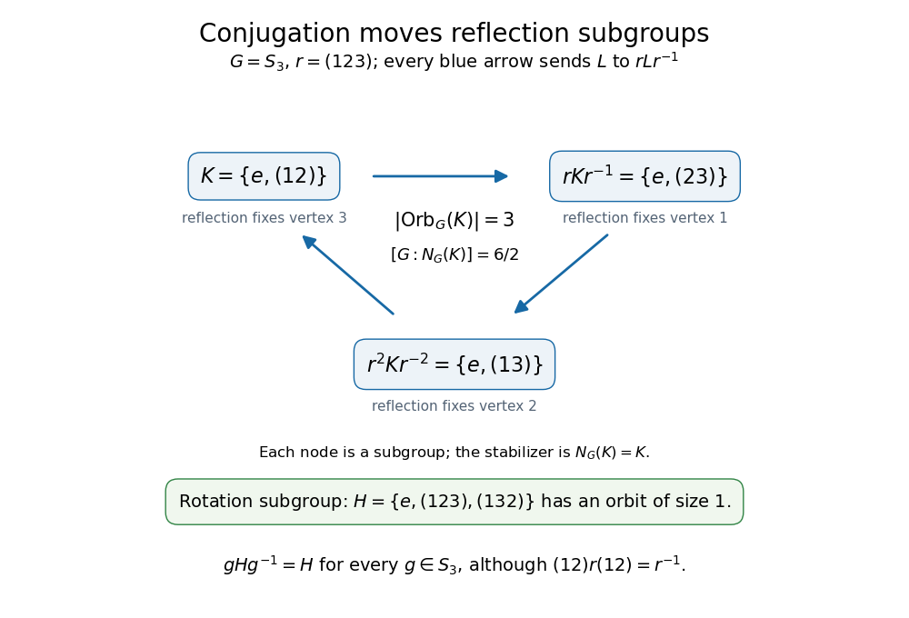

# Conjugate subgroup

↑ **Parent:** [Group theory](group-theory-split.md)  
ⓦ [Wiki](https://en.wikipedia.org/wiki/Conjugate_subgroup)

For a [subgroup](subgroup.md) $H$ of a [group](group-split.md) $G$ and $g\in G$, the conjugate subgroup is the [conjugate subset](conjugate-subset.md)

$$
gHg^{-1}=\{ghg^{-1}:h\in H\}.
$$

It is a [subgroup](subgroup.md) because [conjugation](conjugation.md) is a [group automorphism](group-automorphism.md). Restricting that [group automorphism](group-automorphism.md) gives a [group isomorphism](group-isomorphism.md) from $H$ to $gHg^{-1}$, so conjugate [subgroups](subgroup.md) have the same [group order](order-of-a-finite-group.md). This describes the same operations after moving their reference configuration. Conjugacy of [subgroups](subgroup.md) is an [equivalence relation](equivalence-relation.md). [Structure of Groups](abstract-algebra-second-edition-by-john-a-beachy-and-others/structure-of-groups.md)

For an [equilateral triangle](equilateral-triangle.md) with [vertices of a polygon](vertex-of-a-polygon.md) labeled $1,2,3$ counterclockwise, its [symmetry group](symmetry-group.md) is the [symmetric group](symmetric-group.md) $S_3$, also the [dihedral group](dihedral-group.md) of [group order](order-of-a-finite-group.md) six. Let $r=(123)$ be the counterclockwise [rotation](rotation-mathematics.md) through $120$ degrees, and let $s=(12)$ be the [reflection](reflection-mathematics.md) fixing [vertex of a polygon](vertex-of-a-polygon.md) $3$. Products apply the rightmost [permutation](permutation.md) first. The [cyclic subgroup](cyclic-subgroup.md) $K=\langle s\rangle=\{e,(12)\}$ contains the [identity element](identity-element.md) and one [reflection](reflection-mathematics.md). Relabeling a [transposition](transposition-permutation.md) by [conjugation](conjugation.md) gives

$$
r(12)r^{-1}=(r(1)\ r(2))=(23),\qquad r^2(12)r^{-2}=(13).
$$

Thus the [conjugation action](conjugation-action.md) moves $K$ among the three [subgroups](subgroup.md) $\langle(12)\rangle$, $\langle(23)\rangle$, and $\langle(13)\rangle$. Geometrically, the [rotation](rotation-mathematics.md) moves the axis of the [reflection](reflection-mathematics.md) to the next axis. Each [reflection](reflection-mathematics.md) fixes a different [vertex of a polygon](vertex-of-a-polygon.md), although [group isomorphisms](group-isomorphism.md) relate all three [subgroups](subgroup.md).

**[Figure 5](#image-the-conjugation-action-of-a-triangle-rotation-cycles-three-reflection-subgroups). The conjugation action of a triangle rotation cycles three reflection subgroups**. Each arrow sends a [subgroup](subgroup.md) $L$ to $rLr^{-1}$, rather than multiplying its elements by $r$ on one side. The three-node [group orbit](orbit-group-theory.md) has [stabilizer subgroup](stabilizer-subgroup.md) $N_{S_3}(K)=K$. The [cyclic subgroup](cyclic-subgroup.md) $H=\langle r\rangle$ has a one-node [group orbit](orbit-group-theory.md) even though [reflection](reflection-mathematics.md) [conjugation](conjugation.md) exchanges its two nonidentity elements.

The [normalizer](normalizer.md) tells when this change of reference leaves the [subgroup](subgroup.md) unchanged. For any [group](group-split.md) $G$ and [subgroup](subgroup.md) $H\leq G$, there is a [bijection](bijection.md)

$$
\{gN_G(H):g\in G\}\longrightarrow\{gHg^{-1}:g\in G\},\qquad gN_G(H)\longmapsto gHg^{-1}.
$$

Two choices $g,k$ give the same conjugate [subgroup](subgroup.md) exactly when $k^{-1}g\in N_G(H)$. Consequently the [index of a subgroup](index-of-a-subgroup.md) $[G:N_G(H)]$ counts the distinct conjugate [subgroups](subgroup.md), even for an infinite [group](group-split.md). For a [finite group](finite-group.md) the count is $|G|/|N_G(H)|$. These are [cosets](coset.md); they need not form a [quotient group](quotient-group.md), since $N_G(H)$ need not be a [normal subgroup](normal-subgroup.md) of $G$. In the triangle example there are $6/2=3$ conjugate [subgroups](subgroup.md), while the [cyclic subgroup](cyclic-subgroup.md) $\langle r\rangle$ has only one. [Group Theory (v4.01) by James S. Milne](group-theory-v4-01-by-james-s-milne.md)

## ↑ Ancestors (5)

1. [Group theory](group-theory-split.md)
2. [Algebra](algebra-split.md)
3. [Area of mathematics](area-of-mathematics.md)
4. [Mathematics](mathematics-split.md)
5. [Codex Wiki](split.md)

## ← Incoming links (7)

- [Solution](past-exam-of-the-mathematics-course-of-the-university-of-cambridge/2005/ia/paper-3/5d/solution.md)
- [Solution](past-exam-of-the-mathematics-course-of-the-university-of-cambridge/2007/ib/paper-3/11g/i/solution.md)
- [Solution](past-exam-of-the-mathematics-course-of-the-university-of-cambridge/2015/ia/paper-3/2d/solution.md)
- [Solution](past-exam-of-the-mathematics-course-of-the-university-of-cambridge/2017/ib/paper-1/10e/a/solution.md)
- [Solution](past-exam-of-the-mathematics-course-of-the-university-of-cambridge/2019/ii/paper-3/19i/a/solution.md)
- [Simply transitive group action](simply-transitive-group-action.md)
- [Transitive group action](transitive-group-action.md)
