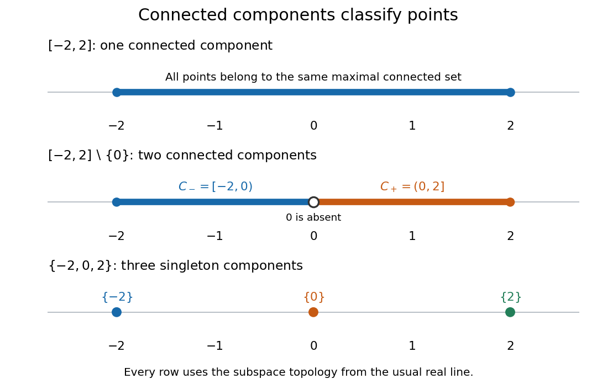

# Connected component

↑ **Parent:** [Connected space](connected-space.md)  
ⓦ [Wiki](https://en.wikipedia.org/wiki/Connected_component)

A [connected component](connected-component.md) of a [topological space](topological-space.md) $X$ is a nonempty [connected subset](connected-subset.md) that is maximal under [subset](subset.md) inclusion. If $C$ is a [connected component](connected-component.md) and $C\subseteq D\subseteq X$ with $D$ a [connected subset](connected-subset.md), then $D=C$. Maximality means that no larger [connected subset](connected-subset.md) contains $C$; it does not mean largest [cardinality](cardinality.md) among all [connected subsets](connected-subset.md).

For example, the [connected components](connected-component.md) of $[-2,2]\setminus\{0\}$ in the usual [subspace topology](subspace-topology.md) of the [real line](real-line.md) are $[-2,0)$ and $(0,2]$. Each is a [real interval](interval-mathematics.md), and no [connected subset of the real line](connected-subset-of-the-real-line.md) can meet both without containing the missing point $0$. For the [finite set](finite-set.md) $\{-2,0,2\}$ in the same [subspace topology](subspace-topology.md), the three [connected components](connected-component.md) are its [singleton sets](singleton-mathematics.md).

**[Figure 10](#connected-component-classification). An intact real interval, an interval with an interior point removed, and a finite set have one, two, and three connected components in the usual subspace topology of the real line**.

Every point $x\in X$ lies in exactly one [connected component](connected-component.md), constructed by taking the [union](set-union.md)

$$
C_x=\bigcup\{A\subseteq X:x\in A\text{ and }A\text{ is connected}\}.
$$

All members contain $x$, so their [union](set-union.md) is [connected](connected-space.md) by [connected union with a connected hub](connected-union-with-a-connected-hub.md). The [union](set-union.md) includes every [connected subset](connected-subset.md) through $x$, so it is maximal. Equivalently, define

$$
x\sim y\quad\Longleftrightarrow\quad
\text{some connected subset of }X\text{ contains both }x\text{ and }y.
$$

This is an [equivalence relation](equivalence-relation.md): [singleton sets](singleton-mathematics.md) give reflexivity, symmetry is immediate, and two [connected subsets](connected-subset.md) sharing the middle point have a [connected](connected-space.md) [union](set-union.md), giving transitivity. The [equivalence classes](equivalence-class.md) are precisely the [connected components](connected-component.md). They form a [partition of a set](partition-of-a-set.md): they cover $X$ and any two are either equal or disjoint.[Proposition 3.1.11, Definition 3.1.12 and Remark 3.1.16: maximal connected subsets and equivalence classes](point-set-topology-by-romyar-sharifi/chapter-3-connected-and-compact-spaces.md)

Every nonempty [connected subset](connected-subset.md) lies within one [connected component](connected-component.md). Moreover, every [connected component](connected-component.md) is [closed](closed-set.md) in $X$: [closure of a connected set](closure-of-a-connected-set.md) makes its [closure](closure-topology.md) [connected](connected-space.md), and maximality forces that [closure](closure-topology.md) to equal the original [connected component](connected-component.md). A [connected component](connected-component.md) need not be [open](open-set.md). For example, in $S=\{0\}\cup\{1/n:n=1,2,\ldots\}$ with its usual [subspace topology](subspace-topology.md) from the [real line](real-line.md), all [connected components](connected-component.md) are [singleton sets](singleton-mathematics.md), but $\{0\}$ is not [open](open-set.md): every [neighbourhood](neighbourhood-mathematics.md) of $0$ in $S$ contains some $1/n$.[Lemma 3.1.13 and Example 3.1.14: closed components and a component which is not open](point-set-topology-by-romyar-sharifi/chapter-3-connected-and-compact-spaces.md)

**Table of contents**

- [Identity component](identity-component.md)
- [Connected components of a product space](connected-components-of-a-product-space.md)
- [Jordan-Brouwer separation theorem](jordan-brouwer-separation-theorem.md)

## ↑ Ancestors (5)

1. [Connected space](connected-space.md)
2. [Geometry and topology](geometry-and-topology-split.md)
3. [Area of mathematics](area-of-mathematics.md)
4. [Mathematics](mathematics-split.md)
5. [Codex Wiki](split.md)

## ← Incoming links (71)

- [Antiderivatives on disconnected domains](antiderivatives-on-disconnected-domains.md)
- [Berge's theorem](berge-s-theorem.md)
- [Bernoulli power substitution](bernoulli-power-substitution.md)
- [Connected component](connected-component.md)
- [Connected-component permanence of subalgebra invertibility](connected-component-permanence-of-subalgebra-invertibility.md)
- [Connected components of a product space](connected-components-of-a-product-space.md)
- [Connected subset](connected-subset.md)
- [Connected subset of the real line](connected-subset-of-the-real-line.md)
- [Constant of integration](constant-of-integration.md)
- [Continuation method](continuation-method.md)
- [Continuous image of a connected space](continuous-image-of-a-connected-space.md)
- [Critical-window connectivity probability of a binomial random graph](critical-window-connectivity-probability-of-a-binomial-random-graph.md)
- [Euler characteristic and holes](euler-characteristic-and-holes.md)
- [Face of a plane graph](face-of-a-plane-graph.md)
- [Gershgorin eigenvalue counting](gershgorin-eigenvalue-counting.md)
- [Graph Laplacian eigenvalue](graph-laplacian-eigenvalue.md)
- [Idempotent–clopen correspondence](idempotent-clopen-correspondence.md)
- [Identity component](identity-component.md)
- [Identity component of a Lie group](identity-component-of-a-lie-group.md)
- [Multiplicity of a point in a real tree](multiplicity-of-a-point-in-a-real-tree.md)
- [Orientability](orientability.md)
- [Parallel vector field](parallel-vector-field.md)
- [Solution](past-exam-of-the-mathematics-course-of-the-university-of-cambridge/2001/iii/paper-7/1/i/solution.md)
- [Solution](past-exam-of-the-mathematics-course-of-the-university-of-cambridge/2002/iii/paper-7/1/ii/solution.md)
- [Solution](past-exam-of-the-mathematics-course-of-the-university-of-cambridge/2004/iii/paper-71/7/solution.md)
- [Solution](past-exam-of-the-mathematics-course-of-the-university-of-cambridge/2005/ia/paper-3/9a/solution.md)
- [Solution](past-exam-of-the-mathematics-course-of-the-university-of-cambridge/2005/iii/paper-60/1/solution.md)
- [Solution](past-exam-of-the-mathematics-course-of-the-university-of-cambridge/2005/iii/paper-7/4/i/solution.md)
- [Solution](past-exam-of-the-mathematics-course-of-the-university-of-cambridge/2006/ib/paper-2/4f/i/solution.md)
- [Solution](past-exam-of-the-mathematics-course-of-the-university-of-cambridge/2006/iii/paper-14/4/c/solution.md)
- [Solution](past-exam-of-the-mathematics-course-of-the-university-of-cambridge/2006/iii/paper-9/2/solution.md)
- [Solution](past-exam-of-the-mathematics-course-of-the-university-of-cambridge/2007/iii/paper-5/1/solution.md)
- [Solution](past-exam-of-the-mathematics-course-of-the-university-of-cambridge/2007/iii/paper-89/1/solution.md)
- [Solution](past-exam-of-the-mathematics-course-of-the-university-of-cambridge/2008/iii/paper-13/1/b/solution.md)
- [Solution](past-exam-of-the-mathematics-course-of-the-university-of-cambridge/2008/iii/paper-9/1/c/solution.md)
- [Solution](past-exam-of-the-mathematics-course-of-the-university-of-cambridge/2009/iii/paper-10/4/f/solution.md)
- [Solution](past-exam-of-the-mathematics-course-of-the-university-of-cambridge/2009/iii/paper-11/3/solution.md)
- [Solution](past-exam-of-the-mathematics-course-of-the-university-of-cambridge/2009/iii/paper-17/1/a/solution.md)
- [Solution](past-exam-of-the-mathematics-course-of-the-university-of-cambridge/2013/ib/paper-4/13g/i/solution.md)
- [Solution](past-exam-of-the-mathematics-course-of-the-university-of-cambridge/2013/ib/paper-4/13g/ii/solution.md)
- [Solution](past-exam-of-the-mathematics-course-of-the-university-of-cambridge/2013/iii/paper-26/4/solution.md)
- [Solution](past-exam-of-the-mathematics-course-of-the-university-of-cambridge/2016/ib/paper-4/13e/b/i/solution.md)
- [Solution](past-exam-of-the-mathematics-course-of-the-university-of-cambridge/2016/iii/paper-102/6/solution.md)
- [Solution](past-exam-of-the-mathematics-course-of-the-university-of-cambridge/2016/iii/paper-115/2/solution.md)
- [Solution](past-exam-of-the-mathematics-course-of-the-university-of-cambridge/2017/ia/paper-3/12b/a/solution.md)
- [Solution](past-exam-of-the-mathematics-course-of-the-university-of-cambridge/2017/ia/paper-3/12b/b/solution.md)
- [Solution](past-exam-of-the-mathematics-course-of-the-university-of-cambridge/2017/ib/paper-1/12e/a/solution.md)
- [Solution](past-exam-of-the-mathematics-course-of-the-university-of-cambridge/2017/iii/paper-106/4/c/solution.md)
- [Solution](past-exam-of-the-mathematics-course-of-the-university-of-cambridge/2017/iii/paper-203/3/c/solution.md)
- [Solution](past-exam-of-the-mathematics-course-of-the-university-of-cambridge/2018/ib/paper-3/3e/solution.md)
- [Solution](past-exam-of-the-mathematics-course-of-the-university-of-cambridge/2018/iii/paper-118/3/b/solution.md)
- [Solution](past-exam-of-the-mathematics-course-of-the-university-of-cambridge/2018/iii/paper-118/5/c/solution.md)
- [Solution](past-exam-of-the-mathematics-course-of-the-university-of-cambridge/2018/iii/paper-118/5/d/solution.md)
- [Solution](past-exam-of-the-mathematics-course-of-the-university-of-cambridge/2018/iii/paper-142/3/1/solution.md)
- [Solution](past-exam-of-the-mathematics-course-of-the-university-of-cambridge/2018/iii/paper-142/3/2/solution.md)
- [Solution](past-exam-of-the-mathematics-course-of-the-university-of-cambridge/2021/iii/paper-220/1/a/solution.md)
- [Solution](past-exam-of-the-mathematics-course-of-the-university-of-cambridge/2021/iii/paper-220/1/c/solution.md)
- [Solution](past-exam-of-the-mathematics-course-of-the-university-of-cambridge/2022/ib/paper-2/10g/solution.md)
- [Solution](past-exam-of-the-mathematics-course-of-the-university-of-cambridge/2025/iii/paper-302/1/d/i/solution.md)
- [Solution](past-exam-of-the-mathematics-course-of-the-year-2-of-the-natural-sciences-course-of-the-university-of-cambridge/2015/paper-1/7/c/solution.md)
- [Solution](past-exam-of-the-theoretical-physics-i-course-of-the-university-of-cambridge/2022/4/a/solution.md)
- [Path component](path-component.md)
- [Rank map in topological K-theory](rank-map-in-topological-k-theory.md)
- [Reciprocal rescaling symmetry of two cross-coupled scalar fields](reciprocal-rescaling-symmetry-of-two-cross-coupled-scalar-fields.md)
- [Spanning forest](spanning-forest.md)
- [Steady gradient Ricci soliton scalar identity](steady-gradient-ricci-soliton-scalar-identity.md)
- [Top-degree de Rham cohomology of a compact Lie group](top-degree-de-rham-cohomology-of-a-compact-lie-group.md)
- [Topological tripod](topological-tripod.md)
- [Topologist's sine curve](topologist-s-sine-curve.md)
- [Topology](topology-split.md)
- [Two stereographic charts on the circle](two-stereographic-charts-on-the-circle.md)
