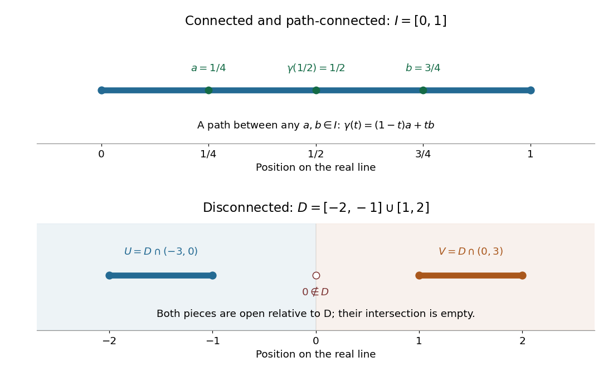

# Connected space

↑ **Parent:** [Geometry and topology](geometry-and-topology-split.md)  
ⓦ [Wiki](https://en.wikipedia.org/wiki/Connected_space)

A [topological space](topological-space.md) $X$ is [connected](connected-space.md) when it has no [separation of a topological space](separation-of-a-topological-space.md): no [partition of a set](partition-of-a-set.md) into two nonempty [open subsets](open-set.md) $U,V$ satisfying

$$
X=U\cup V,\qquad U\cap V=\varnothing.
$$

Here the [union](set-union.md) covers all of $X$, and the [intersection](set-intersection.md) is the [empty set](empty-set.md), so no point belongs to both pieces. For a [subset](subset.md) $X$ of a larger [topological space](topological-space.md), "[open](open-set.md)" means [open](open-set.md) in the [subspace topology](subspace-topology.md): each piece is the [intersection](set-intersection.md) of $X$ with an ambient [open set](open-set.md). Both pieces must be [open](open-set.md); merely dividing a drawing into two colours does not establish a [separation of a topological space](separation-of-a-topological-space.md). [Munkres, Topology: A First Course, section 3-1, definition on p. 147](https://math.mit.edu/~hrm/palestine/munkres-topology.pdf)

For example, the [closed interval](closed-real-interval.md) $I=[0,1]$ with its usual [subspace topology](subspace-topology.md) from the [real line](real-line.md) is [connected](connected-space.md). The proposed split $[0,1/2)\cup[1/2,1]$ fails: the second [subset](subset.md) is not [open](open-set.md) in $I$, since every [neighbourhood](neighbourhood-mathematics.md) of $1/2$ in $I$ contains points less than $1/2$. More generally, a [connected subset of the real line](connected-subset-of-the-real-line.md) is precisely a [real interval](interval-mathematics.md). In contrast, for the [union](set-union.md)

$$
D=[-2,-1]\cup[1,2],\qquad U=D\cap(-3,0)=[-2,-1],\qquad V=D\cap(0,3)=[1,2],
$$

the [open intervals](open-interval.md) $(-3,0)$ and $(0,3)$ exhibit $U,V$ as nonempty [open subsets](open-set.md) in the [subspace topology](subspace-topology.md) of $D$. Their [intersection](set-intersection.md) is empty and their [union](set-union.md) is $D$, so $D$ is not [connected](connected-space.md). Although $U,V$ are [closed intervals](closed-real-interval.md) in the [real line](real-line.md), they are also [open](open-set.md) within $D$.

**[Figure 6](#image-a-connected-closed-interval-and-a-union-of-two-closed-intervals-admitting-a-separation-of-a-topological-space-in-the-subspace-topology). A connected closed interval and a union of two closed intervals admitting a separation of a topological space in the subspace topology**.

Why is [connectedness](connected-space.md) useful? A [continuous image of a connected space](continuous-image-of-a-connected-space.md) is [connected](connected-space.md): a proposed [separation of a topological space](separation-of-a-topological-space.md) in the [image](image-of-a-function.md) would pull back through the [continuous map](continuous-map.md) to a forbidden [separation of a topological space](separation-of-a-topological-space.md) in its source. Thus a [continuous map](continuous-map.md) from a [real interval](interval-mathematics.md) to the [real line](real-line.md) cannot skip values between two attained values. This is the [intermediate value theorem](intermediate-value-theorem.md). For a computed example, the [continuous function](continuous-function.md) $f(x)=x^2$ on $[0,1]$ has [image](image-of-a-function.md) $[0,1]$; the value $1/2$ occurs at $x=1/\sqrt2\approx0.707107$. [Connectedness](connected-space.md) guarantees an input attaining that value even when we have no formula for it.

[Path connectedness](path-connected-space.md) is a stronger condition: it supplies a [continuous path](continuous-path.md) between every pair of points. The [topologist's sine curve](topologist-s-sine-curve.md) below shows that a [connected space](connected-space.md) need not be a [path-connected space](path-connected-space.md).

**Table of contents**

- [Topologist's sine curve](topologist-s-sine-curve.md)
- [Connected chain of overlapping subsets](connected-chain-of-overlapping-subsets.md)
- [Spiral accumulating on a circle](spiral-accumulating-on-a-circle.md)
- [Connectedness from global regular functions](connectedness-from-global-regular-functions.md)
- [Connected subset](connected-subset.md)
  - [Connected union with a connected hub](connected-union-with-a-connected-hub.md)
  - [Irrational-cut separation of rational slopes](irrational-cut-separation-of-rational-slopes.md)
- [Separation of a topological space](separation-of-a-topological-space.md)
- [Connected component](connected-component.md)
  - [Identity component](identity-component.md)
  - [Connected components of a product space](connected-components-of-a-product-space.md)
  - [Jordan-Brouwer separation theorem](jordan-brouwer-separation-theorem.md)
- [Continuous image of a connected space](continuous-image-of-a-connected-space.md)
- [Connected subset of the real line](connected-subset-of-the-real-line.md)
- [Integer-valued function criterion for connectedness](integer-valued-function-criterion-for-connectedness.md)
- [Pairwise-intersecting connected cover](pairwise-intersecting-connected-cover.md)
- [Product of connected spaces](product-of-connected-spaces.md)
- [Closure of a connected set](closure-of-a-connected-set.md)

## ↑ Ancestors (4)

1. [Geometry and topology](geometry-and-topology-split.md)
2. [Area of mathematics](area-of-mathematics.md)
3. [Mathematics](mathematics-split.md)
4. [Codex Wiki](split.md)

## ← Incoming links (28)

- [Circle and interval are not homeomorphic](circle-and-interval-are-not-homeomorphic.md)
- [Connected locally path-connected spaces are path-connected](connected-locally-path-connected-spaces-are-path-connected.md)
- [Connected space](connected-space.md)
- [Connected subset](connected-subset.md)
- [Continuous image of a connected space](continuous-image-of-a-connected-space.md)
- [Solution](past-exam-of-the-mathematics-course-of-the-university-of-cambridge/2001/ib/paper-2/4b/solution.md)
- [Solution](past-exam-of-the-mathematics-course-of-the-university-of-cambridge/2002/ib/paper-2/4g/solution.md)
- [Solution](past-exam-of-the-mathematics-course-of-the-university-of-cambridge/2007/ib/paper-3/4a/a/solution.md)
- [Solution](past-exam-of-the-mathematics-course-of-the-university-of-cambridge/2008/ib/paper-4/4e/solution.md)
- [Solution](past-exam-of-the-mathematics-course-of-the-university-of-cambridge/2008/iii/paper-13/1/b/solution.md)
- [Solution](past-exam-of-the-mathematics-course-of-the-university-of-cambridge/2009/ib/paper-3/4f/ii/solution.md)
- [Solution](past-exam-of-the-mathematics-course-of-the-university-of-cambridge/2015/iii/paper-3/4/b/solution.md)
- [Solution](past-exam-of-the-mathematics-course-of-the-university-of-cambridge/2015/iii/paper-6/3/solution.md)
- [Solution](past-exam-of-the-mathematics-course-of-the-university-of-cambridge/2018/iii/paper-142/3/1/solution.md)
- [Solution](past-exam-of-the-mathematics-course-of-the-university-of-cambridge/2019/ib/paper-2/4g/a/solution.md)
- [Solution](past-exam-of-the-mathematics-course-of-the-university-of-cambridge/2019/iii/paper-311/3/iv/solution.md)
- [Solution](past-exam-of-the-mathematics-course-of-the-university-of-cambridge/2020/ii/paper-3/2h/solution.md)
- [Solution](past-exam-of-the-mathematics-course-of-the-university-of-cambridge/2021/ib/paper-1/10f/c/solution.md)
- [Solution](past-exam-of-the-mathematics-course-of-the-university-of-cambridge/2021/ib/paper-3/11f/solution.md)
- [Solution](past-exam-of-the-mathematics-course-of-the-university-of-cambridge/2021/ii/paper-1/14e/b/solution.md)
- [Solution](past-exam-of-the-mathematics-course-of-the-university-of-cambridge/2022/ib/paper-4/10g/b/i/solution.md)
- [Solution](past-exam-of-the-mathematics-course-of-the-university-of-cambridge/2022/iii/paper-115/3/c/solution.md)
- [Solution](past-exam-of-the-mathematics-course-of-the-university-of-cambridge/2025/ib/paper-3/11g/solution.md)
- [Solution](past-exam-of-the-mathematics-course-of-the-university-of-cambridge/2025/iii/paper-107/1/a/solution.md)
- [Solution](past-exam-of-the-mathematics-course-of-the-university-of-cambridge/2026/iii/paper-131/1/a/solution.md)
- [Path-connected space](path-connected-space.md)
- [Riemann-Hurwitz formula](riemann-hurwitz-formula.md)
- [Topology](topology-split.md)
